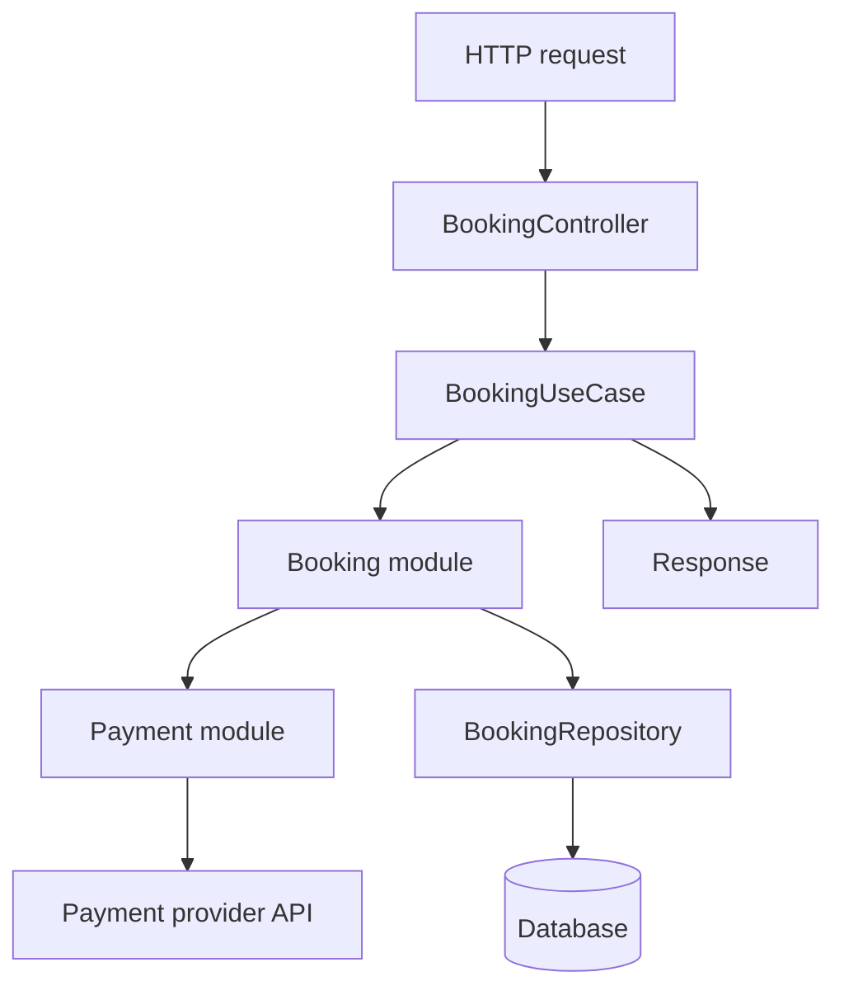

# Observability in a Monolith

A Spring Boot application structured as a monolith is usually deployed as a single unit, yet internally it still contains multiple modules, execution flows, and business boundaries. A rental booking confirmation request may traverse the API, application service, booking module, payment module, repository, and an external service. When errors or latency occur, merely knowing the application is running is not enough to explain which steps the request went through and why the outcome did not match expectations.

Observability answers that question by combining metrics, logs, and distributed tracing. In a monolith, these signals retain their full value even though many steps execute inside the same process. The difference is that most calls between modules are in-process invocations rather than network hops. Therefore, choose appropriate observation boundaries so traces reflect real execution flows without producing excessive spans, logs, or metrics.

This lesson belongs to the Spring Boot Observability module and focuses on setting up and operating Micrometer Observation, metrics, logs, and tracing in a monolith application. After this lesson, you will be able to:

- Explain the role of each observability signal in a monolith.
- Choose instrumentation boundaries at HTTP, use case, integration, and data access layers.
- Use Micrometer Observation to connect operations with metrics and tracing.
- Propagate trace context across executors, schedulers, message listeners, and asynchronous flows.
- Control cardinality, sampling, log volume, and storage costs.
- Design an investigation workflow from alert to logs and traces.

## 1. Monoliths Still Need Observability

A monolith describes how an application is packaged and deployed: functionality is typically bundled into a single deployable unit. It does not mean all source code resides in one single module. A modular monolith may be organized into modules like booking, payment, customer, and inventory, each owning its rules and data while still running inside the same application.

A monolith can run multiple replicas for load handling or redundancy. Those replicas still represent the same logical service and share the same `service.name`; each replica needs a distinct instance identifier to tell them apart during investigation. Never treat every Java module as a separate microservice merely because the module has its own name or package.

For example, a booking confirmation flow might look like this:



Steps from the controller to business modules are usually in-process calls. Calling the payment provider and database creates I/O boundaries across the network or driver. If a trace only contains a single top-level HTTP span, it is hard to see where time went. If spans are created for every tiny method, the trace becomes overly dense and hard to read. The goal is observing boundaries meaningful to performance, errors, and business responsibility.

## 2. Three Signals Complement Each Other

| Signal | Answers Which Question | Example in a Monolith |
|---|---|---|
| Metrics | What is the overall trend? | Confirmation success rate dropped; use case p95 latency increased. |
| Logs | What concrete event occurred and with what data? | Booking rejected because status is `CANCELLED`; payment provider returned a standardized error code. |
| Traces | Which steps did one execution traverse and where was time spent? | HTTP span contains child spans for use case, database queries, and payment provider call. |

Metrics surface issues without reading individual requests. Logs provide details of a specific event. Traces show timing relationships between operations inside one execution. A metrics alert can lead to searching logs by time range and opening traces by trace ID.

Never use one signal to replace the other two. Putting every booking ID into metric tags inflates cardinality. Logging only a generic sentence lacks details to explain failures. Relying solely on sampled traces can miss specific executions needing investigation.

## 3. Choosing Observation Boundaries in a Monolith

A good trace highlights meaningful steps rather than the entire Java call stack. Start from these boundaries.

### 3.1. Application Entry Points

Common entry points include:

- HTTP controllers or endpoints.
- Message listeners receiving events from a broker.
- Scheduled jobs or batch jobs.
- Background task consumers.

This is where context for an execution is created or received. Spring Boot and Micrometer libraries can auto-instrument several common entry points and clients when dependencies and configuration are in place. Before adding manual instrumentation, check existing automatic signals to avoid duplicate spans.

### 3.2. Use-Case Boundaries

An application service or use case is a good place to measure duration and outcome of a user-meaningful action, such as `booking.confirm`, `payment.refund`, or `inventory.reserve`.

You do not need to create Observations for every getter, mapper, or helper method. Create them only where meaningful for business semantics, performance, or investigation. If a use case invokes multiple internal modules, child spans can help pinpoint which module consumes time, but add them only when that data genuinely aids diagnostics.

### 3.3. Integration and I/O Boundaries

Databases, HTTP clients, message brokers, caches, and file storage are boundaries typically worth observing because they carry distinct latency, errors, and retries. Prefer each library's built-in auto-instrumentation. If manual Observations are needed, avoid wrapping an already auto-instrumented call in another span with the exact same meaning.

### 3.4. Key Business Events

Not every event needs its own span. Events like a booking being confirmed, a payment being declined, or retries exhausting usually fit structured logs. When an aggregate count is needed, increment a counter with bounded-value labels. Create spans only when measuring duration or showing causal relationships within an execution.

A practical rule of thumb: spans describe an operation with duration; logs describe an event; metrics aggregate occurrences.

## 4. Setting Up the Observability Foundation in Spring Boot

With Spring Boot 3 and later, Micrometer Observation serves as the unified integration point for handlers emitting metrics and tracing. `ObservationRegistry` coordinates Observations; configured handlers forward relevant data to meter registries or tracers.

Typically, a project starts with Actuator:

```gradle
dependencies {
    implementation("org.springframework.boot:spring-boot-starter-actuator")
    runtimeOnly("io.micrometer:micrometer-registry-prometheus")
}
```

The Prometheus dependency is only needed when exporting metrics for Prometheus. Spring Boot manages compatible versions through project dependency management; avoid overriding a different Micrometer version without clear justification.

If distributed tracing via OpenTelemetry is needed, you can add the Micrometer Tracing bridge and OTLP exporter matching your Spring Boot version:

```gradle
dependencies {
    implementation("io.micrometer:micrometer-tracing-bridge-otel")
    runtimeOnly("io.opentelemetry:opentelemetry-exporter-otlp")
}
```

Other bridges exist, such as Brave. Choose a bridge matching your organization's exporter and backend ecosystem. Avoid adding multiple bridges just to experiment, as that can produce inconsistent configurations.

Example Actuator endpoint and sampling configuration in a properties file:

```properties
management.endpoints.web.exposure.include=health,info,metrics,prometheus
management.tracing.sampling.probability=0.10
```

The `prometheus` endpoint only functions when the corresponding registry is present. Expose only necessary endpoints and protect them via internal networks, authentication, or environment access controls. Never expose management endpoints and observability data to the public Internet.

The sampling value `0.10` in this example means sampling roughly 10% of traces under the configured head-sampling policy. This is an illustrative value, not a default suitable for every system. Production environments must weigh traffic volume, cost, investigative requirements, and tail-sampling capabilities at the collector.

## 5. Creating Observations for Use Cases

When you need to observe an internal operation, inject the Spring Boot-configured `ObservationRegistry` into the application service.

Example:

```java
@Service
public class BookingUseCase {

    private final ObservationRegistry observationRegistry;
    private final BookingRepository bookingRepository;

    public BookingUseCase(
            ObservationRegistry observationRegistry,
            BookingRepository bookingRepository
    ) {
        this.observationRegistry = observationRegistry;
        this.bookingRepository = bookingRepository;
    }

    public Booking confirm(UUID bookingId, BookingType bookingType) {
        return Observation.createNotStarted(
                        "booking.confirm",
                        observationRegistry
                )
                .lowCardinalityKeyValue(
                        "booking.type",
                        bookingType.name()
                )
                .observe(() -> confirmInternal(bookingId));
    }

    private Booking confirmInternal(UUID bookingId) {
        Booking booking = bookingRepository.findById(bookingId)
                .orElseThrow(() -> new BookingNotFoundException(bookingId));

        booking.confirm();
        return bookingRepository.save(booking);
    }
}
```

The Observation name `booking.confirm` describes a stable use case. `booking.type` is a low-cardinality key-value because it should belong to a small, controlled set of booking types. With matching handlers configured, this Observation can feed both metrics and tracing spans.

In a real application, invalid states, transactions, and errors must be handled per business rules. The example above focuses on Observation placement. Ensure the Observation covers the intended duration of the operation, including I/O wait time if the goal is measuring total use-case duration.

Never use Observation names containing IDs, such as `booking.confirm.bkg_123`. Names must remain stable so backends aggregate data of the same kind. Never put `bookingId`, `customerId`, email, or full URLs into low-cardinality key-values.

Micrometer Observation supports high-cardinality key-values for details suited only to certain handlers, typically tracing. Even so, tracing backends also have size and cost limits. Add only approved identifiers genuinely needed for investigation; do not treat high-cardinality key-values as a loophole around metric limits.

## 6. Avoiding Duplicate Instrumentation

In Spring Boot, many libraries already include automatic instrumentation. HTTP servers, HTTP clients, JDBC, messaging, or caches may already emit metrics or spans depending on dependencies and configuration.

Before adding manual Observations, check:

1. Does the library already emit an automatic Observation or span?
2. Does the current span carry enough information to identify the operation and duration?
3. Does the new Observation add a business boundary or merely repeat a method name?
4. When nested spans exist, does the parent-child hierarchy accurately reflect the execution flow?

For example, an HTTP request having a server span, use-case span, database span, and outbound HTTP span is easy to understand. If every small method inside the use case also emits a span, traces can balloon to hundreds of spans without aiding investigation.

Also avoid emitting identically named metrics for the same operation via both auto-instrumentation and manual code. Measuring one operation twice can cause dashboards to misread request counts or durations.

## 7. Metrics for a Monolith Application

Metrics should describe the behavior of the service and key use cases. A baseline metric set might include:

| Group | Indicators | Used For |
|---|---|---|
| HTTP | Request rate, error rate, latency histogram | Monitoring API health and SLOs. |
| Use case | Execution count, outcomes, duration | Detecting slow or failing use cases. |
| JVM | Heap, GC pauses, threads, process CPU | Finding in-process resource pressure. |
| Database | Pool active/idle, timeouts, query latency | Detecting connection bottlenecks or slow queries. |
| Outbound | Request rate, errors, latency per dependency | Distinguishing internal faults from external system faults. |
| Queue/job | Backlog, processing time, retries, job failures | Tracking background tasks and asynchronous processing. |

In a monolith, service-level metrics show overall health. If module breakdown is needed, add a `module` label with a small, stable value set, such as `booking`, `payment`, or `inventory`. Never create a separate meter per object instance or per request.

### 7.1. Controlling Cardinality

Cardinality is the number of distinct time series generated from combinations of metric names and tags. Each tag with many values multiplies the number of time series across combinations.

Commonly suitable tags:

- `operation=booking.confirm|payment.refund`.
- `result=success|rejected|error`.
- `module=booking|payment|inventory`.
- `payment.provider=provider_a|provider_b`, if the provider list is controlled.
- Normalized HTTP method, status, and route template.

Tags to avoid:

- `booking.id`, `customer.id`, `user.id`.
- Request ID, trace ID, session ID.
- Emails, phone numbers, or user-supplied values.
- Full URLs containing path variables or query strings.
- Dynamic SQL statements or unbounded exception messages.

Use route templates like `/bookings/{id}` instead of concrete URLs like `/bookings/8a2...`. For business outcomes, map them to enums or reason codes with finite value sets.

For example, a confirmation outcome counter can use `result` with three values: `success`, `rejected`, and `error`. Never add `bookingId` to tags just to filter one specific booking; look up booking details in logs instead.

## 8. Structured Logs and Trace Correlation

Logs in a monolith must provide event details while staying concise enough to search. Use stable fields rather than concatenating everything into the message string.

Example event:

```json
{
  "timestamp": "2026-11-22T07:15:30.412Z",
  "level": "INFO",
  "service.name": "rental-api",
  "service.instance.id": "rental-api-7c9d",
  "event.name": "booking.confirmed",
  "module": "booking",
  "booking.id": "bkg_7f31",
  "result": "success",
  "traceId": "4f2c...",
  "spanId": "91ad..."
}
```

`service.name` identifies the logical service. `service.instance.id` identifies the replica or process emitting the log. `module` identifies the internal module owning the event. `traceId` and `spanId` connect the log to the trace. Booking identifiers should be logged only when data policies permit and investigative need justifies them.

With SLF4J 2.x, you can use the fluent logging API to attach key-values:

```java
log.atInfo()
        .addKeyValue("event.name", "booking.confirmed")
        .addKeyValue("module", "booking")
        .addKeyValue("booking.id", bookingId)
        .addKeyValue("result", "success")
        .log("Booking confirmed");
```

Key-values appear as separate fields only if the logging backend or encoder is configured to emit them. Inspect actual output from Logback or your logging backend; plain console text does not automatically become structured JSON.

When Micrometer Tracing is configured, trace context can be populated into MDC so the logging backend appends `traceId` and `spanId` to logs. Verify your log pattern or encoder to ensure these fields are emitted. Never generate a custom trace ID per log or manually overwrite active context.

Never put passwords, access tokens, refresh tokens, API keys, cookies, card data, personal information, or full requests/responses into logs. Sensitive data can slip in through messages, exceptions, MDC, or library payloads, so filter across multiple layers.

## 9. Propagating Context Within the Same Process

In synchronous flows, nested Observations naturally share the current trace context. For example, when a controller calls a use case and the use case calls a repository, child spans stay inside the same trace.

Challenges arise when execution switches threads. Many libraries store context in `ThreadLocal`; MDC is also commonly thread-bound. Submitting a task to an executor without propagating context can cause logs inside the task to lose `traceId`, or cause operations to start disconnected traces unlinked to the original request.

Places to inspect:

- `@Async` methods and custom `Executor`s.
- `CompletableFuture` and callbacks running on thread pools.
- Scheduled jobs.
- Message listeners and consumers.
- Reactor pipelines if the application uses WebFlux.
- Callbacks from external libraries.

Micrometer Context Propagation provides mechanisms to capture and restore context across execution boundaries when configured with appropriate context accessors. Spring Boot and integrations can pre-configure some executors; custom executors must be verified individually. You can use `ContextPropagatingTaskDecorator` for Spring executors where supported by version and configuration.

Example declaring an executor with a task decorator:

```java
import org.springframework.context.annotation.Bean;
import org.springframework.context.annotation.Configuration;
import org.springframework.core.task.TaskDecorator;
import org.springframework.core.task.support.ContextPropagatingTaskDecorator;
import org.springframework.scheduling.annotation.EnableAsync;
import org.springframework.scheduling.concurrent.ThreadPoolTaskExecutor;

@Configuration
@EnableAsync
public class AsyncConfiguration {

    @Bean
    public TaskDecorator contextPropagatingTaskDecorator() {
        return new ContextPropagatingTaskDecorator();
    }

    @Bean
    public ThreadPoolTaskExecutor applicationTaskExecutor(
            TaskDecorator contextPropagatingTaskDecorator
    ) {
        ThreadPoolTaskExecutor executor = new ThreadPoolTaskExecutor();
        executor.setCorePoolSize(4);
        executor.setMaxPoolSize(8);
        executor.setQueueCapacity(100);
        executor.setThreadNamePrefix("app-async-");
        executor.setTaskDecorator(contextPropagatingTaskDecorator);
        return executor;
    }
}
```

This example targets Spring Framework 6.1 and later; `ContextPropagatingTaskDecorator` resides in `org.springframework.core.task.support`. Ensure the Micrometer Context Propagation dependency and corresponding accessors are present in the application. If the application uses another executor created by a library, this task decorator does not automatically apply to that executor.

For messages processed after the initial request finishes, continuing the exact same trace as if it were a synchronous call is not always desirable. You can start a new trace for the consumer and use message context, parent context, or span links depending on the system's messaging model. What matters is preserving clear causal relationships without falsely stitching independent jobs together.

## 10. Context Across Replicas and External Systems

In a multi-replica deployment, one request may enter replica A and call an external service, while another request enters replica B. `service.name` should remain consistent across replicas, while `service.instance.id` distinguishes individual instances.

With instrumented HTTP clients, Micrometer Tracing can inject and extract trace context via the configured propagation format, usually W3C Trace Context. When calling external services, verify whether `traceparent` or the matching format headers are sent and received properly. Do not invent custom headers when the platform already provides standard propagation.

Inside a monolith, internal modules do not need HTTP trace propagation because they do not communicate over the network. They share the active in-process context. If a module is extracted into a separate service in the future, the new communication boundary will require network propagation. Using stably named Observations from the start makes that transition easier to manage, without forcing internal modules to behave like independent services.

## 11. Sampling and Trace Retention

Traces typically consume more resources than metrics because each execution can hold multiple spans and attributes. Sampling determines which traces are retained or sent to the backend.

Common approaches:

- Head sampling decides early when a trace starts. It is simple and cuts overhead upfront, but can drop error traces before the final outcome is known.
- Tail sampling decides after the collector receives spans. It can prioritize retaining error traces, slow traces, or key business groups, but requires a collector with sufficient buffering resources.
- Sampling rates can vary across environments such as development, staging, and production.

Never use sampling as a replacement for metrics. Metrics must continue reflecting total traffic as configured, even when only a fraction of traces are stored. If logs for an important event must be kept, keep log retention policies independent of trace sampling.

When evaluating sampling, monitor the percentage of traces actually stored, span sizes, attribute counts, and queryability. Do not raise sampling to 100% in production without assessing traffic volume and backend costs.

## 12. Protecting and Managing Observability Data Costs

A monolith can generate substantial log and span volume despite being a single deployable unit. Cost depends on request rate, spans per trace, log size, retention window, and replica count.

Practical controls:

- Configure log levels by package and environment; enable `DEBUG`/`TRACE` only within limited scope and duration.
- Avoid logging every loop iteration or every record in large batches; prefer summary logs or exception logs.
- Use metric tags with bounded value sets.
- Limit the number and size of span attributes.
- Choose sampling rates based on traffic and investigative goals.
- Set distinct retention periods for metrics, logs, and traces based on need.
- Secure Actuator endpoints and restrict access to observability systems.
- Mask or strip sensitive data before exporting to backends.

Business identifiers in logs can be helpful for customer support, yet require approval under data policies. If a value can identify an individual, consider encryption, tokenization, masking, or omitting the field. Never write secrets into trace attributes merely because they are not metric tags.

## 13. Application Health and Observability Signals

The Actuator health endpoint indicates whether checked components are in a state considered healthy. It does not replace metrics, logs, or traces. An application can return `UP` while still suffering high business error rates, rising latency, or failures in a specific use case.

Distinguish between:

- Liveness: whether the process is alive and able to continue running.
- Readiness: whether the instance is ready to accept traffic.
- Business health: whether critical business flows are meeting targets; usually evaluated via dedicated metrics and alerts.

Do not include every dependency in liveness checks. A temporarily unavailable external service does not mean the JVM needs to restart. Readiness may reflect mandatory dependencies, while avoiding taking all replicas out of traffic because of an optional dependency.

## 14. Incident Investigation Workflow in a Monolith

Suppose operations receives an alert that rental booking confirmation rate dropped and p95 latency rose. You can investigate as follows:

1. Check metrics dashboards to identify start time, blast radius, affected replicas, version, and impacted use case.
2. Inspect JVM, connection pool, database, and outbound dependency metrics to spot anomalous resources or I/O boundaries.
3. Search logs by `event.name`, `result`, time window, and approved business identifiers. Identify standardized reason codes or error codes.
4. Open the relevant trace via `traceId`. Compare durations across the server span, use-case span, database spans, and outbound spans.
5. Check context propagation if background task logs lack trace IDs or traces break at executors/message listeners.
6. After remediation, verify metrics and logs reflect accurate outcomes. Inspect a few additional traces to confirm instrumentation neither emits duplicate spans nor misses critical boundaries.

In a monolith, if time accumulates inside the use-case span rather than database or outbound spans, inspect CPU-bound work, lock contention, synchronization, or internal logic. If time concentrates in database spans, check queries, pools, and transactions. If outbound spans consume most of the time, check timeouts, retries, and dependency health.

## 15. Pre-Production Observability Verification

An observability setup is only useful when data is actually emitted, transmitted, stored, and queryable. Before deployment, verify:

- HTTP and JVM metrics appear in the registry and are scraped successfully.
- Actuator endpoints expose only what is needed and are secured.
- Use-case Observations have stable names and produce expected telemetry.
- Traces contain server, use-case, and dependency spans with accurate parent-child relationships.
- Logs are structured with timestamps, service identity, and trace correlation when context exists.
- Context is preserved across executors and critical asynchronous flows.
- Metric tags contain no IDs or unbounded values.
- Sampling and retention match investigative needs and budget.
- Instrumentation errors never alter business outcomes or cause cascading failures.
- Dashboards and alerts focus on user-meaningful SLIs/SLOs.

You can test an end-to-end flow in a test environment: submit a booking confirmation request, verify the counter increments, the event log appears, the trace contains expected spans, and the trace ID in the log opens the matching trace. Then test a rejection case or dependency timeout to verify log levels, result codes, and how traces depict errors.

## 16. Common Mistakes

| Mistake | Consequence | Fix |
|---|---|---|
| Treating every package/module as an independent service | Creates service identities and dashboards misaligned with deployment reality. | Use one `service.name` for the monolith; add a bounded `module` label if needed. |
| Creating spans for every method | Bloated, unreadable traces and higher costs. | Instrument entry points, use cases, and meaningful I/O boundaries. |
| Having only a single top-level server span | Hard to tell which internal step or dependency is slow. | Add use-case Observations and check auto-instrumentation. |
| Putting IDs into metric tags | Cardinality spikes sharply. | Keep identifiers in logs or approved trace attributes. |
| Using trace sampling instead of metrics | Misses overall trends and skews ratios. | Use metrics for aggregation; use sampling only for traces. |
| Losing context on thread handoffs | Background task logs and traces become disconnected. | Configure context propagation for matching executors and pipelines. |
| Exposing all Actuator endpoints | Leaks operational details or permits unauthorized access. | Expose only needed endpoints and secure them. |
| Concluding business health is fine from `health` `UP` | Overlooks business failures and rising latency. | Combine SLIs, metrics, logs, and traces. |

## 17. Design Checklist

When setting up observability for a Spring Boot monolith, ask yourself:

- Which `service.name` identifies the service, and how is each replica distinguished?
- Which entry points create or receive trace context?
- Which use cases need Observations to measure duration and outcome?
- Do databases, HTTP clients, messaging, and caches already have auto-instrumentation?
- Are any spans duplicated or lacking investigative value?
- Do logs include event names, outcomes, correlation identifiers, and trace context?
- Does context propagate across executors, schedulers, and message listeners?
- Do metric tags have bounded value sets?
- Are sampling, retention, and access controls appropriate?
- Can you navigate from a metrics alert directly to logs and traces for a specific execution?

Observability in a monolith does not require turning every module into a separate service. Keep a consistent service identity, observe meaningful internal boundaries, instrument I/O and use cases, and connect metrics, logs, and traces through shared context. Done well, teams can pinpoint issues inside a complex process without drowning in unnecessary data.
