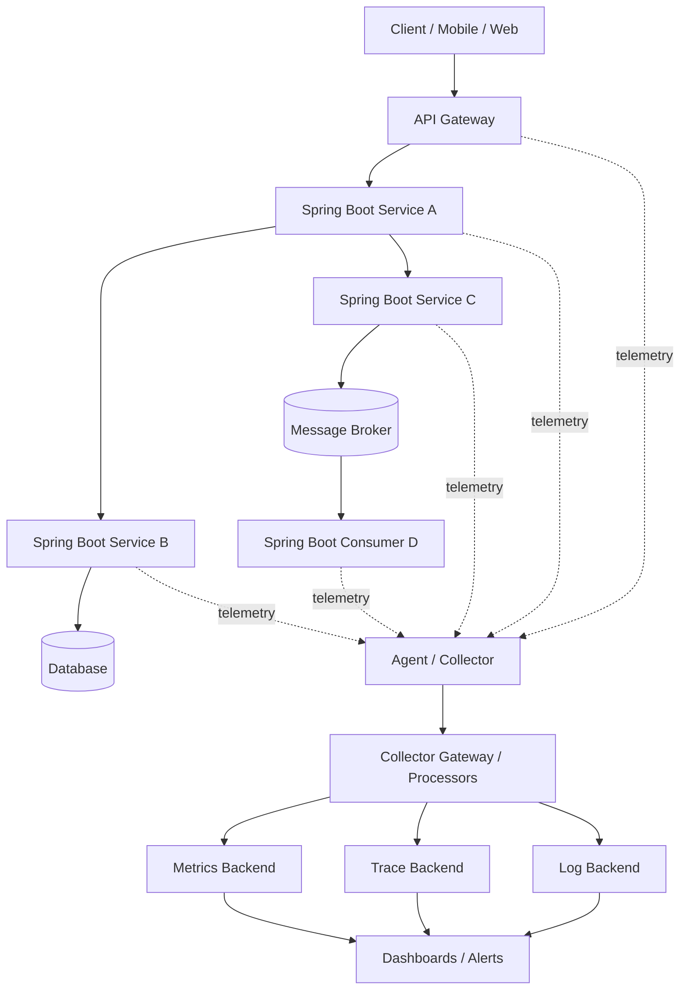
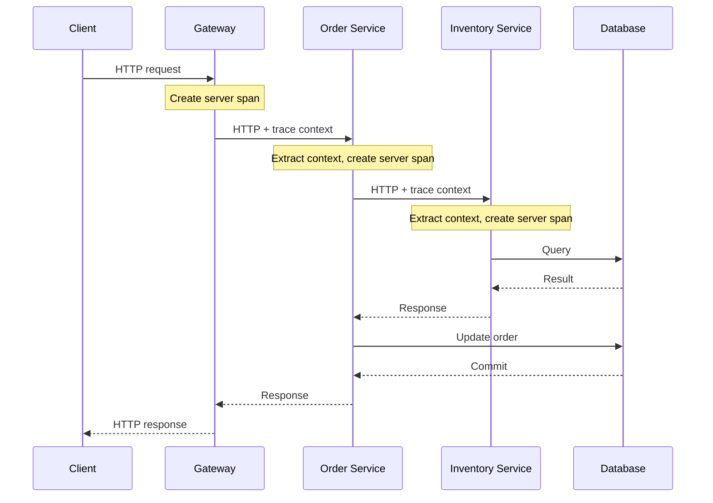
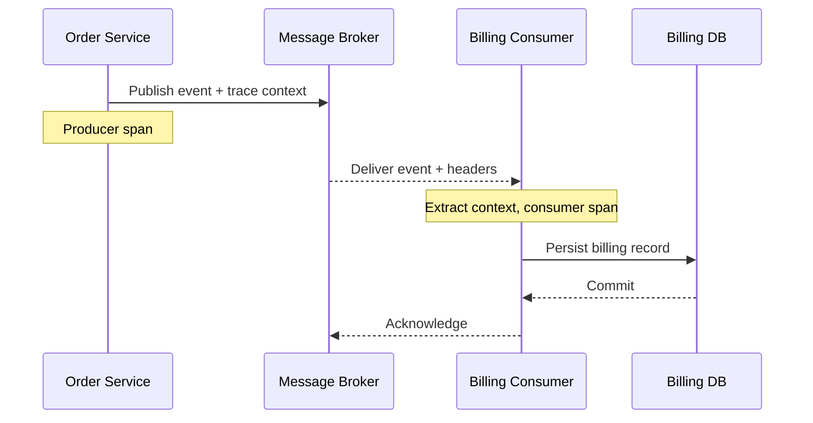

# Observability in Microservices

In a microservices system, a user request often traverses multiple processes: an API gateway, business services, supporting services, databases, caches, and message brokers. Each service sees only part of the work. A request may succeed at the gateway yet fail in a downstream service; a message may be published successfully yet processed slowly by a consumer; a query may stall on a distant dependency. If metrics, logs, and traces are collected independently, operations teams spend considerable time piecing fragments together to find root causes.

Observability in microservices is the architectural approach ensuring every service emits signals with consistent context that correlate across process boundaries. With Spring Boot, Micrometer Observation provides a unified model for instrumentation to create observations connecting metrics and tracing; logging adds event details and correlation context. Signals flow through registries, exporters, collectors, and backends to power dashboards, alerts, and investigations.

The architectural goal is not emitting as much telemetry as possible. The goal is answering operational questions: which services did a request traverse, where did latency originate, which service caused an error, where are messages backing up, which change degraded an SLO, and what data must be retained for investigation.

## 1. Why Microservices Need Cross-Service Observability

In a monolithic application, a request typically runs inside one process with relatively centralized logs. In microservices, the following characteristics make investigation harder:

- **Multiple network boundaries:** every HTTP/gRPC call can incur timeouts, retries, DNS failures, TLS issues, or target service errors.
- **Multiple independent lifecycles:** each service is deployed, scaled, and restarted independently; a single request may traverse multiple versions concurrently.
- **Asynchronous processing:** message queues, event streams, and scheduled jobs decouple when an event occurs from when it is processed.
- **Uneven traffic:** a service may receive few direct requests yet shoulder heavy load from multiple upstream services.
- **Cascading failure modes:** retries, full queues, exhausted connection pools, or slow dependencies can trigger chain reactions.
- **Distributed data:** metrics, logs, and traces may reside in different backends or tenants.

Consequently, inspecting logs of only the failing service is rarely enough. You need consistent service identities, cross-boundary trace context, per-service and per-dependency metrics, and logs searchable by trace ID or request ID.

## 2. Overall Architecture

A reference architecture for a Spring Boot system can be organized as follows:



Services emit signals locally. Agents or collectors close to workloads ingest data, perform appropriate processing, and forward to centralized backends. Backends may differ for metrics, traces, and logs, but identifying fields must be standardized so operators can pivot from one signal to another.

### 2.1. Architectural Layers

| Layer | Responsibility | Example Components |
|---|---|---|
| In-service instrumentation | Creates observations, meters, spans, and log context | Spring Boot Actuator, Micrometer Observation, Micrometer Tracing |
| In-process export | Sends signals out of the application | Meter registries, tracing exporters, logging appenders/agents |
| Workload ingestion | Receives telemetry from one or more nearby processes | OpenTelemetry Collector agent, sidecar, or daemon |
| Processing and routing | Batches, filters, enriches, samples, retries, and routes by signal | Collector processors and exporters |
| Storage and querying | Stores metrics, traces, logs and serves queries | Metrics, tracing, and log backends |
| Operations | Dashboards, alerts, SLOs, runbooks, and investigation | Monitoring platforms and on-call workflows |

You do not need a single product across all layers. What matters is having clear data contracts, transport formats, security, and ownership. Distinguish exporters running inside the application from exporters running inside the collector, as they have different configurations, resource limits, and failure-handling behavior.

## 3. Service and Resource Identification

Every signal must carry metadata identifying which service, version, and environment emitted it. If identification is inconsistent, the same service may appear under multiple names in dashboards; conversely, multiple services may be erroneously merged into one.

Resource attributes commonly standardized:

| Attribute | Meaning | Example |
|---|---|---|
| `service.name` | Logical name of the service | `order-service` |
| `service.version` | Running version | `2.4.1` or image tag |
| `deployment.environment` | Deployment environment | `production`, `staging` |
| `service.instance.id` | Identifier of an instance | Pod UID or instance ID |
| `cloud.region` | Infrastructure region | `ap-southeast-1` |
| `host.name` or container attributes | Where the workload runs | Node or container identity |

Names and values must follow consistent conventions across services. `service.name` should stay stable across scaling; `service.version` changes with releases; `service.instance.id` distinguishes instances yet is usually unsuitable as a metric label because it can spawn many time series.

In Spring Boot, resource attributes are typically configured via Micrometer registries/tracing or the OpenTelemetry SDK depending on stack. Exact property names depend on your Spring Boot version and libraries. Verify configuration against your actual dependencies instead of assuming one property works across all versions.

## 4. Trace Context Propagation Across Services

Distributed tracing links operations belonging to the same distributed request. A trace comprises multiple spans; each span describes an operation such as receiving an HTTP request, calling an HTTP client, querying a database, or processing a message.

### 4.1. Trace, Span, and Parent-Child

- **Trace:** the full logical journey of a distributed request or job, identified by a trace ID.
- **Span:** an operation with start/end timestamps, name, kind, attributes, events, and status.
- **Parent span:** the span that initiates or invokes a child operation; parent-child relationships represent synchronous execution structure.
- **Span context:** metadata propagated to connect spans across processes, typically containing trace ID, span ID, and trace flags.

A trace ID must remain preserved as a request hops from one service to another. Each service creates its own span with a new span ID referencing the received parent context.

### 4.2. Synchronous Request Flow



When the gateway calls Order Service, the gateway injects context into the outbound request. Order Service extracts context from the inbound request and creates a server span. When Order Service calls Inventory Service, client instrumentation continues injecting context. If any hop fails to inject or extract properly, the trace splits into multiple traces or creates disconnected root spans.

W3C Trace Context is the standard format for HTTP propagation, using headers such as `traceparent` and optionally `tracestate`. Instrumentation libraries usually handle inject/extract automatically when properly configured. For custom protocols or frameworks, verify corresponding propagators and interceptors.

Never generate a new trace ID at each service when valid context already exists. Nor should you arbitrarily overwrite incoming request context; doing so breaks links and hampers investigation.

### 4.3. Asynchronous Flow via Message Brokers

In messaging, producers and consumers do not execute simultaneously. The producer creates a message and embeds context in message headers or metadata; the consumer extracts context upon receiving the message and creates a processing span.



For message processing, standardize:

- Which headers or metadata hold trace context and how they are serialized.
- Producer and consumer spans using appropriate span kinds.
- Whether context is preserved across retries, dead-letter queues, and redeliveries.
- Whether messages can be processed multiple times and how each attempt is identified.
- For batches containing messages from different traces, span links may fit better than a simple parent-child relationship.

A message broker may hold events long before a consumer processes them. Traces show logical relationships, whereas broker and consumer metrics must reflect queue wait times, redeliveries, backlog size, and processing rates. Do not infer total queue latency solely from a consumer span's duration if pre-consumption wait time is uninstrumented.

### 4.4. Baggage and Attached Context Data

Baggage carries contextual attributes across multiple services, such as tenant tier or processing group when genuinely needed. Baggage can traverse outside trust boundaries and increases header/message sizes. Therefore:

- Permit only approved keys.
- Never transmit passwords, tokens, cookies, emails, phone numbers, or personal data.
- Never use baggage to carry large business payloads.
- Bound the size and lifetime of baggage data.
- Enforce authorization checks in receiving services.

Trace context links operations; baggage is not an authentication or authorization mechanism. Services must still validate identity and permissions using the system's security mechanisms.

## 5. Metrics for Individual Services and the Overall System

Metrics answer questions about trends, ratios, and resource utilization. In microservices, you need both individual service views and aggregate views along business journeys.

### 5.1. RED and USE Metrics

For request-handling services, RED metrics are the starting point:

- **Rate:** number of requests or operations per unit of time.
- **Errors:** count or percentage of failed requests.
- **Duration:** processing time, typically viewed at percentiles like P50, P95, and P99.

For infrastructure resources, USE helps monitor:

- **Utilization:** usage level of CPU, memory, connection pools, thread pools, or workers.
- **Saturation:** degree of queueing or resource contention.
- **Errors:** resource-layer errors such as connection refused, pool timeouts, or disk errors.

For Spring Boot, combine HTTP server metrics, HTTP client metrics, JVM metrics, connection pool metrics, database metrics, messaging metrics, and custom business metrics. Specific meter names and tags depend on instrumentation, registry, and version.

### 5.2. Measuring Dependencies and Service Boundaries

Distinguish metrics at the calling service from those at the called service. A service may exhibit low internal processing latency while total request time is high due to a dependency. Monitor:

- Outbound call counts by dependency and operation.
- Error, timeout, and retry rates per dependency.
- Outbound latency percentiles.
- Active, idle, and pending connections in connection pools.
- Queue depth, consumer lag, processing rate, and redeliveries for messaging.
- Success rates of critical business steps.

Never create labels containing full URLs or dynamic values like user IDs, order IDs, trace IDs, or request IDs. For HTTP servers, use route templates like `/orders/{id}` instead of concrete paths like `/orders/12345`. For dependencies, use stable logical names like `inventory-service` rather than hostnames containing pod IDs.

### 5.3. Cardinality as an Architectural Concern

Every tag/label combination can create a time series. If a metric has many dimensions, series counts grow as the product of dimension value counts. For instance, an HTTP meter tagged with `method`, `route`, `status`, and `region` may remain manageable; adding `userId` with millions of values can explode cardinality.

Classify attributes:

| Attribute Type | Appropriate Signal | Examples |
|---|---|---|
| Small, stable value set | Metric tags and trace attributes | method, route template, status class, environment |
| Per-request varying values | Controlled traces or logs | request ID, order ID, correlation ID |
| Sensitive information | Exclude from telemetry unless governed by explicit policy | access tokens, passwords, payment details |
| Resource identifiers | Resource attributes | service name, version, region |

Micrometer can apply meter filters and conventions to normalize or limit tags. Enforce cardinality limits on the application side before data reaches the backend, while monitoring series counts in the backend to spot unexpected changes.

## 6. Structured Logs and Correlation

Logs provide event details and error messages that metrics cannot express. In microservices, logs must be structured for searchability and preserve context as requests cross services.

A log record should generally contain:

- Timestamp and severity.
- `service.name`, `service.version`, environment, and instance where needed.
- Logger, message, and appropriate exception/stack trace.
- Trace ID and span ID when executing inside a trace context.
- Request/correlation ID if the system requires business-level request identification.
- Allowlisted business fields free of sensitive data.

Illustrative JSON example:

```json
{
  "timestamp": "2026-11-22T07:30:00Z",
  "level": "ERROR",
  "service.name": "order-service",
  "service.version": "2.4.1",
  "trace_id": "4bf92f3577b34da6a3ce929d0e0e4736",
  "span_id": "00f067aa0ba902b7",
  "message": "Inventory reservation failed",
  "error.type": "TimeoutException"
}
```

This is a structural illustration, not a mandatory schema for every logging backend. Field names may differ depending on encoders and agreed schemas.

When tracing is configured, log correlation can pull trace ID/span ID from the active context. For asynchronous tasks, ensure context propagates across executors, schedulers, or message consumers using the stack's supported mechanisms. If context is lost on thread switches, logs are still emitted but cannot be linked back to the originating trace.

Never log full request/response bodies by default. Payloads can contain sensitive data, large sizes, or details unnecessary for investigation. Prefer logging statuses, error codes, controlled identifiers, and attributes with diagnostic value.

## 7. Micrometer Observation in Spring Boot Architecture

Micrometer Observation provides an abstraction to measure an operation and let multiple handlers consume the same observation. With proper configuration, a single observation can produce meters, spans, and related metadata. This prevents every service from hand-rolling metrics and tracing separately.

### 7.1. Observation Lifecycle

An observation typically goes through these steps:

1. Create an observation with an appropriate name and context.
2. Add low-cardinality and high-cardinality key-values per conventions.
3. Start the observation so handlers open scopes, timers, or spans.
4. Execute the operation.
5. Record any errors and stop the observation so handlers release resources.

In custom code, use the Observation API and matching conventions/filters rather than creating separate timers and spans for the same operation. This supports consistency between metrics and tracing.

### 7.2. Low-Cardinality and High-Cardinality

Micrometer distinguishes two key-value groups:

- **Low-cardinality:** bounded value sets, suitable as metric tags and also visible in traces.
- **High-cardinality:** potentially highly varied values, usually suited only for traces or logs.

Example for an order placement operation:

| Key | Illustrative Value | Classification |
|---|---|---|
| `operation` | `reserve-inventory` | Low-cardinality |
| `outcome` | `success`, `failure` | Low-cardinality |
| `region` | `south`, `north` | Low-cardinality if value set is bounded |
| `order.id` | `ORD-2026-000123` | High-cardinality |
| `customer.id` | `C-839102` | High-cardinality and potentially sensitive data |

Never add `order.id` or `customer.id` to metric tags. When investigating a specific order, use secured traces/logs with appropriate retention.

### 7.3. Custom Observations

A service can create observations for business operations not covered by auto-instrumentation, such as pricing, inventory reservation, or payment confirmation. Observation names should describe stable operations; low-cardinality tags should express outcomes or operation types. High-cardinality data should only be added when justified by investigative need and policy.

Illustrative example in Micrometer Observation style:

```java
Observation.createNotStarted("order.reserve-inventory", observationRegistry)
    .observe(() -> inventoryService.reserve(order));
```

This snippet merely illustrates wrapping an operation. If recording `outcome`, set the value based on the actual result and record exceptions when the operation fails; do not pre-attach `success` before the operation executes. For complex logic, use appropriate scope/callback APIs to stop observations cleanly. How `ObservationRegistry` is injected and exact API overloads may vary by Micrometer version.

### 7.4. Conventions and Filters

Conventions standardize observation names, meter names, and key-values across services. Filters can add or remove attributes before handlers process them. Shared conventions should be maintained as part of a platform library or internal starter, while still allowing services to add controlled business context.

Do not let every team independently name the same operation `http.request`, `http.server.request`, and `server.http.request` without a convention. Inconsistent names make dashboards hard to reuse and cross-service comparisons unreliable.

## 8. Sampling and Distributed Trace Integrity

In multi-service systems, trace volume can grow quickly with request rates and hop counts. Sampling controls costs, but must be designed at the system level.

### 8.1. Head-Based Sampling

Head-based sampling decides whether to keep a trace at the start of the flow, typically using probabilities or simple rules. The advantage is early decision-making, reduced span volume, and straightforward scaling. The drawback is that once a trace is dropped at the head, downstream services generally cannot retroactively keep the complete trace unless propagation policies support changing the decision.

With parent-based sampling, child services honor the sampling decision from parent context to keep traces consistent. Avoid configuring independent probabilities on each service in a way that unintentionally drops trace segments.

### 8.2. Tail-Based Sampling

Tail-based sampling decides after the collector receives spans of a trace. Policies can keep error traces or high-latency traces instead of relying solely on head probabilities. To enable this, SDKs must export candidate traces to the collector (typically using an appropriate head sampler such as always-on within a controlled scope); if the SDK already dropped a trace before export, the collector cannot reconstruct spans it never received. This helps investigate rare errors, but requires the collector to buffer related spans over a window, consuming memory and requiring all spans of the same trace to route to the same collector instance or sampling tier.

When using tail sampling, verify:

- Whether all spans of a trace reach the same decision point.
- Whether the decision wait window is long enough for late-arriving spans.
- Whether memory limiters, queues, and evictions could drop traces.
- Whether traces could split across multiple collectors due to inconsistent load balancing.
- How fallback policies behave when collectors are overloaded.

### 8.3. Sampling Must Fit the Goal

No single sampling rate fits every service. High-traffic services may need lower rates; payment services or critical workflows may need distinct retention policies. Consider traffic volume, spans per request, span size, retention, costs, and investigative needs. Always document sampling policies so observed data is interpreted accurately.

## 9. Collector Topology and Data Pipeline

Collectors provide a buffer layer between applications and backends. A common architecture pairs workload-local collector agents with centralized collector gateways.

### 9.1. Agents and Gateways

**Agents** typically run as node daemons or sidecars alongside workloads. They ingest telemetry from nearby applications, perform local batching or enrichment, and forward to gateways. Agents reduce direct connections from individual applications to backends and can attach deployment environment metadata.

**Gateways** receive data from multiple agents, perform routing, filtering, tail sampling, or centralized processing, and forward to backends. Gateways must scale with throughput and use partitioning policies to prevent any single instance from becoming a bottleneck.

Not every system needs both tiers. Smaller systems can send directly to a single collector endpoint. Larger systems benefit from agents/gateways for centralized configuration, security, and traffic management. The choice depends on topology, tail sampling requirements, networking, and operational capacity.

### 9.2. OTLP and Export Protocols

OpenTelemetry Protocol (OTLP) is the standard protocol for transmitting metrics, traces, and logs to collectors. OTLP supports gRPC or HTTP/protobuf. Common ports are 4317 for OTLP/gRPC and 4318 for OTLP/HTTP, though actual endpoints depend on deployment configuration.

Points to standardize between applications and collectors:

- Protocol, host, port, and path.
- TLS, certificate trust, and authentication.
- Resource attributes and schemas.
- Timeouts, retries, batching, and queuing.
- Payload sizes and request limits.
- Filtering, transformation, sampling, and routing policies.

Never hardcode endpoints or credentials in source code. Use secret management and controlled environment configuration. Avoid plaintext connections across untrusted networks.

### 9.3. Reliability and Backpressure

Exporters and collectors must enforce resource limits. Unbounded retries or infinite queues can exhaust process memory during backend outages. Configure timeouts, retry policies, batching, queue capacities, and queue-full drop behavior according to your stack's capabilities.

Monitor pipeline health signals:

- Volume of telemetry received and successfully exported.
- Export failures, rejected records, and dropped items.
- Queue size, queue capacity, and wait times.
- Export latency, retries, and timeouts.
- Collector CPU, memory, network, and connection counts.
- Delay between event timestamp and backend ingestion time.

The telemetry pipeline itself needs observability. Without these signals, empty dashboards may be mistaken for zero application traffic when in reality exporters or collectors are failing.

## 10. Security and Privacy

Telemetry can inadvertently capture sensitive data: URL queries, exception messages, SQL statements, baggage, log context, or user-controlled attributes. Architecture must govern what data is collected, who can access it, and how long it is retained.

Principles to apply:

- Never put credentials, tokens, cookies, session secrets, or payment data into logs, spans, metrics, or baggage.
- Allowlist permitted attributes instead of collecting every header or request field.
- Redact or strip sensitive data at the application or collector before export/storage.
- Secure OTLP with TLS and appropriate authentication; restrict network access to receivers.
- Enforce backend authorization by environment, tenant, and operations team.
- Define retention policies and access auditing for telemetry data.
- Avoid using trace IDs or request IDs as metric labels, as doing so inflates cardinality and creates unnecessary links.

Never treat trace context or baggage as proof of authentication. Clients can send arbitrary headers; services must handle context per configured propagation mechanisms and never trust sensitive business values merely because they arrive in baggage.

## 11. Dashboards and Alerting from a Microservices Perspective

Dashboards should support both per-service views and business-journey views.

### 11.1. Service Dashboards

Each service should have a baseline dashboard covering:

- Request rate, error rate, and latency percentiles.
- JVM CPU, heap, GC, threads, and connection pools.
- Outbound dependency latency, errors, and timeouts.
- Queue depth, consumer lag, and processing rate when messaging is used.
- Exporter/collector health and dropped telemetry metrics.
- Breakdowns by version, environment, and region where needed.

### 11.2. Service Maps and Dependency Views

Service maps can be built from service-call span relationships or dependency metrics. They help spot central services, failing dependencies, and high-latency paths. Understand the limitations of service maps: they reflect only relationships captured by instrumentation and retained by trace sampling.

Do not treat a service map as a complete dependency model if messaging flows, scheduled tasks, or database connections are uninstrumented. Supplement with broker and database metrics to understand saturation in non-HTTP components.

### 11.3. SLO-Based and Symptom-Based Alerts

Prioritize alerts based on user-facing symptoms: error rates, high latency, abnormal throughput, failed jobs, or rising queue backlogs. Combine with error budget burn-rate alerts where SLOs are defined.

Infrastructure alerts such as high CPU or rising memory remain useful, but should be linked to service impact. Dedicated telemetry-pipeline alerts must detect disconnected exporters/collectors, rising dropped data, or ingest delays exceeding thresholds. Never let telemetry alerts replace business alerts.

## 12. Investigation Workflow Across Multiple Services

When a user reports a slow or failed operation, investigate in this sequence:

1. Gather timestamp, entry-point service, route, environment, and request ID if available.
2. Search for the trace by trace ID or backend-supported search criteria.
3. Inspect the span tree to identify which service or dependency consumed the most time.
4. Check error spans, status, exception events, and relevant attributes.
5. Open logs by trace ID/span ID to read stack traces or approved business details.
6. Cross-check metrics at the same timestamp to see whether the failure is isolated or a broad trend.
7. For messaging, inspect producer, broker queue/lag, consumer, retries, and dead-letter queues.
8. Verify resource attributes to confirm data corresponds to the right version, instance, and environment.

If no trace is found, do not immediately conclude the request is uninstrumented. Check sampling, propagation, trace exporters, collectors, retention, and time range. If a trace exists but omits a service, check instrumentation in that service, context extraction, and asynchronous handoffs.

## 13. End-to-End Example: Multi-Service Order Processing

Suppose an order placement request flows through API Gateway, Order Service, Inventory Service, and Payment Service. Order Service also publishes `OrderCreated` for asynchronous processing by Billing Consumer.

Telemetry architecture can be designed as follows:

| Component | Metrics to Monitor | Required Spans/Logs |
|---|---|---|
| API Gateway | Request rate, status, latency, upstream errors | Server span, route, upstream target, trace context |
| Order Service | Order attempts/success/failure, HTTP RED, DB pool | Server span, inventory/payment client spans, order outcome |
| Inventory Service | Reservation success/failure, latency, lock/DB wait | Server span, database span, controlled error details |
| Payment Service | Payment authorization rate, declines/errors, latency | Server/client spans, provider response category |
| Message Broker | Queue depth, publish errors, consumer lag, redeliveries | Producer/consumer context, message correlation |
| Billing Consumer | Processing rate, failures, duration, retries | Consumer span, database span, billing outcome |

The synchronous trace for the order placement request may finish once Order Service returns its response. The consumer processing `OrderCreated` later can link to context carried in the message, while queue wait time must be measured separately. If a consumer processes batches or a message stems from multiple events, span links may represent relationships better than parent-child chains.

When payment slows down, traces pinpoint Payment Service consuming the bulk of time; metrics confirm P99 latency rising across many requests; logs filtered by trace ID supply provider error codes. When Billing Consumer lags behind, queue lag and processing rate dashboards reveal growing backlogs even while the order API still returns success. This is the value of combining signals across layers.

## 14. Common Architectural Pitfalls

| Design Mistake | Consequence | Remediation |
|---|---|---|
| Every service invents its own service name and tags | Fragmented dashboards, hard to aggregate | Standardize resource attributes and conventions |
| Failing to propagate trace context over HTTP or messaging | Traces break at service boundaries | Configure propagators and test inject/extract |
| Creating metric tags from dynamic IDs | Cardinality and cost explode | Use bounded value sets; move IDs to controlled traces/logs |
| Independent sampling per service | Incomplete traces | Use parent-based policies or centralized sampling design |
| Instrumenting only HTTP | Blind spots for queues, batches, and scheduled tasks | Instrument messaging and background operations |
| Logs missing trace ID/span ID | Hard to pivot from traces to event details | Enable correlation and preserve context across threads |
| Unmonitored collectors | Broken pipelines look like empty app dashboards | Collect collector and exporter metrics/logs |
| Unbounded retries and queues | Can exhaust memory during backend outages | Set limits and track dropped data |
| Logging full headers or payloads | Data leaks and higher costs | Allowlist, redact, and limit contents |
| Relying solely on health endpoints | Telemetry export failures go unnoticed | Separate business health from pipeline health |

## 15. Architecture Checklist

- [ ] Every service has consistent `service.name`, version, environment, and instance identity.
- [ ] Metrics cover RED for requests and USE for critical resources.
- [ ] Outbound dependencies, databases, and messaging have appropriate instrumentation.
- [ ] Trace context is injected/extracted across HTTP/gRPC and message headers.
- [ ] Async context is preserved across executors, schedulers, and consumers.
- [ ] Observation conventions are standardized across Spring Boot services.
- [ ] Low-cardinality tags are bounded; dynamic IDs are never used as metric labels.
- [ ] Logs are structured with correlation ID/trace ID where appropriate.
- [ ] Sampling policy is consistent and suited to traffic, retention, and investigative needs.
- [ ] Collector topology, protocols, TLS, authentication, and retries are defined.
- [ ] Pipeline exposes metrics for received, exported, failed, dropped, and queued items.
- [ ] Dashboards and alerts cover services, dependencies, queues, and SLOs.
- [ ] Sensitive data is allowlisted/redacted; access permissions and retention are governed.
- [ ] Runbooks exist for investigating missing traces, broken context, and exporter failures.

## 16. Conclusion

Observability in microservices must be designed as a cross-cutting architectural capability. Every service must emit metrics with controlled cardinality, structured logs, and spans carrying consistent trace context. HTTP, messaging, and background tasks must all be covered so business journeys do not fracture at process boundaries. Collectors, exporters, and backends must enforce resource limits, security, and their own health signals.

With Spring Boot, Micrometer Observation unifies operation instrumentation and connects metrics with tracing; conventions, filters, and context propagation keep data consistent across services. By combining signals via service identity and trace context, operations teams can move from high-level symptoms directly to the specific service, dependency, or operation, shortening incident detection and resolution times in distributed environments.
