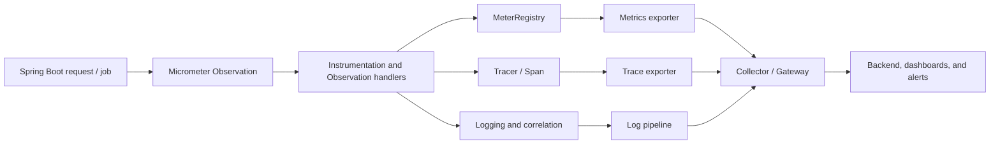

# Telemetry Rollout Strategy

Introducing Micrometer Observation, metrics, logs, and distributed tracing into a running Spring Boot system is an architectural change that directly impacts operations. New instrumentation can increase CPU, memory, network, and storage costs; changing sampling can break trace comparability; renaming meters or resource attributes can prevent existing dashboards and alerts from finding data. Therefore, telemetry must be rolled out in phases, with measurable criteria and a clear rollback path.

A sound rollout strategy must answer four questions: which service or instance goes first, how data volume increases, which signals govern the decision to proceed, and what to do if application quality or the observability pipeline degrades. This article outlines how to design that strategy for Spring Boot systems.

## 1. Defining Rollout Scope

Telemetry is not a single isolated feature. A change can affect multiple layers:

1. **Instrumentation:** creating Observations for HTTP server/client, databases, messaging, scheduled tasks, or custom business logic.
2. **Signal generation:** turning Observations into metrics and spans; emitting logs with correlation context.
3. **Enrichment:** attaching service identity, environment, version, region, and bounded business attributes.
4. **Sampling and filtering:** deciding which traces are kept, which meters are emitted, and which data is allowed through.
5. **Export:** sending metrics, traces, or logs to collectors or backends.
6. **Consumption:** dashboards, alerts, investigative queries, retention, and operational workflows.

These layers can be rolled out independently. For example, enable instrumentation on a subset of instances first, and only later increase sampling or switch exporters to a new collector. Separating changes makes root-causing incidents easier and reduces how many variables change at once.

### 1.1. Telemetry Data Path Model



Every arrow is a point where failures or data loss can occur. When designing a rollout, specify who owns each point: service development teams, observability platform teams, or backend operations teams. Ownership must cover configuration, monitoring, and handling export failures.

### 1.2. Distinguishing Three Scopes of Change

| Scope | Example | Primary Risk |
|---|---|---|
| In-application changes | Adding Observations, meters, spans, or log correlation | Increased overhead, instrumentation behavior changes, cardinality |
| Pipeline changes | Changing endpoints, protocols, collectors, processors, or exporters | Data loss, backlogs, authentication errors, increased ingest delay |
| Data consumption changes | Renaming metrics, labels, service identity, dashboards, or alerts | Broken queries, silent alerts, hard pre/post comparison |

Whenever possible, do not roll out all three scopes across the entire fleet simultaneously. Each rollout wave should have one primary change and a testable hypothesis.

## 2. Principles for Safe Rollout Design

**Incremental rollout:** start in development, staging, and a small group of instances or services with representative traffic. Expand only when quality criteria are met.

**Preserve compatibility:** dashboards, alerts, and downstream tools must continue functioning during transitions. If changing schemas, meter names, or resource attributes, provide a migration plan and parallel support window.

**Bound impact:** enforce limits on sampling, cardinality, queues, batches, retries, and timeouts. Never allow telemetry transmission failures to exhaust application resources or fail business requests.

**Observe the pipeline itself:** exporters and collectors must also be monitored. A pipeline lacking signals for successful exports, failed exports, dropped data, and backlogs is hard to diagnose during rollout.

**Maintain a rollback path:** preserve pre-rollout stable configuration and know how to restore endpoints, sampling, instrumentation, and dashboards. Rollback must be faster than incident blast radius growth.

**Protect data:** collect only necessary attributes, stripping secrets and personal data from tags, baggage, and log fields. Sampling does not replace security policies.

## 3. Pre-Deployment Preparation

### 3.1. System Mapping

Before making changes, gather at least the following baseline information for each service:

- Service name, environment, application version, instance count, and deployment regions.
- Spring Boot, Micrometer, Micrometer Tracing, registry, and exporter versions in use.
- Workload types: HTTP requests, consumers, scheduled tasks, batches, or long-running jobs.
- Normal and peak traffic, requests per second, concurrency, and typical payload sizes.
- Critical dependencies: databases, caches, message brokers, HTTP/gRPC services, and collectors.
- Existing meters, dashboards, alerts, and investigation workflows.
- How trace context propagates across HTTP, messaging, and asynchronous flows.

This information helps select a representative canary. A low-traffic instance does not prove an exporter works under high load; an HTTP-only service does not represent consumers or scheduled jobs.

### 3.2. Finalize the Data Contract

Before rollout, standardize names and meanings of resource identifying fields:

| Attribute | Role | Recommended Rule |
|---|---|---|
| `service.name` | Identifies the service | Consistent across instances of the same service |
| `service.version` | Distinguishes deployment versions | Tied to release or image version |
| `deployment.environment` | Distinguishes environments | Use canonical values like `dev`, `staging`, `production` |
| `service.instance.id` | Identifies an instance when needed for investigation | Unique value; avoid as metric label if it causes high cardinality |
| `cloud.region` or deployment region | Infrastructure region breakdown | Use canonical values; never vary per request |

Attribute names must align with semantic conventions and the backend system in use. Avoid creating variants like `app`, `application`, and `service_name` for the same concept without explicit conversion rules.

Define key meters, units, metric types, histogram buckets, and allowed tags upfront. For tracing, standardize span names, span kinds, statuses, attributes, and cross-service span linking. For logs, standardize timestamps, severity, service identity, and how `traceId`/`spanId` appear in records.

### 3.3. Set Cardinality and Sampling Budgets

Metric labels must have bounded value sets. Values such as user IDs, emails, order IDs, session IDs, request IDs, or URLs containing path parameters typically produce massive time series counts. Normalize routes into templates like `/orders/{orderId}` and use IDs in logs or traces when justified by business need while obeying data policies.

For tracing, establish initial sampling based on traffic, backend capacity, and investigative needs. Head-based sampling decides at trace start and is usually easy to deploy, though it can miss rare error traces. Tail-based sampling decides after inspecting the complete trace, yet requires stateful collectors with adequate resources. Sampling policies must account for propagation so services in the same trace make consistent decisions.

Never pick a sampling probability solely from an arbitrary default. Estimate spans per second, span size, retention duration, and the percentage of traces needed for critical flows. You can apply higher retention policies for errors or high-latency traces at the tail-sampling tier if architecture and budget allow.

### 3.4. Record Baselines

Measure before enabling new telemetry to establish comparison benchmarks:

- CPU, heap, allocation rate, garbage collection, and RSS memory.
- P50, P95, P99 latency; throughput; 4xx/5xx rates and timeouts.
- Connection counts, thread counts, queue depths, and dependency loads.
- Current network egress, log volume, and backend costs.
- Request or job success rates by workload type.

Document exact time windows and load conditions. Comparing a canary against a concurrent control group is more reliable than comparing against numbers from a different day with different traffic.

## 4. Phased Rollout Roadmap

A reference roadmap includes the stages below. Instance percentages are merely starting points; adjust for fleet size, risk profile, and the deployment platform's traffic-splitting capabilities.

### Phase 0: Verification in Development

Integrate dependencies and configure Micrometer Observation, registries, tracing bridges, or exporters in local/dev environments. Verify a request traversing expected layers creates meters/spans; trace context propagates across dependencies; logs include trace IDs when tracing is enabled.

Test both failure and success paths. A failing request should emit spans with error status; a successful request should not emit anomalous spans or logs. Confirm endpoints, protocols, and resource attributes match the service.

### Phase 1: Staging and Load Testing

Deploy to staging with production-like configuration. Verify:

- Metrics, traces, and logs arrive at the intended collectors/backends.
- Dashboards and alerts read service, environment, version, and meter names accurately.
- Sampling, filters, and processors do not drop required data.
- Exporters handle normal load and expected peak load.
- Slow or disconnected collectors/backends do not cause abnormal latency spikes in the application.
- Queues and retries are bounded; under overload, drop behavior is observable.

Test disconnecting the collector for a controlled window to confirm the application still processes business requests as designed. After reconnecting, inspect backlogs, retries, and recovery behavior. Never assume dropped telemetry will automatically be re-sent; that depends on the exporter and queue policy.

### Phase 2: Production Canary

Select one or a few service instances carrying representative load and dependencies. You can start with a single instance or roughly 1–5% of the fleet if the platform supports stable grouping. The canary must receive enough variety of critical requests and workloads for results to be meaningful.

Favor rolling out instrumentation and export with low sampling and already-verified cardinality limits. Monitor the canary group alongside the control group concurrently. Confirm no significant divergence in latency, application errors, CPU, memory, and network, while confirming telemetry actually reaches the backend.

Do not pick a canary based solely on instance count. If the chosen instance receives no traffic or only one rare request type, extend the observation window or include additional representative instances.

### Phase 3: Stepwise Expansion

Once the canary meets criteria, expand in appropriate steps, such as 5% → 25% → 50% → 100%. Each step must have an observation window long enough to cover traffic cycles and important background tasks. For systems with daily batch schedules or hourly consumers, observing for just a few minutes is not enough to conclude safety.

After each step, re-verify:

1. Does business quality remain stable?
2. Are signals complete and correlatable?
3. Are exporters and collectors handling the increased traffic?
4. Do cardinality, storage, and costs stay within budget?
5. Do dashboards, alerts, and on-call workflows function properly?

If anomalies appear, halt at the current step. Never expand automatically merely because the deployment pipeline reports instances as healthy.

### Phase 4: Stabilization and Standardization

After reaching 100%, continue monitoring over a window long enough to catch periodic issues. Standardize configuration, dashboards, alerts, runbooks, access controls, and ownership. Remove temporary flags once confirmed no downstream consumer depends on them.

If the rollout involved schema or backend changes, decommission the old pipeline only after confirming the new data is consumed reliably and dashboards/alerts have migrated. Limit parallel run durations to avoid doubling costs and data.

## 5. Controlling Rollouts in Spring Boot

### 5.1. Externalizing Configuration from Code

Parameters likely to change during rollout should be externalized via environment variables, config servers, or platform-appropriate centralized configuration. Example:

```yaml
app:
  observability:
    enabled: ${APP_OBSERVABILITY_ENABLED:true}
    export-enabled: ${APP_TELEMETRY_EXPORT_ENABLED:true}
    tracing-sample-probability: ${TRACING_SAMPLE_PROBABILITY:0.05}
    service-version: ${APP_VERSION:local}
```

This is an illustrative application-level configuration group, not built-in Spring Boot properties. Configuration code must map these values to Micrometer, tracers, and exporters accordingly. Specific Actuator, Micrometer registry, and OTLP properties vary by Spring Boot version and dependencies; verify against your exact version before deploying.

Separate at least three switches if architecture permits:

- Enable/disable instrumentation or Observations for a controllable scope.
- Enable/disable export out of the process.
- Adjust sampling or filters.

These three switches serve different purposes. Disabling export does not necessarily disable emitting meters/spans; conversely, disabling instrumentation drops data at the source. The design must document the impact of each switch and how changes take effect.

### 5.2. Rolling Out by Service and Instance

When managing multiple services, start with a lower-risk service representative of the shared architecture to validate conventions, exporters, and collectors. Then expand to high-traffic services, dependency-heavy services, or specialized workloads.

Within a single service, use platform deployment strategies such as canary, rolling updates, or traffic splitting to constrain instance percentages. Ensure you can pinpoint the exact version/configuration of instances emitting telemetry via `service.version`, deployment metadata, or equivalent attributes.

When varying sampling per instance, consider distributed traces spanning multiple instances. Parent-based sampling policies and trace context propagation must keep sampling decisions consistent. Avoid incompatible rates across services that leave traces fragmented or hard to interpret.

### 5.3. Migrating Exporters or Backends

When switching collectors or backends, you can run two export paths in parallel for a short period if libraries and architecture support it. Before dual-writing, evaluate:

- Egress traffic and ingestion costs may nearly double.
- Metrics may be double-written or spawn two divergent series sets.
- Traces may appear in two backends with differing retention and sampling.
- Two pipelines may apply different resource attributes or transforms.
- One failing destination can drive up queues and retries if configurations are not isolated.

Use labels or resource identities to distinguish test destinations when needed, without adding constantly changing labels. Compare ingested counts, error rates, ingest latency, schemas, and queries across both destinations. Switch dashboards and alerts only after new data satisfies the agreed contract.

## 6. Sampling, Cardinality, and Signal Correlation During Rollout

### 6.1. Sampling Must Be Planned by Tier

Sampling directly impacts investigative capability and cost. A common rollout pattern starts with a low rate in canary, then gradually increases once overhead and capacity are verified. However, sampling changes must be tracked by version/configuration so investigators understand why trace counts shifted.

For distributed tracing:

- Preserve trace context propagation across HTTP, messaging, and asynchronous tasks.
- Clearly define parent-based versus root sampling and where decisions occur.
- If using tail sampling at the collector, ensure collectors receive complete spans in time and have sufficient memory/queues.
- Consider retaining error or high-latency traces under appropriate policies while weighing cost and privacy.
- Do not directly compare trace counts across two phases with different sampling policies without normalizing.

### 6.2. Controlling Cardinality Before and After Each Step

Rolling out instrumentation can increase meter counts due to new tags or newly covered routes. Track series counts per meter and tag dimension. Enforce limits on label values and avoid using user-supplied input as metric tags. For histograms, weigh bucket counts and tag counts because each combination spawns additional series.

If cardinality spikes unexpectedly, pinpoint the offending meter/tag before expanding. Fix route normalization or drop unnecessary tags. Do not resolve it by blindly raising backend limits, as that masks design bugs.

### 6.3. Ensuring Logs Correlate with Traces

When tracing is enabled, logs must carry `traceId` and `spanId` in the format supported by the backend. Verify correlation on both synchronous requests and asynchronous flows. If a trace is dropped by sampling, logs may still exist; define how to handle cases where a log has a trace ID absent from the tracing backend.

Baggage and log fields must be allowlisted. Never pass tokens, cookies, emails, phone numbers, or personal data through context merely for debugging convenience. Increasing sampling must never become an excuse to collect additional sensitive data.

## 7. Go/No-Go Criteria for Each Phase

Expansion decisions must rely on both application health and telemetry health.

| Category | Indicator/Evidence | Reference Proceed Condition |
|---|---|---|
| Business | Error rates, timeouts, job failures, throughput | Within agreed SLO thresholds or baseline |
| Latency | Request and dependency P95/P99 | No abnormal regression correlated with rollout |
| Resources | CPU, heap, GC, RSS memory, network | Sufficient headroom within operational limits |
| Metrics export | Export success/failure, queues, dropped measurements | No sustained errors; queues not growing continuously |
| Tracing | Spans received/exported, dropped spans, trace completeness | Traces are searchable and linked across core services |
| Logs | Ingest delay, rejected/dropped logs, volume | No critical log loss and volume within budget |
| Data quality | Resource attributes, meter names, tags, sampling | Complies with data contract with no abnormal cardinality |
| Operations | Dashboards, alerts, runbooks, ownership | On-call can detect and investigate incidents |

Specific thresholds must be agreed upon by service owners and platform teams based on SLOs, baselines, and budgets. No single CPU, latency, or export failure threshold fits every system.

### 7.1. Separating Application Errors from Telemetry Errors

If request error rates climb, inspect exceptions, dependencies, and response paths. If requests stay healthy while export failures rise, inspect exporters, collectors, and backends. If both climb together, investigate both tracks in parallel and check whether exporters run synchronously or contend for resources with the request path.

Never rely on `/actuator/health` status as the sole criterion. Health endpoints may report `UP` while collectors drop telemetry. Conversely, telemetry backends may suffer temporary outages while business workflows continue operating normally. Maintain dedicated indicators for each aspect.

## 8. Designing Rollbacks and Degradation Behavior

Rollback procedures must be prepared before enabling a canary. Record pre-rollout configuration, exporter/collector versions, sampling, resource attributes, and dashboard queries. Ensure partial rollback is possible.

Typical rollback actions include:

1. Halt expansion and freeze the current canary percentage.
2. Restore the previous exporter or endpoint configuration if the new pipeline fails.
3. Reduce sampling or pause export for the test scope if queues, network, or backends overload.
4. Revert to the previous instrumentation/configuration version if overhead impacts the request path.
5. Point dashboards/alerts back to the stable pipeline if new data is incompatible.
6. Verify application, collector, and backend have returned to a steady state.

Exporter designs must enforce timeouts, bounded retries, bounded batches, and bounded queues. When queues fill up or backends stay disconnected, emit metrics tracking dropped data. Avoid infinite retries or unbounded queues, which can exhaust memory and widen incidents.

In most systems, telemetry is an operational support capability. Export failures should not unintentionally fail business requests. However, this depends on integration details: custom exporters or synchronous callbacks may execute on the request path. Inspect actual implementations and test behavior when exporters throw exceptions or time out.

Rollback does not mean erasing all observability signals. When a new pipeline fails, preserve stable baseline telemetry if possible so operators maintain visibility into system health during remediation.

## 9. Sample Rollout Scenarios

### Scenario A: Adding Tracing to a Group of Spring Boot Services

A system already emits metrics via Micrometer without distributed tracing. The project team adds a tracing bridge and OTLP exporter.

**Rollout approach:** first verify trace context across HTTP clients and servers in staging. Choose one production service with representative dependencies and enable tracing at low sampling on a subset of instances. Confirm server/client spans share the same trace ID, resource attributes are accurate, and logs carry correlation. Then expand to upstream callers and downstream callees so traces are not half-blind.

**Expansion criteria:** no abnormal rise in latency, CPU, or memory; collectors receive spans; drop rates remain steady; sampling and propagation stay consistent. Post-rollout, tune sampling according to investigative needs and budget.

### Scenario B: Migrating Metrics Exporters to a New Collector

Applications currently send metrics directly to a legacy backend. The system plans to transition to a collector acting as a shared gateway layer.

**Rollout approach:** stand up the new receiver and pipeline first and validate in staging. In production, select one service or instance group to send to the new collector. If dual-writing is necessary, set a clear deadline and monitor series counts, ingest delay, export failures, and cost. Check dashboard queries by service/version and confirm alerts still fire on test scenarios.

**Cutover criteria:** new data matches schema compatibility, shows no abnormal drops, dashboards/alerts function, and collectors have sufficient capacity. Migrate service groups incrementally, then decommission the legacy target on the announced schedule.

### Scenario C: Cardinality Spike After Adding a Business Tag

Following a release, series counts climb rapidly because HTTP meters gained a tag containing object IDs.

**Remediation rollout:** halt rollout expansion and pinpoint the meter and tag dimension causing growth. Replace the tag with a bounded value group or move needed identifiers to controlled logs/traces. Re-verify series counts in staging and canary before resuming.

**Expansion criteria:** cardinality returns within budget, dashboards use the new tag correctly, and no sensitive data enters telemetry.

## 10. Implementation Checklist

### Pre-Rollout

- [ ] Identify services, instances, workloads, and dependencies in scope.
- [ ] Record Spring Boot, Micrometer, registry, tracer, and exporter versions.
- [ ] Standardize service identity, resource attributes, meter names, and span conventions.
- [ ] Define sampling, cardinality budgets, histograms, and data policies.
- [ ] Measure baseline CPU, memory, latency, error rate, throughput, and network.
- [ ] Prepare collectors/backends, dashboards, alerts, and runbooks.
- [ ] Prepare rollback configuration and owners for every layer.

### During Rollout

- [ ] Validate in staging and test slow or disconnected collector/backend scenarios.
- [ ] Start with a canary running representative workloads.
- [ ] Monitor both the application and telemetry pipeline concurrently.
- [ ] Verify trace context, sampling, and log correlation.
- [ ] Watch cardinality, dropped data, queues, retries, and ingestion costs.
- [ ] Expand only after go/no-go criteria pass.
- [ ] Halt rollout if any indicator breaches thresholds or evidence is missing.

### Post-Rollout

- [ ] Confirm all services/instances in scope emit data accurately.
- [ ] Verify dashboards, alerts, investigative queries, and retention.
- [ ] Confirm ownership, runbooks, and exporter failure-handling procedures.
- [ ] Remove temporary configuration and legacy pipelines after the transition window ends.
- [ ] Document costs, overhead, and lessons learned to refine subsequent rollouts.

## 11. Common Mistakes

| Mistake | Consequence | How to Avoid |
|---|---|---|
| Enabling instrumentation across the entire fleet at once | Sudden overhead or cardinality spike | Use canaries and stepwise expansion |
| Checking only whether dashboards show data | Data exists, yet traces break, resources mismatch, or sampling is wrong | Verify data quality and cross-signal correlation |
| Looking only at the health endpoint | Exporter/collector failures go undetected | Maintain dedicated telemetry pipeline metrics |
| Using dynamic IDs as metric tags | Generates excessive time series | Use route templates and bounded-value labels |
| Renaming meters/resources while switching backends | Hard to tell which change broke queries | Separate change waves and preserve compatibility |
| Dual-writing without an end date | Doubles cost and data | Establish comparison criteria and a clear cutoff date |
| Infinite retries or unbounded queues | Exhausts resources during backend outages | Bound queues, retries, and monitor dropped data |
| Changing sampling without documenting it | Unexplained shifts in trace volume | Version and document sampling policies |
| Putting sensitive info into baggage/logs/tags | Data exposure risk | Allowlist, redact, and review schemas |

## 12. Operational Conclusion

Telemetry rollout is the process of introducing observability capability into a system while preserving business reliability. Start with a data contract and baseline, verify instrumentation and exporters in staging, deploy to a representative canary, expand stepwise based on go/no-go criteria, and then standardize dashboards, alerts, and runbooks. Sampling, cardinality, propagation, queues, and privacy must be governed end-to-end.

A rollout succeeds only when the application maintains its SLOs, telemetry arrives where needed with usable quality, the pipeline exposes its own failures, and operations teams can roll back whenever necessary. That makes metrics, logs, and distributed tracing a dependable part of Spring Boot architecture in production.
