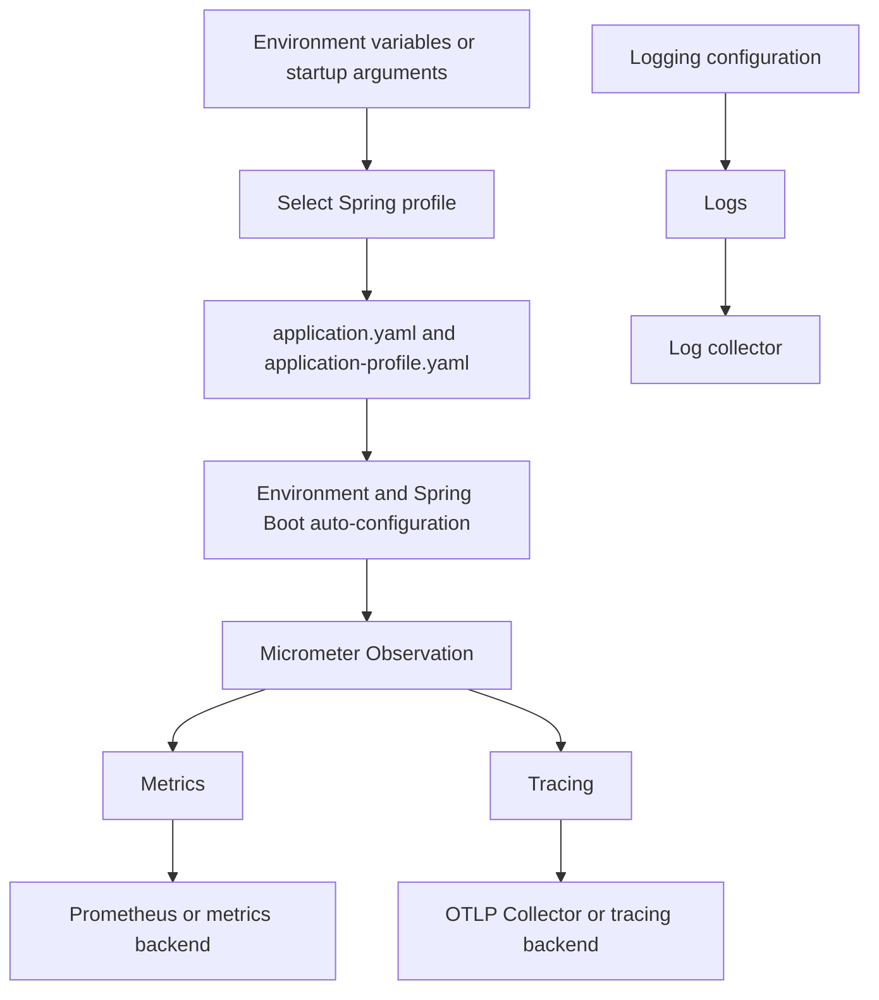

# Profile-Based Configuration

A Spring Boot application typically runs across multiple environments: a developer's local machine, integration testing, staging, and production. Each environment has different operational requirements. During development, we need to inspect detailed health checks, enable debug logs, and capture full traces to follow requests. In production, we need to limit health check details, control the volume of sampled traces, and send telemetry to the appropriate collection systems.

Spring Boot profiles allow selecting a configuration set based on the runtime environment. Combining profiles with externalized configuration, Micrometer Observation, metrics, logging, and distributed tracing enables a single application to keep the same source code while applying an observability configuration suited to each environment.

After this lesson, you will be able to:

- Organize shared configuration and profile-specific configuration.
- Select profiles at startup using arguments or environment variables.
- Tune log levels, health endpoints, metrics, and tracing per environment.
- Externalize endpoints, sampling rates, and sensitive information out of configuration files packaged inside the application.
- Verify the applied configuration and identify common misconfigurations.

## 1. What Problem Do Profiles Solve?

A profile is a label describing a group of configuration properties to be activated when the application starts. For example, the `local` profile can enable verbose logging and sample all traces; the `staging` profile sends traces to a testing collector; and the `prod` profile lowers sampling, restricts exposed endpoints, and points to the production collector address.

Profiles do not create environments or external resources on their own. They only determine which configuration is loaded. Collectors, Prometheus, log management systems, Actuator access controls, and environment variables still have to be deployed, authorized, and operated separately.

A common layout under `src/main/resources` is:

```text
src/main/resources/
├── application.yaml
├── application-local.yaml
├── application-staging.yaml
└── application-prod.yaml
```

`application.yaml` holds shared default values. When the `prod` profile is active, Spring Boot additionally loads `application-prod.yaml`; properties with the same name in the profile-specific configuration override the corresponding default values. Properties not declared in the profile-specific file continue to come from the shared configuration or other configuration sources.

Spring Boot supports multiple configuration sources. Environment variables, command-line arguments, and external configuration files can override values inside the JAR. As a result, you can package a single artifact and supply different configurations at deployment time without rebuilding the application.

## 2. Defining Baseline Configuration in `application.yaml`

It is best to start with a small, safe baseline configuration that works in every environment. For example:

```yaml
spring:
  application:
    name: observability-demo

management:
  endpoints:
    web:
      exposure:
        include: health,info
  endpoint:
    health:
      probes:
        enabled: true
  metrics:
    tags:
      application: ${spring.application.name}
```

In this example:

- `spring.application.name` sets the service name. This name can be used to identify the application in dashboards and telemetry data.
- Only `health` and `info` are exposed over HTTP in the baseline configuration. Other endpoints should be enabled intentionally in the appropriate environments.
- Health probes provide liveness and readiness status so the deployment platform can inspect the application.
- The `application` tag is attached to meters, helping distinguish the service's metrics when multiple applications send data to the same metrics backend.

Avoid setting `spring.profiles.active` in `application.yaml` just to force every run to use one environment. The profile should be chosen via the startup command or deployment environment. That way, the same artifact can run in local, staging, and production.

## 3. Creating Configuration for Each Environment

### Local: prioritizing observability during development

`application-local.yaml` can enable debug logging for the application's packages, show health details, and sample every trace:

```yaml
logging:
  level:
    root: INFO
    com.example: DEBUG

management:
  endpoints:
    web:
      exposure:
        include: health,info,metrics,prometheus
  endpoint:
    health:
      show-details: always
  tracing:
    sampling:
      probability: 1.0
```

`probability: 1.0` means the sampler samples all eligible traces. This is useful when debugging a short request flow on a local machine. If the project does not have the Prometheus Registry dependency, the `/actuator/prometheus` endpoint will not be created even if listed in `exposure`; this endpoint requires the corresponding registry on the classpath.

If local development uses an OpenTelemetry Collector, you can configure a dedicated OTLP endpoint in the local profile. Without a collector, omit the exporter configuration or use an observation mode matching the project's dependencies; setting a sampling rate does not instantiate an exporter by itself.

### Staging: testing close to production

Staging generally needs the same integration topology as production to catch configuration, propagation, or collector connectivity issues before release. Sampling can be higher than in production, though it should still be bounded:

```yaml
logging:
  level:
    root: INFO

management:
  endpoints:
    web:
      exposure:
        include: health,info,prometheus
  endpoint:
    health:
      show-details: when-authorized
  metrics:
    tags:
      environment: staging
  tracing:
    sampling:
      probability: ${TRACING_SAMPLING_PROBABILITY:0.2}
```

The value `0.2` is an example to sample roughly 20% of incoming traces. The actual rate should be based on traffic volume, storage capacity, investigation goals, and the tracing system's sampling policy. The `TRACING_SAMPLING_PROBABILITY` variable allows tuning without editing the YAML file.

### Production: limiting data volume and controlling cost

`application-prod.yaml` can keep logs at `INFO`, hide health details, and send traces to the production collector:

```yaml
logging:
  level:
    root: INFO

management:
  endpoints:
    web:
      exposure:
        include: health,info,prometheus
  endpoint:
    health:
      show-details: never
      probes:
        enabled: true
  metrics:
    tags:
      environment: ${APP_ENV:prod}
  tracing:
    sampling:
      probability: ${TRACING_SAMPLING_PROBABILITY:0.05}
  otlp:
    tracing:
      endpoint: ${OTEL_EXPORTER_OTLP_TRACES_ENDPOINT:http://otel-collector:4318/v1/traces}
```

The OTLP address above is an example for a collector accepting OTLP/HTTP. Replace it with the address actually provided by your production environment. The `management.otlp.tracing.endpoint` property only takes effect when the application includes a tracing bridge and OTLP exporter dependencies compatible with the Spring Boot version in use. A common pairing in the Micrometer ecosystem is `micrometer-tracing-bridge-otel` and `opentelemetry-exporter-otlp`; let Spring Boot dependency management align compatible versions.

In this example, Prometheus collects metrics by scraping the `/actuator/prometheus` endpoint, while traces are sent over OTLP. Both export paths can coexist. To use the Prometheus endpoint, add `micrometer-registry-prometheus` and expose the endpoint as shown above. If your metrics system ingests data via OTLP or another registry, configure the corresponding exporter and remove the Prometheus endpoint if unused.

A sampling rate of `0.05` is only an illustrative starting point, not a universal production rate for every system. A low rate reduces trace volume and storage costs, but also reduces visibility into rare requests. You need to evaluate traffic, telemetry budget, incident investigation needs, and collector-side sampling mechanisms. If you need to prioritize retaining error or slow traces, design an appropriate policy at the collector layer rather than expecting head-based sampling to capture every such case by default.

## 4. Activating Profiles When Running the Application

You can select a profile using an environment variable:

```bash
SPRING_PROFILES_ACTIVE=prod java -jar app.jar
```

Or pass a command-line argument:

```bash
java -jar app.jar --spring.profiles.active=prod
```

When running with Maven locally, you can use:

```bash
SPRING_PROFILES_ACTIVE=local ./mvnw spring-boot:run
```

In PowerShell on Windows:

```powershell
$env:SPRING_PROFILES_ACTIVE = "local"
.\mvnw spring-boot:run
```

For Docker or Kubernetes, set `SPRING_PROFILES_ACTIVE` in the container's deployment configuration. For example, the production deployment sets this variable to `prod`, while the staging deployment sets it to `staging`. There is no need to build separate images just for different profiles.

If you need to enable multiple configuration groups, Spring Boot supports profile groups. Declare groups in a configuration document that is not tied to a profile, for example:

```yaml
spring:
  profiles:
    group:
      production:
        - prod
        - tracing-remote
```

When `production` is activated, Spring Boot also activates `prod` and `tracing-remote`. This is useful when an environment is composed of multiple configuration concerns. Avoid creating too many overlapping profiles that make it hard to determine the final effective value.

## 5. Using `spring.config.activate.on-profile` for Multi-Document YAML

Beyond separate `application-{profile}.yaml` files, you can split a single YAML file into multiple documents using `---` and `spring.config.activate.on-profile`:

```yaml
spring:
  application:
    name: observability-demo

management:
  tracing:
    sampling:
      probability: 0.1

---
spring:
  config:
    activate:
      on-profile: local

management:
  endpoint:
    health:
      show-details: always
  tracing:
    sampling:
      probability: 1.0
```

The second document is applied only when the `local` profile is active. This style works well for small configurations. When each environment has many distinct properties, separate files such as `application-local.yaml`, `application-staging.yaml`, and `application-prod.yaml` are usually easier to read and review.

Do not set `spring.profiles.active` or `spring.profiles.include` inside a configuration document that is conditionally activated by a profile. Properties used to select profiles must reside in unconditional documents; choose profiles via the deployment environment or startup arguments.

## 6. How Profile Configuration Affects Observability Signals

Profiles determine the property values Spring Boot uses to configure observability components. Once the application starts, these components work together:



**Metrics.** Metrics are collected continuously and used to monitor trends, error rates, throughput, and latency. You can attach stable tags such as application name and environment to filter dashboards. Never put `userId`, `orderId`, `requestId`, or URLs with dynamic identifiers into metric tags: each new value can create another time series and cause cardinality to grow rapidly. Use traces or logs to look up high-cardinality identifiers.

**Logs.** Log levels can vary by environment. Local may enable `DEBUG` for packages under investigation; production usually keeps `INFO` and only raises log levels in a controlled way during incident response. When Micrometer Tracing is integrated, trace IDs and span IDs can be added to the MDC to correlate logs with traces. If the project customizes the Logback pattern, ensure the pattern still outputs these correlation fields. Logs should still be forwarded to a collection system via stdout or an agent according to the deployment architecture.

**Tracing.** `management.tracing.sampling.probability` adjusts the sampling rate for the configured tracing bridge. Local typically uses a high rate for easier debugging; production typically uses a lower rate tuned to traffic volume. Sampling does not replace verifying propagation across HTTP clients, message brokers, and service boundaries. If context is not propagated, spans can split into separate traces even when sampling is configured properly.

**Actuator and health checks.** Exposure controls which endpoints are reachable over the web. `show-details` controls the detail level of health responses; `probes.enabled` enables liveness and readiness health probe groups. Management endpoints should be protected using Spring Security, network policies, or both. Not exposing an endpoint over HTTP does not mean every endpoint is unreachable through other management channels.

## 7. Keeping Sensitive Configuration Out of YAML Files

Do not commit passwords, collector tokens, API keys, or credentials into `application-prod.yaml`. Use environment variables, deployment platform secrets, or whatever external configuration mechanism your system supports.

For example, the collector endpoint in YAML uses a placeholder:

```yaml
management:
  otlp:
    tracing:
      endpoint: ${OTEL_EXPORTER_OTLP_TRACES_ENDPOINT}
```

The value is supplied at runtime by the deployment environment. If a property has a safe default, you can use the `${VAR_NAME:default-value}` syntax; for credentials, never put real secrets as default values in the repository.

Profiles are not a security mechanism. An endpoint exposed only in the `prod` profile still requires access control over who can reach it. Do not broadly expose endpoints like `env`, `configprops`, `beans`, `heapdump`, or `*` on a production management interface without a specific reason and proper safeguards.

## 8. Verifying the Running Configuration

After startup, inspect the application and its configured endpoints:

```bash
curl http://localhost:8080/actuator/health
curl http://localhost:8080/actuator/metrics
curl http://localhost:8080/actuator/prometheus
```

The `/actuator/metrics` endpoint lists available meters; you can query a specific meter, such as `/actuator/metrics/http.server.requests`. The Prometheus endpoint only works when the Prometheus registry is on the classpath and the endpoint is exposed. In production, these URLs may sit behind a management port, reverse proxy, or authentication layer, so use the addresses and credentials appropriate for the actual environment.

To verify tracing, send a request through the application and check whether the collector or tracing backend receives spans. Confirm that the trace shows the correct service name, spans are linked under the same trace ID, and logs include the matching trace ID/span ID fields. If the health endpoint works but no traces appear, check the exporter dependency, collector address, network access, and propagation.

In integration tests, you can select a dedicated profile:

```java
@SpringBootTest
@ActiveProfiles("test")
class ObservabilityConfigurationTests {
    // Verify configuration behavior in the test environment.
}
```

`application-test.yaml` can configure properties tailored for tests, such as disabling telemetry export to shared backends or pointing the endpoint to a mock collector. Avoid letting tests accidentally send data to production backends.

## 9. Common Issues and Troubleshooting

| Symptom | Common Cause | How to Check |
|---|---|---|
| Configuration in `application-prod.yaml` is not applied | `prod` profile is not active or filename does not match | Check `SPRING_PROFILES_ACTIVE` and the profile name |
| Application fails to read profile configuration | `spring.profiles.active` is placed inside a profile-specific document | Move profile selection to environment variables or startup arguments |
| `/actuator/prometheus` returns 404 | Missing Prometheus Registry or endpoint not exposed | Check `micrometer-registry-prometheus` dependency and exposure settings |
| Traces do not appear in the backend | Missing bridge/exporter, wrong endpoint, unreachable collector, or broken context propagation | Check dependencies, OTLP settings, collector logs, and trace IDs across services |
| Production logs are excessive | Root/package log level is too verbose or repetitive logging exists | Check `logging.level`, appropriate-layer sampling, and logging policy |
| Metrics backend has too many time series | High-cardinality tags like IDs or free-form values are used | Move dynamic identifiers to logs/traces and keep metric tags to a small value set |
| Health response leaks internal information | `show-details` is too permissive or endpoint is unprotected | Restrict details, enforce authentication, and limit network access |
| Environment variable changed but app still uses old config | Profile/config is loaded at startup | Restart instances with new config and verify the deployment updated |

When a value behaves unexpectedly, check in order: active profile, profile filename, environment variables, startup arguments, and external configuration sources. Remember that higher-priority sources override values in YAML; editing the right file while leaving an old environment variable in place can still cause the application to keep using the stale value.

## 10. Operational Principles

- Keep shared configuration minimal and safe; only override properties that genuinely differ across environments.
- Use the same artifact across environments and pass the profile and configuration at deployment time.
- Keep Actuator endpoints to what is needed, secure management endpoints, and avoid exposing health details in production.
- Choose sampling rates based on traffic and telemetry budgets; verify investigation effectiveness when lowering sampling.
- Keep metric tags low-cardinality; use logs and traces for detailed identifying data.
- Manage secrets outside the repository and verify exporter endpoints from the actual runtime environment.
- Verify health, metrics, log correlation, and end-to-end traces after every operational configuration change.

When organizing profiles according to these principles, observability configuration can adapt per environment without branching the source code. Development teams retain visibility into application behavior across local, staging, and production while controlling what data is collected, where it is sent, and operational costs.
