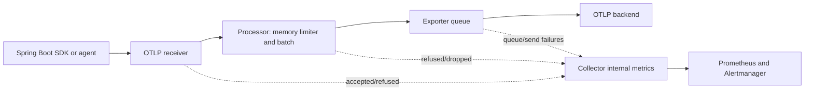

# Setting Up Alerts When OpenTelemetry Collector Fails

The OpenTelemetry Collector sits between Spring Boot applications and telemetry storage systems. If the Collector stops, refuses data, or fails to forward telemetry to the backend, logs, metrics, and traces can be lost even while applications continue serving requests normally. Therefore, production environments must monitor the Collector itself and each stage of its pipeline, alerting before queues fill up or data is dropped.

This lesson belongs to the **Production Operations** chapter of the **SPRING_BOOT_OBSERVABILITY** module. The module guides setting up observability for Spring Boot using Micrometer Observation, metrics, logs, and distributed tracing—including context propagation, tags and cardinality, exporters, sampling, and signal correlation to investigate errors, latency, and application behavior in real environments. The focus here is detecting Collector failures, distinguishing transient errors from data loss, and establishing an alert response workflow.

## 1. Identify What Needs to Be Alerted

The Collector can fail at several layers: the process stops, a receiver fails to accept data, a processor rejects data due to resource constraints, an exporter cannot reach the backend, or the export queue fills up. A generic "Collector unhealthy" alert is not enough to identify the cause or blast radius.

Group operational signals into clear categories:

| Category | What to Detect | Potential Impact |
|---|---|---|
| Availability | Collector is down or unscrapable | No telemetry passes through that instance |
| Receiver | Receiver refuses data or suddenly stops receiving expected traffic | SDKs/agents cannot push telemetry into the pipeline |
| Processor | Processor refuses or drops data | Data is lost before reaching the exporter |
| Exporter | Send failures, enqueue failures, or unresponsive backend | Data is delayed, queues grow, or data is dropped |
| Queue | Queue approaches maximum capacity | No room for new data if backend slowness persists |
| Resources | Memory, CPU, file descriptors, or queue disk space exhausted | Collector throttles, restarts, or drops data |
| End-to-end | Test data does not appear in the backend within the deadline | Pipeline may be broken even though processes report healthy |

Monitor by signal type: traces, metrics, and logs. The Collector might export traces normally while the metrics or logs exporter fails independently. In architectures with node-level agent Collectors and centralized gateway Collectors, collect status from both tiers.

## 2. Monitor the Collector with Its Own Internal Telemetry

The Collector emits internal telemetry describing receiver, processor, exporter, and process behavior. Configure a pull-based metrics endpoint so Prometheus or an independent monitoring system can scrape these metrics directly.

Common Collector Prometheus internal telemetry metrics include:

| Metric | Meaning | Usage |
|---|---|---|
| `otelcol_receiver_accepted_spans` | Number of spans accepted by the receiver | Confirm data is entering the pipeline |
| `otelcol_receiver_refused_spans` | Number of spans refused by the receiver | Detect data failing to enter the Collector |
| `otelcol_processor_refused_spans` | Number of spans refused by a processor | Detect backpressure or processing limits |
| `otelcol_exporter_sent_spans` | Number of spans successfully sent by the exporter | Track outbound flow from the Collector |
| `otelcol_exporter_send_failed_spans` | Number of spans in failed send attempts | Detect backend delivery errors; may be retried later |
| `otelcol_exporter_enqueue_failed_spans` | Number of spans that failed to enter the exporter queue | Clear sign that data could not be queued for export |
| `otelcol_exporter_queue_size` | Current number of items in the exporter queue | Monitor backlog |
| `otelcol_exporter_queue_capacity` | Maximum capacity of the exporter queue | Denominator for calculating queue utilization |
| `otelcol_process_uptime` | How long the Collector process has been running | Detect process restarts or instability |
| `otelcol_process_memory_rss` | Resident set size memory of the process | Track memory usage trends |

Metric names and labels can vary by Collector version, telemetry verbosity level, and exporter type. For metrics, suffixes typically use `metric_points`; for logs, suffixes typically use `log_records` instead of `spans`. Open the metrics endpoint of the exact Collector version you run and verify metric names, units, and labels before deploying alert rules.

### 2.1. Scrape internal telemetry independently

The Collector must enable internal metrics using the configuration schema for the version in use. Different Collector releases can use different pull telemetry syntax, so take examples from the documentation for your exact version rather than copying an outdated `service.telemetry.metrics` block into a newer release.

Prometheus should scrape this metrics endpoint directly. Never ship Collector internal metrics solely through the same Collector pipeline being monitored. If that pipeline breaks, you could lose the very signal telling you the pipeline is broken. An independent Prometheus or monitoring system preserves visibility when the Collector fails.

Bind the metrics endpoint only to the required interface and restrict access with network policies, firewalls, or appropriate controls. Internal telemetry endpoints can expose component names, exporter details, and infrastructure state.

### 2.2. Health checks do not replace metrics

You can enable the `health_check` extension so the platform can probe the Collector process:

```yaml
extensions:
  health_check:
    endpoint: 0.0.0.0:13133

service:
  extensions: [health_check]
```

Kubernetes or a load balancer can use this endpoint for liveness/readiness probes according to deployment configuration. Verify the exact health check behavior of your Collector version and extension.

Health checks mainly reflect Collector status as reported by the extension. A process can continue passing health checks while exporters retry continuously, queues grow, or the backend receives no data. Combine probes with receiver/exporter metrics and an end-to-end check.

## 3. Read Signals at Each Pipeline Stage

A typical traces pipeline:



At each stage, ask different questions:

1. **Receiver:** Is the Collector receiving data from the SDK or agent? Is `accepted` rising with expected traffic, or is `refused` starting to climb?
2. **Processor:** Is the memory limiter or another processor refusing data? Did CPU or memory rise before errors started?
3. **Exporter:** Is the backend responding? Is `send_failed` rising while `sent` stalls?
4. **Queue:** Is the queue growing steadily toward capacity? Does the queue drain after the backend recovers?
5. **Backend:** Does new telemetry show up in backend queries or UI?

If receiver accepted rises while exporter sent stays flat, inspect processors, exporters, and queues. If receiver accepted is also zero, applications may not be sending data, network connectivity to the Collector may be broken, the receiver may not be listening, or there may simply be no traffic. Compare against application traffic and a canary to distinguish these cases.

## 4. Build Baseline Alert Rules

The following PromQL examples assume Prometheus scrapes the Collector with `job="otel-collector"` and the Collector exports standard internal telemetry names. Adjust metrics, labels, windows, and thresholds to match your version, actual load, and operational SLOs.

### 4.1. Collector is unscrapable

```promql
up{job="otel-collector"} == 0
```

This rule detects a target known to Prometheus whose current scrape failed. If every target disappears from service discovery, the `up` series may vanish instead of reporting `0`; add an absence check as well:

```promql
absent(up{job="otel-collector"})
```

In autoscaling systems, do not assume a fixed replica count when replica counts change legitimately. Check service discovery or compare active targets against expected targets from the deployment platform.

### 4.2. Receiver refuses data

```promql
sum(rate(otelcol_receiver_refused_spans[5m])) > 0
```

This indicates trace data is being rejected by the receiver. For metrics and logs, replace the suffix with the corresponding metric exported by the Collector, such as `metric_points` or `log_records` if supported by your version. Investigate using Collector logs, request limits, memory pressure, receiver configuration, and upstream status.

### 4.3. Processor refuses data

```promql
sum(rate(otelcol_processor_refused_spans[5m])) > 0
```

If this metric rises, check which processor is refusing data and inspect resource usage at that time. For `memory_limiter`, inspect RSS memory, container limits, ingestion rate, and batch settings. Do not simply raise the memory limiter if the container lacks sufficient platform-level memory limits; doing so can trigger OOM kills.

### 4.4. Sustained exporter send failures

```promql
sum(rate(otelcol_exporter_send_failed_spans[5m])) > 0
```

`send_failed` indicates data was part of failed send attempts. The exporter may retry and succeed later, so this metric signals delivery errors or backend instability rather than automatically meaning all those spans were lost. Use `for` to avoid paging on brief timeouts, then cross-check queue metrics and enqueue failures to determine whether data loss occurred.

### 4.5. Failed to enqueue data

```promql
sum(rate(otelcol_exporter_enqueue_failed_spans[5m])) > 0
```

This is a severe signal because data could not enter the exporter queue. Check queue capacity, ingest rate, export rate, backend health, and memory. If the queue stays full, enlarging queue capacity only delays saturation; restore the backend, increase export throughput, or shed load cleanly.

### 4.6. Queue approaching maximum capacity

```promql
max(
  otelcol_exporter_queue_size
  /
  clamp_min(otelcol_exporter_queue_capacity, 1)
) > 0.8
```

The 80% threshold is only an initial example. Inspect queue growth rate and time required to drain backlog before picking alert thresholds. If queue capacity is disabled or not exported, the expression may return no data; configure the queue and check actual exported metrics. You can add a critical alert when the queue nears full capacity over a shorter window.

### 4.7. Incoming data suddenly disappears

```promql
sum(rate(otelcol_receiver_accepted_spans[10m])) == 0
```

Use this alert only when the Collector is expected to receive traces continuously. A low-traffic service or overnight lull may legitimately produce zero spans. In production, a periodic canary sending sample traces, metrics, and logs through the full pipeline and verifying arrival at the backend is usually more reliable than inferring health from organic traffic.

## 5. Example Prometheus Alert Rules

You can group baseline rules together. The example below illustrates `for` durations and severities; final thresholds must be calibrated to production load:

```yaml
groups:
  - name: otel-collector
    rules:
      - alert: OTelCollectorTargetDown
        expr: up{job="otel-collector"} == 0
        for: 2m
        labels:
          severity: critical
        annotations:
          summary: "OpenTelemetry Collector is unscrapable"
          description: "Prometheus has failed to scrape the Collector target for at least 2 minutes."

      - alert: OTelCollectorExporterSendFailures
        expr: sum by (cluster, namespace) (rate(otelcol_exporter_send_failed_spans[5m])) > 0
        for: 5m
        labels:
          severity: warning
        annotations:
          summary: "Collector is experiencing trace export failures"
          description: "The exporter is seeing sustained span send failures. Check the backend and queue."

      - alert: OTelCollectorExporterEnqueueFailures
        expr: sum by (cluster, namespace) (rate(otelcol_exporter_enqueue_failed_spans[5m])) > 0
        for: 1m
        labels:
          severity: critical
        annotations:
          summary: "Collector cannot enqueue traces"
          description: "Some spans failed to enter the exporter queue. Check queue capacity and backend."

      - alert: OTelCollectorExporterQueueHigh
        expr: max by (cluster, namespace) (otelcol_exporter_queue_size / clamp_min(otelcol_exporter_queue_capacity, 1)) > 0.8
        for: 10m
        labels:
          severity: warning
        annotations:
          summary: "Collector exporter queue is nearly full"
          description: "Queue exceeded 80% capacity for 10 minutes. Check export rate and backend status."
```

The `cluster` and `namespace` labels in the example must exist in scraped data or be added via relabeling. If they do not exist, remove them from `sum by` or replace them with your actual labels. Some metrics have different labels across versions or exporter types; verify before applying rules.

The rules above focus on traces for readability. In systems shipping all three signals, create corresponding rules for metric points and log records or use standardized recording rules to reduce repetition. Do not merge errors across every pipeline into a single alert if responders need to know which signal is affected.

## 6. Choose Severities and Avoid Alert Noise

Not every send failure carries the same severity. You can start with the following classification:

| Severity | Example Conditions | Action |
|---|---|---|
| Critical | Collector down across required replicas; receiver refused or exporter enqueue failed rising; queue full and data being dropped | Page on-call immediately, inspect pipeline, and assess data loss scope |
| Warning | Sustained exporter send failures while queue still has headroom; queue growing; memory or CPU approaching limits | Investigate backend, network, and load trend before data loss occurs |
| Informational | Brief retry spike, planned rollout, or controlled restart | Record on dashboards or deployment event timelines |

To reduce alert noise:

- Choose `for` windows aligned with retry durations or brief fluctuations.
- Base thresholds on queue growth rate and time remaining before saturation rather than static numbers alone.
- Group alerts by cluster, namespace, Collector, and pipeline so one outage does not trigger hundreds of duplicate notifications.
- Use inhibition rules to suppress secondary alerts when a root alert like Collector target down is already firing.
- Distinguish a single-replica issue from a gateway-wide outage; avoid aggregations that hide where the failure occurred.
- Include dashboard and runbook links in annotations so on-call engineers can act right away.

When running multiple Collector replicas, cluster-wide `max` or `sum` alerts can mask a single failing replica. Keep per-instance alerts for target availability and queue saturation alongside cluster-level dashboards for overall system health.

## 7. End-to-End Verification with Canary Telemetry

Internal metrics show how the Collector behaves at each stage, but they do not prove data is stored and queryable in the backend. A canary verifies the entire path.

One implementation pattern:

1. Run a small workload or scheduled job that emits sample telemetry with fixed identifying attributes such as `service.name="observability-canary"` and the production environment.
2. Emit a clearly named span, a metric with a known value, and a log record carrying a timestamp and canary identifier.
3. Verify the backend receives each signal within a deadline, such as 2 minutes.
4. Export a canary status metric such as last successful check timestamp or failed check count.
5. Alert when the canary fails to appear on time or when one signal type is missing.

The canary should traverse the same receiver, processor, exporter, and network path as production telemetry. If the canary uses a separate pipeline, it may stay green while the real pipeline is broken. Use low-cardinality service names and tags; do not generate a new random ID on every check.

A canary verifies telemetry transport and storage, whereas application SLI metrics measure user request quality. The two checks complement each other and are not substitutes.

## 8. Runbook for Collector Alerts

When an alert fires, first identify which signal is affected, which Collector instance/tier, and when it started. Then trace the pipeline in order:

1. **Confirm scope:** check `up`, replica counts, pod restarts, recent rollouts, and cluster/namespace dashboards. Check whether an agent Collector or gateway Collector is failing.
2. **Check the process:** inspect Collector logs, exit codes, OOMKilled events, CPU throttling, memory RSS, file descriptors, and health check probes.
3. **Check the receiver:** compare accepted vs. refused, OTLP gRPC/HTTP status, connectivity from applications, and network policies. Confirm whether upstream workloads are actually sending traffic.
4. **Check processors:** look for logs related to memory limiter, batching, transforms, or configuration errors; compare incoming volume against available resources.
5. **Check the exporter:** verify backend endpoint, DNS, TLS certificates, credentials, quotas, rate limits, and backend status. Look for 4xx/5xx responses or timeouts in exporter logs.
6. **Check the queue:** inspect queue size, capacity, growth rate, and draining behavior once the backend recovers. If using a persistent queue, check storage extensions, volumes, and disk space.
7. **Verify end-to-end:** send or wait for a fresh canary and query the backend to confirm traces, metrics, and logs have resumed appearing.
8. **Assess data loss:** compare receiver accepted, exporter sent, enqueue failed, refused counts, and the canary outage window; document the impacted timeframe and pipelines.

Do not purge queues or restart all Collectors at once before checking backlog state and storage mode. With in-memory queues, restarts can drop queued data waiting to be sent. With persistent queues, deleting volumes can wipe saved backlog. When configuration changes are needed, roll them out one replica at a time and watch queue drain after each step.

## 9. Troubleshooting by Common Root Cause

| Root Cause | Symptoms | Remediation |
|---|---|---|
| Backend unreachable | `send_failed` rising, queue growing | Check DNS, network routes, TLS, credentials, and backend health |
| Backend rate-limited or overloaded | Repeated send failures, queue climbing over time | Check quotas and ingest limits; coordinate capacity scaling or rate reduction |
| Queue too small | Queue hits capacity quickly during backend slowdowns | Recalculate capacity for expected traffic and outage duration; check memory or persistent storage |
| Collector out of memory | Rising RSS, processor refused, OOMKilled | Tune batching, memory limiter, container limits, and replica count based on measured load |
| Receiver overloaded | Receiver refused, high CPU, or connection timeouts | Inspect request sizes, connection counts, CPU capacity, and agent/gateway topology |
| Misconfigured exporter | Startup errors or continuous connection failures | Verify endpoint, protocol, TLS, auth, and pipeline names |
| Internal metrics scrape failing | `up` equals 0 while Collector may still process data | Check bind address, port, network policies, and Prometheus service discovery |
| Canary missing | Process may be healthy while backend lacks data | Inspect the entire path and each individual signal in the backend |

When scaling the Collector, identify the bottleneck first. Adding gateway replicas can increase processing throughput, provided load balancing, queues, and the backend can sustain the added traffic. For agent Collectors, watch per-node resource limits and avoid having multiple agents scrape or process duplicate data unintentionally.

## 10. Pre-Production Alerting Checklist

- [ ] Prometheus or an independent monitoring system scrapes internal metrics from every Collector.
- [ ] Metrics endpoints and health checks have restricted access.
- [ ] Alerts exist for Collector target down and targets missing from service discovery.
- [ ] Alerts exist for receiver refused, processor refused, and exporter enqueue failed for each monitored signal.
- [ ] Alerts exist for sustained exporter send failures and high queue utilization.
- [ ] Dashboards exist per instance, pipeline, exporter, and cluster.
- [ ] Metric names, labels, and units are verified against the exact Collector version.
- [ ] `for` durations, severities, grouping, and inhibition rules have been tested.
- [ ] A canary verifies data actually lands in the backend.
- [ ] Runbooks guide responders through checking receivers, processors, exporters, queues, backends, and resources.
- [ ] Tested scenarios for backend disconnect, queue buildup, and backend recovery.
- [ ] Defined how backlog and data loss are assessed after an incident.

Effective Collector alerting combines health checks, internal metrics, and end-to-end verification. `send_failed` reveals delivery errors, queue metrics signal backlog risk, while `enqueue_failed` and `refused` warn that data can no longer move forward. Pairing these signals with clear runbooks lets operations teams detect telemetry failures early and restore visibility before losing production troubleshooting capability.
