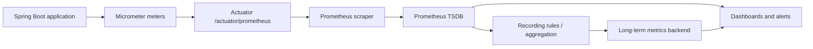

# Metrics Retention

Metrics help operations teams track service health over time: request rate, error rate, latency, CPU usage, memory usage, and dependency status. However, a metric is only useful if its data is stored long enough to answer operational questions. If data is deleted before an SLO window closes, the team cannot accurately calculate SLO attainment for the full period. If every time series is kept at high resolution forever, storage and query costs climb rapidly.

Metrics retention is the policy defining how long metrics data is kept, at what resolution, and in which system. For a Spring Boot application, distinguish two parts: the application produces and exposes metrics via Micrometer/Actuator; the collection or storage system such as Prometheus or a metrics backend determines how long data is kept. Application configuration directly affects time series count and quality, whereas retention is normally configured on the backend.

After this lesson, you will be able to:

- Determine metrics retention durations based on SLOs, incident investigation, and analytical needs.
- Estimate sample counts from active time series and scrape intervals.
- Understand how label cardinality, histograms, and recording rules affect storage volume.
- Configure retention in Prometheus or the corresponding storage backend.
- Design raw and aggregated data tiers to balance granularity against cost.
- Verify data, disk usage, and query behavior after changing a retention policy.

## 1. Where Does Metrics Retention Sit in the Architecture?

A typical metrics flow for a Spring Boot service consists of:



Spring Boot and Micrometer record meters such as counters, gauges, timers, and distribution summaries. With the Prometheus Registry, Actuator can expose meters in Prometheus format at `/actuator/prometheus`. Prometheus scrapes the endpoint periodically and writes samples into its time-series database (TSDB). The backend may retain data locally, forward data to remote storage, or use another metrics platform.

Retention belongs to where data is stored. For instance, `management.endpoints.web.exposure.include` controls which Actuator endpoints are exposed; it does not determine how long Prometheus retains samples. Similarly, `management.metrics.distribution.*` adjusts how meters compute distributions or emit histograms, not when the TSDB deletes data.

Do not confuse metrics retention with log or trace retention. Log collectors may rotate files or set index lifecycle policies; tracing backends may set span retention limits. Each signal has its own format, volume, and storage policy. Configuring one system does not automatically apply to the other two.

## 2. Choose Retention Periods Based on Operational Purpose

There is no single right retention duration for every system. Start from the questions the data must answer:

| Need | Required Data | Considerations |
|---|---|---|
| Investigating recent incidents | High-resolution metrics over recent days or weeks | Needs enough detail to inspect spikes, deploys, and traffic shifts |
| Monthly SLO evaluation | Data covering the full SLO window plus a buffer | Retention must exceed the query window plus investigation lag |
| Quarterly/annual trend comparison | Aggregated metrics at minute, hour, or day resolution | Resolution can be reduced after aggregation |
| Seasonality and growth analysis | Stable aggregated series across many months | Keep useful analytical dimensions; avoid high-variance labels |
| Prolonged incident investigation | Raw metrics plus pre/post-incident aggregates | Account for detection, response, and post-mortem timeframes |

For example, if an SLO is evaluated over a 30-day window, keeping raw metrics for only 14 days prevents direct queries over raw data from covering the full window. You can solve this by extending raw retention or creating appropriate recording rules/aggregates and retaining their output long enough. Aggregates must preserve the semantics of the SLO calculation; not every simple average can replace raw data.

An illustrative policy for a web service might retain raw metrics for 15 days, 5-minute aggregated data for 90 days, and hourly aggregated data for 13 months. This is only an example to discuss with operations teams. Actual limits depend on organizational rules, backend cost, analytical goals, and whether data can be reconstructed. Note that Prometheus local TSDB retention generally applies uniformly across blocks in the same TSDB rather than setting separate lifetimes per metric or recording rule. To retain tiers with distinct lifetimes, use separate backends/tenants or a long-term storage platform supporting tiered policies.

Before finalizing retention periods, answer these questions:

- What is the longest SLI/SLO window? Which dashboards or reports need longer queries?
- Once an alert fires, how long does the team usually take to start and finish investigating?
- Do you need week-over-week, month-over-month, or year-over-year comparisons?
- Does the backend support downsampling or recording rules? Does the aggregation preserve required information?
- Does the data contain sensitive fields or fall under specific retention regulations?
- Who owns the retention policy and who responds when storage approaches its limit?

## 3. Estimate Volume from Time Series and Scrape Intervals

A time series is identified by its metric name and label set. Every distinct label combination can create a separate series. Prometheus scrapes one sample per series during each scrape in which that series is present.

Estimate sample count using:

\[
\text{samples} \approx \text{active series} \times
\frac{86\,400}{\text{scrape interval (seconds)}} \times
\text{retention days}
\]

For example, a backend with 100,000 active series scraped every 15 seconds and retained for 30 days:

\[
100\,000 \times \frac{86\,400}{15} \times 30
= 17,280,000,000\text{ samples}
\]

This estimates sample count before accounting for intermittent series, failed scrapes, recording rules, and label-set churn. It highlights the impact of cardinality and scrape interval: doubling series count or halving the scrape interval roughly doubles sample volume.

You cannot convert sample counts into bytes with a single universal constant across backends. Actual disk size depends on chunk encoding and compression, label length, indexes, WAL, block compaction, series churn over time, and HA replicas. Use real measurements from your backend to forecast, then leave headroom for growth and compaction.

### Cardinality is usually the deciding factor

Suppose a request metric has `method`, `status`, and `uri` labels. If `uri` is normalized to a route like `/orders/{id}`, the number of values stays bounded. If raw URLs containing order IDs are put into the label, every request can create a new series. Dangerous labels commonly include:

- User IDs, order IDs, session IDs, or request IDs.
- Full URLs with dynamic path parameters or query strings.
- Email addresses, client IP addresses, search queries, or free-form strings.
- Exception messages containing per-request varying data.

In metrics, prefer small, stable value sets such as HTTP method, status code, service, environment, or normalized route. Data identifying individual requests belongs in logs or traces, which have dedicated querying and retention mechanisms.

### Histograms multiply series count

Timers and distribution summaries can emit histograms so backends can compute quantiles from buckets. With classic Prometheus histograms, each label combination of a meter generates multiple bucket series plus `_sum` and `_count` series. More buckets mean more series. If a meter already has high cardinality, enabling histograms can increase storage markedly.

An example Spring Boot configuration enabling histograms and SLO buckets for HTTP server requests:

```yaml
management:
  metrics:
    distribution:
      percentiles-histogram:
        http.server.requests: true
      slo:
        http.server.requests: 100ms,250ms,500ms,1s
```

Exact meter names and customization support depend on the Spring Boot/Micrometer version and registry in use. Inspect actual meters at `/actuator/metrics` or `/actuator/prometheus`. Before enabling histograms broadly, identify which latency questions must be answered, how many buckets are needed, and the impact on active series. Prometheus histograms allow aggregating quantiles across instances from buckets; precomputed client-side percentiles generally cannot be accurately combined across instances.

## 4. Configuring Retention in Prometheus

Prometheus stores samples in its local TSDB. Retention is configured on the Prometheus process, usually via command-line flags or container/Helm chart deployment settings.

Example starting Prometheus with a 15-day time limit and a 40 GB TSDB block size cap:

```bash
prometheus \
  --config.file=/etc/prometheus/prometheus.yml \
  --storage.tsdb.path=/prometheus \
  --storage.tsdb.retention.time=15d \
  --storage.tsdb.retention.size=40GB
```

These two limits are illustrative examples. When both time and size are configured, whichever limit requires deleting older data first triggers block cleanup. Therefore, setting `retention.time=30d` does not guarantee a full 30 days of data if the size limit is hit sooner.

The `retention.size` limit should not be treated as an absolute cap on total filesystem usage. WAL, head data, compaction, and other overhead require additional space. Provision persistent volumes with headroom, monitor disk utilization, and verify behavior for your exact Prometheus version. Never set the size cap right up against total volume size, or the system may hit the limit before operators have time to react.

A basic scrape configuration for a Spring Boot application might look like:

```yaml
global:
  scrape_interval: 15s

scrape_configs:
  - job_name: spring-boot
    metrics_path: /actuator/prometheus
    static_configs:
      - targets:
          - observability-demo:8080
```

This snippet determines where and how often Prometheus pulls data. It does not change retention. Place Actuator endpoints on a management network or protect them with proper authentication and network policies; never expose management endpoints to the Internet just so Prometheus can scrape them.

If using `remote_write`, Prometheus forwards samples to a remote storage system. `remote_write` is only a transport mechanism; long-term retention is governed by the receiving backend and its policies. Monitor remote-write queues, send errors, and destination retention as well. Local Prometheus retention settings do not automatically apply to data shipped to remote storage.

## 5. Keeping Long-Term Data with Recording Rules and Downsampling

Keeping all raw series at 15-second resolution for a full year is often expensive and unnecessary for every question. A common pattern is keeping raw metrics for a short window, generating aggregated series for long-term queries, and storing aggregates longer.

Example recording rule computing request rate by application and environment:

```yaml
groups:
  - name: service-rollups
    interval: 1m
    rules:
      - record: application_environment:http_requests:rate5m
        expr: |
          sum by (application, environment) (
            rate(http_server_requests_seconds_count[5m])
          )
```

Metric and label names in expressions must match actual registry output. Micrometer Prometheus typically normalizes timer names with units and the `_count` suffix, but verify on the application's endpoint before deploying rules. Recording rules create new time series; they do not delete raw series or define separate retention on their own.

When aggregating, choose which dimensions to keep for future questions. For instance, keeping `application` and `environment` suffices for overall traffic trends, but dropping `status` prevents that aggregate from distinguishing successful requests from errors. If latency analysis by route or status is needed, keep those dimensions in an appropriate aggregate and bound their cardinality.

Downsampling reduces data points by rolling raw data into larger intervals, such as from 15 seconds to 5 minutes or 1 hour. However, aggregation must match metric semantics:

- Counter: apply `rate`/`increase` over a window before aggregating; never average cumulative counter values directly.
- Gauge: pick an aggregation matching meaning, such as average, min, max, or last value. Averages can mask brief spikes, so retaining min/max is sometimes necessary.
- Timer/histogram: keep buckets or sufficient aggregates to compute required quantiles. Averaging per-instance p95s is not equivalent to the overall p95 across all requests.
- SLO/error ratio: aggregate numerator and denominator separately, then divide; avoid averaging differently weighted ratios.

Prometheus recording rules only produce new computed series within the same system. Automatic block downsampling or tiered long-term storage usually requires features of a backend or long-term storage platform. Check your platform's retention and downsampling policies rather than assuming local Prometheus TSDB creates storage tiers automatically.

## 6. Linking Retention to SLIs and SLOs

Retention must cover every query window the team commits to tracking. If an availability SLO uses a 30-day window, the system needs enough data to compute successful requests and total requests across 30 days. For latency histograms, matching buckets must be retained to evaluate the fraction of requests meeting the threshold.

For example, if an SLO requires 99.9% of requests to finish under 500 ms, one formulation counts requests in buckets at or below 500 ms divided by total requests. When using histograms, buckets and labels must be consistent across instances. Storing only per-instance p95 values and averaging them does not accurately represent the p95 across total traffic.

Recording rules can store pre-aggregated quantities for long-term SLO queries. For instance, if a histogram has a 500 ms bucket, you can record the ratio of requests completing within that bound:

```yaml
groups:
  - name: slo-rollups
    interval: 1m
    rules:
      - record: application_environment:http_requests_under_500ms:ratio_rate5m
        expr: |
          sum by (application, environment) (
            rate(http_server_requests_seconds_bucket{le="0.5"}[5m])
          )
          /
          sum by (application, environment) (
            rate(http_server_requests_seconds_count[5m])
          )
```

The expression assumes the meter has a `le="0.5"` (500 ms) bucket, `application` and `environment` labels, and non-zero requests in the evaluation window. This is an example latency SLI, not a complete SLO formula for every service. To measure availability, classify good/bad requests per your service's SLI definition and retain both quantities. Agree on SLI definitions before choosing aggregates and retention.

If raw data expires after 15 days while SLOs require 30 days, verify that aggregates have been running continuously and hold a full 30 days of history before shortening raw retention. Never shrink retention only to discover later that a recording rule had gaps or failed for part of that window.

## 7. Designing Tiered Storage Policies

A multi-tier model usually balances investigation depth with cost:

| Tier | Suggested Resolution | Illustrative Duration | Purpose |
|---|---|---|---|
| Raw | Per scrape interval, e.g., 15 seconds | 7–30 days | Investigating spikes, deploys, and recent incidents |
| Short aggregate | 1–5 minutes | 30–90 days | Operational dashboards and monthly SLOs |
| Long aggregate | 1 hour or 1 day | 6–13 months | Trends, seasonality, and capacity planning |

These intervals are reference ranges, not Spring Boot or Prometheus defaults. Your platform may offer automatic downsampling, recording rules, or per-tenant retention. Clarify which tier is the authoritative data source for dashboards, alerts, and reports so querying different resolutions does not yield conflicting results.

When designing multiple tiers:

1. List active dashboards, alerts, SLIs/SLOs, and reports; record the longest query window.
2. Classify which metrics need long raw retention and which can be aggregated early.
3. Decide which labels must remain in aggregates and drop dimensions unused by queries.
4. Create recording rules or configure downsampling, then validate output over a sufficient trial period.
5. Shorten raw retention only after confirming the aggregate tier has continuous data and accurate math.
6. Monitor cost, query latency, and storage usage to adjust policies over time.

Do not keep every metric forever just because the backend permits it. Equally, do not purge series needed for rare-bug investigations, operational audits, or SLO reviews too early. A sound policy has an owner, a purpose, and review criteria.

## 8. Data Protection and Lifecycle Governance

Metrics are usually seen as aggregate data, yet labels can still leak sensitive information if poorly designed. Never put emails, phone numbers, tokens, session IDs, or personal identifiers into labels. Short retention is no substitute for minimizing sensitive data at the source.

Define who can query metrics, who can modify retention policies, and who can delete data. In multi-tenant systems, check per-tenant retention settings if supported by the backend. For data subject to internal or legal compliance rules, coordinate with data owners to establish retention windows, deletion rules, and audit trails.

Retention is not backup. If a TSDB loses its volume, a 30-day retention setting will not recover lost data. If critical metrics require recovery guarantees, implement an appropriate backup or remote storage strategy and test restores. Conversely, keeping backups too long can retain data past its policy expiration; backup lifecycles must align with data retention policies.

## 9. Verifying Retention and Backend Health

Before changing a policy, record the current baseline: active series, ingested samples, TSDB disk usage, growth rate, and dashboard query latency. After the change, track those same indicators over several compaction and scrape cycles.

With Prometheus, you can inspect internal metrics exposed by your running version, such as:

- `prometheus_tsdb_head_series`: number of series currently in the head block.
- `prometheus_tsdb_head_samples_appended_total`: total samples appended to the head.
- WAL, block, compaction, and remote-write capacity metrics exposed by your version/backend.

Internal metric names can vary by version. Check Prometheus's own `/metrics` endpoint instead of assuming every metric name exists. Beyond metrics, monitor filesystem usage, PVC status, compaction logs, and remote-write errors.

A practical verification workflow:

1. Confirm Prometheus is scraping the right Spring Boot endpoint and fresh samples continue arriving.
2. Test dashboards over short time windows, then over the longest SLO window.
3. Confirm recording rules are active and aggregated outputs update continuously.
4. Compare series counts and storage usage before and after enabling histograms or adding labels.
5. Check disk usage and free-space alerts, including WAL and head data.
6. If using remote write, inspect queues, send errors, and data presence in the target backend.
7. Query a range older than the retention window to verify query behavior matches the documented policy.

Never treat an empty query result as sole proof that retention expired data. Empty results can also stem from wrong labels, metric names, timezones, scrape gaps, or query syntax errors. Cross-check the oldest/newest sample timestamps, backend metadata, and storage system logs.

## 10. Common Issues

| Symptom | Possible Cause | Remediation |
|---|---|---|
| Unable to query older data | Retention expired blocks or target backend has a shorter policy | Check policies on both local TSDB and remote backend; verify SLO duration needs |
| Disk usage grows fast despite unchanged retention | Active series increased, high label cardinality, or histograms with too many buckets | Inspect new series, normalize labels, and trim unnecessary buckets |
| Prometheus deletes data sooner than expected | Size retention limit hit before time retention limit | Check both flags and disk growth rate; add headroom or reduce ingest |
| Disk full despite setting retention size | WAL, head data, compaction, and overhead consume extra space | Monitor filesystem directly, provision volume headroom, and inspect compaction |
| Long-term dashboards have gaps | Newly deployed recording rule, failing rule, or aggregate backend missed samples | Verify rule status and sample continuity before cutting raw retention |
| Long-term SLOs wrong after downsampling | Aggregates failed to keep required numerator/denominator or buckets | Verify aggregation semantics and compare against remaining raw data |
| Remote backend missing data | Remote write errors, congested queue, or destination rejecting samples | Inspect queue state, logs, and backend quotas/capacity |
| Series count spikes after a release | Added high-variance label or unnormalized route | Identify new label, bound its value set, and assess impact before broad rollout |

A metric change can affect retention without touching storage configuration at all. For instance, adding a `customerId` label spikes series count; enabling histograms on many meters multiplies buckets; scaling out instances increases series carrying the `instance` label. Instrumentation reviews and retention reviews must therefore go hand in hand.

## 11. Pre-Production Policy Checklist

- Documented SLO windows, dashboards, and investigation timeframes to support.
- Distinguished raw retention, aggregate retention, and remote backend retention.
- Estimated active series, scrape interval, bucket count, and growth rate.
- Metric labels have low cardinality and contain no sensitive identifying data.
- Recording rules preserve proper semantics for counters, gauges, histograms, and SLIs.
- Volume capacity includes headroom for WAL, head data, and compaction.
- Verified remote write or forwarding pipelines if used.
- Tested dashboards and alerts against realistic time windows.
- Assigned policy owner, capacity alerts, and a periodic review process.
- Defined a backup/restore plan if metrics data requires recovery.

Metrics retention is an integral part of production observability design. When retention windows, resolution, and cardinality are chosen around operational goals, teams can investigate incidents thoroughly, evaluate SLOs accurately, and keep storage costs under control over time.
