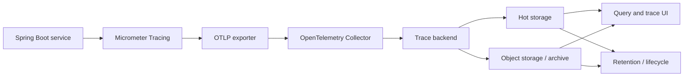
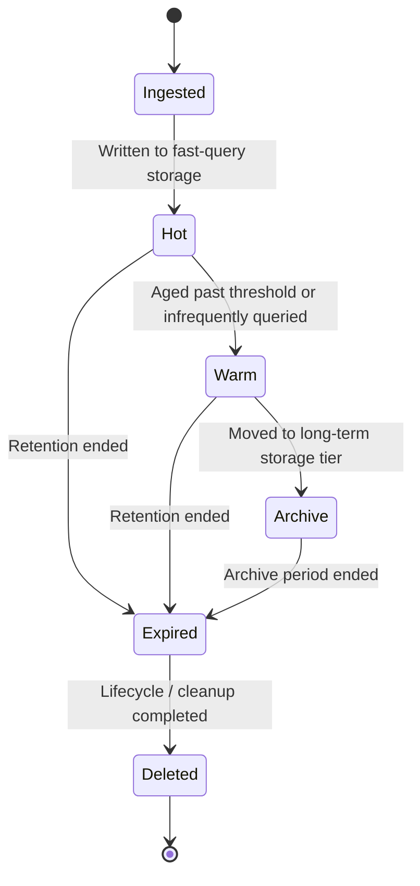

# Trace Retention

In the **Production Operations** chapter of the `SPRING_BOOT_OBSERVABILITY` module, this lesson explains how to design and operate distributed trace retention policies. Traces let teams follow a request across multiple services, pinpoint slow spans, and correlate errors with logs and metrics. However, retaining every trace indefinitely increases ingest, storage, indexing, and query costs. Retention determines how long trace data is kept before the backend removes it.

With Spring Boot, Micrometer Observation and Micrometer Tracing create observation contexts and spans; exporters send spans to an OpenTelemetry Collector or tracing backend. Retention policies are normally enforced at the trace storage tier—such as the backend or object storage—rather than simply by changing exporter settings in the application. You must therefore understand the entire path from the application to where data is stored and deleted.

## 1. What Is Trace Retention?

A trace consists of multiple spans describing the execution steps of a request or distributed job. Each span typically carries a trace ID, span ID, parent span ID, start timestamp, duration, status, operation name, resource attributes, and span attributes. The backend stores received spans to support search, waterfall views, error analysis, and cross-signal correlation.

**Retention** is the time window during which the backend keeps trace data queryable. Once that period expires, the backend deletes or marks the data as expired according to its storage engine mechanism. Retention may be configured globally, per tenant, per namespace, or per dataset depending on the product. Exact enforcement depends on the backend and underlying storage layer.

For example, a 14-day policy means traces are retained across a 14-day storage window under the backend's time calculation. A trace older than that window may no longer be searchable even while applications continue sending new traces normally.

Retention must be distinguished from related concepts:

| Concept | What It Decides | When It Takes Effect |
| --- | --- | --- |
| Sampling | Which traces or spans are selected for collection? | Before or during trace creation/ingestion. |
| Filtering | Which spans or attributes are dropped based on conditions? | In instrumentation, Collector, or backend depending on architecture. |
| Retention | How long received data is kept? | After data enters the storage layer. |
| Archiving | Which long-term tier older data is moved to? | During the storage lifecycle. |
| Deletion | Which data must be removed and when? | By TTL, lifecycle policy, or explicit deletion workflow. |

Low sampling does not replace retention. If a system keeps 100% of traces for 30 days, storage can still grow huge. Conversely, a 7-day retention window does not reduce traces ingested per second; it limits how long data remains in storage.

## 2. Identify Storage Needs Before Setting Retention

No single retention period fits every system. Choose retention based on investigation timelines, incident frequency, traffic, cost, and data governance rules.

Questions to answer:

- How long after an incident begins is it usually detected?
- How many days after detection do operations teams need to search traces?
- Are there incident, reconciliation, or customer support investigations spanning longer than normal query windows?
- Can older traces live in a cheaper tier and be retrieved on demand?
- Do specific tenants, environments, or service groups need different retention windows?
- Does the backend support separate retention by tenant, trace attribute, or storage class?
- Must deletion satisfy personal data, contractual, or internal policy requirements?

One way to determine duration is to sum the maximum expected incident detection lag, analysis time, and a safety buffer. For example, if an incident might be discovered 5 days late, the team needs 4 days to investigate, and 2 buffer days are added, the minimum lookup window should be around 11 days. Then round to a lifecycle cadence supported by the backend and verify actual cost.

Retention can differ across production, staging, and development. Production normally needs a window long enough to support incident investigations; staging can be shorter because data holds less long-term operational value. Still, do not make production retention too short merely to cut costs if doing so prevents investigating late-discovered bugs.

## 3. Estimate Trace Volume and Cost

Storage cost depends on ingested span count, average size, compression, indexing, replication, and how the backend organizes blocks or shards. An initial estimate can use:

\[
S_{raw/day} = N_{spans/day} \times B_{avg}
\]

Where:

- `N_spans/day` is the number of spans received by the backend per day after sampling and filtering.
- `B_avg` is the average size per span before compression and storage overhead.

Estimated stored volume:

\[
S_{stored} \approx S_{raw/day} \times D \times C \times R
\]

Where `D` is retention days, `C` is the size factor after compression and indexing, and `R` is the replication or redundancy factor. This is a rough estimation model; `C` may be below or above 1 depending on overhead accounting, and never replaces real measurements from your backend.

Example assuming 20 million spans/day, 700 bytes/span on average, and 14-day retention:

\[
20{,}000{,}000 \times 700 \times 14 = 196\,GB
\]

This is approximate raw data size before compression, indexing, and replication. Actual storage can differ substantially. Use measured ingest and storage growth numbers to calibrate the model.

Beyond storage, account for additional costs:

- Span ingestion and processing at the Collector/backend.
- Indexing attributes used to search traces.
- Query CPU, cache, and I/O when opening traces or filtering by tags.
- Replication, backups, and standby copies.
- Egress charges when retrieving data from object storage or archives.
- Operational compute for lifecycle jobs, compaction, and deletion.

Increasing retention increases stored data, though costs do not necessarily scale linearly if the backend uses compaction, compression, or tiered storage. Measure daily storage growth and check index/query costs before deciding.

## 4. Where Does Retention Sit in the Observability Architecture?

A typical trace flow:



Applications create spans and send them through exporters. The Collector may batch, enrich, filter, sample, or route telemetry. The backend ingests data and writes it to storage. Retention is typically enforced in the backend or storage lifecycle to remove expired blocks, indexes, objects, or records.

Do not confuse these mechanisms:

- The `batch` processor groups spans into batches to reduce transport overhead; it does not set how long traces are retained.
- The `memory_limiter` processor caps Collector memory; it is not a retention policy.
- Retry queues or persistent queues provide delivery resilience; they are not long-term trace archives.
- Tail sampling decides whether to keep or drop a trace after observing enough spans against a policy; it does not set TTL on stored traces.
- Backend/storage TTL or lifecycle rules determine how long stored data remains available.

If you only adjust Collector settings while the backend keeps data indefinitely, retention is not solved. Conversely, shortening backend retention does not stop the Collector from receiving an overwhelming volume of telemetry during peak hours.

## 5. Choose a Retention Strategy

Common strategies include:

| Strategy | How It Works | When Suitable |
| --- | --- | --- |
| Fixed retention | Keep every trace for the same duration, e.g., 7 or 14 days. | Systems with relatively uniform investigation needs. |
| Per-tenant retention | Each tenant gets its own duration or quota if supported by the backend. | Multi-tenant platforms with varying SLAs and requirements. |
| Per-environment retention | Production keeps traces longer than staging/development. | When data is separated by tenant, namespace, or storage policy. |
| Tiered retention | Fresh data stays on hot storage; older data moves to archive or cold storage. | Long-term retention needed with infrequent queries on older data. |
| Selective retention | Keep only traces flagged by backend policy for longer durations. | Need to retain error traces or critical transactions longer. |

Selective retention can be implemented via tail sampling before storage or via backend retention policies. The two differ in scope: tail sampling decides whether a trace enters storage at all; backend retention policies decide how long stored data survives. Verify whether your backend genuinely supports attribute-based retention before designing policies around `service.name`, status, or span attributes.

## 6. Configuring Retention in the Tracing Backend

There is no single universal Spring Boot property to set retention across all tracing backends. `management.otlp.tracing.endpoint` only specifies where spans are sent; it does not control data TTL at the destination. Retention must be configured on the specific backend you run.

### 6.1. Backends using block storage and object storage

Some backends write traces as blocks on object storage and run a compactor or lifecycle job to expire old blocks. When configuring this, define:

- How long blocks are kept before deletion.
- Compaction intervals and cleanup schedules.
- Which buckets or prefixes belong to which tenants/environments.
- Handling of blocks currently being queried or still open for writes.
- Whether object storage lifecycle rules align with backend retention.

The conceptual snippet below illustrates a 14-day policy—not a literal configuration file usable as-is for every product:

```yaml
trace_storage:
  retention: 14d
  cleanup_interval: 1h
  archive:
    enabled: false
```

Exact key names, units, defaults, and scope must come from the documentation for your specific backend and version. If an object storage lifecycle rule deletes objects earlier than the backend expects, queries can fail while metadata still exists. If the backend deletes metadata while old objects are never swept by lifecycle rules, storage charges keep accumulating.

### 6.2. Backends using Elasticsearch or OpenSearch

For backends storing spans in Elasticsearch/OpenSearch, retention is usually enforced via index lifecycle or index state management policies. A common pattern rolls over indexes by age or size, then deletes indexes past their expiration.

Design steps:

1. Identify the index pattern holding spans and how the backend names indexes.
2. Set rollover thresholds by size or age to prevent oversized indexes.
3. Attach the lifecycle policy to the right index template or index pattern.
4. Configure tier transition times if warm/cold storage is used.
5. Configure the final deletion age matching approved retention.
6. Verify the policy is attached to both new and existing indexes.

Never apply a deletion policy cluster-wide or to shared index patterns without verifying scope. Indexes can hold multiple data types; accidental deletion can wipe logs, metrics, or business data. Inspect mappings, aliases, templates, and index lifecycle status before making changes.

### 6.3. Backends using Cassandra or database TTL

Some storage backends apply TTL at the record or table level. In this model, check whether TTL is applied on write or via backend settings, how TTL propagates to auxiliary tables, and the actual lag before compaction reclaims disk space.

TTL expiration does not necessarily free disk space immediately. A database may tombstone expired records first, waiting for compaction to reclaim storage. Monitor both expired record behavior and actual disk usage.

## 7. Tail Sampling and Retention Working Together

Tail sampling selects traces based on information gathered after spans arrive at a Collector or sampling tier. For instance, it can prioritize retaining traces with error status, high duration, or critical services. This raises the share of high-value diagnostic traces without storing everything.

High-level flow:

1. Services emit spans and propagate the same trace context.
2. The Collector collects spans for a trace during a wait window.
3. Tail sampling evaluates conditions such as error status or latency.
4. Selected traces continue to the backend; unselected traces are dropped.
5. The backend stores accepted traces according to its retention policy.

Tail sampling requires routing so spans of the same trace reach the same sampling decision node, typically via trace-ID-based load balancing. If spans from one trace split across independent Collectors, sampling decisions can lack full data or yield incomplete traces. Decision wait windows must accommodate span arrival skew while bounding memory and concurrent trace count.

Head sampling in the application decides early. Once a trace is dropped by the head sampler, the backend never receives those spans for tail sampling or retention. Dropped traces cannot be recovered later by extending retention.

One policy might keep 10% of normal traces while prioritizing error or slow traces via tail sampling, then store all selected traces for 14 days. This is just an example of combining the two decisions; actual rates and conditions must reflect traffic, backend capacity, and budget.

## 8. Retention by Tenant and Environment

If the backend supports multi-tenancy, per-tenant retention helps satisfy differing service tiers. Ensure tenant identity is passed and authenticated at the ingest layer rather than trusting a self-reported span attribute from clients alone.

Across environments, you might adopt policies such as:

| Environment | Example Retention | Purpose |
| --- | --- | --- |
| Development | 1–3 days | Short-term debugging and instrumentation testing. |
| Staging | 3–7 days | Release validation, performance checks, and regression testing. |
| Production | 14–30 days | Incident investigation and longitudinal behavior comparison. |

These ranges are starting examples, not mandatory standards. Adjust them for incident detection lag, traffic, and budget. When multiple environments share a backend or bucket, isolate tenants, namespaces, index patterns, or storage prefixes so one environment's policy never affects another environment's data.

For traces carrying sensitive data, never rely on shorter or longer retention as a substitute for data controls. Minimize unnecessary attributes, mask or redact before storage, restrict query permissions, and define deletion workflows as required. Deleting from primary storage may not immediately purge backups, caches, replicas, or archives; understand the lifecycle of every copy.

## 9. Operating TTL, Archiving, and Data Deletion

A production retention policy should clearly describe every state in the data lifecycle:



If archiving is unnecessary, data can transition directly from hot or warm to expired. If archiving is used, decide whether older traces are directly queryable or require restoration first, along with restore times and egress costs.

Operational considerations:

- **When TTL starts:** backends may measure age from span timestamp, ingest time, or block/index creation time. Late-arriving traces may expire earlier or linger longer depending on the clock reference.
- **Cleanup lag:** compactors, lifecycle jobs, or database compactions run periodically. Data may disappear from queries slightly before or after nominal TTL expiration.
- **Backups and replicas:** copies may outlive primary storage. Include backup retention in the same data governance model.
- **Restores:** restoring an old snapshot can reintroduce expired data. Restore workflows should run lifecycle cleanup afterward if retention limits still apply.
- **On-demand deletion:** periodic TTL does not immediately satisfy requests to delete a specific trace. Check whether the backend supports deletion by trace ID/tenant or requires a custom procedure.
- **System clocks:** time synchronization across applications, Collectors, and backends ensures accurate trace ages and incident correlation.

Never promise data is deleted to the exact second TTL expires if cleanup runs on periodic schedules. Publish realistic retention windows and deletion lags based on storage engine behavior.

## 10. Monitoring Retention Effectiveness

After applying a policy, monitor ingestion, storage footprint, and cleanup behavior. Useful backend-dependent metrics include:

| Category | Metrics to Monitor | Signals Requiring Investigation |
| --- | --- | --- |
| Ingest | Spans/second, bytes/second, rejected spans | Sudden spikes or data rejections. |
| Storage | Hot/warm/archive footprint, block/index counts, daily growth | Storage growing faster than forecast despite constant retention. |
| Retention | Oldest queryable data, expired blocks/indexes, cleanup lag | Expired traces still lingering or recent data vanishing early. |
| Query | Query latency, timeouts, missing traces | Cleanup, compaction, or index policies degrading queries. |
| Collector | Queue size, export failures, dropped spans, memory | Collector overloaded before data reaches storage. |

Sample traces across age milestones: brand-new traces, traces near the retention boundary, and traces past the boundary. Record ingest time, span occurrence time, and when the trace becomes unqueryable. This reveals which timestamp the backend uses for TTL and how much cleanup lag exists.

You can verify retention with a clearly tagged synthetic trace in a test environment:

1. Trigger a request with an identifiable trace ID.
2. Confirm the trace reaches the backend and record its ingest timestamp.
3. Wait until near the retention boundary or use a test environment with a short TTL.
4. Re-query the trace and verify expiration behavior.
5. Confirm objects/indexes/records are cleaned up by the backend's lifecycle mechanism.

Never shrink production retention down to a few minutes just to test expiration. Use an isolated tenant or test environment with synthetic data.

## 11. Procedure for Changing Retention in Production

Changing retention directly impacts historical data availability and cost. Follow a controlled sequence:

**Step 1 — Define scope.** Specify affected tenants, services, environments, indexes, buckets, or datasets. Confirm whether other data types share the same storage.

**Step 2 — Capture baseline.** Record current ingest rate, storage growth, index size, query latency, cleanup lag, and current retention settings.

**Step 3 — Validate investigation windows.** Compare new retention against incident detection lag, analysis windows, and long-term compliance needs. If long-term storage is needed with rare queries, consider archiving instead of extending hot retention.

**Step 4 — Test policy in staging/test.** Confirm the policy attaches to the right index/bucket/tenant, uses the expected TTL anchor, and cleans up properly. Test against both old and newly written data.

**Step 5 — Roll out safely.** Apply policy changes through the backend's release process. Watch compactor/lifecycle logs, query errors, and disk usage closely during initial cycles.

**Step 6 — Verify results.** Create or pick test traces, verify query windows, and confirm out-of-window data is handled properly. Compare storage growth against projections.

**Step 7 — Document policy and rollback.** Record retention duration, scope, owner, effective date, and rollback steps. Remember that raising retention back up cannot restore already-deleted data; recovery is only possible from valid backups or archives.

## 12. Common Retention Configuration Mistakes

| Symptom | Possible Cause | Remediation |
| --- | --- | --- |
| Traces vanish earlier than expected | TTL calculated from span vs. ingest timestamp differently than assumed; policy attached to wrong tenant/index. | Verify how the backend measures age, ingest timestamps, and active policies. |
| Old traces remain searchable past TTL | Cleanup runs periodically, index has not rolled over, or object lifecycle has not executed. | Check compactor, lifecycle jobs, aliases/templates, and cleanup lag. |
| Storage does not shrink after traces expire | Database has not compacted, object copies remain, or other indexes/backups persist. | Inspect physical storage, replicas, snapshots, and archives. |
| Traces are missing spans | Sampling, filtering, Collector routing, or export failures. | Check sampling decisions, trace-ID load balancing, queues, and exporter logs. |
| Traces are unqueryable yet bucket stays huge | Metadata expired while underlying objects were not deleted by lifecycle rules. | Align backend retention with object storage lifecycle rules. |
| Policy accidentally deletes unrelated data | Index pattern, bucket prefix, or tenant selector was too broad. | Narrow selectors, validate target resources beforehand, and test policies. |
| Missing traces during an incident window | Retention window shorter than detection lag, or sampling dropped the trace. | Adjust retention, sampling, or archiving to match investigation needs. |
| Storage grows beyond forecast | Span volume, attribute size, index overhead, or replication increased. | Measure real ingest, review sampling, cardinality, and storage overhead factors. |

## 13. Design and Operations Checklist

- [ ] Determined the maximum time between incident start and incident detection.
- [ ] Selected retention based on investigation needs, cost, and data governance rules.
- [ ] Distinguished sampling, filtering, retention, archiving, and deletion.
- [ ] Identified the exact layer enforcing retention: backend, database, or object storage lifecycle.
- [ ] Verified whether TTL is anchored on span timestamp, ingest time, or block/index creation.
- [ ] Accounted for replication, backups, caches, archives, and cleanup lag.
- [ ] Separated policies by tenant or environment where supported by architecture.
- [ ] Verified tail sampling and routing so spans of the same trace are not split.
- [ ] Monitored ingest, storage growth, cleanup lag, and query latency.
- [ ] Tested the policy in a test environment and documented rollback steps.

Trace retention is a core part of observability operations design. Sampling decides which traces are collected; retention decides how long stored traces survive; archiving keeps older data on an appropriate tier; deletion completes the data lifecycle. When policies sit at the right storage layer, are tracked with real metrics, and align with investigation requirements, operations teams can balance production traceability against cost and data stewardship.
