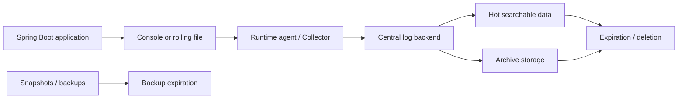

# Log Retention

Log retention is the policy defining which logs are kept, how long they are kept, where they are stored, and how they are deleted upon expiration. For a Spring Boot service, logs may flow from the application to the console or a file, through an agent/collector, and onward to a centralized log platform and archive storage. Configuring file rotation only in the application without managing copies in backends, snapshots, and backups can leave data around longer than intended. Conversely, deleting logs too early can strip operations teams of evidence needed to investigate incidents.

Spring Boot provides a logging system and integrates Logback by default in many applications. Spring Boot logging properties help manage files and rolling policies at the application level. Overall storage lifetimes usually also depend on the centralized log platform, container runtime, collector, object storage, and internal governance rules. Retention must therefore be designed across the entire data lifecycle.

## Goals and Concepts

After this lesson, you will be able to:

- Classify logs by usage purpose and define appropriate retention durations.
- Configure rolling files and size caps with Spring Boot/Logback when an application must write files.
- Design retention across centralized log platforms, archives, and backups.
- Minimize sensitive data, enforce access controls, and handle data deletion requests.
- Monitor storage usage, data age, rollover health, and retention policy enforcement.

Concepts to distinguish:

| Concept | Meaning |
|---|---|
| Log rotation / rollover | Closing the current file or index and starting a new file/index by time or size |
| Retention | The duration data is permitted or required to be kept before expiration |
| Archive | Storing older logs in another storage tier, usually cost-optimized or for long-term lookup |
| Deletion / expiration | Removing expired data from storage tiers and copies within policy scope |
| Backup / snapshot | Copies used for recovery; must have separate lifetimes and be included in the data lifecycle |

Rotation does not automatically equal retention. Renaming a file every day just creates historical files; without limits on day count or total size, they can still fill up the disk.

## Designing a Retention Policy

### 1. Classify logs by purpose

Do not apply the same lifetime to every kind of log. Before picking a day count, identify what problem the log solves, who owns the data, and who needs access.

| Log Category | Examples | Considerations |
|---|---|---|
| Application diagnostic | Startup, exceptions, timeouts, request processing state | Incident investigation time, SLOs, volume, and issue reproducibility |
| Access log | HTTP method, route, status, duration, client metadata | Security/operational purpose, identifying fields, and privacy policies |
| Security/audit log | Logins, permission changes, admin actions, data access | Audit requirements, integrity, restricted access, and legal hold procedures |
| Business event log | Business events or state history | Whether it belongs in dedicated business storage rather than diagnostic logs |
| Platform/infrastructure log | Container runtime, node, gateway, database | Platform ownership and independent system lifecycles |

Diagnostic logs help explain what happened inside an application, but they do not automatically substitute for an audit trail. If you need to prove who performed a sensitive action, audit logs need dedicated schemas, access controls, integrity protection, and archival processes. Never use plain text logs as the sole system of record for critical business data.

### 2. Choose retention windows and expiration anchors

Retention durations must be agreed upon with service owners, security, privacy, and organizational compliance stakeholders. Consider:

- Time required to detect, investigate, and resolve incidents.
- SLOs, release cadences, reconciliation schedules, and anomaly detection windows.
- Collection purpose, data classification, contractual obligations, and applicable regulations.
- Ingestion, indexing, query, archive, snapshot, and recovery costs.
- Ability to delete data across all copies upon expiration or valid request.

No single retention day count fits every application. Document the approved duration for each log category rather than copying one default across services.

Policies must also state when retention begins counting. Normally this starts from the event timestamp (`event time`) or when the system received the log (`ingest time`). These two timestamps can diverge when a collector experiences an outage or logs are replayed. Use UTC timestamps, synchronize clocks across hosts, and define how late-arriving logs are handled to avoid premature deletion or over-retention.

A policy can be captured in a governance table like this:

| Attribute | What to Specify |
|---|---|
| Log category | Log group and originating service |
| Purpose / owner | Intended use and responsible team |
| Classification | Sensitivity level, personal data, or secrets that might appear |
| Hot retention | How long data remains quickly searchable in the backend |
| Archive retention | How long data stays in a low-cost tier, if applicable |
| Expiration rule | Retention anchor timestamp and deletion criteria |
| Backup/snapshot | Lifetime, location, and expiration method for copies |
| Legal hold / exception | Approver, scope, and how the exception is lifted |

Every exception needs an owner, rationale, review date, and end date. Legal holds must follow organization-approved workflows; never auto-delete data under active preservation.

### 3. Design storage tiers

A common pipeline looks like this:



Each tier has distinct responsibilities:

- The application emits logs with timestamp, level, service identity, and required context.
- The container runtime or agent collects logs, tracks read positions, and forwards data to the backend.
- The centralized backend applies rollover, retention, access controls, and querying.
- Archive stores infrequently accessed data when an approved need exists.
- Snapshots/backups have their own expiration schedules; never omit them when evaluating total data retention.

Identify which tier is the authoritative source and which tiers are only caches or copies. If a log is purged from indexes yet remains inside snapshots indefinitely, the retention policy is not fully enforced.

## Configuring File Retention with Spring Boot and Logback

Spring Boot uses Logback as its default logging implementation when the standard logging dependency is present. If an application must write logs to files, configure paths and rolling policies with Spring Boot properties.

### 1. Configuring rolling files

Example `application.yaml`:

```yaml
logging:
  file:
    name: /var/log/order-service/application.log
  logback:
    rollingpolicy:
      file-name-pattern: ${LOG_FILE}.%d{yyyy-MM-dd}.%i.gz
      max-file-size: 100MB
      max-history: 14
      total-size-cap: 2GB
      clean-history-on-start: true
```

With this configuration:

- `logging.file.name` sets the active log file. Spring Boot exposes the `LOG_FILE` property for logging config when a filename is configured.
- `file-name-pattern` names archive files by date and index; the `.gz` suffix compresses rolled-over files.
- `max-file-size` caps individual file size before rolling over within a period.
- `max-history` caps the number of historical periods retained. With the daily pattern in this example, `14` corresponds to up to 14 daily periods.
- `total-size-cap` caps total archive file size kept by the rolling policy; older archives may be deleted early when the cap is reached.
- `clean-history-on-start` cleans up old history when the logging system starts.

These are illustrative examples, not universal recommended limits. Choose paths, days, and size caps based on approved policy, volume capacity, and actual log emission rates. Ensure the application user has write permission to the directory and the volume has room for both the active file and archives.

`max-history` and `total-size-cap` in a rolling policy only manage archive files owned by that appender. They do not delete logs already shipped to a centralized backend, copies created by agents, snapshots, or backups. If using custom file patterns in `logback-spring.xml`, verify equivalent rolling and cleanup policies are still declared.

### 2. Containers and Kubernetes

In containers, the preferred approach is usually writing logs to the console (`stdout`/`stderr`) for collection by the container runtime and node agent. In that case, do not configure `logging.file.name` just to keep local logs. Container runtime log rotation, node disk caps, and backend retention are configured separately on the deployment platform.

If an application writes files inside a container, verify whether the volume is persistent, who owns rotation, how the agent reads files, and what happens when a pod is replaced. Files on an ephemeral container filesystem disappear with the pod; storing files there does not constitute durable storage.

Avoid letting both the application and the runtime rotate the same file without coordination. Two rotation mechanisms can rename, delete, or truncate files while a collector is still reading, causing lost or duplicate logs. Assign one owner for rotation at each write target and test how the agent tracks files across rollovers.

## Retention in Centralized Log Platforms

Once logs reach a backend, configure retention on the backend itself. Policy names and syntax differ across Elasticsearch/OpenSearch, Loki, Splunk, Cloud logging, and other managed services, though the core decisions are similar:

1. **Scope the data:** index, stream, tenant, bucket, or log group by service and category.
2. **Set rollover conditions:** by age, size, or document count so a single index/segment does not grow unbounded.
3. **Set searchable duration:** keep data on fast-query storage for the approved window.
4. **Tier or archive:** when longer retention is needed without frequent querying, move to an appropriate tier and test restoration.
5. **Delete on expiration:** verify the backend deletes indexes/streams and archives on schedule, including managed replicas.

Conceptual policy design table:

| Stage | Action | Verification Question |
|---|---|---|
| Ingest | Attach service, environment, version, category, and timestamp | Do logs land in the right tenant/index/stream? |
| Rollover | Create a new index/segment at chosen thresholds | Do indexes roll over before getting too large? |
| Hot | Keep data fast to search | Does duration match the approved policy? |
| Archive | Move cold data if required | Can it be restored and queried again? |
| Expire | Delete expired data | Do indexes, archives, replicas, and snapshots share a consistent lifecycle? |

For Elasticsearch/OpenSearch, use the platform's lifecycle management to coordinate rollover and index deletion. For Loki or cloud logging services, retention is typically configured per tenant, stream, bucket, or log group and may require enabling a compactor/lifecycle component. Follow documentation for your exact backend version; never copy policy syntax across products because field names and semantics differ.

Do not rely solely on index names for retention if index patterns miss legacy indexes or indexes created by another pipeline. Verify policies are attached to the right data objects and check execution status on each object.

## Protecting Data Inside Logs

The longer retention lasts, the larger the exposure window if sensitive data enters logs. The best control starts at log creation time:

- Never log passwords, access tokens, refresh tokens, API keys, private keys, session cookies, or configuration secrets.
- Restrict logging full request/response payloads. Emit only fields needed for diagnostics.
- Mask or strip personal data and sensitive identifiers per internal policy before logs leave the application.
- Enforce role-based access control; restrict who can search, download, change policies, or delete logs.
- Protect data in transit and at rest with platform-appropriate TLS and encryption.
- Audit administrative access and retention policy modifications.
- Account for data inside archives, snapshots, replicas, and user-downloaded exports.

Logs can include trace IDs, span IDs, request IDs, and deployment/version fields to correlate with metrics and traces. These IDs aid investigation, yet personal data or secrets must never be placed in tags/fields just for search convenience. Preserve correlation without leaking request contents.

Log sampling, lowering log levels, or deduplicating repeated events can trim ingest volume, but they do not replace retention policies. Sampling can drop evidence of rare errors; clearly specify which log types may be sampled and which must be kept completely for operations or audit needs.

## Monitoring Retention Enforcement

Having a policy in configuration does not prove data is actually being deleted on time. Monitor both storage usage and execution health.

| Metric or Check | Signal Requiring Investigation |
|---|---|
| Log ingest rate and bytes/day | Sudden spikes after a release, log loops, or unexpected debug logging |
| Storage by index/stream/tier | Steady growth despite configured retention |
| Age of oldest log | Data surviving beyond approved searchable or archive windows |
| Collector lag and dropped events | Logs arriving late, dropped logs, or inability to keep pace with emission |
| Rollover/retention job status | Failing policies, unattached indexes, or stalled cleanup |
| Disk usage and free space | Volumes nearing limits, risking application logging failures |
| Archive restore test | Inability to restore tiered data when needed for investigations |

Run periodic checks with a test log carrying a timestamp and distinct identifying label. Verify the log reaches the right stream, stays searchable for the expected window, and disappears after expiration in a test environment or approved workflow. Never inject synthetic data into production where it could be mistaken for real audit events.

For local logs, check current file size, archive count, oldest file age, and volume capacity. For centralized backends, inspect policy attachments, lifecycle status, index/stream ages, archives, and snapshots. Also watch late-arriving logs: ingest-time retention can keep old events longer than event time; event-time retention can immediately expire a very old record upon ingest.

## Handling Common Operational Scenarios

### Log storage grows despite `max-history`

Logback's `max-history` only manages archives produced by that rolling policy. Verify the application is actually using Logback and that file appender, that the file pattern includes a date, that another profile does not override logging config, and that you are inspecting the right path. Then check copies on container nodes, collector buffers, backends, archives, and snapshots.

### Old logs are not deleted in the backend

Verify the policy is attached to active indexes/streams, rollover is actually happening, deletion rules use the right timezone and time anchor, lifecycle workers/compactors are running, and no legal hold or exception applies. Also inspect older indexes not matching current patterns and snapshots retained on independent schedules.

### Logs disappear after a pod restart

If logs are written only to an ephemeral container filesystem, data can vanish when pods are replaced. Switch to console logging with centralized collection, or use a persistent volume with managed rotation and backups. Never treat container-local files as durable storage.

### Application runs out of disk space due to log files

Check log emission rates, file appenders, write permissions, rolling policies, `max-file-size`, `max-history`, `total-size-cap`, and volume capacity. If growth comes from repeated exceptions or overly verbose log levels, fix the root cause. Never manually delete a file held open by an active appender without a runbook coordinated with the logging system and collector.

### Request to preserve logs for an investigation

Identify the exact service, time window, category, and scope of logs to preserve. Perform archival/export through a controlled workflow, recording the approver, checksum or integrity evidence if required, storage location, and copy lifetime. If a legal hold is needed, follow organizational procedures and record when the hold may be lifted. Once the investigation closes, review the exception so data is not kept indefinitely.

## Example: Designing a Policy for `order-service`

Suppose `order-service` emits application diagnostic logs, access logs, and security audit logs. The operations team begins by classifying all three groups, assigning owners, and securing retention approvals aligned with purpose and organizational rules. They keep diagnostic logs quickly searchable in the backend for routine incident response; audit logs get dedicated protection and retention; archiving applies only where approved needs exist.

During rollout, the team:

1. Standardizes structured logs with `service.name`, `service.version`, `environment`, UTC timestamps, log level, and trace context.
2. Strips tokens and sensitive data from logs before emission.
3. Configures containerized apps to write to console for agent collection; on any VM-based file-writing instances, applies Logback rolling policies with size and period caps matching the policy.
4. Attaches lifecycle policies to the right backend indexes/streams and validates rollover and expiration.
5. Sets alerts for abnormal ingest rates, storage growth, collector lag, and oldest log age exceeding limits.
6. Runs periodic checks confirming old logs expire in the backend and across related archives/snapshots.

When a dashboard later reports rising storage even though file appenders retain only the configured days, the team checks the backend and finds legacy indexes missing lifecycle policies. They attach the proper policy, monitor rollover/expiration, and verify snapshot retention. This case illustrates why retention must be verified at every storage tier.

## Operational Checklist

- [ ] Every log category has a defined purpose, owner, data classification, and approved retention window.
- [ ] Policy specifies retention anchor, timezone, late-arriving log handling, and exceptions/legal holds.
- [ ] Applications log only needed fields; secrets and sensitive data are stripped or masked.
- [ ] Console/file output matches the runtime environment with a single rotation owner at each write target.
- [ ] Rolling files define size caps, history limits, and cleanup; volumes have room for active files.
- [ ] Backend policies attach to the right indexes/streams/tenants with active rollover and expiration.
- [ ] Archives, replicas, snapshots, backups, and exports have defined lifecycles.
- [ ] Search, download, admin, and delete permissions are restricted and audited.
- [ ] Dashboards/alerts track ingest rates, storage usage, collector lag, data age, and lifecycle errors.
- [ ] Periodic tests verify data is retained as required, deleted on time, and restorable when needed.

Log retention is a core part of observability operations: it ensures logs remain available when teams need to investigate incidents while bounding storage footprint and retention duration to approved purposes. Revisit policies whenever services, traffic levels, storage architecture, or data requirements change.
