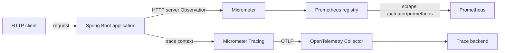
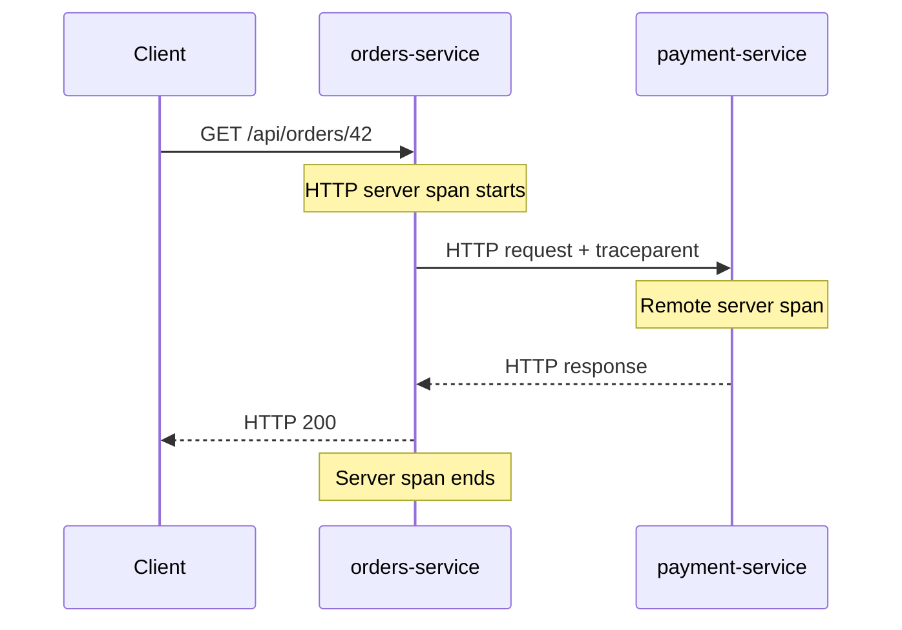

# Enabling Metrics and Traces for HTTP

HTTP is a critical boundary for starting to observe a Spring Boot application. Here, we need to know which requests are arriving, which endpoints are slow, which status codes are returned, and which dependencies a request calls. Metrics show overall trends over time; distributed tracing lets us follow a single request across components and services.

Spring Boot integrates Micrometer Observation and Actuator to automatically record many HTTP operations. By adding an appropriate metrics registry and tracing bridge/exporter, the application can export metrics for Prometheus and send traces to an OTLP receiver. This practice exercise enables both signals, sends a request to generate data, and verifies the output through Actuator and the trace backend.

This lesson belongs to the **Integrated Practice** chapter of the **SPRING_BOOT_OBSERVABILITY** module. The module guides setting up observability for Spring Boot using Micrometer Observation, metrics, logs, and distributed tracing; this lesson combines configuration, HTTP instrumentation, export, and verification to investigate errors and latency in a live runtime environment.

## Objectives

After this lesson, you will be able to:

- Enable HTTP server metrics using Spring Boot Actuator and Micrometer.
- Export metrics in Prometheus format.
- Configure Micrometer Tracing with the OpenTelemetry bridge and OTLP exporter.
- Generate HTTP requests and verify that traces are sent to the collector.
- Understand the difference between metrics and traces, as well as the impact of sampling.
- Secure management endpoints and avoid creating high-cardinality tags.

## Practice Architecture

The data flow is implemented as follows:



Spring Boot/Micrometer records HTTP activity. The Prometheus registry provides a metrics scrape endpoint. Micrometer Tracing creates and propagates trace context, after which the OTLP exporter sends spans to the collector. Prometheus and the trace backend are two independent data consumers; trace sampling does not reduce the count of recorded HTTP metrics.

The examples use Spring Boot 3.x with dependency versions managed by Spring Boot dependency management. If your project uses another version, verify property names and dependencies against the Spring Boot version you are running.

## 1. Preparing Dependencies

Assume the application already has Spring Web. Add Actuator, the Prometheus registry, and the OpenTelemetry tracing bridge/exporter.

With Gradle:

```groovy
dependencies {
    implementation("org.springframework.boot:spring-boot-starter-web")
    implementation("org.springframework.boot:spring-boot-starter-actuator")

    runtimeOnly("io.micrometer:micrometer-registry-prometheus")

    implementation("io.micrometer:micrometer-tracing-bridge-otel")
    runtimeOnly("io.opentelemetry:opentelemetry-exporter-otlp")
}
```

If `spring-boot-starter-web` is already in the project, do not declare it a second time. Spring Boot manages compatible versions through its BOM/plugin; avoid pinning different Micrometer and OpenTelemetry versions manually without checking the compatibility matrix.

Role of each dependency:

| Dependency | Role |
|---|---|
| `spring-boot-starter-actuator` | Provides management endpoints and Micrometer integration |
| `micrometer-registry-prometheus` | Converts meters into Prometheus format for scraping |
| `micrometer-tracing-bridge-otel` | Connects Micrometer Tracing with OpenTelemetry |
| `opentelemetry-exporter-otlp` | Sends spans over the OTLP protocol |

With Actuator alone, the application can already expose many internal metrics via `/actuator/metrics`. The Prometheus registry adds the `/actuator/prometheus` endpoint. Tracing requires the corresponding bridge and exporter; merely enabling the metrics endpoint does not automatically create distributed traces.

## 2. Configuring Actuator, Metrics, and Tracing

Add the following configuration to `application.yml`:

```yaml
spring:
  application:
    name: orders-service

management:
  endpoints:
    web:
      exposure:
        include: health,metrics,prometheus

  metrics:
    distribution:
      percentiles-histogram:
        "http.server.requests": true

  tracing:
    sampling:
      probability: 1.0

  otlp:
    tracing:
      endpoint: http://localhost:4318/v1/traces
```

Configuration breakdown:

- `spring.application.name` sets the service name to distinguish the resource in the trace backend.
- `endpoints.web.exposure.include` exposes only the three endpoints needed for this practice: health, metrics, and prometheus.
- `percentiles-histogram` enables histograms for the HTTP server timer, allowing the metrics backend to compute percentiles from buckets when the registry supports it.
- `sampling.probability: 1.0` samples all traces in the practice environment for easy observation. This value is usually too high for high-traffic production.
- `otlp.tracing.endpoint` points to the collector's OTLP HTTP receiver. The port and path must match the actual receiver configuration.

Setting a 100% sampling probability makes verification easy in a local environment, while metrics are still recorded independently. In production, choose a sampling rate based on traffic, storage budget, investigation needs, and the system's tail-based sampling capabilities. Do not raise sampling just to fix a missing trace without first checking the exporter, collector, and filtering conditions.

If the collector is on another machine or container, replace `localhost` with a hostname reachable from the application process. `localhost` inside a container points to the application container itself, not automatically to the host machine or another collector container.

## 3. Automatically Generated HTTP Server Metrics

When an application uses Spring MVC or WebFlux and has Actuator/Micrometer configured appropriately, Spring Boot automatically records HTTP server requests. The standard meter is:

```text
http.server.requests
```

This is typically a timer that records request count and processing duration. Default tags may include:

| Tag | Meaning |
|---|---|
| `method` | HTTP method such as `GET`, `POST` |
| `uri` | Normalized route template, e.g., `/orders/{id}` |
| `status` | HTTP response status such as `200`, `404`, `500` |
| `outcome` | HTTP outcome group such as `SUCCESS`, `CLIENT_ERROR`, `SERVER_ERROR` |
| `exception` | Exception class name or a default value when no exception occurred |

Exact tag names and tag sets depend on the Spring Boot version, web framework, and configured conventions. Inspect actual data on the metrics endpoint before writing dashboard queries.

There is no need to create a manual Observation around every controller just to measure HTTP server duration. Use this automatic meter for questions about traffic, latency, and status by endpoint. Only add a business Observation when you want to measure an operation with distinct semantics, such as `checkout.submit`.

## 4. Enabling HTTP Client Instrumentation

If the application calls other services, HTTP client metrics and traces help identify which dependency is slow. For clients supported by Spring Boot, use the builder injected by Spring Boot to receive automatic observation and instrumentation configuration.

Example using `RestClient`:

```java
import org.springframework.context.annotation.Bean;
import org.springframework.context.annotation.Configuration;
import org.springframework.web.client.RestClient;

@Configuration
class PaymentClientConfiguration {
    @Bean
    RestClient paymentRestClient(RestClient.Builder builder) {
        return builder
                .baseUrl("http://payment-service")
                .build();
    }
}
```

`RestClient.Builder` configured by Spring Boot can wire the client into Micrometer Observation. When making calls through this client, HTTP client instrumentation can create the `http.client.requests` meter and corresponding spans if tracing is configured. For `WebClient`, use the injected `WebClient.Builder`; for `RestTemplate`, use Spring Boot's `RestTemplateBuilder`.

Avoid creating clients manually with a factory or constructor that bypasses the configured builder if you want auto-instrumentation. If you use another HTTP library or a custom client, check the library's instrumentation support or add an Observation at the boundary of that call.

HTTP client instrumentation also propagates trace context across requests. With W3C Trace Context, the `traceparent` header carries the current trace and span information. When the client is properly instrumented, the application usually does not need to construct this header manually. Manually overwriting or stripping propagation headers can break trace links between services.

## 5. Starting the App and Generating HTTP Traffic

Start the application using the project's standard method. Send a request to a real endpoint in the application, for example:

```bash
curl -i http://localhost:8080/api/orders
```

If the application does not have `/api/orders`, replace it with an actual route. Send a few successful requests and one request that produces a controlled error response, such as a nonexistent ID. Generating traffic is necessary because HTTP timers usually appear only after the endpoint has been called.

For each request, HTTP server instrumentation records method, route, status, outcome, and duration. If the request also calls a payment service through an instrumented client, the trace can include both the server span and the related client span.

## 6. Verifying Metrics via Actuator

First, view the meter list or read the HTTP server meter directly:

```bash
curl -s http://localhost:8080/actuator/metrics/http.server.requests
```

The response typically contains the meter name, measurements, and available tags. You can filter by a specific tag if you know an actual value, for example:

```bash
curl -G \
  --data-urlencode "tag=method:GET" \
  http://localhost:8080/actuator/metrics/http.server.requests
```

Next, check the Prometheus format:

```bash
curl -s http://localhost:8080/actuator/prometheus
```

Look for the series matching the HTTP server timer. With the Prometheus registry, the `http.server.requests` meter is typically represented by names such as:

```text
http_server_requests_seconds_count
http_server_requests_seconds_sum
```

When histograms are enabled, additional `_bucket` series may be present. Exact exported names and tags depend on the registry, convention, and version. `_count` represents the number of recordings; `_sum` represents the total duration. You can use the ratio between these two values over a time interval to estimate average duration.

Illustrative data format example:

```text
http_server_requests_seconds_count{method="GET",status="200",uri="/api/orders"} 12
http_server_requests_seconds_sum{method="GET",status="200",uri="/api/orders"} 0.438
```

The numbers above only illustrate the structure; actual results come from the requests you sent. Ensure `uri` is a route template, not a URL containing resource IDs.

## 7. Verifying Traces via OTLP

When the tracing bridge and exporter are configured, an HTTP request can produce a server span. If the request calls a dependency via an instrumented client, the trace can also include a client span. The OTLP exporter sends spans to the collector at the configured endpoint.

To verify:

1. Ensure the collector is running and the OTLP HTTP receiver is listening at the configured address.
2. Send a new request after the application starts.
3. Open the trace backend connected to the collector.
4. Search for the resource with service name `orders-service`.
5. Open a trace near the time you sent the request and inspect the server span, route, method, status, and duration.
6. If the request calls the payment service, check that the client span and trace context are linked properly.

A basic HTTP trace can be represented as follows:



This is an illustrative flow. Actual traces depend on whether the target service has tracing instrumentation and an exporter. If only the calling service is instrumented, the trace may contain a client span without a corresponding server span on the target side.

If traces do not appear, check in order: whether the bridge/exporter dependencies are on the classpath; whether sampling probability is greater than 0; whether the collector endpoint is reachable; whether the collector has enabled the OTLP receiver with the right protocol; whether the backend is receiving data; and whether application logs show export errors. A single request lacking a span in the backend is not enough to conclude that HTTP instrumentation is broken.

## 8. Correlating Traces with Logs

When Micrometer Tracing is active, the current trace ID and span ID can be placed into the logging context (MDC) so that logs can be cross-referenced with traces. This makes it possible to jump from an error in the logs to the corresponding trace.

Example log with correlation fields:

```text
INFO [orders-service,traceId=4f...a2,spanId=91...0c] OrderController - Loaded order
```

The exact format depends on the logging system and pattern. If the application uses a custom pattern, ensure the corresponding MDC fields are printed. Do not log tokens, payment data, or sensitive payloads just to make traces easier to find.

Trace ID and span ID have high cardinality. They are appropriate for linking a log event to a trace, but must not be added to metric tags. Metrics require aggregatable dimensions such as route, method, status, or outcome.

## 9. Sampling and Its Impact on HTTP Observability

Sampling decides which traces are kept and exported. With `probability: 1.0`, every eligible trace is selected at head sampling in the application. With a lower rate, some requests will not have exported traces even though HTTP metrics still increment.

| Signal | Affected by trace sampling? | Purpose |
|---|---|---|
| HTTP server metrics | No | Count requests and measure latency by group |
| HTTP client metrics | No | Count dependency calls and measure duration |
| Distributed traces | Yes | Follow the path of sampled requests |
| Logs | Not automatically dropped by trace sampling | Record events; may include trace/span ID when context is present |

In production, choose the sampling rate based on traffic and storage capacity. If the system needs to retain traces for errors or slow requests, consider tail-based sampling in the collector when the architecture supports it. Head sampling at the application decides early, so the collector cannot recover spans that were never sent.

Low sampling should also not be compensated by adding request IDs to metric tags. Use trace IDs to look up stored traces and use metrics to observe overall trends.

## 10. Securing Endpoints and Telemetry Data

The `/actuator/metrics` and `/actuator/prometheus` endpoints can reveal service names, routes, traffic volume, and internal operational characteristics. Only expose required endpoints, restrict access via a management network or Spring Security, and do not leave metrics endpoints publicly open without controls.

Key principles for deployment:

- Use health/readiness endpoints appropriate for the orchestration platform; only expose health details to authorized groups.
- Restrict `/actuator/metrics` and `/actuator/prometheus` to Prometheus or the management network.
- Protect the OTLP receiver and exporter with network policies, TLS, or infrastructure-level authentication.
- Do not add user IDs, order IDs, emails, tokens, or raw URLs to metric tags.
- Inspect baggage and span attributes before export to avoid transmitting sensitive data across services.
- Choose sampling and retention suited to traffic, investigation goals, and storage budget.

## 11. Common Issues and Troubleshooting

| Symptom | Causes to Check | Resolution |
|---|---|---|
| `/actuator/metrics/http.server.requests` returns 404 | Missing Actuator, no requests recorded yet, or endpoint not exposed | Check dependencies, send a request, and check exposure configuration |
| `/actuator/prometheus` returns 404 | Missing Prometheus registry or endpoint not exposed | Add `micrometer-registry-prometheus` and check Actuator configuration |
| Metrics exist but no traces appear | Missing tracing bridge/exporter, sampling set to 0, or export failing | Check classpath, sampling, collector, and export logs |
| Trace has server span but lacks client span | Client does not use instrumented builder or library is unsupported | Use Spring Boot's builder or add appropriate instrumentation |
| Two identical spans for the same HTTP call | Both auto-instrumentation and a manual Observation wrap the same operation | Remove the duplicate measurement layer and keep distinct meaningful boundaries |
| Trace ID missing in logs | Logging pattern does not print MDC or request lacks a sampled tracing context | Check tracing and logging system pattern configuration |
| Metrics show many distinct URIs per ID | Using raw path instead of route template or dynamic custom tag | Normalize URI and remove IDs from metric tags |
| Trace between two services is split | Propagation header lost or target service is not instrumented | Check `traceparent`, client builder, and tracing on the target service |

## Completion Checklist

- [ ] Application includes Actuator and HTTP server metrics appear after sending requests.
- [ ] Prometheus registry works and `/actuator/prometheus` returns data.
- [ ] HTTP server timer has appropriate route, method, and status tags.
- [ ] Tracing bridge and OTLP exporter are configured compatibly.
- [ ] Collector receives spans and the trace backend displays the service with the right name.
- [ ] HTTP client uses an instrumented builder and propagates trace context when calling dependencies.
- [ ] Trace ID/span ID correlates logs with traces when the logging pattern supports it.
- [ ] Sampling rate fits the environment; metrics still report data when traces are sampled.
- [ ] Management endpoints have restricted access and metric tags contain no dynamic identifiers.

## Conclusion

Enabling HTTP metrics and tracing in Spring Boot starts with Actuator and Micrometer, followed by selecting the right registry for metrics and tracing bridge/exporter for distributed traces. HTTP server instrumentation provides traffic, status, and latency; HTTP client instrumentation helps monitor dependencies and propagate trace context. Verify both the metrics endpoints and the trace backend, while controlling sampling, cardinality, and access permissions so telemetry remains useful in production.
