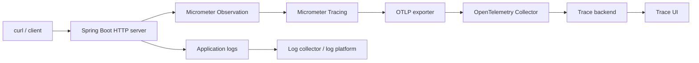

# Configuring OTLP Trace Export

In the **Integrated Practice** chapter of the `SPRING_BOOT_OBSERVABILITY` module, this lesson guides you through configuring Spring Boot to export distributed traces via the OpenTelemetry Protocol (OTLP), routing data through the OpenTelemetry Collector, and verifying that traces reach their destination. The practice ties together what you have learned about Micrometer Observation, Micrometer Tracing, context propagation, sampling, exporters, and log-to-trace correlation.

The goal is to complete a verifiable end-to-end flow: an HTTP request enters the Spring Boot application, tracing creates a span, the OTLP exporter sends the span to the Collector, the Collector processes and forwards the data, and finally a backend or test exporter confirms the trace was received. The examples use OTLP/HTTP for easy inspection of requests and endpoints; OTLP/gRPC is also covered so you know how to choose the right transport.

## 1. Architecture and Prerequisites

The data flow in this practice exercise:



Spring Boot instruments supported requests and creates trace context. Micrometer Tracing connects Micrometer's observation API with the tracing implementation. The OTLP exporter serializes and sends spans. The Collector receives telemetry, optionally batches or enriches it, and sends it to the backend. Logs are a separate pipeline; if logging integration places trace ID and span ID into logs, you can use both signals to investigate the same request.

Before starting, you need:

- A JDK and a Spring Boot application with an HTTP endpoint to generate requests.
- Spring Boot Actuator, the Micrometer Tracing bridge for OpenTelemetry, and the OpenTelemetry OTLP exporter.
- Docker or an OpenTelemetry Collector reachable from the application.
- A trace destination. In the first part, use the Collector's `debug` exporter to inspect traces in logs; later, replace it with a tracing backend.
- Access to application and Collector logs to verify the export process.

The examples assume the application uses Spring Boot 3.x with Spring Boot dependency management. Properties and auto-configuration may differ across version lines; verify against the Spring Boot reference for your project's exact version before deploying to production.

## 2. Adding Dependencies for Tracing and OTLP

With Gradle Kotlin DSL, add the following dependencies to the application module:

```kotlin
dependencies {
    implementation("org.springframework.boot:spring-boot-starter-actuator")
    implementation("io.micrometer:micrometer-tracing-bridge-otel")
    runtimeOnly("io.opentelemetry:opentelemetry-exporter-otlp")

    // If the application exposes an HTTP API using Spring MVC:
    implementation("org.springframework.boot:spring-boot-starter-web")
}
```

With Maven, the equivalent dependencies:

```xml
<dependencies>
    <dependency>
        <groupId>org.springframework.boot</groupId>
        <artifactId>spring-boot-starter-actuator</artifactId>
    </dependency>
    <dependency>
        <groupId>io.micrometer</groupId>
        <artifactId>micrometer-tracing-bridge-otel</artifactId>
    </dependency>
    <dependency>
        <groupId>io.opentelemetry</groupId>
        <artifactId>opentelemetry-exporter-otlp</artifactId>
        <scope>runtime</scope>
    </dependency>
</dependencies>
```

Let Spring Boot dependency management manage compatible versions, unless the project has its own BOM management process. Avoid manually mixing incompatible Micrometer and OpenTelemetry versions.

Role of each dependency:

| Dependency | Role |
| --- | --- |
| `spring-boot-starter-actuator` | Provides Actuator infrastructure and Spring Boot observability integration. |
| `micrometer-tracing-bridge-otel` | Connects Micrometer Tracing with OpenTelemetry. |
| `opentelemetry-exporter-otlp` | Provides the OTLP exporter to send spans. |
| `spring-boot-starter-web` | Provides an HTTP server for request examples; may already exist in the project. |

Adding only the tracing bridge without an exporter lets the application create trace context but provides no OTLP sender. Conversely, having only an exporter without the tracing bridge and instrumentation yields no application spans to send.

## 3. Configuring the OTLP Endpoint in application.yml

In `src/main/resources/application.yml`, declare the endpoint and sampling:

```yaml
spring:
  application:
    name: orders-api

management:
  tracing:
    sampling:
      probability: 1.0
  otlp:
    tracing:
      endpoint: http://localhost:4318/v1/traces
      timeout: 10s
```

Meaning:

- `spring.application.name` provides the service name to distinguish the application in the backend.
- `management.tracing.sampling.probability` sets the head sampling rate per Spring Boot configuration. A value of `1.0` is used in this practice so every trace eligible for the sampler is selected; production requires evaluating traffic and cost.
- `management.otlp.tracing.endpoint` is the OTLP/HTTP URL receiving traces. With the default Collector HTTP receiver, the traces endpoint is typically `http://<host>:4318/v1/traces`.
- `management.otlp.tracing.timeout` limits how long the exporter waits for a send operation as supported by the version in use.

Some Spring Boot versions additionally support headers and compression in OTLP tracing configuration. Only declare these properties when your project's version supports them. The HTTP endpoint must include the `/v1/traces` path; if the Collector receives OTLP/gRPC on port `4317`, transport and exporter configuration must match that protocol. Never send OTLP/HTTP to a gRPC port or vice versa.

### 3.1. Configuring via Environment Variables

When deploying the same image across multiple environments, you can pass properties via environment variables:

```bash
export SPRING_APPLICATION_NAME=orders-api
export MANAGEMENT_TRACING_SAMPLING_PROBABILITY=1.0
export MANAGEMENT_OTLP_TRACING_ENDPOINT=http://localhost:4318/v1/traces
export MANAGEMENT_OTLP_TRACING_TIMEOUT=10s

java -jar build/libs/orders-api.jar
```

In Docker or Kubernetes, replace `localhost` with the Collector's service DNS if the Collector runs in another container or Pod. For example, `http://otel-collector:4318/v1/traces` within the same Docker Compose network or `http://otel-collector.observability.svc:4318/v1/traces` in Kubernetes, depending on the actual service name and namespace.

Never put real tokens in configuration files or command lines. If the backend requires authentication, use a secret store and configure headers using properties supported by your Spring Boot version. When sending tokens over the network, use TLS and restrict the credential's ingest permissions.

## 4. Starting the OpenTelemetry Collector to Receive Traces

Create a Collector configuration file, for example `otel-collector-config.yaml`:

```yaml
receivers:
  otlp:
    protocols:
      grpc:
        endpoint: 0.0.0.0:4317
      http:
        endpoint: 0.0.0.0:4318

processors:
  memory_limiter:
    check_interval: 1s
    limit_mib: 256
    spike_limit_mib: 64
  batch:
    timeout: 5s
    send_batch_size: 512

exporters:
  debug:
    verbosity: basic

service:
  pipelines:
    traces:
      receivers: [otlp]
      processors: [memory_limiter, batch]
      exporters: [debug]
```

The Collector opens both receiver protocols:

- OTLP/gRPC: port `4317`.
- OTLP/HTTP: port `4318`, with traces path `/v1/traces`.

`memory_limiter` protects the Collector against memory pressure; `batch` groups spans before forwarding; the `debug` exporter prints trace information to logs for verification. This is a test pipeline, not a production backend configuration. In production, replace or supplement `debug` with your tracing backend's exporter and configure appropriate authentication, TLS, queue/retry, resource limits, and monitoring. Avoid printing sensitive telemetry payloads into production logs.

You can run the Collector with Docker:

```bash
docker run --rm --name otel-collector \
  -p 4317:4317 \
  -p 4318:4318 \
  -v "$(pwd)/otel-collector-config.yaml:/etc/otelcol/config.yaml:ro" \
  otel/opentelemetry-collector:0.120.0 \
  --config=/etc/otelcol/config.yaml
```

The image version in the example is a pinned illustrative version; choose a Collector version tested and upgrade-managed by your organization. If your Collector image or distribution uses a different config path, adjust the `--config` argument for that image. Check startup logs to confirm the receiver is listening on the expected ports.

If the application runs on the same host machine, `localhost:4318` can reach the published port. If the application runs in another container, use the service/container name on the same network instead of `localhost`.

## 5. Running the Application and Sending the First Request

Start the Collector first, then run the application with the profile and configuration above. Once the application is ready, send a request to an existing HTTP endpoint. For example:

```bash
curl -i http://localhost:8080/actuator/health
curl -i http://localhost:8080/api/orders
```

The `/api/orders` endpoint is an example; replace it with an actual route in your application. Health requests may also be instrumented depending on configuration, but it is better to send a business request to verify the trace has the expected route and span.

If there is no business route yet, you can create a small controller to generate requests:

```java
package com.example.orders;

import org.springframework.web.bind.annotation.GetMapping;
import org.springframework.web.bind.annotation.RestController;

@RestController
class OrderController {

    @GetMapping("/api/orders")
    String listOrders() {
        return "orders";
    }
}
```

With Spring MVC and proper tracing auto-configuration, HTTP requests are instrumented automatically. Calling `/api/orders` causes Spring Boot to create a server span and the exporter to send it to the Collector. You do not need to create spans manually for every controller method.

Check the Collector logs:

```bash
docker logs otel-collector
```

With the `debug` exporter, logs will display received resource and span information. Look for the `orders-api` service name, the span name matching the route, trace ID, span ID, and status. Exact output depends on the Collector version and verbosity level.

## 6. Verifying Trace Context and Propagation

Trace export is only part of distributed tracing. When a request traverses multiple services, trace context must be propagated across HTTP or messaging boundaries so spans share the same trace ID and proper parent-child relationships.

You can send a W3C Trace Context `traceparent` header to test inbound propagation:

```bash
curl -i http://localhost:8080/api/orders \
  -H 'traceparent: 00-4bf92f3577b34da6a3ce929d0e0e4736-00f067aa0ba902b7-01'
```

This is a syntactically valid sample value to illustrate the header. In an application configured with W3C propagation, the server can continue this trace context and create a child span. Look for trace ID `4bf92f3577b34da6a3ce929d0e0e4736` in the Collector or backend output. If the system starts a new trace instead, check propagation type, instrumentation, and any middleware handling headers.

If the application calls another service using an instrumented HTTP client, the client span will appear as a child span in the same trace. Uninstrumented client libraries or manually constructed malformed HTTP headers can break traces. Check both the calling service's server span and the receiving service's server span.

Never attach a hardcoded `traceparent` to all production requests. Trace IDs must be unique per trace; reusing an ID merges unrelated requests and causes confusion during investigation.

## 7. Correlating Traces with Logs

When Micrometer Tracing integrates with the logging framework, trace ID and span ID can be placed into MDC so they appear in log patterns. Check the application logs after sending a request:

```text
2026-11-22T10:15:30.120Z INFO  [orders-api,4bf92f3577b34da6a3ce929d0e0e4736,00f067aa0ba902b7] request completed
```

This is an illustrative log line; actual format depends on logging configuration. Use the trace ID to find all logs related to a request, then open the trace in the backend to inspect timing and relationships between spans. If logs lack trace IDs, check the logging correlation pattern, MDC integration, and how logs are written across threads or asynchronous tasks.

Do not log access tokens, passwords, session IDs, or personal data in span attributes or log fields. Attributes sent to a tracing backend may be stored, indexed, and accessed by many operators.

## 8. Switching the Collector from the Debug Exporter to a Tracing Backend

Once the ingestion pipeline is verified, replace the `debug` exporter with an exporter matching your backend. Example Collector forwarding OTLP/gRPC to a backend with an OTLP receiver:

```yaml
receivers:
  otlp:
    protocols:
      grpc:
        endpoint: 0.0.0.0:4317
      http:
        endpoint: 0.0.0.0:4318

processors:
  memory_limiter:
    check_interval: 1s
    limit_mib: 512
    spike_limit_mib: 128
  batch:
    timeout: 5s

exporters:
  otlp/backend:
    endpoint: tracing-backend:4317
    tls:
      insecure: true

service:
  pipelines:
    traces:
      receivers: [otlp]
      processors: [memory_limiter, batch]
      exporters: [otlp/backend]
```

This is an example for an OTLP/gRPC backend inside a trusted test network. `insecure: true` disables TLS verification and is only suitable when the backend does not use TLS in an isolated test environment. For production, configure proper TLS and CA certificates, never send credentials over unprotected connections, and add authentication headers if required by the backend. Some backends have dedicated endpoints, ports, or exporters; use the official configuration for the backend you are deploying.

If using a backend that requires OTLP/HTTP, configure the `otlphttp` exporter with the appropriate HTTP endpoint instead of the gRPC exporter. Do not reuse the same URL across protocols if the backend separates ports or paths.

## 9. Checking Export Errors and Troubleshooting

| Symptom | Possible Causes | How to Check |
| --- | --- | --- |
| Application fails to start after adding dependencies | Incompatible Micrometer/OpenTelemetry versions or dependency conflict. | Inspect the dependency tree and use Spring Boot dependency management. |
| No traces visible in the Collector | Missing tracing bridge/exporter, uninstrumented requests, or sampling set to 0. | Check dependencies, sampling probability, and whether requests are instrumented. |
| `Connection refused` | Collector not running, wrong port, or receiver not listening. | Check Collector logs and ports `4317`/`4318`. |
| DNS lookup failure inside container | Using `localhost` for a Collector in another container or wrong service DNS. | Use a hostname within the same container network and test DNS from the workload. |
| HTTP `404` during export | Missing `/v1/traces` or misconfigured receiver path. | Check the OTLP/HTTP endpoint and Collector configuration. |
| HTTP `401` or `403` | Missing token, expired token, or missing ingest permissions. | Check secrets and headers required by the backend. |
| Collector receives spans but backend has no traces | Traces pipeline misconfigured, exporter failing, or backend rejecting data. | Read Collector exporter logs and verify the backend receiver. |
| Trace missing spans in downstream service | Broken context propagation or client instrumentation inactive. | Check `traceparent`, HTTP client instrumentation, and propagation format. |
| Trace not found despite successful export | Sampling dropped trace, wrong service/time range query, or retention expired. | Check sampling, resource attributes, timestamps, and backend retention. |

An HTTP 200 from an Actuator endpoint does not prove traces are being exported. You must verify that the Collector actually receives spans and the backend can query traces. Similarly, application logs lacking a trace ID do not necessarily mean no trace exists; the log pattern or MDC might simply not be configured.

## 10. Moving from Test Configuration to Production

In this practice exercise, sampling `1.0` and the debug exporter help make every selected trace visible in Collector logs. Before deploying to production, re-evaluate:

- **Sampling:** pick a head sampling rate suited to traffic and cost; consider tail sampling if you need to prioritize error or slow traces.
- **Collector:** run multiple replicas, set memory/CPU limits, configure queue/retry, and route spans by trace ID when using tail sampling.
- **Network:** use reliable DNS/service discovery, TLS, authentication, and appropriate NetworkPolicies.
- **Exporter:** tune timeouts, batching, and retries to backend characteristics; monitor export failures and dropped spans.
- **Resource attributes:** keep `service.name`, `service.version`, and environment consistent across signals.
- **Data governance:** filter or redact sensitive attributes before storage; restrict query permissions and set appropriate retention.
- **Logs:** collect logs via a separate pipeline and retain trace ID/span ID for correlation.

Do not use the `debug` exporter in production if it exposes span contents or generates excessive log volume. Likewise, do not leave sampling at `1.0` out of habit for all traffic without assessing ingest rate, storage, and cost.

## 11. Practice Steps and Completion Criteria

Follow these steps in order in a local or test environment:

1. Add Actuator, the tracing bridge, and the OTLP exporter to the application.
2. Set `spring.application.name`, OTLP endpoint, and sampling probability.
3. Start the Collector with the OTLP receiver and `debug` exporter.
4. Run Spring Boot and send a request to an HTTP route.
5. Confirm the Collector receives a server span with the service name and trace ID.
6. Send a request with `traceparent` and confirm trace context continues.
7. Check application logs for correlation IDs if the logging pattern is enabled.
8. Replace the `debug` exporter with a test backend and confirm traces can be opened in the UI.
9. Document sampling, timeouts, endpoints, resource attributes, and verification steps in deployment docs.

Checklist:

- [ ] Tracing bridge and OTLP exporter dependencies are added with compatible versions.
- [ ] Application binds the correct OTLP/HTTP or OTLP/gRPC endpoint.
- [ ] Collector receiver listens on the right host and port.
- [ ] Collector pipeline includes `traces` receiver, processor, and exporter.
- [ ] HTTP requests produce spans and spans reach the Collector.
- [ ] Trace ID propagates across requests when `traceparent` is present.
- [ ] Service name and resource attributes appear accurately.
- [ ] Traces can be queried in the backend or verified via the debug exporter.
- [ ] Logs, timeouts, authentication, and export errors have been checked.
- [ ] Sampling, security, and retention have been tuned before production.

Once completed, you have an observable OTLP trace export pipeline from Spring Boot to the Collector and backend. Verifying received spans, trace context, service identity, and log correlation helps distinguish instrumentation, sampling, connectivity, and storage issues—laying the groundwork for operating reliable distributed tracing in production.
