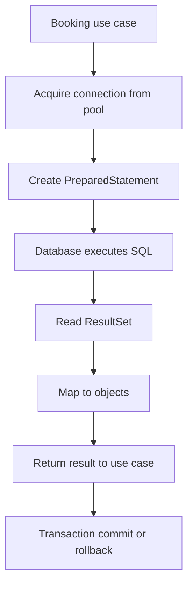

# Instrumenting Database Calls

In a Spring Boot application, the database is often one of the hardest places to diagnose latency and errors. An API may be slow because it is waiting for a connection from the pool, executing a slow query, reading many rows, mapping results, or waiting for a transaction commit. Looking solely at overall HTTP duration does not tell you which step caused the problem.

Instrumenting database calls lets you measure data access operations and correlate them with metrics, logs, and distributed tracing. In Spring Boot, distinguish three layers of telemetry: connection pool health, JDBC operation duration, and business use case duration. Each layer answers a different question.

This lesson guides you through instrumenting database calls in Spring Boot with Micrometer Observation and Actuator, while showing how to verify telemetry, avoid high cardinality, and handle JDBC/JPA-specific nuances. After this lesson, you will be able to:

- Distinguish connection pool metrics from query observations.
- Enable and verify JDBC instrumentation in Spring Boot.
- Create an Observation for data access operations when manual instrumentation is needed.
- Link database spans with use case spans and trace context.
- Choose stable tags and avoid putting dynamic SQL or sensitive data into telemetry.
- Investigate latency, timeouts, query errors, and connection pool exhaustion.

## 1. Which Parts of a Database Call Should Be Observed?

A booking read operation may pass through these steps:



These steps may sit inside a single method from the application's perspective, yet their causes of slowness differ:

- Waiting for a connection: the pool is busy, connections are held too long, or the pool limit is too low.
- Executing SQL: missing indexes, suboptimal query plans, locks, or an overloaded database.
- Reading and mapping results: the query returns too many rows or object mapping is CPU-intensive.
- Transaction: transactions hold locks too long or commit slowly.
- Network: latency between the application and database increases.

Not every instrumentation measures all steps separately. A JDBC-level Observation typically measures the duration of the JDBC call observed by the library. Pool metrics describe connection state. A use case Observation measures total business duration. Combining these signals helps narrow down the root cause.

## 2. Distinguishing Pool Metrics, JDBC Observation, and Use Case Observation

| Telemetry Type | What Does It Measure? | Example Question |
|---|---|---|
| Connection pool metrics | Active/idle connection counts, pool limits, and utilization state. | Is the pool close to exhausting connections? |
| JDBC Observation | Duration and outcome of an instrumented JDBC operation. | How long did the booking lookup query take? |
| Use case Observation | Total duration of a business operation, potentially spanning multiple queries and processing. | How long does confirming a booking take end-to-end? |

Pool metrics do not tell you which SQL statement is slow. JDBC observations do not replace pool metrics because connection acquisition wait time may only be part of the total time. A use case observation can cover multiple operations, yet on its own it cannot pinpoint which query caused the latency.

A well-structured trace may contain the HTTP request span, the use case span, and JDBC spans underneath. Database spans show which operation took time; pool metrics show whether there is connection pressure.

## 3. Enabling the Required Components

With Spring Boot, Actuator provides the metrics and Observation infrastructure. Example Gradle dependencies:

```gradle
dependencies {
    implementation("org.springframework.boot:spring-boot-starter-jdbc")
    implementation("org.springframework.boot:spring-boot-starter-actuator")

    runtimeOnly("io.micrometer:micrometer-registry-prometheus")

    // Only add bridge and exporter if distributed tracing via OpenTelemetry is needed.
    implementation("io.micrometer:micrometer-tracing-bridge-otel")
    runtimeOnly("io.opentelemetry:opentelemetry-exporter-otlp")
}
```

Use Spring Boot's dependency management to select compatible versions. If the application only needs metrics, adding the tracing bridge and OTLP exporter is optional. If equivalent dependencies are already provided by a starter or internal platform BOM, avoid duplicate declarations.

Configure exposure for the endpoints you need to inspect:

```properties
management.endpoints.web.exposure.include=health,info,metrics,prometheus
management.tracing.sampling.probability=0.10
```

The Prometheus endpoint only appears when the Prometheus registry is configured. Sampling at 10% in the example is an illustrative value for tracing; it does not affect whether pool metrics are recorded. In production, secure Actuator endpoints and choose sampling based on traffic, investigation requirements, and backend cost.

Spring Boot normally binds metrics automatically for supported DataSource pools. With HikariCP, metrics may include active, idle, max, and min connection counts. Common DataSource-layer metric names are **jdbc.connections.active**, **jdbc.connections.idle**, **jdbc.connections.max**, and **jdbc.connections.min**; specific registries or pools may also provide their own metric groups. Check the actual metric list for the version and pool in use.

## 4. Using Built-in JDBC Observation in Spring Boot

Spring Framework 6.1 and later added Observation support for JdbcTemplate. When using a Spring Boot auto-configured JdbcTemplate alongside Observation infrastructure, JDBC calls can be observed and produce metrics/tracing telemetry according to configured handlers.

Example repository using JdbcTemplate:

```java
import java.util.List;
import java.util.Optional;
import java.util.UUID;

import org.springframework.jdbc.core.JdbcTemplate;
import org.springframework.stereotype.Repository;

@Repository
public class JdbcBookingRepository {

    private final JdbcTemplate jdbcTemplate;

    public JdbcBookingRepository(JdbcTemplate jdbcTemplate) {
        this.jdbcTemplate = jdbcTemplate;
    }

    public Optional<Booking> findById(UUID bookingId) {
        List<Booking> rows = jdbcTemplate.query(
                """
                select id, status
                from booking
                where id = ?
                """,
                (rs, rowNum) -> new Booking(
                        rs.getObject("id", UUID.class),
                        BookingStatus.valueOf(rs.getString("status"))
                ),
                bookingId
        );

        return rows.stream().findFirst();
    }
}
```

In the example, the SQL uses a placeholder and passes bookingId separately so JDBC binds the parameter. Never concatenate input values into SQL strings. Using fixed queries also keeps operation names and structure stable.

With Spring Boot and Spring Framework versions supporting JDBC Observation, verify that JdbcTemplate is using the configured ObservationRegistry. Applications that instantiate custom templates or replace the bean manually must check this configuration. If an older framework is used or a data access path is not auto-instrumented, you may need to create a manual Observation at the repository boundary.

Do not assume every database operation automatically produces a span just because Actuator was added. Observability depends on the Spring Framework version, how DataSource/JdbcTemplate beans are created, tracing dependencies, and active handlers. Inspect actual metrics and trace output on the running app before concluding instrumentation is enabled.

## 5. Creating a Manual Observation When Needed

There are cases where database calls live inside a proprietary library, custom client, or framework version lacking suitable JDBC Observation. In those cases, wrap the operation with Micrometer Observation.

Example:

```java
@Repository
public class LegacyBookingStore {

    private final LegacySqlClient sqlClient;
    private final ObservationRegistry observationRegistry;

    public LegacyBookingStore(
            LegacySqlClient sqlClient,
            ObservationRegistry observationRegistry
    ) {
        this.sqlClient = sqlClient;
        this.observationRegistry = observationRegistry;
    }

    public Optional<Booking> findById(UUID bookingId) {
        return Observation.createNotStarted(
                        "booking.db.find_by_id",
                        observationRegistry
                )
                .lowCardinalityKeyValue("db.system", "postgresql")
                .lowCardinalityKeyValue("db.operation", "SELECT")
                .lowCardinalityKeyValue("db.table", "booking")
                .observe(() -> sqlClient.findBooking(bookingId));
    }
}
```

The Observation name **booking.db.find_by_id** is stable and describes the data access purpose. Low-cardinality key-values come from finite option sets: database system, operation type, and business table. When the Observation has a meter handler, duration can be recorded as a Timer; when it has a tracing handler, it can become a span.

LegacySqlClient here represents the application's custom client. If the inner call already produces an automatic JDBC Observation, an outer Observation can be useful as a repository boundary, though it adds a parent span. Give them distinct names and keep the extra span only when it helps distinguish business responsibilities.

Do not wrap JdbcTemplate with a duplicate Observation just to create an extra span. Check built-in instrumentation first. If you need a business span covering multiple SQL statements, place the Observation at the use case or repository boundary with a name reflecting the higher-level operation.

### 5.1. What Duration Does an Observation Measure?

When wrapping a synchronous call with observe, the measured interval covers the time from when the callback starts executing until it returns or throws an exception. For a JDBC call, that duration can include acquiring a connection, sending the statement, waiting on the database, reading the ResultSet, and mapping results depending on the API used.

It does not necessarily include transaction commit if the commit happens after the repository method returns. For instance, a transaction interceptor may commit after a @Transactional method body finishes. If you need to measure the whole transaction, observe at the appropriate transaction/use case boundary and understand interceptor ordering. Do not add up durations of nested spans as if they were disjoint intervals; they overlap.

## 6. Choosing Safe Tags and Query Names

Tags help group data. They must be stable and have a predictable number of values.

| Attribute | Good Example | Reason |
|---|---|---|
| db.system | postgresql, mysql | Small, stable set of database engines. |
| db.operation | SELECT, INSERT, UPDATE, DELETE | Finite operation types. |
| db.table | booking, payment | Predefined table names. |
| result | success, error, timeout | Normalized outcomes. |
| query.name | booking.find_by_id | Fixed logical query name. |

Do not put the following values into metric tags:

- booking.id, customer.id, user.id.
- Trace ID, request ID, session ID.
- SQL strings containing literals or actual parameters.
- Exception message text, user-supplied values, or dynamic URLs.
- Table/column names concatenated from untrusted input.

Every new tag value can create additional time series. If there are millions of booking IDs, using IDs as tags creates massive cardinality and drives up memory, scrape overhead, and storage costs. Identifiers needed to locate a single execution belong in logs or policy-approved trace attributes, not metric tags.

If you need to identify queries on a dashboard, use a fixed application-defined query name such as **booking.find_by_id**. Do not use the full SQL statement as the Observation name. SQL can contain literals, internal schema details, or sensitive information, and each statement variant can multiply series or span attributes.

## 7. Connection Pool Metrics and How to Read Them

Connection pools like HikariCP reuse database connections. Pool metrics help determine whether the application is starving for connections or holding them too long.

Key metrics to watch:

| Metric | Meaning | Warning Sign |
|---|---|---|
| Active connections | Number of connections currently borrowed. | Consistently near the pool limit. |
| Idle connections | Number of connections currently idle. | Frequently 0 during high load. |
| Max connections | Configured maximum limit. | Must be checked against database limits and total replicas. |
| Min connections | Minimum connections maintained. | Helps understand warm pool configuration. |
| Pending threads / acquire wait | Threads waiting for a connection or wait duration. | High values indicate the pool may be congested. |

Exact metric names depend on the pool and version. With HikariCP, you can inspect the metric group starting with **hikaricp.connections** if the corresponding binder is active.

Example pool configuration:

```properties
spring.datasource.hikari.maximum-pool-size=20
spring.datasource.hikari.minimum-idle=5
spring.datasource.hikari.connection-timeout=3000
spring.datasource.hikari.idle-timeout=600000
spring.datasource.hikari.max-lifetime=1800000
```

These numbers are examples only. Never copy pool limits into production without calculating total replicas, database connection limits, concurrent apps accessing the database, and workload concurrency. For instance, 5 replicas with a max pool of 20 can open up to 100 connections from this application alone.

High active pool usage does not automatically prove the database is slow. The application might be holding connections inside transactions too long, running many parallel queries, or having a pool sized too small. Cross-check active, idle, and pending/acquire wait against JDBC latency, query latency, and database-side metrics.

## 8. Distinguishing Query Time from Transaction Time

With JDBC, a query observation's duration usually ends when the API call returns. The transaction may continue executing other statements and only commit later.

Example:

```java
@Transactional
public void confirmBooking(UUID bookingId) {
    Booking booking = bookingRepository.findById(bookingId)
            .orElseThrow();

    booking.confirm();
    bookingRepository.save(booking);

    paymentRepository.recordAuthorization(bookingId);
}
```

The use case above can issue multiple database calls within the same transaction. If each call has its own Observation, the trace shows the duration of each operation. A use-case-level Observation shows the total business duration. Transaction commit may happen after the method returns through the proxy; if commits are slow, instrument or monitor at the appropriate transaction/driver layer.

With JPA/Hibernate, calling save does not always send SQL immediately. The ORM may defer SQL until flush or commit. Consequently, the repository method duration is not necessarily the SQL execution duration. During investigation, check flush timing, transaction boundaries, and provider-level instrumentation. Do not call flush manually just to make metrics look cleaner, as doing so alters application behavior and performance.

## 9. Recording Database Errors Without Exposing Data

A database call can fail due to timeout, dropped connection, deadlock, constraint violation, or syntax error. The Observation should finish with an appropriate error state while the exception continues through business error handling. With Observation.observe, exceptions from the callback are recorded on the Observation and then rethrown to the caller.

When logging errors, use normalized error categories:

- connection: unable to acquire or lost connection.
- timeout: wait time exceeded.
- constraint: known constraint violation.
- deadlock: transaction aborted by database due to deadlock.
- other: unclassified error.

Do not use exception messages as tags because messages may contain SQL, parameter values, or unbounded text. SQLState can be useful in logs for investigation, but if used in metrics, normalize it into a small set of code categories.

Never log passwords, connection strings with credentials, tokens, personal data, or bind parameter values. SQL statements can reveal internal schema details; query parameters can contain emails, phone numbers, or user identifiers. Only log logical query names, operations, error codes, and approved fields.

If an exception such as EmptyResultDataAccessException is treated as a normal outcome in a use case, handle it according to business semantics before deciding log level or error classification. Do not let expected not-found lookups trigger database error alerts.

## 10. Linking Database Spans with Traces and Logs

A database span should be a child span of the operation calling it, such as the booking.confirm use case. When a request arrives over HTTP, trace context is created in server instrumentation and propagated through synchronous execution. Child Observations can continue the same trace.

In logs, trace ID and span ID let you jump from a log line to the corresponding trace. When logging inside a repository, you may include logical query name, outcome, and approved business identifiers. Do not generate a new trace ID inside a repository; obtain context from tracing integration.

If database calls run inside an executor or background task, ensure context is propagated across thread boundaries. If context is lost, the database span can become a new root trace and logs will no longer link to the original request. For standalone jobs such as scheduled cleanup, a separate trace may be preferable; for request-triggered tasks, establish a clear parent context or span link model.

Do not put trace IDs into metric tags. Trace IDs have near-unique cardinality per request; they belong in log and trace correlation, not metric grouping.

## 11. Verifying Instrumentation

After enabling instrumentation, verify that telemetry is actually being recorded.

With Actuator, you can list meters and inspect specific meters:

```bash
curl http://localhost:8080/actuator/metrics
curl http://localhost:8080/actuator/metrics/jdbc.connections.active
curl http://localhost:8080/actuator/metrics/jdbc.connections.max
```

Metric names and tags may vary by DataSource implementation. If the endpoint returns 404, check the registry, binders, and endpoint exposure. If metrics do not appear, check whether Spring Boot recognizes the pool or whether the DataSource was replaced by a custom wrapper.

With tracing, send a request executing a booking read and inspect the backend trace:

1. Is there an HTTP request server span?
2. Is there a use case span or Observation?
3. Is there a JDBC span/observation matching the repository call?
4. Are the parent-child relationships right?
5. Does the trace have sensible durations without duplicate spans?
6. Do logs share the same trace ID when emitted inside that context?

For metrics, check the Observation's Timer or corresponding query metric if handlers are configured. Do not guess exact metric names solely from the Observation name; registries may normalize dots, dashes, and units. Inspect the actual exported metric list and tags.

## 12. Workflow for Investigating a Slow Database Call

Suppose the booking read API's p95 jumps from 100 ms to 1.5 seconds. Proceed in order:

1. Use HTTP metrics to identify the affected endpoint, version, and time window.
2. Check the use case observation to see whether total duration rose across all requests or only one flow.
3. Open several slow traces. Compare JDBC spans against application processing and outbound dependencies.
4. If JDBC spans are long, check active/idle pool counts, pending threads, and connection acquisition time.
5. If the pool is not congested, inspect query plans, indexes, locks, returned row counts, and database-side metrics.
6. Check result mapping and the volume of data transferred back to the application.
7. Cross-reference error, timeout, deadlock, and retry logs within the same trace or time range.
8. After applying changes, compare before/after p50/p95/p99, error rate, and pool utilization.

Common symptoms:

| Symptom | Investigation Path |
|---|---|
| Pool active hits max, pending rises | Long transactions, connection leaks, pool too small, or higher concurrent load. |
| JDBC spans long, pool still has idle connections | Slow query, locks, overloaded database, or network latency. |
| JDBC spans short but use case is long | CPU processing, application locks, other service calls, or internal logic. |
| Many small queries in one trace | N+1 queries, repeated lookups, or missing batch/fetch strategy. |
| Timeouts rise alongside connection errors | Unstable database/network, or poorly tuned pool lifetime/timeout settings. |
| JPA repository fast but commit is slow | SQL deferred until flush/commit or transaction holds many changes. |

Do not diagnose a slow query solely from API p95. Use traces and pool metrics to separate connection wait time, database execution time, and post-query processing.

## 13. Common Instrumentation Mistakes

| Practice | Problem | Improvement |
|---|---|---|
| Enabling only pool metrics and assuming queries are measured | Pool state does not reveal per-statement duration. | Enable JDBC Observation or instrument appropriate query boundaries. |
| Adding a manual Observation around an already-instrumented JdbcTemplate | Creates redundant nested spans that clutter traces. | Use built-in instrumentation; add use-case spans only where meaningful. |
| Putting full SQL and parameters into tags | High cardinality and potential data exposure. | Use fixed query names and operations. |
| Putting booking IDs into metric tags | Creates a separate time series per order. | Keep IDs in approved log/trace attributes. |
| Measuring only repository methods while ignoring transactions | Can miss deferred flush and commit after method return. | Observe the use case/transaction when end-to-end duration is needed. |
| Raising pool size to fix every latency spike | Can overload the database further. | Measure pool wait, query latency, and database capacity before tuning. |
| Logging full exception messages and SQL parameters | Can leak credentials or personal data. | Normalize error categories and filter sensitive data. |
| Turning on 100% sampling to find one slow query | High cost and often unnecessary. | Use metrics to detect anomalies, sensible sampling, and tail sampling if available. |

## 14. Practice Exercise: Instrumenting a Booking Read Operation

Perform this exercise on a Spring Boot application with JDBC and a DataSource pool.

### Step 1: Enable Actuator and Metrics Registry

Add Actuator and the registry used by your observability environment. Expose health, metrics, and required scrape endpoints. Confirm Actuator endpoints are secured according to the environment.

### Step 2: Inspect the Connection Pool

Send several booking read requests. Open /actuator/metrics and look for pool metrics such as jdbc.connections.active, jdbc.connections.idle, and jdbc.connections.max. Record values while idle and under load.

### Step 3: Instrument the JDBC Call

Use a Spring Boot-configured JdbcTemplate on a version supporting JDBC Observation. If the data access path lacks automatic instrumentation, wrap the repository operation with an Observation having a fixed name, such as booking.db.find_by_id.

Only add key-values with finite value sets such as database system, operation, and query name. Do not add booking IDs or bind parameter values to metric tags.

### Step 4: Correlate Traces and Logs

Enable the tracing bridge and exporter if the exercise includes a trace backend. Send a booking read request and inspect the server span, use case span, and JDBC span. Emit a log event inside the same context and confirm the trace ID appears in the log.

### Step 5: Trigger a Controlled Error Scenario

In a test environment, simulate a query timeout or database disconnect. Confirm the Observation records the error, the exception still propagates to the handling layer, and logs contain no sensitive data. Never run disruptive experiments on a production database.

### Step 6: Interpret the Results

Compare pool metrics, JDBC duration, and use case duration. Determine whether latency came from the pool, the query, mapping, or other processing. Write down a hypothesis backed by trace/metrics evidence before changing configuration.

### Completion Criteria

- Pool metrics appear and respond under load.
- Database calls are observed via automatic instrumentation or appropriate manual Observation.
- Traces reflect the right relationship between the use case and database operations.
- Tags contain only finite, stable values.
- Database errors are recorded and still handled properly in the business layer.
- Logs and traces contain no passwords, tokens, or sensitive parameters.
- You can distinguish pool wait time from query duration and total use case duration.

## 15. Pre-Production Checklist

- DataSource pool is recognized and exports metrics.
- JDBC instrumentation works properly with your Spring Framework version and DataSource setup.
- Observation names and query names are stable.
- No duplicate spans exist for the same operation.
- Pool metrics are read alongside JDBC duration and use case duration.
- Metric tags contain no IDs, dynamic SQL, or unbounded data.
- SQL and bind parameters are not logged outside policy boundaries.
- Exceptions are categorized without losing needed stack traces.
- Trace context is preserved across relevant executors and background tasks.
- Timeouts, pool sizes, and sampling are chosen based on real measurements.
- Actuator endpoints are secured and retention matches operational requirements.

Instrumenting database calls is effective when each telemetry layer has a clear purpose: pool metrics report connection capacity, JDBC Observation reports data operation timing, and use case Observation reports impact on business flows. Linking them via trace context while keeping tag cardinality low enables teams to pinpoint slow database behavior while controlling cost and protecting sensitive data.
