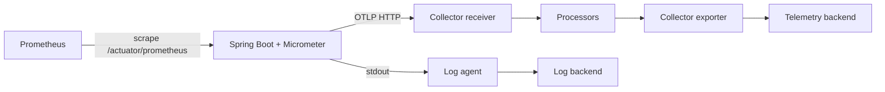

# Simulating Exporter Loss

In production, an application can continue serving requests normally while part of its telemetry fails to reach the observability system. A failing exporter can cause traces to vanish, metrics not to be forwarded, or data to pile up in queues and eventually get dropped. Without proactively testing this scenario, operations teams can easily mistake "no data visible" for "the application generated no activity."

This practice exercise sets up a simple telemetry pipeline for Spring Boot, then intentionally disrupts the exporter or backend step by step to observe behavior. You will distinguish failures across the application, Collector, and backend; check impact on requests; read operational logs and metrics; and finally restore the pipeline and confirm data resumes flowing.

Within the `SPRING_BOOT_OBSERVABILITY` module, this lesson uses Micrometer Observation, metrics, logs, and distributed tracing. The objective is to learn how to verify the entire telemetry path during a real outage.

## Expected Outcomes

After this practice exercise, you will be able to:

- Describe the path of traces, metrics, and logs from the application to storage.
- Simulate a connection failure from the application to the OpenTelemetry Collector.
- Distinguish between a Collector not receiving data and a Collector receiving data but failing to forward it.
- Check whether an exporter affects application requests, latency, memory, or threads.
- Understand the limits of retries, queues, timeouts, and sampling during pipeline disruptions.
- Restore the exporter and verify that telemetry flow has resumed.

## Architecture and Failure Points

In the lab, the application sends traces and metrics via OTLP HTTP to the OpenTelemetry Collector. The Collector receives data, runs pipeline processors, and writes summaries to logs using the debug exporter. Application logs follow a separate stdout path. If using Prometheus, Prometheus actively scrapes the application's metrics endpoint over another path.



| Stage | Failure Example | Signals to Check |
|---|---|---|
| In-app instrumentation | Observation not created or context broken | Missing corresponding meters/spans; traces disconnected across services |
| App exporter → Collector | Wrong host/port, Collector stopped, timeout, or protocol mismatch | Export failure logs in application; Collector receives no signals |
| Collector receiver/processors | Receiver port closed, bad pipeline config, or memory limit exceeded | Collector logs config errors or rejects incoming data |
| Collector exporter → backend | Backend down, DNS failure, invalid auth, or quota exhausted | Collector receives data but export fails, queue grows, or data is dropped |
| Backend and querying | Slow ingest, wrong tenant, wrong filters, or querying wrong time window | Data absent in UI despite upstream stages receiving it |
| Separate log pipeline | Agent/sidecar stopped or log backend rejects data | Logs remain in stdout yet never appear in search UI |
| Prometheus scrape | Prometheus stopped or cannot reach endpoint | Target down or gaps appear in metric time series |

An important point: Prometheus normally scrapes `/actuator/prometheus`; this is not an OTLP push flow from the application. If Prometheus stops scraping, the endpoint inside the application can still work. Similarly, application logs written to stdout do not automatically travel through the Micrometer Tracing exporter. Log collection typically uses a separate agent, sidecar, or runtime logging driver.

## Lab Setup

You need a Spring Boot application with Actuator and an HTTP endpoint that can be called repeatedly. The Spring Boot version and dependencies must be managed consistently via the project's BOM or dependency management.

Common dependencies for the OTLP path in Spring Boot 3.x include:

- `spring-boot-starter-actuator`
- `micrometer-tracing-bridge-otel`
- `opentelemetry-exporter-otlp`
- `micrometer-registry-otlp` if pushing metrics via OTLP

If the lab uses Prometheus scraping instead of OTLP metrics, use `micrometer-registry-prometheus` and expose the Prometheus endpoint. There is no need to install both registries if your goal is only to test one metrics path. Dependency names and properties may vary across Spring Boot/Micrometer versions; use the version managed by your project and check matching configuration for that version.

### Minimal Collector Configuration

Create `otel-collector-config.yaml` in the lab directory:

```yaml
receivers:
  otlp:
    protocols:
      grpc:
        endpoint: 0.0.0.0:4317
      http:
        endpoint: 0.0.0.0:4318

processors:
  memory_limiter:
    check_interval: 1s
    limit_mib: 256
  batch:

exporters:
  debug:
    verbosity: basic

service:
  pipelines:
    traces:
      receivers: [otlp]
      processors: [memory_limiter, batch]
      exporters: [debug]
    metrics:
      receivers: [otlp]
      processors: [memory_limiter, batch]
      exporters: [debug]
```

The debug exporter makes it easy to see in container logs that the Collector received traces and metrics. This is a test destination for the lab, not a long-term storage backend.

Create `compose.yaml`:

```yaml
services:
  otel-collector:
    image: otel/opentelemetry-collector-contrib:0.120.0
    command: ["--config=/etc/otelcol-contrib/config.yaml"]
    volumes:
      - ./otel-collector-config.yaml:/etc/otelcol-contrib/config.yaml:ro
    ports:
      - "4317:4317"
      - "4318:4318"
```

The image version is pinned for lab repeatability. When used in a real project, pick a Collector version supported by your organization with controlled upgrades.

### Application Configuration

The example below assumes the application runs directly on the host machine while the Collector publishes port 4318 to localhost:

```yaml
management:
  endpoints:
    web:
      exposure:
        include: health,metrics,prometheus
  tracing:
    sampling:
      probability: 1.0
  otlp:
    tracing:
      endpoint: http://localhost:4318/v1/traces
    metrics:
      export:
        url: http://localhost:4318/v1/metrics
```

100% sampling is used solely for easy observation in a low-traffic lab. Production must choose sampling suited to budget and investigation goals. If the application runs in a container on the same network as the Collector, use the service hostname `otel-collector` instead of `localhost`. Inside an application container, `localhost` points to the application container itself.

If the project only exports traces via OTLP while using Prometheus for metrics, omit the OTLP metrics configuration and configure the Prometheus registry. Metrics will then be scraped from `/actuator/prometheus`; do not infer that the Collector is receiving OTLP metrics just because the Prometheus endpoint has data.

## Step 1: Confirm Normal Baseline State

Start the Collector:

```bash
docker compose up -d otel-collector
docker compose ps
docker compose logs --tail=100 otel-collector
```

Start the Spring Boot application. Check the health endpoint:

```bash
curl -i http://localhost:8080/actuator/health
```

Call an existing business endpoint in the application a few times to generate requests. Replace `/api/your-endpoint` with an actual route:

```bash
curl -i http://localhost:8080/api/your-endpoint
```

Check HTTP metrics via Actuator:

```bash
curl -s http://localhost:8080/actuator/metrics/http.server.requests
```

Open Collector logs and confirm the debug exporter recorded traces or metrics. If using the Prometheus registry, check the scrape endpoint:

```bash
curl -s http://localhost:8080/actuator/prometheus
```

The Prometheus endpoint only exists when the application has the matching registry installed and exposes that endpoint.

Record your baseline before injecting failures:

- Did the request receive the expected response?
- Did the request metric increment after calling the endpoint?
- Did the Collector receive traces/metrics?
- Does the trace have the proper service name, operation, and span relationships?
- Do application logs include a trace ID when the request is part of a trace?

If signals are missing in the normal state, fix the lab setup before simulating failures. Without a baseline, it is hard to distinguish newly induced failures from pre-existing misconfiguration.

## Step 2: Simulate Stopping the Collector

This scenario represents the application exporter being unable to reach the Collector.

Stop the Collector:

```bash
docker compose stop otel-collector
```

Call the business endpoint and health endpoint again. Then inspect application logs:

```bash
curl -i http://localhost:8080/actuator/health
curl -i http://localhost:8080/api/your-endpoint
```

Look for export-related messages such as connection refused, connection timeout, failed to export, or retry. Exact log messages depend on the exporter and library version.

Observe the following outcomes:

1. Do business requests continue succeeding?
2. Does request latency spike abruptly?
3. Does the application log export errors?
4. Since the Collector is stopped, no new data appears in Collector debug logs.
5. Application logs on stdout may still appear even though OTLP traces or metrics do not reach the Collector.

Under typical batching trace configuration, sending spans happens asynchronously. The OTLP metrics registry also typically exports periodically. Therefore, export failures do not necessarily cause the active request to fail. However, actual behavior depends on the exporter, timeouts, queues, schedulers, and how the application integrates them. Measure in the lab rather than assuming every exporter has zero impact on requests.

If requests start slowing down or failing, identify which thread is waiting, the timeout value, exceptions, and the exporter call path. A synchronously configured exporter or a custom handler performing I/O on the request thread can increase latency. Telemetry should be designed so failures on the export path do not break business serving capacity.

## Step 3: Recover and Verify Data After Disruption

Restart the Collector:

```bash
docker compose start otel-collector
docker compose ps
docker compose logs --tail=100 otel-collector
```

Send new requests and confirm the Collector resumes receiving data. Compare timestamps of export error logs in the application against when the Collector starts receiving data again.

Do not assume all telemetry generated while the Collector was stopped will be backfilled. Results depend on signal type and exporter:

- Traces may sit in the batch queue until the queue fills up or the process exits; spans exceeding queue limits may be dropped.
- Push metrics may retain aggregated data for an interval, but do not guarantee recovery of every missed data point.
- Stdout logs may remain in the runtime or be collected later by the log agent, depending on configuration and retention limits.
- If the application restarts during the outage, in-memory queues are usually lost with the process unless a dedicated persistent buffer exists.

Document the missing data window in your lab notes. New data appearing after Collector recovery does not prove historical data was completely replayed.

## Step 4: Simulate the Backend Behind the Collector Becoming Unavailable

In real architectures, the Collector may still receive OTLP from applications yet fail to deliver to the backend. This is a different failure mode from the application being unable to connect to the Collector.

To test this scenario, replace the debug exporter with an OTLP exporter pointing to a lab backend. An example exporter configuration looks like:

```yaml
exporters:
  otlp/backend:
    endpoint: telemetry-backend:4317
    tls:
      insecure: true
    sending_queue:
      enabled: true
      queue_size: 1000
    retry_on_failure:
      enabled: true
```

Replace `telemetry-backend:4317` with your test environment's backend address. Update the pipeline's exporter list to use `otlp/backend`. After confirming the pipeline works, stop the backend or make the backend address unreachable.

While the backend is down, send new requests to the application and inspect Collector logs and internal telemetry. Confirm that:

- The application still sends data to the Collector's receiver.
- The Collector logs errors when exporting to the backend.
- The queue grows while retries fail, if `sending_queue` is enabled.
- Once the queue hits its limit or data exceeds retry policy, the Collector may drop data.
- The backend shows no new data during the outage window.

Collector internal metric names vary by version and telemetry configuration. Look for metrics covering export successes/failures, queue size, failed enqueue counts, memory usage, and dropped items. Collector logs typically report the exporter, endpoint, and failure cause.

Never raise queue sizes indefinitely to mask a slow backend. Large queues drive up memory consumption and can OOM the Collector. Size queues, retries, timeouts, and memory limits based on traffic volume, expected outage duration, and backend recovery capacity.

## Step 5: Distinguish Failures Across Signal Types

Not all signals travel through the same exporter. Use the table below to pick the right check path:

| Signal | Common Path | When Path Fails |
|---|---|---|
| Traces | Micrometer Tracing → OTLP exporter → Collector → trace backend | New traces fail to appear; check exporter logs, sampling, queue, and Collector |
| Metrics via OTLP | Micrometer OTLP registry → Collector → metrics backend | Export cycles fail or data points go missing; check registry and exporter |
| Metrics via Prometheus | Actuator Prometheus endpoint ← Prometheus scrape | Endpoint may still return data while Prometheus target is down or has gaps |
| Logs | Logging framework → stdout/file → agent/sidecar → log backend | Logs may remain in stdout/file while missing from the search UI |
| Collector self-telemetry | Collector → Collector monitoring backend | You cannot observe the Collector itself if relying solely on the same failing backend |

When log search lacks an exception, inspect stdout or the raw log file before concluding the application failed to log. When metrics disappear, check the scrape target and ingest status. When traces fail to appear, check sampling and the exporter. Change only one stage at a time in the lab so results stay explainable.

## Step 6: Record Results and Fully Restore

After each experiment, record:

- Outage start and end timestamps in UTC.
- Which stage was disrupted and how it was simulated.
- Request success/error rate and latency during the test.
- Error logs in the application or Collector.
- Queue depth, retries, and dropped counts if applicable.
- Missing data window in the backend.
- Recovery timestamp and evidence confirming export resumed.

Restore the original endpoints and configuration, then run a final verification:

```bash
docker compose up -d otel-collector
docker compose ps
docker compose logs --tail=100 otel-collector
```

Send fresh requests, confirm the Collector receives traces and metrics, check application logs, and confirm the backend can query new data. If you made temporary config changes, revert them and inspect the diff before concluding the lab.

## Quick Symptom-Based Diagnosis

| Symptom | First Area to Check | Verification Questions |
|---|---|---|
| Request succeeds but no trace appears | Sampling and app exporter | Was a span created? Is the export endpoint right? |
| Application logs connection refused | App → Collector | Is the Collector running and listening on the right port? |
| Collector receives OTLP but backend is empty | Collector exporter/backend | Are endpoint, auth, TLS, quota, and queue healthy? |
| Actuator metrics exist but Prometheus is empty | Prometheus scrape | Is the target up? Are path, port, and access permissions right? |
| Logs exist in stdout but missing in search UI | Log agent/backend | Is the agent reading the right stream/file and shipping successfully? |
| Only new data appears after recovery | Queue and retention policy | Was old data dropped, expired, or lacking a replay mechanism? |
| Export failures slow down requests | Exporter integration | Is I/O running on the request thread? What are timeout and batch queue settings? |

## Designing Telemetry Resilience

After observing the lab, apply these principles when configuring real environments:

**Set bounded timeouts.** Exporters must not wait indefinitely when the Collector or backend becomes unresponsive. Timeouts should fit the protocol, export interval, and system latency budget.

**Use bounded batches and queues.** Batching lowers transmission overhead; queues absorb brief blips. Monitor queue utilization, retries, and drops to know when the system begins losing telemetry.

**Monitor exporters and Collectors via an independent path.** If the primary backend is down, dashboards hosted in that backend may also be unreachable. Maintain local logs, health checks, internal metrics, or out-of-band alerts to detect pipeline failures.

**Generate periodic synthetic checks.** A synthetic request with an identifiable trace ID verifies the entire path. Checking only the application's health endpoint does not prove the exporter and backend are working.

**Maintain sensible sampling.** Low sampling cuts costs yet risks dropping traces for rare incidents. Consider error- or latency-based retention policies at the collector when architecture supports it; never raise sampling without bounds in production.

**Never let telemetry break business logic.** Avoid synchronous logging to remote services on request threads. Cap resources for exporters, queues, and Collectors; test network partitions and slow backend recoveries.

**Protect data.** Do not use logs or traces as fallback storage for tokens, passwords, or sensitive payloads. When buffering locally during outages, enforce strict access permissions and retention limits.

## Verification Exercises

Run each scenario one by one and fill in the table. Only move to the next scenario after restoring normal state.

| Scenario | Business Requests | Traces/Metrics at Backend | Failure Evidence |
|---|---|---|---|
| Baseline, all components healthy | Recorded | Recorded | None |
| Collector stopped | Record actual outcome | Expected missing new data | Export logs in application |
| Collector running, backend stopped | Record actual outcome | Backend missing data | Collector logs/queue |
| Prometheus unable to scrape | App can still serve | Metric series shows gaps | Scrape target |
| Log agent stopped | App still writes stdout | Log backend missing data | stdout/file and agent |

Answer the following questions in your practice notes:

1. When the Collector stopped, did requests keep succeeding? Did latency change?
2. Which batching and queues does the exporter use? When the queue fills up, how is data handled?
3. How do you distinguish a Collector receiving no data from a Collector failing to ship to the backend?
4. Which metrics or logs reveal that the exporter is retrying or dropping data?
5. When the pipeline recovered, was data generated during the outage replayed? What evidence confirms this?
6. If you only have the backend dashboard, how can you detect that the dashboard itself is losing data?
7. Which alerts and synthetic checks would you configure to detect the next outage early?

## Completion Criteria

The practice exercise meets expectations when you can demonstrate with evidence that:

- The pipeline operated normally before fault injection.
- You disrupted the app → Collector path at least once and measured request impact.
- You distinguished Collector receiver failures from Collector exporter failures.
- You documented the telemetry gap and explained replay limitations.
- You restored the pipeline and confirmed new data resumed appearing.
- You identified at least one improvement to detect exporter failures earlier, complete with verification criteria.

A reliable observability system should surface problems even when the telemetry transport itself fails. Once you have simulated failure points, measured impact, and verified recovery, you can evaluate telemetry reliability with evidence instead of assuming everything works merely because a dashboard currently shows numbers.
