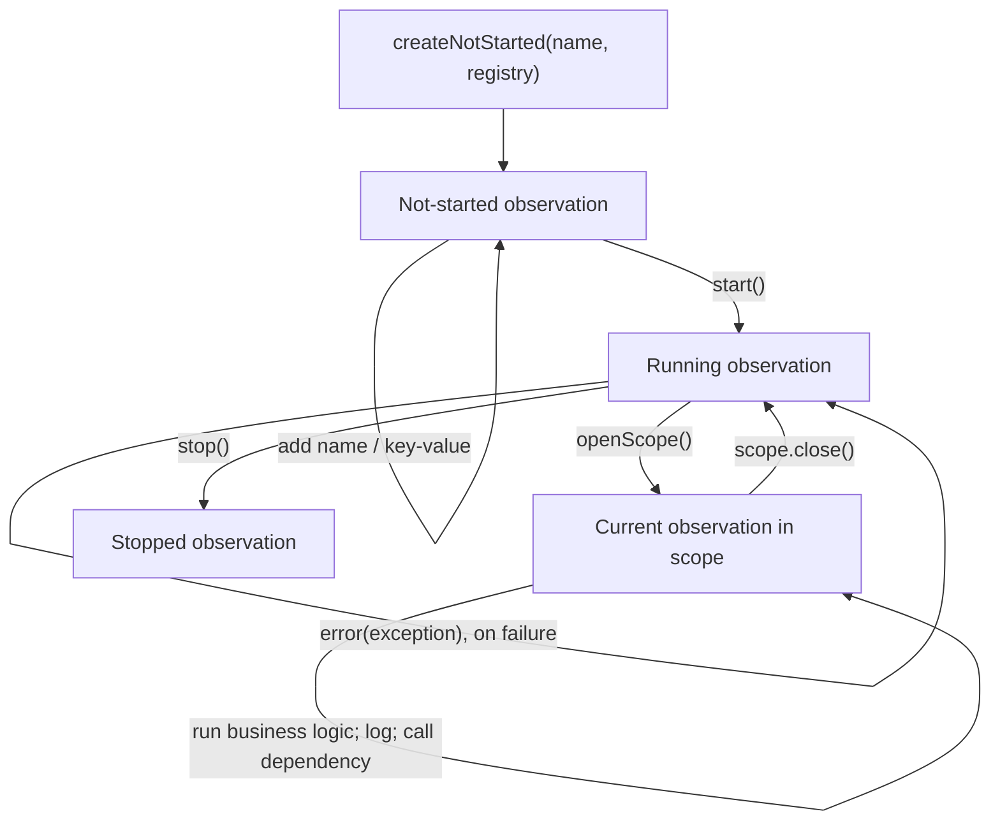

# Creating a Not-Started Observation

In the **Observation Lifecycle** chapter of the **SPRING_BOOT_OBSERVABILITY** module, we explore the first step when manually instrumenting a business operation with Micrometer: **creating an `Observation` without starting the measurement yet**. This step is useful when you need to name the observation, attach attributes, and decide the exact portion of work included in the measured duration.

The observability module for Spring Boot uses Micrometer Observation to correlate metrics with distributed tracing, while also leveraging logs and trace context to investigate errors, latency, and application behavior. Understanding `createNotStarted(...)` helps prevent three common mistakes: assuming measurement begins upon object creation, forgetting to open a scope to bind the context, or failing to call `stop()`, resulting in missing telemetry data.

## 1. Learning Objectives

After completing this lesson, you will be able to:

1. Explain the difference between **creating**, **starting**, **opening a scope**, and **stopping** an observation.
2. Create a not-started observation using `Observation.createNotStarted(...)` with an `ObservationRegistry`.
3. Attach names and key-values with appropriate cardinality before starting measurement.
4. Control the lifecycle using `start()`, `openScope()`, `error(...)`, and `stop()` in Spring Boot code.
5. Identify the impact of observations on metrics, spans, and logs when tracing/exporters are configured.
6. Troubleshoot operational issues related to context propagation, sampling, and measurement boundaries.

## 2. What Is an Observation, and Why Does a “Not-Started” State Exist?

An **observation** represents an observable activity, such as `inventory.lookup`, `payment.authorize`, or `order.calculate-total`. It holds a name, context, and attributes describing the activity. `ObservationHandler` instances registered in the `ObservationRegistry` receive lifecycle callbacks; depending on the handlers, the same observation can be used to record metrics, create a tracing span, or trigger other integrations.

Core API:

```java
Observation observation =
        Observation.createNotStarted("inventory.lookup", observationRegistry);
```

This call **creates an observation in a not-started state**. Do not assume that a timer or tracing span for the operation has already started on that line. Measurement effects and lifecycle callbacks depend on `start()`, `stop()`, and how handlers are configured.

We often want to prepare an observation before starting it because:

- We need to determine a **stable name** and certain tags from information already known.
- We want to separate preparation steps from the actual business logic to be measured.
- We want precise control over start and end timestamps when a method has multiple phases.
- We want to use a unified API for both metrics and tracing, depending on the handlers present at runtime.

**Note:** the measurement interval begins at `start()`, not at `createNotStarted(...)`. If input validation, lock acquisition, or request construction happens before `start()`, the duration of those steps is excluded from the observation's duration. This is a decision about measurement scope, not merely a technical detail.

## 3. Lifecycle Diagram



These operations are not synonymous:

| Call | Primary Effect | Key Takeaway |
| --- | --- | --- |
| `Observation.createNotStarted(name, registry)` | Creates an observation so it can be configured beforehand. | Does not start the measurement interval yet. |
| `lowCardinalityKeyValue(k, v)` | Adds an attribute with few distinct values. | Suitable for grouping metrics; choose stable, bounded values. |
| `highCardinalityKeyValue(k, v)` | Adds an attribute that may have many distinct values. | Often useful for tracing; still requires controlling sensitive data and overhead. |
| `contextualName(name)` | Sets a human-readable contextual name for tracing when supported by the handler. | Does not replace the requirement for a stable observation name. |
| `start()` | Starts the lifecycle and fires start callbacks to matching handlers. | Measurement duration typically starts from here. |
| `openScope()` | Places the observation into the current context within the executing thread's scope. | Helps determine the parent span and link context when tracing integration is present. |
| `error(exception)` | Notifies the observation/handlers of an error. | Does not swallow or handle the business exception on your behalf. |
| `stop()` | Ends the lifecycle and fires completion callbacks. | Must be called on every path where `start()` succeeded. |

A running observation can have its scope opened for only part of its lifetime. Therefore, **`start()` and `openScope()` are two separate actions**: one controls duration; the other defines the current observation in the execution context. A scope is typically closed via `try-with-resources`, and closing the scope **does not replace** `stop()`.

## 4. Preparing ObservationRegistry in Spring Boot

In a Spring Boot 3.x application with Actuator, `ObservationRegistry` is typically provided by Spring Boot as a bean for components to inject into services. With Gradle:

```groovy
dependencies {
    implementation 'org.springframework.boot:spring-boot-starter-actuator'
}
```

The dependency above enables observation and metrics integration according to application configuration. If distributed tracing with OpenTelemetry is needed, the project must also include the appropriate tracing bridge and exporter, for example:

```groovy
dependencies {
    implementation 'io.micrometer:micrometer-tracing-bridge-otel'
    implementation 'io.opentelemetry:opentelemetry-exporter-otlp'
}
```

These dependencies illustrate a common setup with Spring Boot 3.x; use versions managed by the Spring Boot BOM and verify properties/exporters for your target release. Creating an `Observation` in code **does not automatically spin up a metrics/trace backend**, configure a collector, or guarantee that every request is traced.

In a service, inject the registry via the constructor:

```java
import io.micrometer.observation.ObservationRegistry;
import org.springframework.stereotype.Service;

@Service
public class InventoryService {
    private final ObservationRegistry observationRegistry;

    public InventoryService(ObservationRegistry observationRegistry) {
        this.observationRegistry = observationRegistry;
    }
}
```

The next section expands this service into a complete example. If the application has no handlers registered to export metrics or traces, observation operations can still run, but no corresponding data will appear in the backend. **The registry is the central point for handlers and configuration**, not the storage for traces or time series.

## 5. Creating a Not-Started Observation and Configuring Before `start()`

Suppose an `order-api` system needs to call an inventory service. We want to measure the time spent **calling the inventory system**, while input validation at the controller layer is outside this measurement.

```java
Observation observation =
        Observation.createNotStarted("inventory.lookup", observationRegistry)
                .contextualName("lookup inventory")
                .lowCardinalityKeyValue("component", "inventory")
                .lowCardinalityKeyValue("operation", "lookup");
```

Meaning of each part:

- `"inventory.lookup"` is the stable technical name of the operation. Name it by **operation type**, not after an individual request.
- `"lookup inventory"` is the contextual name, which can make spans more readable when supported by the tracing handler.
- `component=inventory` and `operation=lookup` have a small set of values, suitable for grouping metrics.
- The returned object is still **not started**. We can configure attributes before calling `start()`.

Once preparation is complete:

```java
observation.start();  // Start measuring the operation
try (Observation.Scope scope = observation.openScope()) {
    // Execute the business logic to be measured.
} finally {
    observation.stop(); // End measurement after the scope is closed
}
```

This structure is the basic skeleton. When business code can throw exceptions, report the error via `observation.error(exception)` before stopping; a full example is shown in the next section.

### Why Not Use a Request ID as a Low-Cardinality Tag?

Suppose the system processes millions of orders. If you add:

```java
// Avoid: creates a nearly unique tag value per request.
observation.lowCardinalityKeyValue("order.id", orderId);
```

then the metrics registry may have to maintain a very large number of time series. Similarly, raw URLs containing IDs, emails, tokens, and request UUIDs should not be placed in low-cardinality tags.

Instead, use a set of labels with a bounded number of values:

```java
observation.lowCardinalityKeyValue("operation", "lookup");
observation.lowCardinalityKeyValue("backend", "inventory-service");
```

If you must attach a high-variance value to locate a specific request in traces, only consider `highCardinalityKeyValue(...)` when genuinely needed, with appropriate security rules and storage limits. **High cardinality does not mean sensitive data may be recorded freely.**

## 6. Complete Example: Measuring a Business Operation with Error Handling

The code snippet below illustrates a Spring service. `StockGateway` and `Stock` are application-defined business types, not part of the Micrometer API.

```java
import io.micrometer.observation.Observation;
import io.micrometer.observation.ObservationRegistry;
import org.springframework.stereotype.Service;

@Service
public class StockService {
    private final ObservationRegistry observationRegistry;
    private final StockGateway stockGateway;

    public StockService(ObservationRegistry observationRegistry,
                        StockGateway stockGateway) {
        this.observationRegistry = observationRegistry;
        this.stockGateway = stockGateway;
    }

    public Stock loadStock(String sku) {
        Observation observation =
                Observation.createNotStarted(
                        "stock.load", observationRegistry)
                    .contextualName("load stock")
                    .lowCardinalityKeyValue("component", "stock-service")
                    .lowCardinalityKeyValue("backend", "inventory");

        // The object is described, but timing has not started yet.
        observation.start();

        try (Observation.Scope scope = observation.openScope()) {
            return stockGateway.findStock(sku);
        } catch (RuntimeException exception) {
            observation.error(exception);
            throw exception;
        } finally {
            observation.stop();
        }
    }
}
```

Execution flow when calling `loadStock("SKU-123")`:

1. The code creates the `stock.load` observation in a not-started state.
2. Common attributes are added before measurement begins.
3. `start()` marks the beginning; matching handlers receive the start event.
4. `openScope()` lets code running inside see the current observation.
5. `stockGateway.findStock(sku)` is the portion of work being measured.
6. When a `RuntimeException` occurs, `error(exception)` notifies the observation and the exception is rethrown so upper layers can decide the response.
7. `try-with-resources` closes the scope; `finally` always calls `stop()` once the observation has been started.

Placing `stop()` in `finally` prevents an intermediate failure from leaving timers or spans unclosed. This `catch` block handles `RuntimeException`; if the business API throws checked exceptions, add an error-recording branch and rethrow according to the method signature.

**Do not use `sku` as a low-cardinality tag** because the number of SKUs can be very large. If you need to investigate a specific SKU, prefer logs with proper access control/masking policies and log–trace correlation via `traceId`, or add data-reviewed tracing attributes.

### What Happens If You Only Create Without Starting?

```java
Observation observation =
        Observation.createNotStarted("stock.load", observationRegistry);

// observation.start() is not called.
// The observation lifecycle for stock.load is never executed.
```

This snippet does not measure any activity. Do not expect a duration metric or complete span for `stock.load` just by calling `createNotStarted(...)`. Depending on the registry and observation enablement predicates, the object may also behave as a no-op; thus, the existence of the Java variable is not proof that the system emitted telemetry.

### What Happens If You Start but Forget to Stop?

The observation may fail to finalize recording in handlers that rely on completion callbacks; spans may also be left dangling. This is especially dangerous because the business request may still succeed while dashboards show missing or inconsistent data. Always put `stop()` in `finally` and start only once per logical lifecycle.

## 7. When to Use `observe(...)` Instead of Manual Control?

For a simple block of work, the `observe(...)` API manages starting, opening the scope, recording errors, and stopping around the supplied block.

```java
public Stock loadStock(String sku) {
    return Observation.createNotStarted("stock.load", observationRegistry)
            .lowCardinalityKeyValue("backend", "inventory")
            .observe(() -> stockGateway.findStock(sku));
}
```

This concise pattern fits when the entire measured portion sits inside a single lambda and no separate actions are needed before or after starting. Choose `createNotStarted(...)` with manual `start/openScope/stop` when you need to prepare an observation and decide the **exact moment** to start, or when you need to emit events and handle errors in custom steps.

Do not mix `observe(...)` with a manual `start()/stop()` cycle on the same observation without a clear reason and thorough lifecycle understanding: it easily causes duplicate callbacks or inaccurate measurement boundaries.

## 8. Scope and Correlation with Logs and Traces

Inside `try (Observation.Scope scope = observation.openScope())`, the current observation can be accessed by compatible instrumentation within the same execution context. When Micrometer Tracing and logging integration are present, `traceId` and `spanId` can be populated into MDC so operation logs link to a trace.

Simulated log example:

```text
2026-11-22T09:15:13.221Z INFO  stock-service traceId=4b2fe50af9d44c37ab610ebecc803e92 spanId=8ac04bcbd191ad22 Calling inventory
2026-11-22T09:15:13.586Z ERROR stock-service traceId=4b2fe50af9d44c37ab610ebecc803e92 spanId=8ac04bcbd191ad22 Inventory timeout
```

This is only a formatting example. Logs include `traceId` when an active tracing context exists, the logging pattern supports MDC, and the request/span is properly instrumented. `Observation` itself is not a logger, and `openScope()` does not automatically turn every log line into trace data if a tracing bridge is not configured.

For an HTTP request that already has a parent observation, creating a child observation within the proper scope allows the trace backend to display a span tree:

```text
HTTP GET /orders/{id}
└── stock.load
    └── HTTP GET inventory-service /stock
```

Pay attention to timing and how the parent context is resolved by actual handlers. If you create custom clients or run `@Async`, `CompletableFuture`, thread pools, or message listeners, **the current thread's scope does not automatically propagate to another thread**. You must verify context propagation and instrumentation support in your stack; never share an `Observation.Scope` arbitrarily across threads.

### Measurement Time vs. Scope Time

Suppose the code runs sequentially:

```java
observation.start();
prepareRemoteCall();

try (Observation.Scope scope = observation.openScope()) {
    invokeRemoteCall();
} finally {
    observation.stop();
}
```

If all code executes sequentially without abnormal behavior, the observation's duration includes both `prepareRemoteCall()` and `invokeRemoteCall()`. However, the observation is only **open as the current context** during `invokeRemoteCall()`. Therefore, if you want to measure only the remote call, move `start()` right before the call or wrap the call with `observe(...)`.

## 9. Relationship to Metrics, Tracing, Exporters, and Sampling

Suppose `stock.load` is executed multiple times. Observed signals depend on handlers, registries, and export pipelines:

| Component | Role in Example | What Can Be Observed |
| --- | --- | --- |
| Micrometer Observation | Describes the `stock.load` operation and emits lifecycle callbacks. | A single shared abstraction for instrumentation. |
| Metrics handler/registry | Records timing and appropriate tags. | Counts, duration, and latency distribution depending on configuration. |
| Tracing handler/bridge | Creates and finishes spans when tracing is configured. | The `stock.load` span and parent-child relationships when context propagates properly. |
| Logging integration | Attaches trace context to MDC when applicable. | Logs searchable by `traceId`. |
| Exporter / collector / backend | Sends, ingests, and stores observability data. | Metrics dashboards, trace waterfalls, log search. |

Do not confuse the **Java lifecycle** of an observation with **data arriving at the backend**. A successful `stop()` does not guarantee the exporter succeeded; network errors, overloaded collectors, or backend rejections can occur. Conversely, sampling may cause **some traces not to be exported** even while operation metrics still report counts.

Two factors determine data quality right from observation preparation:

- **Cardinality:** Names and low-cardinality tags must be bounded and stable. Never attach timestamps, order IDs, or request IDs as metric values.
- **Propagation:** Downstream services appear in the same distributed trace only when context propagates across HTTP, messaging, or async boundaries via the corresponding instrumentation.

When investigating production incidents, the practical workflow is usually: spot anomalies in error rate or latency in **metrics**, filter **logs** by time window and `traceId`, then open the **distributed trace** to see how long `stock.load` took and which dependency had trouble. Observation provides the foundation for these signals, though each signal still requires its own collection/configuration pipeline.

## 10. Common Pitfalls When Using `createNotStarted(...)`

| Symptom | Common Cause | Resolution |
| --- | --- | --- |
| No metric/span appears for the new operation | Only called `createNotStarted(...)`; forgot `start()`, `stop()`, or missing handlers. | Check execution path, handlers, and pipeline; ensure start–stop wraps the work. |
| Measured latency is lower than user-perceived wait time | `start()` was called after an expensive preparation step. | Redefine measurement boundaries; include preparation if it belongs to the business SLO. |
| Span exists but lacks the expected parent | Parent observation was not active in context or context was lost across an async hop. | Check scope, instrumentation, and propagation. |
| Logs are missing `traceId` | No tracing integration, missing MDC pattern, or improper scope/context. | Verify tracing configuration and when the log is written. |
| Explosion in number of time series | Specific IDs attached as low-cardinality tags. | Use bounded label sets and normalize route names. |
| Metrics exist but traces are missing | Sampling, exporter, collector/backend, or instrumentation differences. | Check sampling and trace export path at each hop. |
| Scope remains open after the operation finishes | `Observation.Scope` was not closed properly. | Use `try-with-resources`; inspect thread context management bugs. |

Also avoid creating numerous observations for overly granular operations, such as every variable assignment in a loop. Choose operationally meaningful boundaries: pricing calculation, inventory lookup, payment calls, critical queries, or message handling. Too many spans increase overhead and make traces hard to read.

## 11. Practice Exercises

### Exercise 1: Identify When Measurement Starts

Inspect the following snippet:

```java
Observation observation =
        Observation.createNotStarted("price.calculate", registry);
loadExchangeRates();
observation.start();

try (Observation.Scope scope = observation.openScope()) {
    calculatePrice();
} finally {
    observation.stop();
}
```

**Question:** Is `loadExchangeRates()` included in the duration of `price.calculate`?

**Answer:** No. That activity happens before `start()`, so it is outside the measured interval. If loading exchange rates is part of what should be reflected in the pricing SLO, move `start()` before the loading step or create a separate observation for `loadExchangeRates()` to see each component clearly.

### Exercise 2: Evaluate Labels

Choose appropriate low-cardinality labels for the `payment.authorize` operation:

- A. `payment.id=8f29e...` (one unique ID per payment).
- B. `payment.provider=bank_a` or `bank_b`.
- C. `customer.email=person@example.com`.
- D. `status=success` or `error`.

**Answer:** B and D are suitable for cardinality if the provider/status sets are bounded and controlled. A and C have high cardinality and risk exposing sensitive data. For outcomes only known after processing, record the attribute at the appropriate time and verify that the handler captures it as expected.

### Exercise 3: Spot the Lifecycle Bug

```java
Observation observation =
        Observation.createNotStarted("invoice.generate", registry);
observation.start();
Invoice invoice = invoiceClient.generate();
observation.stop();
return invoice;
```

**Question:** What happens if `invoiceClient.generate()` throws an exception?

**Answer:** `observation.stop()` never runs; the error is also never passed to `observation.error(...)`. Use `try/catch/finally` and `openScope()` when context is needed for logs/downstream calls. If you only need to measure a simple lambda, use `observe(...)` to minimize lifecycle mistakes.

## 12. Checklist Before Completing Instrumentation

1. The observation name describes the **operation type** and is reusable across requests.
2. Low-cardinality tags do not contain IDs, raw URLs, timestamps, or personal data.
3. `start()` is called at the exact boundary to be measured.
4. `openScope()` is used when current context is needed for traces/logs or child operations.
5. The scope is closed and `stop()` is called on both success and failure paths.
6. Exceptions are reported via `error(...)` while preserving business error handling.
7. The registry has appropriate handlers and telemetry is configured to reach the corresponding backend.
8. If async/messaging is involved, context propagation is verified at each boundary.
9. Results are verified across metrics, logs, and traces, accounting for sampling.

**Key takeaway:** `Observation.createNotStarted(...)` only **prepares** an activity for observation. `start()` defines when measurement begins; `openScope()` defines the current context; `stop()` completes the lifecycle. Mastering these three boundaries ensures Micrometer data in Spring Boot accurately reflects application behavior, connecting metrics, logs, and distributed tracing when investigating errors or latency in production.
