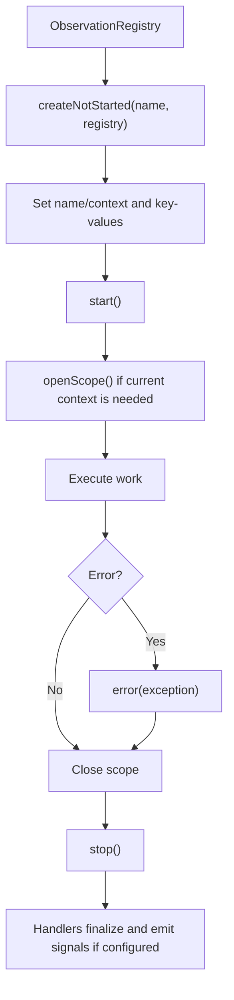
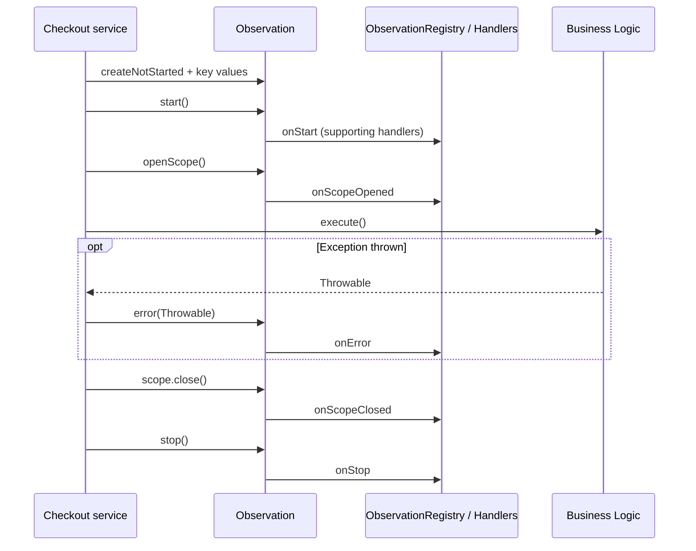

# Starting an Observation

> **Chapter:** Observation Lifecycle  
> **Module:** `SPRING_BOOT_OBSERVABILITY` — setting up observability for Spring Boot using Micrometer Observation, metrics, logs, and distributed tracing.

## Lesson Objectives

After completing this lesson, you will be able to:

- Explain when to **start an observation** and distinguish between `createNotStarted()`, `start()`, `openScope()`, and `stop()`.
- Identify appropriate business boundaries to measure with Micrometer Observation in a Spring Boot application.
- Create an observation from `ObservationRegistry`, assign a name, attach key-values with appropriate cardinality, and safely start and stop its lifecycle.
- Understand how an active observation relates to **metrics, logs, distributed tracing**, context propagation, exporters, and sampling.
- Recognize common mistakes when starting observations, especially with nested operations and asynchronous processing.

## 1. What Is an Observation and Why Is There a Start Step?

When a user calls an API to create an order, the application checks inventory, calculates totals, processes payment, and persists data. We want to know which operation takes time, which step fails, and whether the steps belong to the same request.

In Micrometer, an **observation** describes an activity to observe using a **name**, **context**, and **lifecycle**. Starting an observation establishes a start timestamp so configured `ObservationHandler` instances can process that activity. When the lifecycle ends, handlers can use the duration, error, and metadata to produce corresponding signals.

An observation is not synonymous with a trace span or a metric. It is a **unified observation API**. Depending on the handlers registered in `ObservationRegistry`, an observation can contribute to metrics, spans, or emit no external data.

For example, an instrumented business flow might use the name:

```text
checkout.submit
```

and the attributes:

```text
channel=web
result=success
```

If a metrics handler is present, the system can measure the count and duration of `checkout.submit`. If a compatible tracing handler is present, the activity can appear as a span linked to the ongoing HTTP request. Calling `start()` alone **does not guarantee** that metrics or traces will appear in the backend: that still depends on handlers, bridges, exporters, pipelines, and sampling.

## 2. Lifecycle: Create, Start, Enter Scope, Stop

A typical Micrometer Observation lifecycle includes:



This is a way to organize the lifecycle to understand the steps, not a requirement that every observation must open a scope or encounter an error. The APIs are distinguished as follows:

| Component/API | Primary Effect | Key Point |
| --- | --- | --- |
| `Observation.createNotStarted(name, registry)` | Creates the observation object without activating measurement | Suitable for attaching name/metadata before starting. |
| `lowCardinalityKeyValue(...)` and `highCardinalityKeyValue(...)` | Attaches attributes to the observation | Choose appropriate cardinality and avoid sensitive data. |
| `start()` | Starts the lifecycle; triggers start callbacks on matching handlers | **Does not automatically place the observation into the current scope.** |
| `openScope()` | Sets the observation as the current context for the scope's duration | Important for nesting and trace/log correlation when handlers integrate with it. |
| `error(Throwable)` | Reports an error to the observation and handlers | Call when the observed operation fails. |
| `stop()` | Ends the lifecycle; handlers can compute duration and finalize data | Must be called exactly once for a started observation. |
| `observe(...)` | Convenience API wrapping an operation, managing start/scope/error/stop | Suitable for most synchronous operations. |

**Core distinction:** `start()` marks when **the activity starts**; `openScope()` marks **which observation is the current context on the executing thread**. These two actions are related but not identical. You can start measuring without opening a scope; in that case, child observations or logs in the same code block will not necessarily inherit the context you expect.

For synchronous operations, a safe pattern is **create → attach metadata → start → open scope → execute → record error if any → close scope → stop**, using `try-with-resources` and `finally` to ensure cleanup.

## 3. Choosing Where to Start an Observation

A good starting point is a **boundary that is genuinely meaningful** to users or operations teams, not every function call.

Example for a payment system:

| Activity | Should You Create an Observation? | Reason |
| --- | --- | --- |
| `checkout.submit` | Usually yes | A clear business flow needing success and latency tracking. |
| `payment.authorize` | Yes, when visibility into this step alone is needed | Critical dependency, prone to timeouts or failures. |
| HTTP server handling `POST /orders` | Usually already instrumented by the framework | Check automatic instrumentation before manually creating a duplicate observation. |
| Getters or simple addition | Usually no | Low investigative value; increases measurement volume and overhead. |
| A scheduled data sync job | Yes, if there are operational goals | Need to know which jobs are slow, failing, and how many records are affected. |

The start point should sit **right before the work you intend to measure**, so duration does not accidentally include out-of-scope operations. For example, if you want to measure calling the payment gateway, start only around the payment call; if you want to measure all of checkout, start at the checkout business boundary.

Observation names should be **stable and express the type of activity**, such as `checkout.submit`, `payment.authorize`, `inventory.reserve`. Avoid names containing order IDs, URLs with actual path parameters, or per-request values; dynamic names cause unbounded growth in metric counts.

### 3.1. Automatic Instrumentation vs. Manual Instrumentation

Spring Boot Actuator can enable built-in instrumentation for layers such as HTTP servers and HTTP clients through compatible integrations. Depending on versions and dependencies, these operations already have observations.

**Manual instrumentation** fits *business* boundaries that are not automatically observed, such as `checkout.submit`. It lets you assign names and labels that express user intent rather than only seeing an HTTP request.

If an HTTP request observation already exists, you can create a business observation **inside the request's scope** to gain an extra level of detail. Do not manually wrap the entire request with the same meaning as built-in instrumentation, as that easily creates duplicate metrics or spans and reduces readability.

## 4. Starting an Observation Using the Micrometer API

In a Spring Boot application configured with Micrometer Observation, you typically receive `ObservationRegistry` via dependency injection.

### 4.1. Complete Example with `start()`

The code below creates an observation for a synchronous checkout operation, sets tags before starting, opens a scope during execution, and always stops the observation. `action` represents real business work, such as checking the cart, calling payment, or saving the order.

```java
import java.util.function.Supplier;

import io.micrometer.observation.Observation;
import io.micrometer.observation.ObservationRegistry;
import org.springframework.stereotype.Service;

@Service
public class CheckoutObservationService {
    private final ObservationRegistry observationRegistry;

    public CheckoutObservationService(ObservationRegistry observationRegistry) {
        this.observationRegistry = observationRegistry;
    }

    public <T> T submit(String inputChannel, Supplier<T> action) {
        // Bounded value set; avoid using raw labels received directly from clients.
        String channel = "web".equals(inputChannel)
                || "mobile".equals(inputChannel)
                ? inputChannel
                : "other";

        Observation observation = Observation
                .createNotStarted("checkout.submit", observationRegistry)
                .contextualName("submit checkout")
                .lowCardinalityKeyValue("channel", channel)
                .start();

        try {
            try (Observation.Scope scope = observation.openScope()) {
                try {
                    return action.get();
                } catch (RuntimeException | Error failure) {
                    observation.error(failure);
                    throw failure;
                }
            }
        } finally {
            observation.stop();
        }
    }
}
```

Key details to observe in the code:

1. `createNotStarted(...)` chooses the **observation name** and the registry that receives lifecycle notifications.
2. `contextualName("submit checkout")` provides a descriptive contextual name, which tracing handlers can use as the span name. `checkout.submit` is the stable measurement name.
3. `lowCardinalityKeyValue("channel", channel)` adds a label with a **small, known set of values** for metrics.
4. `start()` marks the activity as started. Registered handlers have the opportunity to receive the corresponding callback.
5. `openScope()` sets the current observation so nested operations can be correlated with the right context.
6. `observation.error(failure)` notifies handlers of the error before rethrowing the exception; it does not alter the application's error-handling decision.
7. `scope.close()` is called automatically by `try-with-resources`, and then `stop()` is called in `finally` even if the business operation fails.

This snippet demonstrates a **synchronous operation**. It does not automatically propagate context if `action` spawns threads, sends messages, or returns an asynchronous task. Duration here measures until `action.get()` returns; if it merely returns an incomplete future, redesign the measurement boundaries to reflect the actual desired time.

### 4.2. Using `observe(...)` When Manual Control Is Not Needed

For a simple synchronous operation, the `observe(...)` API makes lifecycle management more concise:

```java
import java.util.function.Supplier;

import io.micrometer.observation.Observation;
import io.micrometer.observation.ObservationRegistry;

public class CheckoutActions {
    private final ObservationRegistry registry;

    public CheckoutActions(ObservationRegistry registry) {
        this.registry = registry;
    }

    public <T> T run(Supplier<T> action) {
        return Observation.createNotStarted("checkout.submit", registry)
                .lowCardinalityKeyValue("channel", "web")
                .observe(action);
    }
}
```

`observe(...)` is a convenient way to **start, place the observation in scope, execute, record exceptions, and stop** in a synchronous flow. If you want to attach information right before or after individual phases, or measure asynchronous work, you may need explicit lifecycle management.

**Do not call `start()` first and then wrap the same observation with `observe(...)`** unless you know the exact API behavior: you risk duplicating lifecycle control. Choose **one** consistent mechanism per observation.

### 4.3. When Starting Without Opening a Scope

An example missing the context part:

```java
Observation observation =
        Observation.start("payment.authorize", observationRegistry);

try {
    paymentGatewayCall.run();
} finally {
    observation.stop();
}
```

The observation is still started and stopped, but without an appropriate scope, logs or child observations created inside `paymentGatewayCall.run()` may not see this observation as the current context. That can easily break trace/span linking or prevent expected parent–child relationships.

When you want inner work to use the current observation, open a scope around execution and close it safely:

```java
Observation observation =
        Observation.start("payment.authorize", observationRegistry);

try (Observation.Scope scope = observation.openScope()) {
    paymentGatewayCall.run();
} finally {
    observation.stop();
}
```

The example above assumes a `paymentGatewayCall` variable of type `Runnable` and an already-provided `observationRegistry`. In production code, also record errors via `observation.error(...)` or use `observe(...)` as in previous examples.

## 5. What Happens Inside `ObservationRegistry` on Start?

`ObservationRegistry` is where handlers, predicates, and conventions related to observations are wired together. When an observation starts, handlers compatible with its context can receive lifecycle callbacks; opening/closing scopes and reporting errors also trigger corresponding callbacks.

A conceptual view:



Correlation with signals in Spring Boot:

| Signal | Role of the Observation When Started | Conditions to See Results |
| --- | --- | --- |
| **Metrics** | Metrics handlers can record start time and measure duration, count, and outcome on stop. | Appropriate MeterRegistry and ObservationHandler present; exporter/backend configured if viewing externally. |
| **Distributed tracing** | Tracing handlers can create and activate a span following the observation lifecycle. | Micrometer Tracing bridge, sampler, and exporter present; propagation works across service boundaries. |
| **Logs** | Within scope, the logging framework can use MDC and trace context to produce correlated records. | Logs are actually written, and pattern/structured logging and MDC integration are properly configured. |

**Do not expect calling `start()` to automatically emit a log line.** Micrometer Observation does not replace logging business events. Likewise, if the registry has no matching handlers, the code still runs normally without emitting metrics or spans.

A Spring Boot application typically uses Actuator to configure most of the measurement foundation. If adding tracing, you need a bridge and exporter matching your stack and version. The exporter configuration and observability backend in use determine what data is actually collected and queried.

## 6. Current Context and Nested Observations

A request can involve multiple levels:

```text
HTTP POST /orders                 (HTTP observation created by framework)
└── checkout.submit               (business observation)
    ├── inventory.reserve         (business observation)
    └── payment.authorize         (business observation)
```

Suppose the HTTP observation already has an active scope. When `checkout.submit` is created and its scope is opened inside that scope, the tracing handler can create an appropriate child span. When the checkout scope closes, the previous current observation is restored.

Therefore:

- Start an observation **inside a parent context** if you want it linked to an ongoing request/operation.
- Use `openScope()` when nested activities inside need to inherit the context.
- Close scopes promptly and in the right order. Do not keep a scope open longer than the work being observed.
- When no tracing handler is present, observations can still measure metrics, though they will not necessarily build a span tree.

### 6.1. Asynchronous Boundaries

`Observation.Scope` generally relates to the current context on the processing thread. Code dispatched to `@Async`, `CompletableFuture`, an executor, Reactor, or a message consumer **does not automatically** see the same context.

Example of a flawed expectation:

```java
try (Observation.Scope scope = observation.openScope()) {
    // Task runs on another thread; context is not guaranteed to propagate.
    executor.execute(() -> log.info("processing payment"));
}
```

The outer code's lifecycle may end **before the task actually runs**, and tracing/logging context does not automatically follow the new thread. For asynchronous processing, you should:

1. Decide whether you want to measure **scheduling time**, **processing time**, or **total wait + processing time**.
2. Use context propagation mechanisms provided by the framework/integrations to **capture and restore** context at the right boundary.
3. Start and stop the observation where it actually wraps the work you intend to measure.
4. Verify trace ID/span ID in logs and spans across thread or message boundaries.

For distributed tracing over HTTP, Micrometer Tracing and HTTP client/server instrumentation can inject/extract headers such as W3C `traceparent`. An observation started in one service **does not automatically** make another service join the same trace if HTTP/message instrumentation and propagation are not configured.

## 7. Setting Tags at Start Time: Cardinality and Consistent Naming

For metrics to aggregate properly, observations of the same kind should use consistent names and tags. Two common key-value categories:

- **Low-cardinality:** values belong to a bounded, controlled set. For example `channel=web|mobile|other`, `operation=submit`, `outcome=success|error`.
- **High-cardinality:** values can vary widely, such as a specific transaction ID. It can assist search in tracing if configured to become a span attribute, but overhead and data safety must be evaluated.

Example attaching metadata before `start()`:

```java
Observation observation = Observation
        .createNotStarted("checkout.submit", registry)
        .lowCardinalityKeyValue("channel", "web")
        .lowCardinalityKeyValue("operation", "submit")
        .start();
```

Avoid:

```java
// Do not do this: orderId is almost always different per request.
Observation observation = Observation
        .createNotStarted("checkout.submit", registry)
        .lowCardinalityKeyValue("orderId", orderId)
        .start();
```

High-cardinality data like `orderId` can cause the number of time series in Prometheus or a metrics backend to spike, consuming memory and slowing down queries. Never attach passwords, tokens, payment data, or personal information to the observation context.

**When to set tags:** set already-known attributes **before starting** so handlers can read the full set up front. Attributes known only after processing (such as success/failure outcome) can be added during execution; keep in mind that some handlers/conventions evaluate tags at different times. Verify actual emitted signals in your Micrometer version.

## 8. Errors, Duration, and Stopping the Observation

At `start()` time, the observation only has a start point. Complete duration is generally available only when `stop()` is called. Forgetting to stop can result in missing completion measurements or leaving spans unfinished.

Key distinctions to keep in mind:

- **Business exceptions**: must be passed to the observation via `error(e)` if managing the lifecycle manually, then handled/rethrown per the application's contract.
- **Error HTTP statuses**: not every 4xx/5xx response automatically equals an exception in a business observation; the meaning of "failure" must be defined and instrumented accurately.
- **Dependency timeouts**: a timeout may throw an exception, return an error code, or signal asynchronously; the placement of start/stop determines what duration is measured.
- **Tracing sampling**: a trace dropped by sampling does not mean the observation did not run. Metrics can still reflect the activity if a metrics handler is configured, though the metrics pipeline has its own limits.
- **Exporters**: handler-generated data does not mean the collector/backend has received it; the export pipeline itself must be monitored.

For example, if a `payment.authorize` flow takes 3 seconds, placing `start()` before enqueuing the task and `stop()` right after enqueuing measures only the **enqueue** cost, not the **actual payment** time. Choose boundaries that align consistently with operational goals.

## 9. Configuration and Verification in Spring Boot

To run examples using `ObservationRegistry`, the project needs Micrometer/Actuator dependencies matching its Spring Boot version. To collect metrics for Prometheus or traces to a backend, add the corresponding registry, tracing bridge, and exporter.

Example configuration in an application using Actuator and compatible integrations:

```yaml
spring:
  application:
    name: checkout-service

management:
  endpoints:
    web:
      exposure:
        include: health,info,prometheus
  tracing:
    sampling:
      probability: 0.1
```

The configuration above is illustrative only:

- `/actuator/prometheus` is only available when the Prometheus registry dependency is present and the endpoint is exposed.
- `management.tracing.sampling.probability=0.1` instructs a compatible tracing sampler to sample 10% probabilistically. It does not control metric recording frequency.
- Tracing spans reach the backend only when the bridge, exporter, and destination are properly configured.
- Management/metrics endpoints must be secured appropriately per environment; never expose sensitive operational data to the public Internet.

### 9.1. Hands-on Exercise: Observing a Failed Checkout

In a test Spring Boot service with appropriate instrumentation:

1. Obtain `ObservationRegistry` via framework configuration or inject the managed bean; create `CheckoutObservationService` following the example above.
2. Call `submit("web", () -> { ... })` with a simulated task that runs for 200 ms and returns normally.
3. Call it again, this time having the task throw `IllegalStateException`; verify that the execution flow still throws the exception as before.
4. Inspect metrics named `checkout.submit` (if a metrics handler and registry are configured), checking duration and low-cardinality tags.
5. If tracing is enabled, open the HTTP request trace and locate the `checkout.submit` business span; inspect its relationship to the parent HTTP span and child spans.
6. Write a log statement inside the scope and verify whether trace ID/span ID appear in MDC/the logging pattern.
7. Try removing `openScope()` in a test experiment: compare context in logs and child observation linking.
8. Try offloading the business logic to an executor: check timing and context propagation, then adjust start/stop boundaries to match the exact duration you want to measure.

**Success criteria:** You can explain **which activity** `start()` began measuring, **which current context** `openScope()` altered, and when `stop()` ended the activity; from metrics, logs, and traces, you can verify instrumentation decisions when the pipeline is fully configured.

## 10. Common Pitfalls When Starting Observations

| Symptom | Possible Cause | Resolution |
| --- | --- | --- |
| Code called `start()` but no metrics appear | Registry lacks metrics handler, exporter not configured, or backend not scraping/ingesting | Check Actuator/Micrometer, registry, handlers, endpoints, and pipeline. |
| No traces or spans visible | Missing tracing bridge/exporter, trace dropped by sampling, or observation not instrumented as expected | Check tracing configuration, sampling, and backend visibility. |
| Business span is not nested under HTTP span | No active parent observation or scope not opened at the proper boundary | Check `start()`/`openScope()` order and context propagation. |
| Logs lack trace ID | Log executed outside tracing scope or MDC/log format not configured | Check scope, logging configuration, and async boundaries. |
| Timer/span has no completion time | Missing `stop()` on a return or exception branch | Use `finally` or `observe(...)` to close the lifecycle. |
| Metrics produce too many series | Name/tags contain IDs or per-request variable values | Use normalized names and low-cardinality tags with bounded value sets. |
| Measured time is lower than user-perceived latency | Start/stop only wraps enqueueing or an overly narrow step | Re-align boundaries with the behavior you intend to measure. |
| Operation is measured twice | Manual observation duplicates automatic instrumentation | Clarify instrumentation ownership; keep business observations with distinct meaning. |

## 11. Self-Check

**Question 1.** Does `createNotStarted("checkout.submit", registry)` mean timing measurement has already started?  
**Hint:** No. The observation is created, but `start()` has not been called yet.

**Question 2.** After calling `start()`, is `openScope()` mandatory?  
**Hint:** Not mandatory from an API standpoint. However, if you want the observation to become the current context so child operations and logs correlate with it, you need to open a scope appropriately.

**Question 3.** Why should `stop()` be placed in `finally` under manual lifecycle control?  
**Hint:** So the activity is closed even when code returns early or throws an exception; prevents missing duration data and unfinished spans.

**Question 4.** Should a per-request `transactionId` be set as a `lowCardinalityKeyValue`?  
**Hint:** No. It can create huge numbers of metric series; use bounded tags for metrics and handle high-cardinality IDs in appropriate correlation systems only when genuinely needed.

**Question 5.** If no span appears in the backend, can you conclude that `start()` never ran?  
**Hint:** No. A handler/bridge/exporter might be missing, sampling may have dropped the trace, or the data delivery pipeline may have failed.

**Question 6.** When `@Async` executes after the originating method finishes, will an observation started on the calling thread automatically measure the entire async processing time accurately?  
**Hint:** No. You must define the intended timing boundary and configure context propagation/lifecycle handling suitable for asynchronous execution.

**Key takeaway:** In Micrometer Observation, **`start()` marks when the activity begins**, while **`openScope()` establishes the current context** for subsequent steps to inherit. Choose the right boundaries, use stable names/tags, record errors, and end the lifecycle safely. Metrics, logs, and distributed tracing correlate effectively only when `ObservationRegistry`, handlers, context propagation, exporters, and sampling are properly configured for your Spring Boot environment.
