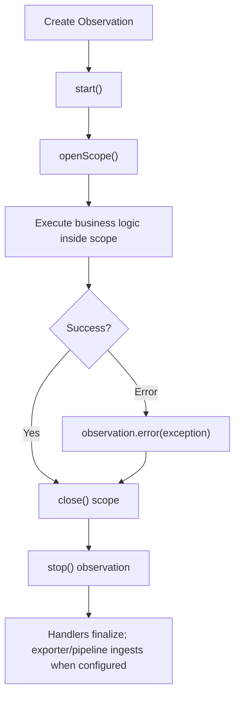

# Opening a Scope in the Micrometer Observation Lifecycle

An HTTP request enters a Spring Boot application. The application creates an observation for the `checkout.payment.authorize` step, then calls the payment gateway and logs an error if something fails. How do operations running on the same thread know which observation they belong to? And why do logs sometimes lose `traceId`, or why does a child observation fail to link properly to its parent observation?

Part of the answer lies in **opening a scope**: `Observation.openScope()`. A scope makes an observation the **current observation** within a specific execution boundary. It is the mechanism that bridges observing an operation and the code running inside that operation.

This lesson belongs to the **Observation Lifecycle** chapter of the **SPRING_BOOT_OBSERVABILITY** module. The module uses Micrometer Observation, metrics, logs, and distributed tracing to investigate production errors and latency; therefore, opening a scope must be understood alongside context propagation, tracing handlers, tags/cardinality, exporters, and sampling.

## Learning Objectives

After completing this lesson, you will be able to:

1. Explain precisely **what a scope is**, **what opening a scope does**, and how it differs from `start()`/`stop()`.
2. Use `openScope()` with `try-with-resources` to ensure scopes are closed on both normal return and exception paths.
3. Read the **current observation** and understand how nested scopes restore the parent context.
4. Identify bugs caused by unclosed scopes, misplaced scopes, or assuming scopes automatically cross threads, executors, message queues, and Reactor pipelines.
5. Relate opening a scope to metrics, log correlation, the current span, sampling, and how to verify signals in a Spring Boot application.

## 1. What Is a Scope?

In Micrometer Observation, an **observation** represents an observed activity, such as handling an HTTP request, executing a payment step, making a downstream HTTP call, or processing a message. An observation has a name, context, key-values, and lifecycle callbacks.

A **scope** is a dynamic boundary during code execution. When a scope is opened for an observation, that observation is registered as the **current observation** in the execution context managed by Micrometer (typically bound to the current thread). Code running inside this boundary can access the current observation without passing the observation variable explicitly through every method signature.

You can visualize it like this:

```text
Observation: "checkout.payment.authorize"
    ├── start()      -> starts the measured lifecycle
    ├── openScope()  -> makes it the current observation here
    │   ├── call gateway
    │   ├── write logs
    │   └── create child observations
    ├── close scope  -> restores the previous current observation
    └── stop()       -> ends the measured lifecycle
```

**Important distinction:** a scope is **not** the observation itself and is **not** an independent span. A scope only defines which observation is current during the executing block of code. Depending on instrumentation and registered `ObservationHandler` instances, it can trigger setting/restoring the current span or correlation metadata in the logging context.

### Three Operations Easily Confused

| Operation | Primary Role | What Not to Assume |
|---|---|---|
| `observation.start()` | Starts the observation lifecycle; invokes matching handlers | Automatically makes the observation current across all inner code |
| `observation.openScope()` | Creates a current observation boundary; notifies handlers on scope open/close | Automatically stops the observation or propagates context across all threads |
| `scope.close()` | Closes the boundary; typically restores the previous observation | Replaces `observation.stop()` |
| `observation.stop()` | Ends the measured activity; invokes completion handlers | Safely auto-closes all open scopes |

One observation can have its scope opened and closed multiple times during its lifecycle; there is no rule saying "each observation may only open a scope once." Even so, **every opened scope must be properly closed**.

## 2. Where Opening a Scope Fits in the Observation Lifecycle

The basic flow of a synchronous operation:



This diagram illustrates a manual implementation. In practice, convenience APIs can manage these steps automatically.

Milestones to distinguish:

- **Creating the observation:** declares the operation name, context, and relevant metadata; a not-started observation does not yet represent a complete measured activity.
- **Starting:** `start()` activates the lifecycle and notifies handlers that observation has begun.
- **Opening a scope:** `openScope()` sets the observation as the current context for the active processing block.
- **Recording events/errors:** `event()`, `error()`, and low-cardinality or high-cardinality key values can be added as needed.
- **Closing the scope:** releases the block's ownership of the current context and restores the previous context when scopes are nested.
- **Stopping the observation:** `stop()` completes the lifecycle; metric timers and spans can be updated/finished by configured handlers.

If you only open and close a scope without calling `start()`/`stop()` properly, do not expect duration to be measured accurately. If you call `start()`/`stop()` without a scope, handlers can still record duration, but nested code may fail to see the current observation and lose correlation with logs and child spans.

## 3. Standard Pattern: `openScope()` and `try-with-resources`

The following example illustrates a synchronous operation in a Spring Boot service. `PaymentGateway`, `PaymentRequest`, and `PaymentResult` are hypothetical application business types.

```java
import io.micrometer.observation.Observation;
import io.micrometer.observation.ObservationRegistry;
import org.springframework.stereotype.Service;

@Service
class CheckoutService {
    private final ObservationRegistry observationRegistry;
    private final PaymentGateway paymentGateway;

    CheckoutService(ObservationRegistry observationRegistry,
                    PaymentGateway paymentGateway) {
        this.observationRegistry = observationRegistry;
        this.paymentGateway = paymentGateway;
    }

    PaymentResult authorize(PaymentRequest request) {
        Observation observation = Observation.createNotStarted(
                        "checkout.payment.authorize", observationRegistry)
                .contextualName("authorize payment")
                .lowCardinalityKeyValue("operation", "authorize")
                .start();

        try (Observation.Scope scope = observation.openScope()) {
            try {
                return paymentGateway.authorize(request);
            } catch (RuntimeException exception) {
                observation.error(exception);
                throw exception;
            }
        } finally {
            observation.stop();
        }
    }
}
```

### Reading the Code with Proper Semantics

1. `Observation.createNotStarted(...)` creates an observation for the `checkout.payment.authorize` operation.
2. `lowCardinalityKeyValue("operation", "authorize")` adds a tag with a small, stable value set suitable for aggregating metrics.
3. `start()` starts the observation interval.
4. `openScope()` places the observation into the current context on the running thread. Calls inside the `try` block can access the corresponding context.
5. If `paymentGateway.authorize(...)` throws a `RuntimeException`, `observation.error(exception)` records the exception for interested handlers; the code then rethrows the error so business failures are not hidden.
6. `try-with-resources` automatically invokes `scope.close()` even on `return` or exception.
7. `finally` invokes `observation.stop()` to end the observation lifecycle.

This pattern only illustrates `RuntimeException`. If the business API declares **checked exceptions**, handle and record them according to the method signature.

**Do not call `stop()` in place of `close()`.** The two actions serve separate purposes. Closing the scope should occur before stopping the observation; `try-with-resources` preserves that order when exiting the block.

### Shorter Approach for Synchronous Operations

For an operation that simply wraps a synchronous block in an observation, the `observe(...)` convenience API helps avoid omitting standard lifecycle steps:

```java
PaymentResult authorize(PaymentRequest request) {
    return Observation.createNotStarted(
                    "checkout.payment.authorize", observationRegistry)
            .contextualName("authorize payment")
            .lowCardinalityKeyValue("operation", "authorize")
            .observe(() -> paymentGateway.authorize(request));
}
```

Here `observe(...)` handles starting, managing the scope while the callback runs, and stopping the observation across the synchronous lifecycle, including recording errors when the callback throws exceptions supported by the API. **Do not** wrap this again in a manual scope just to repeat the same operation. When you need exact control over when scopes open/close or complex lifecycles, use the explicit manual pattern above.

## 4. How Does the Current Observation Work?

Think of the current observation as a **context stack** bound to an execution flow. When no scope is open, the current observation may be `null`. Opening a new scope makes the new context current; closing it typically returns the current observation to the previous context.

Reading the current observation through `ObservationRegistry`:

```java
Observation current = observationRegistry.getCurrentObservation();

if (current != null) {
    // An observation is currently active in this execution context.
    // Avoid adding per-request IDs as metric tags here.
}
```

`getCurrentObservation()` returns the **current observation** managed by the registry, not a list of all active observations across the application. The result can be null if code runs outside any scope or if no context was restored on the current thread. Moreover, having a current observation does not necessarily mean the backend is receiving its span: tracing handlers, sampling, and exporters can differ across environments.

### Example: Nested Observations

```java
Observation outer = Observation.createNotStarted(
        "checkout.process", observationRegistry).start();

try (Observation.Scope outerScope = outer.openScope()) {
    // Current observation is outer.
    Observation inner = Observation.createNotStarted(
            "checkout.payment.authorize", observationRegistry).start();

    try (Observation.Scope innerScope = inner.openScope()) {
        // Current observation is inner.
        callPaymentProvider();
    } finally {
        inner.stop();
    }

    // innerScope closed: current observation returns to outer.
} finally {
    outer.stop();
}
// outerScope closed: previous context before outer is restored.
```

`callPaymentProvider()` is an illustrative business method. In typical scenarios, instrumentation can use the current context to establish parent–child relationships for subsequent observations/spans. However, **exact span relationships depend on the tracing bridge, handlers, and how spans are created**, not merely on nested observation names in source code.

Timeline illustration:

```text
Point in Time      Current observation
--------------------------------------------------
Before outer       (none or another parent observation)
Open outerScope    checkout.process
Open innerScope    checkout.payment.authorize
Close innerScope   checkout.process
Close outerScope   (state prior to outer)
```

**Important rule:** nest scopes structurally and close them in **reverse order of opening (LIFO)**. `try-with-resources` is the natural way to enforce this.

## 5. How Does Opening a Scope Affect Metrics, Logs, and Traces?

Opening a scope generally does not produce all three signals directly. Instead, it makes **the running observation's context accessible to integrated components**.

| Signal | Role of Scope | Prerequisites for Results |
|---|---|---|
| **Metrics** | Links the observation with the execution boundary; metric handlers typically use start/stop events and key values to measure | Metric handler/registry registered, suitable meters, and metrics pipeline |
| **Logs** | Tracing integration can update current trace/span in the logging context (e.g., MDC), letting logs inside scope carry correlation IDs | Tracing bridge, configured log pattern/structured logging, and proper context propagation |
| **Traces** | Tracing handlers can set the current span when the scope opens and restore the previous span when it closes | Tracing handler, instrumentation, sampler, and working exporter/collector/backend |

### Metrics: Opening a Scope Is Not Recording a Metric

For instance, calling `openScope()` **does not automatically increment** a "payment count" counter or record a business success/failure outcome. Metrics are created when compatible instrumentation and handlers exist; timing measurements usually cover the entire `start()` to `stop()` interval.

Attach appropriate key-values:

- **Low-cardinality tags:** `operation=authorize`, `outcome=success|failure` (using normalized values registered at the proper time).
- **Do not put** `orderId`, `userId`, `traceId`, or URLs with dynamic IDs into metric labels; they can generate massive numbers of time series.

Opening an observation with a meaningful name and stable tags makes metrics usable for dashboards/SLOs, though **the exact metrics and export behavior still depend on application configuration**.

### Logs: Scope Enables Correlation, Not Automatic Logging

Suppose inside the payment boundary there is:

```java
log.warn("Payment gateway timed out");
```

When Micrometer Tracing and logging are properly integrated, a log written inside the scope can be enriched with `traceId` and `spanId` via MDC or the configured log format. This allows engineers to locate the trace associated with an error.

However:

- `openScope()` does not emit log lines or stack traces on its own.
- Not every logger or format prints `traceId`/`spanId` automatically; it must be configured accordingly.
- A trace dropped by sampling can still have logs carrying a trace ID; having an ID in logs **does not guarantee** the trace will be found in the backend.
- If code runs on another thread without propagating/restoring context, logs on that thread may lack IDs or carry a different context.

Never place tokens, payment details, personal data, or sensitive content into tags, logs, or tracing baggage merely for easier lookup.

### Traces: Current Observation and Current Span Are Related, Yet Distinct

When Micrometer Tracing is present, observation handlers can create spans and activate the current span according to the scope. Instrumented HTTP clients can then create child spans and propagate trace context via appropriate headers, such as W3C `traceparent`.

Points to remember:

- An **Observation** scope is a Micrometer Observation concept; a **span** scope is provided by the tracing integration. Handlers link them together, though their APIs are not identical.
- Trace/span creation can be governed by **sampling** policies; application code must not treat the presence of an exported trace as the sole proof that business logic ran.
- If a child span is created locally but trace context is not propagated downstream, you may see two separate traces even though it was a single business transaction.
- Span duration and span count depend on instrumentation granularity; opening a scope does not automatically split all inner logic into sub-spans.

## 6. Scopes and Threads: Context Does Not Cross Async Boundaries Automatically

The most common mistake is assuming that opening a scope once on the request-receiving thread automatically carries that context to every task submitted to an executor, `@Async`, message queue, or Reactive pipeline.

In the standard model, the current observation relies on **ThreadLocal** or an equivalent context mechanism. Another thread does not automatically inherit the active scope of the calling thread.

### Anti-Pattern: Opening a Scope Then Offloading Work to an Executor

```java
Observation observation = Observation.createNotStarted(
        "checkout.send-receipt", observationRegistry).start();

try (Observation.Scope scope = observation.openScope()) {
    executor.execute(() -> sendReceiptEmail());
} finally {
    observation.stop();
}
```

This snippet has at least two problems:

1. `sendReceiptEmail()` executes on another thread; the observation that is current on the submitting thread is **not automatically** current on the worker thread.
2. `observation.stop()` can execute right after `executor.execute(...)` returns, **before** sending the email finishes. Metrics/traces measure task submission time, not actual execution time.

### The Right Way to Think About It

For asynchronous work, clarify:

- **Which segment are we observing?** If only measuring enqueue time, stopping the observation right after enqueueing makes sense. If measuring email delivery time, the observation must wrap email sending on the worker thread.
- **Who owns the scope?** A scope should be opened and closed where the callback actually executes—not opened on one thread and arbitrarily closed by another.
- **How should parent context propagate?** Use framework instrumentation or **Micrometer Context Propagation** mechanisms to capture/restore context across thread boundaries instead of storing a reference and assuming it becomes current.
- **Does the work share the request's lifecycle?** Messages processed long after the request ends may fit a new observation/trace linked via span links or causal references, depending on processing semantics and tracing conventions.

Structural illustration (pseudocode, not copy-paste runnable API):

```text
Request-receiving thread:
    open scope for checkout observation
    capture context via configured propagation mechanism
    submit task + captured context
    close checkout scope when request boundary ends

Task-executing thread:
    restore context before executing callback
    create observation for sendReceiptEmail
    open scope for sendReceiptEmail
    execute business logic, record error if any
    close scope and stop task observation
    restore thread's prior context
```

In Spring Boot applications, you can use library integrations, task decorators, or Micrometer Context Propagation depending on your version and stack. **Do not treat raw `ExecutorService`, `CompletableFuture`, `@Async`, and Reactor as identical in propagation behavior.** Always verify how your actual configuration behaves.

### Reactor and Reactive Processing

A Reactor pipeline can hop across multiple threads and only starts running once a subscriber subscribes. Wrapping pipeline **assembly** (`Mono`/`Flux` construction) in `try (scope = observation.openScope())` usually covers only building the pipeline, without guaranteeing the scope surrounds signal processing.

Reactive code should use **Reactor Context** along with context propagation/instrumentation features matching the versions of Spring Boot, Micrometer, and Reactor in use. When tracking asynchronous operations, tie stopping the observation to actual completion/error/cancellation signals rather than stopping immediately after returning the publisher.

## 7. Scopes and HTTP/Messaging Propagation Are Not the Same

Opening a scope makes the current observation accessible within a local execution boundary. **Context propagation** carries required metadata across another boundary—whether between threads, processes, or services.

They are related but do not replace each other:

| Boundary | Typical Mechanism | What to Verify |
|---|---|---|
| Same thread, nested code | `Observation.openScope()` / `Scope.close()` | Scopes closed in order, current observation matches |
| Thread pool / executor | Context capture/restore or supporting integration | Context restored when callback runs; no leaks to subsequent tasks |
| HTTP between services | Instrumented client/server and trace context headers | Headers injected/extracted; gateways/proxies do not strip context |
| Message broker / consumer | Header propagation and message instrumentation | Parent/span link relationships match asynchronous processing |
| Reactive publisher | Reactor Context and matching context propagation | Context follows **subscription/signal time**, not just pipeline assembly |

A request can have a complete scope in checkout-service and still break the trace in payment-service if the HTTP client fails to inject context. Conversely, seeing `traceparent` in a downstream request does not guarantee the receiving app creates the expected observation/span if inbound instrumentation is not configured.

## 8. Nested Scopes, Leaks, and Diagnosis

### Mistake 1 — Forgetting to Close a Scope

```java
Observation.Scope scope = observation.openScope();
callExternalService();
// Not closed if a branch returns early or throws an exception.
```

If the thread is reused by a thread pool, stale context can linger and affect the next request. Consequences include wrong current observations, corrupted parent–child trace trees, or logs carrying mismatched correlation IDs. **Solution:** use `try-with-resources` and avoid storing scopes in fields or long-lived caches.

### Mistake 2 — Stopping the Observation While Its Scope Is Still Open

```java
Observation observation = Observation.createNotStarted(
        "checkout.process", observationRegistry).start();

Observation.Scope scope = observation.openScope();
observation.stop();  // Wrong resource management order.
scope.close();
```

This can cause inner code or handlers to still view the observation as current even though its lifecycle has ended. **Solution:** close the scope first, then stop the observation; structure with `try/finally`.

### Mistake 3 — Closing Nested Scopes Out of Order

If you open A → B but close A before B, the restored context may no longer match expectations. When scopes are nested using `try-with-resources`, Java guarantees resources close in reverse order.

### Mistake 4 — Calling `openScope()` and Assuming Downstream HTTP Is Automatically Linked

A local scope does not generate HTTP headers. Verify client instrumentation, propagation format, server extraction, and sampling/export. Custom clients or non-standard protocols in particular may require explicit propagation integration.

### Mistake 5 — Using Scope as a Substitute for Business Errors or Metrics

Opening a scope does not turn exceptions into error statuses, nor does it guarantee business counters increment. Call `observation.error(exception)` when appropriate; if you need to count payment outcomes, design meters/observations and define outcomes per business rules. Scopes do not replace retries, timeouts, or error handling.

## 9. Verifying in Practice Inside a Spring Boot Application

Suppose the checkout service has an endpoint that creates an order and calls a payment gateway. After adding a manual observation, test a successful request, a failing request, and a request dispatching work to another thread.

### In-Code Verification

Inside the scope boundary:

```java
Observation observation = Observation.createNotStarted(
        "checkout.payment.authorize", observationRegistry).start();

try (Observation.Scope scope = observation.openScope()) {
    Observation current = observationRegistry.getCurrentObservation();
    boolean correctScope = (current == observation);

    if (!correctScope) {
        throw new IllegalStateException("Observation scope is not current");
    }

    // Perform a synchronous business operation here.
} finally {
    observation.stop();
}
```

This check demonstrates comparing the current observation via the registry. With no-op registries/handlers or varying instrumentation setups, behavior and telemetry visibility can differ; verify against your actual stack rather than treating this check expression as a universal specification across all configurations.

### Operational Signal Verification

1. **Metrics:** does an appropriate metric exist for the instrumented operation? Are names/tags stable? Does the timer reflect duration matching the start/stop lifecycle?
2. **Logs:** do logs inside the scope contain `traceId`/`spanId` when tracing is enabled? After exiting the scope, do logs from other requests avoid inheriting wrong IDs?
3. **Traces:** does the operation's span relate properly to the HTTP server span? Do traces break across HTTP clients or executors?
4. **Errors:** are failing requests recorded properly in logs, observation errors, and required outcome measurements? Do not infer error rates from a handful of sampled traces.
5. **Pipeline:** if a trace is missing, check sampler, exporter, collector, retention, and queryability; do not equate "trace not stored" with "scope not opened."

An error can be recorded in metrics while no trace is saved due to sampling. A trace can appear while logs lack correlation because MDC/log patterns are not integrated. Those cases pinpoint **exactly where the signal chain breaks**.

## 10. Self-Check Questions

**Question 1.** `observation.start()` has been called. Will a child method on the same thread automatically find that observation via `getCurrentObservation()`?

**Hint:** Do not assume so. `start()` begins the lifecycle; an active scope or appropriate propagation mechanism is needed for inner code to see the right current observation.

**Question 2.** Why use `try (Observation.Scope scope = observation.openScope())` instead of just calling `openScope()`?

**Hint:** Because the scope must close on both normal `return` and exception paths. Closing the scope restores the prior context and prevents context leaks to unrelated work on the same thread.

**Question 3.** After closing an inner child scope, which observation should become current again?

**Hint:** The parent observation from the outer scope, if still open; if there is no parent, the current observation returns to its state prior to opening.

**Question 4.** A callback is submitted to an executor inside a scope, yet logs inside the callback lack `traceId`. Can you be sure the callback ran outside the business operation?

**Hint:** No. Local scopes do not automatically cross thread boundaries. Check context capture/restore, tracing integration, log formatting, and sampling.

**Question 5.** Code opens a scope, runs fast work, closes the scope, and forgets `stop()`. Are opening and closing the scope enough to ensure timers/spans finish?

**Hint:** No. `close()` releases the current observation boundary; `stop()` is what completes the observation lifecycle. The `observe(...)` API can manage both for synchronous operations.

## Conclusion

In Micrometer Observation, **opening a scope makes an observation the current context within a specific execution boundary**. It enables nested operations and integrations like tracing and log correlation to discover the right context. A scope does not replace `start()`/`stop()`, does not automatically emit complete metrics/logs/traces, and does not propagate across threads or services by itself. In Spring Boot, using `try-with-resources`, closing scopes in the proper order, choosing the right instrumentation, and verifying the full telemetry path ensures observability data accurately reflects application behavior when investigating errors and latency.
