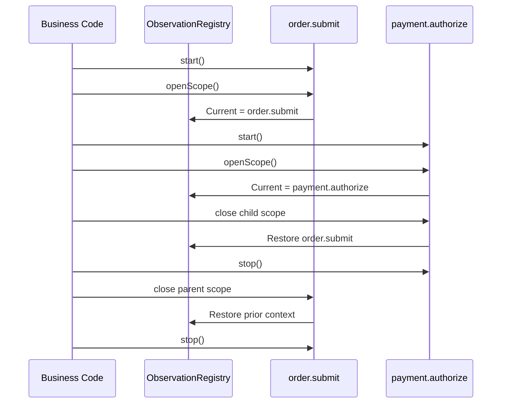

# Closing a Scope in the Micrometer Observation Lifecycle

A request enters `OrderController`, calls `PaymentService`, and writes logs during processing. If each operation is tracked with Micrometer Observation, logs and spans can link to the same trace. However, once `PaymentService` finishes, **the current observation must return to `OrderController`'s operation**. If a scope is left unclosed, a reused thread can mistakenly retain the previous request's context, corrupting logs or span relationships.

In the **Observation Lifecycle** chapter of the `SPRING_BOOT_OBSERVABILITY` module, this lesson explains precisely what **closing a scope** is, when to close it, and why that operation matters when setting up observability for Spring Boot using Micrometer Observation, metrics, logs, and distributed tracing. The examples also connect scopes with context propagation, cardinality, exporters, and sampling to aid production error and latency investigations.

## 1. What Is a Scope?

In Micrometer Observation, `Observation` represents **a piece of work being observed**, such as `order.submit` or `payment.authorize`. `Observation.Scope` is **the boundary during which an observation is set as the current observation** in the corresponding execution context.

When you call:

```java
Observation observation =
    Observation.createNotStarted("order.submit", observationRegistry).start();

try (Observation.Scope scope = observation.openScope()) {
    // Observation "order.submit" is the current observation inside the scope.
    handleOrder();
} finally {
    observation.stop();
}
```

`openScope()` activates the observation as the **current observation** for the enclosed code block; `scope.close()`, called automatically by `try-with-resources`, **exits that boundary and restores the previous observation (if any)**.

A scope has characteristics to distinguish:

- It represents the **current context**, typically managed on the synchronous execution thread by the registry's scope mechanism and associated handlers.
- It is **not** a container holding all metrics, logs, or traces; those signals are generated and exported by their respective components.
- An Observation has a start–stop lifecycle, whereas a scope is simply the interval during which that Observation is set as current.
- Closing a scope generally restores the previous current context; **it does not mean the Observation has stopped**.

In Spring Boot 3.x, `ObservationRegistry` is typically configured by the framework when `spring-boot-starter-actuator` is present. Inject and use this managed registry bean to remain consistent with the application's handlers, filters, and observation policies.

## 2. How Is Closing a Scope Different from `Observation.stop()`?

Two actions that are easily confused:

| Action | Called On | Primary Effect | Ends Observation Measurement? |
| --- | --- | --- | --- |
| `observation.start()` | `Observation` | Starts the operation lifecycle and notifies matching handlers | Not yet |
| `observation.openScope()` | `Observation` | Sets the observation as current within a new scope | Not yet |
| `scope.close()` | `Observation.Scope` | Exits the scope and restores the previous context | **No** |
| `observation.error(ex)` | `Observation` | Records an error on the context and notifies matching handlers | No |
| `observation.stop()` | `Observation` | Ends the lifecycle and notifies handlers to finalize data | **Yes** |

To visualize, consider two conceptual timelines:

```text
Time                 t0            t1            t2            t3
                     |-------------|-------------|-------------|
Observation          start -----------------------------------> stop
Scope                              openScope ---> close
Current observation  as before      Observation X  as before
```

At `t2`, the scope ends and the current observation is restored; Observation X itself remains active until `t3`. Duration measurement for an Observation typically follows the `start`–`stop` lifecycle, not simply how long a scope stayed open.

**Consequence:** calling `scope.close()` while forgetting `observation.stop()` can prevent metrics/tracing handlers from receiving the completion event. Conversely, calling `stop()` while leaving a scope open is not a proper way to clean up the current context. Manage these two responsibilities separately.

## 3. Why Must Scopes Be Closed Promptly?

Servers typically reuse threads to process multiple requests. If request A's scope remains active after request A finishes, request B running on the same thread may see the stale context. Depending on installed instrumentation, effects can include:

- Logs from request B receiving the wrong `traceId` or `spanId` from A.
- Child spans of B getting attached to A's trace.
- Code calling `observationRegistry.getCurrentObservation()` retrieving the wrong operation, attaching tags or events to the wrong context.
- Scope-tracking handlers not being notified at the right time of scope closure.

Proper scope closure restores **the context prior to entering the boundary** and preserves nesting relationships between operations. In applications with a tracing bridge and log correlation support, restoring context is also critical so MDC/logging contexts do not retain a stale current span.

Exact risks depend on library versions, handler types, and how context is configured. Not every application relies solely on the same ThreadLocal mechanism; when using Reactor or asynchronous propagation, context must be evaluated under that execution model.

## 4. Standard Approach: `try-with-resources`

`Observation.Scope` implements `AutoCloseable`, making Java's `try-with-resources` construct the preferred choice for synchronous code:

```java
import io.micrometer.observation.Observation;
import io.micrometer.observation.ObservationRegistry;
import org.springframework.stereotype.Service;

@Service
public class InventoryService {
    private final ObservationRegistry observationRegistry;

    public InventoryService(ObservationRegistry observationRegistry) {
        this.observationRegistry = observationRegistry;
    }

    public void reserve(String warehouseType) {
        Observation observation =
            Observation.createNotStarted("inventory.reserve", observationRegistry)
                .lowCardinalityKeyValue("warehouse.type", normalize(warehouseType))
                .start();

        try (Observation.Scope scope = observation.openScope()) {
            reserveInDatabase();
        } catch (RuntimeException ex) {
            observation.error(ex);
            throw ex;
        } finally {
            observation.stop();
        }
    }

    private String normalize(String raw) {
        return "regional".equals(raw) ? "regional" : "central";
    }

    private void reserveInDatabase() {
        // Actual inventory reservation logic.
    }
}
```

Here:

1. `start()` starts the Observation.
2. `openScope()` sets `inventory.reserve` as the current context.
3. Upon exiting the `try` block—normally or via an exception—Java automatically calls `scope.close()`.
4. `catch` records the error and rethrows so the business layer still handles it properly.
5. `finally` calls `observation.stop()`, even if the operation failed.

This snippet constrains `warehouse.type` to two values, suitable for a **low-cardinality tag**. Do not directly add `warehouseId`, `orderId`, or high-cardinality user data as metric labels just for convenience. Such data, if permitted to be collected, belongs in trace/log high-cardinality mechanisms governed by separate policies.

### Avoid Manual `close()` When Unnecessary

An error-prone pattern:

```java
Observation.Scope scope = observation.openScope();
doWork();             // If this throws, the next line never runs.
scope.close();        // The scope may never be closed.
observation.stop();
```

Fix this with `try-with-resources` and `finally`, or use the `Observation.observe(...)` convenience API when explicit scope control is unnecessary.

### When Is `observe(...)` All You Need?

If the entire business operation fits inside a synchronous lambda, let Micrometer manage start, scope, error, and stop:

```java
return Observation.createNotStarted("payment.authorize", observationRegistry)
    .lowCardinalityKeyValue("payment.channel", "card")
    .observe(() -> paymentClient.authorize());
```

This example assumes `paymentClient.authorize()` returns a type matching the enclosing method. It is a clean option for synchronous operations. **If the lambda merely returns an incomplete `CompletableFuture`**, `observe(...)` measures only the time to create or schedule the future; it does not wait for the async work to complete. When measuring asynchronous work, design the Observation lifecycle around actual completion, with proper propagation.

## 5. Nested Scopes: Closing the Child Scope to Return to the Parent Scope

Suppose `order.submit` is the parent operation and `payment.authorize` is the child operation. When opening a child scope while a parent scope is active, the registry can save the previous context to restore when the child scope closes.



### Step-by-Step Readable Example

```java
import io.micrometer.observation.Observation;
import io.micrometer.observation.ObservationRegistry;

public void submitOrder(ObservationRegistry registry) {
    Observation parent =
        Observation.createNotStarted("order.submit", registry).start();

    try (Observation.Scope parentScope = parent.openScope()) {
        // Current observation: parent
        System.out.println(registry.getCurrentObservation() == parent);

        Observation child =
            Observation.createNotStarted("payment.authorize", registry).start();

        try (Observation.Scope childScope = child.openScope()) {
            // Current observation: child
            System.out.println(registry.getCurrentObservation() == child);
            authorizePayment();
        } catch (RuntimeException ex) {
            child.error(ex);
            throw ex;
        } finally {
            child.stop();
        }

        // After childScope closes: current observation returns to parent.
        System.out.println(registry.getCurrentObservation() == parent);
    } catch (RuntimeException ex) {
        parent.error(ex);
        throw ex;
    } finally {
        parent.stop();
    }
}

private void authorizePayment() {
    // Simulated operation, placed in the same class in a real example.
}
```

The three `println` calls above are expected to print `true` with an active registry and normal synchronous scope usage. If another scope already existed before `parentScope` opened, closing `parentScope` restores that prior context; do not assume the current observation always resets to `null`.

**Closing order:** for nested scopes, close in the reverse order of opening (*last in, first out*): child scope first, parent scope afterward. Nested Java `try-with-resources` blocks enforce this order. Never arbitrarily close a parent scope while a child scope is still open, or reuse an already-closed `Scope`.

## 6. What Actually Happens When Closing a Scope?

Conceptually, closing an `Observation.Scope` triggers two groups of behaviors:

1. **Restoring the current observation:** after leaving the scope, subsequent code no longer sees the exited observation as current; instead, it sees the previous observation/context, if any.
2. **Notifying the observation system:** the registry and matching handlers get a chance to react to scope closure, such as updating the current tracing context or restoring related state.

Closing a scope **does not by itself**:

- call `observation.stop()` for you;
- guarantee a metric has been recorded as a time series or scraped by Prometheus;
- force a trace to be sampled or successfully exported to a collector;
- end an HTTP request, commit a transaction, or finish an async task;
- ship logs to a centralized logging system.

Those are separate responsibilities of instrumentation, handlers, exporters, and operational infrastructure.

### Scopes, Trace Context, and Log Correlation

When using a Micrometer Tracing bridge with compatible instrumentation, opening a scope can activate the corresponding span/context. Logs written within the scope, if the logging system is configured to include MDC in the log pattern, can carry `traceId` and `spanId`. After closing a child scope, code continuing in the parent scope can resume using the parent's context/span.

Never assume MDC always contains `traceId` simply because `ObservationRegistry` exists: you need a tracing bridge, handlers, current-context management, and proper logging configuration. Never manually log fake `traceId` values or put sensitive IDs into tags just to identify logs.

## 7. Closing Scopes Across Exceptions, Returns, and Other Control Flows

`try-with-resources` closes the scope across standard exit paths:

| Exit Path from `try` Block | Is Scope Auto-Closed? | What Code Authors Still Must Handle |
| --- | --- | --- |
| Normal completion of block | Yes | Call `stop()` on Observation if managed manually |
| `return` from inside block | Yes | Keep `stop()` in `finally` |
| Throwing `RuntimeException` | Yes | Record `observation.error(ex)` if needed and rethrow or handle intentionally |
| `break` / `continue` | Yes | Ensure lifecycle policy remains intact |
| Sudden process termination | Not guaranteed | Cannot rely on Java cleanup to preserve telemetry on process crash |

When recording errors, avoid suppressing business errors solely for telemetry collection. `observation.error(ex)` is a recording operation; deciding HTTP status codes, retries, or transaction compensation belongs to the business layer.

One caveat: if code **catches an exception inside the scope and does not rethrow**, the observation API cannot automatically infer that the business outcome failed. When such an error should be recorded, proactively report the error or outcome according to your application's conventions.

## 8. Scope Boundaries Must Match Execution Context

### 8.1. Synchronous on the Same Thread

In synchronous Java calls, a `try (Observation.Scope scope = observation.openScope())` block provides a clear boundary. Functions called inside it can typically access `observationRegistry.getCurrentObservation()` until the scope exits.

### 8.2. Offloading to `@Async`, Executors, or `CompletableFuture`

Do not share the same `Observation.Scope` object directly across threads and close it on a different thread. A scope is tied to the execution context where it was opened; carrying an open scope across threads breaks current-context consistency.

When submitting tasks to an executor:

```java
try (Observation.Scope scope = observation.openScope()) {
    executor.execute(() -> processInWorker());
}
// The calling thread's scope closes here.
// processInWorker() may execute later on another thread.
```

The code above **does not guarantee** `processInWorker()` receives the observation/span context. To preserve the trace, capture context at submission time and restore it on the worker using framework-supported mechanisms—such as Micrometer Context Propagation and `ContextPropagatingTaskDecorator` with a compatible `TaskExecutor` in supported Spring Framework versions.

In principle:

1. Capture the current context before handing off work.
2. On the new execution thread, restore the context inside a scope **belonging to that thread**.
3. Run the instrumented task.
4. Close the restored scope when the task finishes, returning the worker thread to its prior context.

If an Observation must measure **the entire async processing duration**, do not call `stop()` immediately after scheduling the task; end it when the future/callback completes or fails, using an appropriate propagation and synchronization strategy.

### 8.3. Reactor / WebFlux

In reactive programming, a processing pipeline can jump across multiple threads or schedulers. `ThreadLocal` alone does not accurately represent a subscriber's context. Use Reactor Context integration and Micrometer Context Propagation matching your Spring Boot/Reactor versions, and verify behavior at subscription, cancellation, and termination points.

Opening a scope inside a single callback and closing it when that callback ends differs from managing the lifecycle of an entire reactive pipeline. Never keep an outer Java scope open and assume it covers all asynchronously emitted signals.

### 8.4. HTTP and Messaging

Closing a scope in one JVM does not transmit trace context across the network. When a request leaves the process, client instrumentation must inject trace context into headers/metadata; the receiving side must extract it and initialize the corresponding context. Formats like W3C Trace Context (`traceparent`) are commonly used, though compatible propagation must be configured on both ends.

## 9. How Does Closing a Scope Affect Observability Signals?

| Signal | Relationship to Scope | Additional Conditions to Actually See Data |
| --- | --- | --- |
| Metrics | Scope lets inner code discover the current observation; metric timers usually finalize on the Observation lifecycle | Metrics handler, `MeterRegistry`, export/scrape setup, and backend |
| Distributed traces | Scope helps set/restore span context and parent–child relationships | Tracing bridge, instrumentation, exporter, context propagation, backend |
| Logs | Scope can influence log correlation via traceId/spanId | MDC/log pattern, tracing integration, log collector |
| Dashboards/alerts | Signals can be correlated once collected accurately | Storage, queries, retention, and alerting rules |

**Properly closing a scope does not guarantee complete signals.** For example, traces may not appear because sampling retains only 10% of requests or the exporter failed to send data. Conversely, even if sampling drops a trace, latency metrics can still be recorded if a metrics handler is configured and the Observation was not filtered out up front.

Cardinality is also a separate responsibility. Attach stable labels like `operation=reserve` or `channel=card`; high-cardinality data like `orderId` must follow appropriate telemetry policies. Proper tagging makes metric series searchable without exploding monitoring costs.

## 10. Hands-on Exercise: Checking Context Before and After Closing

The plain Java example below focuses on restoring the current observation. It requires no running server or exporter to demonstrate scope boundaries:

```java
import io.micrometer.observation.Observation;
import io.micrometer.observation.ObservationRegistry;

public class ScopeCloseDemo {
    public static void main(String[] args) {
        ObservationRegistry registry = ObservationRegistry.create();

        // No scope is open on the current thread.
        System.out.println(registry.getCurrentObservation() == null); // true

        Observation outer =
            Observation.createNotStarted("order.submit", registry).start();

        try (Observation.Scope outerScope = outer.openScope()) {
            System.out.println(registry.getCurrentObservation() == outer); // true

            Observation inner =
                Observation.createNotStarted("payment.authorize", registry).start();

            try (Observation.Scope innerScope = inner.openScope()) {
                System.out.println(registry.getCurrentObservation() == inner); // true
            } finally {
                inner.stop();
            }

            System.out.println(registry.getCurrentObservation() == outer); // true
        } finally {
            outer.stop();
        }

        System.out.println(registry.getCurrentObservation() == null); // true
    }
}
```

When run with a compatible Micrometer Observation version and no pre-existing scope on the thread, expected output is:

```text
true
true
true
true
true
```

**Explanation:** the inner scope temporarily replaces `outer` as current. Closing `innerScope` restores `outer`; closing `outerScope` returns `null` in this example with no prior context. Calling `inner.stop()` and `outer.stop()` are separate steps to finish each Observation.

### Testing with Spring Boot

In Spring Boot 3.x, you can add Actuator:

```xml
<dependency>
    <groupId>org.springframework.boot</groupId>
    <artifactId>spring-boot-starter-actuator</artifactId>
</dependency>
```

Expose custom measurements through a service that injects `ObservationRegistry`. To view metrics over HTTP, configure web exposure for `health` and `metrics`, and add the Prometheus registry if you want `prometheus`. Operational endpoints must be properly secured; exposure **does not replace authentication and authorization**.

To evaluate scope closure with distributed tracing, add a compatible tracer bridge and exporter/backend. Log before, inside, and after the inner scope; inspect `traceId`/`spanId` once log correlation is configured. The output should show the child context is active only within its boundary, then reverts to the parent context. If traces are missing from the backend, inspect sampling, exporter, and propagation before blaming `close()`.

### Self-Check Questions

1. Once `scope.close()` is called, is the `Observation` automatically stopped via `stop()`? Why or why not?
2. Given two nested scopes A then B, what should `getCurrentObservation()` return after B is closed?
3. Why is `try-with-resources` safer than calling `close()` after `doWork()`?
4. A future is created inside a scope, yet runs on another thread after the scope closes: what conditions are required for trace context to continue?
5. If scopes are closed cleanly yet the backend is missing traces, how should you inspect the tracing bridge, sampling, and exporter?

## 11. Coding and Review Checklist

- Open a scope right before code that needs the current observation, and close it right upon exiting that section.
- Use `try-with-resources` for synchronous scopes; ensure `stop()` runs in `finally` when managing Observations manually.
- Close nested scopes in reverse order of opening, returning context to the parent scope.
- Record exceptions appropriately without altering business error behavior solely for telemetry.
- Do not keep scopes open across thread, future, or reactive pipeline boundaries without a clear propagation strategy.
- Do not close framework-managed scopes if application code does not own them; for HTTP instrumentation, the framework typically manages lifecycle and context.
- Verify trace/log correlation across both success and failure flows, including how threads are reused.
- Remember that closing a scope is independent of metrics export, trace sampling, and backend policies.

## Conclusion

**Closing a scope** in Micrometer Observation exits the current context boundary to restore the previous observation. `scope.close()` and `observation.stop()` serve two distinct responsibilities: one cleans up and restores context, while the other completes the measurement lifecycle. Using `try-with-resources`, preserving reverse closing order when nesting, and applying context propagation when crossing execution contexts enable Spring Boot to correlate metrics, logs, and distributed traces accurately when investigating production errors, latency, and application behavior.
