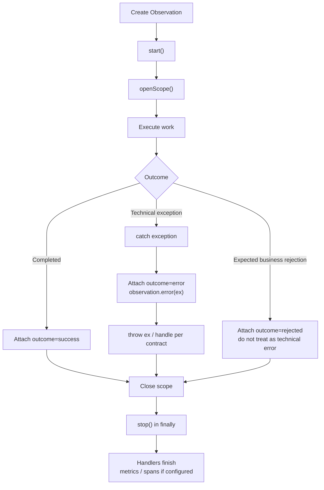
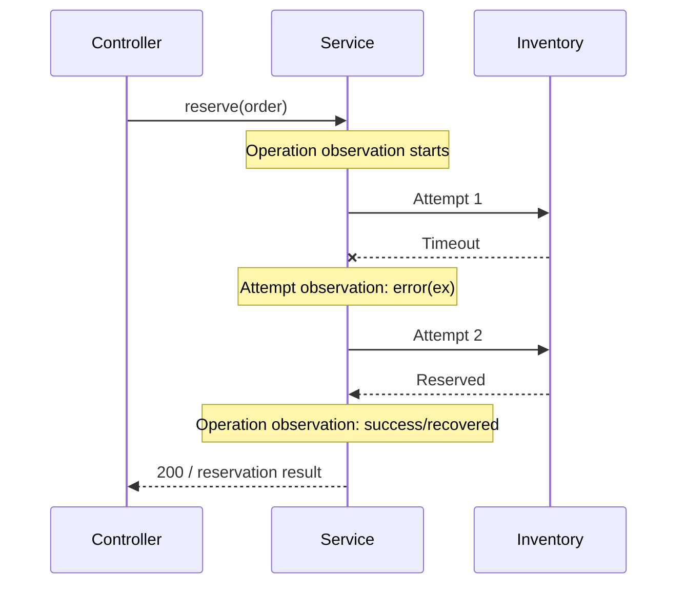
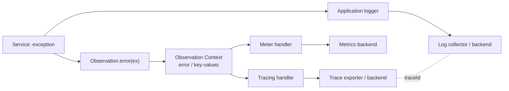

# Recording Exceptions in the Micrometer Observation Lifecycle

In a Spring Boot application, a method can throw an exception and exit early: an HTTP call to another service times out, a database query fails, or input data violates a business rule. If the system only knows when the operation started and ended, operators will see **duration**, yet may not know **why it failed**. Micrometer Observation provides the `error(Throwable)` API to feed failure information into the observed operation's lifecycle.

The **Recording Exceptions** lesson belongs to the **Observation Lifecycle** chapter of the **SPRING_BOOT_OBSERVABILITY** module. The module focuses on setting up observability with Micrometer Observation, metrics, logs, and distributed tracing; exploring context propagation, tags/cardinality, exporters, sampling, and signal correlation to investigate errors, latency, and application behavior in production. Here, the focus is on **when, where, and how to record exceptions** so signals accurately reflect incidents.

## 1. Learning Outcomes

After completing this lesson, you will be able to:

- Explain the difference between a **thrown exception**, an **exception recorded on an observation**, and a **logged exception**.
- Call `observation.error(ex)` at the right time, preserve the exception flow, and always stop the observation.
- Distinguish technical failure exceptions from expected business cases; handle retries, fallbacks, and caught-and-recovered exceptions.
- Understand how `ObservationHandler`, metrics, distributed tracing, and MDC/logging consume error context.
- Avoid duplicate error recording, high-cardinality metric labels, or leaking sensitive data.
- Verify success, failure, early return, and asynchronous execution paths.

## 2. Exceptions and Observations Are Different Mechanisms

An **exception** is Java's control-flow mechanism: code executes `throw ex`, and another layer catches it or lets it propagate. An **observation** is a context measuring a unit of work with a start point, an end point, and observational facts.

Three operations frequently appear together yet **do not replace one another**:

| Operation | Effect | What Does Not Happen Automatically |
| --- | --- | --- |
| `throw ex` | Propagates the exception to the caller/framework | Does not automatically mark a manually managed observation as failed |
| `observation.error(ex)` | Records the `Throwable` in context and notifies observation handlers of the error | Does not rethrow the exception or write an application log |
| `log.error("...", ex)` | Writes a log record with a message and stack trace (per logger config) | Does not mark the observation/span or update business outcome |
| `observation.stop()` | Ends the observed work and lets handlers finalize measurement | Does not mean the work succeeded |

An operation can complete **without throwing an exception** and still yield an undesirable business outcome. Conversely, an exception on a first attempt might succeed on retry. Therefore, before calling `error(ex)`, answer: **does this observation represent the failed attempt, or the overall recovered operation?**

### What Does "Error Recorded" Mean?

In Micrometer Observation, `Observation.error(Throwable)` stores the error details on the context and triggers error callbacks on interested `ObservationHandler` instances. Depending on handlers and configuration, the system may reflect the error on a tracing span, incorporate error details into metrics, or drive custom handling.

Recording **does not instantaneously guarantee** a log line, a metric with `error=true`, or a red span in a dashboard. Those still depend on registered handlers, field mappings, exporters, backends, and sampling. The proper way to verify is to inspect actual signals in the application's telemetry pipeline.

## 3. Where `error(ex)` Fits in the Observation Lifecycle



Key sequence:

1. **`start()`** marks the start of work; key-values can be attached before or while the observation runs.
2. **`openScope()`** sets the current observation within the synchronous scope; integrations can use this context to link spans and MDC.
3. **`error(ex)`** is called when an exception belongs to this observation's boundary and by convention should be reflected as an error. Call it **before** stopping.
4. **`throw ex`** or handle the exception according to the application's contract. Calling `error(ex)` does not determine retry policies, HTTP status mapping, or fallback returns.
5. **`stop()`** always executes, even when the catch block rethrows the exception. Closing the scope and stopping are two distinct steps.

If `observation.error(ex)` is omitted in a **manually managed** observation, throwing an exception and calling `stop()` may record duration while missing error signals for handlers. Conversely, if you use the `observe(...)` convenience API, Micrometer already handles exception recording and lifecycle management: do not add a duplicate error-recording layer for the same observation.

## 4. Spring Boot Example: Recording Exceptions Manually

Suppose an order-processing service needs to call `InventoryGateway`. For each reservation operation, we want to measure time, detect technical errors, and preserve the exception so the HTTP layer decides the response status code.

The example uses `ObservationRegistry` provided by Spring when Micrometer Observation is integrated; `InventoryGateway` and `Reservation` are hypothetical application-defined types.

```java
import io.micrometer.observation.Observation;
import io.micrometer.observation.ObservationRegistry;
import org.springframework.stereotype.Service;

@Service
public class ReservationService {
    private final InventoryGateway gateway;
    private final ObservationRegistry registry;

    public ReservationService(InventoryGateway gateway,
                              ObservationRegistry registry) {
        this.gateway = gateway;
        this.registry = registry;
    }

    public Reservation reserve(String orderId, String sku, int quantity) {
        Observation observation = Observation
            .createNotStarted("inventory.reserve", registry)
            .contextualName("reserve inventory")
            .lowCardinalityKeyValue("operation", "reserve")
            .start();

        try (Observation.Scope ignored = observation.openScope()) {
            try {
                Reservation result = gateway.reserve(orderId, sku, quantity);
                observation.lowCardinalityKeyValue("outcome", "success");
                return result;
            } catch (RuntimeException ex) {
                observation.lowCardinalityKeyValue("outcome", "error");
                observation.error(ex);
                throw ex;
            }
        } finally {
            observation.stop();
        }
    }
}

interface InventoryGateway {
    Reservation reserve(String orderId, String sku, int quantity);
}

record Reservation(String reservationId) {}
```

**Reading the example by execution path:**

- If the gateway succeeds, the observation gets `outcome=success`, the scope closes, and `stop()` still runs even though the method returns inside `try`.
- If the gateway throws `RuntimeException`, the `catch` branch attaches `outcome=error`, calls `observation.error(ex)`, and then **rethrows the same exception**. `finally` still stops the observation.
- `orderId` and `sku` are excluded from low-cardinality key-values; they have huge numbers of distinct values. Permitted IDs can be included in logs or controlled trace contexts when per-transaction investigation is needed.
- If the gateway throws checked exceptions, declare and catch those types per Java's contract, calling `error(ex)` before rethrowing or intentionally translating the error.

In this example, `RuntimeException` represents an **unrecovered technical error within the operation's scope**. If the gateway also throws an exception to indicate "insufficient stock" as a normal business condition, separate that exception type and assign a distinct outcome. Do not blindly apply a "every exception is a system error" rule across all business logic.

### Recording Controlled Error Categories

You can attach a bounded label so dashboards easily distinguish timeouts from other dependency failures:

```java
catch (InventoryTimeoutException ex) {
    observation.lowCardinalityKeyValue("outcome", "error");
    observation.lowCardinalityKeyValue("error.category", "timeout");
    observation.error(ex);
    throw ex;
} catch (RuntimeException ex) {
    observation.lowCardinalityKeyValue("outcome", "error");
    observation.lowCardinalityKeyValue("error.category", "dependency");
    observation.error(ex);
    throw ex;
}
```

This is a **replacement** for the `catch` branch in the previous example; `InventoryTimeoutException` is a hypothetical project-defined exception. Do not append both catch styles together. The label `error.category=timeout|dependency` has a bounded value set; unlike `ex.getMessage()`, URLs, or order IDs, which are unsuitable as metric labels.

If you wrap exceptions, such as `throw new OrderProcessingException("...", ex)`, clearly decide whether the observation records the original error (`ex`) or the mapped error, and preserve `cause` for investigation. Do not record both multiple times just because the exception crosses multiple layers.

## 5. Reducing Boilerplate with `Observation.observe(...)`

When the entire unit of work consists of a synchronous lambda, the `observe(...)` convenience API manages start/stop, scope, and errors thrown inside the lambda. Example:

```java
public Reservation reserveSimple(String orderId, String sku, int quantity) {
    return Observation.createNotStarted("inventory.reserve", registry)
        .lowCardinalityKeyValue("operation", "reserve")
        .observe(() -> gateway.reserve(orderId, sku, quantity));
}
```

Here, runtime exceptions from `gateway.reserve` still propagate to the caller, and the observation is handled according to `observe`'s lifecycle. Avoid adding an outer `catch` block just to call `error(ex)` again on the **same** observation already managed by `observe`.

Choose the approach matching your operation's semantics:

| Scenario | Recommendation |
| --- | --- |
| Just need to measure a synchronous block and let exceptions propagate | Use `observe(...)` |
| Need to attach `outcome` across multiple branches and categorize errors explicitly | Manage manually with `start`, `openScope`, `error`, `stop` |
| A framework layer already creates an observation (HTTP server, HTTP client, database...) | Check existing instrumentation before adding another observation |
| Reactive/async work finishes after returning a publisher/future | Use appropriate instrumentation so the lifecycle matches the **asynchronous completion** |

A custom observation wrapping an HTTP request that already has a server observation can still add value if it measures a **distinct business boundary**. However, if both measure the exact same boundary with the same intent, you create redundant spans/timers and make charts harder to interpret.

## 6. Exceptions Caught Without Failing the Overall Operation

Real systems frequently employ **retries**, **fallbacks**, or **valid business rejections**. Determine the observation's outcome by **boundary**:

| Scenario | Attempt-Level Observation | Operation-Level Observation |
| --- | --- | --- |
| Attempt 1 times out, attempt 2 succeeds | Attempt 1 records error; attempt 2 succeeds | Succeeded or recovered, per definition |
| All attempts time out | All attempts fail | Final failure |
| Payment declined per business rules | May be a `declined` result, not a technical error | `outcome=rejected` or appropriate outcome |
| Serving cached data when primary source fails | Error on the primary source call branch | `outcome=degraded` if returning a degraded response |

### Example: Two-Level Retries



If the outer observation is meant to measure the **final user-facing outcome**, you should not necessarily call `error(ex)` on it for an exception that was completely recovered by retry. On the attempt-level observation, however, the timeout is a genuine failure event that should be recorded. If there is no attempt-level observation, you can use a stably named event, a retry counter, or a log at the appropriate boundary.

Avoid counting **attempt** errors as **request** errors: one request with three attempts generates three attempt records yet only one final outcome. When dashboards compute error rates, state clearly which level they measure.

### Should Business Exceptions Call `error(ex)`?

There is no universal rule across all systems. For example, `PaymentDeclinedException` may be an expected condition under the domain contract, whereas `PaymentGatewayUnavailableException` is a technical error. One design option is:

- Return typed outcomes (e.g., `APPROVED`/`DECLINED`) for expected conditions; attach `outcome=rejected` without calling `error(ex)`.
- For unrecoverable technical errors, attach `outcome=error` and call `error(ex)`.
- If the framework still receives an unhandled business exception escaping the HTTP boundary, the **HTTP request** observation may classify it differently from the **business** observation. Inspect both rather than assuming a single shared error label.

These rules must be standardized across the service so error rates and alerts carry consistent meaning.

## 7. How Do Error Signals Flow into Metrics, Tracing, and Logs?

`ObservationRegistry` can be configured with multiple `ObservationHandler` instances. They process lifecycle events and data stored in `Observation.Context`:



**Metrics.** An observation's timer typically counts executions and measures duration. An `outcome=error` label, when recorded as a low-cardinality key-value and accepted by handlers, separates failed operations from successful ones. Which labels an exception generates automatically depends on conventions and configuration. Histograms/percentiles are configured separately; do not assume every timer includes p95 by default.

**Distributed tracing.** Tracing handlers can translate a reported exception into error attributes/events or error status on the span. Whether a span is exported still depends on the tracer/exporter and sampling; thus, logs may contain a `traceId` even when the tracing backend did not store the trace.

**Logs.** `observation.error(ex)` alone does not guarantee a log entry. When needed for diagnostics, log deliberately where full context is available:

```java
catch (RuntimeException ex) {
    observation.lowCardinalityKeyValue("outcome", "error");
    observation.error(ex);
    log.error("event=inventory_reservation_failed cause=DEPENDENCY_ERROR", ex);
    throw ex;
}
```

This snippet shows how to **add** logging inside the catch block of a service that already has an SLF4J logger; it is not automatic logging by Micrometer. Loggers should be defined on the class and only log the full exception at an appropriate boundary. If multiple layers log `ERROR` and rethrow upward, a single incident can appear as multiple confusing error logs.

**Signal correlation.** When Micrometer Tracing and logging configuration populate `traceId`/`spanId` into MDC properly, you can search logs by trace and open the associated spans. This depends on **context propagation** across threads, HTTP, or messaging. Calling `observation.error(ex)` alone does not create cross-service propagation; instrumentation at network and thread boundaries is required.

## 8. Cardinality, Data Safety, and Diagnostic Trails

When hunting root causes, developers are often tempted to put exception messages and all inputs into the observation. That is an easy way to pollute data and inflate costs.

| Information | Where to Place It | Notes |
| --- | --- | --- |
| `operation=reserve` | Low-cardinality key-value | Bounded values, suitable for metrics |
| `outcome=success|rejected|error` | Low-cardinality key-value | Consistent across all branches |
| `error.category=timeout|dependency|validation` | Low-cardinality key-value if needed | Normalize to a bounded set |
| `traceId` | Trace/log correlation | Do not use as a metric label |
| `orderId`/`sku` | Logs or dedicated context when permitted | Avoid high-cardinality labels; consider data policies |
| `exception.message` | Usually only in controlled logs or limited diagnostics | May contain SQL, PII, endpoints, tokens, or user-supplied input |
| Full exception stack trace | Logs at an appropriate handling boundary | Can be lengthy, costly, and duplicated if logged at multiple layers |

Exception class names can help diagnostics, yet avoid letting dynamic exception messages become metric labels. When backends attach error attributes automatically, inspect what is actually exported and enforce masking, retention, and access-control policies.

### Three Diagnostic Principles

1. **Record the error event once per observation.** Calling `error(ex)` multiple times does not turn one incident into multiple incidents; it can fire duplicate callbacks or make handler output ambiguous.
2. **Do not lose the root cause.** When translating to a business exception, preserve `cause`. Avoid logging only `ex.getMessage()` and discarding the stack trace for technical errors needing investigation.
3. **Never trade sensitive data for verbose logs.** Keep tokens, passwords, cookies, sensitive payloads, and personal data out of messages and tags.

## 9. Common Failure Modes

### 9.1. Using `try/finally` and Forgetting to Record the Error

```java
Observation observation =
    Observation.start("inventory.reserve", registry);
try {
    return gateway.reserve(orderId, sku, quantity);
} finally {
    observation.stop();
}
```

The snippet above **stops the observation**, yet if the gateway throws an exception there is no `error(ex)` call in application-managed code. Fix this by adding a `catch` block to report the error and rethrow, or use `observe(...)` to handle it automatically.

### 9.2. Calling `stop()` at the End of the Method Body

```java
Observation observation =
    Observation.start("inventory.reserve", registry);
Reservation result = gateway.reserve(orderId, sku, quantity);
observation.stop(); // Does not run if the line above throws!
return result;
```

Put `stop()` in `finally` (or use `observe`) so the observation finishes on both error paths and early returns.

### 9.3. Recording an Error on the Wrong Observation Boundary

An HTTP 503 from a dependency might be handled by the service layer via a successful fallback. If the outer observation measures the **final outcome**, attaching the timeout error directly to the outer span can mislead operators—even though marking the dependency-call span as failed is accurate. Define each observation's boundary before deciding.

### 9.4. Using `@Async` or Reactor and Stopping the Observation Too Early

If a method returns `CompletableFuture` or `Mono` and `stop()` is called right after **creating** the future/publisher, the timer measures initialization time rather than actual work. Exceptions thrown later will not be recorded on the already-stopped observation. Tie the observation lifecycle to actual completion—including errors and cancellation—according to the execution model. With Reactor, prefer compatible observation/context propagation integrations instead of holding a `Scope` across threads.

### 9.5. Duplicating Instrumentation

Spring Boot may already create observations for HTTP servers/clients and instrumented components. Wrapping the exact same HTTP call in another observation with identical intent produces confusing extra spans and timers. Only add manual observations for **new business boundaries**, with clear names and documentation.

## 10. Practice Procedure: Injecting Faults and Verifying

Create a test service containing `ReservationService` from the example above, with an `InventoryGateway` that can return a result or throw runtime exceptions. When using Spring Boot Actuator, a Micrometer meter registry, tracing bridge, and exporter, ensure dependencies match your project's Spring Boot version. An active metrics/traces/logs collection path is required to evaluate backend signals.

### Test Cases to Run

| Case | Simulated Input | Expected Result |
| --- | --- | --- |
| Success | Gateway returns `Reservation` | `outcome=success`; observation stops; no error recorded |
| Timeout | Gateway throws `InventoryTimeoutException` | `error(ex)` called; `outcome=error`; exception rethrown; observation stops |
| Other error | Gateway throws `IllegalStateException` | Error recorded and observation still stops |
| Early return | A return branch inside `try` | `finally` still calls stop |
| Retry succeeded | Attempt 1 times out, attempt 2 succeeds | Attempt 1 records error; final result matches contract |
| Async run | Future completes with error after method returns | Observation spans actual execution time; context does not leak between requests |

### How to Self-Verify

1. **Application layer:** does the error still propagate to the caller per contract? Was any exception swallowed just because `error(ex)` was called?
2. **Lifecycle:** is every observation started and stopped properly, even when errors occur? Are scopes or MDC values ever leaked to the next request?
3. **Metrics:** are success/error counts accurate? Do timers record error durations? Distinguish attempt counts from request counts.
4. **Tracing:** when exported, do spans reflect errors and link to parent spans? If traces are missing, inspect sampling, exporter, collector, and propagation before concluding `error(ex)` is broken.
5. **Logging:** do permitted logs include the error event and trace ID for lookup, without secrets or dangerous dynamic tags?

### Production Investigation Scenario

Users report that part of checkout hangs for ~3 seconds and then fails. Metrics show rising latency and error rate on `inventory.reserve`. Search logs for `event=inventory_reservation_failed` in the same time window, filter by trace ID if present, and open the trace to see whether the inventory call span took long or the failure originated elsewhere. If the exception was recorded on the observation yet does not show up in the backend, check handlers, sampling, exporters, and the collection pipeline before changing business logic.

### Self-Check Questions

1. Why might both `throw ex` and `observation.error(ex)` be necessary in a catch block?
2. When should an outer observation not be marked as an error even though an inner attempt threw an exception?
3. Why does `stop()` not prove success?
4. What happens when an exception is thrown out of `try` without being passed to an `ObservationHandler`?
5. Why can error counts be accurate in metrics while no matching trace is found?
6. Why shouldn't an exception message or order ID be used as a low-cardinality key-value?

## 11. Key Takeaways

**Recording an exception** in Micrometer Observation notifies the observability mechanism of an error event, whereas **throwing an exception** is Java control flow and **logging** emits a diagnostic record. For manually managed observations, when a technical exception causes an operation to fail, call `observation.error(ex)` before rethrowing, and always call `stop()` in `finally`. With `observe(...)` or automatic instrumentation, understand the built-in error handling so you do not double-report errors.

In production systems, define clear observation boundaries: separate per-attempt failures from final outcomes, technical errors from business rejections, and unrecovered failures from successful fallbacks. Combining low-cardinality key-values, tracing, safe logs, and proper context propagation turns error telemetry into actionable evidence during incident investigations rather than mere noise.
