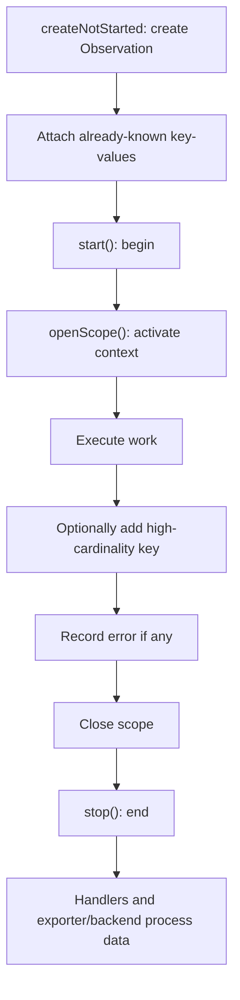
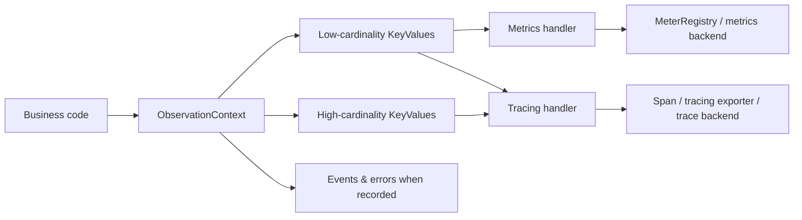

# Recording High-Cardinality Key-Values in the Observation Lifecycle

In a Spring Boot application, the same operation can be invoked thousands of times, each time associated with a unique identifier: an order ID, transaction ID, task ID, or internal correlation code. When investigating why **a specific request** failed or ran slowly, this information can be very helpful. However, placing identifiers with many distinct values into metric labels risks creating huge numbers of time series and driving up monitoring costs.

**Micrometer Observation** distinguishes between *low-cardinality key values* and *high-cardinality key values*. This lesson, part of the **Observation Lifecycle** chapter in the **SPRING_BOOT_OBSERVABILITY** module, focuses on how to **record high-cardinality key values** at the right time, how they are used in tracing, and how they relate to metrics, logs, distributed tracing, context propagation, exporters, and sampling in practice.

## 1. What Does High Cardinality Mean?

**Cardinality** is the number of distinct values or combinations of values in a set of attributes. An attribute is considered *high cardinality* when the number of possible values is very large or hard to bound over time.

Example in an order-processing service:

| Attribute | Illustrative Value | Typical Cardinality | Preferred Usage |
| --- | --- | --- | --- |
| `http.method` | `GET`, `POST`, `PUT` | Low | Metric label; trace attribute |
| `http.route` | `/orders/{id}` | Low if using route template | Metric label; trace attribute |
| `payment.method` | `card`, `wallet`, `bank_transfer` | Low if normalized | Metric label; trace attribute |
| `http.status_code` | `200`, `400`, `503` | Bounded | Metric label; trace attribute |
| `order.id` | A different code per order | High | Controlled detailed trace/log attribute |
| `payment.operation_ref` | A unique code per execution | High | Trace attribute if genuinely needed |
| `traceId` | One identifier per trace | Very high | Dedicated correlation; **never** a metric label |
| Full URL containing `?search=...` | Depends on user input | Unpredictable | Avoid capturing verbatim; normalize or omit |

**Metrics** typically store a separate time series for each combination of label values. For example, if `order.id` takes a new value on nearly every request and is used as a metric label, series counts can grow alongside order counts. By contrast, a trace stores details of *a single execution*, so attaching per-execution attributes there can be more appropriate—provided access control, sensitive data, and storage/indexing costs are controlled.

Micrometer Observation captures this distinction in its API:

```java
observation.lowCardinalityKeyValue("payment.method", "card");
observation.highCardinalityKeyValue("payment.operation_ref", "op-7c91");
```

Both are **key–values** attached to an Observation. The difference lies in their intended purpose and how `ObservationHandler` instances process them, not two different Java data types.

## 2. API for Recording High-Cardinality Key-Values

The basic Micrometer Observation API:

```java
Observation observation = Observation.createNotStarted(
        "payment.authorize", observationRegistry);

observation.highCardinalityKeyValue(
        "payment.operation_ref", "op-7c91");
```

Where:

- `"payment.authorize"` is the Observation name, which should remain stable across executions.
- `"payment.operation_ref"` is the **key name**, which should also follow a stable convention.
- `"op-7c91"` is the value for a single execution; this value may vary per request.
- `observationRegistry` is the registry receiving the Observation and coordinating relevant handlers.

Calling `highCardinalityKeyValue(String key, String value)` attaches data to the **Observation context**. Whether that data appears as a span attribute in the trace backend depends on the tracing handler, Observation state, sampling, exporter, and pipeline configuration. **Adding a high-cardinality key does not automatically create a trace, write a log, or create a metric.**

Micrometer also supports representing key–values with `KeyValue` (depending on API/version), though for a simple pair, passing strings directly is clear and readable:

```java
observation.highCardinalityKeyValue("order.reference", reference);
```

### Distinguishing Observation Name, Key, and Value

A common design mistake is embedding variable values into the **Observation name**:

```java
// Wrong direction: every request creates a distinct Observation name.
Observation.createNotStarted("order.lookup." + orderId, registry);
```

That name can become a meter or span name and cause data groupings to explode. The right approach is separating the stable operation name from detailed values:

```java
Observation.createNotStarted("order.lookup", registry)
        .lowCardinalityKeyValue("operation", "lookup")
        .highCardinalityKeyValue("order.reference", safeReference);
```

Here, `safeReference` should only be used if it is an identifier permitted in telemetry for investigation and contains no secrets or inappropriate personal data.

## 3. Recording High-Cardinality Keys in the Observation Lifecycle

An Observation passes through basic stages: created, started, placed in scope, optionally receiving key–values/events/errors while running, and then stopped.



The diagram presents a logical view. The order **close scope then call `stop()`** is a valid pattern under manual lifecycle management. When using `observe(...)`, the library manages the lifecycle around the callback.

### Case A — Value Known Before the Operation Starts

If the reference code is already determined at the start of the method, attach it when creating the Observation:

```java
import io.micrometer.observation.Observation;
import io.micrometer.observation.ObservationRegistry;
import org.springframework.stereotype.Service;

import java.util.function.Supplier;

@Service
public class PaymentActionService {
    private final ObservationRegistry registry;

    public PaymentActionService(ObservationRegistry registry) {
        this.registry = registry;
    }

    public String authorize(String safeOperationReference,
                            Supplier<String> callGateway) {
        return Observation.createNotStarted("payment.authorize", registry)
                .lowCardinalityKeyValue("payment.action", "authorize")
                .highCardinalityKeyValue(
                        "payment.operation_ref", safeOperationReference)
                .observe(callGateway::get);
    }
}
```

`PaymentActionService` here is a standalone example. In real integration, verify that `safeOperationReference` is permitted in telemetry; `callGateway` is supplied by the caller. Never pass raw HTTP bodies, tokens, card numbers, emails, or secrets into this API.

**Benefit of attaching before `start()`:** handlers can read the key–value right at start time if they process data in `onStart`. This is generally more predictable when the value is already known.

### Case B — Value Only Known After Work Has Started

For instance, an operation code from a payment gateway only appears after the transaction creation call returns. In that case, keep a reference to the Observation and attach the attribute once the result arrives:

```java
import io.micrometer.observation.Observation;
import io.micrometer.observation.ObservationRegistry;

public final class GatewayWorkflow {
    private final ObservationRegistry registry;

    public GatewayWorkflow(ObservationRegistry registry) {
        this.registry = registry;
    }

    public String run(GatewayClient gateway) {
        Observation observation = Observation.createNotStarted(
                        "payment.gateway.operation", registry)
                .lowCardinalityKeyValue("payment.gateway", "primary");

        observation.start();
        try (Observation.Scope scope = observation.openScope()) {
            String reference = gateway.createOperation();

            // Record only if reference is approved for telemetry use.
            observation.highCardinalityKeyValue(
                    "payment.operation_ref", reference);

            gateway.completeOperation(reference);
            return reference;
        } catch (RuntimeException ex) {
            observation.error(ex);
            throw ex;
        } finally {
            observation.stop();
        }
    }

    public interface GatewayClient {
        String createOperation();
        void completeOperation(String reference);
    }
}
```

In this case:

1. `createNotStarted(...)` creates the Observation with a fixed name and low-cardinality key.
2. `start()` notifies matching handlers of the start.
3. `openScope()` places the Observation into the current context; inner work can inherit trace context when tracing is integrated.
4. `highCardinalityKeyValue(...)` appends the value learned after the gateway creates the operation.
5. `error(ex)` records the exception on the Observation; `throw ex` still propagates the failure to the caller.
6. `stop()` runs in `finally`, even if the gateway throws an error.

**Important timing caveat:** handlers can read key–values during different callbacks (`onStart`, `onStop`, etc.). An attribute added after starting remains in the Observation context, yet **do not assume every handler or exporter reflects late additions identically**. For attributes required on a span, verify behavior against your actual tracing handler and version.

## 4. Where Do High-Cardinality Key-Values Go in Micrometer?

Micrometer Observation splits an observation's data in a way that supports multiple backends:



The diagram shows **common usage**; each `ObservationHandler` decides which data becomes metrics, span tags, events, or other behavior. Not every handler supports every field.

### Metrics: Use Low-Cardinality Labels Only

Standard metrics handlers typically build timers or meters from the Observation name and **low-cardinality key values**. High-cardinality key values are not designed to serve as metric labels in this way.

Example:

```java
Observation.createNotStarted("payment.authorize", registry)
        .lowCardinalityKeyValue("payment.method", "card")
        .highCardinalityKeyValue("payment.operation_ref", "op-7c91")
        .observe(() -> invokePaymentGateway());
```

When an appropriate metrics handler is active, a metric series can be grouped by `payment.method=card`. **Do not expect** a separate series broken out by `payment.operation_ref=op-7c91`.

However, this is not an absolute safeguard: a **custom handler**, filter, convention, or backend configuration can still intentionally promote a high-cardinality attribute into a metric label. Therefore, teams must audit actual exported labels and never treat `highCardinalityKeyValue` as a license to record arbitrary data.

### Tracing: Per-Span Attributes

When an Observation is wired to a compatible tracing handler, high-cardinality key values can become attributes on the **span** representing the operation. This helps filter traces by reference ID, investigate a slow transaction, or link data with approved business events.

An illustrative span looks like:

```text
Trace: 4bf92f3577b34da6a3ce929d0e0e4736
  Span: payment.authorize
    payment.method = card
    payment.operation_ref = op-7c91
    duration = 145 ms
    status = OK
```

This is an illustration, not a guarantee of exact span names, statuses, or attributes stored by a specific exporter. Due to sampling or pipeline errors, this span might not appear in the trace backend at all.

### Logs: Do Not Automatically Receive Every Attribute

Calling:

```java
observation.highCardinalityKeyValue(
        "payment.operation_ref", reference);
```

**does not mean** subsequent `log.info(...)` lines automatically gain a `payment.operation_ref` field. Spring Boot can populate `traceId`/`spanId` into MDC when tracing is configured, yet Observation high-cardinality keys do not automatically become standard MDC log fields.

When correlating with logs, prefer using the existing `traceId` to find logs for the trace and inspect the span containing `payment.operation_ref`. When business needs require logging a reference code directly, enforce dedicated logging rules for masking, access control, and retention.

### Context Propagation: Not the Same as Baggage

A high-cardinality key value belongs to the **current Observation**. It does **not automatically** become an HTTP header, W3C `baggage`, or metadata sent to another service. Distributed tracing propagation handles trace context (such as `traceparent`), whereas forwarding an optional business value across service boundaries is a separate mechanism requiring explicit data policies.

For cross-service lookup, trace IDs and span relationships are normally the default correlation mechanism. Only propagate high-cardinality values across services when explicitly required, approved, and governed.

## 5. Choosing Keys with Practical Value

Not every high-variance value helps an investigation. A good high-cardinality key answers a concrete operational question.

Payment system examples:

| Investigation Question | Key to Consider | Why Useful | What to Control |
| --- | --- | --- | --- |
| Which transaction was declined by the gateway? | `payment.operation_ref` | Locate the exact gateway call span | Only use reference codes approved for storage |
| Which background run retried heavily? | `job.execution_ref` | Distinguish individual job executions | Do not use as a metric label |
| Which technical resource timed out? | `storage.object_ref` | Isolate the failing dependency object | Avoid exposing sensitive paths/buckets |
| Which call failed inside a batch? | `batch.item_ref` | Isolate a single item | Watch attribute volume and retention |
| Which HTTP endpoint is slowest? | `http.route` | Group requests by route | Usually **low** cardinality, no need for high |
| Which request has a trace? | `traceId` | Correlate spans and logs | Managed by tracing SDK; avoid duplicating as tag |

### Naming and Value Selection Rules

- **Stable key names:** use clear names like `payment.operation_ref` or `job.execution_ref`; never embed values into key names.
- **Meaningful values:** collect only what is genuinely needed for lookup or diagnosis.
- **Approved data:** exclude passwords, API keys, access tokens, card numbers, raw request bodies, and unauthorized personal data.
- **Avoid redundant data:** if `traceId` already links logs and traces, weigh whether `request.id` is truly necessary.
- **Bound size:** overly long values still increase collection, transmission, storage, and indexing costs in the trace backend.
- **Semantic consistency:** the same key should describe the same identifier type wherever used.

For sensitive values that still need correlation, consider mapping to an internal code that does not directly identify a user. Hashing alone does not guarantee privacy: if original values are guessable or policies are lacking, hashes can still be reversed or improperly linked.

## 6. Combining High- and Low-Cardinality Keys in One Operation

In a Spring Boot service, both key types commonly appear together:

```java
import io.micrometer.observation.Observation;
import io.micrometer.observation.ObservationRegistry;

public final class InventoryReservation {
    private final ObservationRegistry registry;

    public InventoryReservation(ObservationRegistry registry) {
        this.registry = registry;
    }

    public void reserve(String safeReservationRef, Runnable action) {
        Observation.createNotStarted("inventory.reserve", registry)
                .lowCardinalityKeyValue("inventory.action", "reserve")
                .lowCardinalityKeyValue("inventory.channel", "online")
                .highCardinalityKeyValue(
                        "inventory.reservation_ref", safeReservationRef)
                .observe(action);
    }
}
```

A single invocation can yield three perspectives:

| Signal | Expected Behavior When Properly Instrumented/Configured |
| --- | --- |
| **Metrics** | Duration/count of `inventory.reserve` aggregated by `inventory.action` and `inventory.channel`; series count does not grow per reservation ID |
| **Tracing** | One span per invocation, optionally carrying `inventory.reservation_ref` as an attribute for investigation |
| **Logs** | Application log lines; correlatable via `traceId`/`spanId` when tracing and MDC are configured, while reservation ref requires its own logging policy |

It is essential to **check against actual configuration**: a registry with only a metrics handler records metrics without creating spans; a registry with only a tracing handler may create spans without creating custom timers; a registry with no handlers produces neither signal. `ObservationRegistry.NOOP` likewise emits no metrics or spans from those calls.

### Interaction with Sampling

Traces are commonly sampled to control cost. When a span is dropped from export/storage, a high-cardinality key value attached to the Observation **cannot be used to find that span** in the backend.

Meanwhile, aggregate metrics for the operation can still be recorded via the metrics handler regardless of whether a trace is kept, assuming typical configuration. Therefore:

- Do not infer system-wide error rates solely by counting spans with `payment.operation_ref`.
- Do not assume every transaction ID is searchable in traces when sampling retains only a fraction.
- When business or audit requirements demand lookup of **every** operation, design a reliable business data store instead of treating sampled tracing as a complete ledger.

## 7. What Changes When Keys Are Set Before vs. After `start()`?

When you record a key affects whether handlers see it at different processing milestones:

| Timing | Use Case | What to Watch |
| --- | --- | --- |
| Before `start()` | Reference code known at start of request or message | Usually most predictable because `onStart` handlers can read it |
| After `start()`, before `stop()` | Code only learned after calling dependency or creating resource | Verify whether handler/tracer updates span attributes at this stage |
| After `stop()` | Code learned after work already finished | Do not expect already-finished or exported telemetry to update |
| Inside `observe(...)` callback | Attaching attributes while callback executes | Need access to the corresponding Observation if adding keys dynamically |

For pre-known values, chaining methods before `observe(...)` is clean and clear:

```java
return Observation.createNotStarted("shipment.create", registry)
        .highCardinalityKeyValue("shipment.operation_ref", safeRef)
        .observe(this::createShipment);
```

If the value is produced inside the callback, keep an `observation` variable and manage the lifecycle explicitly as in the `GatewayWorkflow` example in Section 3.

**Never mutate an Observation after `stop()` and assume the span updated.** By then, handlers may already have finished the span or exporters may have dispatched an immutable record.

## 8. Error Handling, Retries, and Asynchronous Tasks

### Exceptions Are Not Replaced by Observations

When using `observe(...)`, business logic still governs return values or exceptions. When managing manually, call `observation.error(ex)` to notify handlers of the failure, then keep propagating the error according to the application's contract.

If you rely on an operation reference to diagnose failures, attach it before an error occurs whenever possible. An exception thrown before receiving a reference from a gateway cannot supply a value that never existed.

### One Observation or Multiple Observations on Retry?

Suppose a request triggers an operation with three gateway attempts:

- You can use **one overall Observation** for the business task, carrying common details such as payment method and an approved transaction code.
- If per-attempt analysis is needed, instrument **individual attempts** as child Observations/spans; keep names stable and use a normalized attempt attribute or small bounded attempt index.
- Avoid appending attempt numbers, order IDs, or exception messages into the Observation **name**.
- Do not assume a single `payment.operation_ref` describes all three attempts if the gateway returns a distinct reference per attempt.

Tracing can display child spans and durations for each retry when instrumentation creates them. Aggregate metrics should reflect attempt counts, error rates, and latency using low-cardinality labels.

### Async and Propagation

An Observation scope usually relates to the current execution context. If code hops to an executor, `CompletableFuture`, message consumer, or reactive pipeline, context propagation must be configured using the appropriate Spring/Micrometer mechanism.

Attaching a high-cardinality key to an Observation on the initial thread **does not mean** context automatically follows onto a new thread or service. When child spans split into separate traces or logs lack `traceId`, check propagation first rather than assuming the high-cardinality key was "lost."

Modifying or sharing an Observation context concurrently across multiple threads also requires careful design; never treat an Observation context as an unsynchronized shared mutable store.

## 9. Investigating a Slow Transaction with High-Cardinality Keys

Scenario: a user reports that payment `op-7c91` took around 4 seconds. The system has metrics, logs, and distributed tracing.

**Step 1 — Metrics pinpoint timing and blast radius.** Inspect latency, error rate, and throughput of `payment.authorize` by `payment.method=card` over the relevant time window. Do not query Prometheus by `payment.operation_ref=op-7c91` because that key was not designed as a metric label.

**Step 2 — Traces isolate a single execution.** If the trace backend supports searching by span attribute and the trace was captured, search for `payment.operation_ref=op-7c91`. Inspect the span tree to see whether time was spent in the gateway, DB, or retries. Backends may not index every span attribute, so searchability depends on configuration.

**Step 3 — Logs explain fine-grained details.** Grab `traceId` from the trace and query logs sharing that trace ID and service/timestamp. Inspect exceptions, response codes, retries, and fallbacks. Do not assume high-cardinality keys appear automatically in logs.

**Step 4 — Return to metrics to verify scope.** If the trace reveals a gateway timeout, check whether aggregate gateway metrics show elevated errors/latency during the same window. A single trace does not prove every request was impacted.

If the transaction cannot be found in the trace backend, check in order:

1. Was the Observation actually created and was `highCardinalityKeyValue` recorded at the right time?
2. Does the registry have a tracing handler, and was a span created?
3. Did sampling keep the corresponding trace?
4. Did the exporter/collector and backend receive the trace?
5. Does the backend support indexing and querying on this attribute?
6. Did filters, data policies, or scrubbing rules strip sensitive attributes in the exporter/collector?

Sometimes a system has valid business logs and aggregate metrics yet no trace due to sampling; that is acceptable behavior by design, not necessarily an instrumentation bug.

## 10. Common Pitfalls

| Mistake | Impact | Fix |
| --- | --- | --- |
| Attaching `order.id` via `lowCardinalityKeyValue` | Metrics handler may create series per order | Use high-cardinality for traces if allowed; never use IDs as metric labels |
| Putting IDs in the `Observation` name | Variable meter/span names, hard to aggregate | Keep operation names fixed; move IDs into attributes |
| Assuming high-cardinality keys auto-appear in logs | IDs missing from logs, leading to false conclusions | Use trace ID to link logs–traces; configure explicit log fields if needed |
| Assuming high-cardinality keys auto-propagate to other services | Downstream service lacks the attribute | Distinguish span attributes from trace context and baggage |
| Recording raw tokens, emails, request bodies | Secret/PII leaks and higher storage costs | Store only approved, minimal data under protection policies |
| Recording attributes after `stop()` was called | Handlers may miss or fail to export updates | Attach before `start()` if known, or while lifecycle is open |
| Registry exists yet no spans appear | Missing tracing handler, sampling, or pipeline issue | Check each layer: registry → handler → exporter → backend |
| Using sampled traces to count total transactions | Missing samples or skewed ratios | Use metrics or appropriate business data sources |
| Attaching too many lengthy attributes to every span | Higher storage/index costs and slower queries | Set tag budgets, standardize names, limit count/size |

## 11. Guided Practice Exercise

Suppose a Spring Boot application is already configured with Micrometer Observation, metrics, and tracing. Build an `invoice.issue` Observation with:

- Low-cardinality key `invoice.channel` with bounded values: `web` or `batch`.
- High-cardinality key `invoice.operation_ref` holding a simulated internal code approved for storage.
- Processing logic yielding success or error depending on input.

Skeleton example:

```java
import io.micrometer.observation.Observation;
import io.micrometer.observation.ObservationRegistry;

public class InvoiceIssuer {
    private final ObservationRegistry registry;

    public InvoiceIssuer(ObservationRegistry registry) {
        this.registry = registry;
    }

    public String issue(String safeOperationRef, boolean fail) {
        return Observation.createNotStarted("invoice.issue", registry)
                .lowCardinalityKeyValue("invoice.channel", "web")
                .highCardinalityKeyValue(
                        "invoice.operation_ref", safeOperationRef)
                .observe(() -> {
                    if (fail) {
                        throw new IllegalStateException("Issue failed");
                    }
                    return "ISSUED";
                });
    }
}
```

Test across three setups:

1. **Real registry with metrics and tracing handlers:** inspect metrics by `invoice.channel`; locate the trace containing `invoice.operation_ref` if sampling retains it and the exporter/backend supports it.
2. **Real registry with only metrics handler:** the operation still produces metrics, yet do not expect a span carrying the operation ref.
3. **`ObservationRegistry.NOOP`:** `issue(...)` still returns `"ISSUED"` or throws `IllegalStateException` per input, without emitting telemetry from that Observation.

Try changing `invoice.operation_ref` across two calls. Verify that total **metric series count** does not grow just because the reference value changed. If it grows, audit your actual instrumentation and handlers because an ID likely leaked into metric labels unintentionally.

### Self-Assessment

1. Why should `http.route=/invoices/{id}` usually be low-cardinality, whereas a concrete invoice code may be high-cardinality?
2. When should `highCardinalityKeyValue(...)` be called before `start()`, and when must it be called while the Observation is running?
3. Does adding a high-cardinality key to an Observation mean every log in the same trace contains that key?
4. Why does failing to find a reference in the tracing backend not prove the Observation failed to record it?
5. If a custom handler promotes a high-cardinality key into a metric label, what can happen?
6. Do high-cardinality span attributes automatically travel with HTTP `traceparent` or W3C baggage?
7. Which data must never be placed in span attributes even if it helps debug errors?

## Conclusion

**`highCardinalityKeyValue(...)` attaches per-execution detailed attributes to an Observation context**, typically serving tracing and individual request investigations. Keep Observation names and low-cardinality keys stable for metrics, attach high-cardinality keys at the proper point in the lifecycle, and verify handlers/exporters actually deliver attributes to the backend. High cardinality still carries cost and data risks: collect only approved, necessary, and governable values. When correlated with metrics, logs, and distributed tracing in Spring Boot, detailed attributes pinpoint root causes while aggregate metrics quantify system-wide impact.
