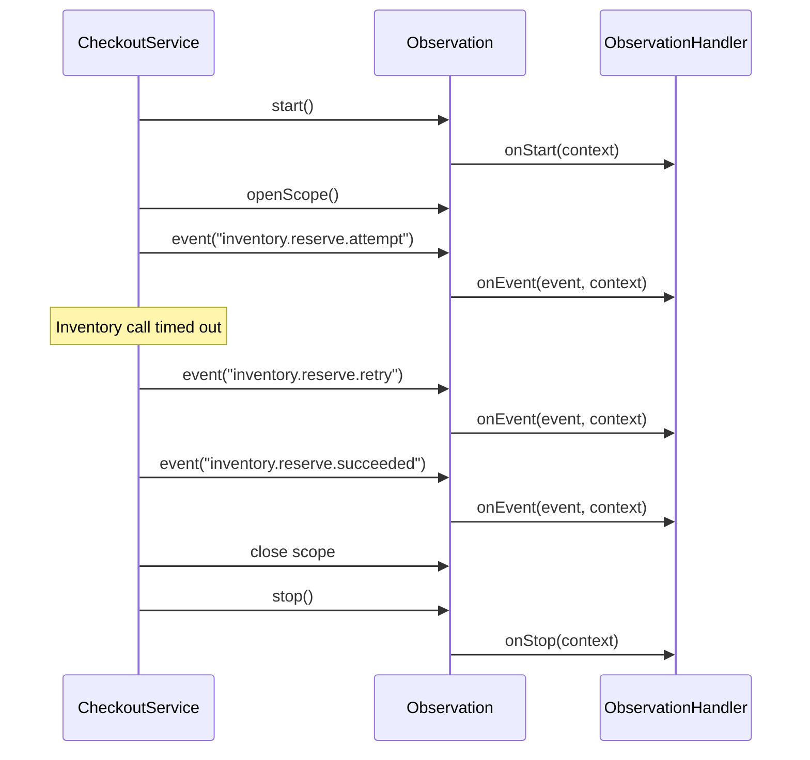
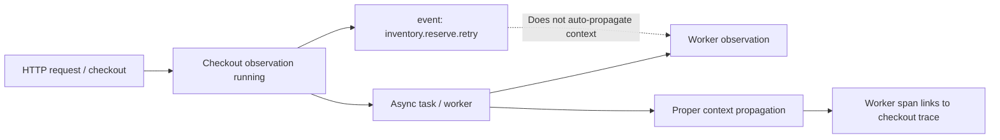

# Observation Events: Milestones in the Observation Lifecycle

When monitoring a Spring Boot operation, we usually know **when it started**, **when it stopped**, and **how long it took**. Yet between those two timestamps, important things can happen: starting an inventory call, retrying after a timeout, switching to a fallback, or completing a validation step. These occurrences are not necessarily operations long enough to warrant separate observations. An **Observation event** is Micrometer Observation's way of marking a **point-in-time occurrence** inside an observed activity.

In the **SPRING_BOOT_OBSERVABILITY** module, this lesson belongs to the **Observation Lifecycle** chapter. The goal is to understand events in Micrometer Observation, how to emit and handle them with handlers, and how events relate to metrics, logs, distributed traces, context propagation, sampling, and production incident investigation.

## 1. What Is an Observation Event?

In Micrometer Observation, an `Observation` describes an activity with a `start → stop` lifecycle. During that interval, the application can call:

```java
observation.event(Observation.Event.of("inventory.reserve.retry"));
```

This call announces that **an event named `inventory.reserve.retry` occurred** within the observation's context. When a compatible `ObservationHandler` is registered, it is invoked at the point of emission and can translate that information into an observable signal, such as a tracing span event.

**An Observation event is not synonymous with:**

- **A new observation:** an event does not create an extra start/stop pair or independent duration.
- **A metric counter:** emitting an event does not automatically increment a counter in `MeterRegistry`.
- **A log entry:** calling `observation.event(...)` does not automatically write a business log line.
- **An exception/error:** an event describes a milestone; `observation.error(ex)` reports failures via a separate callback branch.
- **A message broker event:** here "event" means an internal observability event, not a Kafka message or domain event published externally.

A specific handler or pipeline may generate a log, metric, or span event from an observation event, but that is **behavior of the configured component**, not a fixed guarantee of the API.

## 2. Distinguishing Events from Other Lifecycle Elements

| Concept | Meaning | Common API / Callback | Primary Question |
| --- | --- | --- | --- |
| Observation **start** | Begins observing an activity | `start()` / handler `onStart` | When did the activity begin? |
| Observation **scope** | Places the observation into the current context | `openScope()`, `Scope.close()` | Which activity is the current context? |
| Observation **event** | Marks an occurrence at a point in time | `event(Observation.Event.of(...))` / handler `onEvent` | What happened inside? |
| Observation **error** | Reports a specific error | `error(Throwable)` / handler `onError` | What error occurred? |
| Observation **key-value** | Supplies attributes about the activity | `lowCardinalityKeyValue(...)`, `highCardinalityKeyValue(...)` | Which attributes should group/filter the activity? |
| Observation **stop** | Ends the activity and finalizes duration | `stop()` / handler `onStop` | How long did the activity take? |

Events and key-values differ in meaning: `outcome=retry` might be treated as a status/outcome attached to the observation, whereas `inventory.reserve.retry` pinpoints **the exact moment a retry occurred**. If you need both the retry count **and retry rate relative to traffic**, you may need a dedicated metric.

### An Illustrative Timeline



This diagram shows **one example of success after a retry**. If the retry also failed, the application might call `error(ex)` before `stop()`. The exact sequence depends on how code is structured; not every operation opens a scope or emits multiple events. Events are emitted during the observation lifecycle, while **their visibility in a backend** depends on handlers, exporters, sampling, and collection limits.

## 3. Creating and Emitting `Observation.Event` in Spring Boot

Suppose `CheckoutService` must reserve inventory during checkout. We want to mark meaningful milestones while still measuring total execution time. The snippet below uses `ObservationRegistry` provided by the Spring Boot application:

```java
import io.micrometer.observation.Observation;
import io.micrometer.observation.ObservationRegistry;
import org.springframework.stereotype.Service;

interface InventoryGateway {
    boolean reserve(String sku, int quantity);
}

@Service
public class CheckoutService {
    private final InventoryGateway inventoryGateway;
    private final ObservationRegistry observationRegistry;

    public CheckoutService(InventoryGateway inventoryGateway,
                           ObservationRegistry observationRegistry) {
        this.inventoryGateway = inventoryGateway;
        this.observationRegistry = observationRegistry;
    }

    public boolean reserveForCheckout(String sku, int quantity) {
        Observation observation = Observation.createNotStarted(
                "checkout.inventory.reserve", observationRegistry)
            .lowCardinalityKeyValue("operation", "reserve")
            .start();

        try (Observation.Scope ignored = observation.openScope()) {
            observation.event(
                Observation.Event.of("inventory.reserve.attempt"));

            boolean accepted = inventoryGateway.reserve(sku, quantity);

            if (accepted) {
                observation.lowCardinalityKeyValue("outcome", "accepted");
                observation.event(
                    Observation.Event.of("inventory.reserve.accepted"));
            } else {
                observation.lowCardinalityKeyValue("outcome", "rejected");
                observation.event(
                    Observation.Event.of("inventory.reserve.rejected"));
            }
            return accepted;
        } catch (RuntimeException exception) {
            observation.lowCardinalityKeyValue("outcome", "error");
            observation.error(exception);
            observation.event(
                Observation.Event.of("inventory.reserve.failed"));
            throw exception;
        } finally {
            observation.stop();
        }
    }
}
```

**Notes when reading the example:**

1. `Observation.createNotStarted(...)` creates a not-started instance; `start()` marks the starting point. `stop()` in `finally` guarantees the observation closes on method exit, whether it succeeds or throws an exception.
2. `openScope()` sets the current context for the synchronous block. `try-with-resources` closes the scope before the `finally` block calls `stop()`.
3. `Observation.Event.of("...")` creates an event with a **stable name**. `observation.event(...)` attaches it to the observation at the moment it occurs.
4. `accepted` and `rejected` are business outcomes; `error` is reserved for technical exceptions. Do not automatically treat every `rejected` result as a system error.
5. `lowCardinalityKeyValue("outcome", ...)` enables aggregation across three bounded outcomes. Individual events mark milestones and do not replace aggregate metrics.
6. `InventoryGateway` is merely an interface simulating the inventory call and requires a real implementation to run in a project.

In this example, there are two handling paths: a boolean result or an exception. **There is no actual retry loop**, because retrying requires its own strategy, attempt limits, and idempotency rules. Naming an event `retry` will not make the application retry on its own.

## 4. Events and Retries: Multiple Occurrences Within One Observation

To illustrate retries more clearly, you can use a bounded retry loop. The snippet below is **illustrative Java pseudocode showing where events are emitted**, not production-complete code:

```java
// Assumes observation has started and is currently in scope.
for (int attempt = 1; attempt <= maxAttempts; attempt++) {
    observation.event(Observation.Event.of("inventory.call.started"));
    try {
        callInventory();
        observation.event(Observation.Event.of("inventory.call.succeeded"));
        break;
    } catch (TemporaryInventoryFailure ex) {
        if (attempt == maxAttempts) {
            observation.error(ex);
            observation.event(Observation.Event.of("inventory.call.exhausted"));
            throw ex;
        }
        observation.event(Observation.Event.of("inventory.call.retry"));
        applyBackoff(attempt);
    }
}
```

Each call to `event(...)` can trigger a new `onEvent` callback. Event names **do not change** per attempt; if you need to track attempt numbers, choosing where to store `attempt` must weigh your goal against API/handler limits. Avoid names like `inventory.call.retry.1`, `retry.2`, or embedding request IDs into event names to generate endless variants.

In production, retrying requests can cause side effects if the downstream service is not idempotent; design timeouts, backoff, max attempts, circuit breakers, and error classification before retrying. Observation only **records what happened**, rather than defining retry policy.

## 5. How Does `ObservationHandler` Receive Events?

A key extension point of Observation is **`ObservationHandler`**. Handlers can react at various lifecycle points, including `onEvent(...)`. Handlers decouple **where business code emits events** from **where telemetry recording or export decisions happen**.

Example of a handler processing checkout events and writing logs to illustrate the callback:

```java
import io.micrometer.observation.Observation;
import io.micrometer.observation.ObservationHandler;
import org.slf4j.Logger;
import org.slf4j.LoggerFactory;

public final class CheckoutEventHandler
        implements ObservationHandler<Observation.Context> {

    private static final Logger log =
        LoggerFactory.getLogger(CheckoutEventHandler.class);

    @Override
    public boolean supportsContext(Observation.Context context) {
        return context.getName() != null
            && context.getName().startsWith("checkout.");
    }

    @Override
    public void onEvent(Observation.Event event,
                        Observation.Context context) {
        log.info("observation={} event={}",
                 context.getName(), event.getName());
    }
}
```

**Key point to understand:** the handler shown above **explicitly writes a log** inside `onEvent`. If this handler is not registered, `observation.event(...)` in the service **will not automatically generate these log lines**. Similarly, a tracing handler may translate events into span events; another custom handler may execute custom logic depending on what it supports.

The handler must be registered with `ObservationRegistry` before observations run. Direct registration example during registry setup:

```java
registry.observationConfig()
    .observationHandler(new CheckoutEventHandler());
```

This is a **registry configuration snippet**; do not run it inside every request, and do not bypass Spring Boot auto-configuration with it. In real applications, register handlers during registry initialization according to your Spring Boot version, while verifying configured metrics/tracing handlers. Specific implementations or composite handlers determine which handlers actually run.

If the sole goal is writing a single business log line, calling a logger directly is often simpler than writing a dedicated handler. Custom handlers shine when enforcing a **consistent observability event-handling policy** across multiple services.

## 6. How Are Events Mapped to Metrics, Logs, and Traces?

Do not equate "emitted an Observation event" with "recorded all three observability pillars." The table below separates each component's responsibilities:

| Signal | What Does an Observation Event Provide? | What Else Is Required? |
| --- | --- | --- |
| **Metrics** | Can serve as a hook for a custom handler to update a meter when an event occurs | A `MeterRegistry` and logic to increment counters/record measurements; events are not automatically counters |
| **Logs** | Can let a handler log an event name and context | A logger, log format, correlation, and collection pipeline |
| **Traces** | Can be mapped by a tracing handler to a **span event** on the observation's span | A tracing bridge, recorded span, exporter, collector/backend, and matching sampling |

A **span event** (for example in the OpenTelemetry ecosystem) is a named milestone with a timestamp inside a span, useful for seeing where phases like retries or fallbacks occurred. `Observation.Event` is Micrometer's abstraction; mapping to span events and which attributes are preserved depends on the tracing handler implementation and backend.

Suppose a request takes 1.8 seconds:

```text
Span/Observation: checkout.inventory.reserve   1,800 ms
  0 ms       event: inventory.reserve.attempt
  900 ms     event: inventory.reserve.retry
  1,760 ms   event: inventory.reserve.accepted
  1,800 ms   stop
```

These timestamps are hypothetical. Reading only **duration = 1.8 seconds** does not tell us the request retried. Inspecting a trace with complete span events reveals the key milestones. Yet inspecting a single trace still cannot tell you what percentage of requests retried; use dedicated metrics when quantifying that ratio.

## 7. Events, Errors, and Status: Three Distinct Concepts

Consider three scenarios:

| Scenario | Suggested Observation Call | Meaning |
| --- | --- | --- |
| Inventory legitimately replies out of stock | `event("inventory.reserve.rejected")` and `outcome=rejected` | Expected business outcome, likely not a technical error |
| HTTP call times out, then retry succeeds | `event("inventory.reserve.retry")` and track final outcome | An anomaly occurred, yet the overall request can succeed |
| Retries exhausted, exception thrown | `error(ex)`, `event("inventory.reserve.failed")`, `outcome=error` | Both a technical failure and a final milestone event |

`observation.error(ex)` is an Observation lifecycle error signal and can trigger handlers' `onError`. Calling `event("...failed")` only emits an **event named "failed"**; it is not equivalent to reporting an exception or setting a span's status to error. Conversely, calling `error(ex)` does not guarantee an event named `failed` appears in the trace.

Which attributes an exception gets, whether a handler records an error status, or whether an error counter increments depends on the implementation. Inspect exported data rather than inferring behavior from event names.

## 8. Naming Observation Events for Long-Term Diagnostics

An event name should express a **specific milestone with stable meaning**, without embedding per-request variable data.

| Name | Assessment | Reason |
| --- | --- | --- |
| `inventory.reserve.attempt` | Good | Describes a meaningful, reusable milestone |
| `inventory.reserve.retry` | Good | Pinpoints when the application initiated a retry |
| `inventory.reserve.fallback` | Good if fallback actually occurs | Distinguishes an alternate execution path |
| `error` | Too generic | Lacks operation and milestone context |
| `retry-order-728193` | Unsuitable | Embedding IDs makes names unstable and risks data exposure |
| `some-problem-happened` | Unsuitable | Does not describe a searchable, useful milestone |

Helpful naming conventions:

- Use short, clear, consistent names such as `component.action.phase` or `component.action.result`.
- Distinguish **attempt**, **retry**, **fallback**, **success**, **rejected**, and **failed** faithfully according to actual logic.
- Avoid emitting events for every line of code; emit only at **milestones that answer operational questions**.
- Never put emails, accounts, tokens, URLs containing IDs, or business payloads into event names.
- Never use events as a substitute for low-cardinality outcome labels like `outcome=success/error` or a retry counter needed to compute rates.

The core `Observation.Event.of(name)` API focuses on the event's name. If you need structured attributes **per span event** beyond what the observation/handler expresses, consider the appropriate tracing API and keep specialized code in the instrumentation layer rather than scattering it across every service.

## 9. Cardinality and Cost of Emitting Too Many Events

Events are not metric labels, yet **costs still apply**. Each emitted event can trigger callbacks, object allocations, handler work, and—when tracing is active—extra span events to store or export. At high throughput, hundreds or thousands of events per span can inflate trace sizes, hit per-span event limits, overload collectors, and raise backend costs.

Hypothetical example: 1,000 requests/second adding 20 events each triggers up to 20,000 event emissions/second at the instrumentation layer before sampling and handlers are even applied. Not all are exported; actual volume depends on the tracing pipeline.

**Cardinality** matters primarily for key-values used as metric labels. Distinct values like `orderId`, `customerId`, or raw URLs cause time-series explosions if placed in low-cardinality tags. Therefore:

- Low-cardinality tags should hold bounded value sets like `operation=reserve` and `outcome=accepted/rejected/error`.
- High-cardinality key-values can aid per-request trace debugging, though volume and sensitive data must still be constrained.
- Event names should stay stable, free of request IDs or private info.
- Emit events only when they add diagnostic value not already captured by start/stop, errors, or existing spans.

When measuring the **frequency** of retries across all requests, use a metric such as a counter with bounded labels. When checking **when during a request a retry happened**, span events are a strong fit when traces are collected.

## 10. How Do Sampling and Context Propagation Affect Events?

Emitting an event at runtime **does not guarantee it will appear on a stored trace**:

1. The observation may run without a tracing handler configured.
2. The tracing bridge may not create or record a span for that observation.
3. Sampling may drop the trace from storage; e.g., 10% sampling does not guarantee keeping any given request's trace.
4. Exporters, collectors, or backends can fail, hit payload limits, or enforce caps on events per span.
5. The event might be emitted outside the lifecycle or not inside the tracing context the application expects.

In Spring Boot with Micrometer Tracing, `Observation.Scope` manages the current context within an execution boundary, yet **does not automatically guarantee context propagation** across custom threads, executors, uninstrumented HTTP clients, or message brokers. For HTTP/messaging, instrumentation is needed to inject/extract trace context (commonly W3C `traceparent`). For async work, context capture/restore mechanisms matching your framework and libraries are required.

Imagine checkout emits `inventory.reserve.retry`, then enqueues a task running on another thread:



The diagram emphasizes the boundary: the event occurred in the checkout observation; async execution needs **context propagation** so downstream traces link properly to the initial task. Never send raw `Observation` objects over the network or treat `traceId` in logs as proof that the trace was definitely stored.

## 11. Investigating Incidents with Observation Events

**Hypothetical scenario:** After a timeout configuration change, p95 latency on `POST /checkout` jumped from 300 ms to 1.8 seconds, yet most requests still return HTTP 200.

**Step 1 — Use metrics to quantify impact.** Check request rate, p95/p99 latency, and checkout outcome ratios over the same window. Rising p95 with few errors may indicate retries or fallbacks masking downstream failures.

**Step 2 — Open a sampled and exported slow trace.** The `checkout.inventory.reserve` span totals around 1.7 seconds, with span events:

```text
00:00.000   inventory.reserve.attempt
00:00.700   inventory.reserve.retry
00:01.420   inventory.reserve.accepted
00:01.700   checkout.inventory.reserve completed
```

These timestamps are illustrative examples, not live system data. The `retry` event proves at least one retry occurred in this case; it does not yet reveal whether the retry stemmed from network issues, timeouts, throttling, or business rules.

**Step 3 — Search logs sharing the trace ID.** When correlation is configured, logs may show a `SocketTimeoutException`, the downstream service name, or retry count. Logs are written by application code or handlers, not created automatically by the event itself.

**Step 4 — Verify scope with metrics and additional requests.** Compare retry rates across many requests, timeout/downstream metrics, and latency per deployed version. One trace showing a retry does not prove all traffic was affected.

**Step 5 — Evaluate after remediation.** Monitor p95/p99, throughput, error ratio, and retry counts. Seeing fewer `retry` events in a handful of traces is a supporting clue, yet quantitative metrics are needed to confirm the overall trend.

This workflow connects all three pillars: **metrics quantify**, **traces record paths and milestone events**, and **logs explain probable root causes**. Temporal correlation across signals is a clue, not automatic proof of root cause.

## 12. Common Implementation Mistakes

| Symptom | Possible Cause | Resolution |
| --- | --- | --- |
| Called `event(...)` yet no span event appears | Missing tracing handler/bridge, trace not sampled, or exporter failure | Check registry, bridge, sampling, and trace backend |
| Want to count retries on dashboard yet only emitted events | Events do not auto-increment counters | Add a retry metric with bounded labels; use traces to inspect retry timing |
| Cannot find a log for the event | No logger/handler writes logs for it | Write structured logs when needed; never assume events auto-log |
| Event name contains per-order IDs | Unstable names, data leak risk, hard to aggregate | Use fixed event names; handle identifiers separately |
| Spans packed with unnecessary events | Emitting at every tiny step; high storage cost | Keep operationally decisive milestones only |
| Event inside async task not linked to trace | Context not propagated across executor/queue | Instrument and propagate context at boundaries |
| Event named `failed` yet span does not report error | Events are milestones, not replacements for `error(ex)` | Call `error(ex)` on failures; verify how handler sets status |
| Called `stop()` too early and emitted events afterward | Wrong operation boundaries | Emit events within the active interval and manage scope/`finally` cleanly |
| Wrote custom handler yet it is never invoked | Handler not registered or `supportsContext` mismatches | Check registry configuration and observation names |

Never "fix" missing traces by forcing 100% sampling across every system. Weigh load, investigative goals, storage capacity, sampling policies, and targeted strategies for capturing rare errors.

## 13. Self-Check Exercises

**Exercise 1.** An API has three stages: `validated`, `payment.authorized`, and `completed`. Should you create three separate observations or three events?

*Hint:* If the goal is merely marking milestones within the same activity, events can fit. If each step needs independent duration measurement, create child observations/spans. Decide based on investigative questions, not line count.

**Exercise 2.** A developer calls `observation.event(Observation.Event.of("retry"))` and expects `retry_total` in Prometheus to increment. What is wrong?

*Hint:* An Observation event only notifies matching handlers. Counters require instrumentation or a custom handler dedicated to updating meters; events do not auto-create counters.

**Exercise 3.** The system emits `inventory.reserve.failed` without calling `observation.error(ex)`. Can you be sure the span is marked as errored?

*Hint:* No. An event name describes a milestone and does not automatically set error status. Depending on the tracing handler and context, report errors through the proper API and verify after export.

**Exercise 4.** Logs contain `traceId` and a `retry` log, yet no corresponding span event is found. List at least three plausible causes.

*Hint:* Sampling, missing handler/tracing bridge, exporter/collector errors, per-span event limits, broken context propagation, or the log and event came from different observations.

**Exercise 5.** A service emits 200 events per request to "record every step." What should operations teams review?

*Hint:* The value of each event, CPU and trace storage overhead, backend limits, sampling, and actual investigative questions. Keep noteworthy milestones and consider logs or metrics for information needing aggregation.

## 14. Key Takeaways

- An **Observation event** is a milestone inside an observation lifecycle; emit it with `observation.event(Observation.Event.of("event.name"))`.
- **`ObservationHandler.onEvent`** determines how the system reacts to events. The API itself does not guarantee logs, counters, or span events in the backend.
- **Events**, **errors**, **key-values**, and **start/stop** serve distinct purposes: milestones, failures, attributes, and duration.
- Choose **stable event names**, protect sensitive data, limit event volume, and keep **low-cardinality tags** for metrics.
- Events are most valuable when combined with metrics to measure magnitude, logs to inspect context, and traces to follow a single request's path; always verify handlers, sampling, exporters, and context propagation.
