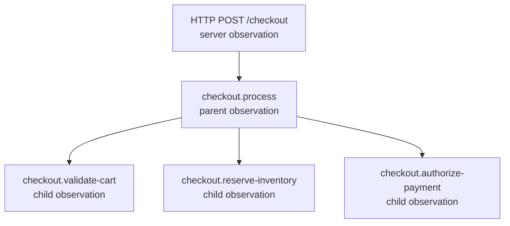

# Nested Observations

In the **Observation Lifecycle** chapter of the **SPRING_BOOT_OBSERVABILITY** module, **nested observations** are how you create child observations inside a parent observation to describe a large operation composed of smaller steps. For example, a checkout request might involve cart validation, inventory reservation, payment authorization, and order persistence. Each step has its own duration and failure modes; the parent–child relationship reveals the overall picture and narrows down where to investigate.

This module sets up observability for Spring Boot using **Micrometer Observation, metrics, logs, and distributed tracing**, while covering context propagation, tags/cardinality, exporters, and sampling. Nested observations sit at the intersection of these topics: code builds a logical tree of activities, while handlers and observability pipelines decide how those activities appear as metrics, spans, and logs.

## 1. Learning Outcomes

After this lesson, you will be able to:

1. Distinguish **parent observation**, **child observation**, **current scope**, and **parent–child spans** when tracing is enabled.
2. Create two or more nested observations using `ObservationRegistry` and `Observation.createNotStarted(...)`.
3. Explain why a child observation must be started while the parent context is active for tracing systems to link them.
4. Properly manage the `start()`, `openScope()`, `error(...)`, and `stop()` lifecycle, including when exceptions occur.
5. Read parent/child durations accurately; avoid mistakenly summing overlapping intervals.
6. Recognize context-loss bugs across async or HTTP/messaging boundaries and the limits of sampling.
7. Choose observation names and low-cardinality tags so metrics stay useful without causing runaway costs.

## 2. What Is a Nested Observation?

An observation describes **one type of activity**. A nested observation occurs when an observed activity spawns other observed activities **within its context**.

Example:

```text
checkout.process                   (parent: checkout flow)
├── checkout.validate-cart         (child: validate cart)
├── checkout.reserve-inventory     (child: reserve inventory)
└── checkout.authorize-payment     (child: authorize payment)
```

In a sequential execution flow, the three child observations typically fall one after another inside the parent observation's duration. If an active tracing handler is present and scopes are managed properly, these activities can appear as parent–child spans in the same trace.

One way to visualize it:



The diagram shows the **logical structure**. Child steps may run sequentially, in parallel, or on different threads, and whether each span appears in the trace backend still depends on instrumentation, context propagation, and sampling.

### Three Concepts Easily Confused

| Concept | Meaning | Automatically Creates Parent–Child Spans on Trace? |
| --- | --- | --- |
| **Nested Java calls** | Method A calls method B. | No. If B is uninstrumented, it is just an ordinary method call. |
| **Nested observation** | A child observation is created/started under a parent observation's context. | Possibly, when the tracing handler receives the context relationship. |
| **Distributed trace** | Spans linked via trace context, potentially spanning multiple services. | Complete only when context propagates across boundaries and spans are ingested. |

Thus, placing two `Observation.createNotStarted(...)` calls near each other in code does not make them parent and child. **The active current context during observation lifecycle execution is what determines the relationship.**

## 3. Underlying Mechanism: Registry and Current Scope

`ObservationRegistry` holds configuration and `ObservationHandler` instances. Under normal synchronous execution, an open scope makes that observation the **current observation** on the executing thread. When another observation is created and started inside that active scope, handlers can use this context to establish a parent–child relationship.

A minimal example:

```java
Observation parent = Observation.createNotStarted(
        "checkout.process", registry);

parent.start();
try (Observation.Scope parentScope = parent.openScope()) {

    Observation child = Observation.createNotStarted(
            "checkout.validate-cart", registry);

    child.start();
    try (Observation.Scope childScope = child.openScope()) {
        validateCart();
    } catch (RuntimeException exception) {
        child.error(exception);
        throw exception;
    } finally {
        child.stop();
    }

} catch (RuntimeException exception) {
    parent.error(exception);
    throw exception;
} finally {
    parent.stop();
}
```

Here `validateCart()` is an illustrative business method. Key sequence:

1. `parent.start()` begins the parent lifecycle.
2. `parent.openScope()` places the parent into the current context.
3. Inside the parent scope, `child.start()` begins the child lifecycle; tracing handlers can detect the active parent.
4. `child.openScope()` sets the child as the current context for inner calls.
5. Once the child scope closes, the parent scope resumes as the current context.
6. `child.stop()` ends the child; finally `parent.stop()` ends the parent.

**`start()` differs from `openScope()`.** `start()` controls timing measurement and lifecycle callbacks. `openScope()` controls the current context for linking child activities and logs when integrations support it. Starting a parent observation without opening its scope can prevent child observations from receiving the expected parent.

**`Observation.Scope.close()` also differs from `stop()`.** Closing a scope restores the previous context; the observation needs `stop()` to complete its lifecycle. Use `try-with-resources` for scopes and `finally` for `stop()` to prevent leaks when exceptions occur.

## 4. Concise Approach: Nesting `observe(...)` Blocks

For synchronous work, `observe(...)` handles starting, opening the scope, recording errors, and stopping the observation around a lambda; blocks can be nested without manually invoking each lifecycle step.

```java
return Observation.createNotStarted("checkout.process", registry)
        .lowCardinalityKeyValue("operation", "checkout")
        .observe(() -> {

            Cart cart = Observation.createNotStarted(
                    "checkout.validate-cart", registry)
                    .observe(() -> validateCart(command));

            Reservation reservation = Observation.createNotStarted(
                    "checkout.reserve-inventory", registry)
                    .lowCardinalityKeyValue("dependency", "inventory")
                    .observe(() -> reserveInventory(cart));

            return Observation.createNotStarted(
                    "checkout.authorize-payment", registry)
                    .lowCardinalityKeyValue("dependency", "payment")
                    .observe(() -> authorizePayment(reservation));
        });
```

The snippet illustrates nested relationships; `Cart`, `Reservation`, and business functions must exist in a real application. While the parent lambda executes, the parent scope is active; each child observation's lambda runs inside a child scope and reverts to the parent scope upon completion.

Characteristics of this style:

- Nesting is clearly visible from code structure.
- `observe(...)` wraps the entire synchronous lifecycle.
- Exceptions from child operations propagate outward, allowing the parent observation to record the overall failure too.
- These children are **siblings** under one parent, not a parent–child–grandchild chain simply because they run sequentially.

In this chapter, "nested" refers to **context relationships**, not merely indentation depth in code.

## 5. Complete Spring Boot Example: Checkout Flow

Suppose `CheckoutService` receives a request to reserve inventory and then process payment. `InventoryGateway` and `PaymentGateway` are application interfaces that may be implemented with an HTTP client or another component.

Java 17+, Spring Boot 3.x example:

```java
import io.micrometer.observation.Observation;
import io.micrometer.observation.ObservationRegistry;
import org.springframework.stereotype.Service;

@Service
public class CheckoutService {
    private final ObservationRegistry registry;
    private final InventoryGateway inventory;
    private final PaymentGateway payment;

    public CheckoutService(ObservationRegistry registry,
                           InventoryGateway inventory,
                           PaymentGateway payment) {
        this.registry = registry;
        this.inventory = inventory;
        this.payment = payment;
    }

    public CheckoutResult checkout(CheckoutRequest request) {
        return Observation.createNotStarted("checkout.process", registry)
                .contextualName("process checkout")
                .lowCardinalityKeyValue("workflow", "checkout")
                .observe(() -> {
                    String reservationId = Observation.createNotStarted(
                            "checkout.reserve-inventory", registry)
                            .lowCardinalityKeyValue("dependency", "inventory")
                            .observe(() -> inventory.reserve(
                                    request.sku(), request.quantity()));

                    String authorizationId = Observation.createNotStarted(
                            "checkout.authorize-payment", registry)
                            .lowCardinalityKeyValue("dependency", "payment")
                            .observe(() -> payment.authorize(reservationId));

                    return new CheckoutResult(reservationId, authorizationId);
                });
    }

    public record CheckoutRequest(String sku, int quantity) {}
    public record CheckoutResult(String reservationId, String authorizationId) {}

    public interface InventoryGateway {
        String reserve(String sku, int quantity);
    }

    public interface PaymentGateway {
        String authorize(String reservationId);
    }
}
```

This is a service instrumentation example; a real application must implement both gateways, validation, and appropriate rollback/compensation policies. Succeeding on inventory reservation yet failing payment is a business scenario requiring separate handling: **observability only records what happened, not how to recover transactions**.

When `checkout(...)` is called inside an HTTP request with an active observation/tracing context, the activity tree can nest under the server span:

```text
POST /checkout                  HTTP server span
└── checkout.process            custom parent span
    ├── checkout.reserve-inventory
    │   └── HTTP client: inventory-service /reservations
    └── checkout.authorize-payment
        └── HTTP client: payment-service /authorizations
```

The HTTP client spans appear only if the client is properly instrumented. If the implementation calls an uninstrumented library, the trace may show only the custom `checkout.reserve-inventory` span without a child HTTP span. A custom span measuring a business step remains useful, though it does not replace dependency instrumentation.

### How Are Names and Key-Values Used?

The example above uses three stable observation names: `checkout.process`, `checkout.reserve-inventory`, and `checkout.authorize-payment`. The set of names does not grow with order volume.

`workflow=checkout` and `dependency=inventory/payment` are **low-cardinality key-values**, suitable for grouping metrics. Conversely:

```java
// Avoid using as low-cardinality key-values.
observation.lowCardinalityKeyValue("checkout.id", checkoutId);
observation.lowCardinalityKeyValue("customer.email", customerEmail);
```

These two values can produce massive numbers of time series and risk exposing private data. If you need detailed attributes for traces, consider `highCardinalityKeyValue(...)` subject to data security policies and collection limits; never push user IDs, tokens, or sensitive payloads into telemetry indiscriminately.

Child observations do not automatically inherit every **metric tag** from their parent. Sharing trace context **does not mean** inheriting all low-cardinality key-values. If backends need to filter child metrics by environment, service, or workflow, configure common tags or conventions intentionally.

## 6. Timeline: Parent and Child Latencies Can Differ

Inspect a hypothetical request:

```text
Timeline (ms)
0         50        150       250       350       450
|---------|---------|---------|---------|---------|
checkout.process        [======================================] 430 ms
  validate-cart          [===]                                    30 ms
  reserve-inventory          [================]                   180 ms
  authorize-payment                            [=============]    140 ms
  remaining work         (parse/map/logic/persist result)          80 ms
```

Timeline bars illustrate time proportions only. The **parent's** duration measures all work between start and stop, including time when no child observation is active. Children represent only the instrumented parts.

In this sequential example, you can deduce ~80 ms remaining outside the two dependency steps and validation step; however, always inspect the actual timeline to account for waits, overhead, and unexported children.

In systems with parallel processing or retries:

- Two children can **overlap in time**, so summing child durations can exceed actual wall-clock elapsed time.
- A child can contain grandchildren, so summing every duration in the tree **double-counts** time.
- A parent can take longer than the sum of its children due to uninstrumented work or waiting on results.
- A long child only points out **where time was spent**; finding root cause requires dependency metrics, logs, database timings, and other evidence.

Therefore, never assume "parent = sum of all child spans." When reading a trace waterfall, inspect **intervals along the critical path**, parent–child relationships, and each span's self-time. For latency issues, comparing a slow request against a normal request is usually more informative than staring at a single waterfall.

## 7. Current Scope and the "Accidental Sibling" Bug

A common mistake:

```java
Observation parent = Observation.createNotStarted(
        "checkout.process", registry).start();

// Parent scope was not opened:
Observation child = Observation.createNotStarted(
        "checkout.reserve-inventory", registry).start();

try (Observation.Scope childScope = child.openScope()) {
    reserveInventory();
} finally {
    child.stop();
    parent.stop();
}
```

In this example, `parent` was started yet **not set as the current observation** when `child` started. The tracing handler may pick another context as parent—such as an active HTTP server context—or create spans lacking the expected parent link. A Java reference relationship between `parent` and `child` variables does not establish tracing lineage on its own.

The correct synchronous approach:

```java
Observation parent = Observation.createNotStarted(
        "checkout.process", registry).start();

try (Observation.Scope parentScope = parent.openScope()) {
    Observation child = Observation.createNotStarted(
            "checkout.reserve-inventory", registry).start();

    try (Observation.Scope childScope = child.openScope()) {
        reserveInventory();
    } catch (RuntimeException exception) {
        child.error(exception);
        throw exception;
    } finally {
        child.stop();
    }
} catch (RuntimeException exception) {
    parent.error(exception);
    throw exception;
} finally {
    parent.stop();
}
```

`ObservationRegistry.getCurrentObservation()` helps verify the current observation along a synchronous execution path when debugging. Inside the child scope, the current observation is `child`; once the child scope closes, the parent scope is restored. Yet **never treat the mere existence of an `Observation` variable as proof that its context is active on the thread**.

## 8. Nested Observations, Exceptions, and Overall Workflow Outcomes

Suppose inventory reservation succeeds, yet the payment gateway times out. Simulated trace tree:

```text
checkout.process                     ERROR    1,500 ms
├── checkout.reserve-inventory       OK         110 ms
└── checkout.authorize-payment       ERROR    1,350 ms
```

With the `observe(...)` lambdas in the checkout example, if the timeout is thrown as an exception, the payment step's observation finishes on the error branch; the exception continues propagating out of the parent observation so the checkout flow also records the error. This distinguishes the **directly failing step** from the **affected parent workflow**.

However, "error" in tracing/observation and "business failure" do not always coincide:

- A gateway returning a valid payment decline can be a **business outcome**, not necessarily a technical exception.
- A 4xx validation error differs from a 5xx server failure; define consistent status-marking rules.
- If an exception is caught and a successful fallback is returned, the parent may finish normally even though the child reported an error; decide how to represent **outcome** according to SLOs and domain semantics.
- If managing the lifecycle manually, call `error(exception)` on the appropriate observation, then `stop()` in `finally`. Never let instrumentation logic alter the service's error-return behavior.

Selective fallback handling example:

```java
return Observation.createNotStarted("checkout.process", registry)
        .observe(() -> {
            try {
                return Observation.createNotStarted(
                        "checkout.authorize-payment", registry)
                        .observe(() -> paymentGateway.authorize());
            } catch (PaymentTemporarilyUnavailable exception) {
                // Record business fallback per application policy.
                return Authorization.pendingReview();
            }
        });
```

Types `PaymentTemporarilyUnavailable` and `Authorization` are purely illustrative. The child observation saw the exception inside its lambda; the parent observation saw the fallback outcome because the exception was caught inside the parent lambda. This can be **accurate** if business policy permits `pendingReview`, though dashboards must still distinguish completed, pending, and failed checkouts via dedicated business metrics.

## 9. Limits of Nesting Across Threads and Async Processing

### 9.1 Thread Pools and `CompletableFuture`

The current scope in synchronous execution is typically tied to the thread's execution context. When running a child on another thread, never assume the parent context automatically moves onto the new thread:

```java
return Observation.createNotStarted("checkout.process", registry)
        .observe(() -> CompletableFuture.supplyAsync(() -> {
            // On another thread: parent's current observation may be absent.
            return reserveInventory();
        }));
```

This snippet has a second problem too: the `observe(...)` lambda only waits until **creating the `CompletableFuture`**, then returns immediately. The parent observation can finish while the async work is still running. Duration measures scheduling time, not the full transaction.

When tracing across threads is needed, use context propagation mechanisms supported by your stack, such as Micrometer Context Propagation integrated with an instrumented executor. Create/close child observations where work actually executes and tie lifecycles to actual async completion. **Never pass the same `Observation.Scope` object to another thread to share**: opening/closing scopes across the wrong execution contexts corrupts parentage and MDC.

### 9.2 Reactor and Reactive Flows

In Reactor, execution can switch threads and operators execute upon **subscription**, not necessarily when constructing a `Mono` or `Flux`. The following usually **does not measure** actual processing time:

```java
Mono<Receipt> result = Observation.createNotStarted(
        "checkout.process", registry)
        .observe(() -> checkoutReactive()); // Merely builds the Mono.
```

If `checkoutReactive()` returns a lazy `Mono`, the scope may close before the publisher ever executes. To instrument reactive flows, use observation/Reactor context mechanisms and context propagation suited to your Spring Boot, Micrometer, and Reactor versions; terminate the observation on the subscription's terminal signal (completion, error, or cancel).

Remember: **nesting in Java code structure does not guarantee nesting across asynchronous execution timelines**.

### 9.3 Across HTTP and Messaging

Two Spring Boot services do not share a single Java `Observation` or `Observation.Scope` object. Distributed trace relationships across services connect only if the client injects context and the server extracts context from a carrier, such as the W3C `traceparent` header:

```http
POST /authorizations HTTP/1.1
Host: payment-service
traceparent: 00-4b2fe50af9d44c37ab610ebecc803e92-84f191c76aeadc11-01
```

When the header is handled properly by propagators, the receiving service can create a server span belonging to the same trace, then create nested observations inside its own service. For message brokers, context must similarly travel in message headers via corresponding instrumentation.

If a trace splits into two separate trees at a service boundary, check client/server instrumentation, headers, propagators, async context, and sampling before concluding the request never arrived.

## 10. How Do Nested Observations Impact the Three Pillars?

Nested observations do not automatically guarantee all three signals appear in one dashboard. **`ObservationRegistry`** and handlers provide the integration hooks; exporting and correlating signals depends on application configuration, exporters, collectors, and backends.

| Signal | What Can Parent/Child Help With? | What to Verify |
| --- | --- | --- |
| **Metrics** | Measure latency and frequency separately for overall checkout and each dependency step. | Metrics handler, registry, actual metric names, tags, and histograms/percentiles. |
| **Traces** | Display parent/child spans, errors, dependencies, and critical path. | Tracing bridge, context propagation, exporter, sampling, backend. |
| **Logs** | Tag step logs with `traceId` and `spanId` while context is active. | Logging MDC/pattern, log levels, access control, avoiding sensitive data. |

Illustrative test setup with Spring Boot 3.x, Prometheus registry, and Micrometer Tracing bridge for OpenTelemetry:

```groovy
dependencies {
    implementation 'org.springframework.boot:spring-boot-starter-actuator'
    implementation 'io.micrometer:micrometer-registry-prometheus'
    implementation 'io.micrometer:micrometer-tracing-bridge-otel'
    implementation 'io.opentelemetry:opentelemetry-exporter-otlp'
}
```

```yaml
spring:
  application:
    name: checkout-api

management:
  endpoints:
    web:
      exposure:
        include: health,info,metrics,prometheus
  tracing:
    sampling:
      probability: 1.0
  otlp:
    tracing:
      endpoint: http://otel-collector:4318/v1/traces
```

This configuration assumes a collector exposes an OTLP HTTP endpoint on port 4318. `sampling.probability: 1.0` fits low-traffic test environments for visibility; production environments must weigh trace volume costs and sampling strategies. The `actuator/prometheus` path must be access-restricted per operational policy.

After invoking checkout a few times, check `actuator/metrics` or `actuator/prometheus` to verify observation timings were recorded by the metrics registry. Check actual metric names and label sets directly from the exporter/endpoint, as they depend on conventions and versions. Then search `checkout.process` in the trace backend to inspect the span tree and compare durations, error attributes, and logs.

Some systems support **exemplars** to jump from a metric data point to a representative trace; this requires separate configuration and backend support. Never assume every observation metric includes a built-in button to open a trace.

### How Sampling Affects Conclusions

When trace sampling keeps only a percentage of requests, you may have complete checkout metrics yet fail to find the trace for a particular error. That **does not prove** metrics are wrong or nested observations are broken. Distinguish span-creation failures, propagation failures, sampling, and exporter/collector issues. Likewise, never use a single slow trace to conclude most requests are slow: blast radius must be confirmed via aggregate metrics.

## 11. Real-World Bugs and Troubleshooting

| Symptom | Common Hypothesis | What to Check |
| --- | --- | --- |
| Parent span exists, child span missing | Child uninstrumented, incompatible tracing handler/registry, trace dropped by sampling, or export error. | Verify execution reaches child, lifecycle, tracing config, and collector. |
| Parent and child become two separate root spans | Parent scope was not active when child started, or context was lost across threads/services. | Check open scopes, execution context, and propagation. |
| Child attaches under HTTP span instead of checkout span | Checkout parent called `start()` without `openScope()` before starting child. | Use nested `observe(...)` or open the parent scope at the right time. |
| Parent duration is shorter than async work | Parent stopped as soon as `CompletableFuture` or `Mono` was created. | Measure execution lifecycle until completion, with context propagation. |
| Sum of child durations exceeds parent | Children ran in parallel or grandchildren were double-counted. | Read the waterfall and critical path; never sum durations blindly. |
| Trace tree looks right, yet metrics explode in time series | `orderId`/`userId`/raw URLs put into low-cardinality tags. | Switch to bounded route/template, operation, dependency, and outcome tags. |
| Error occurred in child, yet parent is not marked error | Exception was caught into a fallback or parent missed business outcome. | Define success, fallback, partial success, and failure clearly; add business metrics. |
| Child logs lack trace ID | MDC or tracing context was not active when logging. | Check scope, logging integration, and async boundaries. |

## 12. Incident Investigation Workflow with Nested Observations

Suppose an alert shows P95 for `POST /checkout` rose from 300 ms to 2 seconds after a payment service change. A practical workflow:

1. **From metrics**, narrow down the timestamp, route, instances, error rate, and P95/P99 of the `checkout.process` parent.
2. Compare child metrics: did `checkout.reserve-inventory` slow down, or only `checkout.authorize-payment`?
3. **From logs**, search for payment gateway timeouts, retries, and errors in the same time window; grab `traceId` if available.
4. **From tracing**, open several slow requests and several normal requests. Inspect the parent checkout span, the `authorize-payment` child, and the corresponding HTTP client/server spans.
5. If the parent checkout is long while every child span is short, look for uninstrumented gaps, lock/queue waits, or broken async handling; do not rush to blame payment.
6. If the payment child is long, check network, timeouts, retries, payment service saturation, client pools, and dependencies inside payment.
7. After applying a fix, return to **metrics** to verify P95 and error rates improve across traffic, while checking a fresh trace to confirm the critical path shifted as expected.

The strength of nested observations here is splitting a single checkout into stably named steps, speeding up investigation instead of guessing from a single monolithic HTTP span.

## 13. Self-Check Exercises

### Exercise 1: Relationship Between Observations

Inspect the code:

```java
Observation a = Observation.createNotStarted("a", registry).start();
Observation b = Observation.createNotStarted("b", registry).start();

try (Observation.Scope scope = b.openScope()) {
    runBusinessLogic();
} finally {
    b.stop();
    a.stop();
}
```

**Question:** Can you be sure `b` is a child of `a`?

**Answer:** No. `a` was started, yet its scope was not active when `b` started. In a tracing environment, `b` may pick another parent or become a root depending on context and handlers. The simpler approach is `a.observe(() -> b.observe(...))`, or opening `a`'s scope before starting `b`.

### Exercise 2: Reading Duration

A trace has a `checkout.process` parent of 500 ms and two parallel children of 350 ms each. Can you conclude the data is wrong because the child sum of 700 ms exceeds the 500 ms parent?

**Answer:** No. The children overlapped in time. Parent duration is elapsed wall-clock time; summing child durations is not a valid way to compute parent duration. Read the timeline and critical path.

### Exercise 3: Measuring an Unsubscribed Mono

```java
Mono<String> result = Observation.createNotStarted(
        "payment.authorize", registry)
        .observe(() -> paymentClient.authorizeReactive());
```

**Question:** When `authorizeReactive()` returns a lazy `Mono`, has the observation measured the full transaction?

**Answer:** Unlikely; normally this snippet measures only `Mono` assembly time. Work executes on subscription; you need instrumentation tied to the execution lifecycle and Reactor context to measure until the terminal signal.

### Exercise 4: Finding Why a Child Span Is Missing

Metrics show `checkout.authorize-payment` latency rose, yet traces only show the HTTP server span and `checkout.process`. List at least three possibilities.

**Hint:** The child's scope or lifecycle was wrong, or that branch did not execute in the inspected trace; context was lost across threads/services; tracing instrumentation or handlers were missing; or sampling and the trace export pipeline dropped the data. Verify with a reproducible request in a test environment before drawing conclusions.

## 14. Checklist When Designing Nested Observations

- Parent and child names describe **operation types**; never include request IDs or user names.
- Child is created and started while the proper parent context is active.
- Use `observe(...)` for simple synchronous blocks; under manual control, close scopes and call `stop()` on every branch.
- Create children only at operationally meaningful business boundaries; avoid creating spans for individual lines of code.
- Distinguish business outcomes, technical exceptions, and fallbacks when designing error recording.
- For async, Reactor, and messaging, tie lifecycles to **actual execution time** and real propagation.
- Choose bounded low-cardinality tags; safeguard all data exported to logs and traces.
- Verify each layer: metrics exist, spans have proper relationships, logs carry correlation when needed, and exporter/backend work.
- When investigating, examine parent/child waterfalls alongside aggregate metrics; never sum nested durations to infer end-to-end latency.

**Key takeaway:** Nested observations turn a complex operation into an **observable tree of work**, yet those relationships are reliable only when lifecycles and scopes are managed properly. In Spring Boot, Micrometer Observation provides the model for measuring business steps; tracing, logs, metrics, propagation, sampling, and exporters determine how completely you see that tree when incidents occur.
