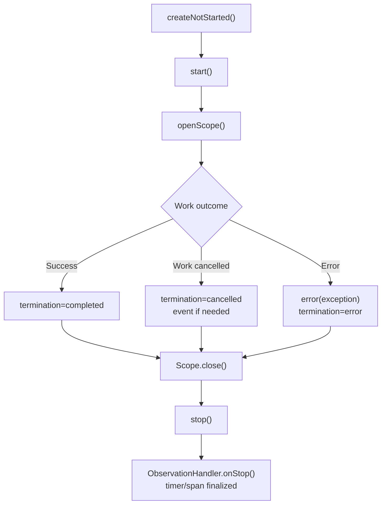

# Cancelled Observations

A user starts downloading a report in a Spring Boot application, then closes the browser after three seconds. Or a running data-import job is cancelled due to system shutdown. The work may not have finished, yet its timer, trace, and logging context must still be handled cleanly. Ignoring this case can leave dashboards missing cancelled requests, spans dangling, or threads retaining stale context from prior requests.

In the **Observation Lifecycle** chapter of the **SPRING_BOOT_OBSERVABILITY** module, the **Cancelled Observations** lesson explains how to design and handle work cancellation when using **Micrometer Observation** in Spring Boot. This is part of setting up observability with metrics, logs, and distributed tracing: understanding context propagation, tags/cardinality, exporters, sampling, and signal correlation to investigate errors, latency, and application behavior in production.

> **Key takeaway:** Micrometer Observation provides lifecycle operations such as `start()`, `openScope()`, `error()`, `event()`, and `stop()`. The standard Observation API **does not have a `cancel()` method as a separate lifecycle step**. "Cancelled observation" in this lesson primarily refers to **the observed work being cancelled or terminated early**, and the application deciding how to record that state. Closing the scope and calling `stop()` remain the right procedure to complete an already-started measurement.

## 1. Learning Objectives

After completing this lesson, you will be able to:

1. Distinguish **work cancellation**, **Reactor subscription cancellation**, **recording an error**, **stopping an observation**, and **disabling an observation**.
2. Explain the corresponding lifecycle callbacks on `ObservationHandler` and the consequences of missing `stop()` or failing to close `Scope`.
3. Instrument an interruptible Java task to measure `completed / cancelled / error` consistently.
4. Observe Reactor's `SignalType.CANCEL` and understand why operator placement affects measurement results.
5. Trace cancelled requests across metrics, logs, and distributed traces, even when traces are sampled.
6. Control tag cardinality, avoid misclassifying cancellation as an error, and verify there are no context leaks.

## 2. "Cancelled" Can Mean Very Different Things

| Scenario | Example | Primary Semantics | Effect on Observation |
|---|---|---|---|
| **Work requested to cancel** | User clicks Cancel; `Future.cancel(true)`; shutdown | External request to stop execution; work may or may not have stopped yet | When handler code detects and exits, record `termination=cancelled` if appropriate, then `stop()`. |
| **Reactive subscription cancelled** | WebFlux client disconnect; `take(1)`; `timeout` cancels upstream | Reactor sends a `CANCEL` signal upstream to the subscription | The `doFinally` operator or Micrometer Reactor instrumentation can record the cancelled status. |
| **Work failed** | Database error, unhandled exception | Execution terminated due to an error | Record `Observation#error(exception)`; close scope and observation. |
| **Work completed normally** | Report generated and response sent | Activity completed per business contract | Record `termination=completed` if an outcome convention is used, then `stop()`. |
| **Observation skipped from the start** | `ObservationPredicate` disables a kind of observation | System decides not to instrument that activity | May yield a `no-op Observation`; emits no timers/spans through standard handlers. |
| **Only closing the Scope** | Exiting a `try-with-resources` block | Removes current observation/span from execution context | **Does not replace `stop()`**; duration measurement still needs completion. |

The word "cancel" is often used interchangeably for two distinct requirements:

- **Cancelling a business activity** while still wanting to measure time already spent, see who was affected, and understand why it was cancelled.
- **Discarding telemetry for an already-started activity** so it emits no metric or span. That is not what `stop()` means; do not assume Micrometer has an `Observation.cancel()` to erase recorded results.

For example, when a user aborts a report download, recording the duration spent prior to abort can be very valuable. Treating that request as if it "never happened" causes p95 latency and abort rates to misrepresent the real user experience.

## 3. Recap of the Exact Micrometer Observation Lifecycle

An Observation is created from `ObservationRegistry`, then started and stopped. A scope places the observation into the current context to support parent/child relationships and log correlation.



`ObservationHandler` receives callbacks defined by the API: `onStart`, `onScopeOpened`, `onScopeClosed`, `onError`, `onEvent`, `onStop`, etc. Depending on the handler, they record timers, spans, and other metadata. Micrometer **does not define a standard `onCancel` callback** on `ObservationHandler`; cancellation is information carried by the framework or business code via context, events, or tags.

### 3.1 Operations to Understand Accurately

| Operation | Meaning | On Work Cancellation |
|---|---|---|
| `Observation.start()` | Starts the measurement lifecycle; triggers handler `onStart`. | The observation must be started if you want to measure execution duration. |
| `Observation.openScope()` | Places observation/span into the current context for child instrumentation and loggers. | Keep the scope open over code requiring correlation. |
| `Observation.event(...)` | Signals a named milestone; handlers can record an event on a span or counter. | Can add `job.cancelled` as a milestone clue; does not replace outcome metrics. |
| `Observation.error(Throwable)` | Records an error per instrumentation conventions. | Call only when policy treats that situation as an error; **do not blindly treat every cancellation as an error**. |
| `Observation.Scope.close()` | Restores/clears the current context and fires the scope-closed callback. | Must run even on cancellation or exception. |
| `Observation.stop()` | Ends the observation; handlers finalize measurements and spans. | Must be called once the observation started and the work has actually ended. |

Two common misconceptions:

1. **`close()` is not `stop()`.** An observation can open multiple scopes; exiting one scope does not close its lifecycle.
2. **`stop()` is not a work-cancellation command.** Calling `stop()` does not interrupt threads, abort HTTP requests, roll back transactions, or halt async tasks. It only signals that the observation has ended.

Calls to `error()` and `event()` can happen before `stop()`, yet they do not transition to a built-in "Cancelled" lifecycle state.

### 3.2 What Happens If Cleanup Is Missing?

- Forgetting `stop()`: standard timers will lack a completed record for that run; spans may remain unfinished and fail to export properly. If the system tracks active observations, active-task data can remain stuck inaccurately.
- Forgetting `Scope.close()`: `ThreadLocal`/MDC may retain a stale trace ID or current observation when threads are reused, corrupting log/trace correlation.
- Calling `stop()` too early: duration no longer covers actual work; a parent span can finish before child calls are even done.
- Calling `error()` then catching the exception and returning a "success" result without clear conventions: metrics and traces may show errors inconsistent with the user experience.
- Ignoring cancellation requests inside the task: measurement may drag on even though the caller no longer wants the result.

**Design principle:** every unit of work has a clear owner responsible for finishing its observation; close scopes at the right boundary and call `stop()` only when the activity represented by the observation has truly finished.

## 4. Deciding Whether Cancellation Is an Error

"Cancelled" describes how the work ended, while "error" represents an assessment of the outcome. They can overlap, yet they are **not identical**.

| Case | Suggested `termination` | Should `observation.error(...)` Be Called? | Reason |
|---|---|---|---|
| User intentionally cancels export | `cancelled` | Usually no | Expected behavior, not necessarily a system failure. |
| `Future.cancel(true)` from graceful shutdown | `cancelled` | Usually no | Task was asked to stop; record reason and check cleanup. |
| Client disconnects mid-request | `cancelled` if framework receives signal | Per HTTP/framework convention | Could be normal navigation away or network drop; do not automatically assign HTTP 500. |
| Internal deadline exceeded and work aborted | `timeout` or `cancelled`, per contract | Possibly | If a timeout violates an SLO, reflect the corresponding error status. |
| Exception from DB | `error` | Yes | Execution failure requiring investigation. |
| Reactor `take(1)` cancels upstream after one element | `cancelled` on upstream; `completed` on downstream | Usually no | Flow-control cancellation with successful downstream processing as requested. |

Standardize **outcome/termination** before building dashboards. You can use a bounded set like `completed`, `cancelled`, `error`, `timeout`; if cancellation reasons are needed, use a dedicated key like `cancel.reason` with a predefined set such as `client_disconnect`, `operator`, `deadline`, `shutdown`.

Never put `userId`, `orderId`, tokens, or URLs with concrete IDs into **low-cardinality tags**. Excessive cardinality explodes Prometheus series counts. To look up specific requests, use trace IDs in logs/traces under security policies rather than putting them in metrics.

### 4.1 `observe(...)` and Exceptions on Cancellation

The convenience method:

```java
Observation.createNotStarted("my.operation", registry)
        .observe(() -> doWork());
```

automatically starts the observation, opens the scope, invokes the callback, automatically calls `error(...)` if the callback **throws an exception**, closes the scope, and calls `stop()`. It works very well for simple synchronous blocks.

However, if the application throws `CancellationException` from the callback, `observe(...)` will also automatically mark that exception as an **error**. That may conflict with a system convention that "intentional cancellation is not an error." When you need to distinguish all three outcomes cleanly, manage the lifecycle explicitly and choose when to call `error()`.

## 5. Java Example: Interruptible Task Completing Its Observation Cleanly

Suppose a Spring Boot service generates reports. The task can be interrupted when the system requests cancellation; we want to track counts of successes, cancellations, errors, and duration before exit.

The example below uses `ObservationRegistry` provided by Spring Boot Actuator. Java supports `Thread.sleep`; when a thread is interrupted while sleeping, it throws `InterruptedException` and clears the interrupt flag. Code must restore the flag after recording cancellation.

```java
import io.micrometer.observation.Observation;
import io.micrometer.observation.ObservationRegistry;
import org.slf4j.Logger;
import org.slf4j.LoggerFactory;
import org.springframework.stereotype.Service;

@Service
public class ReportJobService {

    private static final Logger log =
            LoggerFactory.getLogger(ReportJobService.class);

    private final ObservationRegistry observationRegistry;

    public ReportJobService(ObservationRegistry observationRegistry) {
        this.observationRegistry = observationRegistry;
    }

    public String generateReport() throws InterruptedException {
        Observation observation =
                Observation.createNotStarted("report.generate", observationRegistry)
                        .contextualName("generate report")
                        .lowCardinalityKeyValue("job.type", "export")
                        .start();

        try (Observation.Scope scope = observation.openScope()) {
            try {
                // Simulate interruptible processing work.
                Thread.sleep(5_000L);

                observation.lowCardinalityKeyValue(
                        "termination", "completed");
                log.info("Report generated successfully");
                return "report-ready";

            } catch (InterruptedException cancelled) {
                // Convention: stopping via interrupt is cancellation, not an error.
                observation.lowCardinalityKeyValue(
                        "termination", "cancelled");
                observation.event(Observation.Event.of("report.cancelled"));
                log.info("Report generation cancelled by interruption");

                Thread.currentThread().interrupt();
                throw cancelled;

            } catch (RuntimeException failure) {
                observation.lowCardinalityKeyValue(
                        "termination", "error");
                observation.error(failure);
                log.error("Report generation failed", failure);
                throw failure;
            }
        } finally {
            // Runs on success, interruption, or error.
            observation.stop();
        }
    }
}
```

**Why does this example handle the lifecycle properly?**

1. `createNotStarted(...)` creates the observation. `start()` begins timing right before the observed work.
2. `openScope()` makes the current observation/span available while code runs and logs are written.
3. On success, the `termination=completed` tag is added **before** `stop()`.
4. On interruption, code attaches `termination=cancelled` and emits an event. It deliberately skips `error()`, reflecting the business choice of "intentional cancellation."
5. The cancellation log is written **while the scope is still open**, preserving correlation IDs if tracing/MDC is configured.
6. `try-with-resources` closes the scope across all three branches. `finally` calls `stop()` after the scope has closed.
7. The exception propagates to the caller, and the interrupt flag is restored so executors recognize the cancellation.

This snippet illustrates reacting once `InterruptedException` **has been received**; it does not create a cancellation endpoint itself and does not guarantee every I/O library respects interrupts. If an SDK ignores interrupts, work may keep running even after the caller invoked `cancel(true)`.

### 5.1 Reading Metric Results

When a matching metrics handler is in `ObservationRegistry`, a timer named `report.generate` records duration for each **finished** call. Under `DefaultMeterObservationHandler`, the timer typically includes low-cardinality tags plus the `error` tag:

| Outcome | Illustrative Tags | Duration |
|---|---|---|
| Success | `termination=completed`, `error=none` | From `start` to `stop`. |
| Interrupted, by convention not an error | `termination=cancelled`, `error=none` | Actual elapsed time until interrupt handling and cleanup. |
| Runtime exception | `termination=error`, `error=IllegalStateException` (example) | Time until exception and cleanup. |

The `error` tag value on the meter is determined by handlers/conventions; do not manually assign `error=none` as business metadata competing with handlers. A cancellation with `error=none` **does not mean the task succeeded**; always read `termination` too.

If you want a dedicated counter for cancellations, you can register a counter with Micrometer's `MeterRegistry`, though avoid combining `report.generate` timer counts and a separate counter as if both represent the exact same "request count." They measure distinct concepts, and dashboards should make that explicit.

### 5.2 Does Cancelling a `Future` Actually Stop the Task?

Caller-side example:

```java
Future<String> task = executorService.submit(reportJobService::generateReport);

// When the user requests cancellation, call:
boolean accepted = task.cancel(true);
```

`Future.cancel(true)` requests interrupting the executing thread if possible; the return value indicates `Future` cancellation, **not final proof that business logic stopped and cleaned up**. For a task cancelled before ever starting, `generateReport()` may never have run, producing no observation at all.

Therefore, distinguish additional states:

- `cancel_requested`: the system acknowledged cancellation intent;
- `cancelled`: the instrumented work itself confirmed exiting via the cancellation branch;
- `completed` or `error`: work finished via another branch if it raced with the cancellation request.

How these milestones are persisted depends on your job scheduler, API, and storage design. Observation does not provide a cancellation orchestration mechanism replacing `Future`, `ExecutorService`, or job state machines.

### 5.3 Quick Verification Across Three Paths

Assuming Spring Boot Actuator and a metrics registry are configured:

```bash
# List metric names; report.generate appears only after running once.
curl http://localhost:8080/actuator/metrics

# Business timer (if handler/endpoint is enabled).
curl http://localhost:8080/actuator/metrics/report.generate

# Inspect stats specifically for cancelled runs, once data exists:
curl "http://localhost:8080/actuator/metrics/report.generate?tag=termination:cancelled"
```

These are illustrative check commands; your project needs an actual controller/job runner invoking `generateReport()` plus an active cancellation/interrupt mechanism to generate `cancelled` samples. The `metrics` endpoint must be exposed in Spring Boot configuration.

In Prometheus, the timer name may translate to `report_generate_seconds_count` and `report_generate_seconds_sum`. You can compute:

```promql
# Ratio of runs finishing via cancellation over 5 minutes,
# if Prometheus is configured and samples have been emitted.
sum(rate(report_generate_seconds_count{termination="cancelled"}[5m]))
/
sum(rate(report_generate_seconds_count[5m]))
```

If no calls have occurred or samples lack the tag, the denominator/range may lack sufficient data. Ensure every branch normalizes `termination` so the division stays meaningful.

## 6. In Spring WebFlux/Reactor, CANCEL Is a Distinct Signal

Reactor defines key termination signals for a `Publisher`:

- `ON_COMPLETE`: upstream completed.
- `ON_ERROR`: upstream terminated with an error.
- `CANCEL`: subscriber signaled it no longer wants items from upstream.

`CANCEL` **is not an exception**, and `doOnError(...)` does not run merely because a subscription was cancelled. That is why `doFinally(...)` is used when you need to know which path terminated a reactive sequence.

### 6.1 `doFinally` Example

```java
import java.time.Duration;

import org.slf4j.Logger;
import org.slf4j.LoggerFactory;
import reactor.core.publisher.Flux;
import reactor.core.publisher.SignalType;

public class TickStream {

    private static final Logger log =
            LoggerFactory.getLogger(TickStream.class);

    public Flux<Long> ticks() {
        return Flux.interval(Duration.ofMillis(100))
                .doFinally(signal -> {
                    if (signal == SignalType.CANCEL) {
                        log.info("Tick stream subscription cancelled");
                    } else if (signal == SignalType.ON_ERROR) {
                        log.warn("Tick stream terminated with an error");
                    } else {
                        log.info("Tick stream completed");
                    }
                });
    }
}
```

`doFinally` runs on completion, error, and cancellation—like a `finally` block for a reactive stream. It receives `SignalType` to distinguish the three outcomes. If you only want a callback on cancellation, `doOnCancel(...)` is also useful; they differ in timing: `doOnCancel` executes before propagating the cancel signal upstream, whereas `doFinally` runs after termination/cancellation passes through the operator's position.

For infinite streams like `Flux.interval`, normal termination occurs when the subscriber cancels or the connection closes rather than via natural `onComplete`. Still, **not every client browser close immediately or deterministically produces the exact same signal across every layer**; it depends on the WebFlux adapter, HTTP transport, backpressure, and instrumentation placement.

### 6.2 Using Reactor's Micrometer Observation Integration

The `reactor-core-micrometer` module provides `Micrometer.observation(ObservationRegistry)` to instrument a `Flux`/`Mono`:

```groovy
dependencies {
    implementation 'io.projectreactor:reactor-core-micrometer'
}
```

```java
import java.time.Duration;

import io.micrometer.observation.ObservationRegistry;
import reactor.core.observability.micrometer.Micrometer;
import reactor.core.publisher.Flux;

public class ObservedTickStream {

    private final ObservationRegistry observations;

    public ObservedTickStream(ObservationRegistry observations) {
        this.observations = observations;
    }

    public Flux<Long> ticks() {
        return Flux.interval(Duration.ofMillis(100))
                .name("stream.ticks")
                .tap(Micrometer.observation(observations));
    }
}
```

When `ObservationRegistry` has a metrics handler, Reactor instrumentation can create the `stream.ticks` timer and a low-cardinality `reactor.status` tag with values:

| `reactor.status` | Meaning |
|---|---|
| `completed` | Sequence emitted items and completed. |
| `completedEmpty` | Sequence completed without emitting any items. |
| `error` | Sequence terminated with `onError`. |
| `cancelled` | Subscription was cancelled. |

This is a **Reactor instrumentation convention**, not a `cancel()` method on Micrometer Observation. Producing corresponding trace spans still requires a tracing handler/exporter; viewing metrics in Prometheus requires a configured metrics registry/exporter and endpoint.

If the application already instruments a stream via another mechanism, evaluate potential telemetry duplication before adding `tap`.

### 6.3 Instrumentation Placement Changes Outcome Meaning

A Reactor chain consists of sequential operators. `CANCEL` can occur **upstream** while **downstream** still completes normally.

Consider two structures:

```java
// Measure upstream of take(1):
Flux.just(1, 2, 3)
    .name("sample.upstream")
    .tap(Micrometer.observation(registry))
    .take(1);

// Measure downstream of take(1):
Flux.just(1, 2, 3)
    .take(1)
    .name("sample.downstream")
    .tap(Micrometer.observation(registry));
```

In the first case, `take(1)` only needs the first element and can then cancel upstream; the observation before `take(1)` may record `reactor.status=cancelled`. In the second case, the sequence **after `take(1)`** emits one element and completes, so its observation may record `completed`.

This is **not a contradiction**: you are measuring two different boundaries of the same pipeline. Do not treat every upstream cancellation as a user-facing error.

Another example is `timeout`:

```java
source
    .name("source.before.timeout")
    .tap(Micrometer.observation(registry))
    .timeout(Duration.ofSeconds(2));
```

When a timeout occurs, `timeout` typically cancels the upstream subscription while emitting `TimeoutException` downstream. Instrumentation **before timeout** may observe `CANCEL`, whereas instrumentation **after timeout** may see `ON_ERROR`. Always clarify the exact observation boundary before interpreting charts.

### 6.4 Never Share One Manual Observation Across Multiple Subscriptions

Reactor `Publisher` instances are usually **lazy**: declaring a pipeline does not execute it; each subscription creates a new execution. Buggy code often looks like this:

```java
// Avoid this: observation created before any subscription exists.
Observation shared = Observation.start("stream.work", registry);
return remoteCallMono.doFinally(signal -> shared.stop());
```

The snippet above can start the observation too early, stop it multiple times across multiple subscribers, or never stop it if nobody subscribes. With Reactor, prefer `tap(Micrometer.observation(...))` because it binds instrumentation to the subscription lifecycle. If manual lifecycle control is genuinely needed, create and own one observation **per subscription**, ensuring cleanup on `COMPLETE/ERROR/CANCEL` while handling context propagation properly. Never copy a synchronous `try-with-resources` pattern directly onto a method returning an async pipeline.

## 7. HTTP Cancellation: Client Disconnect Does Not Automatically Mean 500

In Spring MVC or WebFlux, a request can terminate early because the client disconnected or the network layer closed. Depending on timing, framework, and adapter:

- The server may detect an I/O exception while writing the response.
- WebFlux may receive a cancellation signal from the subscriber/transport.
- Background-thread work may continue running unless the application explicitly cancels it.
- A handler might return 200 before post-processing runs, so HTTP status alone does not describe the whole business flow.

Therefore, do not automatically infer from "the client went away" that every span must have error status, or that every request gets status 499. **499 is a convention used by certain proxies**, not a standard HTTP status code Spring Boot is forced to emit.

### 7.1 Picking the Right Target to Measure

Distinguish three lifecycles:

1. **HTTP server observation**: measures request handling from the HTTP layer's perspective.
2. **Business export/report observation**: measures the actual work of generating the report.
3. **Streaming response observation**: measures pushing data out to the client if you manually instrument that part.

For example: the HTTP request terminated, yet a background job keeps generating the file for the user to download later. The job may intentionally be non-cancellable. Using HTTP cancellation alone to mark `report.generate=cancelled` would make telemetry **factually wrong**.

Define explicitly: does cancelling the request cancel the job? Are there timeouts or retries? Is the work idempotent? Can the job be re-picked from a queue? Only after answering these questions should you attach `termination` to the right observation.

### 7.2 Client Disconnects and Distributed Tracing

When Micrometer Tracing is enabled:

- The HTTP observation can correspond to the server span; inner business observations create child spans when matching handlers exist.
- With proper scopes and propagation, logs can carry `traceId` and `spanId`.
- If the request aborts after child spans already started, ensure each owner of a span/observation closes it at the right time.
- Sampling can keep a span out of the backend even while request timers and logs exist.

Seeing a `traceId` in logs does not prove the trace was sent by the exporter; the exporter and backend must work, and sampling must retain the trace.

## 8. Cancellation in Tasks, Queues, and Retries

Asynchronous flows are often trickier than a single HTTP request:

### 8.1 Task Cancelled Before Running

A queued job is marked "cancelled" before a worker ever picks it up. There is no real execution interval to call `Observation.start()` and `stop()`. If you want to count **pre-execution cancellations**, use dedicated metrics like `job.cancel.requested`/`job.cancel.accepted` or scheduler event logs. Never fabricate fake durations as if the job executed.

### 8.2 Task Already Running When Cancellation Arrives

Place the observation around the execution boundary that actually ran. Attach `termination=cancelled` only after code exits through the cancellation branch; a user clicking Cancel is merely a **cancellation request**. If the job completes while cancellation is in flight, the final outcome may still be `completed`. Design state machines and state updates consistently so the same task is never double-counted as both completed and cancelled.

### 8.3 Retries and Timeouts

A task can have multiple attempts:

```text
Job A
├── attempt 1: timeout (2 s)
├── attempt 2: timeout (2 s)
└── attempt 3: completed (0.2 s)
Job A: completed after 4.2 s + backoff
```

Clarify which observation measures an **attempt** and which measures the **overall job**. If one attempt times out and cancels, do not mark the entire job cancelled when the next attempt succeeds. You can record `attempt.termination=timeout` and `job.termination=completed` on separate observations with stable names and keys.

Conversely, if the job is cancelled after attempt 2, the overall job should reflect its true final outcome. Having only an HTTP 200 metric hides internal retries or cancellations.

### 8.4 Cleanup and Side Effects

Cancelling a subscription or sending an interrupt **does not automatically roll back** transactions and is not guaranteed to halt an external system call. For jobs with side effects like payments, orders, or sending emails, decide:

- Which steps are safe to abort and which must finish?
- Do locks need releasing, streams closing, or connections returning to a pool?
- If a request was already sent to a provider, do you know whether the provider processed it?
- Do retries require idempotency keys and external status checks before resending?

Observation helps you **see** these events; it does not replace application cancellation, rollback, idempotency, or timeout mechanisms.

## 9. What Do Metrics, Logs, and Traces Look Like on Cancellation?

### 9.1 Metrics

A useful dashboard might include:

| Operational Question | Suggested Metric | Notes |
|---|---|---|
| How many jobs ended due to cancellation? | Timer/counter filtered by `termination=cancelled` | Distinguish running jobs cancelled from queued cancellation requests. |
| Did cancellation ratio rise after deploy? | Ratio of cancelled over completed + cancelled + error | Ensure complete outcome tags and group by the same job type. |
| How long until cancellation usually happens? | Timer duration for `termination=cancelled` | Do not judge "fast/slow" without knowing exact start/stop boundaries. |
| How many tasks are currently active? | Active Gauge/`LongTaskTimer` (if configured) | `LongTaskTimer` for active observations is not always enabled by default. |
| Are timeouts widespread? | Counter/timer with `termination=timeout` | Separate per-attempt timeouts from overall job timeouts. |

Per Micrometer documentation, `DefaultMeterObservationHandler` typically records the **Timer on `stop()`**, whereas `LongTaskTimer` for active observations is an optional configurable feature. Thus, missing `stop()` prevents duration recording and skews active task counts when that meter type is enabled.

### 9.2 Logs

Illustrative log:

```json
{
  "timestamp": "2026-11-22T08:10:30Z",
  "service": "report-service",
  "level": "INFO",
  "event": "report.generation.cancelled",
  "reason": "operator",
  "elapsedMs": 3140,
  "traceId": "4bf92f3577b34da6a3ce929d0e0e4736",
  "spanId": "00f067aa0ba902b7"
}
```

This is an illustrative structure; Spring Boot does not emit this exact JSON by default without configured structured logging and correlation context. Never include personal data or report contents in logs. Keep reasons within a bounded value set for grouping; evaluate individual identifiers carefully before indexing.

### 9.3 Traces

```text
trace T
└─ http.server POST /reports
   └─ report.generate [termination=cancelled, 3140 ms]
        └─ storage.fetch [completed, 250 ms]
```

This trace shows the request began report generation and ended on the cancellation branch. The `storage.fetch` span may have completed before the user cancelled the job. Whether a span carries `termination=cancelled` depends on handlers, conventions, and instrumentation; never assume a tracing exporter automatically interprets a `termination` tag as an error status.

Some systems only represent span status as OK/ERROR/UNSET. **Business cancellation can appear as an attribute/event**, while span status remains non-ERROR. Operators should query both attributes and events when supported by the backend.

## 10. Common Implementation Mistakes

| Symptom | Common Cause | Resolution |
|---|---|---|
| `report.generate` does not record cancellations | Exception/return before `stop()` or missing metrics handler | Use `finally` and verify handler registration/exporter. |
| Trace hangs with unfinished span | Observation/spans never stopped, unclear async ownership | Assign one owner responsible for stopping; audit timeout/cancel paths. |
| Subsequent task logs still carry old trace ID | Scope/MDC not restored on reused thread | Close `Scope` cleanly; check propagation and executor setup. |
| `CancellationException` counted as an error | Used `observe(...)` and callback threw the exception | If cancellation is intentional, manage lifecycle explicitly to choose when to call `error()`. |
| Cancelled `Future` yet job still logs "completed" | Running library ignores interrupts; race with completion | Check cooperative cancellation and final job state. |
| WebFlux shows `reactor.status=cancelled` even though request succeeded | `take(1)`/`timeout` cancelled upstream while downstream finished | Inspect `tap` placement and operator semantics. |
| No cancellations visible in tracing backend | Sampling/exporter/backend dropped or failed to store trace | Cross-check metrics and logs; inspect telemetry pipeline. |
| Cancellation metric series explode | Used customer/order/request ID as a tag | Keep low-cardinality keys with bounded value sets. |
| `/actuator/metrics` lacks the meter | Work never ran, missing Actuator, endpoint not exposed | Check dependencies, endpoints, and meter creation conditions. |
| Request disconnected yet job keeps running | HTTP cancellation not propagated to background job | Design explicit job cancellation; never equate HTTP cancel with job cancel. |
| Timeout counted simultaneously as error and cancel | Two instrumentation layers measure different boundaries | Name metrics by boundary and document outcome conventions. |
| Recorded `cancelled` metric the instant user clicked Cancel | Counting cancellation requests instead of actual cancelled completions | Separate `cancel.requested` from `termination=cancelled` after task ends. |

## 11. Workflow for Investigating Abnormal Cancellations

**Scenario:** After a deployment, cancelled report downloads spike while HTTP 5xx remains low.

1. **Quantify**: inspect total report-generation requests, `report.generate{termination="cancelled"}` counts, completion/cancellation latencies, and active task counts over time. Do not look only at `http.server.requests` status codes.
2. **Isolate**: pinpoint routes, report types, deployed versions, worker pools, and timestamps. Use low-cardinality tags to avoid excessive cost.
3. **Separate cancel requests from actual cancellations**: are users leaving the page? Is a server shutting down? Timing out? Did a client enforce a shorter deadline?
4. **Trace**: grab `traceId` values from cancellation logs if available and open sampled traces; inspect which spans ran long and look for instrumentation gaps.
5. **Inspect logs at suspicious points**: search for `InterruptedException`, dependency timeouts, shutdown events, backpressure, connection errors, or retries.
6. **Check the telemetry pipeline**: are traces missing due to sampling, logs missing at the collector, or scrape gaps occurring?
7. **Verify**: after remediation, compare cancellation rates, p95 latency, throughput, active tasks, and user experience.

Example: metrics show export p95 jumped from 1 s to 8 s; logs show `report.generation.cancelled` mostly due to `deadline`; traces reveal DB query wait time surged. A plausible hypothesis is slower DB queries pushing requests past their deadlines. Verify connection pool, concurrency, DB metrics, and sample sizes before concluding. Rising cancellations are an **observed symptom**, not necessarily the root cause.

## 12. Testing and Verifying Across Termination Branches

Design a lesson-level test matrix:

| Case | Action | Expectation |
|---|---|---|
| Task succeeds | Let `generateReport()` run to completion | One observation with `termination=completed`, scope closed, timer recorded. |
| Task interrupted after starting | Run on separate thread, wait until inside processing, then interrupt | `termination=cancelled`; thread preserves interrupt flag on catch; observation stopped and scope closed. |
| Runtime error | Simulate a `RuntimeException` | `observation.error(...)` called, `termination=error`, timer/span finished. |
| `Future` cancelled before running | Cancel queued task | Do not expect a job-execution observation if code never ran; optional separate cancel-request metric. |
| Reactor `take(1)` | Place `tap` before and after the operator | Upstream/downstream signals may differ; verify per boundary. |
| Reactor `timeout` | Create slow source with `tap` on both sides of `timeout` | Can see upstream cancellation and downstream error. |
| No-op registry / predicate | Disable one observation type at creation | Business code still runs; handlers record no timer/span for the disabled type. |
| No tracing backend | Enable only Actuator + metrics registry | Metrics still work; do not expect traces to be stored automatically. |

For pure Micrometer lifecycle unit tests, you can use `SimpleMeterRegistry` and an `ObservationRegistry` with `DefaultMeterObservationHandler` registered to assert timer counts per tag. When testing tracing context, add matching test instrumentation/handlers; never treat a single log line as proof that all scopes were released.

### Self-Check Knowledge Questions

1. Why shouldn't you call `stop()` as a way to cancel an `ExecutorService` task?
2. What is the difference between `Scope.close()` and `Observation.stop()`? What breaks if each is omitted?
3. Why can `observe(() -> { throw new CancellationException(); })` record an `error` even when you view cancellation as normal behavior?
4. Why can `take(1)` produce `cancelled` upstream yet `completed` downstream?
5. Should `traceId` or `reportId` be used as a low-cardinality tag in the `report.generate` metric?
6. When traces are missing yet cancellation metrics rise, what should you inspect?
7. When a user requests cancellation at the exact moment a job completes, how do you distinguish `cancel_requested` from final `cancelled`?

## 13. References

- [Micrometer Observation — Introduction](https://docs.micrometer.io/micrometer/reference/observation/introduction.html): lifecycle `start/stop/error/event/scope`, handlers, and tag concepts.
- [Micrometer Observation — Components](https://docs.micrometer.io/micrometer/reference/observation/components.html): `ObservationPredicate`, `ObservationFilter`, `DefaultMeterObservationHandler`, and when timers are recorded.
- [Micrometer Observation — Java API](https://javadoc.io/doc/io.micrometer/micrometer-observation): reference for current `Observation` and `Observation.Scope` methods.
- [Micrometer Tracing — Configuring with Observation](https://docs.micrometer.io/tracing/reference/configuring.html): scopes and spans, log correlation, and closing spans.
- [Project Reactor — Exposing Reactor metrics](https://projectreactor.io/docs/core/release/reference/metrics.html): `Micrometer.observation()` and `reactor.status` tags including `cancelled`.
- [Project Reactor — Mono API](https://projectreactor.io/docs/core/release/api/reactor/core/publisher/Mono.html): `doFinally` and `doOnCancel` behavior.
- [Spring Framework — Observability Support](https://docs.spring.io/spring-framework/reference/integration/observability.html): HTTP server/client observations for Servlet and reactive stacks.
- [Spring Boot — Observability](https://docs.spring.io/spring-boot/reference/actuator/observability.html): how Spring Boot wires instrumentation and context propagation.

**Key takeaway:** When work is cancelled, instrumentation's job is to reflect **how the work actually ended**. With Micrometer Observation, record outcomes with appropriate cardinality, call `error()` only when policy genuinely treats the situation as an error, always close scopes, and stop observations at the right boundary. With Reactor, treat `CANCEL` as its own signal and measure at the right spot in the pipeline. When metrics, logs, and traces share clear conventions, work cancellation becomes verifiable, explainable operational evidence.
