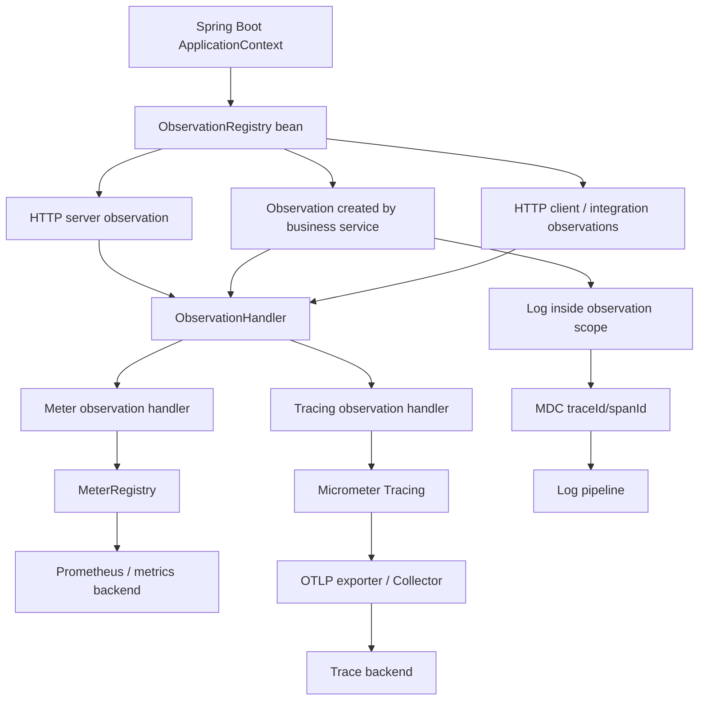

# Registering ObservationRegistry in Spring Boot

> **Chapter:** Registry Configuration  
> **Module:** `SPRING_BOOT_OBSERVABILITY` — Setting up observability for Spring Boot with Micrometer Observation, metrics, logs, and distributed tracing. This lesson explains how to introduce `ObservationRegistry` into a Spring Boot application, use the instance configured by Spring, register extension components, and verify the path from an observation to monitoring signals.

## Learning Objectives

After this lesson, you will be able to:

1. Explain what `ObservationRegistry` is, how it differs from `Observation` and `MeterRegistry`, and why an application needs a unified registry.
2. Know when Spring Boot creates `ObservationRegistry` automatically, when a manual `@Bean` declaration is needed, and why you should not create a new registry in every service.
3. Constructor-inject the registry into a service, open an observation around business logic, and understand the order of start, scope, error, and stop.
4. Use `ObservationRegistryCustomizer` to register an `ObservationPredicate`, `ObservationFilter`, or `ObservationHandler` while still leveraging Spring Boot's configuration.
5. Verify metrics, traces, and log correlation; recognize issues such as missing dependencies, lost context, disconnected registries, high-cardinality tags, or inactive exporters.

## 1. Where Does ObservationRegistry Fit in the Observability Architecture?

`ObservationRegistry` is Micrometer's **registration and configuration point for Observations**. It holds the components that decide which observations are processed, how they are processed, and which handlers receive lifecycle callbacks. It is neither the storage for full trace records nor directly the metrics database.

A Spring Boot application can share this single registry across automatic framework observations and custom business observations:



Components with similar names have distinct responsibilities:

| Component | Role | What does it create or manage? |
|---|---|---|
| `ObservationRegistry` | Holds observation lifecycle configuration, predicates, filters, handlers, and current observation | Coordinates *how an Observation is observed* |
| `Observation` | Represents an operation with a name, key-values, error, and lifecycle | A specific activity such as `inventory.reserve` |
| `ObservationHandler` | Receives `onStart`, `onError`, `onStop`, and scope callbacks | Connects an observation to recording or tracing behavior |
| `MeterRegistry` | Where meters/timers/counters are registered and collected | Metrics and tags; can export to Prometheus or other backends |
| `Tracer`/tracing bridge | Creates and links spans, provides trace/span context | Distributed traces and propagation |
| Logback/SLF4J | Writes application events; uses MDC when correlation context is present | Logs, usually sent via stdout and a log agent |

**One registry, many observations:** for a typical Spring Boot application, `ObservationRegistry` is injected as a shared bean. Each request/operation has its own `Observation`. Do not create a registry per request because handlers, filters, and telemetry bridges may not be applied consistently.

### 1.1. Why Does "Registration" Matter?

Consider a checkout application with an HTTP request, a call to inventory, and a `checkout.validate` step instrumented by the team. If all of them use the same configured registry:

- The handler that creates timers for custom observations can record processing duration.
- The tracing handler can create a span and link it to the current HTTP server span.
- When opening an observation scope, logs can receive the trace ID/span ID if tracing and logging are configured.
- Shared predicates and filters can exclude unnecessary observations or enrich tags according to approved rules.

If you create an independent `ObservationRegistry.create()` inside a service, custom observations may bypass the handlers that Spring Boot attached to the application's registry. The business logic still runs, but expected timers or spans may not appear.

## 2. When Does Spring Boot Register ObservationRegistry Automatically?

In **Spring Boot 3.x** with Actuator observability auto-configuration enabled, the framework typically declares `ObservationRegistry` as a bean automatically and wires the appropriate components based on dependencies on the classpath. This is the default approach.

For a Maven project already using the Spring Boot parent/BOM, the foundational dependency is:

```xml
<dependency>
    <groupId>org.springframework.boot</groupId>
    <artifactId>spring-boot-starter-actuator</artifactId>
</dependency>
```

The corresponding Gradle dependency:

```groovy
implementation 'org.springframework.boot:spring-boot-starter-actuator'
```

Spring Boot manages compatible Micrometer versions. Avoid forcing a Micrometer version outside the BOM without a clear reason and compatibility testing plan.

**Typical path during application startup:**

1. Spring Boot reads dependencies, auto-configurations, and application properties.
2. If auto-configuration conditions are met, Boot provides the `ObservationRegistry` bean.
3. Boot applies the appropriate customizers, conventions, predicates, filters, and handlers based on configuration and present integrations.
4. Business beans inject `ObservationRegistry` via constructor.
5. Instrumented HTTP/WebClient and other integrations can use the configured observation registry.

Specific conditions and details vary across Spring Boot versions and dependencies. Therefore, when bringing code into a project using a specific minor version, check the documentation for that exact version; do not assume every behavior of Spring Boot 3.x is identical down to every property.

### 2.1. Actuator, Prometheus, and Tracing Are Three Separate Concerns

Having `ObservationRegistry` does not mean all signals are exported. To use Prometheus with Actuator:

```xml
<dependency>
    <groupId>io.micrometer</groupId>
    <artifactId>micrometer-registry-prometheus</artifactId>
</dependency>
```

To connect observations to OpenTelemetry tracing in a common Spring Boot 3.x setup:

```xml
<dependency>
    <groupId>io.micrometer</groupId>
    <artifactId>micrometer-tracing-bridge-otel</artifactId>
</dependency>
<dependency>
    <groupId>io.opentelemetry</groupId>
    <artifactId>opentelemetry-exporter-otlp</artifactId>
</dependency>
```

Four concepts need to be kept distinct:

- **Registry registration:** having a single `ObservationRegistry` shared by services and integrations.
- **Meter handler and MeterRegistry:** turning observation events into queryable metrics.
- **Tracing bridge and exporter:** creating/finishing spans and shipping traces to a Collector/backend according to sampling.
- **Log pipeline:** collecting logs and preserving correlation fields (trace ID/span ID).

Without the Prometheus registry, `/actuator/prometheus` may not exist even though `ObservationRegistry` is injected normally. Without a tracing bridge or exporter, `Observation` logic still executes, but traces may not reach the backend.

## 3. Injecting ObservationRegistry via Constructor

This is the recommended way to register and use it with Spring Boot auto-configuration:

```java
package com.example.checkout;

import io.micrometer.observation.Observation;
import io.micrometer.observation.ObservationRegistry;
import org.springframework.stereotype.Service;

@Service
public class InventoryService {

    private final ObservationRegistry observationRegistry;

    public InventoryService(ObservationRegistry observationRegistry) {
        this.observationRegistry = observationRegistry;
    }

    public String reserve(String sku) {
        return Observation.createNotStarted(
                    "inventory.reserve", observationRegistry)
                .contextualName("reserve inventory")
                .lowCardinalityKeyValue("operation", "reserve")
                .observe(() -> {
                    if (sku == null || sku.isBlank()) {
                        throw new IllegalArgumentException("SKU is required");
                    }

                    // Placeholder for calling a database or inventory service.
                    return "RESERVED";
                });
    }
}
```

Key takeaways:

- `ObservationRegistry` is a service dependency; it is injected by Spring and can be shared across many requests.
- `Observation.createNotStarted(...)` creates **a new observation** for each call to `reserve`, bound to the same registry.
- `observe(...)` handles start, opening the scope, running the callback, handling any thrown exception, closing the scope, and stopping for a **synchronous** block of work.
- `inventory.reserve` is a stable operation name; `operation=reserve` is a tag with a bounded set of values.
- `contextualName` can help provide a human-readable span name when supported by the tracing handler.
- The `sku` value does not appear as a tag; SKU can take many distinct values and is unsuitable as a metric label.

**Design mistake to avoid:**

```java
// Do not use inside a Spring-managed service:
public InventoryService() {
    this.observationRegistry = ObservationRegistry.create();
}
```

This creates an isolated registry and does not guarantee the use of handlers configured by Spring Boot. With dependency injection, the constructor receives the official bean from the application context.

### 3.1. Minimal Controller for Testing

```java
package com.example.checkout;

import org.springframework.web.bind.annotation.GetMapping;
import org.springframework.web.bind.annotation.PathVariable;
import org.springframework.web.bind.annotation.RequestMapping;
import org.springframework.web.bind.annotation.RestController;

@RestController
@RequestMapping("/demo/inventory")
public class InventoryController {

    private final InventoryService inventoryService;

    public InventoryController(InventoryService inventoryService) {
        this.inventoryService = inventoryService;
    }

    @GetMapping("/{sku}")
    public String reserve(@PathVariable String sku) {
        return inventoryService.reserve(sku);
    }
}
```

Sending a request to `GET /demo/inventory/sku-001` goes through HTTP server instrumentation (if enabled) and the custom `inventory.reserve` observation. When tracing is active, the handler can link the business span to the HTTP request span through the current context.

### 3.2. Scope and Lifecycle When Not Using observe(...)

If you need manual control over when it starts and stops:

```java
Observation observation = Observation
        .createNotStarted("checkout.validate", observationRegistry)
        .start();

try (Observation.Scope scope = observation.openScope()) {
    validateCheckout();
} catch (RuntimeException exception) {
    observation.error(exception);
    throw exception;
} finally {
    observation.stop();
}
```

`validateCheckout()` is an illustrative business method. `openScope()` makes the observation the current observation during execution; `Scope.close()` restores the previous context; `stop()` ends the measurement and triggers completion callbacks on handlers. If an exception occurs, `error(...)` records the error; it does not stop the observation on its own.

This structure highlights two distinctions:

- **The registry** lives for the lifetime of the application.
- **The observation and scope** live for the duration of a single activity.

Do not store a mutable observation in a singleton service field to reuse across requests. Each operation needs its own observation instance.

## 4. Configuring the Registry with Properties Before Writing Code

Simple changes should use Spring Boot configuration if supported by your version. For example, `application.yml`:

```yaml
spring:
  application:
    name: checkout-service

management:
  endpoints:
    web:
      exposure:
        include: health,metrics,prometheus
  observations:
    key-values:
      application: ${spring.application.name}
      deployment.environment: ${APP_ENVIRONMENT:local}
  tracing:
    sampling:
      probability: 0.10
  otlp:
    tracing:
      endpoint: ${OTLP_TRACES_ENDPOINT:http://localhost:4318/v1/traces}
```

Purpose of each property group:

| Group | Effect |
|---|---|
| `management.endpoints.web.exposure.include` | Selects Actuator endpoints exposed over web; only applies to endpoints that are present |
| `management.observations.key-values` | Adds common key-values to observations according to the corresponding Spring Boot version's mechanism |
| `management.tracing.sampling.probability` | Head-sampling probability for traces, **not** a metric sampling rate |
| `management.otlp.tracing.endpoint` | Target endpoint for the OTLP HTTP span exporter; requires the matching dependency and receiver |

This is a reference configuration for Spring Boot 3.x. `/actuator/prometheus` only exists when the Prometheus registry is enabled. For Spring Boot 4 or minor versions with changes, verify property/dependency names before applying as-is.

In production, use an internal Collector endpoint, enforce access controls, secure the transport, and do not rely on the `localhost` default. `APP_ENVIRONMENT` must have a small, consistently managed set of values such as `dev`, `staging`, `prod`; never put request IDs or user IDs into common tags.

### 4.1. Distinguishing Common Observation Key-Values and Metric Tags

A common key-value may be recorded by handlers into metrics, traces, or both depending on the integration. When you only need metric tags, `MeterRegistry` also has its own common tags mechanism; **do not assume the two configuration mechanisms are synonymous or automatically synchronized**.

In dashboards, an environment label helps distinguish where signals originate. However, if a label is already added by the Collector, Prometheus relabeling, or platform metadata, check for duplicate or inconsistent labels before adding it again in the application.

## 5. Customizing ObservationRegistry with ObservationRegistryCustomizer

When logic goes beyond properties, Spring Boot provides the `ObservationRegistryCustomizer` extension point. The goal is to **customize the registry bean managed by Boot**, rather than creating another standalone instance.

Example adding an observation filter for an environment label with a configured value:

```java
package com.example.checkout;

import io.micrometer.common.KeyValue;
import io.micrometer.observation.ObservationRegistry;
import org.springframework.beans.factory.annotation.Value;
import org.springframework.boot.actuate.autoconfigure.observation.ObservationRegistryCustomizer;
import org.springframework.context.annotation.Bean;
import org.springframework.context.annotation.Configuration;

@Configuration(proxyBeanMethods = false)
public class ObservabilityConfiguration {

    @Bean
    ObservationRegistryCustomizer<ObservationRegistry> environmentTagCustomizer(
            @Value("${app.observability.environment:local}") String environment) {

        return registry -> registry.observationConfig()
                .observationFilter(context -> {
                    context.addLowCardinalityKeyValue(
                            KeyValue.of("deployment.environment", environment));
                    return context;
                });
    }
}
```

Accompanying configuration:

```yaml
app:
  observability:
    environment: prod
```

The snippet above attaches a fixed low-cardinality label to observations processed through that registry. In practice, you usually only need **one** global configuration method for the same label: if you already use `management.observations.key-values.deployment.environment`, there is no need to add an identical filter.

**Note on timing:** `ObservationFilter` transforms the context when the observation is completing, so it should not be treated as a way to inject an attribute into propagation at the moment a scope is opened. If information must be available early to decide parent/child relationships, baggage, or logic in `onStart`, choose a more suitable mechanism.

### 5.1. ObservationPredicate: Skipping Unnecessary Observations

You can exclude a group of internal observations, such as very frequent debug operations:

```java
@Bean
ObservationRegistryCustomizer<ObservationRegistry> predicateCustomizer() {
    return registry -> registry.observationConfig()
            .observationPredicate((name, context) ->
                    !name.startsWith("internal.debug."));
}
```

`ObservationPredicate` decides whether a proposed operation should be observed. Only drop observations after evaluating the impact; if you exclude all HTTP server observations, critical metrics and traces can disappear. To control volume, in many cases it is better to adjust trace sampling or specific histograms/labels instead of turning off all telemetry for an operation.

**Be careful with names:** predicates operate on the actual observation name. Determine the operation name produced after instrumentation before writing rules. Do not assume the route path, contextual name, and observation name are always the same.

### 5.2. ObservationHandler: Reacting to Lifecycle Events

A handler can receive callbacks such as `onStart`, `onScopeOpened`, `onError`, `onScopeClosed`, and `onStop`. Example of a diagnostic handler counting completions of a specific observation:

```java
package com.example.checkout;

import io.micrometer.observation.Observation;
import io.micrometer.observation.ObservationHandler;
import java.util.concurrent.atomic.AtomicLong;

public final class CheckoutDiagnosticHandler
        implements ObservationHandler<Observation.Context> {

    private final AtomicLong completions = new AtomicLong();

    @Override
    public boolean supportsContext(Observation.Context context) {
        return "checkout.validate".equals(context.getName());
    }

    @Override
    public void onStop(Observation.Context context) {
        completions.incrementAndGet();
    }

    public long getCompletions() {
        return completions.get();
    }
}
```

Register the handler **once** on the active registry:

```java
@Bean
CheckoutDiagnosticHandler checkoutDiagnosticHandler() {
    return new CheckoutDiagnosticHandler();
}

@Bean
ObservationRegistryCustomizer<ObservationRegistry> diagnosticHandlerCustomizer(
        CheckoutDiagnosticHandler handler) {
    return registry -> registry.observationConfig()
            .observationHandler(handler);
}
```

Place both `@Bean` methods in a `@Configuration` class with the appropriate imports. The handler above demonstrates the callback mechanism; it **does not replace** the metrics/tracing handlers integrated by Spring Boot and is not the recommended way to count metrics in production. If you need a count, prefer an existing meter; a custom handler should only address specific needs not covered by default integrations.

To avoid duplicate recording, **do not register the same handler through multiple mechanisms simultaneously** (e.g., letting auto-discovery register it while also adding it manually via a customizer). How `ObservationHandler` beans are collected and ordered can vary across Boot versions; inspect the actual configuration when adding complex handlers, especially tracing-related ones.

## 6. When Should You Declare @Bean ObservationRegistry Manually?

In a Spring Boot application using Actuator, the usual answer is **you should not**. However, there are special situations: integrating Micrometer without Actuator auto-configuration, pure Java test environments, or a configuration intentionally replacing default behavior.

Example of manual bean registration:

```java
package com.example.checkout;

import io.micrometer.observation.ObservationRegistry;
import org.springframework.context.annotation.Bean;
import org.springframework.context.annotation.Configuration;

@Configuration(proxyBeanMethods = false)
public class ManualObservationRegistryConfiguration {

    @Bean
    ObservationRegistry observationRegistry() {
        return ObservationRegistry.create();
    }
}
```

**This is an intentional choice**, not something to add to a project just to inject a registry. Depending on auto-configuration, a bean you define may cause Boot's default registry configuration to back off; you must verify whether the desired filters, handlers, conventions, and instrumentations are actually attached to that registry.

Two common pitfalls:

1. You create a manual bean but forget to configure tracing/meter handlers, so custom observations run without producing the expected spans or timers.
2. Multiple beans of type `ObservationRegistry` exist in the Spring context, causing ambiguous constructor injection or causing an integration to use a different instance from the business service.

If you truly need multiple separate registries, clearly design the purpose and wiring of each instance, use `@Qualifier` where needed, and test end-to-end. The default model of one shared registry is far simpler for web applications.

### 6.1. Without a Spring Container

In unit tests or plain Java applications, you can create a standalone registry:

```java
ObservationRegistry registry = ObservationRegistry.create();

String value = Observation
        .createNotStarted("demo.operation", registry)
        .observe(() -> "done");
```

At this point **there are no handlers** unless you configure handlers on the registry. The callback still runs and returns `done`; do not treat successful method execution as proof that metrics/traces were exported.

A no-op registry can also be used intentionally when you do not want to record data; distinguish an intentional no-op state from a misconfigured pipeline. Do not "fix" missing telemetry symptoms by creating a new registry without verifying which bean is in use.

## 7. How the Registry Affects Tracing, Propagation, and Logs

A single observation like `inventory.reserve` can appear in a distributed trace when a tracing handler is attached and the trace is sampled. To establish parent–child relationships and propagate context:

1. The HTTP server request is instrumented and establishes the observation/tracing context.
2. The business service creates a new observation using the **same ObservationRegistry**.
3. `observe(...)` or `openScope()` opens the current context for the execution block.
4. An instrumented HTTP client can inject the trace context into outbound headers (typically W3C `traceparent`).
5. The downstream server extracts the context and links subsequent spans to the same trace.

### 7.1. Current Observation and Scope

Inside code executing within an observation scope, you can ask the registry which observation is currently active:

```java
Observation current = observationRegistry.getCurrentObservation();

if (current != null) {
    // Running inside an accessible observation scope.
}
```

The result depends on the current thread's context. If you create an observation and only call `start()` without opening a scope, do not assume the registry will return the newly created observation.

A scope is not a distributed session or a mechanism that automatically propagates across all threads. With `@Async`, custom executors, `CompletableFuture`, Reactor, or messaging, appropriate context propagation is required for your framework and version. Do not pass an `Observation.Scope` object to another thread and close it arbitrarily; manage scopes where the operation actually executes.

### 7.2. Logs Having Trace IDs Is Different from "The Registry Exporting Logs"

When Micrometer Tracing is configured, a log pattern or structured log schema can read `traceId`/`spanId` from MDC inside the scope. Example of a correlated log line:

```text
INFO [checkout-service,4bf92f3577b34da6a3ce929d0e0e4736,00f067aa0ba902b7] Inventory reserved
```

However, `ObservationRegistry` does not send logs to a log backend itself. The application needs logging configuration, a stdout/file collection path, and a backend receiving logs. Never use a trace ID as a low-cardinality metric tag: it has too many distinct values and will cause the number of time series to explode.

### 7.3. Sampling Is a Tracing Pipeline Decision

With `management.tracing.sampling.probability=0.10`, only a fraction of traces are typically selected under a head-sampling policy. Metrics can still record the full count of completed observations through the meter handler; trace count in the backend is not request count.

If you see the `inventory.reserve` metric incrementing in count but cannot find a corresponding span, check sampling, the bridge, exporter, Collector, and retention. Do not immediately conclude that the service is using the wrong registry.

## 8. Cardinality and Tag Policy When Configuring the Registry

The registry is where global rules can affect a large number of observations. A small mistake in a common filter or common key-values can multiply time series across the entire service.

| Value | Should be a low-cardinality tag? | Explanation |
|---|---|---|
| `deployment.environment=prod` | Yes | Small, controlled set of environments |
| `service=checkout-service` | Yes | Number of services is bounded by the organization |
| `operation=reserve` | Yes | Values belong to a small enum/set |
| `http.route=/orders/{id}` | Yes, when it is a route template | Groups many concrete URLs under one route |
| `user.id=123456` | No | Values can differ per user; also poses data risk |
| `order.id=...` | No | Nearly unique per request |
| `http.url=/orders/123456?token=...` | No | High cardinality and may contain secrets |
| `trace.id=...` | No | Trace IDs belong in trace/log correlation, not as metric labels |

For example, a timer with 6 `operation` values × 4 `environment` values × 8 instances = up to 192 label combinations before considering other dimensions. If a global filter adds `user.id` with 100,000 values, the number of combinations can explode. These numbers are illustrative; what must be controlled is the actual value set of each dimension.

Consider adding high-cardinality attributes to traces only for specific investigation goals and where permitted by data policy. Never write tokens, passwords, card details, personal information, or full request bodies into tags, baggage, or logs.

## 9. Verifying Registry Registration in a Real Application

### 9.1. Checking That the Bean Exists in the Spring Context

A simple integration test verifies that Spring initializes the registry:

```java
package com.example.checkout;

import io.micrometer.observation.ObservationRegistry;
import org.junit.jupiter.api.Test;
import org.springframework.beans.factory.annotation.Autowired;
import org.springframework.boot.test.context.SpringBootTest;

import static org.junit.jupiter.api.Assertions.assertNotNull;

@SpringBootTest
class ObservationRegistryWiringTest {

    @Autowired
    private ObservationRegistry observationRegistry;

    @Test
    void registryIsInjected() {
        assertNotNull(observationRegistry);
    }
}
```

This test verifies **dependency injection**, not that a backend has received metrics/traces. In some Spring Boot test setups, observability is limited or disabled by default; testing actual exporters and integrations requires test observability configuration appropriate for your version. No real network backend is needed in a pure wiring test.

### 9.2. Testing Lifecycle with a Standalone Registry

To test the `onStop` callback without depending on a backend:

```java
import io.micrometer.observation.Observation;
import io.micrometer.observation.ObservationHandler;
import io.micrometer.observation.ObservationRegistry;
import java.util.concurrent.atomic.AtomicInteger;
import org.junit.jupiter.api.Test;

import static org.junit.jupiter.api.Assertions.assertEquals;

class ObservationLifecycleTest {

    @Test
    void invokesHandlerOnStop() {
        ObservationRegistry registry = ObservationRegistry.create();
        AtomicInteger completions = new AtomicInteger();

        registry.observationConfig().observationHandler(
                new ObservationHandler<Observation.Context>() {
                    @Override
                    public boolean supportsContext(Observation.Context context) {
                        return "checkout.validate".equals(context.getName());
                    }

                    @Override
                    public void onStop(Observation.Context context) {
                        completions.incrementAndGet();
                    }
                });

        Observation.createNotStarted("checkout.validate", registry)
                .observe(() -> "ok");

        assertEquals(1, completions.get());
    }
}
```

This is a meaningful test for handler lifecycle behavior. It intentionally creates a standalone registry **inside a unit test** to avoid depending on Spring Boot configuration. If you want to verify the real bean/configuration, use a separate integration test with an application context.

### 9.3. Checking Metrics with Actuator

Assuming the Prometheus registry has been added and endpoints are exposed as shown earlier, after starting the application on `localhost:8080`:

```bash
curl -i http://localhost:8080/actuator/health
curl -s http://localhost:8080/actuator/metrics
curl -s http://localhost:8080/demo/inventory/sku-001
curl -s http://localhost:8080/actuator/metrics/inventory.reserve
curl -s http://localhost:8080/actuator/prometheus
```

First check whether `/actuator/metrics` lists the meter; custom meters only appear after the operation has run and a metric-supporting handler is present. The Prometheus output format for a timer typically has series like:

```text
inventory_reserve_seconds_count{operation="reserve",...} 1
inventory_reserve_seconds_sum{operation="reserve",...} 0.012
```

This is an **illustrative series shape**, not guaranteed application output; names, units, tags, and values depend on the registry/version/configuration. Always inspect the actual output before writing PromQL. If you want p95 from a histogram, configure the corresponding histogram and ensure buckets are exported; registering the registry does not automatically enable histograms for every timer.

### 9.4. Checking Traces and Logs

If using the OpenTelemetry bridge, OTLP exporter, and Collector/backend:

1. Temporarily set sampling to `1.0` in a low-traffic local environment.
2. Send an HTTP request that invokes `InventoryService.reserve(...)`.
3. Search for the trace by service and time range in the backend. Check for the parent HTTP span and child inventory span if full instrumentation is in place.
4. Verify that logs inside the scope contain the trace ID/span ID and that the log backend supports searching by those fields.
5. Exercise the error branch and verify that the observation stops and records the error according to the operation's semantics.

Before going to production, lower sampling according to budget, restrict Actuator endpoints, verify OTLP transport, protect data, and control cardinality. Sampling rates govern traces; do not reduce metric accuracy in the same way.

## 10. Troubleshooting When the Registry Is Registered but Telemetry Is Missing

| Symptom | Common Cause | How to Check |
|---|---|---|
| Spring reports no `ObservationRegistry` bean | Missing Actuator/auto-configuration, unsatisfied condition, or overly narrow test context | Check dependencies, Boot version, initialized context |
| Spring reports multiple `ObservationRegistry` beans | Multiple registries created manually or imported from extra config | Check bean definitions, remove extra registries or specify an intentional qualifier |
| Service runs but custom metric does not appear | Observation uses a manually created registry, missing meter handler, operation not invoked, or excluded by predicate | Verify Boot bean injection, handlers, operation name, and stop callback |
| HTTP metrics exist but custom metric does not | Method never actually runs through `observe` or `stop`; handler does not support context | Hit the exact code path, inspect `/actuator/metrics`, check lifecycle |
| No `/actuator/prometheus` | Missing `micrometer-registry-prometheus`, endpoint not exposed, or request blocked | Check dependencies, exposure, security, and management port |
| Metrics exist, no traces | Missing tracing bridge/exporter, low sampling, wrong OTLP protocol/endpoint, or Collector error | Check sampling, dependencies, receiver, service identity, and search window |
| Trace is not linked to parent request | Missing scope or context propagation across HTTP/async | Check current observation, client builder, W3C headers, executor |
| Logs have no trace ID | Tracing/MDC or logging pattern/structured schema not configured | Check log format, scope, and MDC context |
| Tags do not appear | Wrong key-value names, filter/predicate did not run, or handler/exporter uses different metadata | Check which registry is used, callbacks, actual metric/span names |
| Sudden spike in number of series | Common tag contains dynamic ID, raw URL, or too many dimensions | Audit config/filters, reduce cardinality, normalize route templates |
| Exporting telemetry increases latency | Heavy synchronous handler, excessive logging, or congested exporter/Collector | Measure handler overhead, batching/queues, and export errors |

**A sensible investigation workflow:**

1. **Registry:** Did Spring create the right bean, and is the service injecting that same instance?
2. **Lifecycle:** Does the code path run the observation and finish with `stop` or `observe`?
3. **Handlers:** Are meter/tracing handlers attached? Is a predicate filtering out the observation?
4. **Export:** Are MeterRegistry, Prometheus scrape, tracing exporter, and Collector working?
5. **Correlation:** Are scope, async propagation, trace ID/span ID, and log ingestion consistent?

This layered approach separates application wiring errors from external pipeline issues. Do not tweak sampling or dashboards when the real cause is that a service created its own isolated registry.

## 11. Production Design Decisions

When registering `ObservationRegistry` for an application handling real traffic, follow a few principles:

- **Single source of configuration:** let framework instrumentation and business instrumentation share the appropriate registry.
- **Dependency management:** use Spring Boot's BOM to keep Micrometer Observation, Micrometer Tracing, registry exporters, and instrumentations compatible.
- **Stable operation names:** do not insert request IDs, dynamic SKUs, or user IDs into observation names or low-cardinality tags.
- **Scoped customizations:** shared predicates/filters/handlers can affect all observations; roll out with clear rules and observe overhead after changes.
- **Separation of responsibilities:** the registry does not replace the metrics backend, trace exporter, collector, or logging pipeline.
- **Propagate context:** use instrumented HTTP clients/executors and verify linked traces across services.
- **Security:** keep secrets out of attributes, logs, and baggage; restrict access to Actuator and backends.
- **Reliability:** telemetry pipelines need timeouts, bounded retries/queues, and dropped-data monitoring; export failures should not take down API serving.
- **Verifiable changes:** before/after deployment, verify meter counts, span correlation, and that metrics/traces/logs continue producing data.

In a system with multiple Spring modules or multiple `ApplicationContext`s, each context may configure beans differently. If multiple contexts are used, explicitly document which registry each integration uses; do not assume the entire JVM automatically shares one instance.

## 12. Comprehensive Practice Exercise

**Scenario:** the checkout service already has Actuator, but the team just wrote `inventory.reserve` and wants to see processing duration, errors, and traces continuing to the inventory service.

Follow these steps in order:

1. **Register:** verify `ObservationRegistry` is auto-configured by Spring Boot; constructor-inject it into `InventoryService`.
2. **Instrument:** wrap the synchronous business block with `createNotStarted(...).observe(...)`. If async is involved, tie the lifecycle to when processing actually completes.
3. **Customize:** add a low-cardinality environment label via property or `ObservationRegistryCustomizer`. Avoid adding the same key twice.
4. **Verify metrics:** call the API a few times, check `/actuator/metrics/inventory.reserve` or the Prometheus exporter to see the timer increase.
5. **Verify traces:** enable the tracing bridge, configure the exporter and a local receiver; check whether the business span appears in the trace alongside the HTTP server span.
6. **Verify logs:** write a log line inside the observation scope and match the trace ID/span ID against the backend.
7. **Diagnose:** intentionally try a version of the code using a separate `ObservationRegistry.create()` inside the service, observe the difference in handlers, then restore constructor injection using the standard bean.
8. **Prepare for production:** set controlled sampling, secure Actuator, manage exporter endpoints, and check cardinality cost.

**Self-check questions:**

- Why is `ObservationRegistry` a shared bean while `Observation` is created per operation?
- When is `@Bean ObservationRegistry` justified, and what needs to be checked after replacing auto-configuration?
- How do `ObservationRegistryCustomizer`, `ObservationFilter`, and `ObservationHandler` differ?
- Why might there be meter counts without spans in the trace backend?
- When is opening a scope necessary, and why does calling `start()` alone not guarantee trace context in logs?
- What problem does a common tag containing a user ID cause for metrics?

## Key Takeaways

Properly registering `ObservationRegistry` in Spring Boot usually means **adding Actuator, letting auto-configuration create the registry, and constructor-injecting that bean**. Each business unit creates its own observation and manages its lifecycle with `observe(...)` or `start/openScope/error/stop`. When global behavior adjustments are needed, use `ObservationRegistryCustomizer` with appropriate predicates/filters/handlers; only declare `@Bean ObservationRegistry` manually when there is a clear purpose and integrations have been verified. Metrics, logs, and distributed tracing only connect into a coherent error and latency investigation story when the registry, handlers, exporters, sampling, tags, and context propagation are all configured consistently.
