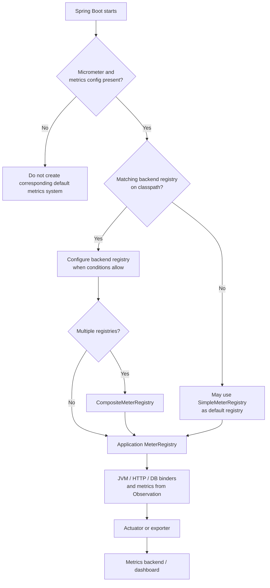
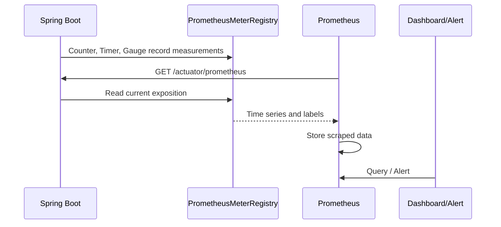
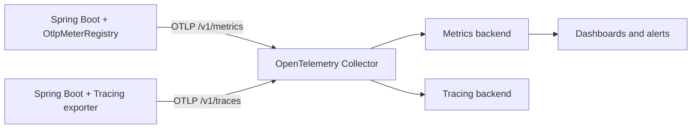

# Registry Auto-configuration in Spring Boot

In Spring Boot Observability, **registry auto-configuration** is the mechanism by which Spring Boot detects Micrometer libraries on the classpath, creates the appropriate `MeterRegistry` beans, and connects them to measurement components in the application. As a result, the application can collect HTTP metrics, JVM metrics, connection pool metrics, and business measurements without manually initializing a registry for each backend.

This lesson belongs to the **Registry Configuration** chapter of the **SPRING_BOOT_OBSERVABILITY** module. Its focus is understanding the conditions under which registries are automatically created, how to configure Prometheus and OTLP, how to customize meters/tags, how **Micrometer Observation** connects to metrics and traces, and how to troubleshoot when metrics do not appear on dashboards.

## 1. What Is a Registry and Where Does It Sit?

In Micrometer, **`MeterRegistry`** is where meters such as `Counter`, `Timer`, `Gauge`, and `DistributionSummary` are registered, store state, and export data. Business code records data through meters; the registry determines how that data is represented and forwarded to a backend.

For example, an ordering system wants to observe:

- Request rate, error count, and latency of `POST /orders`.
- Number of confirmed or rejected orders.
- Time spent checking inventory and authorizing payments.
- Pressure on JVM heap, threads, and database connection pools.
- The path of a slow request across multiple services.

The first four groups fit **metrics**; the last group fits **distributed tracing**. An activity can be recorded via **Observation** to contribute to both signals, but the registries and exporters for metrics and traces are not the same component.

| Component | Role | Example |
| --- | --- | --- |
| **`MeterRegistry`** | Manages meters and provides the metrics export mechanism | `PrometheusMeterRegistry`, `OtlpMeterRegistry` |
| **`CompositeMeterRegistry`** | Distributes recordings across multiple member registries | Sends metrics to Prometheus and OTLP |
| **`ObservationRegistry`** | Coordinates Observation lifecycle across handlers | Activity `inventory.reserve` |
| **Metrics ObservationHandler** | Converts Observations into measurement data | Timer for a business step |
| **Tracing ObservationHandler** | Converts Observations into spans and tracing context | Span `payment.authorize` |
| **Exporter/backend** | Receives, transports, stores, and queries data | Prometheus scrape, OTLP Collector |

**Keep the distinction clear:** `MeterRegistry` manages metrics, while `ObservationRegistry` manages Observations. Having a `MeterRegistry` does not mean tracing is enabled in the application. Having an `ObservationRegistry` also does not guarantee a span will appear in a tracing backend without a tracing handler, bridge, sampling, or exporter.

## 2. How Does Spring Boot Auto-Configure Registries?

Spring Boot performs auto-configuration based on **dependencies on the classpath**, **already-registered beans**, **properties**, and **activation conditions** for each configuration.



The diagram illustrates the principle, not the detailed initialization order of every bean or every Spring Boot version. Several important conditions apply:

1. **Required classes are present:** `spring-boot-starter-actuator` supports observability integration; specific registries like Prometheus require the `micrometer-registry-prometheus` library.
2. **Auto-configuration is allowed to run:** the application does not exclude the corresponding configuration via exclusions or other settings.
3. **Appropriate beans:** some configurations rely on conditions similar to `@ConditionalOnMissingBean`; a custom bean can cause the default configuration to back off. The exact outcome depends on each auto-configuration.
4. **Backend/exporter is enabled:** the `enabled` property and related conditions can disable a registry.
5. **Activity produces measurements:** the existence of a registry does not mean all meter names already exist. For example, an HTTP timer may appear only after a request finishes processing.

When debugging, distinguish three situations: **no registry bean**, **registry exists but no meter**, and **meter exists but is not exported to the backend**. Each situation has different root causes.

### 2.1. Common Registry Types

| Registry | Model | Use Case |
| --- | --- | --- |
| `SimpleMeterRegistry` | Stores measurements in-process without exporting to a dedicated production backend | Dev, unit tests, basic metrics setup |
| `PrometheusMeterRegistry` | Application exposes metrics for Prometheus to scrape (pull) | Infrastructure using Prometheus |
| `OtlpMeterRegistry` | Proactively sends metrics to an OTLP receiver (push) | OpenTelemetry Collector, observability platforms |
| `StatsdMeterRegistry` | Sends data via StatsD | Infrastructure with a StatsD agent |
| `CompositeMeterRegistry` | Combines multiple registries | Migration or simultaneous export to multiple targets |

Normally Spring Boot may configure **Simple** when no dedicated exporting registry is in use; when a backend registry is added, the bean structure can change. Do not write business services that depend directly on `SimpleMeterRegistry`, because production applications may use Prometheus, OTLP, or a composite.

### 2.2. Auto-Configuration Also Attaches Instrumentation

In addition to creating `MeterRegistry`, Spring Boot can wire:

- Meter binders for JVM memory, GC, CPU, process, and some built-in infrastructure components.
- HTTP server observations/metrics from instrumented web stacks.
- HTTP client observations when using clients configured by Spring Boot.
- Metrics for integrated components such as connection pools, caches, or messaging, when matching libraries and instrumentations are present.
- Custom observations for measuring business operations.
- Common tags, filters, conventions, and distribution settings.

**Do not assume every library automatically emits metrics.** For example, a manually instantiated HTTP client that bypasses instrumentation may not produce HTTP client meters. A custom-written DAO also does not automatically create a Timer for every SQL statement.

## 3. Baseline Configuration with Spring Boot 3.x

The examples use **Spring Boot 3.x** and Maven, with dependency versions managed by the Spring Boot BOM or parent. Other Spring Boot lines may use different starters/properties; verify against your project's version.

### 3.1. Enabling Actuator

```xml
<dependency>
    <groupId>org.springframework.boot</groupId>
    <artifactId>spring-boot-starter-actuator</artifactId>
</dependency>
```

In `application.yml`:

```yaml
spring:
  application:
    name: order-service

management:
  endpoints:
    web:
      exposure:
        include: health,info,metrics
  metrics:
    tags:
      application: order-service
      environment: development
```

Once the application is running:

```bash
curl -s http://localhost:8080/actuator/metrics
curl -s http://localhost:8080/actuator/metrics/jvm.memory.used
```

`/actuator/metrics` lists registered meter names; `/actuator/metrics/{name}` displays measurements and filterable tags. This endpoint **is not synonymous with a metrics backend**; it helps inspect application internals. Port, path, security, and access permissions may differ if the application customizes Actuator.

### 3.2. Common Tags

Tags like `application=order-service`, `environment=production`, or `region=apac` help group data when multiple instances send metrics together.

**Cardinality** is the number of distinct values for a tag. If you add `orderId`, `userId`, or raw URLs containing transaction IDs, the number of tag combinations can grow with real traffic and cause a time series explosion. The registry works correctly from a technical standpoint, but the backend can become overloaded, storage expensive, and queries slow.

Use values from small, bounded sets. When a route has an ID, prefer a route template like `/orders/{id}` instead of `/orders/123456` when supported by instrumentation.

## 4. Auto-Configuration of PrometheusMeterRegistry

To export metrics in Prometheus format, add the dependency:

```xml
<dependency>
    <groupId>io.micrometer</groupId>
    <artifactId>micrometer-registry-prometheus</artifactId>
</dependency>
```

With the right classpath and conditions, Spring Boot automatically configures the Prometheus registry. Allow access to the endpoint:

```yaml
management:
  endpoints:
    web:
      exposure:
        include: health,info,metrics,prometheus
  prometheus:
    metrics:
      export:
        enabled: true
```

Verify:

```bash
curl -s http://localhost:8080/actuator/prometheus
```

Illustrative example output:

```text
# HELP jvm_memory_used_bytes The amount of used memory
# TYPE jvm_memory_used_bytes gauge
jvm_memory_used_bytes{area="heap",id="G1 Eden Space"} 10485760.0
```

Specific pool names and figures depend on the JVM, framework, and sampling moment. `Timer` meters are usually renamed and suffixed according to Prometheus conventions; for example, an HTTP timer can generate series such as `http_server_requests_seconds_count` and `http_server_requests_seconds_sum`.

### 4.1. Scraping Does Not Happen Just Because the Endpoint Works



An endpoint returning data proves the registry has metrics to expose; **it does not prove Prometheus has scraped successfully**. Check scrape config, target health, DNS, network, port, access, and dashboard queries. In Kubernetes, you may also need `ServiceMonitor`/`PodMonitor` or scrape annotations depending on infrastructure.

If `/actuator/prometheus` is missing, check the dependency, endpoint exposure, and registry configuration; do not jump to assuming meters are missing.

## 5. Auto-Configuration of OtlpMeterRegistry

OTLP metrics follow the **push** model: the application periodically sends measurements to an OpenTelemetry Collector or compatible backend.

Dependency:

```xml
<dependency>
    <groupId>io.micrometer</groupId>
    <artifactId>micrometer-registry-otlp</artifactId>
</dependency>
```

Illustrative Spring Boot 3.x configuration:

```yaml
management:
  otlp:
    metrics:
      export:
        enabled: true
        url: http://localhost:4318/v1/metrics
        step: 30s
```

This address assumes an **OTLP/HTTP** receiver on port 4318; `step` specifies the registry's metric publishing interval. If the application and Collector run in separate containers, `localhost` inside the application **does not point to the Collector container**; replace it with a reachable DNS/service name.



Even when sharing the same Collector, **metrics and traces are two separate pipelines**:

| Signal | Application Component | Sample Address |
| --- | --- | --- |
| Metrics | `micrometer-registry-otlp` | `http://collector:4318/v1/metrics` |
| Traces | Micrometer Tracing bridge + corresponding exporter | `http://collector:4318/v1/traces` |
| Logs | Logging pipeline/agent or separate configuration | System-dependent |

In Spring Boot 3.x, the property commonly used for the tracing exporter is `management.otlp.tracing.endpoint`; the metrics property is `management.otlp.metrics.export.url`. Do not swap these two properties. Port 4317 is usually associated with OTLP/gRPC, while 4318 is usually used for OTLP/HTTP, though you must check the specific receiver.

Merely adding `micrometer-registry-otlp` does not configure distributed tracing, nor does it propagate `traceparent` over HTTP. Linking traces requires a tracing bridge, propagator, exporter, and appropriate instrumentations.

## 6. When Multiple Registries Are Present

An application can have both `micrometer-registry-prometheus` and `micrometer-registry-otlp` at the same time. Depending on Spring Boot configuration, active registries can be coordinated via **`CompositeMeterRegistry`**, allowing business code to record a meter once while multiple backends receive the data.

```text
Business service / Observation
             |
        MeterRegistry
             |
    CompositeMeterRegistry
        /          \
 Prometheus       OTLP
    |               |
/actuator/       Collector
prometheus           |
    |            Metrics backend
Prometheus
```

This is a conceptual model. Actual bean structure depends on version, auto-configuration, and custom beans. **Inject the `MeterRegistry` interface** rather than casting to `PrometheusMeterRegistry` if business logic does not specifically depend on Prometheus.

Having multiple exporters carries trade-offs:

- Measurement, export, and storage overhead increases with the number of destinations.
- Each backend may normalize names, units, histograms, and labels differently.
- Failure in one exporter does not necessarily affect the other; each export path must be checked independently.
- If multiple export paths lead to the same backend, there is a risk of recording duplicate time series.

Use a composite setup when multiple destinations are genuinely needed or during a migration phase. If only one canonical data source is needed, configuring a single backend registry is usually simpler.

## 7. Why Inject the Spring-Managed Registry?

An example you **should not** put in a production service:

```java
// This standalone registry sits outside Spring Boot configuration:
SimpleMeterRegistry isolated = new SimpleMeterRegistry();
isolated.counter("orders.accepted").increment();
```

The counter above may never reach the Prometheus or OTLP registry managed by Spring Boot. Use dependency injection:

```java
import io.micrometer.core.instrument.MeterRegistry;
import org.springframework.stereotype.Service;

@Service
public class OrderMetrics {

    private final MeterRegistry registry;

    public OrderMetrics(MeterRegistry registry) {
        this.registry = registry;
    }

    public void recordAccepted(String channel) {
        String group = "mobile".equals(channel) ? "mobile" : "web";

        registry.counter("orders.accepted",
                "channel", group).increment();
    }
}
```

Spring manages the lifecycle and shared configuration of the registry bean. In unit tests, you can supply a dedicated `SimpleMeterRegistry` to the object under test, but you should not create a local registry and treat it as a production metrics export path.

### 7.1. When a Custom Bean Changes Auto-Configuration

A `MeterRegistry` bean declared by the application can affect auto-configuration conditions. Some default configurations back off when a matching bean already exists, though the extent of replacement depends on each auto-configuration. Therefore, when you want to **customize the existing registry**, prefer `MeterRegistryCustomizer` or appropriate properties rather than declaring a new registry arbitrarily.

## 8. Customizing the Registry Created by Spring Boot

### 8.1. Common Tags via Properties

```yaml
management:
  metrics:
    tags:
      application: order-service
      environment: staging
```

This approach is convenient when consistent configuration via deployment config is needed. Do not put per-request data into common tags.

### 8.2. MeterRegistryCustomizer

When you want to configure the registry in code, Spring Boot 3.x supports `MeterRegistryCustomizer` beans:

```java
import io.micrometer.core.instrument.MeterRegistry;
import org.springframework.boot.actuate.autoconfigure.metrics.MeterRegistryCustomizer;
import org.springframework.context.annotation.Bean;
import org.springframework.context.annotation.Configuration;

@Configuration
public class MetricsConfig {

    @Bean
    MeterRegistryCustomizer<MeterRegistry> registryCustomization() {
        return registry -> registry.config()
                .commonTags("service_domain", "commerce");
    }
}
```

The customizer applies shared configuration to the Spring-managed registry. In this example, `service_domain` has low cardinality. Do not use both properties and a customizer to define the **same key** in conflicting ways.

### 8.3. MeterFilter

Use `MeterFilter` to deny meters, alter mappings, or apply policies to specific groups of meters:

```java
import io.micrometer.core.instrument.config.MeterFilter;
import org.springframework.context.annotation.Bean;
import org.springframework.context.annotation.Configuration;

@Configuration
public class MeterFilterConfig {

    @Bean
    MeterFilter dropLegacyMetrics() {
        return MeterFilter.denyNameStartsWith("legacy.");
    }
}
```

An overly broad filter can accidentally disable meters needed for dashboards and alerts. If you only want to turn off a group that already has property support, you can use configuration such as:

```yaml
management:
  metrics:
    enable:
      jvm: false
```

This example illustrates the mechanism; disabling JVM metrics in production means losing visibility into memory, GC, or runtime pressure.

### 8.4. Histograms and Percentiles

A `Timer` counts invocations and total duration; computing p95/p99 across **multiple instances** typically requires histogram buckets or a corresponding backend mechanism. Spring Boot 3.x can configure histograms/SLO buckets:

```yaml
management:
  metrics:
    distribution:
      percentiles-histogram:
        http.server.requests: true
      slo:
        http.server.requests: 100ms,300ms,1s
```

When histograms are enabled, Prometheus can aggregate buckets first and then apply `histogram_quantile`. Never average per-instance p95 values to infer system-wide p95.

**Histograms + many tags can multiply the number of series dramatically.** Enable them only on critical operations, consider bucket counts carefully, and limit labels. Check backend names/units before writing PromQL.

## 9. Metrics Registry and Micrometer Observation

When the same operation needs to serve both metrics and traces, using the **Observation API** keeps lifecycle management consistent.

```java
import io.micrometer.observation.Observation;
import io.micrometer.observation.ObservationRegistry;
import org.springframework.stereotype.Service;

@Service
public class PaymentService {
    private final ObservationRegistry observationRegistry;

    public PaymentService(ObservationRegistry observationRegistry) {
        this.observationRegistry = observationRegistry;
    }

    public void authorize(String method, Runnable action) {
        String group = "wallet".equals(method) ? "wallet" : "card";

        Observation.createNotStarted(
                    "payment.authorize", observationRegistry)
                .lowCardinalityKeyValue("payment.method", group)
                .observe(action);
    }
}
```

With Spring Boot having the matching handlers and registry:

1. **Metrics ObservationHandler** can create the `payment.authorize` Timer and record duration with the `payment.method` tag.
2. **Tracing ObservationHandler** can create a span belonging to the current trace when tracing is configured.
3. Metrics exporters (Prometheus/OTLP) send measurements to the metrics backend.
4. Tracing exporters ship sampled spans to the tracing backend.
5. Log correlation can use Trace ID/Span ID in MDC when the current tracing scope is properly maintained.

**An Observation is not an exporter.** Distinguish between an Observation being recorded, a metric being exported, a span being sampled, and a trace being displayed.

### 9.1. Low-Cardinality and High-Cardinality Values

In Micrometer Observation:

```java
Observation observation = Observation
        .createNotStarted("payment.authorize", observationRegistry)
        .lowCardinalityKeyValue("payment.method", "card")
        .lowCardinalityKeyValue("result", "approved");

observation.highCardinalityKeyValue("operation.reference", safeReference);
```

`safeReference` is only an illustrative variable for non-sensitive data permitted in tracing.

- Low-cardinality values are usually turned into tags by the metrics handler; restrict them to stable enums/value groups.
- High-cardinality values can become span attributes when an appropriate tracing handler is present; normally they do not become metric tags through standard handlers.
- High cardinality can still increase storage usage and pose data exposure risks.
- Never put emails, user IDs, access tokens, payment details, or raw payloads into metrics, spans, or baggage.

### 9.2. Registry Auto-Configuration Does Not Handle Propagation

When `order-service` calls `payment-service`, for both spans to share the same Trace ID, the HTTP client/server must inject and extract the tracing context (such as W3C `traceparent`):

```http
traceparent: 00-4bf92f3577b34da6a3ce929d0e0e4736-00f067aa0ba902b7-01
```

The metrics registry can work perfectly while traces still break if the client is uninstrumented, a proxy strips headers, or context is lost when switching threads/consuming messages. In Spring Boot, use framework-managed HTTP client builders and async/context propagation, then **verify via Trace ID and parent span relationships**.

### 9.3. Does Tracing Sampling Cause Missing Metrics?

Illustrative Spring Boot 3.x configuration:

```yaml
management:
  tracing:
    sampling:
      probability: 0.10
```

This is a sampling probability at the configured tracing sampler point; it does not promise exactly 10% in every window and can be influenced by upstream decisions.

Metrics typically still capture measurements for activities passing through the metrics handler, even when a request's trace is not sampled. Thus **an aggregated metric can represent more requests than the number of visible traces**. Tail sampling in the Collector also cannot recover spans already dropped at the source by head sampling.

| Scenario | Metrics | Traces |
| --- | --- | --- |
| Observation processed by metrics handler, trace sampled | Measurement recorded | Span can appear in backend if exporter works |
| Tracing does not sample request | Metrics can still be recorded | No corresponding trace exported |
| OTLP tracing exporter fails | Does not necessarily affect metrics | Traces may not appear |
| Metrics exporter fails | Meters may still exist in application | Tracing can continue working independently |

## 10. Inspecting Auto-Configuration Layer by Layer

An observability issue is usually much easier to pinpoint when inspected sequentially from the application to external systems.

### 10.1. Checking Beans and Conditions

Enable debug mode in development to read the **Conditions Evaluation Report**:

```bash
java -jar app.jar --debug
```

The report shows which auto-configurations matched or did not match and reasons such as missing classpath entries, existing beans, or property conditions. If security policies allow, Actuator exposes `/actuator/conditions` to inspect conditions. Do not leave this endpoint publicly open in production because it can expose configuration details.

You can temporarily log the registry bean type at startup:

```java
import io.micrometer.core.instrument.MeterRegistry;
import org.springframework.boot.ApplicationRunner;
import org.springframework.context.annotation.Bean;
import org.springframework.context.annotation.Configuration;

@Configuration
public class RegistryDiagnosticConfig {
    @Bean
    ApplicationRunner showRegistry(MeterRegistry registry) {
        return args -> System.out.println(
                "Registry implementation: " + registry.getClass().getName());
    }
}
```

This is a local diagnostic snippet and should be removed after verification. The printed bean class alone is not enough to conclude all exporters are sending data, especially when a composite registry is present.

### 10.2. Checking Whether Meters Are Recorded

```bash
curl -s http://localhost:8080/actuator/metrics
curl -s http://localhost:8080/actuator/metrics/http.server.requests
```

If a meter does not appear, send an HTTP request or run the operation that creates it, then check again. For manual Observations, confirm the lifecycle finishes via `observe(...)` or `stop()`. Check meter filters and whether an instrumentation is disabled.

**A 404 on Actuator** may be due to an unexposed endpoint, access policy, management port, or base path; do not automatically infer that the registry was not created.

### 10.3. Checking Export Paths

**Prometheus:** check `/actuator/prometheus` output from Prometheus's network, scrape target health, labels, and PromQL queries. Output at the application does not guarantee data has reached Prometheus.

**OTLP metrics:** check URL property, protocol, receiver, network, TLS, authentication, publish step, registry/Collector logs, and backend pipeline. Meters in `/actuator/metrics` can still exist even when export fails.

**Tracing:** check tracing bridge, sampling, propagation, exporter, Collector, and backend separately. Do not use a trace display failure to conclude that the metrics registry is broken.

### 10.4. Checking Operational Value

Evaluate names, units, tags, and cardinality; standardize conventions across instances. Verify dashboards have enough data to distinguish services, endpoints, outcomes, and time ranges. When p95 spikes, use traces to isolate slow spans and logs to verify timeouts, retries, or business errors.

## 11. Common Errors Table

| Symptom | Common Cause | How to Handle |
| --- | --- | --- |
| Cannot inject `MeterRegistry` | Missing Micrometer/Actuator integration, auto-config excluded | Check dependencies, conditions, Spring beans |
| Only Simple registry seen | No backend registry or disabled | Add right registry dependency, check config |
| `/actuator/metrics` returns 404 | Endpoint not exposed, different path/port/security | Check Actuator exposure and access permissions |
| `/actuator/prometheus` does not exist | Missing registry or endpoint not enabled | Check dependency and endpoint exposure |
| Prometheus endpoint has data, dashboard empty | Scrape target error, wrong query/labels | Check target status and PromQL |
| OTLP metrics do not reach backend | Wrong URL, receiver, protocol, TLS/auth, or network | Check Collector, app logs, and exporter config |
| Custom Counter missing in backend | Created standalone `SimpleMeterRegistry`, meter not recorded | Inject Spring bean and trigger test activity |
| Timer does not appear | Missing instrumentation or Observation not finished | Check handler, filter, `stop()` |
| Time series count explodes | High-cardinality tags, broad histograms | Use route templates, small value sets, optimize buckets |
| Metrics exist but no traces | Sampling, tracing handler, or exporter issue | Check tracing branch independently |
| Trace changes ID across services | Missing context propagation | Check HTTP headers and async context |
| Numbers differ between two backends | Different naming/step/scrape/tags | Align queries, same window and units |

## 12. End-to-End Practice Exercise

**Goal:** observe the **concrete effect of auto-configuration** when adding dependencies and properties.

1. **Run Spring Boot 3.x with Actuator.** Expose `metrics` and send a few HTTP requests. Verify `/actuator/metrics` contains JVM metrics and HTTP meters after requests complete.
2. **Add Prometheus registry.** Add `micrometer-registry-prometheus`, expose `prometheus`, and restart. Match a meter in `/actuator/metrics` with its corresponding series in `/actuator/prometheus`.
3. **Check common tags.** Add `application=order-service`. Observe this label appearing in exported metrics, and confirm it remains stable across requests.
4. **Try a business Counter.** Inject `MeterRegistry` and call `recordAccepted()` from the example. Observe `orders.accepted` increment after each operation.
5. **Try a business Observation.** Call `PaymentService.authorize()` several times; look for the `payment.authorize` Timer via Actuator. If it does not appear, inspect handlers and Observation lifecycle.
6. **Try OTLP metrics.** With a Collector supporting OTLP/HTTP, configure `OtlpMeterRegistry` and confirm the metrics backend receives data on the publish step.
7. **Add tracing.** With a bridge and tracing exporter configured, raise sampling to `1.0` **in the lab** and look up the `payment.authorize` span in the tracing backend. Cross-check against the Timer for the same operation.
8. **Create a controlled export failure.** Intentionally misconfigure the OTLP metrics URL in the lab only, verify meters remain inside the app while the backend stops receiving them. Restore the correct URL and confirm the exporter recovers.
9. **Test sampling.** Lower tracing sampling to `0.10`; send many requests and note that aggregated metrics continue increasing while visible traces decrease.
10. **Assess production readiness.** Review Actuator security, authentication/TLS, common tags, cardinality, histogram cost, scrape/push cadence, and retention policies.

### Verification Criteria

| Verification | Expected Result |
| --- | --- |
| Registry bean | Spring-managed `MeterRegistry` exists |
| Default instrumentation | JVM/process metrics and HTTP meters exist under matching traffic |
| Prometheus | Exposition endpoint outputs series with correct labels |
| OTLP | Collector receives metrics and backend can query them |
| Custom meter | Counter changes after business operation executes |
| Observation | Timer is recorded; span can be exported if full tracing is configured |
| Propagation | Cross-service spans share the same Trace ID and reasonable parent |
| Sampling | Lowering trace sampling does not disable metrics |
| Cardinality | No dynamic IDs or sensitive data in metric tags |
| Troubleshooting | Able to distinguish bean, meter, exporter, and backend errors |

## 13. Key Takeaways

Auto-configuration allows Spring Boot to assemble a metrics system from dependencies, bean conditions, and properties. **All business measurements should use the Spring-managed registry** so they benefit from shared configuration for tags, filters, distributions, and exporters.

When designing practical observability:

- **Choose the registry to match your backend:** Prometheus uses pull/scrape, OTLP uses push to a Collector; Simple suits dev/test.
- **Keep meter names and tags stable**, and never put request IDs, user IDs, or personal data into metric labels.
- **Use Observation for business operations needing both metrics and traces**, with separate handlers, tracing bridges, and exporters.
- **Do not confuse metrics export with trace propagation or sampling**; they are independent yet complementary mechanisms.
- **Diagnose in order:** bean/conditions → meter → Actuator/exporter → Collector/backend → dashboard.
- **Connect metrics, traces, and logs** to detect latency/error trends, find problematic spans, and verify root causes through logs.

Understanding registry auto-configuration explains why a metric appears, disappears, or fails to reach a backend after changing the classpath or configuration. This is the foundation for building reliable dashboards and alerts for Spring Boot applications in real production environments.
