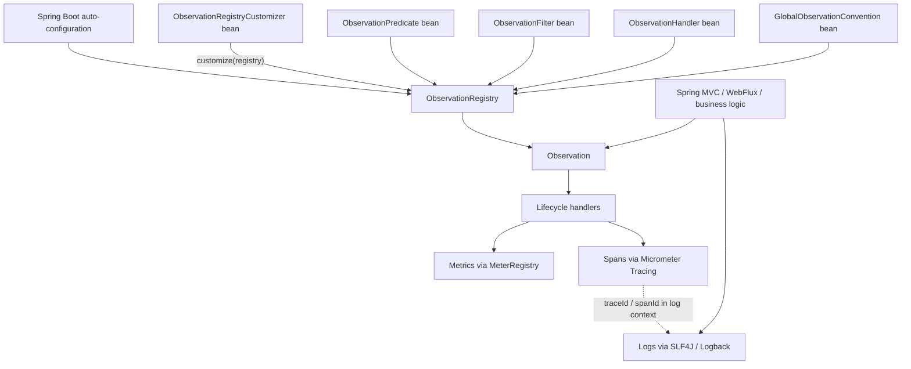

# ObservationRegistryCustomizer: Customizing ObservationRegistry in Spring Boot

## 1. Learning Objectives

In a Spring Boot system with observability, creating an `Observation` is only the first step. The application must also decide **which observations are collected**, **what metadata is added**, and **which handlers process the data**. Spring Boot provides the `ObservationRegistryCustomizer` extension point to configure the shared observation registry during application startup.

After this lesson, you will be able to:

1. Explain the role and lifecycle of `ObservationRegistryCustomizer` in Spring Boot.
2. Write an `@Bean ObservationRegistryCustomizer<ObservationRegistry>` to register an `ObservationPredicate`, `ObservationFilter`, or configure handlers when needed.
3. Choose appropriately among customizers, `ObservationPredicate`/`ObservationFilter`/`ObservationHandler` beans, and Spring Boot property configuration.
4. Distinguish between `ObservationRegistryCustomizer`, `ObservationRegistry`, and `MeterRegistryCustomizer`.
5. Verify configuration in a Spring Boot application, inspect metrics/traces/logs, and detect errors caused by filters, cardinality, duplicate instrumentation, or missing exporters.
6. Recognize the API package changes between Spring Boot 3.5.x and Spring Boot 4.x.

This lesson belongs to the **Registry Configuration** chapter of the **SPRING_BOOT_OBSERVABILITY** module. The knowledge applies to setting up Micrometer Observation, metrics, logs, and distributed tracing; propagation, tags/cardinality, exporters, sampling, and correlation are woven into registry configuration decisions so errors and latency can be investigated in real environments.

## 2. What Does ObservationRegistry Coordinate?

`io.micrometer.observation.ObservationRegistry` holds shared configuration for Micrometer Observation:

- **ObservationHandler**: receives events such as `onStart`, `onStop`, `onError`, `onEvent`, and scope events to convert an observation into metrics, spans, or extended behaviors.
- **ObservationPredicate**: decides whether to create a real observation or a no-op for a given name and context.
- **ObservationFilter**: can add or adjust `Observation.Context` before handlers receive `onStop`.
- **GlobalObservationConvention**: standardizes names and key-values for supported contexts.

When the application calls:

```java
Observation.createNotStarted("checkout.process", observationRegistry)
        .lowCardinalityKeyValue("channel", "web")
        .observe(this::chargePayment);
```

Micrometer relies on the registry to invoke handlers matching the context. If a meter handler and `MeterRegistry` are connected, the operation can generate a processing duration metric. If a tracing handler/tracer is present, it can generate a span. Logs still flow through the logging system; correlation via `traceId`/`spanId` depends on the tracing scope and log formatting.

`ObservationRegistry` **is not** `MeterRegistry`: the latter stores meters such as `Counter`, `Timer`, and `Gauge`. Nor is it an exporter or storage backend.

### Integration Points Diagram



The bean arrows represent ways to **register configuration** with the Spring Boot auto-configured registry. Not every application enables all metrics handlers, tracing, and exporters.

## 3. What Is `ObservationRegistryCustomizer`?

In **Spring Boot 3.5.x**, the interface resides in the package:

```java
org.springframework.boot.actuate.autoconfigure.observation.ObservationRegistryCustomizer
```

It is a functional interface:

```java
@FunctionalInterface
public interface ObservationRegistryCustomizer<T extends ObservationRegistry> {
    void customize(T registry);
}
```

How to read it:

| Element | Meaning |
| --- | --- |
| `T extends ObservationRegistry` | Registry type that the customizer can configure |
| `customize(T registry)` | Callback receiving the created registry to register additional components/configuration |
| Functional interface | Can be implemented with a lambda or method reference |
| Spring `@Bean` | Spring Boot detects the customizer and applies it to the observation registry managed by auto-configuration |

**Key takeaway:** An `ObservationRegistryCustomizer` normally runs **during the registry configuration phase**, not on every incoming HTTP request, every observation start/stop, or every span export. If you need per-observation processing, register a predicate/filter/handler via the registry or as a matching bean.

### Conceptual Sequence

```text
Spring Boot Startup
  ├─ Create/prepare Boot-managed ObservationRegistry
  ├─ Collect Predicate, Filter, Handler, Global Convention beans
  ├─ Collect and apply ObservationRegistryCustomizer
  └─ Registry ready for instrumentations

Runtime
  ├─ Code or framework creates Observation
  ├─ Predicate decides whether the observation is active
  ├─ Handlers receive start/scope/error/event callbacks
  └─ Filter → Handler.onStop, emit signals if handlers/exporters exist
```

This is a **conceptual** sequence. The exact internal ordering of configuration phases depends on the Spring Boot version; do not write customizers assuming a specific handler has or has not been registered at an exact moment. Customizer beans should be independent, single-purpose, and free of side effects outside registry configuration.

## 4. Getting Started with Spring Boot 3.5.x

The examples use **Spring Boot 3.5.x and Java 17+** in an MVC application. When using the Spring Boot parent/BOM to manage versions, at minimum you need Actuator and Web:

```xml
<dependencies>
    <dependency>
        <groupId>org.springframework.boot</groupId>
        <artifactId>spring-boot-starter-web</artifactId>
    </dependency>
    <dependency>
        <groupId>org.springframework.boot</groupId>
        <artifactId>spring-boot-starter-actuator</artifactId>
    </dependency>
    <!-- Only needed when exporting Prometheus metrics -->
    <dependency>
        <groupId>io.micrometer</groupId>
        <artifactId>micrometer-registry-prometheus</artifactId>
    </dependency>
</dependencies>
```

Actuator integrates Micrometer Observation and provides `ObservationRegistry` for injection. The Prometheus registry enables scrape-format metrics export; **to get traces**, you must also add a tracing bridge (such as Micrometer Tracing OTel), an exporter, and a corresponding collector/backend. Adding `ObservationRegistryCustomizer` alone is not enough to send traces.

In `application.yml`, when testing over HTTP in a test environment:

```yaml
spring:
  application:
    name: checkout-service

management:
  endpoints:
    web:
      exposure:
        include: health,info,metrics,prometheus
```

The `/actuator/prometheus` endpoint only exists when the Prometheus registry is on the classpath and exposed. Restrict access to Actuator in real environments; HTTP endpoints are not safe by default when exposed to the public Internet.

## 5. Basic Example: Dropping Noisy, Low-Value Observations

Suppose the system continuously executes an `internal.poll.heartbeat` operation to check internal state. This task runs very frequently, creating many observations without helping investigate checkout. We want to drop **observations with prefix `internal.poll.`** while keeping business operations running normally.

```java
package com.example.checkout.config;

import io.micrometer.observation.ObservationRegistry;
import org.springframework.boot.actuate.autoconfigure.observation.ObservationRegistryCustomizer;
import org.springframework.context.annotation.Bean;
import org.springframework.context.annotation.Configuration;

@Configuration(proxyBeanMethods = false)
public class ObservationConfiguration {

    @Bean
    ObservationRegistryCustomizer<ObservationRegistry> skipNoisyPolling() {
        return registry -> registry.observationConfig()
                .observationPredicate((name, context) ->
                        !name.startsWith("internal.poll."));
    }
}
```

Here:

1. `@Bean` returns a callback to Spring Boot.
2. When applied to the registry, the callback registers an `ObservationPredicate`.
3. When code creates an observation named like `internal.poll.heartbeat`, the predicate returns `false`, and Micrometer provides a no-op observation.
4. If the name is `checkout.process`, the predicate returns `true`, and the observation continues through the active handlers.

Suppose the service is:

```java
package com.example.checkout.service;

import io.micrometer.observation.Observation;
import io.micrometer.observation.ObservationRegistry;
import org.springframework.stereotype.Service;

@Service
public class PollingService {
    private final ObservationRegistry registry;

    public PollingService(ObservationRegistry registry) {
        this.registry = registry;
    }

    public void poll() {
        Observation.createNotStarted("internal.poll.heartbeat", registry)
                .observe(() -> refreshInternalState());
    }

    private void refreshInternalState() {
        // Logic to read internal state still runs.
    }
}
```

**Skipping an observation does not skip the business logic.** `refreshInternalState()` still executes. What is skipped is Micrometer Observation signal collection for that name; standalone logging or meters recorded directly via `MeterRegistry` do not disappear automatically.

To filter *by name* without writing Java, Spring Boot also supports properties such as:

```yaml
management:
  observations:
    enable:
      internal:
        poll: false
```

The configuration above demonstrates disabling the `internal.poll` prefix by naming convention; if filtering depends on context or dynamic conditions, use `ObservationPredicate`. In production configuration, verify exactly which prefixes will be affected so you do not accidentally hide important error signals.

## 6. Adding Metadata with `ObservationFilter` Inside a Customizer

Second requirement: all observations named `checkout.process` should carry a `component=checkout` label so dashboards can group by feature. We can register a filter from a customizer:

```java
package com.example.checkout.config;

import io.micrometer.common.KeyValue;
import io.micrometer.observation.ObservationRegistry;
import org.springframework.boot.actuate.autoconfigure.observation.ObservationRegistryCustomizer;
import org.springframework.context.annotation.Bean;
import org.springframework.context.annotation.Configuration;

@Configuration(proxyBeanMethods = false)
public class CheckoutTagConfiguration {

    @Bean
    ObservationRegistryCustomizer<ObservationRegistry> checkoutComponentTag() {
        return registry -> registry.observationConfig()
                .observationFilter(context -> {
                    if ("checkout.process".equals(context.getName())) {
                        context.addLowCardinalityKeyValue(
                                KeyValue.of("component", "checkout"));
                    }
                    return context;
                });
    }
}
```

`ObservationFilter` receives an `Observation.Context` and returns the updated context. Micrometer runs filters **before handlers' `onStop` callback**, so Timer metrics can usually see the added label. However, **handlers that act immediately in `onStart`** will not see late-added labels if they were not present from the beginning. For example, depending on configuration, a `LongTaskTimer` measuring in-flight tasks may require tags to be ready at `onStart`.

If you need an attribute as soon as a span opens or at start, attach it early at instrumentation time or use an appropriate convention. Do not rely on `ObservationFilter` to replace naming conventions or supply data to every callback.

### Why Low Cardinality?

`component=checkout` only has a small set of values; it is suitable as a metric tag. Conversely, `orderId`, `userId`, or raw URLs containing IDs or tokens can generate an enormous number of series. High-cardinality key-values can go into trace attributes, though they must still follow sensitive-data policies and trace storage budgets. Do not put these values into low-cardinality tags simply because a customizer has global scope.

## 7. Do You Need a Customizer for Every Predicate/Filter/Handler?

**No.** In Spring Boot 3.5.x, beans of types `ObservationPredicate`, `GlobalObservationConvention`, `ObservationFilter`, and `ObservationHandler` are automatically registered with `ObservationRegistry` by Boot. Thus the following is sufficient:

```java
import io.micrometer.common.KeyValue;
import io.micrometer.observation.ObservationFilter;
import org.springframework.context.annotation.Bean;
import org.springframework.context.annotation.Configuration;

@Configuration(proxyBeanMethods = false)
class ObservationFilterBeans {

    @Bean
    ObservationFilter addInventoryComponentTag() {
        return context -> {
            if ("inventory.reserve".equals(context.getName())) {
                context.addLowCardinalityKeyValue(
                        KeyValue.of("component", "inventory"));
            }
            return context;
        };
    }
}
```

Spring Boot already detects the `ObservationFilter` bean, so there is no need to add another customizer calling `registry.observationConfig().observationFilter(addInventoryComponentTag)` for **that same bean**. Duplicate registration can cause the filter/handler to run multiple times, adding overhead or producing unwanted signals.

### Configuration Point Selection Table

| Need | Preferred Approach | Why |
| --- | --- | --- |
| Enable/disable observations by name prefix | `management.observations.enable.*` | No code needed, easy to track per environment |
| Filtering condition depending on name and Context | `ObservationPredicate` bean | Returns boolean during observation creation |
| Add low-cardinality key-values at stop time | `ObservationFilter` bean | Clear responsibility, auto-registered by Boot |
| Standardize names and tags for a Context type | `GlobalObservationConvention` bean or convention accepted by instrumentation | Keeps names/tags consistent |
| Listen to `start/stop/error/event` callbacks | `ObservationHandler` bean | Behavior at each lifecycle step |
| Programmatically configure registry, coordinate multiple changes, or use dynamically created components | `ObservationRegistryCustomizer` | Has access to the registry and `observationConfig()` |
| Adjust histograms, meter tags, or metrics registry | `MeterRegistryCustomizer` / `MeterFilter` / metrics config | Belongs to the Micrometer Metrics layer |
| Adjust tracing sampling, exporter, collector endpoint | Corresponding tracing/OpenTelemetry/exporter config | Not the primary job of observation customizer |

Each approach addresses only one layer of the system. For example, an `ObservationPredicate` does not directly change tracer sampling; a `MeterFilter` also does not delete spans already sent to a trace backend.

## 8. Configuring Multiple Components in One Customizer

When an organization wants to package a policy into a single reusable change, multiple operations on `observationConfig()` can be combined:

```java
import io.micrometer.common.KeyValue;
import io.micrometer.observation.ObservationRegistry;
import org.springframework.boot.actuate.autoconfigure.observation.ObservationRegistryCustomizer;
import org.springframework.context.annotation.Bean;
import org.springframework.context.annotation.Configuration;

@Configuration(proxyBeanMethods = false)
class CheckoutObservabilityPolicy {

    @Bean
    ObservationRegistryCustomizer<ObservationRegistry> checkoutPolicy() {
        return registry -> registry.observationConfig()
                .observationPredicate((name, context) ->
                        !name.startsWith("internal.poll."))
                .observationFilter(context -> {
                    if ("checkout.process".equals(context.getName())) {
                        context.addLowCardinalityKeyValue(
                                KeyValue.of("component", "checkout"));
                    }
                    return context;
                });
    }
}
```

This snippet is **an alternative** to the two customizers in sections 5–6; do not keep all three configurations active simultaneously if they register duplicate functionality. Splitting into two beans or combining into one depends on policy boundaries and reuse needs; the key is having **a single source of truth** for each rule.

### Multiple Customizers and Ordering

Spring Boot can apply multiple `ObservationRegistryCustomizer` beans; when a stable order between customizers is needed, use Spring's ordering mechanism (`@Order` or `Ordered`) for your version. For example:

```java
import io.micrometer.observation.ObservationRegistry;
import org.springframework.boot.actuate.autoconfigure.observation.ObservationRegistryCustomizer;
import org.springframework.context.annotation.Bean;
import org.springframework.context.annotation.Configuration;
import org.springframework.core.annotation.Order;

@Configuration(proxyBeanMethods = false)
class OrderedRegistryConfiguration {

    @Bean
    @Order(10)
    ObservationRegistryCustomizer<ObservationRegistry> firstPolicy() {
        return registry -> registry.observationConfig()
                .observationPredicate((name, context) ->
                        !name.startsWith("debug."));
    }
}
```

`@Order(10)` only applies **relative to other customizers**. It does not guarantee that all of Spring Boot's own handlers/filters have finished configuring before this callback runs. Avoid logic that depends on internal ordering or repeats registration when the application refreshes its context.

If two customizers express conflicting policies (for instance, one predicate filters out a group of observations while another expects that group to be recorded), adding a later callback **does not necessarily override** the earlier predicate: predicates are combined, and a single rejection condition makes the observation inactive. Resolve conflicts in rule design.

## 9. How Do `ObservationRegistryCustomizer` and `MeterRegistryCustomizer` Differ?

Both interfaces carry the `Customizer` suffix, but they configure **two registries at two different layers**:

| Attribute | ObservationRegistryCustomizer | MeterRegistryCustomizer |
| --- | --- | --- |
| Target | `ObservationRegistry` | `MeterRegistry` |
| Configures | Predicates, Filters, Handlers, Global Conventions | Meter configuration, `MeterFilter`, naming, registry-specific tags |
| When effective | During observation creation and observation lifecycle | When registering/reading/exporting meters |
| Impact on traces | Can affect indirectly if a tracing handler processes the observation | Does not directly create or modify distributed traces |
| Right example | Drop `internal.poll.*`, add context tag for `checkout.process` | Add common tag to all meters, restrict meter names/tags/cardinality |

Example adding a common tag to **all meters** in Spring Boot 3.5:

```java
import io.micrometer.core.instrument.MeterRegistry;
import org.springframework.boot.actuate.autoconfigure.metrics.MeterRegistryCustomizer;
import org.springframework.context.annotation.Bean;
import org.springframework.context.annotation.Configuration;

@Configuration(proxyBeanMethods = false)
class MetricsRegistryConfiguration {

    @Bean
    MeterRegistryCustomizer<MeterRegistry> commonMetricTags() {
        return meterRegistry -> meterRegistry.config()
                .commonTags("service", "checkout");
    }
}
```

This does not give all your spans a `service=checkout` attribute. Similarly, adding an `ObservationFilter` does not automatically apply to a `Counter` invoked directly via `MeterRegistry` without creating an observation. If you want to slice along the same dimensions across both metrics and traces, design labels/attributes clearly at each layer.

## 10. Verifying That the Customizer Actually Takes Effect

### 10.1. Quick Check Inside the Application

After starting the application with the customizer from section 5, create two observations using **the registry injected from Spring**:

```java
import io.micrometer.observation.Observation;
import io.micrometer.observation.ObservationRegistry;

class RegistryDiagnostics {
    private final ObservationRegistry registry;

    RegistryDiagnostics(ObservationRegistry registry) {
        this.registry = registry;
    }

    boolean isNoisyObservationSuppressed() {
        Observation disabled = Observation.createNotStarted(
                "internal.poll.heartbeat", registry);
        return disabled.isNoop(); // Expected: true
    }

    boolean isCheckoutObservationEnabled() {
        Observation enabled = Observation.createNotStarted(
                "checkout.process", registry);
        return !enabled.isNoop(); // Expected: true
    }
}
```

This is an illustrative diagnostic snippet, not an API endpoint to expose to users. In an integration test, use `@SpringBootTest`, inject the real registry, call `isNoop()`, and assert the result deterministically.

Note that `isNoop()` only tells you whether the observation was dropped at the Observation layer; it **does not prove** that metrics were exported or spans reached the backend.

### 10.2. Checking Metrics

1. Enable Actuator and the matching metrics registry (e.g., Prometheus).
2. Run code calling `Observation.createNotStarted("checkout.process", registry).observe(...)`.
3. Inspect `GET /actuator/metrics/checkout.process` after the observation completes; the meter name in Prometheus will be converted accordingly, such as `checkout_process_seconds_...`.
4. Check for the `component=checkout` tag if the filter from section 6 is active and supported by the meter handler.
5. Run `internal.poll.heartbeat` several times and confirm no metric **generated by this observation** appears. Meters recorded directly through `MeterRegistry` with the same or different names are not controlled by the predicate.

If querying does not find `checkout.process`, check the Actuator dependency, metrics registry, observation name, handler registration, and whether the code actually reaches `stop()`. Being able to reach `/actuator/health` does not mean metrics and traces are complete.

### 10.3. Checking Tracing and Log Correlation

To observe spans for `checkout.process`, you need an active tracing bridge and exporter. With **Spring Boot 3.5 + Micrometer Tracing OTel + OTLP exporter**, an illustrative configuration:

```yaml
spring:
  application:
    name: checkout-service

management:
  tracing:
    sampling:
      probability: 1.0 # For controlled testing only
  otlp:
    tracing:
      endpoint: http://localhost:4318/v1/traces
```

Add `micrometer-tracing-bridge-otel` and `opentelemetry-exporter-otlp` dependencies managed by the Boot BOM; an OTLP/HTTP collector must be running and reachable. When running in containers, `localhost` refers to the application container, so point it to the appropriate collector service name.

During verification:

1. Send a request via an instrumented Spring MVC/`RestClient` or `WebClient` with a proper scope.
2. Check that the trace contains the `checkout.process` span (if supported by sampling/exporter/handlers).
3. Verify logs contain the corresponding `traceId` and `spanId`, then match them against the trace backend.
4. Compare latency/error metrics during a failure window with the span and logs of a specific request.

Sampling at `1.0` can incur high cost in production. Lowering sampling can keep a specific trace out of the backend even while metrics continue aggregating; a customizer is not the API for directly setting tracing SDK sampling. Distributing trace context across HTTP, executors, or Reactor is a **propagation** concern requiring matching instrumentations and configuration. Adding a customizer does not automatically reconnect broken traces across services.

## 11. Spring Boot 4.x: Watch for the Package Change

The package of `ObservationRegistryCustomizer` **changed between the two Spring Boot lines**:

| Version | Import |
| --- | --- |
| Spring Boot 3.5.x | `org.springframework.boot.actuate.autoconfigure.observation.ObservationRegistryCustomizer` |
| Spring Boot 4.0.x / 4.x | `org.springframework.boot.micrometer.observation.autoconfigure.ObservationRegistryCustomizer` |

Conceptually the callback signature remains `void customize(T registry)`. In a real project, pick **one** Spring Boot line and use that line's APIs/dependencies/BOM consistently. Boot 4's modules/starters reorganize several Micrometer features, so do not just swap the import and assume all old starters and exporter properties remain compatible.

Corresponding import example in Boot 4:

```java
import org.springframework.boot.micrometer.observation.autoconfigure.ObservationRegistryCustomizer;
```

If you hit a "cannot find symbol: ObservationRegistryCustomizer" error during an upgrade, check the actual `spring-boot` version, new package, starter classpath, and BOM consistency before changing customizer logic.

## 12. Common Errors and How to Fix Them

| Symptom | Possible Cause | How to Check/Fix |
| --- | --- | --- |
| Customizer is not called | `@Configuration` class not component-scanned, `@Bean` excluded by condition, registry not created by Boot | Check component scan scope, bean registration, and registry source |
| Code still executes but observation is missing | `ObservationPredicate` rejected that name | Use `isNoop()`, check all predicates and `management.observations.enable` properties |
| Observation runs but no metric appears | Missing meter handler/registry/exporter, or observation never stopped | Check Actuator/registry, metrics endpoint, and lifecycle |
| Metrics exist but no traces | Tracing bridge/exporter not configured or sampling dropped it | Check classpath, trace backend, collector, sampling |
| Metric increments more times than expected | Handler registered twice, duplicate observation instrumentation | Audit bean auto-registration and manual customizers |
| Filter adds tag but in-flight long task lacks it | Tag added too late after `onStart` | Add label before start or use an appropriate convention |
| One tag produces huge numbers of time series | Dynamic ID or URL added as low-cardinality key | Switch to bounded categories, route templates; cap cardinality |
| After `@Async`, trace does not link to parent | Missing current observation/span propagation across executor | Configure context propagation; test end-to-end across thread boundaries |
| Cannot find `ObservationRegistryCustomizer` | Mixed up Boot 3.x/4.x package or dependency | Check API, BOM, and starter for the exact version |
| Registry customizer does not affect a library | Library created its own separate registry | Inject/pass the Boot-managed registry into the instrumentation; avoid standalone registries |
| Added new customizer but old predicate still filters | All predicates are applied; there is no simple "re-allow" override | Redesign centralized policy and resolve conflicting rules |

### Notes on Multiple Registries and Duplication

In Spring, code might manually call `ObservationRegistry.create()` for tests or inside a library. Those instances **are not automatically customized** by Spring Boot's `ObservationRegistryCustomizer` beans. For consistency, use the registry injected from Spring; only create a registry manually when intentionally designing a separate configuration.

When a customizer registers an `ObservationHandler` created by a separate bean, avoid letting the same handler be auto-registered and then also passed to `observationConfig().observationHandler(...)`. Duplicate registration can run callbacks multiple times and skew metrics/traces. If you only need a handler, declaring an `ObservationHandler` bean is usually clearer than using a customizer.

## 13. Design Rules for Production Systems

1. **Clarify the goal before picking an extension:** blocking observations, altering metadata, standardizing conventions, or controlling exporters are distinct responsibilities.
2. **Prefer properties or direct beans for simple rules:** use a customizer when you need registry-level operations or want to group a managed policy.
3. **Keep callbacks fast and deterministic:** do not perform network I/O, database queries, or depend on runtime requests inside `customize()`.
4. **Avoid duplicate registration:** one policy should have one configuration owner; when multiple customizers exist, apply ordering and document rules clearly.
5. **Control cardinality:** keep low-cardinality tags bounded and names stable; never leak personal data or secrets into tags, spans, or logs.
6. **Test against a real registry:** one blocked observation, one retained observation; verify names/tags/errors in metrics and spans when backends are enabled.
7. **Verify end-to-end across all three signals:** metrics to measure impact, traces to locate the slow step, and logs to read the root cause by trace ID.
8. **Verify version compatibility:** imports, starter modules, tracing/exporter properties, and propagation setups vary across Spring Boot/Micrometer versions.
9. **Do not use registry filters to hide incidents:** if you choose to drop frequent heartbeats, keep an aggregated metric or another alert to track essential health.

## 14. Self-Practice Exercises

1. Create an `ObservationRegistryCustomizer` that only drops names prefixed with `internal.poll.`. Why does the business logic still execute?
2. Create a filter adding `component=payment` to `payment.charge`. Explain why `orderId` should not be a low-cardinality tag.
3. Write an `ObservationPredicate` bean instead of the customizer in Exercise 1. When would you choose each approach?
4. An `ObservationFilter` is already declared as a Spring bean. What can happen if a customizer also registers that exact same instance again?
5. Use `MeterRegistryCustomizer` to add `service=checkout` to metrics. Does that automatically add the attribute to distributed traces?
6. When upgrading from Boot 3.5 to 4.x, identify the `ObservationRegistryCustomizer` package change and the additional dependencies/properties to verify.
7. A predicate excludes `checkout.process`, yet the dashboard still shows `http.server.requests`. Explain why the two signals behave differently.
8. In a system where error metrics rise but traces are fragmented and logs lack `traceId`, why does merely adding `ObservationRegistryCustomizer` fail to fix propagation and correlation?

## 15. References

- [Spring Boot 3.5 API — ObservationRegistryCustomizer](https://docs.spring.io/spring-boot/3.5/api/java/org/springframework/boot/actuate/autoconfigure/observation/ObservationRegistryCustomizer.html)
- [Spring Boot 4.0 API — ObservationRegistryCustomizer](https://docs.spring.io/spring-boot/4.0/api/java/org/springframework/boot/micrometer/observation/autoconfigure/ObservationRegistryCustomizer.html)
- [Spring Boot 3.5 — Observability](https://docs.spring.io/spring-boot/3.5/reference/actuator/observability.html)
- [Spring Boot — Observability (current)](https://docs.spring.io/spring-boot/reference/actuator/observability.html)
- [Micrometer — Observation Components](https://docs.micrometer.io/micrometer/reference/observation/components.html)
- [Micrometer — Observation Introduction](https://docs.micrometer.io/micrometer/reference/observation/introduction.html)
