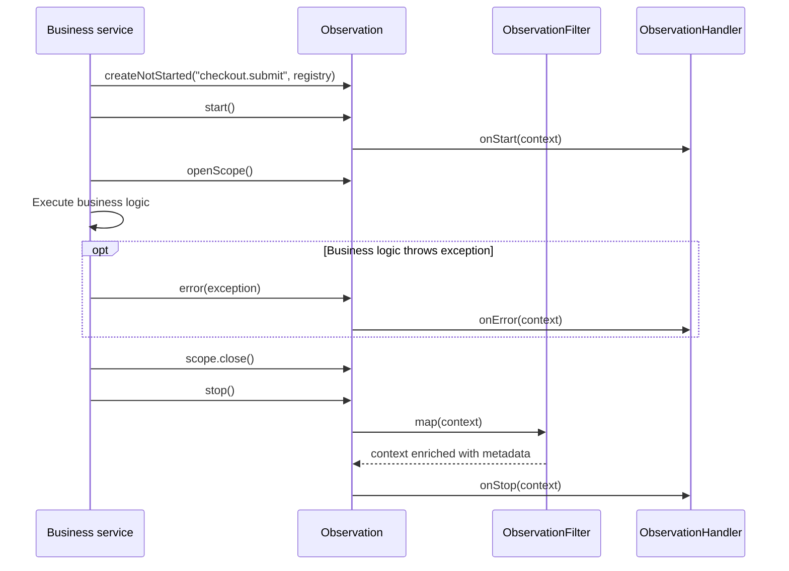
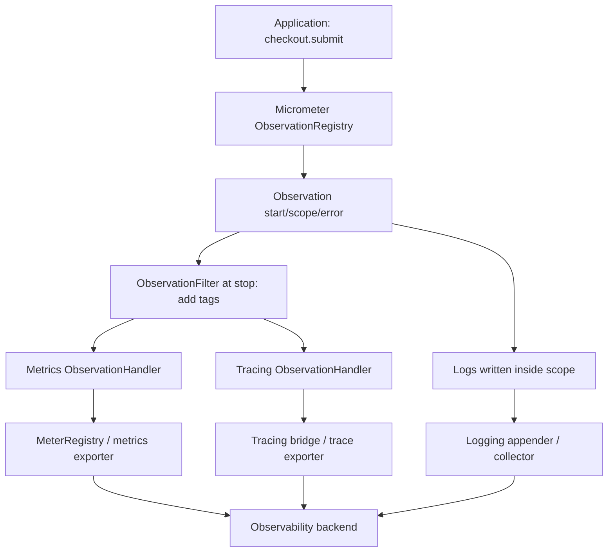

# ObservationFilter

> **Chapter:** Registry Configuration  
> **Module:** `SPRING_BOOT_OBSERVABILITY` — setting up observability for Spring Boot with Micrometer Observation, metrics, logs, and distributed tracing; emphasizing context propagation, tags/cardinality, exporters, sampling, and signal correlation when investigating errors and latency.

## Learning Objectives

After this lesson, you will be able to:

- Explain what Micrometer Observation's `ObservationFilter` is used for and **at which stage** of the observation lifecycle it is applied.
- Distinguish `ObservationFilter` from `ObservationPredicate`, `ObservationConvention`, `ObservationHandler`, and `MeterFilter`.
- Configure a filter in Spring Boot to enrich `Observation.Context` with low-cardinality tags.
- Choose safe data to put into metrics/traces and recognize the limits of filters with respect to logs, context propagation, exporters, and sampling.
- Test a filter using a business scenario and spot mistakes when tags fail to appear or increase time series count.

## 1. Problem: Adding Metadata Across Many Observations

Suppose a system has the following operations:

- `checkout.submit` — customer submits an order.
- `payment.authorize` — application calls the payment provider.
- `inventory.reserve` — reserving stock.

Each operation is measured with Micrometer Observation. The operations team wants metrics for `checkout.submit` to always carry `business.domain=checkout`, along with `outcome=success|error` to compare failure rates and latency easily.

Tags can be added manually at every observation creation site. However, when a rule applies broadly across many places, that approach is easy to miss or keep inconsistent.

**`ObservationFilter`** is an extension point that lets you **transform/enrich `Observation.Context` before the observation finishes and handlers run end-of-lifecycle processing**. Filters are registered with `ObservationRegistry`, so one rule can be applied centrally to matching observations.

A useful pattern is:

> For observations named `checkout.submit`, add tags `business.domain=checkout` and `outcome` based on the recorded error status.

Key point: a filter receives the **observation's context**, not the HTTP request object or a metric record directly. Base your logic on data actually present in the context when the filter runs.

## 2. Where Does `ObservationFilter` Sit in the Lifecycle?

An observation is created, started, executed, and stopped. When an observation is stopped through the standard Micrometer Observation mechanism, registered filters are applied to the context **before `ObservationHandler`s receive the completion step**.



**Three important consequences:**

1. Filters run **before `onStop`**, so they can supply tags or metadata for completion processing, such as recording a timer's duration.
2. Filters **cannot go back in time** to add tags that a handler already read at `onStart` or `onError`. If information must exist as soon as a span starts or when logging inside the scope, attach it earlier at observation creation/start or use another suitable mechanism.
3. A filter **is not code invoked on every log line or metric emission**. It operates on the observation lifecycle, not on the logging pipeline or every exporter flush.

If an observation is not stopped properly, these completion steps and lifecycle filters may not execute as expected. Thus `try/finally` or the `observe(...)` API is essential when instrumenting manually.

### 2.1. Meaning of the `map(Context)` Method

`ObservationFilter` is a functional interface; its main method takes an `Observation.Context` and returns a context:

```java
Observation.Context map(Observation.Context context);
```

A filter can inspect the observation name, recorded error, or other context properties to add key-values. A simple example:

```java
ObservationFilter filter = context -> {
    if ("checkout.submit".equals(context.getName())) {
        context.addLowCardinalityKeyValue(
                KeyValue.of("business.domain", "checkout"));
    }
    return context;
};
```

The example assumes `io.micrometer.observation.ObservationFilter` and `io.micrometer.common.KeyValue` are imported. This approach **mutates the context and returns it** per the filter contract. For observations whose name does not match, the context is returned unchanged.

Do not misuse filters to read data from thread-locals or the current HTTP request: by the time `stop()` runs, execution may be outside the request scope, or the observation may finish on another thread in an asynchronous flow.

## 3. Distinguishing Extension Points in Micrometer

| Mechanism | Responsibility | Timing / Target | Typical Use Case |
| --- | --- | --- | --- |
| **`ObservationFilter`** | Transforms/enriches the observation context. | Before the observation is processed at stop time. | Adding `business.domain`, resolved `outcome`. |
| **`ObservationPredicate`** | Decides whether an observation should be instrumented based on name and context. | When deciding to create/activate the observation. | Skipping a low-value operation under an explicit policy. |
| **`ObservationConvention`** | Defines meaningful names and key-values for an observation/context type. | When names/metadata are computed by instrumentation conventions. | Standardizing names and tags for HTTP or business operations. |
| **`ObservationHandler`** | Receives lifecycle events to create/control signals. | `onStart`, `onError`, `onScopeOpened`, `onStop`… | Metrics handler, tracing span handler. |
| **`MeterFilter`** | Accepts, denies, or alters meter info at the Micrometer Metrics layer. | At the `MeterRegistry` layer. | Capping a group of meters or shaping metric tags. |

Distinguish two senses of the word *filter*:

- `ObservationFilter` **does not have the primary job of blocking an observation**. It transforms the context before stop.
- If the goal is **not to record measurements** for a group of observations, look at `ObservationPredicate` or the corresponding instrumentation configuration. Reducing metric series count may also call for `MeterFilter` at the metrics layer; each choice has a different scope.

Nor is `ObservationFilter` a **tracing sampler**. Deciding which traces are exported/stored is governed by the sampler and tracing pipeline; an observation can still be processed for metrics even when its trace is not sampled.

## 4. Registering `ObservationFilter` in Spring Boot

When using Spring Boot Actuator with Micrometer Observation, `ObservationFilter` beans declared by the application are typically auto-registered by Spring Boot's observability configuration onto the managed `ObservationRegistry`.

The example below uses a bean to enrich the `checkout.submit` observation:

```java
package example.observability;

import io.micrometer.common.KeyValue;
import io.micrometer.observation.ObservationFilter;
import org.springframework.context.annotation.Bean;
import org.springframework.context.annotation.Configuration;

@Configuration(proxyBeanMethods = false)
public class CheckoutObservationConfig {

    @Bean
    ObservationFilter checkoutObservationFilter() {
        return context -> {
            if (!"checkout.submit".equals(context.getName())) {
                return context;
            }

            context.addLowCardinalityKeyValue(
                    KeyValue.of("business.domain", "checkout"));

            String outcome = context.getError() == null
                    ? "success"
                    : "error";
            context.addLowCardinalityKeyValue(
                    KeyValue.of("outcome", outcome));

            return context;
        };
    }
}
```

**How to read the example:**

1. Spring manages the `checkoutObservationFilter` bean and registers it onto the registry through Spring Boot's integration in compatible configurations.
2. The filter only modifies contexts for observations named exactly `checkout.submit`.
3. `business.domain` is a constant value; `outcome` has only two values. Both are appropriate for **low-cardinality tags**.
4. `context.getError()` relies on the error recorded on the observation. If business code catches an exception without calling `observation.error(exception)`, the filter may mark `success` even though the business operation failed in application terms.
5. Returning the context passes the enriched metadata to downstream lifecycle steps.

The rule above measures **errors recorded on the context**, not every HTTP status by default. For instance, a `400` or `500` response might be handled without throwing an exception; if you need classification by HTTP status, use the HTTP instrumentation's context/convention or explicitly attach business outcomes to the observation.

### 4.1. When Not Using Spring Boot Auto-Configuration

If you create and configure `ObservationRegistry` manually, the filter must be registered on that registry:

```java
import io.micrometer.observation.ObservationFilter;
import io.micrometer.observation.ObservationRegistry;

ObservationRegistry registry = ObservationRegistry.create();

ObservationFilter checkoutFilter = context -> {
    if ("checkout.submit".equals(context.getName())) {
        context.addLowCardinalityKeyValue(
                io.micrometer.common.KeyValue.of("business.domain", "checkout"));
    }
    return context;
};

registry.observationConfig().observationFilter(checkoutFilter);
```

A manually created registry **does not automatically come with** metrics/tracing handlers or exporters like Spring Boot's registry. To avoid two independent registries operating side by side, a typical Spring Boot application should use the framework-managed registry and register extension components with it.

Across Spring Boot/Micrometer versions, bean auto-registration, API names, or auto-configuration mechanisms may vary. Consult the documentation for your exact version if a filter bean does not take effect.

## 5. Creating an Observation to Test the Filter

A simple business service using the `ObservationRegistry` provided by Spring Boot:

```java
package example.observability;

import java.util.function.Supplier;

import io.micrometer.observation.Observation;
import io.micrometer.observation.ObservationRegistry;
import org.springframework.stereotype.Service;

@Service
public class CheckoutService {
    private final ObservationRegistry registry;

    public CheckoutService(ObservationRegistry registry) {
        this.registry = registry;
    }

    public <T> T submit(Supplier<T> action) {
        return Observation.createNotStarted("checkout.submit", registry)
                .lowCardinalityKeyValue("channel", "web")
                .observe(action);
    }
}
```

`observe(action)` manages start, scope, exception recording, and stop for a **synchronous** operation. As a result, at stop time, the filter can inspect `getError()` to attach `outcome`.

Invocation example:

```java
// Success case:
String orderId = checkoutService.submit(() -> "order-001");

// Failure case:
try {
    checkoutService.submit(() -> {
        throw new IllegalStateException("Inventory unavailable");
    });
} catch (IllegalStateException expected) {
    // Application decides HTTP response / retry / rollback.
}
```

This illustrates API usage, not a complete Spring Boot application with controllers or a database. When a metrics handler is active, the stopped observation can contribute measurements for `checkout.submit` with tags:

```text
name: checkout.submit
tags: channel=web, business.domain=checkout, outcome=success
```

and when an exception is recorded:

```text
name: checkout.submit
tags: channel=web, business.domain=checkout, outcome=error
```

The meter/series names generated by exporters may differ depending on registry, naming conventions, and backend. The examples above show the **logical observation name** and tags, not guaranteed raw output from a specific Prometheus endpoint.

## 6. Choosing Appropriate Metadata: Low vs. High Cardinality

Most operational issues when enriching contexts stem from adding values with **too many variants** into metric tags.

| Attribute | Example | Should be a low-cardinality tag? | Notes |
| --- | --- | --- | --- |
| `business.domain` | `checkout` | Yes | Small business domain set. |
| `outcome` | `success` / `error` | Yes | Standardized outcome. |
| `channel` | `web` / `mobile` / `other` | Yes | External values must be constrained. |
| `http.route` | `/orders/{id}` | Yes, if normalized | Do not use URLs containing real IDs. |
| `orderId` | `ord-829114` | No | Nearly unique per request. |
| `traceId` | Unique hex string | No | Used to find traces/logs, not as a metric label. |
| `email` / `accessToken` | Personal/secret data | No | Do not attach to telemetry unnecessarily; avoid data leak risk. |

In Micrometer Observation:

- **Low-cardinality key values** are typically used for metrics and may also be included in traces depending on handlers/conventions.
- **High-cardinality key values** can be helpful in tracing contexts when you truly need to look up a specific entity, but must be weighed against sensitive data, payload size, and storage cost.
- Filters do not decide on their own which fields are safe. Designers must validate input values and intended use.

**Mistake to avoid:**

```java
// Unsuitable: each orderId creates a new metric tag combination.
context.addLowCardinalityKeyValue(
        KeyValue.of("orderId", orderId));
```

Beyond inflating cardinality, reading `orderId` from a `ThreadLocal` right at observation stop can read the wrong context in async flows. If that detail is genuinely needed for traces, put it into the context explicitly where the data exists, apply security rules, and choose the right metadata tier.

### 6.1. Global Rules vs. Business-Specific Rules

A filter can apply to **every** observation, or only when the name/context matches. Consider:

- Global tags like `region=ap-southeast` or `deployment.environment=staging` should have bounded, stable values. In some Spring Boot setups, `management.observations.key-values` also supports adding shared key/value pairs.
- Business tags like `business.domain=checkout` should apply only to the matching group of observations.
- If a tag is already declared by the framework or a convention, avoid overwriting it with conflicting values. Agree on **one owner** per tag so dashboards and alerts stay consistent.
- Every metadata-adding filter increases complexity. Avoid stacking overlapping filters when a convention or direct configuration expresses the rule more cleanly.

## 7. How Do Filters Affect Metrics, Traces, and Logs?

Observation acts as an intermediary layer for multiple signals. However, a filter does not by itself turn data into all three signals.



| Signal | How does the filter help? | Conditions or Limitations |
| --- | --- | --- |
| **Metrics** | Adds low-cardinality key-values used by the metrics handler at completion. | Requires a metrics handler, `MeterRegistry`, and matching pipeline/exporter; output also depends on meter conventions. |
| **Distributed tracing** | Can add metadata processed by the tracing handler when the observation stops. | Tracing bridge/handler, sampling, exporter, and when the handler reads attributes determine the outcome; does not replace trace context propagation. |
| **Logs** | Data on the observation can aid correlation when application logging is designed accordingly. | The filter runs at stop, so it **does not retroactively add fields to logs already emitted**; log correlation requires MDC/trace context or structured logging at write time. |

In particular, if you want every log inside `checkout.submit` to carry `traceId` and `spanId`, the standard way is enabling Micrometer Tracing and using an appropriate logging pattern/MDC **while the scope is open**. Adding tags via `ObservationFilter` at stop cannot alter logs already written.

If you want to link metrics to a specific trace, some backends support **exemplars**. Never put `traceId` into low-cardinality metric tags to simulate that link manually. Exemplars depend on the registry, exporter, backend, and compatible tracing configuration.

### 7.1. Filters Do Not Replace Sampling and Propagation

- **Sampling:** tracing configuration decides which traces are sampled or exported. A context-enriching filter does not guarantee spans will appear in the backend.
- **Context propagation:** HTTP clients/servers, executors, Reactor, or messaging instrumentations must carry trace context across boundaries. A filter does not inject `traceparent`, create parent spans, or transfer MDC to another thread.
- **Exporter:** handlers may produce data, yet you still need a registry, exporter, and backend to query it. Network or collector issues can drop signals after the filter has already run.
- **Metric coverage:** an observation may be skipped by a predicate, lack a handler, never be stopped, or have a different name than expected, causing tags to be absent; do not immediately blame the filter.

## 8. Testing `ObservationFilter` in a Test Environment

A structured verification path tests both filter logic and export capability.

### 8.1. Preparing the Application

The Spring Boot project needs matching Micrometer Observation/Actuator support. To inspect metrics via Prometheus, you typically add the Prometheus registry and enable the endpoint; to see traces, configure a Micrometer Tracing bridge, exporter, and backend.

Example configuration when dependencies are present:

```yaml
spring:
  application:
    name: checkout-service

management:
  endpoints:
    web:
      exposure:
        include: health,info,prometheus
  tracing:
    sampling:
      probability: 0.1
```

This configuration only produces telemetry when integration components are installed and properly configured. `/actuator/prometheus` must be appropriately secured; do not expose sensitive management data to the public Internet. The 10% sampling probability is an example, not a mandatory value.

### 8.2. Verification Steps

1. Run `checkoutService.submit(() -> "ok")` several times. Check the `checkout.submit` observation and tags `business.domain=checkout`, `outcome=success` in metrics (if the metrics handler is active).
2. Run the exception case. Check the corresponding measurement with `outcome=error` after `observe(...)` records the error before stop.
3. Run an observation named `inventory.reserve`. Ensure the current filter **does not** attach `business.domain=checkout` to that observation.
4. If tracing is enabled, open a collected trace containing `checkout.submit` and inspect the attributes actually surfaced by the exporter/backend. Verify the relationship between the HTTP span and the business span.
5. Write a log inside `checkout.submit` and check whether `traceId`/`spanId` appear in the log via tracing context; do not expect the filter to modify already-emitted logs.
6. Inspect the metric label set after many requests. Confirm `business.domain`, `outcome`, and `channel` generate only a few combinations with no dynamic IDs.
7. Verify when the filter runs: add a temporary debug log inside business code and a checkpoint when the filter is invoked, then observe the order. Remove temporary logs before going to production.

**Pass criteria:** the filter is applied when the observation stops, adds the right tags to the right observation type, creates no high-cardinality metric labels, leaves business flow unchanged, and data is actually observable in the backend when supported by the pipeline.

## 9. Diagnosing Common Issues

| Symptom | Possible Cause | How to Check |
| --- | --- | --- |
| `ObservationFilter` bean is not applied | Registry not managed by Spring Boot, auto-configuration inactive, or wrong version/integration | Check injected bean/registry, filter registration, and Actuator config |
| Filter appears only on some operations | `context.getName()` condition does not match actual observation name | Check actual observation name set by instrumentation/convention |
| `outcome=success` despite failed response | Error not recorded on `Observation.Context`; failure handled as status instead of exception | Record error/outcome at the right boundary; do not equate HTTP status with context error |
| New metric tag does not appear | Missing metrics handler, observation not stopped, or exporter/backend not scraping | Check lifecycle, `MeterRegistry`, endpoint, and pipeline |
| Span tag missing in backend | Handler reads tags at an earlier time, missing tracing bridge/exporter, or trace not sampled | Check handler, sampling, context propagation, and exported traces |
| Earlier logs lack tag added by filter | Filter runs at stop, whereas logs were written earlier | Attach logging context earlier via MDC, baggage, or appropriate correlation |
| Metric cardinality spikes | Tag contains per-request ID, unnormalized URL, or unbounded client input | Audit key-values, remove high-variance values, and normalize labels |
| Filters attach conflicting tags | Multiple owners for one key or unaligned conventions | Assign a single tag source, check convention/filter/handler config |
| Traces break across services | Missing propagation or HTTP/message client/server instrumentation | Check `traceparent`, scope, and context inject/extract mechanisms |

### 9.1. Design Decisions to Lock Down First

Before adding a new `ObservationFilter`, clarify:

- **Scope:** which observations is the filter for? Are the names or context types stable?
- **Data source:** is the metadata available at stop time, or must it be attached from the start?
- **Cardinality:** how many tag combinations will appear under real load?
- **Lifecycle:** is the observation guaranteed to stop on success, error, and timeout?
- **Correlation:** is the tag for dashboard trend slicing, or do you actually need trace ID/log correlation?
- **Privacy:** could this data reach third-party backends or cross multiple services?

A good filter is usually tiny: a clear matching condition, a few normalized values, no network calls, and no side effects. Avoid DB queries, remote service calls, or heavy work inside a filter: this code runs on the measurement completion path and can impact application latency.

## 10. Self-Check Questions

**Question 1.** How does `ObservationFilter` differ from `ObservationPredicate`?  
**Hint:** A filter transforms the context as the observation prepares to stop; a predicate decides whether to instrument the observation based on name/context.

**Question 2.** Can a filter add `orderId` to `lowCardinalityKeyValue` for easier debugging?  
**Hint:** Not suitable. Per-order values cause time series explosion. Use properly managed tracing/log attributes when investigating a specific order.

**Question 3.** Why does `context.getError() == null` not guarantee an HTTP request succeeded?  
**Hint:** Framework or business code may return an error status without throwing an exception or recording an error on the observation context. Define outcomes accordingly.

**Question 4.** If `business.domain` is added by a filter, do logs already emitted inside the scope automatically show that field?  
**Hint:** No. Filters run near stop; logs emitted earlier need logging context present at write time.

**Question 5.** You registered a filter, yet no span appears in the backend—can you conclude the filter is broken?  
**Hint:** Not yet. Check the tracing handler, sampling, exporter, and propagation; the observation may still be recording metrics.

**Question 6.** When should metadata be added directly when creating the observation instead of via a filter?  
**Hint:** When handlers or code inside the scope need the data **from the very start**, or when metadata is already known at that moment and applies to a single operation.

**Key takeaway:** `ObservationFilter` is a mechanism for **enriching `Observation.Context` at the observation stop stage**. In Spring Boot, use it to attach stable, low-cardinality, operationally meaningful metadata. Observing complete metrics, logs, and distributed tracing also requires proper handlers, registry wiring, context propagation, exporters, and sampling strategies; filters do not replace those components.
