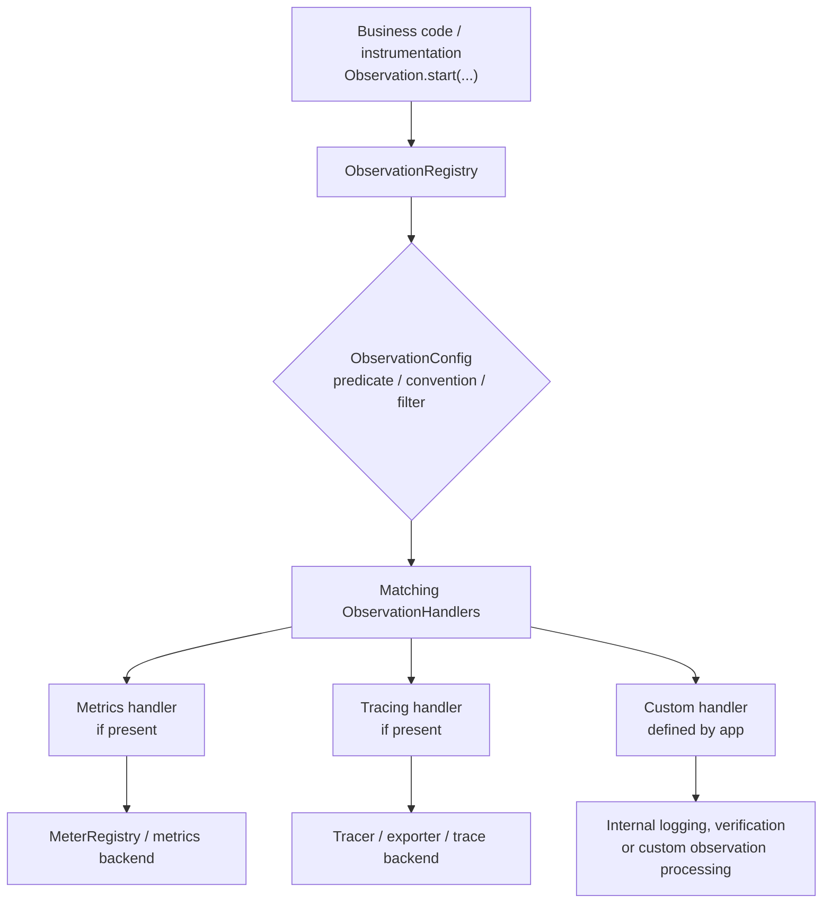
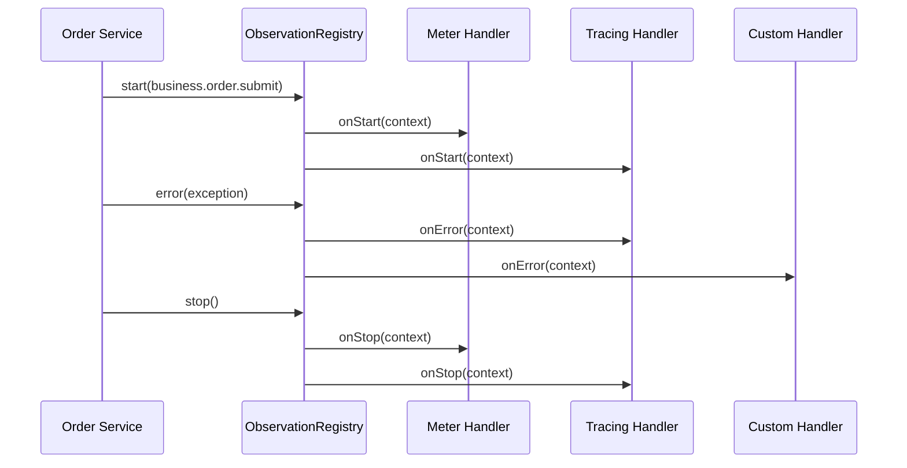

# ObservationHandler Bean in Spring Boot

The application has created an `Observation` for a business operation, yet the desired information still does not show up on dashboards: how do you know when an observation started, errored, or finished? The answer lies in **`ObservationHandler`**. This is the component that receives callbacks during the observation lifecycle, connecting observation data to metrics recording, distributed tracing, or custom behavior.

The **ObservationHandler Bean** lesson belongs to the **Registry Configuration** chapter of the **SPRING_BOOT_OBSERVABILITY** module. The overarching goal of the module is setting up observability for Spring Boot using Micrometer Observation, metrics, logs, and distributed tracing; understanding context propagation, tags/cardinality, exporters, sampling, and signal correlation to investigate errors, latency, and application behavior in production. This lesson focuses on properly declaring, registering, testing, and using an **`ObservationHandler` bean**.

## 1. Learning Objectives

After completing this lesson, you will be able to:

- Explain the relationship between `Observation`, `ObservationRegistry`, and `ObservationHandler`.
- Distinguish `ObservationHandler` from `ObservationConvention`, `ObservationFilter`, and `ObservationPredicate`.
- Create an `ObservationHandler` as a Spring bean and understand the conditions for it to be registered on the registry.
- Use `supportsContext` and lifecycle callbacks `onStart`, `onError`, `onEvent`, `onStop`, and `onScopeOpened` / `onScopeClosed`.
- Write a custom handler that processes only one business operation's observations without increasing metric cardinality or leaking sensitive data.
- Analyze the roles of the registry, handlers, tracing bridge, exporter, and sampling when a signal does not appear in the backend.

## 2. Where ObservationHandler Fits in the Architecture

An `Observation` represents **the unit of work being observed**, such as `business.order.submit` or an HTTP request. `ObservationRegistry` holds configuration and coordinates observers. `ObservationHandler` is **the receiver of observation lifecycle events**.



**Important point:** `ObservationHandler` is not synonymous with an exporter. It **receives notifications** when an observation changes state. Metrics require a matching handler and meter registry; distributed tracing requires a tracing handler, bridge, tracer, and appropriately configured exporter. A handler that only writes logs will not automatically send spans to a tracing system.

In a Spring Boot application integrated with Actuator, you usually **inject the framework-configured `ObservationRegistry`** rather than creating another registry yourself. If each service calls `ObservationRegistry.create()`, observations on isolated registries may bypass the handlers registered by Spring Boot.

### How Do Observation and Handler Differ?

| Component | Responsibility | Example |
| --- | --- | --- |
| `Observation` | Describes a unit of work; manages start, scope, error, event, stop | `business.order.submit` |
| `ObservationRegistry` | Holds configuration and coordinates handlers | Registry provided by Spring Boot |
| `ObservationHandler` | Receives lifecycle callbacks when context is supported | Handles `onError` to emit diagnostic signals |
| `MeterRegistry` | Manages meters/timers/counters for metrics | Prometheus registry |
| Tracer / exporter | Creates and ships spans to the tracing backend | Micrometer Tracing bridge and OTLP exporter |

Not every observation produces metrics or traces. An observation may lack a matching handler, be excluded by a predicate, or lack an exporter. Therefore, inspect **the entire path** from observation creation to backend.

## 3. How Spring Boot Registers an ObservationHandler Bean

In **Spring Boot 3.x** with appropriate Actuator/observability configuration, Spring Boot can automatically create and configure `ObservationRegistry`. Beans of type `ObservationHandler<?>` in the application context are registered on the registry by Boot's auto-configuration. Depending on the Spring Boot version and dependencies, metrics/tracing handlers may also be auto-registered by Boot.

Starter dependency in a Gradle Kotlin DSL project:

```kotlin
dependencies {
    implementation("org.springframework.boot:spring-boot-starter-actuator")
}
```

This snippet suffices to illustrate baseline Observation/Actuator configuration in Spring Boot 3.x. To export metrics or traces, add the appropriate registry, tracing bridge, and exporter; Actuator alone does not guarantee data is shipped to an external backend. To avoid API mismatches, manage dependency versions with the project's Spring Boot BOM.

### Bean Configuration: Common Approach

Declare a `@Bean` method returning `ObservationHandler<Observation.Context>`. Boot detects the bean and adds it to the auto-configured registry:

```java
import io.micrometer.observation.Observation;
import io.micrometer.observation.ObservationHandler;
import org.springframework.context.annotation.Bean;
import org.springframework.context.annotation.Configuration;

@Configuration(proxyBeanMethods = false)
public class ObservationHandlersConfiguration {

    @Bean
    ObservationHandler<Observation.Context> businessFailureHandler() {
        return new BusinessFailureObservationHandler();
    }
}
```

In this example, `BusinessFailureObservationHandler` is an application-defined class shown later. Use only **one** declaration style: if you register the handler as a bean via `@Bean`, do not also annotate the same implementation with `@Component` to avoid creating two beans and handling events twice.

### When Must You Register Manually?

If the application does **not** use the Spring Boot-configured registry and instead creates a standalone Micrometer registry, declaring a bean is not enough for that isolated registry to know about the handler. Registration can be done directly:

```java
ObservationRegistry isolatedRegistry = ObservationRegistry.create();
isolatedRegistry.observationConfig()
    .observationHandler(new BusinessFailureObservationHandler());
```

This is only an example for an **isolated registry**, not something to add to an application already using Boot auto-configuration. In a standard Spring Boot project, use the injected registry and let the framework manage shared handlers. If deep customization is required, inspect the customizer mechanism of your Boot version and guard against duplicate registration.

## 4. The ObservationHandler Contract

The `ObservationHandler<T extends Observation.Context>` interface lets a handler implement callbacks; the most common ones are `supportsContext` and lifecycle callbacks like `onStart` / `onStop` / `onError`.

| Callback | Typical Timing | Purpose |
| --- | --- | --- |
| `supportsContext(context)` | When the registry checks whether the handler applies to a context | Accept only observations with matching scope and context type |
| `onStart(context)` | Observation starts | Prepare measurement state or record start event |
| `onError(context)` | Observation is notified of an error via `error(ex)` | Read error from context, emit controlled diagnostic signal |
| `onEvent(event, context)` | An event is added to the observation | Handle a meaningful milestone during work |
| `onScopeOpened(context)` | Observation scope opens | Attach or synchronize context per integration |
| `onScopeClosed(context)` | Observation scope closes | Clean up scope-bound context |
| `onStop(context)` | Observation stops | Finalize duration, counters, or handler-managed state |

Some API versions include additional callbacks related to scope reset. Callbacks have default no-op implementations when not overridden, so a handler only needs to implement **the callbacks it actually requires**. `supportsContext` gates whether the handler participates in the observation lifecycle.

**Note:** `onError` does not mean Java automatically enters a `catch`. The callback is triggered only when observation-managing code calls `observation.error(ex)`, or when an automatic API/instrumentation explicitly records the error. Having a custom method throw an exception **does not guarantee** your custom handler receives `onError`.

### Scope and Context Propagation

`onScopeOpened` and `onScopeClosed` are useful when a handler must manage data bound to the current scope. In synchronous execution, the scope is usually attached to the current thread. When work moves to a thread pool, `@Async`, Reactor, or a message consumer, context may not propagate automatically. Use appropriate instrumentation and **Micrometer Context Propagation**; do not rely on a custom `ThreadLocal` assuming it propagates across all threads.

Never leave an `Observation.Scope` open past its intended execution boundary, especially when threads are pooled and reused. If a handler writes to MDC itself, ensure it cleans up context properly so subsequent requests' logs do not carry previous requests' data.

## 5. Complete Example: Bean Handling Only Order-Submission Failures

Let us create a handler that receives `onError` **only when** the observation name equals `business.order.submit`. This handler logs a short diagnostic line with the observation name and **exception type**. This example demonstrates the bean/callback mechanism, not a recommendation to log every observation in production.

### 5.1. Handler Implementation

```java
import io.micrometer.observation.Observation;
import io.micrometer.observation.ObservationHandler;
import org.slf4j.Logger;
import org.slf4j.LoggerFactory;

public final class BusinessFailureObservationHandler
        implements ObservationHandler<Observation.Context> {

    private static final Logger log =
        LoggerFactory.getLogger(BusinessFailureObservationHandler.class);

    @Override
    public boolean supportsContext(Observation.Context context) {
        return "business.order.submit".equals(context.getName());
    }

    @Override
    public void onError(Observation.Context context) {
        Throwable error = context.getError();
        if (error == null) {
            return;
        }

        log.warn(
            "event=business_observation_error observation={} exceptionType={}",
            context.getName(),
            error.getClass().getSimpleName()
        );
    }
}
```

**Design explanation:**

1. `supportsContext` uses a low-cost fixed name comparison, avoiding processing every HTTP, database, or messaging observation in the application.
2. `getError()` retrieves the exception reported to the observation. The handler **does not** throw a new exception and **does not** alter the business outcome.
3. The log includes a stable `event` field and exception type; the handler does not dump request bodies, tokens, or `exception.getMessage()` into logs. Exception messages can contain sensitive data.
4. The handler holds no global per-request state; each callback reads the current observation's context. This reduces the risk of cross-request data mix-ups under concurrency.
5. If the application already logs the same error completely in another layer, consider using the handler only for counting or at a lower log level to avoid duplicate stack traces for the same incident.

The `BusinessFailureObservationHandler` example does not replace meter or tracing handlers. Its purpose is illustrating how to **add custom behavior** whenever a matching observation reports an error.

### 5.2. Registering the Bean in Spring

```java
import io.micrometer.observation.Observation;
import io.micrometer.observation.ObservationHandler;
import org.springframework.context.annotation.Bean;
import org.springframework.context.annotation.Configuration;

@Configuration(proxyBeanMethods = false)
public class ObservabilityConfiguration {

    @Bean
    ObservationHandler<Observation.Context> businessFailureHandler() {
        return new BusinessFailureObservationHandler();
    }
}
```

This is the complete version of the bean configuration from section 3. In a real application, **keep only one** of the two configuration snippets above to avoid duplicate bean declarations. The package of `ObservabilityConfiguration` must lie within component scan scope or be imported into the Spring application context.

### 5.3. Creating an Observation to Trigger the Handler

```java
import io.micrometer.observation.Observation;
import io.micrometer.observation.ObservationRegistry;
import org.springframework.stereotype.Service;

@Service
public class OrderApplicationService {

    private final ObservationRegistry observationRegistry;
    private final PaymentGateway paymentGateway;

    public OrderApplicationService(
            ObservationRegistry observationRegistry,
            PaymentGateway paymentGateway) {
        this.observationRegistry = observationRegistry;
        this.paymentGateway = paymentGateway;
    }

    public void submit(String orderId) {
        Observation observation = Observation
            .createNotStarted("business.order.submit", observationRegistry)
            .lowCardinalityKeyValue("operation", "submit")
            .start();

        try (Observation.Scope scope = observation.openScope()) {
            try {
                paymentGateway.charge(orderId);
                observation.lowCardinalityKeyValue("outcome", "success");
            } catch (RuntimeException ex) {
                observation.lowCardinalityKeyValue("outcome", "error");
                observation.error(ex);
                throw ex;
            }
        } finally {
            observation.stop();
        }
    }
}

interface PaymentGateway {
    void charge(String orderId);
}
```

When the gateway succeeds, the observation runs through `start`, scope, and `stop`. Since the handler only overrides `onError`, **no error line is logged**. When the gateway throws `RuntimeException`, the service attaches `outcome=error` and calls `error(ex)`: the registry invokes `onError` on matching handlers. The exception then propagates to the caller, the scope closes, and `stop` runs in `finally`.

`orderId` is not put into a low-cardinality key-value. If you need to look up a specific request, record an internal order ID in business-layer logs or a controlled tracing context in line with your system's data policy.

If `PaymentGateway` returns a value representing a **valid business decline** rather than throwing an exception, the operation can attach `outcome=rejected` without calling `error(ex)`. The handler above will not emit an error log; that is the right result for that business classification choice.

## 6. How Does a Custom Handler Differ from Convention, Filter, and Predicate?

When configuring `ObservationRegistry`, extension points can be confused because all relate to observations:

| Mechanism | Primary Function | Example |
| --- | --- | --- |
| **`ObservationHandler`** | Receives callbacks at lifecycle points | Recording errors or turning context into signals |
| **`ObservationConvention`** | Defines name, contextual name, and key-values for a group of observations | Standardizing HTTP or business names/tags |
| **`ObservationFilter`** | Modifies observation context through a config pipeline before completion | Adding an environment label with a bounded value set |
| **`ObservationPredicate`** | Allows or excludes observations conditionally | Skipping health-check observations that do not need measuring |
| **Registry customizer** | Modifies registry configuration, including the components above when needed | Registering handlers in an app using a customized registry |

Use `ObservationHandler` when you want to **react to the lifecycle**. If the goal is merely renaming or adding shared key-values, a convention/filter is usually a better fit. If you want to prevent observations on an endpoint from the outset, a predicate is the closest tool.

### Do Not Cram All Logic into Handlers

A complex handler making synchronous HTTP calls to external systems inside `onStart` or `onStop` can degrade request latency and let instrumentation errors leak into business execution. Callbacks should be **fast, low-side-effect, and concurrency-safe**. For heavy work like guaranteed business event delivery, use a dedicated queue/transactional mechanism; do not turn handlers into a reliable business storage channel.

Handlers are suited for adding monitoring and metadata; they do not replace validation, audit trails, transaction handling, or rule-based alerting engines.

## 7. Multiple Handlers on One Registry

An observation may simultaneously need timer metrics, a tracing span, and a custom handler. Micrometer supports **composing** handlers, though selection behavior depends on how the registry is configured:

- An **all-matching** mechanism dispatches callbacks to every handler supporting the context.
- A **first-matching** mechanism picks the first matching handler, typically used when multiple handlers are mutually exclusive alternatives for the same context type.

In an application with Spring Boot auto-configuration, how existing metrics/tracing handlers and Boot-managed custom beans are composed depends on the version and configuration. Do not replace the entire handler composition without verifying the impact, as doing so can drop metrics or spans. Also do not assume an ordering annotation like `@Order` always resolves relationships between handlers; inspect the actual registry/composite setup in use.

### Risk of Duplicate Registration

A common mistake is doing both:

1. Declaring a `BusinessFailureObservationHandler` bean so Spring Boot auto-registers it.
2. Also manually calling `registry.observationConfig().observationHandler(handler)` for **the same instance or another instance**.

Callbacks can then fire twice. If the handler logs or increments a counter, recorded counts can double. Avoid this by **choosing one registration mechanism**, then verifying empirically how many events a failing observation emits.

### Application Handlers Can Coexist with Metrics/Tracing

When full monitoring is desired:



The diagram depicts **the case where all handlers are selected by the registry and support the context**; it does not promise every handler is invoked in every configuration. The custom handler in the example only implements `onError`, while meter and span handlers may implement their own sets of callbacks.

## 8. Cardinality, Tags, and Sensitive Information

A handler has access to `Observation.Context`, but that does not mean everything inside the context should be exported as a metric label or logged.

| Data | Appropriate Level | Reason |
| --- | --- | --- |
| `operation=submit` | Low-cardinality key-value | Small, stable value set |
| `outcome=success\|error\|rejected` | Low-cardinality key-value | Easy grouping of counts and error rates |
| `error.category=timeout\|dependency` | Low-cardinality if strictly defined | Bounded error categorization |
| `traceId` / `spanId` | Trace context and log correlation | Too many distinct values to be a metric label |
| `orderId`, `userId`, `sessionId` | Only when permitted in log/trace context | High cardinality, potentially sensitive |
| `exception.getMessage()` | Controlled diagnostics | May contain tokens, queries, PII, or user input |

In **metrics**, low-cardinality key-values can become time series labels. Labels with huge value sets cause series counts to explode. In **traces**, high-cardinality attributes can make sense for per-request diagnostics but also increase storage volume. In **logs**, manage masking, access control, retention, and duplicate stack traces.

`supportsContext` should also filter by **operation name or context class**, avoiding ties to per-request IDs or volatile user data. If complex business classification is needed, compute it in the business layer and pass a stable category to the observation.

## 9. Verifying That the Bean Works in Practice

Declaring a handler bean does not guarantee the application uses it. Verify dependencies, Spring context, registry, and observation lifecycle:

| Check | How to Perform | Expected Result |
| --- | --- | --- |
| Bean exists | Check Spring context for `businessFailureHandler` | Handler instantiated exactly once per config |
| Right registry used | Inject Boot's `ObservationRegistry` into service | No stray manually created registry |
| Name matches | Create `business.order.submit` and trigger exception | `supportsContext` returns `true` |
| Error callback | Call `observation.error(ex)` before `stop` | `onError` runs once per error notification |
| Other observation | Create `business.order.validate` and report error | Sample handler does **not** log because name differs |
| Success path | Gateway returns normally | No `business_observation_error` line |
| No duplicate registration | Trigger one error and count callback logs | No doubled logs from two registrations |
| Metrics/traces | Check registry/bridge/exporter and backend | Signals appear if pipeline supports and is configured |

### A Quick Test Without an External Backend

When Prometheus, Jaeger, or an OpenTelemetry Collector is not available yet, you can test the handler with an isolated `ObservationRegistry` in a **unit test**, registering the handler once, creating an observation, and calling `error`. The snippet below illustrates the API; to assert the callback ran, a real test should use a handler incrementing an in-memory counter or a spy rather than manual visual inspection:

```java
ObservationRegistry registry = ObservationRegistry.create();
registry.observationConfig()
    .observationHandler(new BusinessFailureObservationHandler());

Observation observation =
    Observation.start("business.order.submit", registry);
try {
    observation.error(new IllegalStateException("simulated failure"));
} finally {
    observation.stop();
}
```

When running this snippet, Spring Boot's beans **do not participate** because this is an isolated registry. It only verifies basic Micrometer behavior. To verify **bean auto-registration**, test inside a Spring application context using the auto-configured registry.

### If the Handler Is Not Invoked, What Should You Check?

1. **Observation name:** does `supportsContext` return `true` for the actual runtime name/context? Do not confuse the contextual name displayed on spans with `context.getName()`.
2. **Registry:** does the service inject the Boot-configured `ObservationRegistry`, or did it create another registry?
3. **Registration:** is the handler truly a Spring bean within component scan scope, and does Boot have matching observability configuration?
4. **Lifecycle:** were `start`, `error(ex)`, and `stop` called in the right order? Simply throwing an exception does not automatically trigger `onError` for manual observations.
5. **Filters/handler structure:** was the observation dropped by a predicate, or did composition select a different handler?
6. **Observing results:** if the callback ran yet expected traces/logs are missing, inspect logger levels, tracing bridge, exporter, sampling, and collection pipelines.

## 10. Common Design Mistakes

| Mistake | Symptom | Fix |
| --- | --- | --- |
| Creating a new registry inside service | Boot handler beans do not run | Inject the existing registry |
| Handler bean outside application context | No callbacks observed | Place configuration in component scan or import it |
| `supportsContext` always false or wrong name check | Some observations unhandled | Match `context.getName()` against actual created name |
| Same handler both a bean and manually registered | Duplicate callbacks/logs | Pick only one registration mechanism |
| Forgetting `error(ex)` in manual observation | Handler only sees start/stop | Record error before stop, then rethrow if needed |
| Forgetting `stop()` on error path | Missing or unclosed timers/spans | Use `finally` or `observe(...)` |
| Handler makes synchronous network calls per callback | Slow requests or instrumentation-induced errors | Keep callbacks short, avoid blocking I/O |
| Putting `orderId`/`traceId` in metric labels | Cardinality explosion | Attach only low-cardinality values |
| Logging full exceptions in handler and every service layer | Noisy logs and duplicate stack traces | Log details only at appropriate boundaries |
| Replacing handler composition indiscriminately | Lost metrics or tracing | Inspect auto-configured handlers before altering |

## 11. Extended Practice Exercise

**Scenario:** the system has `order-service` calling `payment-service`, which occasionally fails with timeouts. You want to track errors in the order-submission business operation without logging every successful request.

**Step 1.** Create `BusinessFailureObservationHandler` whose `supportsContext` matches only `business.order.submit` and whose `onError` logs `event=business_observation_error`, observation name, and exception type.

**Step 2.** Declare the handler as a `@Bean` and inject `ObservationRegistry` into `OrderApplicationService`. Do not register it manually a second time.

**Step 3.** Trigger one successful order submission and one throwing a timeout error. For a manual observation, call `error(ex)` and rethrow; `stop` must be in `finally`.

**Step 4.** Verify the callback fires only on failure; create an observation with a different name to confirm the handler stays within scope.

**Step 5.** If a meter handler and tracing bridge/exporter are available, verify latency/counter metrics, spans, and log correlation via `traceId`. Set tracing sampling explicitly; do not assume every request's trace is retained.

**Step 6.** Simulate a retry: first attempt times out, second succeeds. Decide by policy whether the overall operation observation reports `success` or `recovered`, while the failing attempt's observation still records the error. Avoid counting a recovered transient failure as two failed requests.

**Self-check questions:**

1. Why might adding `@Bean ObservationHandler<?>` not be enough if a service creates another `ObservationRegistry`?
2. How does `onError` differ from a Java `catch` and `log.error`?
3. When should you pick `ObservationFilter` instead of writing a new handler?
4. Why can metrics exist without traces, even for the same observation?
5. If two handlers both return `true` from `supportsContext`, are both guaranteed to receive callbacks? Which part of the registry should you check?
6. Why is `traceId` useful for investigating logs yet unsuitable as a low-cardinality metric label?

## 12. Key Takeaways

**`ObservationHandler` is the bridge between an observation's lifecycle and the observing behaviors configured in the registry.** In Spring Boot with Actuator and appropriate auto-configuration, declaring a handler as a Spring bean is the standard way to add processing; callbacks only take effect when observations are actually created on the right registry, pass filtering conditions, and follow a proper lifecycle.

A good handler has a **clear scope**, simple `supportsContext`, fast and concurrency-safe callbacks, stores no sensitive information, and avoids high-cardinality tags. When combining custom handlers with metrics, logs, and distributed tracing, understand registration/composition, context propagation, exporters, and sampling. That way signals accurately reflect errors, latency, and behavior of the Spring Boot system in real operations.
