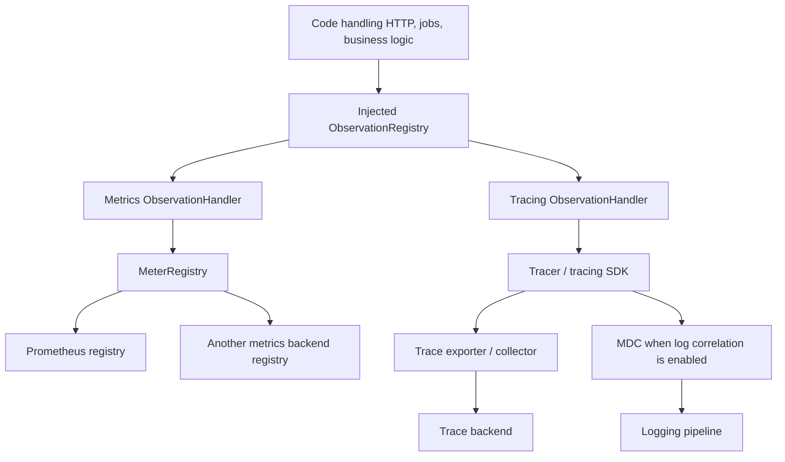
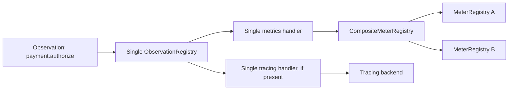
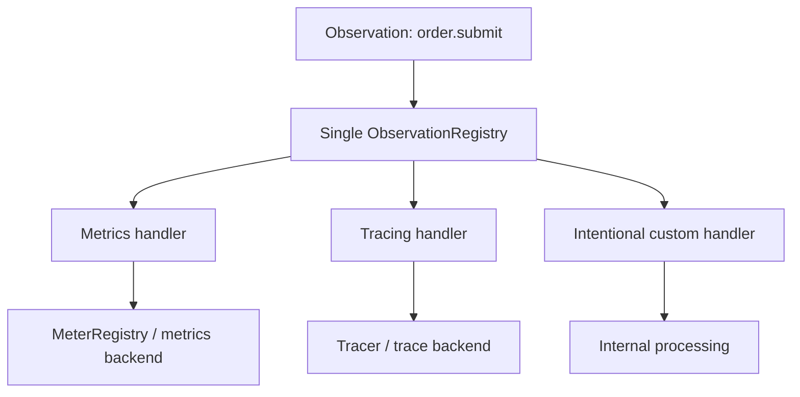
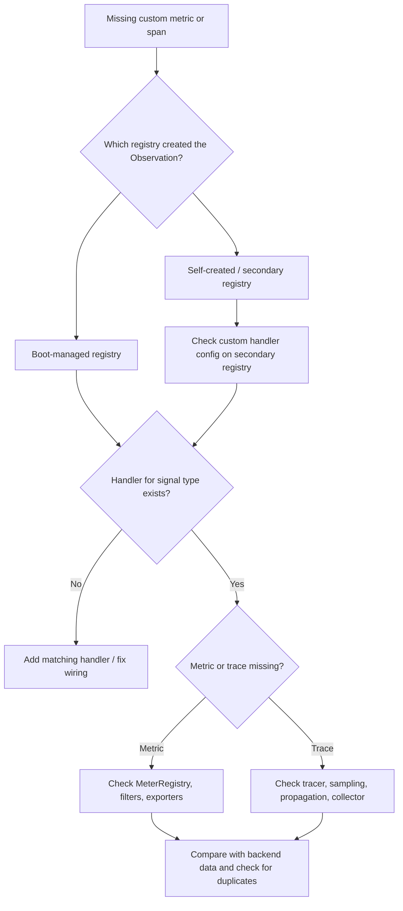

# Multiple Registries in a Spring Boot Application

In Spring Boot, a single application may simultaneously send metrics to Prometheus and another monitoring service, create distributed traces via OpenTelemetry, and write logs to a centralized system. During configuration, development teams often ask: **do we need multiple registries to export data to multiple destinations?** If two `ObservationRegistry` beans or multiple `MeterRegistry` beans exist, do they work together or separately? What happens when one service uses registry A while the tracing handler is attached to registry B?

The **"Multiple Registries in One Application"** lesson belongs to the **Registry Configuration** chapter of the **SPRING_BOOT_OBSERVABILITY** module. The module's goal is setting up observability for Spring Boot using Micrometer Observation, metrics, logs, and distributed tracing; understanding context propagation, tags/cardinality, exporters, sampling, and how to correlate signals to investigate errors, latency, and application behavior in practice.

Key point: **"registry" does not refer to just one kind of object**. Distinguish the component coordinating Observation lifecycles from the component managing meters, as well as the tracer/exporter. Adding more registries does not automatically increase observability; properly configuring the data flow is what determines whether data reaches backends and correlates cleanly.

## 1. Distinguishing Registries Before Configuring

In a Micrometer-based application, two concepts are often loosely called "registry":

| Component | Primary Role | Typical API | When Multiple Instances Exist |
| --- | --- | --- | --- |
| **`ObservationRegistry`** | Coordinates `Observation`, context, filters, predicates, conventions, and `ObservationHandler`s | `ObservationRegistry.create()`, `Observation.createNotStarted(...)` | Each Observation is created against **one specific registry**; handler config does not automatically carry over to another registry |
| **`MeterRegistry`** | Creates, manages, classifies, and exports counters/timers/gauges/distribution summaries | `MeterRegistry`, `Counter`, `Timer` | Registries may represent separate backends; coordination is needed if the same measurement must go to multiple targets |
| **`CompositeMeterRegistry`** | An aggregating `MeterRegistry` forwarding meters to registered child registries | `composite.add(childRegistry)` | Useful when the same set of metrics must be shipped to multiple implementations/backends |
| **Tracer / tracing SDK** | Creates and manages spans, trace context, sampling, propagation; exporter sends spans | Micrometer Tracing / OpenTelemetry or Brave | Not a `MeterRegistry`; having multiple metric registries does not determine trace structure |
| **Logging framework / log pipeline** | Writes logs, stores MDC, and ships log events | SLF4J, Logback, collector | Not automatically managed by `MeterRegistry` or `CompositeMeterRegistry` |

A simplified diagram:



In the diagram, the `MeterRegistry` box may represent a `CompositeMeterRegistry` if the application actually configures multiple child registries. **Not every Spring Boot app has this exact topology**; the Spring Boot, Micrometer, and SDK versions in use determine which beans, handlers, and exporters are created.

### "One Observation" Is One Measurement Event, Not a Broadcast to Every Registry

When you write:

```java
Observation observation =
        Observation.createNotStarted("payment.authorize", observationRegistry);
```

This Observation is bound to **the `observationRegistry` instance passed in**. If the application also has `otherRegistry`, that other registry does not automatically receive lifecycle events from the newly created Observation.

Conversely, a single `ObservationRegistry` can attach **multiple `ObservationHandler`s** so each handler handles a different signal type. For the same Observation, a metrics handler can update a timer and a tracing handler can create a span; you do not need two `ObservationRegistry` instances just to get both metrics and tracing.

## 2. Why Might an Application Have Multiple Registries?

Several valid or common reasons exist:

1. The application must **export the same metrics to multiple destinations** (e.g., an internal monitoring system and an external vendor). This is primarily a **multiple `MeterRegistry`** concern.
2. An application pulls in multiple components/libraries, each initializing its own `ObservationRegistry` or `MeterRegistry`. This can happen accidentally and fragment data.
3. The system wants to isolate instrumentation for batch jobs, experimental tasks, or a special processing zone. **Multiple `ObservationRegistry` instances** can be a deliberate choice, but require careful management of lifecycles, handlers, and propagation.
4. Multiple Spring `ApplicationContext`s exist, or a test config differs from production. Each context may define different registry beans; inspect **actual contexts and dependency injection**, rather than just counting classes on the classpath.
5. A library creates its own registry or meters without using the Spring Boot-managed registry. The result can be metrics/spans with the right names missing from the monitoring destination operators check.

Before adding a registry, decide: **do you want another export destination, another signal type, or an intentional isolation boundary?** Those three goals require different configurations.

## 3. How Do Multiple `ObservationRegistry` Instances Operate Independently?

`ObservationRegistry` holds Observation coordination configuration such as handlers, filters, predicates, and conventions. Creating two registries with `ObservationRegistry.create()` yields **two independent coordination points**.

The plain Java example below uses only Micrometer Observation and Micrometer Core. One registry is wired to a meter handler; the other has no handler attached.

```java
import io.micrometer.core.instrument.simple.SimpleMeterRegistry;
import io.micrometer.core.instrument.observation.DefaultMeterObservationHandler;
import io.micrometer.observation.Observation;
import io.micrometer.observation.ObservationRegistry;

public final class MultipleObservationRegistriesDemo {
    public static void main(String[] args) {
        SimpleMeterRegistry meters = new SimpleMeterRegistry();

        ObservationRegistry webRegistry = ObservationRegistry.create();
        ObservationRegistry batchRegistry = ObservationRegistry.create();

        webRegistry.observationConfig().observationHandler(
                new DefaultMeterObservationHandler(meters));

        Observation.createNotStarted("job.execute", webRegistry)
                .lowCardinalityKeyValue("channel", "web")
                .observe(() -> doWork());

        Observation.createNotStarted("job.execute", batchRegistry)
                .lowCardinalityKeyValue("channel", "batch")
                .observe(() -> doWork());

        System.out.println(
                meters.find("job.execute")
                        .tag("channel", "web")
                        .timer()
                        .count()); // 1

        System.out.println(
                meters.find("job.execute")
                        .tag("channel", "batch")
                        .timer()); // null: no corresponding meter exists

        meters.close();
    }

    private static void doWork() {
        // Illustrative business code.
    }
}
```

Key takeaways:

- Both `doWork()` callbacks execute.
- `webRegistry` has `DefaultMeterObservationHandler`, so it updates the corresponding timer.
- `batchRegistry` is a **real** registry, but without a metrics handler, Observations through it do not update `meters` under this setup.
- Two Observations sharing the **same name** `job.execute` creates no synchronization between the two registries.

This snippet only demonstrates how registries and handlers interact; whether data is exported depends on concrete registries and exporters in a real application.

### Having No Handlers vs. `NOOP`

`ObservationRegistry.NOOP` intentionally disables Observation-based collection. A registry created with `ObservationRegistry.create()` without registered handlers can still be configured further. From a dashboard's perspective, both cases can look identical because custom metrics/spans are absent, yet the root causes differ.

If a service returns correct results yet traces are missing, **do not jump to assuming the service uses NOOP**. It may be using a different registry, missing a tracing handler, dropped by a sampler, or failing at the exporter.

### Observation Scope and Tracing Context

An Observation can open a `Scope` to establish context for active work. A tracing handler can tie that context to a tracer, span, and MDC depending on the integration. If an Observation is created with registry A while neighboring instrumentation uses registry B, there is no guarantee that handlers, conventions, or linking logic on A apply to B.

Some systems still share tracing context via the tracer SDK at another layer; therefore **you cannot claim** that having multiple `ObservationRegistry` instances always breaks traces. The right approach is inspecting which registry each instrumentation uses, which handlers are registered, and actual propagation across threads, HTTP, or message brokers.

## 4. One ObservationRegistry, Multiple MeterRegistries: Common Pattern

Suppose all HTTP requests and business operations need the same metrics in two destinations. Instead of creating two Observations per task, use **one ObservationRegistry**, one metrics handler, and a **`CompositeMeterRegistry`** holding multiple child registries.



Plain Java example using two `SimpleMeterRegistry` instances simulating two target backends:

```java
import io.micrometer.core.instrument.composite.CompositeMeterRegistry;
import io.micrometer.core.instrument.simple.SimpleMeterRegistry;
import io.micrometer.core.instrument.observation.DefaultMeterObservationHandler;
import io.micrometer.observation.Observation;
import io.micrometer.observation.ObservationRegistry;

public final class CompositeMetersDemo {
    public static void main(String[] args) {
        SimpleMeterRegistry first = new SimpleMeterRegistry();
        SimpleMeterRegistry second = new SimpleMeterRegistry();
        CompositeMeterRegistry composite = new CompositeMeterRegistry();

        composite.add(first);
        composite.add(second);

        ObservationRegistry observations = ObservationRegistry.create();
        observations.observationConfig().observationHandler(
                new DefaultMeterObservationHandler(composite));

        Observation.createNotStarted("payment.authorize", observations)
                .lowCardinalityKeyValue("payment.method", "card")
                .observe(() -> authorizePayment());

        long countA = first.get("payment.authorize")
                .tag("payment.method", "card")
                .timer().count();
        long countB = second.get("payment.authorize")
                .tag("payment.method", "card")
                .timer().count();

        System.out.println(countA); // 1
        System.out.println(countB); // 1

        composite.close();
    }

    private static void authorizePayment() {
        // Illustrative work.
    }
}
```

This pattern shows that **a single instrumentation point** can still update multiple child meter registries. `SimpleMeterRegistry` only stores data locally for demos; production uses implementations matching your export destinations.

**Note for Spring Boot:** manual registry creation examples are for understanding mechanics. In an app with Spring Boot Actuator, prefer the **Spring-managed registry** and configure exports according to your version. Declaring a new `@Bean CompositeMeterRegistry` or `@Bean ObservationRegistry` yourself can interfere with auto-configuration and leave some instrumentations pointing to another bean.

### Composite Does Not "Merge Backend Data" at Query Time

`CompositeMeterRegistry` distributes meters/updates to child registries on the **application side**. It does not fetch, merge, or query data stored in Prometheus, OTLP backends, or dashboards. When the same measurement goes to two backends, each has its own storage, label rules, and retention.

If one child registry succeeds while the other fails, data visibility can differ between backends. Inspect each exporter and destination independently rather than assuming composite guarantees all destinations stay in sync.

## 5. Relationship Between Multiple MeterRegistries and Spring Boot Actuator

Spring Boot Actuator typically configures `MeterRegistry`, supporting multiple implementations/exporters depending on dependencies and properties. When multiple implementations are present, Spring Boot can use composition to route the same meters to multiple registries. Exact auto-configuration behavior depends on the **Spring Boot version**, classpath dependencies, and metrics enablement settings.

Two common needs:

| Goal | Recommended Approach | Unnecessary Action |
| --- | --- | --- |
| Same request count/latency sent to two metrics backends | Use Boot's registry/export support or appropriate composition | Creating two Observations per request |
| One service needs metrics and distributed tracing | One ObservationRegistry with matching handlers for metrics and tracing | Creating a separate ObservationRegistry just for tracing |
| Some metrics should not export to an external backend | Configure meter filters, tag policies, and export registries appropriately | Duplicating business instrumentation |
| Logic tests without exporting data | Use local registry or appropriate `NOOP` setup | Making production depend on test registries |

**Two `MeterRegistry` instances do not imply two `ObservationRegistry` instances.** Code calling `meterRegistry.counter(...)` directly and code creating `Observation`s follow different paths. Verify whether both feed the same meter backend.

### Example of Divergent Data Paths

```text
HTTP auto-instrumentation ----> Boot-managed ObservationRegistry
                                 |
                                 +--> Metrics handler --> Boot MeterRegistry

Custom PaymentService --------> Manually created ObservationRegistry
                                 |
                                 +--> (no handlers)

PaymentService still returns the right result,
but custom metrics/spans for payment.authorize do not appear.
```

The issue is not the `payment.authorize` name. The root cause is that the custom service received **a different registry** from the one where Spring Boot configured its handlers.

## 6. Multiple Registry Beans in Spring: Explicit Dependency Injection

In Spring, having multiple beans of type `ObservationRegistry` or `MeterRegistry` can make constructor injection ambiguous. If Spring cannot resolve a single candidate bean, bean creation can fail. Rules like `@Primary`, `@Qualifier`, and bean names affect selection.

Example of a service using the standard injected registry:

```java
import io.micrometer.observation.Observation;
import io.micrometer.observation.ObservationRegistry;
import org.springframework.stereotype.Service;

@Service
public class CheckoutService {
    private final ObservationRegistry observations;

    public CheckoutService(ObservationRegistry observations) {
        this.observations = observations;
    }

    public void checkout(Runnable action) {
        Observation.createNotStarted("checkout.process", observations)
                .lowCardinalityKeyValue("channel", "web")
                .observe(action);
    }
}
```

When the application has one properly managed `ObservationRegistry`, this model is simple and easy to operate.

If the application **intentionally** maintains two separate registries, specify explicitly which bean goes where:

```java
import io.micrometer.observation.Observation;
import io.micrometer.observation.ObservationRegistry;
import org.springframework.beans.factory.annotation.Qualifier;
import org.springframework.stereotype.Service;

@Service
public class BatchRunner {
    private final ObservationRegistry batchObservations;

    public BatchRunner(
            @Qualifier("batchObservationRegistry")
            ObservationRegistry batchObservations) {
        this.batchObservations = batchObservations;
    }

    public void execute(Runnable work) {
        Observation.createNotStarted("batch.execute", batchObservations)
                .lowCardinalityKeyValue("batch.type", "daily")
                .observe(work);
    }
}
```

The second snippet is **only valid when the application already defines a bean** with qualifier `batchObservationRegistry` and registers the necessary handlers/filters on it. A qualifier only selects a bean; it does not synchronize handlers, link tracing contexts, or guarantee export.

### Be Careful with Custom `@Bean` Declarations

This example looks simple:

```java
@Bean
ObservationRegistry customObservationRegistry() {
    return ObservationRegistry.create();
}
```

Yet in a Spring Boot application, manually declaring a registry bean **can alter auto-configuration bean conditions**. The result depends on configuration/version and may leave your custom registry missing the handlers Boot normally attaches to the standard registry.

If multiple registries are genuinely needed:

1. Identify the primary bean serving Spring Boot's HTTP/server instrumentation.
2. Check auto-configuration conditions and bean names after adding the secondary bean.
3. Specify `@Qualifier`/`@Primary` explicitly to eliminate injection ambiguity.
4. Intentionally configure handlers, filters, conventions, and predicates for the secondary registry.
5. Verify trace context, metric export, and log correlation through real execution paths.

**`@Primary` is not a registry-merging mechanism.** It merely tells Spring which bean to prefer in certain dependency-injection resolutions.

### Inspecting Actual Registry Beans

In development or integration tests, you can use Spring's `ApplicationContext` to list beans by type:

```java
import io.micrometer.core.instrument.MeterRegistry;
import io.micrometer.observation.ObservationRegistry;
import org.springframework.context.ApplicationContext;

import java.util.Arrays;

public final class RegistryInspector {
    public static void printRegistryNames(ApplicationContext context) {
        System.out.println("ObservationRegistry beans: "
                + Arrays.toString(
                        context.getBeanNamesForType(ObservationRegistry.class)));
        System.out.println("MeterRegistry beans: "
                + Arrays.toString(
                        context.getBeanNamesForType(MeterRegistry.class)));
    }
}
```

This is a starting point to see **which beans exist**, though not enough by itself to see which bean each service receives, which handlers are attached, or which exporters run. For real issues, trace the injection path and the registry actually used by each Observation.

## 7. One Registry Can Have Multiple Handlers Without Duplicating Observations

A single `ObservationRegistry` can coordinate several different handlers. For instance:

- A metrics handler updates `Timer`/`Counter` on `MeterRegistry`.
- A tracing handler works with `Tracer` to represent spans and context.
- A custom handler records a specific internal event when genuinely needed by the app.

Conceptual diagram:



When using multiple handlers, understand **which events each handler processes**, whether they generate overlapping data, and whether they depend on scopes/threads. Registering two metrics handlers updating the same meter can count the same Observation more than once in a series. Registering multiple tracing handlers for the same operation can produce extra spans or confusing trace trees.

Extending handlers is generally safer when built on the official extension mechanisms of your Spring Boot/Micrometer version rather than replacing the entire auto-configured registry.

## 8. Choosing a Design Based on Requirements

| Requirement | Structure to Consider | Why |
| --- | --- | --- |
| One service needing metrics, traces, and log correlation | **One ObservationRegistry**, metrics handler, tracing handler, and matching logging/MDC | One Observation flow recorded consistently |
| Metrics sent to both Prometheus and a second backend | One ObservationRegistry with `MeterRegistry`/`CompositeMeterRegistry` or Boot-supported exporters | No need to duplicate Observations |
| Multiple business operations needing distinct names and tags | Same ObservationRegistry; use separate names, conventions, filters, and tags | Centralized configuration while distinguishing business actions |
| Batch needing complete isolation from web instrumentation | Optional secondary registry, explicit wiring, and dedicated handlers | Intentional isolation, at the cost of higher management overhead |
| Unit tests caring only about business logic | `ObservationRegistry.NOOP` or explicitly configured test registry | Independent of external observation pipelines |
| Library not using Boot's registry | Prefer injecting the managed registry from the application boundary | Prevents lost/duplicated data from self-created registries |

Never use multiple registries to solve high-cardinality label issues. Reduce cardinality by choosing **stable low-cardinality tags**, using route templates, and keeping `userId`/`orderId`/`traceId` out of metric labels; high-cardinality keys can go onto spans when allowed and necessary. Adding registries does not fix a bad tag design.

## 9. How Do Multiple Registries Affect Tracing and Log Correlation?

An observability system becomes valuable when you can go from a metric alert → a trace of the slow/failing request → logs with the same `traceId` to understand why. When Observations are split across registries, these links become harder to follow.

### A Common Scenario

Suppose `order-service` uses a Boot-managed `ObservationRegistry` with a tracing handler. Meanwhile, a payment integration library calls:

```java
ObservationRegistry localRegistry = ObservationRegistry.create();

Observation.createNotStarted("payment.gateway.call", localRegistry)
        .observe(() -> invokeGateway());
```

Here `localRegistry` has no tracing handler attached. Therefore, **the `payment.gateway.call` Observation itself produces no span** via this registry. If the underlying HTTP client was auto-instrumented separately, you may still see an HTTP client span; however, the `payment.gateway.call` business span expected by the library author is missing.

If the library also manages custom propagation based on its local registry, traces can fragment further. Always inspect real telemetry output rather than guessing from registry names.

### Logs and MDC

Logging via SLF4J/Logback is a separate system. With Micrometer Tracing configured, `traceId`/`spanId` can appear in MDC while a span/context is active. An `ObservationRegistry` without a tracing handler does not establish a trace context for its code block. Still, logs may carry a trace ID inherited from an outer active span.

High-cardinality keys attached to an Observation also do **not automatically** become log fields or W3C baggage. To correlate business values across signals, use trace ID as the primary correlation key and add permitted business references only when genuinely needed.

### Sampling and Exporters

An `ObservationRegistry` with a tracing handler attached still does not guarantee visible traces. Samplers may drop traces from the backend, exporters can fail, or collectors can drop data. Separate registries can also use distinct handler/tracer configs if intentionally configured independently.

| Symptom | Causes to Check |
| --- | --- |
| Custom metric exists, business span missing | Registry only has metrics handler; missing tracing handler; sampler/exporter |
| Trace exists, custom timer missing | Registry only has tracing handler; missing meter handler or MeterRegistry/exporter |
| Two identical spans for one operation | Duplicate instrumentation; multiple tracing handlers; calling observe logic twice |
| Metric increments multiple times for one event | Two instrumentations measuring together; handlers/registries double-sending to one series/backend |
| Logs missing `traceId` in async tasks | Missing context propagation across executor/reactive/messaging; wrong scope/tracer |
| Trace exists, logs cannot be found | Logger format, MDC, log pipeline, retention, timestamp skew, or access permissions |

These symptoms are investigation clues, **not root-cause verdicts**. Trace the execution path and active configuration to confirm.

## 10. Risk of Duplicate Recording and How to Spot It

When an operation is measured twice, dashboards can show abnormally high counts. Several paths lead to duplication:

1. An HTTP request already has Spring Boot auto-instrumentation, yet a developer wraps the same operation in an Observation with a similar name/labels and later sums both series as if they were the same request type.
2. Two metrics handlers update the same `MeterRegistry` with the same name and labels.
3. Two registries or two export pipelines ship **the exact same dataset** into one backend without source-distinguishing labels configured.
4. A composite registry forwards to a child registry while that child registry is also configured to export directly via a second path to the same destination.

Distinguish two types of duplication:

| Type | Consequence | How to Detect |
| --- | --- | --- |
| **Duplicate measurement at source** | One request increments counter/timer more than once | Inspect instrumentation code and callback counts for one test request |
| **Duplicate data during export/ingest** | Backend receives two streams describing the same measurement | Inspect registry/exporter/collector and source-distinguishing labels |

To avoid wrong conclusions, send a deterministic test request, measure count deltas end-to-end, and compare local registry values against backend data. For timers, `count` shows how many duration samples were recorded; for monotonic counters scraped by Prometheus, use `increase(...)` or `rate(...)` over an appropriate window instead of reading a cumulative counter and calling it requests per minute.

## 11. Diagnostic Workflow: "App Has Multiple Registries and Missing Data"

Suppose `POST /orders` runs normally, yet dashboards only show HTTP metrics; custom `order.process` does not appear in traces.

**Step 1 — Isolate the missing Observation.** Identify the name `order.process`, the code creating the Observation, and the registry passed to `createNotStarted(...)`. Never infer which backend receives it just from the Observation name.

**Step 2 — Identify the actual bean.** Check constructor injection and qualifiers; if code calls `ObservationRegistry.create()`, pinpoint where it is created. List registry beans in the Spring context when needed.

**Step 3 — Inspect handlers on the right registry.** Is there a metrics handler? A tracing handler? Are filters/predicates dropping the Observation? Do conventions rename names/tags? A handler registered on a different registry will never see events from this registry.

**Step 4 — Inspect MeterRegistry.** If only metrics are missing, verify which `MeterRegistry` the metrics handler uses. Is there a `CompositeMeterRegistry`? Which child registry actually exports data, and can it reach the backend?

**Step 5 — Inspect the tracing pipeline.** If only traces are missing, verify the tracer bridge, sampling, context propagation, exporter/collector, and backend trace searchability. For HTTP clients, messaging, or async calls, observe trace IDs across context-handoff boundaries.

**Step 6 — Cross-check logs.** Search logs by `traceId`, `service.name`, and time range. Logs lacking trace IDs may point to MDC/encoder or context issues rather than a missing registry.

**Step 7 — Verify no duplicate recording.** After fixing wiring, send a controlled batch of requests to compare counts, durations, and span counts. A configuration that stops "missing data" but introduces duplicate data is still broken.

Summary decision tree:



## 12. Real-World Design Example

A `checkout-service` handles HTTP requests and runs payment reconciliation jobs. The operations team wants to:

- View transaction counts, errors, and p95 latency by route/payment method.
- Open traces of slow transactions to see whether time went into the database or payment gateway.
- Pivot from a trace to logs by `traceId` to identify exceptions or retries.
- Export metrics to two independent monitoring destinations.

An easily governable topology:

```text
checkout-service
  |
  +-- Spring Boot HTTP instrumentation ---+
  |                                       |
  +-- Checkout / reconcile Observations --+--> Single ObservationRegistry
                                                  |
                                                  +--> Metrics handler
                                                  |       |
                                                  |       +--> Composite MeterRegistry
                                                  |                +--> Metrics backend A
                                                  |                +--> Metrics backend B
                                                  |
                                                  +--> Tracing handler
                                                          |
                                                          +--> Tracer + exporter
                                                                  |
                                                                  +--> Trace backend

Logback / log pipeline <--- MDC traceId/spanId when tracing is active
```

In this topology, Observation names can vary: `checkout.pay`, `reconciliation.run`, `payment.gateway.call`. Metric labels should use only bounded values, such as `payment.method=card` or `result=success`. `orderId`, `customerId`, `traceId`, and URLs with dynamic parameters must not be used as metric labels.

If batch jobs genuinely require telemetry isolation, a secondary `ObservationRegistry` can be introduced, provided ownership, attached handlers, naming/tag policies, and what counts as "correct" backend data are clearly documented. The value of isolation must outweigh the operational cost of maintaining multiple registries.

### A Convention to Prevent Misconfiguration

- **Primary registry:** used via dependency injection by Spring Boot instrumentations and application code.
- **Secondary registry:** used only in explicitly designated areas, with specific bean names and export verification.
- **Metric registries and exporters:** one measurement stream can fan out to multiple destinations; manage those targets at the `MeterRegistry`/export layer.
- **Tracing:** align tracer, propagation, and sampling rules with system requirements.
- **Logging:** keep trace correlation consistent, enforce data-protection policies, and verify log backends independently.

These conventions are design principles; final APIs, bean names, and auto-configuration behaviors must be confirmed on the deployed Spring Boot version.

## 13. Hands-On Verification for Each Pattern

### Exercise A — Two ObservationRegistries

Take `MultipleObservationRegistriesDemo` from section 3, then register the same `DefaultMeterObservationHandler(meters)` on `batchRegistry`. Re-run both Observations and verify both `job.execute` timers for `channel=web` and `channel=batch`.

Question: if two handlers both update the same `MeterRegistry`, what happens if both are attached to **the same registry** and process the same Observation? Observe the recorded metric counts to confirm.

### Exercise B — One ObservationRegistry, Two MeterRegistries

Run `CompositeMetersDemo` and verify the same Observation updates both child registries. Next, remove `composite.add(second)` and inspect data in the second registry. This test demonstrates composite responsibility without needing an external monitoring system.

### Exercise C — Spring Boot with a Secondary Bean

In a test environment with Spring Boot Actuator, identify the `ObservationRegistry` and `MeterRegistry` beans. If adding a secondary registry, apply `@Qualifier` at the exact injection sites, ensure primary instrumentations still receive the handler-equipped registry, and compare metrics/spans before and after the change.

Do not experiment with swapping registry beans in production without full visibility into impacts across all signals.

### Exercise D — Cross-Signal Investigation

Trigger an intentionally slow request in a test environment, then:

1. Locate the window of elevated latency via timer metrics or HTTP server metrics.
2. Find a representative trace in the trace backend, if kept by sampling.
3. Use `traceId` to search logs for the same request; inspect MDC and the log pipeline if missing.
4. Identify the registry/handler that actually created the custom span and metric for the slow step.
5. Verify that adding a second metrics backend does not inflate the **base count** for a single request.

If traces do not appear, check sampler/propagation/exporter before assuming the registry is inactive.

## 14. Misconceptions to Avoid

| Claim | Why It Is Wrong or Incomplete | Correct Understanding |
| --- | --- | --- |
| "Two metrics destinations require two ObservationRegistries" | ObservationRegistry coordinates Observations, not the number of metrics exporters | Use one ObservationRegistry and multiple MeterRegistries/export paths when appropriate |
| "Calling `ObservationRegistry.create()` uses Boot's handlers" | A new registry starts with its own configuration | Inject Boot's managed bean or configure handlers on the new registry |
| "Two registries using the same Observation name merge events" | Identical names create no link between two registry objects | Data only flows through handlers of the registry actually used |
| "Use `@Primary` to merge metrics/tracing" | `@Primary` only affects bean selection during injection | Configure handlers and exporters on the right registry |
| "Having CompositeMeterRegistry means traces are duplicated too" | CompositeMeterRegistry only concerns meters | Traces belong to their own tracer/SDK and pipeline |
| "Missing custom span means all tracing is broken" | Only the business span may be missing; HTTP instrumentation may still exist | Inspect each span, handler, and pipeline |
| "Adding another registry fixes high-cardinality labels" | Cardinality is a metric label design issue | Design key-values and meter filters properly |
| "Having metrics means log correlation works" | MDC and tracing context belong to separate components | Inspect tracing bridge, context, and logging encoder |
| "Sending the same data twice to one backend is harmless" | Can cause double counting, series contention, or higher cost | Control instrumentation/export paths |

## Conclusion

**A Spring Boot application can have multiple registries, but each kind of registry solves a different layer of problems.** Multiple `ObservationRegistry` instances mean multiple Observation coordination points with independent handler configurations. Multiple `MeterRegistry` instances—often coordinated via `CompositeMeterRegistry` or appropriate auto-configuration—support shipping the same metrics to multiple destinations. Tracing and logs still rely on their own tracers, propagation, sampling, MDC, exporters, and backends.

For most applications, **one consistently managed `ObservationRegistry`, appropriate handlers, and clear `MeterRegistry`/exporter configuration** make tracking errors, latency, and application behavior far more reliable. Only introduce a secondary registry when isolation is explicitly required, backed by verification that instrumentations receive the intended beans, metrics are not double-counted, spans are not lost, and signals stay correlated during incident investigations.
