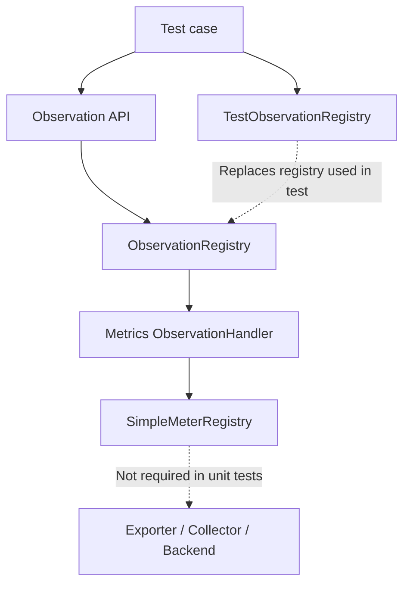
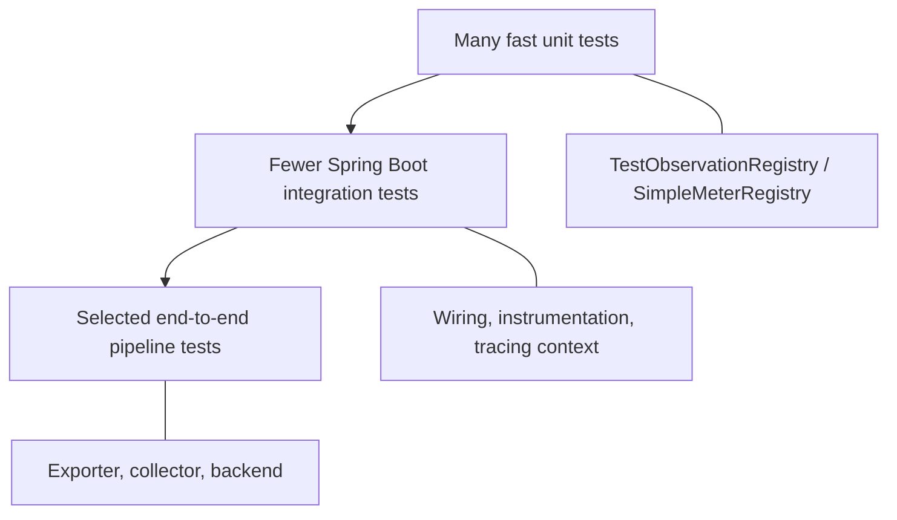

# Test Registries in Spring Boot Observability

A business test can pass while the application fails to emit the expected telemetry: wrong observation name, unstable tags, handler not invoked, or missed errors. Conversely, if tests run against a production-like registry and exporter, the test suite may have to connect to Prometheus, an OpenTelemetry Collector, or an external network backend, making results slow and flaky.

In the **SPRING_BOOT_OBSERVABILITY** module, **Registry Configuration** chapter, the **Test Registries** topic focuses on creating an **isolated registry per test**, verifying how the application uses **Micrometer Observation**, verifying **metrics**, and deciding when you genuinely need to test **tracing, propagation, sampling, and exporters**. The goal is validating signals used to investigate errors, latency, and Spring Boot application behavior without forcing every unit test to spin up the full observability stack.

## 1. What Is a Registry in a Testing Context?

The word *registry* appears in two related yet distinct APIs:

- **`ObservationRegistry`** from Micrometer Observation. This is where observations are created and `ObservationHandler`s are configured to react to `start`, `stop`, `error`, `event`, and scope lifecycles.
- **`MeterRegistry`** from Micrometer Metrics. This is where meters such as `Counter`, `Timer`, and `Gauge` are registered, updated, and queried.

An `ObservationRegistry` does not store all metrics; conversely, `MeterRegistry` does not record the full observation lifecycle. When connected via a metrics observation handler, an observation can produce a measurement in `MeterRegistry`. With an appropriate tracing handler, the observation can also be represented as a span.

In tests, we pick the registry according to **what we want to prove**:

| Test Goal | Right Tool | What It Verifies |
| --- | --- | --- |
| Observation name, tags, lifecycle, or error emitted properly | `TestObservationRegistry` from Micrometer Observation test library | Application's instrumentation contract |
| Custom handler receives start/stop/event/error | `ObservationRegistry.create()` with a recording handler | Callback behavior and required processing order |
| Counter/Timer/Gauge has expected values | `SimpleMeterRegistry` | Direct metric values and labels |
| Observation actually produces a Timer | `ObservationRegistry` + `DefaultMeterObservationHandler` + `SimpleMeterRegistry` | Observation → Metrics bridge |
| Trace has spans, parent-child links, context propagation | Test tracer or in-memory tracing exporter for your stack | Tracing relationships, not just observation names |
| Exporter/Collector receives and stores data | Integration test with a controlled collector/backend | Actual telemetry export pipeline |

A "test registry" is not a separate product. It is a **test configuration choice**: keeping data in memory, isolating state, and enabling reliable assertions.

## 2. Why Not Use a Production Registry in Every Test?

Suppose a `CheckoutService.reserve(...)` test only needs to verify that stock reservation attaches `outcome=accepted`. If that test also has to boot a Spring context, configure an OTLP endpoint, enable sampling, wait for an exporter to flush data, and query a tracing backend, there will be more failure modes unrelated to the business logic under test than in the logic itself.

An in-memory registry provides practical benefits:

1. **Isolation:** data from one test never bleeds into another.
2. **Determinism:** assertions inspect in-process events/metrics without waiting on network transport.
3. **Speed:** no Docker, collector, or backend needed for most unit tests.
4. **Clear contract:** tests verify observation names, tags, and errors instead of vendor-specific formats.
5. **Easy diagnosis:** when an assertion fails, you can tell whether the fault is in instrumentation, handlers, or metrics.

This does not make integration tests redundant. In-memory registry tests **do not prove** that Prometheus scraping works, collectors are configured properly, traces are sampled, or logs are searchable in a backend. Each test level needs an appropriate scope.



The diagram illustrates options. You can test observations **with `TestObservationRegistry` alone**, or test metrics using `SimpleMeterRegistry` without creating observations.

## 3. Preparing Dependencies for Unit Tests

With Spring Boot 3.x and matching Micrometer Observation, a typical Gradle configuration:

```groovy
dependencies {
    implementation 'org.springframework.boot:spring-boot-starter-actuator'

    testImplementation 'org.springframework.boot:spring-boot-starter-test'
    testImplementation 'io.micrometer:micrometer-observation-test'
}
```

`spring-boot-starter-test` normally supplies JUnit Jupiter and assertions; `micrometer-observation-test` provides dedicated observation testing utilities such as `TestObservationRegistry`. Exact dependencies, versions, and annotation packages can vary across Spring Boot/Micrometer lines; rely on your project's dependency management/BOM instead of guessing version numbers.

If you only need to check meter values, `SimpleMeterRegistry` lives in Micrometer Core, which is usually already brought in with Actuator/Micrometer. If a test does not use a Spring context, you can create the registry directly inside the `@Test` method; no `@SpringBootTest` is needed.

> **Selection rule:** Verify **what the application emits** first using a test registry; expand to real registries/exporters only when the test targets the data delivery path.

## 4. Unit Testing Observations with TestObservationRegistry

First write a service class accepting `ObservationRegistry` via its constructor. In a Spring Boot app, this constructor works with dependency injection; in a unit test, you simply instantiate it directly.

```java
import io.micrometer.observation.Observation;
import io.micrometer.observation.ObservationRegistry;

public final class InventoryReservationService {
    private final ObservationRegistry observations;

    public InventoryReservationService(ObservationRegistry observations) {
        this.observations = observations;
    }

    public String reserve(boolean inStock) {
        Observation observation = Observation.createNotStarted(
                "inventory.reserve", observations)
            .lowCardinalityKeyValue("operation", "reserve");

        return observation.observe(() -> {
            String outcome = inStock ? "accepted" : "rejected";
            observation.lowCardinalityKeyValue("outcome", outcome);
            return outcome;
        });
    }
}
```

The service describes an activity with a stable name, two bounded-value labels, and a clear business outcome. This is a minimal example: no network calls, retries, exporters, or tracing backend.

Test using `TestObservationRegistry`:

```java
import io.micrometer.observation.tck.TestObservationRegistry;
import io.micrometer.observation.tck.TestObservationRegistryAssert;
import org.junit.jupiter.api.Test;

class InventoryReservationServiceTest {

    @Test
    void recordsAcceptedOutcome() {
        TestObservationRegistry registry = TestObservationRegistry.create();
        InventoryReservationService service =
            new InventoryReservationService(registry);

        String result = service.reserve(true);

        org.junit.jupiter.api.Assertions.assertEquals("accepted", result);
        TestObservationRegistryAssert.assertThat(registry)
            .hasObservationWithNameEqualTo("inventory.reserve")
            .that()
            .hasLowCardinalityKeyValue("operation", "reserve")
            .hasLowCardinalityKeyValue("outcome", "accepted");
    }

    @Test
    void recordsRejectedOutcome() {
        TestObservationRegistry registry = TestObservationRegistry.create();
        InventoryReservationService service =
            new InventoryReservationService(registry);

        org.junit.jupiter.api.Assertions.assertEquals(
            "rejected", service.reserve(false));

        TestObservationRegistryAssert.assertThat(registry)
            .hasObservationWithNameEqualTo("inventory.reserve")
            .that()
            .hasLowCardinalityKeyValue("outcome", "rejected");
    }
}
```

These assertions capture the **observation contract**:

- The observation is named `inventory.reserve`.
- Both scenarios attach `operation=reserve`.
- Outcomes are recorded consistently under `outcome` rather than inventing different tag keys per branch.
- Each test creates a **fresh registry**, making tests independent of execution order.

`TestObservationRegistryAssert` belongs to Micrometer's testing API. Assertion syntax may differ slightly across versions; the examples reflect common usage in Micrometer Observation 1.x. Check the API of your project's managed dependency if the IDE does not recognize a method.

### Why Create a Fresh Registry for Each Test?

The registry retains recorded state for assertions. If all tests shared a `static` registry, the "rejected" test could see the "accepted" observation from the prior test and yield false results. Likewise, avoid relying on manual cleanup of a shared registry when you can instantiate a fresh one from the start.

If a single test triggers multiple calls with the same observation name, assert the count or filter by attributes **and inspect the actual recorded observations snapshot provided by the test tool**. Do not merely assert "at least one observation with that name exists" when your goal is verifying individual invocations.

## 5. Testing Lifecycle and Events with a Recording Handler

In some situations you need to test directly **which events a handler receives**. You can use `ObservationRegistry.create()` and register an in-memory handler with no backend required:

```java
import io.micrometer.observation.Observation;
import io.micrometer.observation.ObservationHandler;
import io.micrometer.observation.ObservationRegistry;
import java.util.ArrayList;
import java.util.List;
import org.junit.jupiter.api.Test;
import static org.junit.jupiter.api.Assertions.assertEquals;

class ObservationLifecycleTest {
    static final class RecordingHandler
            implements ObservationHandler<Observation.Context> {
        final List<String> calls = new ArrayList<>();

        @Override
        public boolean supportsContext(Observation.Context context) {
            return true;
        }

        @Override
        public void onStart(Observation.Context context) {
            calls.add("start:" + context.getName());
        }

        @Override
        public void onEvent(Observation.Event event,
                            Observation.Context context) {
            calls.add("event:" + event.getName());
        }

        @Override
        public void onStop(Observation.Context context) {
            calls.add("stop:" + context.getName());
        }
    }

    @Test
    void invokesRegisteredHandler() {
        ObservationRegistry registry = ObservationRegistry.create();
        RecordingHandler handler = new RecordingHandler();
        registry.observationConfig().observationHandler(handler);

        Observation observation = Observation.createNotStarted(
            "inventory.reserve", registry).start();
        try {
            observation.event(
                Observation.Event.of("inventory.reserve.retry"));
        } finally {
            observation.stop();
        }

        assertEquals(
            List.of(
                "start:inventory.reserve",
                "event:inventory.reserve.retry",
                "stop:inventory.reserve"),
            handler.calls);
    }
}
```

This example verifies the `onStart`, `onEvent`, and `onStop` callbacks of a specific handler. It proves that **the registry dispatched events to the handler**. It **does not prove** that a separate tracing handler will record a span event or that events were shipped by an exporter.

When testing error handling, extend the handler with `onError(Observation.Context context)`, read `context.getError()`, and assert the expected exception type. Naming an event `failed` does not substitute for `observation.error(exception)`: the two calls represent distinct telemetry semantics.

## 6. Testing Metrics with SimpleMeterRegistry

`SimpleMeterRegistry` is an in-memory metrics registry well suited for checking counters/timers/gauges in unit tests. It is a different registry from `TestObservationRegistry`.

Example of a service counting stock reservation rejections:

```java
import io.micrometer.core.instrument.Counter;
import io.micrometer.core.instrument.MeterRegistry;

public final class ReservationRejectionCounter {
    private final Counter rejected;

    public ReservationRejectionCounter(MeterRegistry registry) {
        this.rejected = Counter.builder("inventory.reservation.rejected")
            .description("Number of rejected inventory reservations")
            .tag("reason", "out_of_stock")
            .register(registry);
    }

    public void reject() {
        rejected.increment();
    }
}
```

Testing counter values without Prometheus or a Spring context:

```java
import io.micrometer.core.instrument.Counter;
import io.micrometer.core.instrument.simple.SimpleMeterRegistry;
import org.junit.jupiter.api.Test;
import static org.junit.jupiter.api.Assertions.*;

class ReservationRejectionCounterTest {
    @Test
    void incrementsRejectedCounter() {
        SimpleMeterRegistry registry = new SimpleMeterRegistry();
        try {
            ReservationRejectionCounter service =
                new ReservationRejectionCounter(registry);
            service.reject();
            service.reject();

            Counter counter = registry.find("inventory.reservation.rejected")
                .tag("reason", "out_of_stock")
                .counter();

            assertNotNull(counter);
            assertEquals(2.0, counter.count());
        } finally {
            registry.close();
        }
    }
}
```

The advantage is asserting **exact numeric values** and **specific tags** without scraping an endpoint. The limitation is that the test does not verify how a Prometheus registry reformats metric names, how time series are exported, or how the monitoring server stores data.

### Testing Timers Produced by Observations

If you want to verify that an observation actually creates a metric, **bridge the registries** using a metrics handler. Example using `DefaultMeterObservationHandler`:

```java
import io.micrometer.core.instrument.Timer;
import io.micrometer.core.instrument.simple.SimpleMeterRegistry;
import io.micrometer.core.instrument.observation.DefaultMeterObservationHandler;
import io.micrometer.observation.Observation;
import io.micrometer.observation.ObservationRegistry;
import org.junit.jupiter.api.Test;
import static org.junit.jupiter.api.Assertions.*;

class ObservationMetricsBridgeTest {
    @Test
    void recordsTimerOnObservationStop() {
        SimpleMeterRegistry meters = new SimpleMeterRegistry();
        try {
            ObservationRegistry observations = ObservationRegistry.create();
            observations.observationConfig()
                .observationHandler(new DefaultMeterObservationHandler(meters));

            Observation.createNotStarted("inventory.reserve", observations)
                .lowCardinalityKeyValue("outcome", "accepted")
                .observe(() -> {
                    // Simulate measured operation.
                });

            Timer timer = meters.find("inventory.reserve")
                .tag("outcome", "accepted")
                .timer();

            assertNotNull(timer);
            assertEquals(1L, timer.count());
        } finally {
            meters.close();
        }
    }
}
```

The test verifies that the handler recorded **one execution** in the Timer. Do not assert exact duration values: OS schedulers, CPU load, and JIT compilation cause execution times to vary. When latency threshold testing is needed in performance tests, use a dedicated environment and benchmarking methodology.

In this example, `DefaultMeterObservationHandler` is registered **explicitly**. Simply calling `ObservationRegistry.create()` and running an observation will not automatically populate an arbitrary `SimpleMeterRegistry`.

## 7. Test Registries Inside a Spring Boot Context

Not every test can instantiate services with `new`. When you want to test Spring Boot wiring, AOP, auto-configuration, HTTP instrumentation, or multi-bean integration, use a Spring test context.

Two common testing levels:

| Level | Approach | When to Use |
| --- | --- | --- |
| **Plain Java unit test** | Instantiate `TestObservationRegistry` directly, pass to service | Verifying instrumentation of a single class |
| **Spring integration test** | Provide a test registry bean in `@TestConfiguration` or via appropriate bean override | Verifying the same registry is injected across multiple beans and instrumentation runs in context |

Example test bean configuration (illustrative for Spring Boot 3.x):

```java
import io.micrometer.observation.tck.TestObservationRegistry;
import org.springframework.boot.test.context.TestConfiguration;
import org.springframework.context.annotation.Bean;
import org.springframework.context.annotation.Primary;

@TestConfiguration(proxyBeanMethods = false)
class TestObservationConfiguration {
    @Bean
    @Primary
    TestObservationRegistry testObservationRegistry() {
        return TestObservationRegistry.create();
    }
}
```

Import this configuration into your test class as appropriate for your project layout, e.g. via `@Import(TestObservationConfiguration.class)`. `@Primary` helps Spring pick the test bean when code depends on `ObservationRegistry` and multiple beans of that type exist. Inspect the actual auto-configuration context: in some Spring Boot versions, an `ObservationRegistry` bean or test observability setup already exists, so adding a test bean and wiring handlers must be reviewed to avoid two registries coexisting unintentionally.

**Important note for `@SpringBootTest`:** in many Spring Boot 3.x lines, observability auto-configuration in tests is scaled back/disabled by default so tests do not emit telemetry. When your goal is verifying automatic instrumentation, you may need `@AutoConfigureObservability` and matching dependencies/configuration for your version. That mechanism **does not replace** a test registry for asserting business-created observations. Use the exact annotation package for your Spring Boot version.

### Pitfalls with Spring ApplicationContext Caching

Spring Test normally caches the `ApplicationContext` for speed. If `TestObservationRegistry` is a singleton bean inside a cached context, multiple test methods or classes may see observations recorded earlier. Do not assume each `@Test` automatically gets a fresh bean.

How to handle it:

- Prefer plain Java tests with a fresh registry when testing a single service's instrumentation.
- For integration tests, design appropriate state isolation or context boundaries; weigh the cost of recreating contexts.
- Never run parallel tests against **a single shared recording registry** if assertions assume ordering or exact counts.
- Ensure async calls complete before asserting; avoid arbitrary `Thread.sleep(...)` checks.

## 8. Testing Tracing: Requires More Than ObservationRegistry

`TestObservationRegistry` verifies observation lifecycles and tags, but **does not by itself prove** tracing works. For distributed tracing, add a test layer when needed:

1. Configure a test tracer/bridge or an **in-memory span exporter** from your tracing SDK.
2. Use sampling matching your test goal so asserted spans are actually recorded.
3. Run the observation-producing operation and cross HTTP, messaging, or async boundaries if that is the behavior under test.
4. Assert span names, parent-child relationships, attributes, error statuses, and propagation; do not rely on a hardcoded trace ID.
5. Close/export/flush resources after tests per the SDK's API to prevent thread and state leaks.

Key distinctions to maintain:

- **Observation recorded**: proves code emitted an Observation signal.
- **Span created**: requires an active tracing handler/bridge and tracer.
- **Span exported**: requires configured and flushed SDK/exporter.
- **Trace visible in backend**: also depends on collector, network, sampling, retention, and query system.

In unit tests, a fake/in-memory tracer can be used. In operational integration tests, a test collector and test backend verify telemetry export configuration. Avoid making real network calls in hundreds of unit tests just to assert observation names.

### Context Propagation in Tests

A synchronous test may pass `Observation.Scope` checks yet still miss a lost-trace-context bug when the application uses an executor. Real propagation tests should cross **the actual boundary type** (threads, task executors, HTTP client/server, or message brokers), then verify both upstream and downstream receive the right context. Creating a new `ObservationRegistry` does not automatically propagate context to other threads.

When verifying MDC correlation in logs, use a **test appender** or appropriate log capture and verify `traceId` and `spanId` in the expected context. Log correlation does not guarantee the trace exists in the backend if sampling/export dropped that trace.

## 9. Testing Tags, Cardinality, and Signal Names

One of the most valuable goals of registry testing is catching unintended instrumentation changes.

**Should assert:**

- Stable observation names, such as `inventory.reserve`, free of SKUs or request IDs.
- Bounded low-cardinality tags such as `operation=reserve` and `outcome=accepted/rejected/error`.
- No emails, tokens, `userId`, or raw URLs containing IDs in metric labels.
- Labels and errors reflect actual outcomes rather than treating every out-of-stock case as a technical error.
- At operation start/stop, handlers receive callbacks and Timer metrics record the expected count.

**Should not assert:**

- Exact millisecond execution time in unit tests.
- Random values of trace IDs, span IDs, or timestamps.
- Strict ordering among parallel async requests when no ordering contract exists.
- Exporter-transformed metric names/units/suffixes by relying on `SimpleMeterRegistry`; those tests require the specific exporter.

Example: A developer puts `orderId=ORD-918273` as a low-cardinality key. A unit test might pass because it finds the requested tag, yet production will suffer a time series explosion. Observability contract reviews/tests should catch **bad label design**, not merely verify that the API accepts a tag.

## 10. Common Mistakes When Using Test Registries

| Symptom | Possible Cause | How to Fix |
| --- | --- | --- |
| Assertion finds no observation | Service received a different registry, or observation never ran/stopped | Inject the exact same registry; check lifecycle |
| Observation runs, `SimpleMeterRegistry` stays empty | Metrics handler not connected | Register `DefaultMeterObservationHandler` |
| Counter in test B is unexpectedly large | Shared registry/bean across multiple tests | Create a fresh registry or isolate state |
| Observation test passes, no traces appear | Missing tracing handler/bridge, sampled out, or export failure | Test tracing at the appropriate level |
| Integration test fails calling collector | Unit test uses production exporter | Use in-memory registry; separate exporter integration tests |
| Duration assertions flake | Execution time depends on runtime environment | Assert counts/tags; keep latency checks for dedicated perf tests |
| Handler misses events | Handler unregistered or `supportsContext(...)` returns false | Check registry, context, and observation name |
| Test misses HTTP instrumentation | Test context lacks observability auto-configuration or dependency | Check Spring Boot version and test config |
| Tests pass but Prometheus queries fail | `SimpleMeterRegistry` does not replicate exporter naming/buckets | Add contract/integration test with Prometheus registry |
| Logs have trace ID, stored trace missing | Sampling, exporter, or tracing pipeline issue | Verify each tracing stage separately |

One major mistake is **mocking the entire `ObservationRegistry`** and merely asserting method call counts. That may check that code *invoked an API*, but does not verify lifecycle completion, tags on the finished observation, or handlers. Given how cheap it is, a real in-memory registry is usually far more useful than heavy mocking.

## 11. Layered Testing Strategy for Real Projects

A balanced strategy typically has three layers:



**Unit layer:** each business class can test its observation names, tags, outcomes, errors, and dedicated metrics. Evidence is in-memory data, fast to run and easy to debug.

**Integration layer:** pick critical paths such as HTTP checkout → service → executor or downstream client. Verify automatic instrumentation, context propagation, handler/registry wiring, and log correlation.

**Pipeline layer:** run a few controlled tests confirming Prometheus endpoints, OTLP exporters, collectors, credentials, sampling, and backends genuinely receive data. These tests can be slower, so keep them out of everyday unit tests.

Separating test layers isolates root causes: if a unit test fails, the issue is likely instrumentation or the tag contract; if only pipeline tests fail, investigate registry/exporter/collector/network before touching business code.

## 12. Illustrative Scenario: Slow Checkout with Missing Traces

**Hypothetical scenario:** a development team adds an observation for `checkout.payment.authorize`. Unit tests with `TestObservationRegistry` verify the name and `outcome=timeout`. Metrics tests with `SimpleMeterRegistry` show the Timer recorded once. However, staging shows no traces.

We can analyze along the verification chain:

1. **Observation contract:** unit tests prove the operation emits the right name/tags into the test registry. This is baseline instrumentation evidence.
2. **Metrics path:** a metrics handler in tests turned the observation into a Timer. That does not prove a tracing handler is present in staging.
3. **Tracing path:** inspect the tracing bridge dependency, sampler, and tracer in staging. An observation without a tracing handler produces no span even when unit tests pass.
4. **Exporter path:** inspect the OTLP endpoint, protocol, TLS/credentials, collector, and dropped-span metrics. Sampling may also drop the specific request trace you are looking for.
5. **Correlation:** if logs for that request contain `traceId`, use it to locate a successfully sampled/exported trace. The presence of a correlation ID does not guarantee the trace sits in trace storage.
6. **Latency investigation:** once tracing works, combine p95/error-rate metrics, slow trace spans, and related logs to pinpoint bottlenecks and measure again after fixes.

Test results localize the gap: **Observation API was tested, the tracing pipeline was not**. Do not conclude `TestObservationRegistry` is broken just because staging traces are absent.

## 13. Self-Check Exercises

**Exercise 1.** A test must verify that `PaymentService` creates an observation named `payment.authorize` with `outcome=declined`. Which registry should you use?

*Hint:* `TestObservationRegistry`, with a fresh registry for the test and assertions on the completed observation's name and tags.

**Exercise 2.** A test wants to confirm the counter `checkout.errors` increments three times with tag `cause=timeout`. What should you use?

*Hint:* `SimpleMeterRegistry`, then look up the exact counter and assert `count() == 3`; no tracing backend needed.

**Exercise 3.** A test creates `ObservationRegistry.create()` and `SimpleMeterRegistry` but sees no Timer. Explain why.

*Hint:* The two registries do not connect automatically. Register a matching metrics observation handler or use `MeterRegistry` directly.

**Exercise 4.** A `@SpringBootTest` has a shared `TestObservationRegistry` bean; running the test alone passes, but running the full suite fails. Why?

*Hint:* Spring may cache the `ApplicationContext` so the registry retains state across tests. Isolate the registry or adjust test scoping; watch out for parallel runs.

**Exercise 5.** A `TestObservationRegistry` test passes, yet traces between checkout and inventory split into two separate traces in a real environment. What is the next step?

*Hint:* Test context propagation across HTTP/async and inspect instrumentation on both sides; testing observation names alone does not prove propagation.

**Exercise 6.** Why should you avoid asserting that a call completes in exactly 50 ms?

*Hint:* Execution time depends on the scheduler, JIT, and test environment. Assert Timer presence, count, and tags; keep performance measurements in dedicated benchmarks.

## 14. Key Takeaways

- **`TestObservationRegistry`** verifies the lifecycle contract, names, and tags of Micrometer Observation without depending on real exporters.
- **`SimpleMeterRegistry`** tests Counters/Timers/Gauges. To verify Timers emitted from Observations, connect them via a **metrics observation handler**.
- **A fresh registry per test** isolates data; with Spring Test, account for **`ApplicationContext` caching** and parallel test execution.
- **Tracing, context propagation, sampling, and exporters** require matching integration tests; unit tests for observations do not prove traces reach the backend.
- A useful observability test suite validates **the business meaning of signals**: stable names, sensible low-cardinality tags, accurate error representation, and sufficient data for incident investigation.
