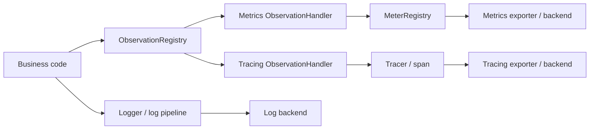
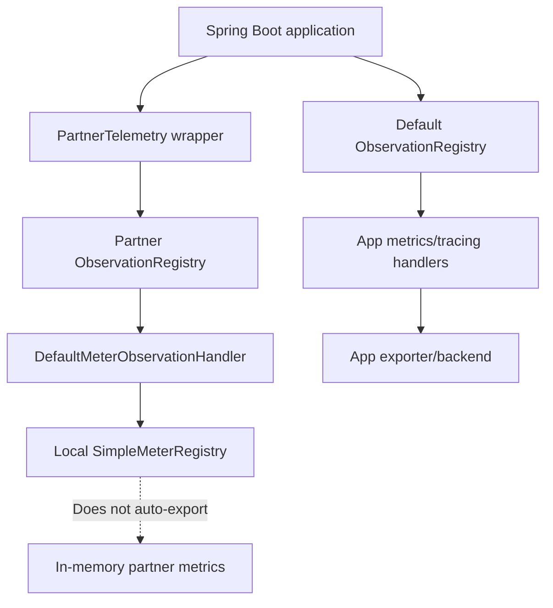

# Splitting Registries by Boundary

A Spring Boot application may simultaneously handle user requests, call an external payment service, and run internal data-sync tasks. These activities differ in ownership, observation requirements, data sensitivity, and telemetry budgets. When should you use **one shared `ObservationRegistry`**, and when should you **split registries by boundary**?

In the **SPRING_BOOT_OBSERVABILITY** module, we build observability using Micrometer Observation, metrics, logs, and distributed tracing; we also learn context propagation, tags/cardinality, exporters, sampling, and how to correlate signals to investigate errors or latency. This lesson belongs to the **Registry Configuration** chapter and focuses on an architectural decision: which registry owns an observation, how processing is configured, and whether that boundary actually isolates operational data.

**Key idea:** splitting `ObservationRegistry` separates **observation processing configuration and lifecycle** along a scope within the same application. It **does not automatically** isolate `MeterRegistry`, tracers, exporters, backends, or data access controls. When full isolation is needed, you must design the paths for metrics, logs, and traces as well.

## Learning Objectives

After this lesson, you will be able to:

1. Explain what a **boundary** is and distinguish it from an HTTP/service boundary or deployment boundary.
2. Distinguish the responsibilities of `ObservationRegistry`, `MeterRegistry`, tracing bridges, and exporters in Spring Boot.
3. Decide when to use one registry with tags/filters/conventions versus creating an independent registry.
4. Configure an isolated observation zone with a metrics handler while keeping the Spring Boot-managed registry for other components.
5. Analyze how splitting registries affects current observations, scopes, propagation, linked spans, and log correlation.
6. Avoid confusing configuration separation with data isolation, control cardinality/sampling, and verify results in real environments.

## 1. What Does Boundary Mean in Observability?

A **boundary** is a line of responsibility or policy where you want to control how observation signals are collected and processed. It can be defined by:

- **Business domain:** checkout, payment reconciliation, notifications, and reporting.
- **Ownership:** shared platform, payments team, partner-integration team.
- **Reliability:** internal logic versus calls to third-party systems.
- **Data requirements:** fields needing masking, retention duration, query permissions, or storage location.
- **Operational profile:** high-volume low-diagnostic-value flows versus critical flows with rare errors requiring retained traces.
- **Execution model:** synchronous requests, background jobs, message consumers; these can be useful boundaries without necessarily needing separate registries.

Boundary does not mean "one registry per class" or "one registry per controller." Over-splitting forces the application to maintain multiple sets of handlers, tags, sampling rules, and exporters; correlating signals also becomes harder.

For example, in a `checkout-service` application:

```text
checkout-service (single JVM)
├── Checkout API
│   ├── validateCart()
│   ├── reserveStock()
│   └── authorizePayment()
├── Adapter calling payment provider (partner boundary)
└── Job reconcilePayments() (background task boundary)
```

We might want to measure overall checkout latency and apply a dedicated policy for payment provider calls. However, **wanting a separate dashboard is not enough reason to create multiple `ObservationRegistry` instances**: a single registry with clear observation names, stable tags, and appropriate filters is usually simpler.

## 2. Which Registry Are We Talking About?

The word "registry" is easy to confuse because the Micrometer ecosystem contains several distinct objects.

| Component | Role | What does splitting this object achieve? |
|---|---|---|
| `ObservationRegistry` | Manages observation configuration: predicates, filters, conventions, handlers, and current observation context | Separates processing policies and current-observation scope per registry |
| `MeterRegistry` | Registers and stores/collects meters like counters, timers, gauges; connects to a metrics system depending on registry type | Can create separate measurement scopes or metric export paths if configured with matching backends |
| `Tracer` / tracing implementation | Creates/manages spans, context, and tracing decisions per implementation | Can alter how traces are formed, sampled, and propagated; not synonymous with splitting exporters |
| Exporter / collector / backend | Transports, filters, stores, and queries telemetry | Determines where data actually lands, how long it is kept, and who can access it |
| Logging framework / log pipeline | Writes events, correlation, and forwards structured logs | Has its own logging policy; splitting `ObservationRegistry` does not automatically split logs |

**Micrometer Observation is a coordination layer**, not a store for all metrics, logs, and traces. When an observation calls `start()`, opens a `scope`, and calls `stop()`, `ObservationHandler`s registered on that registry can turn lifecycle events into timers, spans, or other behaviors.



Looking at the diagram makes it clear: **adding another registry does not automatically create matching handlers**. An unconfigured new registry still lets code invoke the Observation API without producing useful metrics or spans.

### What Does Spring Boot Provide?

In Spring Boot 3.x applications with observability configured, Spring Boot can automatically create an `ObservationRegistry` and wire it to matching instrumentations/handlers based on existing dependencies, beans, and configuration. This is normally the registry used by auto-instrumented components.

Declaring an additional `@Bean ObservationRegistry` yourself requires great caution:

- Auto-configuration conditions can change when the application supplies its own bean of that type.
- If multiple beans of the same type exist, unqualified injection can become ambiguous.
- A self-created registry does not automatically inherit `ObservationHandler`s, `ObservationPredicate`s, `ObservationFilter`s, or customizers applied to another registry.
- Some Spring or library instrumentations may keep using the default registry while business code uses the separate registry.

Dependency names, auto-configuration hooks, and sampling/export mechanisms must be verified against the running Spring Boot/Micrometer version.

## 3. When Should You Use a Shared Registry?

**By default, start with a single Spring Boot-managed `ObservationRegistry`** for flows inside the same application if they share observation goals, handlers, and telemetry infrastructure.

Check the following questions before deciding to split:

1. **Need dashboard grouping?** Use observation names and low-cardinality tags such as `boundary=partner` or `operation=authorize`.
2. **Need to skip certain observations?** Consider an `ObservationPredicate` instead of creating a new registry just to drop a group of operations.
3. **Need to add or normalize tags?** Use appropriately configured conventions/filters to keep semantics unified; pay attention to when tags apply relative to handlers.
4. **Need a few dedicated business spans?** Instrument high-diagnostic-value sections with observations using proper names and scopes; you do not need to split registries just for child spans.
5. **Need separate dashboards per team?** Use queries, namespaces, resource attributes, labels, and access controls in the backend.

For example, a shared registry can record metrics for `checkout.payment.authorize` with tag `boundary=external-partner`. This field has a small value set, making filtering easy without creating millions of time series like `orderId` or `traceId`.

```java
import io.micrometer.observation.Observation;
import io.micrometer.observation.ObservationRegistry;
import org.springframework.stereotype.Service;

@Service
class CheckoutPaymentService {
    private final ObservationRegistry observationRegistry;
    private final PaymentGateway gateway;

    CheckoutPaymentService(ObservationRegistry observationRegistry,
                           PaymentGateway gateway) {
        this.observationRegistry = observationRegistry;
        this.gateway = gateway;
    }

    PaymentResult authorize(PaymentRequest request) {
        return Observation.createNotStarted(
                        "checkout.payment.authorize", observationRegistry)
                .lowCardinalityKeyValue("boundary", "external-partner")
                .lowCardinalityKeyValue("operation", "authorize")
                .observe(() -> gateway.authorize(request));
    }
}
```

Types `PaymentGateway`, `PaymentRequest`, and `PaymentResult` are illustrative. This pattern relies on the Spring Boot-supplied registry via dependency injection and the `observe(...)` API to manage synchronous lifecycles. **The `boundary` tag is for grouping, not a security or exporter-isolation mechanism.**

## 4. When Is Splitting ObservationRegistry Actually Useful?

A separate registry is worth considering when a group of operations needs **distinct, independent processing policies**, such as:

- A partner adapter requires a specialized chain of `ObservationHandler`s while main application telemetry stays untouched.
- A library or workflow has its own instrumentation lifecycle and must not alter handlers of the main application.
- An experimental task needs a **local, non-exported** registry and meter store to measure a set of operations in a controlled way.
- Groups of operations have lifecycles and semantics so different that sharing filters/conventions risks unintended interference, and separation has proven necessary.

If the only differences are service name, route, team, or priority level, splitting registries adds overhead without solving the problem.

Decision table:

| Need | Usually Appropriate Option | Reason |
| --- | --- | --- |
| Separate checkout and inventory dashboards | One `ObservationRegistry`, categorized by name/tags | Keeps tracing and context consistent |
| Distinguish partners A/B in measurements | Bounded tag like `partner=alpha\|beta` | Controlled cardinality |
| Drop a noisy operation | Policy-driven predicate/filter | Avoids adding extra registries |
| Dedicated handlers for an isolated library | Dedicated, fully configured registry | Separates handlers and configuration lifecycle |
| Keep experimental metrics out of main backend | Dedicated registry and meter store **not wired** to main exporter | Isolates the actual measurement path |
| Two tenants require isolated data access | Dedicated pipeline/exporter/backend and access controls | A single in-process registry is not a security boundary |
| Different trace sampling rates per request type | Appropriate sampler/collector policy in tracing stack | Splitting ObservationRegistry does not automatically create independent sampling policies |

**Prerequisite before splitting:** know clearly whether you want to separate **observation configuration**, **metric sets**, **traces**, or **data storage**. These are distinct objectives.

## 5. Spring Boot Example: A Local Registry for a Partner Boundary

The example below shows how an integration module creates **its own `ObservationRegistry` and `MeterRegistry`** for isolated measurements independent of the main application registry. The snippet illustrates Spring Boot 3.x and Micrometer; it uses `SimpleMeterRegistry` to keep the mechanism clear, not as a production exporter setup.

To avoid replacing Spring Boot's default `ObservationRegistry` bean, we **wrap** the second registry inside a bean of a different type:

```java
import io.micrometer.core.instrument.observation.DefaultMeterObservationHandler;
import io.micrometer.core.instrument.simple.SimpleMeterRegistry;
import io.micrometer.observation.ObservationRegistry;
import org.springframework.context.annotation.Bean;
import org.springframework.context.annotation.Configuration;

record PartnerTelemetry(ObservationRegistry observations,
                        SimpleMeterRegistry meters) {}

@Configuration(proxyBeanMethods = false)
class PartnerTelemetryConfiguration {

    @Bean
    PartnerTelemetry partnerTelemetry() {
        SimpleMeterRegistry meters = new SimpleMeterRegistry();
        ObservationRegistry observations = ObservationRegistry.create();

        observations.observationConfig()
                .observationHandler(new DefaultMeterObservationHandler(meters));

        return new PartnerTelemetry(observations, meters);
    }
}
```

In this configuration:

- `observations` is a dedicated registry created for the partner boundary; it is not exposed as a Spring bean of type `ObservationRegistry`.
- `meters` is an independent in-memory meter store. `DefaultMeterObservationHandler` converts observations processed by this registry into corresponding metrics.
- This registry **has no tracing handler attached**, and `SimpleMeterRegistry` **does not automatically ship metrics to Prometheus/OTLP**.
- Thus the example is helpful for learning how to isolate configuration and verify metrics locally; for production, select appropriate registry/exporter types, manage lifecycle/cleanup, and integrate tracing as required.

Service using the boundary's registry:

```java
import io.micrometer.observation.Observation;
import org.springframework.stereotype.Service;

@Service
class PartnerPaymentAdapter {
    private final PartnerTelemetry telemetry;
    private final PartnerClient client;

    PartnerPaymentAdapter(PartnerTelemetry telemetry, PartnerClient client) {
        this.telemetry = telemetry;
        this.client = client;
    }

    PartnerResponse send(PartnerRequest request) {
        return Observation.createNotStarted(
                        "partner.payment.send", telemetry.observations())
                .lowCardinalityKeyValue("operation", "send")
                .lowCardinalityKeyValue("partner", "provider-a")
                .observe(() -> client.send(request));
    }
}
```

`PartnerClient`, `PartnerRequest`, and `PartnerResponse` are illustrative types. `observe(...)` manages start, scope, supported error recording, and stop for the synchronous callback. Once the operation completes, metrics can be queried in `telemetry.meters()` if the handler and context meet measurement conditions.

### What Is Isolated and What Is Not?



**Isolated:** handler application for observations created with `telemetry.observations()` and where their metrics are held in this example.

**Not automatically provided:** spans/traces for partner-boundary observations, correlation with the root request span, separate exporters, separate log pipelines, or per-tenant access controls. If the application needs end-to-end request investigation, those pieces must be integrated explicitly.

### Why Not Declare Two `@Bean ObservationRegistry` Beans Right Away?

Suppose we declare `@Bean("applicationRegistry")` and `@Bean("partnerRegistry")` both of type `ObservationRegistry`. Then:

- Injecting `ObservationRegistry` into a controller or instrumentation can become ambiguous without `@Qualifier`/`@Primary`.
- A custom bean can alter auto-configuration behaviors that depend on missing-bean conditions.
- If only one registry has a tracing handler, observations using the other registry may not emit expected spans.
- Marking one registry `@Primary` chooses the default injection bean, but **does not automatically copy** handlers, samplers, and exporters between registries.

Wrapping in `PartnerTelemetry` **clarifies ownership** and minimizes side effects on application auto-configuration. If you truly need multiple Spring-managed registries, carefully design bean wiring, customizer/handler chains, and instrumentations for your exact version, and verify end-to-end.

## 6. Splitting Registries and Parent–Child Observation Relationships

One easily overlooked cost of splitting registries is **losing shared reasoning about the current context**.

Within a single registry, code can create a parent observation, open a scope, and create a child observation:

```java
Observation parent = Observation.createNotStarted(
        "checkout.request", applicationRegistry).start();

try (Observation.Scope parentScope = parent.openScope()) {
    // Application registry sees parent observation as current.
    executeCheckout();
} finally {
    parent.stop();
}
```

If `executeCheckout()` calls an adapter using `partnerTelemetry.observations()`, the second registry has **its own current-observation tracker**. Consequently:

- `applicationRegistry.getCurrentObservation()` sees `checkout.request` inside the parent scope.
- `partnerTelemetry.observations().getCurrentObservation()` does not automatically see the current observation from the other registry.
- Parent–child observation relationships at the Micrometer Observation level cannot be assumed merely from nested Java calls.

This **does not mean every trace automatically breaks**. The tracing implementation may maintain its own span context, and some integrations can restore/propagate spans through their own mechanisms. Still, with the partner registry in the example above **having no tracing handler**, you should not expect a `partner.payment.send` span to appear.

Therefore, if the goal is keeping **one continuous trace from the HTTP request to the payment provider**, a shared registry with child observations/spans is usually the lower-risk choice. Only split registries when you have explicitly designed how relationships and context restoration work across the boundary.

### Distinguishing Scope Separation from Trace Separation

| Symptom | What You Can Conclude | What You Cannot Conclude Yet |
|---|---|---|
| `getCurrentObservation()` on registry B returns `null` | B has no current observation in this context | That the request has no parent span in the system-wide tracer |
| Metric in registry B has a value | B's metric handler processed a matching observation | That traces were exported or logs carry trace IDs |
| Downstream HTTP still receives `traceparent` | Something injected trace context | That the backend stored spans from all services |
| Partner span is missing | There is a telemetry gap to investigate | That the partner adapter definitely did not run |

**Do not use registry splitting to try to "cut off traces" as a security mechanism.** Trusted data boundaries require controlling headers, baggage, attributes, exporters, and access permissions at the appropriate layers.

## 7. Splitting by Handler Policy, Tags, and Cardinality

`ObservationRegistry`'s practical strength is configuring how observations are processed. When registries are split, these configurations must be governed per boundary.

### 7.1. One Registry Can Have Multiple Handlers

`ObservationHandler` receives callbacks such as start, stop, event, error, or scope according to the methods it implements. You can have metrics handlers, tracing handlers, and custom handlers. Handler ordering/composition strategies must be configured properly to avoid both missing recordings and double counting.

**Never assume "adding a registry copies handlers from the main registry."** Each registry must be wired explicitly. Conversely, if an observation is instrumented twice by two mechanisms, metrics or spans can be double-counted.

### 7.2. Predicates and Filters Have Different Purposes

- **`ObservationPredicate`** decides whether an observation is observed by handlers in a registry, based on its name and context at evaluation time.
- **`ObservationFilter`** adds/adjusts an observation's context according to lifecycle timing; understand when filters apply to tags so you do not expect them to modify data already recorded earlier.
- **`ObservationConvention`** defines standardized names/contextual names and key-values for a group of observations.

These mechanisms let you enforce policies on a shared registry when differences between boundaries come down to names, tags, or operation types.

### 7.3. Keep Cardinality Low Even After Splitting Registries

Splitting registries **does not make high-cardinality labels safe**. For example:

```text
Good for metrics:
  boundary=partner
  operation=send
  partner=provider-a
  outcome=success|failure

Unsuitable as metric labels:
  orderId=84923842
  userId=391847
  traceId=...
  requestUrl=/orders/84923842
```

If `orderId` or a request identifier is needed for investigation, store it in logs/traces under security policies rather than as a metric tag. Keeping multiple registries while putting unique IDs into meter names/tags still incurs high cost.

**Principle:** a boundary should describe a stable operation category and owner; it should not be a dynamic string per request or per customer.

## 8. Sampling, Exporters, and Privacy: Three Separate Layers

Suppose the payments team wants to retain 100% of failed partner traces while keeping only 10% of successful traces, whereas regular checkout flows follow a different sampling policy. Merely creating another `ObservationRegistry` **is not enough to achieve that requirement**.

Separate three questions:

1. **How does an observation create a span?** Its registry must have a configured tracing handler/bridge. Without one, there is no span for an exporter to send.
2. **Which spans are kept?** This depends on the tracing implementation's sampler, head/tail sampling mechanisms, and collector. Head sampling usually decides before final outcomes are known; prioritizing slow errors often requires tail sampling with sufficiently sized buffers.
3. **Where are spans/logs/metrics sent and viewed?** Exporters, collector routing, backends, retention, and authorization determine whether data is truly isolated.

Even a separate registry can still feed **the same exporter and backend** if all components are configured to share an export path. For traces, the same tracer or trace context can span multiple operations; verify the concrete policy.

### Security Boundaries Cannot Live Only in ObservationRegistry

In environments with multiple tenants/partners or sensitive data:

- Audit span attributes, baggage, log fields, and payloads shipped to backends. Keep out tokens, card numbers, secrets, and sensitive payloads.
- If access separation is needed, use backend namespaces/tenants/projects, collector routing, and appropriate access controls.
- Define retention, export, sampling, and data residency rules matching real compliance requirements.
- Check HTTP header paths too: trace context may need propagation for linking, while baggage or attributes may need restriction.
- Consider what happens if one boundary's exporter stalls: could it degrade latency or resources in the main application?

**A registry is an in-process configuration boundary, not a security sandbox.**

## 9. Operational Scenario: Slow Payments After Splitting Registries

Suppose a Spring Boot application initially used one shared registry. Later the team split the payment-provider adapter onto its own registry to manage partner metrics separately. The next day, dashboards still show `POST /checkout` p95 rising, yet traces no longer show the `partner.payment.send` span.

From this symptom, do not conclude the payment-provider call is not running.

### Investigation Path

**Step 1 — Verify whether the observation is created.** Check that instrumentation actually uses `PartnerTelemetry` and callbacks run in the right scope; inspect local metrics in the partner registry if using a setup like the example.

**Step 2 — Inspect handlers on the partner registry.** If only `DefaultMeterObservationHandler` is registered, missing spans are the expected result of the current setup. Add an appropriately designed tracing handler/bridge if spans are needed.

**Step 3 — Inspect scopes and current context.** An observation in registry A does not automatically become the current observation in B. For continuous traces, define how context links across both zones rather than guessing from Java call nesting.

**Step 4 — Inspect HTTP clients and propagation.** A tracing handler might exist while the client fails to inject context or a gateway strips `traceparent`. Inspect the instrumented client, headers, and downstream spans.

**Step 5 — Inspect sampling and exporters.** A span might be created yet dropped by sampling, dropped at the collector, or sent to an unconfigured backend. Check pipeline health signals rather than relying solely on the trace search screen.

**Step 6 — Re-evaluate the split.** If the actual goal was only a separate dashboard, one shared registry with `boundary=external-partner` reduces complexity, preserves trace linking, and still supports slicing metrics.

### Combining Evidence

| Evidence | Tells You | Does Not Prove |
|---|---|---|
| HTTP p95 metric increases | Latency for a group of requests changed | Which downstream step is slow |
| Local `partner.payment.send` metric still rises | Adapter observation is measured in the isolated registry | That spans/traces reached the backend |
| Timeout logs from provider | Timeout events were recorded | That every slow request failed for the same reason |
| Trace lacks adapter span | There is a gap in the viewed trace signal | That the adapter failed to execute |
| Trace context appears over HTTP | Headers propagated across one hop | That all services' traces were stored |

Here splitting registries created a **tracing blind spot** because handler setups were out of sync. Explicitly weigh whether isolation benefits justify the added telemetry-correlation complexity.

## 10. Pre-Production Checklist

Before splitting one application into multiple registries, answer:

1. **What is this boundary?** Business domain, ownership, policy difference, or legal requirement? Is a new registry truly necessary?
2. **Who creates observations?** Which registry is each instrumentation, filter, convention, and handler attached to?
3. **Where is the current context?** Are there nested calls, thread pools, `@Async`, Reactor, or message queues needing context capture/restoration?
4. **Where are metrics stored?** Local registry or real exporter? Any duplicate meters, wrong tags, or high cardinality?
5. **Is tracing continuous?** Are matching handlers, child spans, HTTP/messaging propagation, samplers, and collectors in place?
6. **Can logs correlate?** Do logs inside the adapter carry `traceId`/`spanId` per log correlation config and active context?
7. **Is data isolated as required?** Are exporters, collectors, backends, retention, access controls, and sensitive-data redaction policies configured?
8. **Does Spring Boot auto-configuration still work?** Did adding registry beans alter default bean selection, handlers, or built-in instrumentation?
9. **Can missing-telemetry incidents be diagnosed?** Monitor exporter errors, dropped spans, scrape failures, and backend health.
10. **Has it been tested end-to-end?** Exercise success, error, slow, and async requests; verify figures across each path.

### Common Design Mistakes

| Mistake | Why It Happens | Fix |
|---|---|---|
| Calling `ObservationRegistry.create()` and expecting traces | New registry lacks a tracing handler | Configure required handlers/bridge and pipeline, or use the shared registry |
| Adding a secondary registry bean breaks injection | Multiple beans of the same type or altered auto-config conditions | Wrap secondary registry, configure qualifiers/primary, and verify bean wiring |
| Custom metrics exist locally but not in Prometheus | `SimpleMeterRegistry` stores in memory and does not export | Use the intended meter registry/exporter |
| Putting `userId` in metric tags for tenant isolation | Cardinality grows per user | Use bounded group tags; keep individual IDs in controlled signals |
| Splitting registries to protect partner data | Data may still share the same exporter/backend | Configure routing, storage, access control, and redaction |
| Traces break when calling adapter | Current observation belongs to another registry, missing handler/propagation | Trace context across each boundary and design linking explicitly |
| One operation counted twice | Auto and manual instrumentation measure the same scope | Pick one owner for the measurement or clearly separate names/semantics |
| Missing traces for rare errors | Sampling or exporter did not retain them | Check sampler/collector and use metrics/logs to gauge impact |

## 11. Self-Assessment

**Question 1.** Two teams want different dashboards for the same Spring Boot application. Must you create two `ObservationRegistry` instances?

**Hint:** No. When you only need to filter by operation group, observation names, low-cardinality tags, and backend query permissions usually suffice.

**Question 2.** An adapter uses an independent `ObservationRegistry.create()` without registering handlers. Will timers and spans appear in the backend?

**Hint:** No. Creating a registry only sets up the observation coordination layer; matching handlers, meters/tracers, and exporters are required.

**Question 3.** When registry A has a current observation, does calling `registryB.getCurrentObservation()` automatically return that observation?

**Hint:** Do not assume so. Two registries manage current observations independently. Tracing contexts at another layer may have their own mechanism, so inspect the real execution path.

**Question 4.** Is splitting `ObservationRegistry` enough to guarantee partner data is never exported to the main backend?

**Hint:** No. You must also separate or control handlers, meter registries, tracers/exporters, collector routing, storage, and access permissions.

**Question 5.** After splitting registries, payment metrics still appear, but traces no longer contain the adapter span. What should you check first?

**Hint:** Identify which registry is used, which handlers are registered, scope/current observation, and the tracing bridge; then inspect propagation, sampling, and exporters.

## Conclusion

**Splitting registries by boundary separates observation processing policies**, which is useful when there is a clear handler or ownership rationale. In most Spring Boot applications, **one shared `ObservationRegistry` with sensible names, tags, conventions, and filters** preserves context and reduces complexity. When a dedicated registry is needed, configure all required handlers, meters/tracers, and export paths; verify propagation, sampling, cardinality, log correlation, and access controls. A sound design lets engineers keep connecting metrics, logs, and traces to investigate requests crossing multiple boundaries without losing critical visibility.
