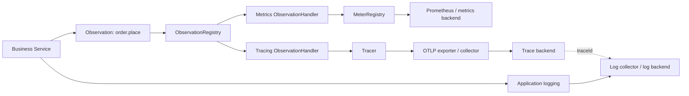
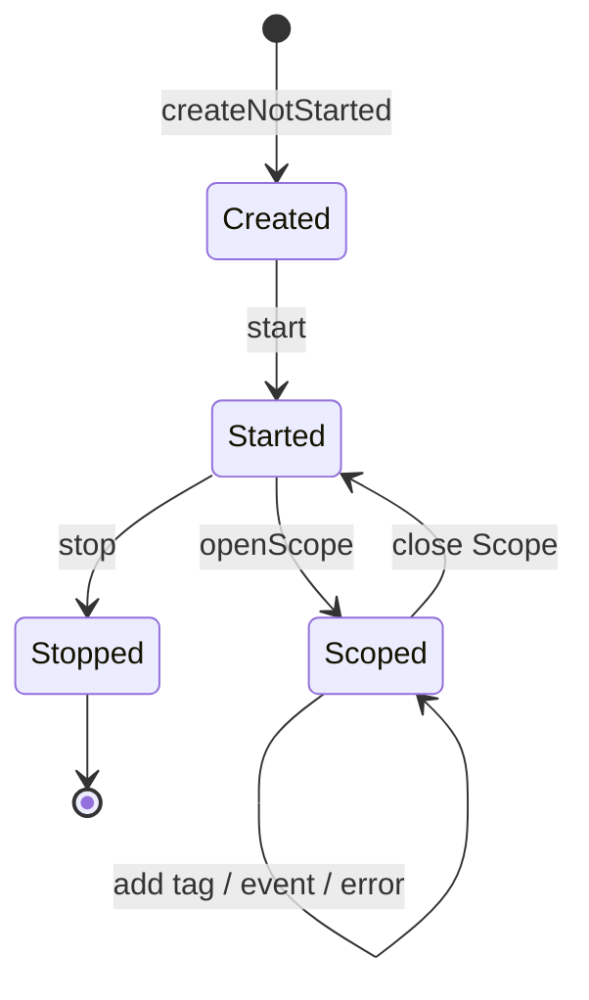

# Creating business observations in Spring Boot

A retail system exposes the `POST /orders` endpoint. Spring Boot can automatically record HTTP request latency and outcomes, yet a single request spans multiple tasks: checking inventory, applying promotions, reserving stock, and sending a payment request. When the endpoint's p95 latency increases, HTTP metrics only indicate that **the entire request is slow**; they do not necessarily tell you **which business step** is slowing the request down. To gain deeper visibility, the application needs to instrument operations that are meaningful to the product itself.

In the **Custom observation** chapter of the `SPRING_BOOT_OBSERVABILITY` module, we will create a **Micrometer Observation for a business operation** and feed signals into the Spring Boot observability ecosystem. The module focuses on combining Micrometer Observation, metrics, logs, and distributed tracing; accordingly, this lesson also explains how to choose tags/cardinality, propagate context, configure exporters and sampling, and correlate signals to investigate errors or latency in production environments.

> **Goal:** After this lesson, you will be able to select the right boundaries to observe, write code to create an Observation, attach meaningful metadata without causing uncontrolled cardinality growth, record errors, inspect the generated metrics/traces, and recognize scenarios where additional context propagation is required.

## 1. When should you create a custom Observation?

Micrometer and Spring Boot already provide instrumentation for many common components such as HTTP servers, certain HTTP clients, and integration libraries. However, business questions do not always map neatly to a single endpoint or library.

For example:

- **Order placement:** How long do inventory checks and order confirmation take?
- **Payments:** Which payment channel is experiencing authorization failures, and how is the error rate changing?
- **Data ingestion:** How long does each product import batch take, and does the batch complete?
- **Voucher issuance:** Which stage in the eligibility check and voucher issuance flow is slow?
- **Message processing:** How long does it take from when a consumer starts processing until the result is persisted?

A custom Observation is useful when it represents a **stable unit of work that is meaningful during investigation**, rather than an arbitrary Java method.

| Technical instrumentation only | Adding business custom Observations |
| --- | --- |
| `http.server.requests` measures incoming API requests | `order.place` measures the order placement operation |
| HTTP client metrics measure calls to the gateway | `payment.authorize` measures the authorization stage regardless of adapter |
| Database metrics measure queries or connection pools | `inventory.reserve` measures the entire stock reservation step |
| Can show "the request is slow" | Adds evidence of "which business step is slow" |

Avoid creating an Observation for every getter, variable assignment, or tiny loop. Overly dense instrumentation increases processing overhead, span volume, and trace readability complexity. Start with boundaries that serve a clear operational purpose.

## 2. Which components does a business Observation flow through?



The roles:

1. **`Observation`:** the object representing an operation, its name, context, key-values, error, and lifecycle.
2. **`ObservationRegistry`:** the shared registry that holds configuration and coordinates handlers, predicates, conventions, and filters.
3. **`ObservationHandler`:** receives callbacks when an Observation starts/stops or encounters an error; metrics and tracing handlers can produce the corresponding signals.
4. **`MeterRegistry` and `Tracer`:** manage metric data or spans according to the selected integration.
5. **Exporters/collectors/backends:** forward, store, and enable querying over time; they do not appear automatically just by creating an Observation in code.

This diagram shows a **conceptual** flow. Not every application has all handlers and exporters active simultaneously. An Observation can record metrics without creating traces when only metrics are configured; conversely, missing metrics configuration can prevent the observation name from appearing under `/actuator/metrics`.

## 3. Preparing a Spring Boot application

The examples use Spring Boot 3.x, Java 17+, and Maven. For a project using the Spring Boot parent or BOM, Micrometer versions should be managed by the Boot ecosystem.

```xml
<dependencies>
    <dependency>
        <groupId>org.springframework.boot</groupId>
        <artifactId>spring-boot-starter-web</artifactId>
    </dependency>
    <dependency>
        <groupId>org.springframework.boot</groupId>
        <artifactId>spring-boot-starter-actuator</artifactId>
    </dependency>
    <!-- Only needed when Prometheus scrapes metrics -->
    <dependency>
        <groupId>io.micrometer</groupId>
        <artifactId>micrometer-registry-prometheus</artifactId>
    </dependency>
</dependencies>
```

With Spring Boot 3.x, Actuator typically sets up the `ObservationRegistry` bean and the necessary metrics integrations. Services should **inject the Spring-managed registry bean**, avoiding manual `ObservationRegistry.create()` calls inside individual services because a self-created registry will not carry the configured handlers and policies.

```yaml
spring:
  application:
    name: order-service

management:
  endpoints:
    web:
      exposure:
        include: health,metrics,prometheus
  observations:
    key-values:
      application: order-service
```

Endpoints are typically prefixed with `/actuator`. `/actuator/metrics` lets you discover meters; `/actuator/prometheus` requires the Prometheus registry to be present. The `exposure` setting only exposes endpoints over HTTP and **does not automatically protect them with authentication or authorization**. In production, restrict access to management endpoints via internal networks, Spring Security, or a properly configured gateway.

## 4. Designing an Observation before writing code

Do not start by adding tags arbitrarily. Answer these questions first:

1. **What work is being measured?** For instance, the entire order confirmation step, from eligibility validation until the business outcome is decided.
2. **What is a stable name?** For example, `order.place`. This name must not include IDs, dynamic URLs, or user data.
3. **Along which dimensions do you need to break it down?** For example, `order.channel` with `web`, `mobile`, `partner`.
4. **Which details are only for tracing individual requests?** For example, an opaque order reference, not placed into metric labels.
5. **What counts as success/failure?** Distinguish technical exceptions, rejected business outcomes, and retryable errors.
6. **Is there an asynchronous execution path?** If so, clearly define the start time, completion time, and propagation behavior.

A sample telemetry contract:

| Property | Value | Reason |
| --- | --- | --- |
| Observation name | `order.place` | Groups measurements of the same kind |
| Contextual name | `place-order` | Human-readable span name when tracing is enabled |
| Low-cardinality key-value | `order.channel=web/mobile/partner/other` | Breakdown across a bounded set of values |
| Low-cardinality key-value | `outcome=success/rejected/error` | Track outcome ratios if recorded by handlers |
| High-cardinality key-value | `order.reference=<opaque code>` | Look up a specific request in traces if permitted |
| Error | Thrown exception | Marks technical failures |

**Low cardinality** refers to a small, stable set of label values suitable for metric aggregation. **High cardinality** refers to data with many distinct values; it should stay in controlled traces/logs instead of being added to metric tags. High-cardinality **does not mean** the data is automatically safe: avoid secrets, tokens, emails, or personal data unless there is a clear need and appropriate protection policy.

## 5. The simplest approach: `Observation.observe(...)`

The following code illustrates a synchronous order service. To stay focused on instrumentation, assume an `OrderGateway` adapter handles the actual business logic.

```java
import io.micrometer.observation.Observation;
import io.micrometer.observation.ObservationRegistry;
import org.springframework.stereotype.Service;

@Service
public class OrderPlacementService {
    private final ObservationRegistry observationRegistry;
    private final OrderGateway orderGateway;

    public OrderPlacementService(
            ObservationRegistry observationRegistry,
            OrderGateway orderGateway) {
        this.observationRegistry = observationRegistry;
        this.orderGateway = orderGateway;
    }

    public OrderReceipt place(OrderCommand command) {
        String channel = normalizeChannel(command.channel());

        return Observation.createNotStarted("order.place", observationRegistry)
            .contextualName("place-order")
            .lowCardinalityKeyValue("order.channel", channel)
            .highCardinalityKeyValue("order.reference", command.reference())
            .observe(() -> orderGateway.place(command));
    }

    private static String normalizeChannel(String input) {
        if ("web".equals(input)
                || "mobile".equals(input)
                || "partner".equals(input)) {
            return input;
        }
        return "other";
    }
}

// Illustrative types for the business boundary.
record OrderCommand(String reference, String channel) {}
record OrderReceipt(String confirmationCode) {}

interface OrderGateway {
    OrderReceipt place(OrderCommand command);
}
```

Assume `OrderGateway` already has an implementation registered as a Spring bean; if you run this example verbatim, you need to provide that implementation.

What happens when `place(...)` is called:

- Creates an Observation named `order.place` bound to the application's registry.
- Attaches the normalized channel information and the high-cardinality reference code.
- `observe(Supplier`)` manages start, scope, and stop for the **synchronous** block; the gateway's return value is returned to the caller.
- If the gateway throws an exception, `observe(...)` records the error according to the Observation lifecycle and rethrows the exception for the caller to handle.
- Configured handlers can record a timer metric or create a span. Whether a signal appears in a backend also depends on handlers, exporters, and sampling.

Naming like `order.place` should follow a consistent convention across the entire application. Avoid `"order.place." + reference` because every order reference would create a distinct metric name, making aggregation difficult and potentially causing metric series explosion.

### 5.1. Why normalize tags right at the business boundary?

The `channel` field might come from request headers, forms, or partners. If recorded raw, thousands of invalid values could become separate tags. The `normalizeChannel` function restricts it to four allowed values so metrics remain usable for trend analysis without causing unmanageable cardinality.

For example, `order.channel=web` and `order.channel=mobile` are useful analytical dimensions. `order.reference=ORD-734829` is unsuitable for metrics; traces can use this opaque identifier to investigate a specific order when policy allows.

## 6. Manual lifecycle management when outcomes and events are needed

`observe(...)` is a great choice for simple synchronous operations. If you need to record result-based outcomes or events at specific checkpoints, you can manage the lifecycle manually:

```java
import io.micrometer.observation.Observation;
import io.micrometer.observation.ObservationRegistry;

public PaymentDecision authorizePayment(
        PaymentCommand command, ObservationRegistry registry,
        PaymentGateway gateway) {

    Observation observation =
        Observation.createNotStarted("payment.authorize", registry)
            .contextualName("authorize-payment")
            .lowCardinalityKeyValue("payment.channel", command.channel());

    observation.start();
    try (Observation.Scope scope = observation.openScope()) {
        PaymentDecision decision = gateway.authorize(command);

        String outcome = decision.approved() ? "approved" : "rejected";
        observation.lowCardinalityKeyValue("outcome", outcome);
        observation.event(Observation.Event.of("gateway.responded"));
        return decision;
    } catch (RuntimeException ex) {
        observation.lowCardinalityKeyValue("outcome", "error");
        observation.error(ex);
        throw ex;
    } finally {
        observation.stop();
    }
}

// Illustrative contract; place in an appropriate class/service when integrating.
record PaymentCommand(String channel) {}
record PaymentDecision(boolean approved) {}
interface PaymentGateway {
    PaymentDecision authorize(PaymentCommand command);
}
```

In this example, `approved` and `rejected` are **two business outcomes**; `error` is reserved for technical exceptions. Not every payment decline should be treated as an exception. That distinction makes alerts more accurate.

### Detailed lifecycle



Key distinctions:

| API | Effect |
| --- | --- |
| `createNotStarted(name, registry)` | Creates an Observation without starting its lifecycle |
| `start()` | Starts the observation; handlers may receive the `onStart` callback |
| `openScope()` | Sets the Observation as the current context for the corresponding execution scope |
| `lowCardinalityKeyValue(...)` | Adds a dimension with few values, typically used as a metric tag |
| `highCardinalityKeyValue(...)` | Adds detailed data for suitable handlers; generally not used as a metric tag |
| `event(...), error(ex)` | Notifies the observation/handlers of an event or error |
| `scope.close()` | Restores the previous current context; **does not stop the Observation** |
| `stop()` | Stops the Observation, allowing handlers to finalize recording |

**Note on tag timing:** the example adds `outcome` after receiving the result. A handler that records metrics at the end of the lifecycle will see that value, whereas a tracing handler that creates a span or attaches certain attributes during `onStart` may behave differently. If data is needed right when a span starts, set key-values before `start()` or use an appropriate convention/handler for your goal. Do not assume every handler reads every tag at the exact same moment.

For synchronous code, `try-with-resources` ensures the Scope closes even when an exception occurs; `finally` guarantees `stop()`. Never leave a scope open after a method returns, because server threads may be reused for other requests.

## 7. Parent–child scopes and understanding business traces

Suppose an HTTP request to `order-service` invokes `order.place`, which in turn calls `payment.authorize`:

```text
HTTP POST /orders              [--------------------------]
  order.place                     [----------------------]
    inventory.reserve                [---------]
    payment.authorize                          [--------]
      HTTP client POST /authorize                 [-----]
```

This is the **ideal model when tracing is integrated**, not a guaranteed result of merely adding Observation code. To see nested spans within the same trace:

1. The parent Observation must have an active current scope when the child Observation starts.
2. The application must have a Micrometer Tracing bridge and appropriate handlers to create spans from those Observations.
3. HTTP client or message instrumentation must propagate the trace context to other services.
4. The receiving side must extract a compatible context; the trace exporter and backend must ingest the spans.
5. Sampling may cause some traces not to be stored even when requests execute normally.

Without a tracing bridge, an Observation can still produce metrics via the metrics handler. Without a metrics registry, having spans does not automatically mean you have latency dashboards over time.

### Scopes do not automatically cross asynchronous boundaries

A common mistake is writing:

```java
Observation.createNotStarted("order.submit", observationRegistry)
    .observe(() -> CompletableFuture.supplyAsync(this::doWork));
```

This snippet **only wraps the creation/scheduling of the `CompletableFuture`**, without guaranteeing measurement until `doWork` finishes; the scope on the thread creating the future also does not automatically move onto the worker thread. Therefore, do not use this pattern to measure the entire async work.

With `@Async`, `Executor`, Reactor/WebFlux, or message consumers, understand the execution model and use compatible **Micrometer Context Propagation** integrations. The general rule is to capture context where the work is submitted, restore it within the processing scope on the receiving side, close the restored scope upon completion, and stop the Observation when the work truly finishes.

Do not pass an open `Observation.Scope` directly to another thread and call `close()` there. For reactive flows, rely on Reactor Context / framework propagation capabilities instead of assuming a single thread's ThreadLocal persists across the pipeline.

## 8. Using `@Observed` when instrumentation fits a method

Micrometer provides the `@Observed` annotation and an AOP aspect to create an Observation around method invocations. Example:

```java
import io.micrometer.observation.annotation.Observed;
import org.springframework.stereotype.Service;

@Service
public class CouponService {
    @Observed(
        name = "coupon.validate",
        contextualName = "validate-coupon",
        lowCardinalityKeyValues = {"operation", "validate"})
    public boolean validate(String code) {
        return code != null && !code.isBlank();
    }
}
```

The annotation **does not take effect simply by placing it on a method**. You need AOP and a configured `ObservedAspect`, or the corresponding auto-configuration for your Spring Boot version:

```java
import io.micrometer.observation.ObservationRegistry;
import io.micrometer.observation.aop.ObservedAspect;
import org.springframework.context.annotation.Bean;
import org.springframework.context.annotation.Configuration;

@Configuration
class ObservedAopConfiguration {
    @Bean
    ObservedAspect observedAspect(ObservationRegistry observationRegistry) {
        return new ObservedAspect(observationRegistry);
    }
}
```

Using Spring AOP requires an appropriate dependency such as `spring-boot-starter-aop` (added to Maven as a Spring Boot starter), and the method must be invoked through the Spring proxy for the aspect to run. Check whether your Boot version already auto-registers the aspect to avoid duplicate configuration. Internal calls from one method of a bean to another method on the same bean (**self-invocation**) typically bypass the proxy and may not be instrumented.

**Which API should you choose?** For business operations requiring control over dynamic key-values, errors, outcomes, scopes, or stop timing, the manual `Observation` API is usually clearer. `@Observed` works well for methods with synchronous boundaries and simple telemetry schemas, provided AOP is genuinely active. Avoid applying both the annotation and manual Observation to the same code block without a clear reason, as that can produce duplicate spans/metrics.

## 9. Designing analyzable outcomes and tags

A good tag set answers "over the last 15 minutes, which operation was slow or failing frequently?" without forcing the backend to store millions of series.

For example, `payment.authorize` has:

| Tag | Expected values | Recommendation |
| --- | --- | --- |
| `payment.channel` | 3–5 | Low cardinality |
| `outcome` | 3–4 | Low cardinality |
| `environment` | A few deployment environments | Low cardinality, managed consistently |
| `region` | A few regions | Low cardinality |
| `order.id` | Millions | High cardinality; do not use as a metric tag |
| `customer.email` | Very many, sensitive | Avoid putting in business telemetry |
| `exception.message` | Potentially near-infinite | Do not use as a metric tag |

Suppose the first four tags have 4 × 3 × 2 × 3 values respectively; the maximum number of combinations is already **72** for a single metric, before accounting for instances, histogram buckets, and other labels. Adding `order.id` causes cardinality to grow with order volume, increasing costs and destabilizing queries.

Do not use HTTP status codes as the sole outcome for a business Observation: an API might return HTTP 200 while the business result is `rejected`, or return HTTP 202 because asynchronous processing was accepted. Define outcomes tied to **business semantics**, and separate them from infrastructure failures and exceptions.

## 10. Verifying results with Actuator and a trace backend

With the dependencies in Section 3 and the metrics handler configured, after calling `OrderPlacementService.place(...)` at least once, check:

```bash
curl -s http://localhost:8080/actuator/health
curl -s http://localhost:8080/actuator/metrics
curl -s http://localhost:8080/actuator/metrics/order.place
curl -s http://localhost:8080/actuator/prometheus
```

The metric name under `/actuator/metrics` typically matches the Observation name when using the default meter observation handler without a renaming convention. Exact output depends on configuration and Micrometer version. Metrics for an Observation that has not run or has not stopped yet may not appear.

Normally, a `Timer` provides count and total time; histograms/percentiles require appropriate meter policies. A single measurement is not enough to evaluate p95 or p99. With Prometheus, scrape over time and apply histogram/summary queries matching the configured series type.

### 10.1. What do you add to see distributed traces?

For an OpenTelemetry setup in Spring Boot 3.x, commonly used dependencies include:

```xml
<dependency>
    <groupId>io.micrometer</groupId>
    <artifactId>micrometer-tracing-bridge-otel</artifactId>
</dependency>
<dependency>
    <groupId>io.opentelemetry</groupId>
    <artifactId>opentelemetry-exporter-otlp</artifactId>
</dependency>
```

Beyond dependencies, the application needs an exporter/collector configured with the right protocol and endpoint, along with a trace backend. Example:

```yaml
management:
  tracing:
    sampling:
      probability: 0.1
  otlp:
    tracing:
      endpoint: http://otel-collector:4318/v1/traces
```

This is a common configuration pattern in Spring Boot 3.x versions supporting OTLP HTTP tracing. Verify the exact property names and exporter protocol against your application version and collector.

`sampling.probability: 0.1` illustrates keeping only a fraction of traces; **it does not guarantee every failing request has a trace**. If you need to investigate rare errors, consider appropriate sampling and retention strategies, including a collector supporting tail-based sampling if your architecture permits.

### 10.2. Correlating logs with an Observation

When the tracing bridge and logging correlation are configured properly, logs written inside a custom Observation's scope can include `traceId` and `spanId`. This lets you:

1. Find logs for a failing request using its trace ID.
2. Open the corresponding trace to inspect `order.place`, `inventory.reserve`, or `payment.authorize` spans.
3. Cross-check metrics to see whether the error is isolated or part of a multi-request trend.

The registry itself does not collect, transport, or store logs. You still need a JSON/text pattern, MDC correlation, and a proper log pipeline. Never log full payment payloads or user data merely to create correlation.

## 11. Investigating a real-world scenario: slow API while health stays UP

Suppose a dashboard shows `POST /orders` p95 rising from 180 ms to 1.4 s, while `/actuator/health` still returns `UP`.

| Step | Signal | Question to answer |
| --- | --- | --- |
| 1. Narrow the scope | HTTP metrics | Is it slow across all routes or only `/orders`? Did traffic change? |
| 2. Compare business steps | `order.place`, `inventory.reserve`, `payment.authorize` | Which step takes the largest share of time or has errors? |
| 3. Segment | Low-cardinality tags `channel`, `outcome` | Is it slow on web/mobile or across every channel? |
| 4. Trace a request | Tracing spans and traceId | Are outbound retries or timeouts stretching the request? |
| 5. Inspect root cause | Logs sharing traceId/spanId | Did a partner report errors, is a connection pool exhausted, is there a specific exception? |
| 6. Verify after fix | Metrics over time and sample traces | Did error rates and latency drop under comparable load? |

A plausible scenario is `order.place` metrics being slow while `inventory.reserve` is normal; traces reveal `payment.authorize` consumes most of the time due to gateway timeouts and retries. Here, an overall `UP` health status does not contradict degraded user experience: health only checks declared conditions, whereas custom Observations isolate the specific business flow.

## 12. Common pitfalls when creating business Observations

| Symptom/error | Possible cause | Resolution |
| --- | --- | --- |
| `order.place` missing from metrics | Code hasn't run; `stop` wasn't called; wrong registry/metric handler; filtered out by predicate | Check execution path and registry configuration |
| Metrics exist but spans are missing | Missing tracing bridge, exporter, backend, or trace was sampled out | Check everything from handler to collector and sampling policy |
| Disconnected spans across two services | Client/server didn't propagate/extract trace context; thread switch without restore | Configure propagation and instrumentation |
| Logs missing traceId | Missing tracing/log correlation or log written outside scope | Check MDC and logging pattern |
| Sudden spike in time series | Using IDs/dynamic URLs/error messages as metric tags | Normalize to a low-cardinality value set |
| Timer records unrealistically short duration for async | `observe(...)` only wraps future creation | Tie Observation lifecycle to actual completion |
| Duplicate metrics/spans | Instrumenting the same code with multiple mechanisms | Check for overlapping custom and auto instrumentation |
| Business failures lost | Catching exceptions without reporting proper error/outcome | Define business semantic outcomes and errors |
| Tracing works locally but backend is empty | Exporter not connected or wrong endpoint/protocol | Check exporter, collector, network, and retention |

**Security note:** do not leave management endpoints containing sensitive data publicly accessible, do not place user-identifying information in metric tags, and do not treat the tracing backend as a place to dump arbitrary business data.

## 13. Hands-on exercise

Build a small service handling an order placement flow, initially containing two steps: `inventory.reserve` and `payment.authorize`.

1. **Manually instrument** both steps using `Observation.createNotStarted(...).observe(...)`; choose stable business-oriented names.
2. Add `channel` with a bounded value set and an `approved/rejected/error` outcome. Keep the order reference in high-cardinality context (or omit it entirely if unneeded).
3. Invoke each step several times, triggering both successes and failures; inspect `/actuator/metrics` to see which meters were recorded.
4. Add a tracing handler/exporter and a test backend; verify that custom spans appear inside the HTTP request trace when context propagation is configured properly.
5. Try invoking the payment gateway from an executor and compare losing trace context without propagation against the result after applying a compatible context propagation mechanism.
6. Add logs at meaningful checkpoints, configure correlation, and locate the corresponding trace from a `traceId`.
7. Review tags, management endpoints, sampling, exporter settings, and cost; keep only signals that answer real operational questions.

### Self-check questions

1. Why is a custom Observation for `order.place` useful even when `http.server.requests` already exists?
2. What is the cardinality difference between `order.channel` and `order.reference`?
3. On an exception path, what responsibilities do `observation.error(ex)`, `scope.close()`, and `observation.stop()` each handle?
4. Why can `observe(() -> CompletableFuture.supplyAsync(...))` record inaccurate timings?
5. What components beyond Observation are needed to see a trace span two services and find the corresponding logs?

## Conclusion

**Creating business observations** is a structured way to encode real operational questions directly into code. Choose meaningful boundaries, use stable names, inject the Spring-managed `ObservationRegistry`, prefer `observe(...)` for synchronous blocks, and manage start/scope/error/stop manually when finer control is needed. Low-cardinality tags support metric aggregation, while high-cardinality context aids controlled investigation. When properly wired to handlers, exporters, sampling, propagation, and logging correlation, custom Observations become the bridge between **latency metrics**, **per-request spans**, and **specific error logs** for investigating Spring Boot applications in production.
