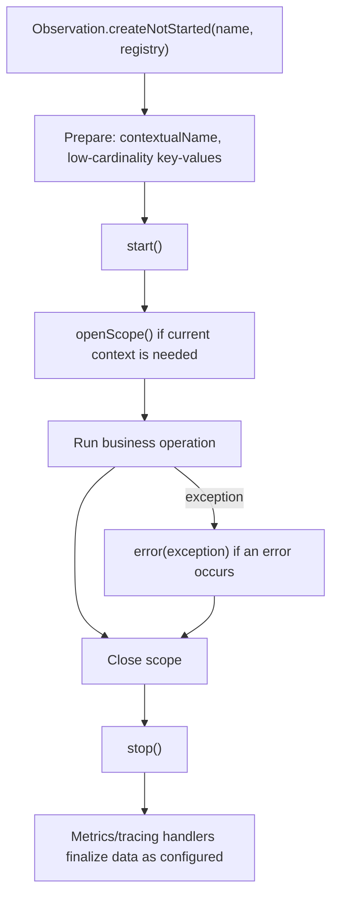
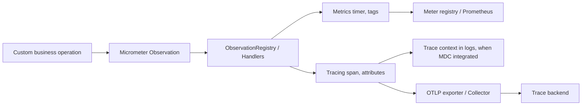

# Observation.createNotStarted

In the **Custom observation** chapter of the **SPRING_BOOT_OBSERVABILITY** module, `Observation.createNotStarted(...)` is the core API for describing a business operation to monitor without **starting measurement immediately**. The operation might be calculating shipping fees, calling a payment gateway, looking up product prices, or processing a message. When your code explicitly creates an observation, you control its name, labels, timing boundaries, and error recording instead of relying solely on Spring Boot's automatic HTTP metrics.

This module focuses on investigating real application behavior using **Micrometer Observation, metrics, logs, and distributed tracing**. A custom observation connects business code to those signals: handlers can create timers or tracing spans; logs can receive trace context when a scope is opened; exporters, sampling, and backends determine whether the data ultimately appears in your observability system.

## 1. Objectives

After this lesson, you will be able to:

1. Explain the return value of `Observation.createNotStarted(name, registry)` and when measurement actually starts.
2. Write a custom observation using `lowCardinalityKeyValue(...)`, `contextualName(...)`, and the `start/openScope/error/stop` lifecycle.
3. Decide when to create an observation before all facts are known, and when to start the work to be measured.
4. Use `observe(...)` for simple synchronous operations; choose manual control when complex logic or outcomes are required.
5. Choose names and tags safely with respect to cardinality while avoiding sensitive data.
6. Diagnose why an observation exists in code yet no metrics, correlated logs, or traces appear in the backend.
7. Apply custom observations to isolate errors, latency, and dependencies in Spring Boot.

## 2. What does the `createNotStarted` API do?

Common syntax:

```java
Observation observation =
        Observation.createNotStarted("shipping.quote", observationRegistry);
```

`Observation` is Micrometer's abstraction for an observed activity. `ObservationRegistry` is where `ObservationHandler` instances, rules, and observation configurations are bound to the application. The name `shipping.quote` identifies the **type of operation**, not a specific request.

After the statement above, you have an observation object ready for additional context. However:

- No duration has been measured by a `start()` – `stop()` cycle for this activity yet.
- There is no reason to expect a timer to have recorded a completed sample or a tracing span to have finished.
- The object may behave as a no-op depending on the registry and observation enablement policies, so successfully constructing a Java variable does not prove the system has emitted telemetry.
- Storing metrics or traces depends on handlers, meter/tracing registries, exporters, and backends, not solely on calling `createNotStarted(...)`.

An observation only becomes a useful measurement when **the work to be observed actually runs within a complete lifecycle**.

### Before and after starting



**Creating** and **starting** are two distinct milestones. If you create an observation and then spend 50 ms building the request before calling `start()`, those 50 ms are excluded from the duration. If those 50 ms are part of what the user waits for and should count toward the SLO, move `start()` earlier or create an observation wrapping the preparation phase as well.

## 3. Signature, name, and registry

We commonly use the overload taking a name and a registry:

```java
Observation.createNotStarted(String name, ObservationRegistry registry)
```

Each part serves a different role:

| Component | Role | Example |
| --- | --- | --- |
| `name` | Stable logical name of the operation type, typically used by handlers for metric/observation naming. | `shipping.quote`, `inventory.reserve` |
| `observationRegistry` | Connects the observation with handlers and configuration in the application. | `ObservationRegistry` bean provided by Spring Boot |
| Returned `Observation` | The object under preparation, providing APIs to add key-values, start, open scope, report errors, and stop. | Variable `observation` |
| `contextualName(...)` | A more readable contextual name for tracing when supported by handlers. | `calculate shipping quote` |
| `lowCardinalityKeyValue(...)` | Attributes with a controlled number of distinct values. | `carrier=standard`, `operation=quote` |

Micrometer also provides mechanisms using custom contexts and `ObservationConvention` when naming rules or tags need to be reused across multiple places. However, for a standalone operation, the `createNotStarted(String, ObservationRegistry)` overload is the clearest starting point.

### Create early, start at the right time

Suppose an endpoint needs to calculate shipping fees. You already know the operation and carrier type when the request arrives, but you only want to measure **the call to the quoting system**.

```java
Observation observation =
        Observation.createNotStarted("shipping.quote", registry)
                .contextualName("quote shipping")
                .lowCardinalityKeyValue("carrier", "standard")
                .lowCardinalityKeyValue("operation", "quote");

// Preparation work outside the measured window.
QuoteRequest request = buildQuoteRequest(order);

// Only the dependency call is what needs to be measured.
observation.start();
try (Observation.Scope scope = observation.openScope()) {
    return shippingGateway.quote(request);
} catch (RuntimeException exception) {
    observation.error(exception);
    throw exception;
} finally {
    observation.stop();
}
```

`QuoteRequest`, `order`, and `shippingGateway` are illustrative application-defined components.

The key detail is placing `start()` **after** `buildQuoteRequest(order)`: the `shipping.quote` observation answers "how long did the quote call take?". If you want to answer "how long did the entire quote calculation take?", place `start()` before building the request or create a parent observation for the whole flow. **Observation names and measurement boundaries must remain consistent**; if different call sites measure different spans of work under the same `shipping.quote` name, aggregated metrics become hard to interpret.

## 4. Integrating `ObservationRegistry` into Spring Boot

In a Spring Boot 3.x application with Actuator, you can inject the registry as a bean. Gradle example:

```groovy
dependencies {
    implementation 'org.springframework.boot:spring-boot-starter-actuator'
}
```

Illustrative service:

```java
import io.micrometer.observation.ObservationRegistry;
import org.springframework.stereotype.Service;

@Service
public class ShippingService {
    private final ObservationRegistry observationRegistry;

    public ShippingService(ObservationRegistry observationRegistry) {
        this.observationRegistry = observationRegistry;
    }
}
```

`ObservationRegistry` is the instrumentation integration point, **not a database for metrics or traces**. To view custom metrics through Prometheus, add the corresponding registry; to see distributed tracing, you need a bridge and an exporter:

```groovy
dependencies {
    implementation 'io.micrometer:micrometer-registry-prometheus'
    implementation 'io.micrometer:micrometer-tracing-bridge-otel'
    implementation 'io.opentelemetry:opentelemetry-exporter-otlp'
}
```

These dependencies are common examples for Spring Boot 3.x; manage versions via the corresponding BOM. Exact backend configuration depends on your Spring Boot version, pipeline, and runtime environment.

Sample test configuration:

```yaml
spring:
  application:
    name: shipping-api

management:
  endpoints:
    web:
      exposure:
        include: health,metrics,prometheus
  tracing:
    sampling:
      probability: 1.0
  otlp:
    tracing:
      endpoint: http://otel-collector:4318/v1/traces
```

The path `http://otel-collector:4318/v1/traces` assumes an OTLP HTTP collector is listening at that address. `sampling.probability: 1.0` is meant for low-traffic practice environments and should not be applied by default in large-scale production. Actuator endpoints must be protected according to network and authorization policies.

Only after the application receives matching requests, the registry/handlers are configured, and the exporter is working should you expect telemetry to show up in your observability backend.

## 5. Complete implementation pattern for a custom observation

Problem: `shipping-api` calculates fees via a gateway. We want to specifically observe the `shippingGateway.quote(...)` call; when the gateway throws an error, the observation must record the error and complete its lifecycle even as the exception propagates.

```java
import io.micrometer.observation.Observation;
import io.micrometer.observation.ObservationRegistry;
import org.springframework.stereotype.Service;

@Service
public class ShippingQuoteService {

    private final ObservationRegistry registry;
    private final ShippingGateway gateway;

    public ShippingQuoteService(ObservationRegistry registry,
                                ShippingGateway gateway) {
        this.registry = registry;
        this.gateway = gateway;
    }

    public ShippingQuote getQuote(ShippingRequest request) {
        Observation observation =
                Observation.createNotStarted("shipping.quote", registry)
                    .contextualName("get shipping quote")
                    .lowCardinalityKeyValue("operation", "quote")
                    .lowCardinalityKeyValue("dependency", "shipping-gateway");

        observation.start();

        try (Observation.Scope scope = observation.openScope()) {
            ShippingQuote result = gateway.quote(request);
            observation.lowCardinalityKeyValue("outcome", "success");
            return result;
        } catch (RuntimeException exception) {
            observation.lowCardinalityKeyValue("outcome", "error");
            observation.error(exception);
            throw exception;
        } finally {
            observation.stop();
        }
    }

    public interface ShippingGateway {
        ShippingQuote quote(ShippingRequest request);
    }

    public record ShippingRequest(String destinationZone, int packageCount) {}
    public record ShippingQuote(long amountMinorUnits, String currency) {}
}
```

Assumptions: `gateway.quote` returns an amount in minor currency units; the code is not meant to demonstrate currency conversion logic. The example fits inside a Spring Boot 3.x project using a Java version that supports `record`.

**Step-by-step explanation:**

1. `createNotStarted` creates an unstarted observation object with the stable name `shipping.quote`.
2. `contextualName` and the `operation/dependency` attributes are declared before execution.
3. `start()` begins the lifecycle; appropriate handlers can initialize a timer context or span.
4. `openScope()` makes the observation the current context on the synchronous thread; child instrumentation and logs can pick up the trace context when tracing is integrated.
5. `gateway.quote(request)` is the measured work.
6. On success, `outcome=success` is added; on `RuntimeException`, `outcome=error` is set, `error(exception)` is called, and the exception is rethrown.
7. The scope is closed by `try-with-resources`; `stop()` inside `finally` completes the observation on both paths.

The `outcome` attribute is added while the observation is running. In practice, metrics handlers typically record results when the observation stops, so they can use outcomes computed after the operation. However, if your organization uses custom handlers that read tags on different callbacks, check when tags are inspected to ensure consistency.

### Why are both `openScope()` and `stop()` necessary?

The two calls solve **two different problems**:

- `openScope()` sets the current observation for code executing inside the scope, which matters for parent/child tracing and logging context.
- `stop()` ends the observation, giving handlers a chance to finalize duration/metrics/spans.

Closing a scope does not stop the observation. Conversely, calling `start()` and `stop()` without opening a scope still lets you capture duration, but child operations and logs may not receive the context you expect.

If `getQuote` executes inside an HTTP request that already has a server observation, starting the custom observation within the active HTTP scope allows it to appear as a child span, provided tracing handlers and context propagation are active.

## 6. When should you choose `observe(...)`?

For concise synchronous tasks, you can write:

```java
public ShippingQuote getQuote(ShippingRequest request) {
    return Observation.createNotStarted("shipping.quote", registry)
            .lowCardinalityKeyValue("dependency", "shipping-gateway")
            .observe(() -> gateway.quote(request));
}
```

`observe(...)` is a convenient way to wrap work, handle the lifecycle, and capture exceptions for straightforward cases. It is especially suitable when **the work to be measured matches the entire lambda** and no intermediate checkpoints are needed.

| Criterion | `createNotStarted(...).observe(...)` | `createNotStarted(...)` + manual control |
| --- | --- | --- |
| Running a simple synchronous lambda | Concise, minimal lifecycle boilerplate | More verbose than necessary |
| Need preparation before starting measurement | Can prepare before calling `observe` | Easy to choose exact `start()` placement |
| Need to attach `outcome` from execution result | Possible via custom logic/convention or suitable structure | Easy to set explicit tags before `stop()` |
| Need explicit scope open/close around a specific block | Less direct control | Direct control |
| Asynchronous work or lazy publishers | Does not automatically measure until async completion | Lifecycle must be tied to completion signals and context propagation |

**Do not call `start()` and then call `observe(...)` on the same observation thinking `observe` only runs the lambda.** Choose one consistent lifecycle management style.

## 7. Distinguishing observation name, contextual name, and tags

A custom observation carries three very different kinds of metadata.

### 7.1 Observation name must be stable

Use:

```java
Observation.createNotStarted("shipping.quote", registry);
```

Avoid:

```java
// Avoid: a different name per order.
Observation.createNotStarted("shipping.quote." + orderId, registry);
```

Request-varying names can generate unbounded metric names, cluttering dashboards and inflating storage costs.

### 7.2 Contextual name makes traces easier to read

```java
Observation.createNotStarted("shipping.quote", registry)
        .contextualName("quote shipping cost");
```

Tracing handlers can use the contextual name when naming spans. It should be clear, reasonably stable, and free of sensitive data. It does not replace the technical observation name used to group metrics.

### 7.3 Low-cardinality vs. high-cardinality

```java
Observation observation =
        Observation.createNotStarted("shipping.quote", registry)
                .lowCardinalityKeyValue("operation", "quote")
                .lowCardinalityKeyValue("carrier", "standard");
```

`operation` and `carrier` have bounded value sets, making them good low-cardinality tags.

If a reference identifier needs to be attached to traces to investigate a specific request, you may consider:

```java
// Only after evaluating privacy and data retention limits.
observation.highCardinalityKeyValue("provider.request_ref", safeReference);
```

Do not use `safeReference` unless you have verified it truly contains no sensitive information and your backend is permitted to store the field. **High cardinality does not imply safety**, and tracing attributes also carry noticeable cost.

Quick decision table:

| Attribute | Low cardinality? | Recommended handling |
| --- | --- | --- |
| `operation=quote` | Yes | Suitable metric tag |
| `carrier=standard/express` | Yes, when bounded | Suitable metric tag |
| `outcome=success/error` | Yes | Suitable metric tag |
| `orderId=...` | No | Avoid as a metric tag; consider trace/log only per policy |
| `customerEmail=...` | No, and sensitive | Do not record in default telemetry |
| `requestPath=/orders/43821` | No if raw URL | Normalize to route template ` /orders/{id}` |

Never turn dynamic `traceId` or `spanId` values into low-cardinality tags. They are meant to **correlate individual events**, not group millions of measurements in a metrics backend.

## 8. What signals does an observation produce?

`Observation.createNotStarted(...)` is backend-agnostic. Conditions for the three pillars to appear:



Actual telemetry does not necessarily include every branch in the diagram; some systems use different exporters and pipelines. To investigate a slow request:

1. **Metrics** show elevated P95 latency or error rates for `shipping.quote`.
2. **Logs** in the same time window reveal timeouts, retries, or error responses; when logging integration is enabled, you can filter by `traceId`.
3. **Distributed traces** show where `shipping.quote` sits inside the parent request and whether HTTP/database child spans exist.
4. Use dependency details to verify the root cause, then return to metrics to confirm recovery.

Not every observation produces a visible span. Trace sampling can drop certain traces, and exporters or collectors can fail. Metrics can still aggregate executions if the meter handler is active, even when an individual request's trace was not retained.

### Metric naming and practical verification

With the Prometheus registry, timers created by `ObservationHandler` are typically exported as series with suffixes like `_seconds_count` and `_seconds_sum`; histogram buckets require appropriate configuration. Do not guess the exact exported metric name from the observation name without checking active conventions, the registry, and your version.

In a test environment, after invoking the service a few times:

```bash
curl -s http://localhost:8080/actuator/metrics
curl -s http://localhost:8080/actuator/metrics/shipping.quote
curl -s http://localhost:8080/actuator/prometheus
```

`actuator/metrics/shipping.quote` only contains data if the observation actually produced a metric with that name; check the list of names at `actuator/metrics` first. Automatic HTTP server metrics do not replace a business metric such as `shipping.quote`. Traces should be checked in your configured tracing backend.

## 9. Custom events and errors in the lifecycle

Beyond duration and tags, a custom observation can record meaningful progress events:

```java
Observation observation =
        Observation.createNotStarted("shipping.quote", registry)
                .lowCardinalityKeyValue("operation", "quote");

observation.start();
try (Observation.Scope scope = observation.openScope()) {
    observation.event(Observation.Event.of("gateway.request.sent"));

    ShippingQuote quote = gateway.quote(request);

    observation.event(Observation.Event.of("gateway.response.received"));
    return quote;
} catch (RuntimeException exception) {
    observation.error(exception);
    throw exception;
} finally {
    observation.stop();
}
```

An `Observation.Event` is an in-lifecycle signal; tracing handlers can convert it into a span event, whereas metrics backends normally **do not automatically export every event** as a separate metric. If you need aggregate counts for fallbacks, timeouts, or retries, design dedicated metrics or conventions instead of assuming an event becomes a counter.

Avoid recording events for tiny steps inside hot loops, as this increases overhead and trace size. Record only milestones that aid analysis: starting a dependency call, triggering a fallback, exhausting retry budgets, or choosing cache vs. remote.

**Technical errors and business outcomes also differ.** A gateway returning "address not supported" may be a valid business result rather than an exception. In that case, you can attach `outcome=unsupported` and return a business response instead of flagging every 4xx case as a runtime error. Outcome classification rules should stay consistent across metrics and traces.

## 10. Parent/child observations and propagation

A custom observation can sit inside an HTTP request's server observation and contain child observations:

```text
HTTP GET /shipping/quote
└── shipping.quote
    ├── shipping.read-cache
    └── HTTP client POST carrier-service /quotes
```

For tracing handlers to establish the parent/child hierarchy properly, the parent observation must be in the active context when the child starts. `start()` and `openScope()` are not the same operation; opening a new scope makes the current observation visible to synchronous code inside it. Example:

```java
return Observation.createNotStarted("shipping.quote", registry)
        .observe(() -> Observation.createNotStarted("shipping.read-cache", registry)
                .observe(() -> cache.find(key)));
```

Both observations are nested following synchronous execution structure. However, whether a child HTTP span appears still depends on whether the HTTP client is instrumented.

When calling another Spring Boot service, the two processes **do not share the same Java Observation object**. Trace context must be injected and extracted via a carrier (such as the W3C Trace Context HTTP `traceparent` header). With queues, message headers serve the same purpose. If a trace splits at a service boundary, check propagation and instrumentation on both sides.

### Asynchronous and Reactor code: avoid measuring only task creation

The following snippet is easy to misunderstand:

```java
CompletableFuture<ShippingQuote> task =
        Observation.createNotStarted("shipping.quote", registry)
                .observe(() -> CompletableFuture.supplyAsync(
                        () -> gateway.quote(request)));
```

This only measures **the time to create/schedule the `CompletableFuture`** inside the lambda, not the time until the gateway finishes. The parent observation may already stop before the work item executes. Similarly, calling `observe(() -> mono)` on a lazy Reactor publisher may only measure constructing the `Mono`.

For async/reactive workloads, use context propagation mechanisms, framework instrumentation, and an observation lifecycle bound to actual execution (completion, error, cancel) for your stack. Never pass an open `Observation.Scope` across threads; manage scopes on the appropriate execution context.

## 11. Common pitfalls

| Symptom | Possible cause | Check / Fix |
| --- | --- | --- |
| `createNotStarted` is in code but no metric appears | `start/stop` not called, registry lacks a metric handler, or code path never ran. | Verify code path, Actuator/registry setup, and actual metric name. |
| Duration exists but trace is missing | Tracing bridge not configured, trace sampled out, or exporter/collector/backend error. | Check tracing config, sampling, and export pipeline. |
| Metric latency is lower than user-observed wait time | `start()` placed after expensive preparation/work. | Redefine measurement boundaries and adjust start/stop placement. |
| Child span is not nested under parent | Parent scope not opened, context lost across threads, or uninstrumented HTTP client. | Check active scope and propagation across every boundary. |
| No result recorded on exception | `stop()` missing from `finally`; error not reported. | Use `catch` with `error(e)` and `finally` with `stop()`. |
| Metric series count spikes unexpectedly | Request IDs, raw URLs, or user data placed in names/tags. | Restrict to low-cardinality values and use route templates. |
| Logs missing `traceId` | Missing tracing/MDC integration or log written outside active scope. | Check logging pattern, tracing, and active context. |
| Metrics and traces differ in counts | Sampling/exporters, tags, conventions, and units differ. | Distinguish aggregated metrics from sampled traces; inspect raw data. |

Another anti-pattern is redundant instrumentation without purpose: if Spring Boot already automatically observes HTTP server requests, adding a custom observation that also represents "HTTP request" can mislead operators into thinking two requests occurred. A custom observation should describe a **specific business stage or dependency** that is not yet clearly measured.

## 12. Practice: from anomaly to evidence

Suppose an alert shows that after a new release, the P95 latency of `GET /shipping/quote` rose from 180 ms to 1,100 ms, while application CPU stayed nearly flat. You have a custom observation `shipping.quote` wrapping the gateway call.

Investigation workflow:

1. Check HTTP **metrics** and custom `shipping.quote` metrics over the same time window. If both rose proportionally, the gateway call is the branch to inspect.
2. Filter shipping service **logs** by timestamp, timeouts, retries, and correlation fields (if available).
3. Pick a `traceId` from a slow request; open the **distributed trace** and inspect the `shipping.quote` span. Compare its duration with the HTTP client span and the carrier service's server span.
4. If the client span is long while the server span is short, check connection pools, DNS, network, retries, and timeouts. If the server span is long, check CPU, queues, and dependencies on the carrier side.
5. After fixing the root cause, verify recovery using P95 metrics, error rate, and traffic over a sufficiently large sample of requests. A single fast trace does not prove the incident is resolved.

When telemetry is incomplete, the first question is not "what is wrong with the gateway?" but **"am I measuring the right boundary, and is the data actually being exported?"** Therefore, verifying naming, lifecycle, and pipelines around `createNotStarted` is an essential part of the runbook.

## 13. Practice questions

### Question 1: Does the API start measuring immediately?

```java
Observation o = Observation.createNotStarted("tax.calculate", registry);
loadTaxRules();
o.start();
try {
    calculateTax();
} finally {
    o.stop();
}
```

**Question:** Is `loadTaxRules()` included in the duration of `tax.calculate`?

**Answer:** No, because it executes before `start()`. If you want to measure total tax calculation time including rule loading, start the observation before `loadTaxRules()`. If you want to analyze rule loading separately, use a clearly named child observation.

### Question 2: Find the lifecycle bug

```java
Observation o = Observation.createNotStarted("payment.authorize", registry);
o.start();
Payment payment = gateway.authorize();
o.stop();
return payment;
```

**Question:** When `gateway.authorize()` throws an exception, what happens to the measurement?

**Answer:** `o.stop()` does not run, so the observation is never properly completed. Wrap the operation in `try/catch/finally`, report errors with `o.error(exception)`, and place `o.stop()` in `finally`. Or use `observe(...)` for simple synchronous lambdas.

### Question 3: Evaluate cardinality

From the following four attributes, choose which ones are suitable as low-cardinality key-values: `provider=bank_a`, `requestId=uuid`, `outcome=success`, `customerEmail=...`.

**Answer:** `provider` and `outcome` are suitable when their value sets are bounded. `requestId` has high cardinality, and `customerEmail` is both high-cardinality and sensitive; avoid placing either in metric tags.

### Question 4: Metrics exist, traces are missing

Operational dashboards show `shipping.quote` call counts and durations in metrics, yet no matching traces can be found. Does that mean `createNotStarted` is broken?

**Answer:** Not necessarily. Check the tracing bridge, sampling, exporter, collector, backend, time range, and filters. Metrics recording can succeed even while traces are sampled out or the trace pipeline encounters issues.

## 14. Custom observation checklist

- [ ] Observation name describes the **type of operation** and stays stable across requests.
- [ ] `ObservationRegistry` is injected or configured appropriately for the application.
- [ ] Only bounded value sets go into low-cardinality tags; no sensitive data is recorded.
- [ ] `start()` is placed immediately before the work actually meant to be measured.
- [ ] When trace/log correlation or nested observations are needed, scopes are opened and closed properly.
- [ ] Errors are reported via `error(...)`, and `stop()` always executes on every path after start.
- [ ] `observe(...)` is used for simple synchronous lambdas to reduce lifecycle boilerplate.
- [ ] For async/reactive flows, lifecycle and propagation are bound to actual work execution, not task creation.
- [ ] Metrics, logs, and traces are verified at their respective outputs; sampling and exporters are accounted for.
- [ ] During investigations, overall metrics are compared alongside representative requests rather than relying on a single trace.

**Key takeaway:** `Observation.createNotStarted(...)` lets you **declare and prepare a custom observation before measurement begins**. With this control, you can set accurate business boundaries, bound cardinality, and record outcomes consistently. Combining the `start/openScope/error/stop` lifecycle with the registry, trace propagation, and proper export pipelines turns custom observations into reliable evidence when Spring Boot encounters errors or latency in production.
