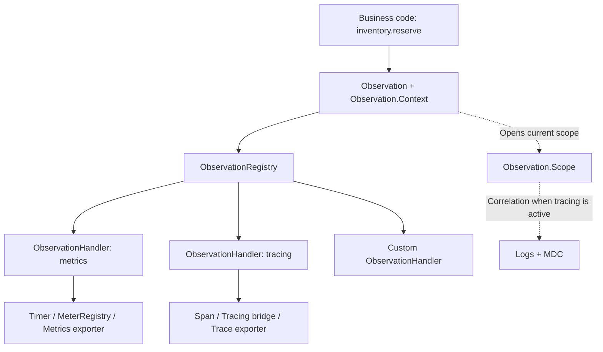
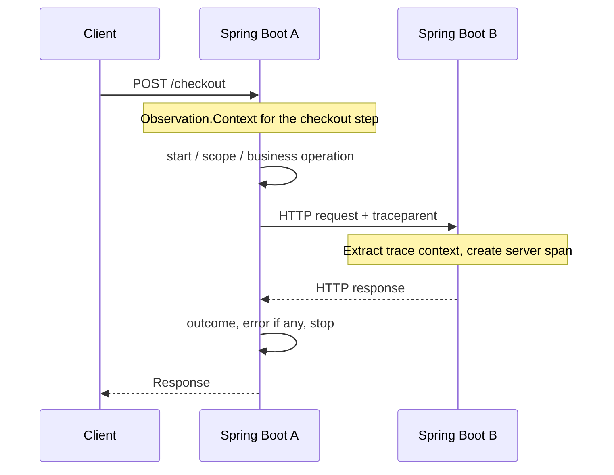

# Choosing the right context

When building a custom observation for an order placement step, you need to record duration, outcome, errors, and the path across services. Should you put the entire `Order` object into the observation? Should you declare tags directly on `Observation`, create a subclass of `Observation.Context`, or push data into the trace context so other services receive it? Choosing wrongly can explode metric time series counts, break tracing links, leak sensitive data into exporters, or make instrumentation hard to maintain.

In the **Custom observation** chapter of the **SPRING_BOOT_OBSERVABILITY** module, the **"Choosing the right context"** lesson addresses that design decision. Micrometer Observation is the shared abstraction for representing an operation in Spring Boot; metrics, logs, and distributed tracing can all consume data provided by the observation. Choosing the right context lets you describe an operation adequately, maintain a clean boundary between business data and telemetry, and preserve the ability to investigate errors, latency, and application behavior in production.

Learning objectives:

1. Distinguish `Observation.Context` from `Observation.Scope`, trace context, logging MDC, Reactor Context, and business data.
2. Choose between the **default context** and a **specialized context** based on the needs of your observation, convention, and handlers.
3. Design a context with stable naming, attributes, and lifecycle without leaking sensitive information or creating high metric cardinality.
4. Apply `ObservationConvention` to standardize how a context maps to observation names and key-values.
5. Select the right context propagation mechanism across threads, reactive pipelines, HTTP clients/servers, or message brokers.
6. Recognize real-world bugs: sharing a context across concurrent requests, storing oversized payloads, setting tags after stop, and confusing an internal context with trace propagation.

## 1. What is Context in Micrometer Observation?

An **Observation** represents a single execution of work with a name and lifecycle: starting, optionally opening a scope, optionally recording errors or events, and stopping. **Observation.Context** is the object holding state and metadata tied to *that single execution* for the observation, conventions, and handlers to consume.

For example, with `inventory.reserve`, a context might provide:

- The business operation being measured, such as `reserve`.
- The calling channel normalized to a bounded set: `web`, `mobile`, `batch`.
- The final outcome: `reserved`, `rejected`, `error`.
- The recorded exception if the operation failed.
- Strongly typed technical data needed by a custom handler to perform specialized behavior.

A context is **not a copy of the request or database entity**. Unless there is a specific, controlled reason, do not stuff JSON payloads, payment tokens, passwords, emails, customer IDs, or full object graphs into it. The context should describe just enough information for observability and share the observation's lifecycle.

Visualizing where context sits:



A single observation can be handled by multiple handlers. Context carries shared information for those handlers; **handlers and registry configuration** decide which signals are actually produced. Creating an `Observation.Context` alone does not automatically emit metrics, create spans, send OTLP data, or write business logs.

## 2. Types of "context" that are easily confused

The word *context* appears at many layers of a system. They are related, yet not interchangeable.

| Concept | Role | Scope and usage |
| --- | --- | --- |
| **`Observation.Context`** | Metadata/state of one occurrence read by handlers/conventions | Tied to a single Observation; can be specialized via subclassing |
| **`Observation.Scope`** | Sets an observation as the current observation in an execution block | Open and close in the right place; scope does not replace `stop()` |
| **Trace context** | Trace/span identifiers and parent–child links | Propagated across calls when instrumentation and propagators are configured |
| **W3C `traceparent`/`tracestate`** | Representation of part of trace context over HTTP headers | Serves inter-process propagation; not a container for full business metadata |
| **Baggage** | Selected attributes that can propagate across services when configured | Incurs cost and data exposure risk; requires explicit allowlists and limits |
| **MDC / log correlation** | Contextual fields attached to a log event, e.g., `traceId`/`spanId` | Depends on logging config, active scope, and execution context |
| **Reactor Context** | Context traveling along a Reactor subscription | Supports passing data through reactive chains; distinct from `Observation.Context` |
| **Domain context / request DTO** | Business data required to process a request | Not inherently suitable for telemetry export or metric labels |

A common mistake is seeing a custom `Observation.Context` with a `customerId` field and assuming that field automatically propagates to service B. **No such mechanism exists by default.** To pass traces between service A and B, you need client/server instrumentation and propagators; to pass business data, use explicit API/message contracts and appropriate data policies.

Likewise, calling `observation.openScope()` does not automatically guarantee tasks running on another executor or inside Reactor retain trace context. Choosing the right context must go hand-in-hand with choosing **the right propagation mechanism for each boundary**.

## 3. Start with the question: what data do handlers actually need?

Do not create a specialized context class merely because an observation has several key-values. Answer these first:

1. **What operation is being measured?** An HTTP request, a business step, a dependency call, or a background job?
2. **Which signals do you need?** Duration and counts; trace spans; correlated logs; or another custom handler?
3. **Which signals must be grouped?** For example, `operation`, `provider`, `outcome` with bounded value sets.
4. **Which data is only needed internally?** Does any custom handler or convention need to read strongly typed details?
5. **Does execution cross thread/process boundaries?** If yes, identify the propagation path independently of the context class.
6. **Where is the end boundary?** Is the context known before start, or only resolved after the work finishes?

Decision table:

| Scenario | Starting choice | Reason |
| --- | --- | --- |
| Measuring one synchronous step with a few low-cardinality tags | Default `Observation.Context` via the `Observation` API | Simple, minimal code to maintain |
| Reusing naming/tag rules across multiple places | `ObservationConvention` with an appropriate context | Centralizes naming and tag policies |
| Handlers need strongly typed fields: operation kind, outcome, retry count | Subclass of `Observation.Context` | Clear contract, avoids casting or ad-hoc maps |
| Instrumenting HTTP server/client already supported by the framework | Use the framework's built-in context and instrumentation | Avoids duplicate boundaries and losing structured HTTP metadata |
| Context must cross HTTP/message boundaries | Tracing/propagation instrumentation and corresponding carriers | Domain contexts do not travel over the network automatically |
| Need to store and query business payloads | Domain stores or controlled audit logs | Do not abuse `Observation.Context` as a data store |

General rule: **choose the simplest context that still satisfies your current handlers and conventions**. As responsibilities grow, introduce a specialized type intentionally instead of copying every request field into the context.

## 4. When to use the default context?

If you only want to measure the duration of a dependency call and attach a few stable tags, you usually do not need to declare a custom context class.

Spring Boot example (Java 17+, assuming the app already has an `ObservationRegistry` bean provided by Actuator/appropriate instrumentation):

```java
import io.micrometer.observation.Observation;
import io.micrometer.observation.ObservationRegistry;
import org.springframework.stereotype.Service;

@Service
public class ShippingQuoteService {
    private final ObservationRegistry registry;
    private final ShippingGateway gateway;

    public ShippingQuoteService(ObservationRegistry registry,
                                ShippingGateway gateway) {
        this.registry = registry;
        this.gateway = gateway;
    }

    public long quote(String destinationPostcode) {
        return Observation.createNotStarted("shipping.quote", registry)
                .contextualName("calculate shipping quote")
                .lowCardinalityKeyValue("operation", "quote")
                .lowCardinalityKeyValue("provider", "primary")
                .observe(() -> gateway.quote(destinationPostcode));
    }
}

interface ShippingGateway {
    long quote(String destinationPostcode);
}
```

With a metrics handler configured, each call can update the corresponding timer/metric. With a tracing handler, it can create a span. `observe(...)` handles the synchronous lifecycle: starting, opening a scope, running the lambda, handling exceptions per the API, and stopping.

Here:

- `shipping.quote` is the **stable measurement name**.
- `operation=quote` and `provider=primary` are **low-cardinality tags**.
- `destinationPostcode` is just a business input parameter; it does not automatically become a tag.
- The code does not need a dedicated `ShippingQuoteContext` class because no handler/convention requires additional strongly typed state.

### When this approach stops being enough

Suppose later you integrate three shipping providers, each with custom retry behavior; a custom handler needs to distinguish `timeout`, `invalid_response`, and `rate_limited` errors and read the attempt count to emit an internal event. If you keep adding dozens of tag-selection lines inside every service, the default context representation becomes hard to maintain. That is the signal to design a **typed context** and possibly a shared convention.

Do not create a typed context merely to wrap a single `operation` string; the benefit will not outweigh the extra class, construction rules, and lifecycle management overhead.

## 5. Specialized context: typed and consistent representation

A specialized context is a subclass of `Observation.Context` holding **the exact properties handlers/conventions actually need**. It participates in the same Observation lifecycle, while giving instrumentation a clear contract instead of scattered strings or maps.

Example observing inventory reservation with these outcomes:

- `reserved`: reservation succeeded.
- `rejected`: cleanly declined due to insufficient stock.
- `error`: exception/technical failure.

We want to use the calling channel (small bounded set) as a metric dimension, while holding the final outcome in the context so other handlers can read it.

### 5.1. Defining a typed context

```java
import io.micrometer.observation.Observation;

public final class InventoryReserveContext extends Observation.Context {
    private final String channel;
    private String outcome = "unknown";

    public InventoryReserveContext(String channel) {
        // Caller must normalize channel to a bounded value set.
        this.channel = channel;
    }

    public String channel() {
        return channel;
    }

    public String outcome() {
        return outcome;
    }

    public void outcome(String value) {
        this.outcome = value;
    }
}
```

This class holds only the two needed properties. It **does not store `sku`, `orderId`, request bodies, or tokens**. Even though this is just an in-memory object, we follow the *data minimization* principle: whatever is unnecessary for instrumentation is not stored.

A **new** context is created for **each invocation**. Never inject a singleton `InventoryReserveContext` into a service so multiple requests mutate `outcome`; that introduces shared mutable state and causes one observation to read another observation's result.

### 5.2. Creating a convention for the context

`ObservationConvention<T>` lets you define names and key-values based on the context type, so multiple instrumentation points for the same operation share identical rules. Example:

```java
import io.micrometer.common.KeyValue;
import io.micrometer.common.KeyValues;
import io.micrometer.observation.Observation;
import io.micrometer.observation.ObservationConvention;

public final class InventoryReserveConvention
        implements ObservationConvention<InventoryReserveContext> {

    @Override
    public boolean supportsContext(Observation.Context context) {
        return context instanceof InventoryReserveContext;
    }

    @Override
    public String getName() {
        return "inventory.reserve";
    }

    @Override
    public String getContextualName(InventoryReserveContext context) {
        return "reserve inventory";
    }

    @Override
    public KeyValues getLowCardinalityKeyValues(
            InventoryReserveContext context) {
        return KeyValues.of(
                KeyValue.of("operation", "reserve"),
                KeyValue.of("channel", context.channel())
        );
    }
}
```

Here the convention only emits tags known upfront; `outcome` has no final value until the work completes, so it will be attached then. The advantage of a convention is avoiding duplicating meter names and tag policies across multiple call sites.

**Remember:** `supportsContext(...)` ensures the convention only applies to the right context type. If multiple conventions or handlers match, registry configuration and ordering/precedence can affect the result; when customizing framework instrumentation, verify with real metrics/traces. Never apply an HTTP convention to a business context merely because field names look similar.

### 5.3. Using the context in a service

```java
import io.micrometer.observation.Observation;
import io.micrometer.observation.ObservationRegistry;
import org.springframework.stereotype.Service;

@Service
public class InventoryService {
    private final ObservationRegistry registry;
    private final InventoryGateway gateway;
    private final InventoryReserveConvention convention =
            new InventoryReserveConvention();

    public InventoryService(ObservationRegistry registry,
                            InventoryGateway gateway) {
        this.registry = registry;
        this.gateway = gateway;
    }

    public boolean reserve(String channel, String sku) {
        String normalizedChannel = switch (
                channel == null ? "" : channel) {
            case "web" -> "web";
            case "mobile" -> "mobile";
            case "batch" -> "batch";
            default -> "other";
        };

        InventoryReserveContext context =
                new InventoryReserveContext(normalizedChannel);

        Observation observation = Observation
                .createNotStarted("inventory.reserve", () -> context, registry)
                .observationConvention(convention)
                .start();

        try (Observation.Scope scope = observation.openScope()) {
            boolean reserved = gateway.reserve(sku);
            String outcome = reserved ? "reserved" : "rejected";

            context.outcome(outcome);
            observation.lowCardinalityKeyValue("outcome", outcome);
            return reserved;
        } catch (RuntimeException | Error failure) {
            context.outcome("error");
            observation.error(failure);
            observation.lowCardinalityKeyValue("outcome", "error");
            throw failure;
        } finally {
            observation.stop();
        }
    }
}

interface InventoryGateway {
    boolean reserve(String sku);
}
```

Data flow:

1. Select `channel` from a bounded set so arbitrary inputs cannot create new labels.
2. Create **one** `InventoryReserveContext` per occurrence.
3. Create the Observation with a context supplier and attach the convention, then call `start()`.
4. Open a scope for the business operation; set `outcome` on both the context and as a low-cardinality key-value before stopping.
5. If an exception is thrown, record it via `observation.error(failure)`; `finally` still stops the observation.

**Important note on timing:** handlers may inspect key-values at different lifecycle milestones. The illustrative code adds `outcome` once known and before `stop()`, yet to guarantee a label appears on metrics/spans in a specific setup you must verify the active handlers and conventions. Do not assume every backend updates attributes that were already read during `onStart`. If business requirements demand an exact set of outcome labels, verify how the metrics handler records tags at `onStop` and how the tracing handler processes tags before the span ends.

The snippet above illustrates API usage and design; it omits the `InventoryGateway` bean implementation, build dependencies, and full production configuration. For custom handlers that need `outcome`, read it at **stop time** rather than `onStart`.

### 5.4. When should you use a custom ObservationHandler?

A custom handler can be useful when forwarding an internal event to a dedicated monitoring system or applying custom policies. A handler should clearly declare which context it supports:

```java
import io.micrometer.observation.Observation;
import io.micrometer.observation.ObservationHandler;

public final class InventoryOutcomeHandler
        implements ObservationHandler<InventoryReserveContext> {

    @Override
    public boolean supportsContext(Observation.Context context) {
        return context instanceof InventoryReserveContext;
    }

    @Override
    public void onStop(InventoryReserveContext context) {
        // Read only required data, e.g. context.outcome().
        // Educational example: does not send data to an external system yet.
    }
}
```

This handler must be registered in the `ObservationRegistry` configuration to be invoked. Creating a handler class without registering it emits no telemetry. Do not let a custom handler record a second timer if the metrics handler already measures the same occurrence, unless a distinct measurement purpose is clearly defined.

**Never place mandatory business logic inside a handler**, such as deducting inventory inside `onStop`. Instrumentation callbacks can be reconfigured, sampled, or disabled in other environments; business correctness must reside in the appropriate business service/transaction.

## 6. What data should a context carry, and what must be excluded?

Separate three common goals:

- **To group metrics:** Choose low-cardinality keys with small, stable value sets.
- **To explain a specific trace:** Detailed attributes may be used when handlers support them, subject to data limits and sampling.
- **To execute business logic:** Use separate method parameters/domain objects; do not automatically push them into observations or exporters.

| Data | Should it be in `Observation.Context`? | Should it be a metric tag? | Notes |
| --- | --- | --- | --- |
| `operation=reserve` | Yes | Yes | Stable name/value |
| `channel=web|mobile|batch|other` | Yes | Yes | Normalize at the input boundary |
| `outcome=reserved|rejected|error` | Yes | Yes | Set only once known; standardize taxonomy |
| `provider=inventory-a|inventory-b` | Yes if needed | Yes if bounded | Avoid dynamic hostnames/pod IDs causing unbounded cardinality |
| Retry attempt count | Yes if needed by handler | Consider bucketing or a separate metric | Avoid using unbounded attempt counts as labels |
| `http.route=/orders/{id}` | Yes via appropriate HTTP instrumentation | Yes | Use route templates, not raw URLs containing IDs |
| `orderId`, `customerId`, email | Usually unnecessary | No | High cardinality; personal data risk |
| Secrets, access tokens, passwords, payment payloads | No | No | Must not leak into traces/logs indirectly |
| Full request body / response body | Usually no | No | Likely contains PII and inflates storage costs |
| Exception / technical error category | Yes via `observation.error(...)` | Use stable error category codes if needed | Never use raw exception messages as tags |
| Trace ID / span ID | From tracing context | Never as a metric tag | Used for log/trace correlation, not grouping time series |

### 6.1. How quickly does cardinality grow?

A meter with dimensions `operation` (3 values), `channel` (4 values), and `outcome` (3 values) can produce up to:

```text
3 × 4 × 3 = 36 label combinations
```

If you add `orderId` with 100,000 values, **potential** combinations jump to 3,600,000, before counting extra dimensions or histogram buckets. This is a theoretical combinatorial example; actual series count depends on which combinations occur at runtime. Still, the risks to memory, exporter load, and query cost are real.

Micrometer Observation distinguishes:

- `lowCardinalityKeyValue(k, v)`: suitable for metric dimensions and usable in traces.
- `highCardinalityKeyValue(k, v)`: detailed context usable by tracing handlers; normally **must not** become a metric dimension.

The term **high-cardinality** does not authorize sending PII or secrets. Even if excluded from metrics, data can still leave the system via trace exporters and get persisted. Data minimization applies to **every** signal.

### 6.2. Preserving tag semantics

Free-form strings frequently cause data quality issues:

```text
outcome="SUCCESS"       differs from outcome="success"
outcome="OK"            differs from outcome="success"
outcome="err 503"       can spawn endless variants by error code/message
channel="<raw header>"  can have an unbounded number of values
```

It is far better to define a consistent taxonomy and normalize inputs before attaching them to the Observation. If you want error classification, use a bounded set such as `timeout`, `rejected`, `upstream_error`, `other`, rather than using raw error messages as labels.

## 7. How are observation name, convention, and context related?

A context typically carries the data; the convention decides how that data is represented consistently:

| Part | Design question |
| --- | --- |
| **Observation name** | Is it stable across occurrences and suitable for metric aggregation? |
| **Contextual name** | Does it describe the work clearly in traces without arbitrary IDs? |
| **Low-cardinality key-values** | Are value sets bounded, cleanly named, and backend-compatible? |
| **High-cardinality key-values** | Are they genuinely necessary? Do they contain sensitive data? |
| **Context class** | Does it store the exact strongly typed data needed by conventions/handlers? |
| **Handler** | Does it support the right context type and read data at the right lifecycle callback? |

Example:

```text
Observation name   : inventory.reserve
Contextual name    : reserve inventory
Low-cardinality    : operation=reserve, channel=web, outcome=reserved
High-cardinality   : (unneeded in this example)
Typed context      : InventoryReserveContext(channel, outcome)
Handler            : configured metrics/tracing; custom onStop if needed
```

Do not name an observation `inventory.reserve.customer-9981` expecting the backend to group it properly. When you need to investigate a specific order, the right mechanism is trace/log correlation with proper access policies, not inflating metric name granularity.

A convention reused across modules keeps labels consistent as application code evolves. However, if a convention turns overly granular fields into free-form tags, centralization alone does **not** make it safe. Taxonomy quality still requires deliberate design.

## 8. Choosing the right context by instrumentation boundary

### 8.1. Business logic inside a Spring Boot service

Use the default context when you only need a timer and a few fixed labels. Create a typed context when logic and handlers must share strongly typed state, such as business category and outcome; place start/stop around the exact business step boundary.

For example, an HTTP server has an observation for `POST /orders`, containing a custom `inventory.reserve` inside. The two observations answer **different questions**:

- HTTP server observation: how long did the request take, and what status was returned?
- Inventory observation: how long did stock reservation take, and what was its outcome?

Do not create multiple observations repeating the exact same boundary already instrumented by the framework if they add no meaningful new signal.

### 8.2. HTTP clients and servers

HTTP integrations typically provide framework-created specialized contexts describing the request, response, URI template, or propagation carrier. If you want to customize route naming or tags, prefer the framework's convention/configuration matching that context type rather than inventing a new `Observation.Context` per request.

In Spring Boot, using Boot-configured HTTP client builders (such as `RestClient.Builder` or `WebClient.Builder`) leverages built-in observation/tracing integration when the required dependencies are present. Creating an uninstrumented standalone client means an internal custom observation context **will not automatically turn into** an outbound `traceparent` header.

### 8.3. Message brokers

A producer and consumer may require propagation across message headers. Whatever context travels through messages must be governed by that system's instrumentation/propagator. Never serialize an entire `InventoryReserveContext` into a message just to "keep the trace"; it is an in-process instrumentation object with its own lifecycle and ownership.

### 8.4. Batch jobs, schedulers, and background jobs

For background work not initiated by an HTTP request, create a fresh observation at the job boundary. The context should carry bounded-cardinality fields like `job.type`, `operation`, and `outcome`. Job run IDs can live in job/audit records or protected logs rather than directly in metric labels.

If a scheduler executes multiple attempts/retries, decide whether you want a parent observation measuring the whole job and child observations measuring each attempt. Each observation must manage its own lifecycle and stop cleanly when its work completes.

## 9. Scope and context propagation: two distinct tasks

A custom context created in service A does not automatically exist inside service B. Tracing can link operations via headers when the instrumentation pipeline is set up:



Three separate tasks must be handled:

1. **Instrument:** Use Observation/handlers to describe the work and metadata.
2. **Activate:** Open/close scopes when an observation needs to be current within an execution block.
3. **Propagate:** Use tracing instrumentation and propagators to carry trace context across HTTP, message headers, or thread/reactive boundaries.

Example:

```java
Observation observation = Observation
        .createNotStarted("checkout.authorize", registry)
        .start();

try (Observation.Scope scope = observation.openScope()) {
    // Synchronous code here can see the current observation.
    paymentClient.authorize();
} catch (RuntimeException | Error failure) {
    observation.error(failure);
    throw failure;
} finally {
    observation.stop();
}
```

Closing `Scope` does not replace `Observation.stop()`. In tracing, the current span and log correlation usually rely on an active scope. If code moves onto another thread, you need a context propagation mechanism. **Never pass a mutable `Observation.Context` directly and mutate its fields concurrently from multiple threads** as a substitute for context propagation.

### 9.1. Baggage is not a transport for full business context

Baggage can propagate across processes and sometimes integrates with MDC depending on configuration. However, carried attributes can be exposed over the network, to downstream services, or in logs. Use baggage only with explicit allowlists, length limits, and clear data governance. Never put emails, tokens, raw customer IDs, or request bodies into baggage simply to search traces faster.

If your goal is simply linking spans of a request, **trace context** is usually sufficient. If downstream services need to know a business decision, include that data in the proper API/message contract rather than stuffing every field into baggage.

## 10. Choosing context in asynchronous and reactive processing

### 10.1. Never reuse one context across concurrent requests

`Observation.Context` is typically a stateful object mutated over its lifetime. If two requests share an instance, fields like `outcome` or `error` can overwrite each other, corrupting telemetry and causing race conditions. Create one context per occurrence, ensuring a single responsible code path updates its state.

```text
Wrong:
  singleton InventoryReserveContext
      ├── request A -> outcome = reserved
      └── request B -> outcome = error

Right:
  request A -> Context A -> Observation A -> stop A
  request B -> Context B -> Observation B -> stop B
```

If multiple callbacks could finalize an operation, designate one owner responsible for stopping and synchronize context updates if truly necessary. Merely using an object with matching field names does not make cross-thread mutations safe.

### 10.2. CompletableFuture

A common bug:

```java
return Observation.createNotStarted("inventory.reserve.async", registry)
        .observe(() -> inventoryClient.reserveAsync());
```

If `reserveAsync()` returns a `CompletableFuture` immediately, `observe(...)` only measures the time to *create the future*, not the time until completion. In async models, allocate one context per invocation and end the observation when the underlying future finishes according to your definition; use terminal callbacks like `whenComplete`, record errors, and call stop during cleanup.

Distinguish **future cancellation** from **physical task termination**: cancelling a future does not guarantee downstream work stopped immediately. If you want to measure both user wait time and background execution time, use two separate observations at those two boundaries.

### 10.3. Reactor / WebFlux

A `Mono`/`Flux` can be subscribed to multiple times. Create the observation and context *per subscription*, avoiding creating shared context at publisher assembly time:

```java
import io.micrometer.observation.Observation;
import reactor.core.publisher.Mono;

public Mono<Boolean> reserveReactive(String channel, String sku) {
    return Mono.defer(() -> {
        InventoryReserveContext context =
                new InventoryReserveContext(normalizeChannel(channel));

        Observation observation = Observation.createNotStarted(
                "inventory.reserve.reactive", () -> context, registry
        ).start();

        try {
            return reactiveGateway.reserve(sku)
                    .doOnNext(reserved -> {
                        String outcome = reserved ? "reserved" : "rejected";
                        context.outcome(outcome);
                        observation.lowCardinalityKeyValue("outcome", outcome);
                    })
                    .doOnError(failure -> {
                        context.outcome("error");
                        observation.error(failure);
                        observation.lowCardinalityKeyValue("outcome", "error");
                    })
                    .doFinally(signal -> observation.stop());
        } catch (RuntimeException | Error setupFailure) {
            context.outcome("error");
            observation.error(setupFailure);
            observation.stop();
            throw setupFailure;
        }
    });
}
```

This example illustrates the lifecycle pattern for a simple publisher and assumes `normalizeChannel` and `reactiveGateway` already exist. Depending on business semantics, you may also need to handle `Mono.empty()` and `CANCEL` signals (where neither `doOnNext` nor `doOnError` runs), avoiding leaving `outcome` as `unknown` if that field matters. **`doFinally` does not automatically activate scope/tracing context across operators or schedulers**; use compatible Reactor/Micrometer Context Propagation mechanisms.

With `retry`, `share`, `cache`, and hot publishers, the meaning of "one execution" depends on how the chain is built. Decide whether the observation measures **each subscription**, **each attempt**, or **the entire user operation**, then place `defer` and `doFinally` at the matching boundary.

## 11. Context and results: recording errors, outcomes, and duration

Two categories of signals must be kept separate:

- **Technical errors:** Exceptions, timeouts, upstream failures, serialization errors.
- **Business outcomes:** Reservation succeeded, declined due to out-of-stock, payment legitimately declined per business rules.

For example, `gateway.reserve(sku)` returning `false` may be a normal business outcome with no exception thrown. Relying solely on `observation.error(...)` to compute decline rates would miss this outcome entirely.

Recommended outcome table:

| Case | `context.outcome` | `observation.error(...)` | Metric/tag |
| --- | --- | --- | --- |
| Reservation succeeded | `reserved` | No | `outcome=reserved` |
| Valid out-of-stock decline | `rejected` | No | `outcome=rejected` |
| Dependency timeout | `error` | Yes, timeout exception | `outcome=error` and/or bounded error category |
| Programming exception | `error` | Yes, exception | `outcome=error` |
| Cancelled before result | `cancelled` if defined | Not necessarily an exception by default | `outcome=cancelled` if needed |

When a convention reads context data at `onStart`, the `outcome` value does not exist yet. When a handler reads at `onStop`, it usually has the final result. If a tag needs to be emitted at another point, deliberately design the callback, convention, and update timing. Most importantly, **never attach results after an observation has stopped** expecting already-exported data to retroactively change.

## 12. How does context relate to metrics, logs, and distributed tracing?

Choosing the right context only solves data representation; for production observability, you need to examine the whole pipeline.

| Signal | What does context contribute? | What else must be configured? | Common blind spots |
| --- | --- | --- | --- |
| Metrics | Name, controlled tag dimensions, operation outcome | Metrics handler, `MeterRegistry`, exporter/scrape | High-cardinality tags; timer missing because stop wasn't called |
| Traces | Span name, diagnostic attributes, scope/parent links | Tracing handler/bridge, sampler, exporter, propagation | Trace sampled out or parent lost across HTTP/async |
| Logs | Trace/span correlation when scope/tracing are active | Logging pattern/MDC, log pipeline | Logs emitted outside scope or MDC lost |
| Custom handler | Reads typed context for custom telemetry logic | Register handler with the registry | Context mismatch; putting business logic in callbacks |

### 12.1. Baseline configuration example for Spring Boot 3.x

In a Maven project already using Spring Boot dependency management, a typical setup includes Actuator, the Prometheus registry, and Micrometer Tracing via OpenTelemetry:

```xml
<dependency>
    <groupId>org.springframework.boot</groupId>
    <artifactId>spring-boot-starter-actuator</artifactId>
</dependency>

<!-- When Prometheus metrics are needed -->
<dependency>
    <groupId>io.micrometer</groupId>
    <artifactId>micrometer-registry-prometheus</artifactId>
</dependency>

<!-- When using Micrometer Tracing + OpenTelemetry -->
<dependency>
    <groupId>io.micrometer</groupId>
    <artifactId>micrometer-tracing-bridge-otel</artifactId>
</dependency>

<!-- When exporting traces via OTLP -->
<dependency>
    <groupId>io.opentelemetry</groupId>
    <artifactId>opentelemetry-exporter-otlp</artifactId>
</dependency>
```

```yaml
management:
  endpoints:
    web:
      exposure:
        include: health,metrics,prometheus
  tracing:
    sampling:
      probability: 0.1
  otlp:
    tracing:
      endpoint: http://localhost:4318/v1/traces
```

`localhost:4318` is an example when a collector/backend accepts OTLP HTTP on the same host running the application. To see traces, an active collector/backend must be running and receiving data. Sampling `0.1` specifies the trace sampling policy; **it does not mean only 10% of metrics are recorded**.

In Spring Boot **4.x**, starter names and tracing/OTLP properties change. When implementing, consult documentation for your exact version; do not blindly copy 3.x dependency/property blocks into 4.x. Using `Observation.Context`, conventions, scopes, and handlers still follows the same design principles covered here.

Checking in a lab environment:

```bash
curl -fsS http://localhost:8080/actuator/metrics
curl -fsS http://localhost:8080/actuator/metrics/inventory.reserve
curl -fsS http://localhost:8080/actuator/prometheus
```

These endpoints only exist when Actuator/web exposure is configured appropriately and the operation has been instrumented and executed. A missing meter alone does not prove the code is wrong: a handler, registry, endpoint, or filter could be involved. In production, protect management endpoints with proper network and authorization controls; never expose them publicly without restriction.

### 12.2. Context does not control sampling or exporters

Suppose an observation has `channel=web` and `outcome=error`, yet no matching trace appears:

- The trace may have been dropped by the sampler.
- The tracing handler/bridge may not be active.
- The exporter/collector/backend may be failing.
- Scope/propagation may have broken when calling another service.
- Logs might carry a `traceId` even though the trace itself was not stored.

Do not alter the context or keep adding more tags to "fix" missing traces when the issue lies in the pipeline. Verify each link in the chain.

## 13. Anti-patterns to avoid

| Anti-pattern | Why it is problematic | Better approach |
| --- | --- | --- |
| Storing full DTO/request in every observation | Wastes memory, tight coupling, risks leaking data | Keep only fields needed by handlers/conventions |
| One mutable singleton context for all requests | Race conditions, mixed outcomes and exceptions | Create a fresh context per occurrence |
| Using `orderId` as a metric tag | Cardinality explosion, hard to operate | Use standard outcomes/routes; trace/log correlation when needed |
| Sending a typed `Observation.Context` directly over HTTP | Context object is not a standard propagation format | HTTP instrumentation + W3C Trace Context |
| Assuming `openScope()` automatically crosses all threads | Context can be lost across executors/reactive operators | Use context propagation integrations |
| Convention reads result fields unavailable at start | Tags/attributes can be wrong or missing | Set them before stop, verify handler callbacks |
| Writing business logic in `ObservationHandler.onStop` | Disabling or changing telemetry breaks business behavior | Keep business logic in services; handlers are strictly for observability |
| Creating custom observations duplicating HTTP instrumentation | Overlapping span/metric boundaries, harder to read | Create custom spans only for meaningful business steps |
| Storing secrets in `highCardinalityKeyValue(...)` | Traces can still be exported and stored | Omit or redact; enforce data governance policies |
| Forgetting `stop()` on exception/early return | Timers/spans lack completion timestamps | Use `observe(...)` or `try/finally` |
| Creating context once when assembling a `Mono` | Multiple subscriptions can share state | Use `Mono.defer(...)`, one context per occurrence |

## 14. Practice: choosing context for three scenarios

### Scenario A: calculating shipping fees

The application makes one synchronous call to a single provider and only needs duration and error rate. Fixed tag set: `operation=quote` and `provider=primary`.

**Sound choice:** Use `Observation.createNotStarted(...).lowCardinalityKeyValue(...).observe(...)` with the default context. No specialized context class is needed. Keep the postcode in business arguments.

### Scenario B: multi-channel inventory reservation

The application has channels `web`, `mobile`, `batch`; outcomes `reserved`, `rejected`, `error`. Multiple handlers or conventions need to read the outcome consistently.

**Sound choice:** Create `InventoryReserveContext` and a convention, use the name `inventory.reserve`, normalize the channel, and update outcome before stop. Do not add `sku` or `orderId` as metric labels. If part of the work runs async, define ownership/lifetime and dedicated propagation.

### Scenario C: two microservices communicating over HTTP

Both services already have Actuator and tracing. You need to find why checkout is slow in service B.

**Sound choice:** Rely on existing HTTP instrumentation and header propagation via client builders. Add a custom observation for a specific business step inside B if deeper breakdown is needed. Do not stuff a full `CheckoutRequest` into baggage or serialize a typed context to service B.

### Self-assessment matrix

| Question | If "Yes", what should you do? |
| --- | --- |
| Need only a timer and 2–3 stable tags? | Start with the default context |
| Do handlers need multiple strongly typed properties and an outcome? | Consider a typed `Observation.Context` |
| Do multiple places need the exact same naming/tag taxonomy? | Use `ObservationConvention` |
| Are you at an HTTP boundary with auto-instrumentation? | Reuse the built-in integration and context |
| Need to cross service or message broker boundaries? | Verify trace propagation instead of transferring domain context |
| Are there dynamic IDs, PII, or secrets? | Exclude them from metric tags and unnecessary telemetry |
| Are there async execution, retries, or cancellations? | Define lifetime, ownership, and stop timing |
| Are traces missing from dashboards despite metrics appearing? | Check sampler/exporter/collector and propagation |

### Self-check questions

**1. Why shouldn't you use a singleton typed context for all requests?**

Because a context holds the state of **one occurrence** and is often mutated during execution. Sharing it across concurrent requests can cause outcome/error fields to overlap and trigger data races.

**2. When is the default context better than a typed context?**

When you only need an observation name and a few stable key-values, with no custom handler or convention needing additional strongly typed fields. A new context class would only add unnecessary complexity.

**3. Does a context containing a `traceId` field cause the app to automatically propagate traces to another service?**

No. Trace propagation relies on tracing instrumentation, propagators, and carriers like HTTP headers. Putting a string inside `Observation.Context` does not replace W3C Trace Context.

**4. Why is `orderId` unsuitable as a low-cardinality tag?**

Because it generates an unbounded set of values and risks exposing data. Use bounded dimensions for metrics; use properly authorized log/trace correlation to look up individual requests.

**5. If `outcome` is only known after a method returns, what should you do?**

Hold outcome in the context if handlers need it, attach the low-cardinality value before stop, and verify which callback your handlers read it from. For async/reactive flows, ensure stop occurs when the real work completes per your defined boundary.

## 15. Principles to remember

- **`Observation.Context` describes one occurrence**, not a container for whole domain objects. Choose a context matching the actual needs of handlers and conventions.
- **Prefer the default context** for simple steps; move to a typed context when strongly typed data and shared rules are clear enough to justify it.
- **Separate context from propagation:** scopes serve the current observation, tracing context links spans across boundaries, Reactor Context serves reactive chains, and MDC serves log correlation.
- **Control cardinality and privacy:** metric tags must have bounded values; never put tokens, PII, or full payloads into telemetry.
- **Align lifecycle with the actual work:** create one context per occurrence, record outcomes/errors before stop, and never reuse shared mutable contexts across concurrent tasks.
- **Verify against real signals:** inspect meters/timers, traces, correlated logs, and exporters; missing traces may stem from sampling or pipeline issues rather than the wrong context choice.

### References

- [Micrometer — Observation API](https://docs.micrometer.io/micrometer/reference/observation.html)
- [Micrometer — Observation components and conventions](https://docs.micrometer.io/micrometer/reference/observation/components.html)
- [Micrometer — Context Propagation](https://docs.micrometer.io/context-propagation/reference/)
- [Spring Boot 3.5 — Observability](https://docs.spring.io/spring-boot/3.5/reference/actuator/observability.html)
- [Spring Boot 3.5 — Tracing](https://docs.spring.io/spring-boot/3.5/reference/actuator/tracing.html)
- [OpenTelemetry — Context propagation](https://opentelemetry.io/docs/concepts/context-propagation/)
