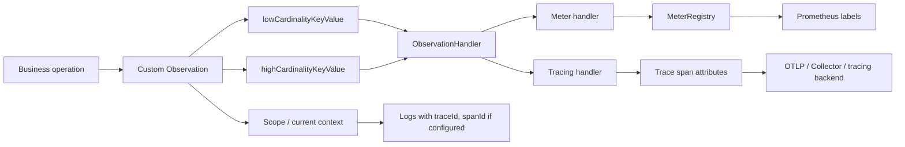
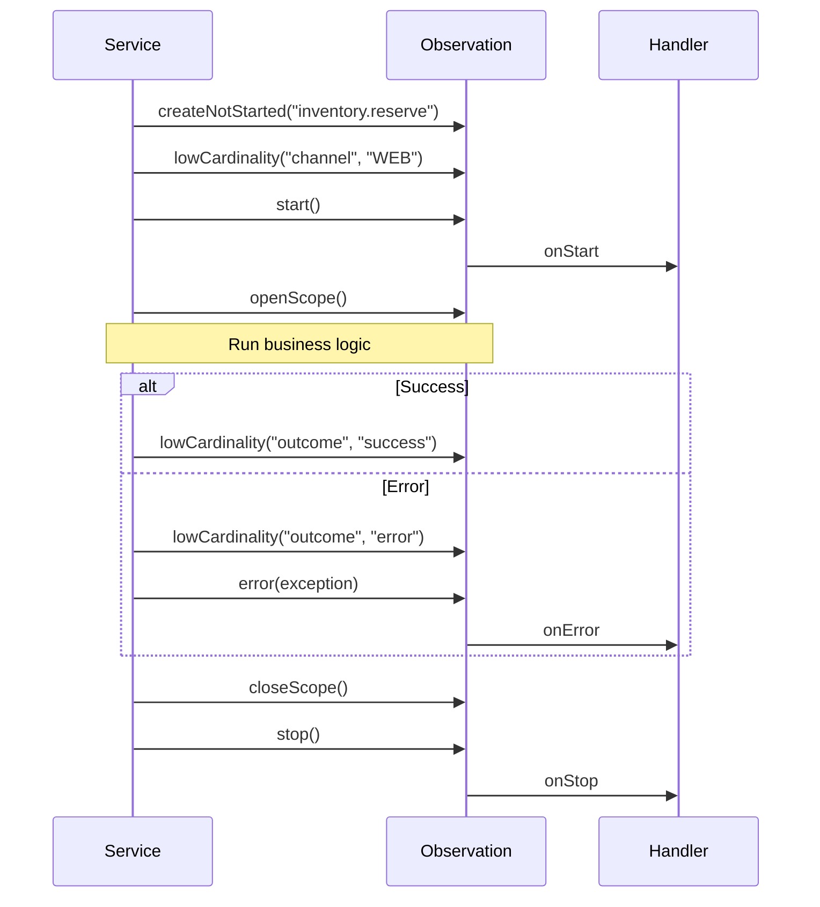

# Attaching low-cardinality metadata to custom Observations in Spring Boot

> **Chapter:** Custom observation  
> **Module:** `SPRING_BOOT_OBSERVABILITY` — setting up observability for Spring Boot using Micrometer Observation, metrics, logs, and distributed tracing; understanding context propagation, exporters, sampling, tags/cardinality, and signal correlation when investigating errors, latency, and application behavior.  
> **Focus:** How to choose, normalize, attach, and verify **low-cardinality key-values** on custom observations so metrics can be aggregated, traces are easy to filter, and telemetry pipelines maintain reasonable costs.

## 1. Learning objectives

After this lesson, you will be able to:

1. Explain what low-cardinality metadata is and why a tag's number of **distinct values** directly impacts time series count.
2. Distinguish low-cardinality from high-cardinality key-values in Micrometer Observation, as well as distinguishing metadata from trace context.
3. Use `lowCardinalityKeyValue(...)` on `Observation` or add key-values to `Observation.Context` at the right moment in the lifecycle.
4. Design **stable, bounded** value sets for dimensions like `channel`, `operation`, `outcome`, and `dependency`; avoid placing IDs or raw URLs in metric labels.
5. Use global configuration, observation filters, or conventions to keep naming/tagging consistent as a module grows.
6. Verify tags via Actuator, Prometheus, and a backend-free test; diagnose missing tags or abnormal cardinality spikes.

## 2. What is low-cardinality metadata?

*Metadata* is supplementary information describing an observed activity. For example, on an `inventory.reserve` observation, we might want to know which channel triggered the operation (`WEB`, `MOBILE`, `PARTNER`) and its outcome (`success`, `error`).

In Micrometer Observation, part of that metadata is expressed as **key-values**. We classify them into:

| Metadata type | Example | Operational meaning |
|---|---|---|
| **Low-cardinality** | `channel=WEB`, `outcome=success`, `dependency=inventory` | Has a **bounded, controlled** number of values; suitable for metric labels and usable as trace attributes |
| **High-cardinality** | `order.id=...`, `attempt.id=...`, `request.id=...` | Has many distinct values; use selectively in traces when needed and permitted, **never as metric labels** |
| **Trace/correlation context** | `traceId`, `spanId`, `traceparent` header | Used to link operations in distributed tracing and locate matching logs; must not become metric labels |
| **Sensitive data** | Passwords, tokens, emails, card numbers, private request bodies | Never send into default metric tags/traces/logs; requires dedicated data protection policies |

**Cardinality** can be thought of as the number of distinct values a label takes over a given period. A `channel` tag with exactly 3 predefined values is low-cardinality. A `userId` tag varying across 500,000 users is high-cardinality even though the tag name looks simple.

### 2.1. Why does low cardinality matter for metrics?

Prometheus and many metrics backends store time series keyed by **metric name plus label set**. For a metric `inventory_reserve_seconds_count`, each of the following is a distinct series:

```text
inventory_reserve_seconds_count{channel="WEB",outcome="success"} 154
inventory_reserve_seconds_count{channel="WEB",outcome="error"} 7
inventory_reserve_seconds_count{channel="MOBILE",outcome="success"} 42
```

These are illustrative lines, not default output from a specific application.

Suppose a timer has 3 `channel` × 3 `outcome` × 4 `dependency` × 6 instances; those dimensions alone can produce up to **216 label combinations** if all combinations occur. Histograms additionally generate separate series for buckets, sum, and count. Adding an `orderId` tag with hundreds of thousands of values makes series counts scale with order volume.

This directly impacts RAM, disk, scrape duration, query time, retention, and backend costs. Consequently, **a few meaningful tags with bounded value sets** are far better than many tags describing individual requests.

### 2.2. "Low" is a property of actual values

The tag name `endpoint` is not automatically low-cardinality. If its value is `/orders/{id}` (a normalized URI template), it generally has a small value set. If its value is `/orders/123456` with continuously changing IDs, it becomes high-cardinality.

Similarly, `result` can be low-cardinality if it only takes `success`, `rejected`, `error`; it turns high-cardinality if every call assigns a different exception message string.

## 3. Where does low-cardinality metadata go in the system?



`ObservationRegistry` holds the handlers, filters, predicates, and conventions applied to observations. When code creates an `Observation` using the Spring Boot-managed registry, handlers can read metadata from `Observation.Context`.

Typically:

- **Meter handlers** read low-cardinality key-values to create dimensions/tags on the corresponding timers and meters.
- **Tracing handlers** may put both low- and high-cardinality key-values into span attributes, depending on the bridge, handler, and conventions.
- **Logs** typically correlate with traces via `traceId`/`spanId` in MDC or structured logging; attaching `channel=WEB` does not automatically turn it into a field in every log line.
- **Exporters and Collectors** can add, rename, drop, or map attributes. Always verify actual data arriving at the backend rather than looking solely at code.

Micrometer Observation is a shared instrumentation API. **Having an observation containing key-values does not guarantee metrics or traces are exported**, as that still depends on the registry, handlers, sampling, exporters, and backend configuration.

## 4. API for attaching low-cardinality key-values

With Micrometer Observation configured by Spring Boot 3.x, the basic form is:

```java
Observation observation = Observation
        .createNotStarted("inventory.reserve", observationRegistry)
        .lowCardinalityKeyValue("channel", "WEB")
        .lowCardinalityKeyValue("dependency", "inventory");
```

In this snippet:

- `"inventory.reserve"` is the **observation name** with stable meaning.
- `"channel"` and `"dependency"` are **keys**. Name them consistently across call sites.
- `"WEB"` and `"inventory"` are **values**. This is where cardinality must be controlled.
- `lowCardinalityKeyValue(...)` attaches metadata to the observation; it **does not start or stop the observation**.

An equivalent way is working directly with `Observation.Context`, commonly seen in filters, conventions, or custom handlers:

```java
import io.micrometer.common.KeyValue;
import io.micrometer.observation.Observation;

void addEnvironment(Observation.Context context) {
    context.addLowCardinalityKeyValue(
            KeyValue.of("deployment.environment", "prod"));
}
```

The main difference lies in **who owns the operation**:

| Where to attach | When suitable | Notes |
|---|---|---|
| `Observation.lowCardinalityKeyValue(...)` | A business operation knows its own classification metadata | Clear, close to origin; normalize values before attaching |
| `Observation.Context.addLowCardinalityKeyValue(...)` | Code handling contexts inside filters/handlers/conventions | Be mindful of callback timing and available data |
| Spring Boot common key-values config | Labels fixed per deployment/service | Values should not vary per request |
| `ObservationConvention` | Standardizes key-values/observation names for an operation kind | Useful when multiple places emit the same observation type |

## 5. Spring Boot example: tagging calling channel and order outcome

We will instrument an `inventory.reserve` step in a checkout service. Problem: measure reservation counts, processing duration, and error rates by **bounded calling channel**, while keeping SKU dynamic and out of metrics.

### 5.1. Baseline dependencies

A Spring Boot 3.x Maven application using an appropriate Spring Boot parent/BOM can start with:

```xml
<dependency>
    <groupId>org.springframework.boot</groupId>
    <artifactId>spring-boot-starter-actuator</artifactId>
</dependency>

<!-- Only needed when exposing a Prometheus scrape endpoint. -->
<dependency>
    <groupId>io.micrometer</groupId>
    <artifactId>micrometer-registry-prometheus</artifactId>
</dependency>
```

To obtain distributed traces, add a compatible tracing bridge and exporter—for example, the OpenTelemetry stack with `micrometer-tracing-bridge-otel` and `opentelemetry-exporter-otlp` on supported Spring Boot 3.x versions. Specific dependencies may differ in Spring Boot 4 or other versions; keep them aligned with your BOM and version documentation.

### 5.2. Service with a controlled value set

```java
package com.example.checkout;

import io.micrometer.observation.Observation;
import io.micrometer.observation.ObservationRegistry;
import java.util.Locale;
import org.springframework.stereotype.Service;

@Service
public class InventoryService {

    private final ObservationRegistry observationRegistry;
    private final StockGateway stockGateway;

    public InventoryService(ObservationRegistry observationRegistry,
                            StockGateway stockGateway) {
        this.observationRegistry = observationRegistry;
        this.stockGateway = stockGateway;
    }

    public String reserve(String sku, String rawChannel) {
        String channel = normalizeChannel(rawChannel);

        Observation observation = Observation
                .createNotStarted("inventory.reserve", observationRegistry)
                .contextualName("reserve inventory")
                .lowCardinalityKeyValue("channel", channel)
                .lowCardinalityKeyValue("dependency", "stock-gateway")
                .start();

        try (Observation.Scope scope = observation.openScope()) {
            stockGateway.reserve(sku);
            observation.lowCardinalityKeyValue("outcome", "success");
            return "RESERVED";
        } catch (RuntimeException exception) {
            observation.lowCardinalityKeyValue("outcome", "error");
            observation.error(exception);
            throw exception;
        } finally {
            observation.stop();
        }
    }

    private static String normalizeChannel(String rawChannel) {
        if (rawChannel == null) {
            return "OTHER";
        }

        return switch (rawChannel.trim().toUpperCase(Locale.ROOT)) {
            case "WEB" -> "WEB";
            case "MOBILE" -> "MOBILE";
            case "PARTNER" -> "PARTNER";
            default -> "OTHER";
        };
    }
}

interface StockGateway {
    void reserve(String sku);
}
```

`StockGateway` is an illustrative abstraction. In a real application, the `StockGateway` implementation calls a database or instrumented downstream HTTP service. The example uses Java 17+, matching Spring Boot 3.x.

**Key details:**

1. `ObservationRegistry` is injected from the Spring container. Each call to `reserve(...)` creates its own observation while sharing the registry.
2. `channel` is normalized into **four values**: `WEB`, `MOBILE`, `PARTNER`, `OTHER`. Any unexpected input maps to `OTHER`.
3. `dependency=stock-gateway` is a fixed value. With multiple dependencies, use a managed list of logical names rather than dynamic hosts/URLs.
4. `sku` is not attached as a metric tag because every SKU could be a distinct value.
5. `outcome` is attached **before stop**: `success` after the gateway completes, `error` when an exception occurs. Handlers can consume this field upon observation completion.
6. `Observation.error(exception)` informs handlers of the error while `throw` preserves business semantics. `finally` guarantees `stop()` runs.

`try-with-resources` closes the scope before `finally` invokes `stop()`; when an exception leaves the scope, the `catch` block runs after the scope has closed. If you need **error logs carrying trace ID/span ID inside the child scope itself**, log inside the scope or ensure an appropriate parent tracing context exists.

### 5.3. Why not use rawChannel directly as a tag?

**Wrong:**

```java
observation.lowCardinalityKeyValue("channel", rawChannel);
```

A user-crafted request could send `"WEB-abcdef..."` or millions of arbitrary strings. Placing raw input into meter tags inflates cardinality while making dashboards hard to aggregate.

**Right:**

```java
observation.lowCardinalityKeyValue(
        "channel", normalizeChannel(rawChannel));
```

The core solution is **controlling the value set at the source**. Regex sanitization and length truncation are insufficient: even short strings can take infinitely many distinct values. Map inputs to an enum, error category group, or approved allowlist.

## 6. Attaching metadata while an observation is running

Some values are known before starting, such as `operation` and `channel`. Others are only known at completion, such as `outcome` or `result.category`.



**Choosing the right timing:**

- Metadata known upfront should be attached **before `start()`** so handlers interested in `onStart` can see it.
- Metadata known only at the end should be attached **before `stop()`** and before handlers need to read it.
- Never try adding tags after `stop()` expecting backends to update completed timers/spans.
- Not all handlers consume metadata at the same instant. Traces, metrics, and exporters may capture data at different points; verify the version and integration behavior in use.
- `openScope()` manages the **current observation/tracing context**, not metric tag creation. Attaching key-values does not replace opening a scope when parent–child context or propagation is needed.

### 6.1. Using observe(...)

When branch-specific outcome tagging is not required, the `observe(...)` API is more concise:

```java
public String reserveSimple(String sku) {
    return Observation
            .createNotStarted("inventory.reserve", observationRegistry)
            .lowCardinalityKeyValue("operation", "reserve")
            .observe(() -> {
                stockGateway.reserve(sku);
                return "RESERVED";
            });
}
```

`observe(...)` wraps a **synchronous** callback: start, scope, error on thrown exceptions, close, and stop are all managed by Micrometer. If you need a result-based `outcome` tag, you can update the observation inside the callback or use manual lifecycle control for readability as in `reserve(...)`.

**Critical limitation:** never use `observe(() -> CompletableFuture.supplyAsync(...))` to measure the full duration of an asynchronous task. The callback returns the future immediately, so the observation stops before the future finishes. For async/reactive work, bind start/stop to actual completion signals and configure context propagation.

## 7. Designing the tag set: naming, scope, and semantics

A system is easy to operate when each custom observation has a clear **tag contract**: name, description, allowed values, unknown-value handling, and ownership.

Example contract for `inventory.reserve`:

| Key | Allowed value set | Data source | When attached? |
|---|---|---|---|
| `channel` | `WEB`, `MOBILE`, `PARTNER`, `OTHER` | Request/channel enum mapping | Before start |
| `dependency` | `stock-gateway`, `backup-gateway` | Controlled routing decision | Before start or before stop |
| `outcome` | `success`, `error` | Actual result | Before stop |
| `deployment.environment` | `local`, `staging`, `prod` | Deployment config | Via common config/filter |
| `retry.category` | `initial`, `retry` | Business logic | Before stop |

### 7.1. Consistent naming and avoiding duplicates

Choose keys like `channel` and `outcome` with stable semantics. When using multiple integrations, check built-in conventions before adding overlapping keys. For example, standard HTTP server metrics already include `uri`, `method`, and `status`; do not add a `full_url` tag containing concrete request URLs.

Never abruptly rename `outcome` to `result` between releases if dashboards/alerts already rely on `outcome`. Renaming is a telemetry schema change that can split series or drop expected data.

### 7.2. Should you attach exception classes?

A **whitelisted** exception category such as `timeout`, `rejected`, `dependency_unavailable`, `other` is usually a stable choice. Raw exception messages are unsuitable as metric tags; they can contain URLs, IDs, or sensitive data.

```java
private static String errorCategory(Throwable error) {
    if (error instanceof java.net.SocketTimeoutException) {
        return "timeout";
    }
    if (error instanceof IllegalArgumentException) {
        return "invalid_request";
    }
    return "other";
}
```

In practice, exceptions thrown at each layer may be wrapped; map them according to business failures and the integrations in use. Never classify exceptions by using `error.getMessage()` directly as a label.

### 7.3. Preserving outcome semantics

Suppose `inventory.lookup` fails, yet a cache fallback succeeds. You should distinguish:

- `dependency.outcome=error` for the dependency call that timed out;
- `checkout.outcome=success` for the outer API if it returns a valid fallback result.

Each observation has its own boundary and result; not every span in a trace needs the same `outcome`. Clear outcomes explain why traces contain downstream errors while overall HTTP server error rates stay low.

## 8. How does low-cardinality metadata differ from high-cardinality metadata?

Micrometer Observation provides separate APIs:

```java
Observation observation = Observation
        .createNotStarted("payment.authorize", observationRegistry)
        .lowCardinalityKeyValue("provider", "primary")
        .lowCardinalityKeyValue("outcome", "success")
        .highCardinalityKeyValue("attempt.id", nonSensitiveAttemptId);
```

`nonSensitiveAttemptId` is an internal identifier **approved for telemetry**. High-cardinality key-values can be turned into span attributes by tracing handlers and are excluded from metric tags by default. However, "high-cardinality" does not mean "safe": user identifiers, tokens, payment details, and personal data must still follow security policies.

| Property | Low-cardinality | High-cardinality |
|---|---|---|
| Value count | Bounded and predictable | Can grow with every request/transaction |
| Suitable for metric labels | Usually yes | No |
| Suitable for trace span attributes | Possible | Possible, when purposeful and permitted |
| Purpose | Filtering/grouping/aggregation/alerting | Locating a specific transaction or step |
| Risk | Series explosion if poorly designed or over-combined | Data volume, privacy, search/indexing load |

**There is no universal "safe cardinality number" for all systems.** In a low-traffic deployment, a few dozen values may be fine; on a metric with many labels and histogram buckets, the same count can be very expensive. Evaluate based on total series, scrape frequency, instance count, and storage budget.

## 9. Attaching application-wide common metadata

Values such as `application` or `deployment.environment` apply across many observations. Spring Boot supports configuring common key-values in supported versions.

Example `application.yml` for Spring Boot 3.x:

```yaml
spring:
  application:
    name: checkout-service

management:
  observations:
    key-values:
      application: ${spring.application.name}
      deployment.environment: ${APP_ENVIRONMENT:local}
  endpoints:
    web:
      exposure:
        include: health,metrics,prometheus
```

**Scope of use:** use values that vary by deployment, not by request. If a `tenant` tag has tens of thousands of values and gets attached to every observation, it is no longer a reasonable common low-cardinality dimension.

Distinguish **common observation key-values** from **MeterRegistry common tags**. They sit at different layers of the pipeline; depending on registries and handlers, the two mechanisms can behave differently. If a label is already injected via Prometheus scrape labels, a Collector, or another layer, cross-check to prevent duplicates and conflicting values.

### 9.1. Using ObservationRegistryCustomizer and filters

When tagging policy requires code (for instance, mapping an environment setting onto an allowlist), customize **the Spring Boot-managed registry** instead of creating a standalone registry:

```java
import io.micrometer.common.KeyValue;
import io.micrometer.observation.ObservationRegistry;
import org.springframework.beans.factory.annotation.Value;
import org.springframework.boot.actuate.autoconfigure.observation.ObservationRegistryCustomizer;
import org.springframework.context.annotation.Bean;
import org.springframework.context.annotation.Configuration;

@Configuration(proxyBeanMethods = false)
class ObservabilityTagsConfiguration {

    @Bean
    ObservationRegistryCustomizer<ObservationRegistry> envTags(
            @Value("${app.environment:local}") String rawEnvironment) {

        String environment = switch (rawEnvironment) {
            case "prod", "production" -> "prod";
            case "staging" -> "staging";
            default -> "local";
        };

        return registry -> registry.observationConfig()
                .observationFilter(context -> {
                    context.addLowCardinalityKeyValue(
                            KeyValue.of("deployment.environment", environment));
                    return context;
                });
    }
}
```

`ObservationFilter` can modify `Observation.Context` as an observation completes. That works well for metadata used when exporting metrics/timers after execution, but **does not guarantee the tag exists when handlers run `onStart`**. If a value must be present right at the start or inform propagation/sampling decisions, choose context creation timing/mechanisms accordingly.

Do not simultaneously configure `management.observations.key-values.deployment.environment` and the filter above for the same tag without a clear purpose. Picking one single source simplifies maintenance.

### 9.2. When to use ObservationConvention?

When multiple places emit the same kind of observation, a convention standardizes the operation name and key-values uniformly. For instance, if multiple adapters invoke `inventory.reserve`, a convention can enforce:

- Technical name is always `inventory.reserve`;
- Meaningful contextual name for traces such as `reserve inventory`;
- `channel` comes from a normalized enum;
- `outcome` uses `success`/`error`;
- Dynamic extras are never promoted to metric tags.

Conventions help reduce duplicate naming/tagging logic and stop individual teams from inventing new keys. The `ObservationConvention<T extends Observation.Context>` API can be attached to specific observations; when customizing framework-instrumented observations, consult that framework's conventions because context types and tag names may differ from custom observations.

**Selection rule:** a small custom operation can attach tags directly with `lowCardinalityKeyValue`. Multiple semantically identical operations should consider a convention. Deployment-wide labels belong in common config/filters. Avoid creating extra abstraction layers just to attach one static tag.

## 10. Observing locally and in production

Locally, the goal is confirming metadata accuracy without needing a complex backend. When the app already includes Actuator and the Prometheus registry, for example:

```yaml
management:
  endpoints:
    web:
      exposure:
        include: health,metrics,prometheus
```

Suppose the app serves on `localhost:8080` and has an endpoint calling `InventoryService.reserve`. After running a few requests:

```bash
curl -s http://localhost:8080/actuator/metrics
curl -s http://localhost:8080/actuator/metrics/inventory.reserve
curl -s http://localhost:8080/actuator/prometheus
```

If an appropriate meter handler is registered and the observation has stopped, `/actuator/metrics/inventory.reserve` typically shows measurements like `COUNT` and `TOTAL_TIME` along with available tags. In the Prometheus exposition output, the timer may produce series like:

```text
inventory_reserve_seconds_count{channel="WEB",dependency="stock-gateway",outcome="success",...} 12
inventory_reserve_seconds_sum{channel="WEB",dependency="stock-gateway",outcome="success",...} 0.361
inventory_reserve_seconds_count{channel="WEB",dependency="stock-gateway",outcome="error",...} 2
```

These are **sample outputs**. Exact series names, units, label order, and tags depend on Micrometer version, registry, conventions, and configuration. Inspect actual output before writing dashboards.

If Prometheus is scraping, some reference PromQL queries (adjust metric/label names to match your system):

**Reservations per second by channel and outcome:**

```promql
sum by (channel, outcome) (
  rate(inventory_reserve_seconds_count[5m])
)
```

**Reservation error ratio across all calls (0–1):**

```promql
sum(rate(inventory_reserve_seconds_count{outcome="error"}[5m]))
/
clamp_min(
  sum(rate(inventory_reserve_seconds_count[5m])),
  1e-9
)
```

**Average duration by channel (in seconds):**

```promql
sum by (channel) (
  rate(inventory_reserve_seconds_sum[5m])
)
/
clamp_min(
  sum by (channel) (
    rate(inventory_reserve_seconds_count[5m])
  ),
  1e-9
)
```

This average query computes **mean duration**, not p95. To calculate p95/p99 from histograms, enable appropriate histograms, size buckets carefully, and apply `histogram_quantile` properly; never compute cluster-wide p95 by averaging per-instance p95s.

### 10.1. Combining with traces and logs

When a Micrometer Tracing bridge, exporter, Collector, and backend are running, custom observations can create spans carrying attributes derived from the metadata received by the tracing handler. An investigation scenario:

1. A dashboard shows `inventory.reserve` with `outcome=error` rising on `channel=PARTNER`.
2. Search traces by service, time window, operation, and matching attributes (if the backend indexes/filters them).
3. Inspect the inventory call span to pinpoint latency and where the exception occurred.
4. Use `traceId` to find related logs. Logs can carry `traceId`/`spanId` via MDC/structured fields; `channel` will not automatically appear in every log line.
5. Re-check error ratio and latency metrics after deploying the fix.

**Sampling affects traces; it does not mean metrics are reduced by the same proportion.** A timer metric can count every completed observation while only a fraction of traces are saved in the backend. Never use the count of found traces to infer exact processed request volume.

### 10.2. Policies when moving to production

| Area | Local | Production |
|---|---|---|
| Cardinality | Small test data, yet still requires a proper tag contract | Bound dimensions and total series; monitor growth |
| Trace sampling | Can use 100% at low traffic to verify correlation | Tune rate to traffic/cost and investigation goals |
| Tags | Use mock data, test all `success/error/OTHER` branches | Free of sensitive data; audit new values on release |
| Exporters | Can inspect Actuator endpoints and debug Collector directly | Reliable scrape/OTLP/log pipelines, auth/TLS, and retention |
| Change tracking | Inspect a single call directly | Test dashboard/alert compatibility, compare series counts post-deploy |

## 11. Testing tags without Prometheus

You can write a pure Micrometer unit test using `ObservationRegistry.create()` **for testing only**, attaching a handler to inspect the context when the observation stops. This verifies your code attaches metadata independently of exporters and backends:

```java
import io.micrometer.common.KeyValue;
import io.micrometer.observation.Observation;
import io.micrometer.observation.ObservationHandler;
import io.micrometer.observation.ObservationRegistry;
import java.util.concurrent.atomic.AtomicReference;
import org.junit.jupiter.api.Test;

import static org.junit.jupiter.api.Assertions.assertNotNull;
import static org.junit.jupiter.api.Assertions.assertTrue;

class LowCardinalityMetadataTest {

    @Test
    void handlerSeesBoundedTagsOnStop() {
        ObservationRegistry registry = ObservationRegistry.create();
        AtomicReference<Observation.Context> captured = new AtomicReference<>();

        registry.observationConfig().observationHandler(
                new ObservationHandler<Observation.Context>() {
                    @Override
                    public boolean supportsContext(Observation.Context context) {
                        return "inventory.reserve".equals(context.getName());
                    }

                    @Override
                    public void onStop(Observation.Context context) {
                        captured.set(context);
                    }
                });

        Observation.createNotStarted("inventory.reserve", registry)
                .lowCardinalityKeyValue("channel", "WEB")
                .lowCardinalityKeyValue("outcome", "success")
                .observe(() -> "RESERVED");

        Observation.Context observed = captured.get();
        assertNotNull(observed);

        boolean hasWebChannel = false;
        for (KeyValue kv : observed.getLowCardinalityKeyValues()) {
            if ("channel".equals(kv.getKey()) &&
                    "WEB".equals(kv.getValue())) {
                hasWebChannel = true;
                break;
            }
        }
        assertTrue(hasWebChannel);
    }
}
```

In a test, creating a standalone registry is reasonable because you are testing the Observation API itself. In the real application, inject the Spring Boot-configured registry to receive integrated handlers. **This test does not prove Prometheus has the series** or that an OTLP backend received the span; those require integration and end-to-end pipeline verification.

A useful companion test verifies `normalizeChannel(...)` always returns one of the four allowed values and maps unusual inputs to `OTHER`. The test's goal is protecting the **cardinality contract**, not merely confirming a method was invoked.

### 11.1. Do not equate a key existing in context with appearing in the backend

A tag may exist in `Observation.Context` yet be absent from metrics/traces because:

- The observation lacks a matching handler or used an isolated registry.
- `stop()` was not called on the observation (handler has not finalized the timer/span).
- A predicate filtered out the observation.
- A convention or filter added/overwrote metadata rules.
- The backend/Collector processed, stripped, or renamed the attribute.
- Traces were dropped by sampling or the exporter failed.
- The query filters the wrong service, time range, metric name, or label.

Therefore verify layer by layer: **code/context → handler/registry → exporter → backend → query**.

## 12. Common pitfalls when attaching metadata

### 12.1. Putting unique identifiers into low-cardinality tags

**Avoid:**

```java
observation.lowCardinalityKeyValue("order.id", orderId);
observation.lowCardinalityKeyValue("user.id", userId);
observation.lowCardinalityKeyValue("request.url", rawUrl);
```

**Prefer:** use `channel`, `operation`, `outcome`, route templates, or normalized error categories. When correlating a specific transaction, rely on controlled tracing/log correlation instead of metric labels.

### 12.2. Adding uncontrolled tags inside a filter

**Avoid:**

```java
context.addLowCardinalityKeyValue(
        KeyValue.of("tenant", rawTenantId));
```

This is an **application-wide bug** if the filter applies to every observation. It multiplies a high-cardinality dimension onto HTTP, database, JVM-adjacent observations, and custom metrics created by handlers.

**Prefer:** add only shared configuration labels with bounded values; tenant IDs may belong in traces/logs per policy or a separate intentionally designed aggregation mechanism.

### 12.3. Setting outcome after stop

**Wrong:**

```java
observation.stop();
observation.lowCardinalityKeyValue("outcome", "success");
```

**Right:** set the result before stop or inside the `observe(...)` callback. Once stop runs, handlers may already finalize telemetry.

### 12.4. Attaching inconsistent values

```text
channel=web
channel=WEB
channel=Web
channel=mobile
channel=MOBILE
```

To metrics, those are five distinct values even though the business only has two channels. Normalize casing, trimming, and fallbacks in one shared helper. Define explicit enums/contracts to prevent drift across services.

### 12.5. Renaming a tag and forgetting dashboards

When a new release renames `outcome` to `result`, queries filtering on `outcome` lose data. Manage telemetry schema updates like API changes: provide a transition period, update dashboards/alerts, and verify before and after deployment.

### 12.6. Confusing metadata with scopes or propagation

Attaching `channel=WEB` does not propagate trace context over HTTP. To keep spans across services in the same trace, you need tracing handlers, HTTP client/server instrumentation, and propagation headers (typically W3C `traceparent`). For async flows, you need matching context propagation; never treat metric tags as a substitute for trace IDs.

## 13. Practical diagnosis by symptom

| Symptom | Possible cause | Check / Action |
|---|---|---|
| `/actuator/metrics/inventory.reserve` missing | Code path not invoked, isolated registry, missing handler, filtered by predicate, stop not called | Trigger the real operation, confirm registry bean and lifecycle |
| Meter exists but `channel` tag missing | Tag set on wrong observation, set after stop, ignored by handler/convention, tag renamed | Inspect context in tests; compare metric output |
| Prometheus exposed yet custom metric absent | Missing Prometheus registry, endpoint not exposed or not scraped | Check `/actuator/prometheus` directly first, then inspect scrape target |
| `outcome=error` missing on exception | Caught without setting outcome, observation not stopped, or failure occurred outside boundary | Review try/catch/finally and observation boundaries |
| Series count spikes after deploy | Tag populated from free-form input, new tag has too many values, histograms with many buckets | Audit new labels, count distinct values, reduce cardinality |
| Metrics exist but traces missing | Tracing bridge/exporter not enabled, low sampling, Collector not receiving | Check tracing config, endpoint, protocol, sampling |
| Logs missing correlation IDs | Missing tracing context/scope, MDC or log format unsupported | Check active scope and logger pattern/structured fields |
| Each deployment uses different tag names | No tag contract, multiple conflicting conventions/filters | Standardize schema and value mappings |
| Duplicate or conflicting labels | Same key attached across observation, MeterRegistry, Collector/Prometheus | Inspect each layer and establish a single source of truth |

### 13.1. Workflow for investigating a tag-related incident

Suppose the `inventory.reserve` dashboard loses the `channel=PARTNER` series right after a deploy:

1. Verify the API is still receiving `PARTNER` traffic and the service actually executes the operation.
2. Check what `normalizeChannel` returns for request inputs; did it accidentally map to `OTHER`?
3. Verify the observation attaches `channel` before `stop()` and uses the same registry instance as the handlers.
4. Inspect `/actuator/metrics/inventory.reserve` and `/actuator/prometheus` directly on an instance receiving traffic.
5. If application output is correct, inspect scrape targets, relabeling rules, Collector/remote write, and dashboard queries.
6. Confirm schema migrations: did tag names, casing, label filters, or metric names change?

This workflow prevents falsely concluding the system stopped receiving PARTNER traffic merely because the dashboard no longer displays the old label.

## 14. Comprehensive hands-on exercise

**Scenario:** A `POST /checkout` API calls a payment gateway across three channels: `WEB`, `MOBILE`, `PARTNER`. The team wants a dashboard displaying request rate, error ratio, and processing duration per channel. Some requests carry `customerId` and `paymentAttemptId` for error lookup.

### Requirements

1. Create a custom observation `checkout.payment` around the payment gateway call.
2. Attach `channel` with the three channel values plus an `OTHER` fallback.
3. Attach `provider` from a fixed list (e.g., `primary`, `backup`).
4. Attach `outcome` as `success`, `rejected`, or `error` before stop.
5. Never attach `customerId` or `paymentAttemptId` as low-cardinality tags.
6. Write tests confirming normalization and verifying the handler sees `channel`/`outcome`.
7. Inspect the meter in Actuator or Prometheus, then compare with traces/logs once a tracing backend is active.
8. Estimate series growth with 4 `channel` × 2 `provider` × 3 `outcome` × 10 instances; the maximum across those dimensions is **240 label combinations**, excluding extra labels, histogram buckets, and combinations that never occur.

### Completion criteria

- All key-values have documented allowed values and semantics.
- A failing request records `outcome=error` before the observation stops without silently swallowing unexpected exceptions.
- Timer count increments with completed observations and can be grouped by `channel`/`outcome`.
- No trace IDs, user IDs, order IDs, or raw URLs appear in metric labels.
- You can pivot from an elevated error metric group to the corresponding trace and logs for the same request while explaining the impact of sampling.

## 15. Checklist before shipping a new tag to production

- [ ] Key and allowed value set are defined; an `UNKNOWN`/`OTHER` policy exists.
- [ ] The tag describes **a necessary analytical dimension** with a planned dashboard, query, or alert consuming it.
- [ ] Input values are normalized before attaching; no raw user input, individual IDs, or exception messages are used.
- [ ] Contains no secrets, personal info, or payment details.
- [ ] Evaluated combinations with existing tags and expected series/histogram bucket counts.
- [ ] Tag is attached at the right lifecycle moment; the observation stops even on error.
- [ ] Does not duplicate tags already added by Boot, conventions, MeterRegistry, or collectors.
- [ ] Verified actual output from metrics backends and traces when those pipelines are enabled.
- [ ] Updated dashboards, alerts, telemetry schema docs, and change owners.
- [ ] Plan in place to monitor post-deploy cardinality and roll back if series counts spike abnormally.

---

## Remember

**Low-cardinality metadata consists of key-values with small, stable, controlled value sets**, attached to custom `Observation` instances via `lowCardinalityKeyValue(...)` or through contexts/conventions/filters. They enable metrics to be grouped, rated, and alerted across business dimensions without exploding time series. Attach upfront tags before `start()`, attach outcomes before `stop()`, normalize inputs to enums/allowlists, and avoid dynamic IDs.

In Spring Boot, share the configured `ObservationRegistry`. Metrics handlers, tracing bridges, exporters, sampling, and log correlation determine which signals appear in each backend. Good metadata design both answers "which request group is slow or failing?" and provides a clean pivot from metrics into traces and logs during root-cause investigations.
