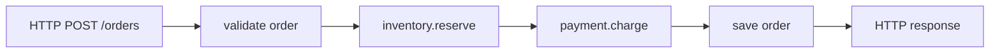
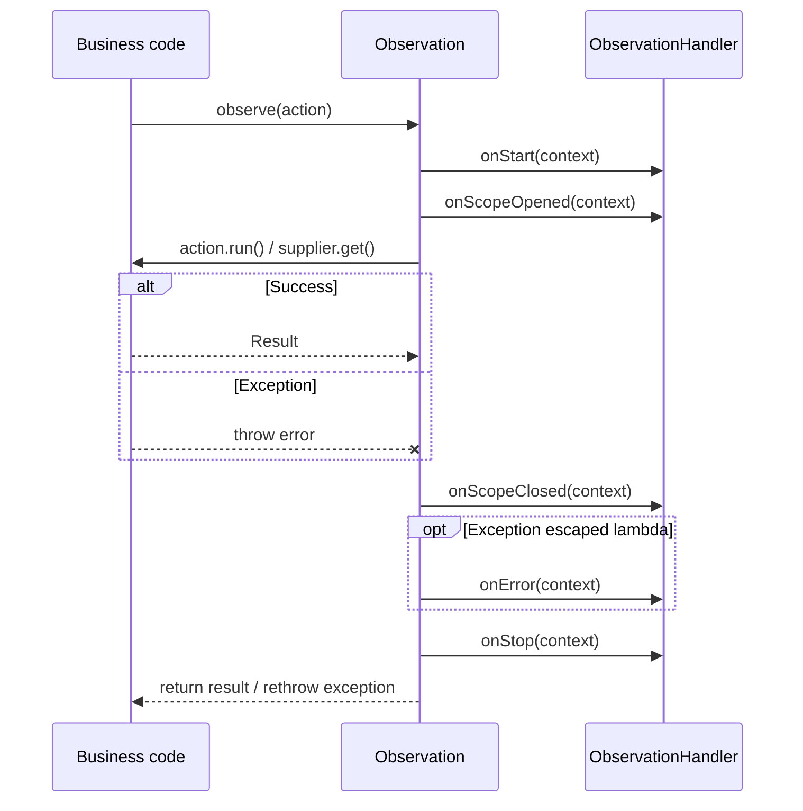

# Wrapping code with `observe` in Micrometer Observation

## 1. Learning objectives and context

In a Spring Boot system, knowing that an **HTTP request is slow** is only the first step. When a request traverses inventory checks, pricing, order persistence, and a payment gateway call, operators need to know *which step* consumes time or causes errors. **Micrometer Observation** lets you place an observation boundary around business code so handlers can emit metrics and distributed tracing from one shared instrumentation point.

This lesson belongs to the **Custom observation** chapter in the **SPRING_BOOT_OBSERVABILITY** module. The focus is the **`Observation.observe(...)`** method: proper usage, lifecycle, exception handling, naming/tags, impact on metrics, logs, and traces, and limitations when code runs asynchronously.

After this lesson, you will be able to:

- Distinguish `observe(Runnable)`, `observe(Supplier<T>)`, and `observeChecked(...)`.
- Explain what `observe` automatically does with `start()`, `openScope()`, `error()`, `close()`, and `stop()`.
- Choose a meaningful business boundary, instrument it using `ObservationRegistry` in Spring Boot, and set key-values with proper cardinality.
- Verify results via Actuator metrics, Prometheus, a trace backend, and log correlation.
- Recognize mistakes when using `observe` with exception-catching lambdas, already-started observations, `CompletableFuture`, Reactor, and callbacks.
- Know when manual lifecycle management is required instead of `observe`.

## 2. Why wrap code with `observe`?

Suppose `POST /orders` has the following steps:



Spring MVC may already instrument the HTTP request to measure total handling time, yet HTTP metrics alone do not explain which internal step caused a slowdown. Wrapping `inventory.reserve` separately with `observe` gives you a business operation with a stable name, its own duration, and its own error signal.

```java
Observation.createNotStarted("inventory.reserve", observationRegistry)
        .observe(() -> reserveInventory());
```

This snippet has two key aspects:

1. `createNotStarted(...)` creates an **unstarted** observation named `inventory.reserve`.
2. `observe(...)` **executes** the lambda immediately in the current call and manages the full observation lifecycle around that code.

When a `DefaultMeterObservationHandler` or equivalent timer handler is present, the observation can create a Timer. When a tracing handler and tracer/exporter are present, it can create a span. Do not assume that merely calling `observe` guarantees metrics and traces automatically appear in backends: output still depends on registry configuration, handlers, exporters, and sampling.

### One instrumentation point, multiple signals

| Component | Question answered | Example data |
| --- | --- | --- |
| Metrics | How many reservations ran? Mean duration/histogram? | `inventory.reserve`, `channel=web` |
| Traces | In this request, how long did reserve take and under which parent span? | Span `reserve inventory` inside the HTTP span |
| Logs | When that step failed, what did the system record? | Logs with `traceId`, `spanId` when tracing scope is configured |
| `Observation.Context` | What metadata and errors do handlers see for the operation? | Key-values, exception, internal data |

Micrometer Observation is the layer describing the operation; systems like Prometheus, Tempo/Jaeger/Zipkin, or log backends handle storing and displaying the corresponding signals.

## 3. What steps does `observe` perform?

Visualize the lifecycle equivalent of `Observation.observe(Runnable)`:

```java
observation.start();
try (Observation.Scope scope = observation.openScope()) {
    action.run();
} catch (Throwable error) {
    observation.error(error);
    throw error;
} finally {
    observation.stop();
}
```

This illustrates how `observe` behaves, **not code you need to rewrite** when using `observe`. Micrometer will:

1. Call `start()` so handlers receive the start event.
2. Open a `Scope`, making the observation the current observation in the active execution context.
3. Run the lambda; return the result if using `Supplier`.
4. Close the scope even if the lambda throws an error.
5. If the lambda throws a `Throwable`, call `observation.error(error)` and rethrow it.
6. Call `stop()` in `finally` so handlers receive the stop event.

The order when an exception is thrown has an important detail: the scope is closed by `try-with-resources` when exiting the `try` block, then `catch` reports the error, and `finally` stops the observation. For API users, the guarantee to remember is that **the scope is always closed, errors are reported, and the observation is always stopped**.



**`observe` does not swallow exceptions.** It preserves the success/failure behavior of the underlying code while adding observability signals. If the lambda throws `IllegalStateException`, the caller still receives `IllegalStateException` unless a secondary failure occurs inside a handler or cleanup.

### `Observation` and `Scope` are separate concepts

- `Observation` describes the overall operation, start/stop timestamps, and metadata.
- `Scope` sets the observation as the current context so spans/logs and nested observations can determine parent-child relationships.
- Closing `Scope` **does not replace** `stop()`; `observe` handles both.
- `ObservationRegistry.getCurrentObservation()` reflects only the current scope on the active execution context; it does not automatically cross every thread.
- An observation must be created **per execution**; never retain and call `observe` repeatedly on the same stopped instance.

## 4. Three lambda forms to know

`Observation` supports these common overloads:

| API | Input | Result | Example |
| --- | --- | --- | --- |
| `observe(Runnable)` | Operation returning no value | `void` | Sending an internal notification |
| `observe(Supplier<T>)` | Operation returning a value | `T` | Calculating price, reading an order |
| `observeChecked(CheckedRunnable<E>)` | `void` operation with a checked exception | `void`, declaring `throws E` | Writing a file with `IOException` |
| `observeChecked(CheckedCallable<T,E>)` | Returning operation with a checked exception | `T`, declaring `throws E` | Reading data from a stream |

`Runnable` and `Supplier` are standard JDK functional interfaces suited for unchecked exceptions. `CheckedRunnable` and `CheckedCallable` are nested types defined by `Observation`; `observeChecked` preserves checked exception contracts without wrapping them in `RuntimeException`.

### 4.1. Measuring code with no return value

```java
import io.micrometer.observation.Observation;

void sendConfirmation() {
    Observation.createNotStarted("notification.send", observationRegistry)
            .contextualName("send confirmation")
            .lowCardinalityKeyValue("channel", "email")
            .observe(() -> mailSender.sendConfirmation());
}
```

Here `mailSender` is a business dependency exposing `sendConfirmation()`. If `sendConfirmation()` fails with a `RuntimeException`, the observation records the error and propagates it to the caller.

### 4.2. Measuring code that returns a value

```java
PriceQuote quote = Observation
        .createNotStarted("pricing.calculate", observationRegistry)
        .lowCardinalityKeyValue("channel", "web")
        .observe(() -> pricingService.calculate(cart));
```

There is no need for a mutable local variable outside the lambda to capture the result. `observe(Supplier<T>)` returns the exact value produced by `supplier.get()`. `PriceQuote`, `pricingService`, and `cart` are application business types/variables.

### 4.3. When code throws a checked exception

```java
import java.io.IOException;
import java.nio.file.Files;
import java.nio.file.Path;

byte[] readInvoice(Path path) throws IOException {
    return Observation.createNotStarted("invoice.read", observationRegistry)
            .lowCardinalityKeyValue("source", "local-file")
            .observeChecked(() -> Files.readAllBytes(path));
}
```

For example, `Files.readAllBytes(path)` throws `IOException`; `observeChecked` lets this error propagate outward matching the `throws IOException` signature. Similarly for a checked `void` operation:

```java
void writeInvoice(Path path, byte[] bytes) throws IOException {
    Observation.createNotStarted("invoice.write", observationRegistry)
            .observeChecked(() -> {
                Files.write(path, bytes);
            });
}
```

Do not put absolute file paths, usernames, or business IDs into low-cardinality key-values. Choose bounded groups such as `source=local-file` or `result=success|failure` if needed.

## 5. Runnable example with Spring Boot 3.5.x

To clearly illustrate `observe` boundaries, use a Spring Boot 3.5.x application with Java 17+ and Spring MVC. The controller example below **requires no database or payment system**, creating a simulated reservation step inside an HTTP request.

### 5.1. Dependencies

If the project already uses the Spring Boot parent or BOM:

```xml
<dependencies>
    <dependency>
        <groupId>org.springframework.boot</groupId>
        <artifactId>spring-boot-starter-web</artifactId>
    </dependency>
    <dependency>
        <groupId>org.springframework.boot</groupId>
        <artifactId>spring-boot-starter-actuator</artifactId>
    </dependency>
    <dependency>
        <groupId>io.micrometer</groupId>
        <artifactId>micrometer-registry-prometheus</artifactId>
    </dependency>
</dependencies>
```

`spring-boot-starter-actuator` provides Observation/metrics integration and the `ObservationRegistry` bean for Spring injection. `micrometer-registry-prometheus` is needed when exposing the Prometheus scrape endpoint. For distributed tracing, add a tracing bridge, exporter, and backend; they are not required for a metrics-level `observe` demo.

### 5.2. Test configuration

```yaml
spring:
  application:
    name: inventory-service

management:
  endpoints:
    web:
      exposure:
        include: health,info,metrics,prometheus
```

In a real application, protect actuator endpoints according to network and authorization policies. For example, expose metrics only locally or on an authorized internal network.

### 5.3. Complete controller

```java
package com.example.inventory;

import io.micrometer.observation.Observation;
import io.micrometer.observation.ObservationRegistry;
import org.springframework.web.bind.annotation.GetMapping;
import org.springframework.web.bind.annotation.RequestParam;
import org.springframework.web.bind.annotation.RestController;

@RestController
public class InventoryDemoController {
    private final ObservationRegistry observations;

    public InventoryDemoController(ObservationRegistry observations) {
        this.observations = observations;
    }

    @GetMapping("/demo/reserve")
    public String reserve(
            @RequestParam(defaultValue = "false") boolean fail) {

        Observation observation = Observation
                .createNotStarted("inventory.reserve", observations)
                .contextualName("reserve inventory")
                .lowCardinalityKeyValue("operation", "reserve")
                .lowCardinalityKeyValue("source", "demo");

        return observation.observe(() -> {
            if (fail) {
                throw new IllegalStateException("Simulated out of stock");
            }
            return "reserved";
        });
    }
}
```

Results:

- `GET /demo/reserve`: returns `reserved`, recording a successful `inventory.reserve`.
- `GET /demo/reserve?fail=true`: throws `IllegalStateException`, returning HTTP 500 by default without a custom exception handler; the observation records the error and still stops.
- Because `observe` runs **inside** the HTTP handler, it describes the business step; Spring MVC instrumentation can separately record the HTTP server observation. When a tracing handler is active, they can appear as parent/child spans in the same trace.
- The demo emits at most two fixed tag values (`operation=reserve`, `source=demo`), avoiding per-request cardinality growth.

In production environments, business methods return richer results and call external systems. Keep observation names descriptive of the *operation* (such as `inventory.reserve`, `payment.authorize`) instead of constructing names containing request IDs, emails, SKUs, or dynamic URLs.

### 5.4. Checking results via HTTP and metrics

Send a few successful and failing requests, then check:

```text
GET /actuator/metrics
GET /actuator/metrics/inventory.reserve
GET /actuator/prometheus
```

In Actuator metrics, a Timer typically displays stats such as `COUNT`, `TOTAL_TIME`, and tags `operation`, `source`, along with any tags added by handlers/conventions. In Prometheus, the timer name may be transformed per naming conventions into series like `inventory_reserve_seconds_count` and `inventory_reserve_seconds_sum`. Exact names/tags depend on the registry and Micrometer version.

Verification tip: if the meter is missing, confirm the request executed the lambda, the observation stopped, the metrics registry/handler are registered, and the endpoint is exposed. You can inspect handlers and registries inside the application even before running a real Prometheus server.

## 6. Adding metadata at the right time

You can attach metadata before calling `observe`:

```java
Observation.createNotStarted("payment.authorize", observationRegistry)
        .contextualName("authorize payment")
        .lowCardinalityKeyValue("provider", "acquirer-a")
        .lowCardinalityKeyValue("channel", "web")
        .observe(() -> paymentGateway.authorize(command));
```

**Low-cardinality key-values** have a small, bounded set of values and can become metric tags and trace attributes. **High-cardinality key-values** are meant only for suitable signals like trace attributes when supported by handlers and permitted by data policies; they should never create metric labels.

| Metadata | Should it be a metric tag? | Reason |
| --- | --- | --- |
| `provider=acquirer-a` | Yes | Small, managed list of providers |
| `channel=web|mobile|other` | Yes | Bounded, analyzable set |
| `outcome=success|failure` | Yes, with unified semantics | Only a few states |
| `orderId=...` | No | Every order produces a new value |
| `customerEmail=...` | No | High cardinality and personal info |
| `url=/orders/934725` | No | Use route template `/orders/{id}` instead |
| `exceptionMessage=...` | No | Values vary wildly and may leak secrets |

**Cardinality example:** with 3 channels, 4 providers, and 2 outcomes, there are at most `3 × 4 × 2 = 24` combinations *before* dimensions such as instance, region, and status. Adding `orderId` with one million values can explode time series counts, exhausting memory and query resources on the metrics backend.

### Metadata known after running

When the outcome is only known after the call returns, keep a reference to `Observation` and add key-values inside the lambda:

```java
Observation observation =
        Observation.createNotStarted("payment.authorize", observationRegistry)
                .lowCardinalityKeyValue("provider", "acquirer-a");

PaymentResult result = observation.observe(() -> {
    PaymentResult payment = paymentGateway.authorize(command);
    observation.lowCardinalityKeyValue(
            "outcome", payment.approved() ? "approved" : "declined");
    return payment;
});
```

This example updates `outcome` only when the call returns normally. If an exception escapes before setting `outcome`, no `outcome` is added by the code above; establish metric label policies upfront to avoid series with missing tags or inconsistent classification.

Timing note: a tag attached inside the lambda arrives after handlers received `onStart`, yet before `onStop`. Typical timers can read tags at `onStop`; some handlers needing tags immediately at start will miss late-added values. For strict requirements, determine metadata upfront or use an `ObservationConvention` and context designed for the business flow.

## 7. Exceptions: three different scenarios

### 7.1. Exception escapes the lambda

```java
return observation.observe(() -> {
    PaymentReceipt receipt = gateway.charge(command);
    return receipt;
});
```

If `gateway.charge(command)` throws a `RuntimeException`, `observe` reports the error to the observation, closes the scope, stops the observation, and **rethrows** the exception. Tracing handlers can mark the span with an error; metrics handlers can record a status label when designed to do so. Exact presentation depends on handlers/conventions.

### 7.2. Exception handled *inside* the lambda

```java
Observation observation =
        Observation.createNotStarted("payment.charge", observationRegistry);

Receipt receipt = observation.observe(() -> {
    try {
        return gateway.charge(command);
    } catch (PaymentTimeoutException ex) {
        return Receipt.pending(); // valid business fallback
    }
});
```

Because the exception is caught and never escapes the lambda, `observe` sees the lambda **complete normally**. If business requirements want to flag that an error occurred despite the fallback, report it explicitly:

```java
Observation observation =
        Observation.createNotStarted("payment.charge", observationRegistry);

Receipt receipt = observation.observe(() -> {
    try {
        return gateway.charge(command);
    } catch (PaymentTimeoutException ex) {
        observation.error(ex);
        return Receipt.pending();
    }
});
```

Calling `observation.error(ex)` records that an incident occurred. Base your error-marking rules on SLI/SLO definitions: a successful fallback may still need a separate timeout metric or degraded outcome tag. **Do not automatically treat every caught exception as a failed HTTP request.**

`PaymentTimeoutException`, `Receipt`, and `gateway` are illustrative business types; use real exception types and fallback logic in an actual application.

### 7.3. Exception occurs *after* the lambda returns

```java
CompletableFuture<Receipt> future =
        observation.observe(() -> CompletableFuture.supplyAsync(
                () -> gateway.charge(command), executor));
```

This snippet only wraps **the time to create/schedule the future**. `observe` stops as soon as `supplyAsync` returns the `CompletableFuture` object; failures happening later occur outside the lambda and are never automatically reported to the already-stopped observation.

This is a very common mistake when measuring asynchronous latency. Place observation boundaries around the work actually executing, or tie the observation lifecycle to future completion.

## 8. Synchronous `observe` vs. asynchronous lifecycles

### 8.1. `CompletableFuture`: measuring work on the worker thread

If you only want to measure the work executing **inside the worker thread**, you can create the observation there:

```java
CompletableFuture<Receipt> future =
        CompletableFuture.supplyAsync(() ->
                Observation.createNotStarted(
                        "payment.charge.async", observationRegistry)
                        .observe(() -> gateway.charge(command)),
                executor);
```

Here the observation duration wraps the `gateway.charge` call on the worker; errors from that call are reported to the worker's observation and the future completes exceptionally. **However, the link to the parent span/current request is not automatically preserved**: `CompletableFuture.supplyAsync` does not automatically carry all tracing context from the calling thread to the worker.

To continue the parent trace, configure **context propagation** properly on the executor—for instance via Spring's `ContextPropagatingTaskDecorator` with `AsyncTaskExecutor` or the Micrometer Context Propagation library. Verify with a request crossing threads and compare trace IDs on both sides.

### 8.2. If you need to measure total time from submission to completion

The synchronous pattern below only fits when work starts and ends along the same execution path:

```java
Observation.createNotStarted("payment.charge", observationRegistry)
        .observe(() -> gateway.charge(command));
```

To measure the **entire lifetime of the future**, including queueing and execution, use `Observation.start` and complete the observation inside a callback when the future finishes—handling both success and exceptions, closing any scope on the matching thread, and avoiding unsynchronized context writes across threads. Conceptual outline:

```text
start observation
  ├─ record submission timestamp
  ├─ submit to executor (propagating context if parent trace is needed)
  └─ future.whenComplete((value, error) -> {
         if (error != null) record error (unwrap completion wrapper if appropriate)
         stop observation exactly once
     })
```

This is only an **outline**, not a complete Java template, because managing scopes/tracing across threads depends on the executor and framework. Never open a `Scope` on thread A and close it in a callback running on thread B. Under high load, monitor open observations and cancellation/timeout paths to prevent resource leaks.

### 8.3. Reactor/WebFlux: wrap execution time, not assembly time

An error-prone snippet:

```java
Mono<Receipt> mono = observation.observe(() ->
        webClient.post()
                .uri("/charge")
                .retrieve()
                .bodyToMono(Receipt.class));
```

`bodyToMono(...)` constructs a **lazy** publisher; the request normally only runs upon subscription. Therefore an outer `observe` only measures *pipeline assembly time*, not the network round-trip. In WebFlux, prefer built-in instrumentation from Spring Boot-managed `WebClient.Builder` and Reactor context propagation. If you need to measure an extra custom reactive step, instrument at subscribe/termination using APIs and lifecycles matching your Reactor/Micrometer version rather than wrapping assembly.

In Spring Boot 3.5, `spring.reactor.context-propagation=auto` can assist automatic context propagation across reactive operators when properly configured; this does not mean arbitrary `ThreadLocal` variables or custom `Observation.Context` state are always transferred.

## 9. `observe` compared to `start/openScope/stop` and `scoped`

`observe` is the most concise and safest option when you have a **synchronous block with clear start/end boundaries**.

| Usage | Who calls start/stop? | Who manages scope? | When to choose |
| --- | --- | --- | --- |
| `observation.observe(action)` | Handled by API | Opened/closed by API | Standard synchronous code |
| `observation.observeChecked(action)` | Handled by API | Opened/closed by API | Synchronous code throwing checked exceptions |
| `observation.start(); ... stop()` | Caller code | Caller opens/closes if needed | Lifecycles spanning multiple callbacks |
| `observation.scoped(action)` | **Caller** must manage lifecycle | API wraps one scope around action | Observation already started; just need one block inside a scope |
| `observation.wrap(action)` | Runs `observe` when action is invoked | When action is invoked | Passing a `Runnable`/`Supplier` to execute *later* |

`scoped(...)` does not replace `observe(...)`. Creating a scope alone does not start a new measurement cycle. If your code already called `start()` on an observation and wants to open/close scopes repeatedly during processing, you can use `scoped(...)` or `openScope()`, but you must still call `stop()` manually when the operation finishes.

Manual management example for synchronous code:

```java
Observation observation =
        Observation.start("inventory.reserve", observationRegistry);

try (Observation.Scope scope = observation.openScope()) {
    inventoryService.reserve();
} catch (RuntimeException ex) {
    observation.error(ex);
    throw ex;
} finally {
    observation.stop();
}
```

Never call `observation.start()` and then call `observation.observe(...)` on the same instance: `observe` calls `start()` itself, resulting in an invalid lifecycle. Also avoid calling `stop()` again after a successful `observe`.

### A note on `wrap`

```java
Observation observation = Observation.createNotStarted(
        "notification.send", observationRegistry);

Runnable task = observation.wrap(() -> mailSender.sendConfirmation());
// Task has not executed yet.

task.run(); // Starts the observation and runs the work now.
```

`wrap` defers measurement until the `Runnable`/`Supplier` executes. Do not reuse the same wrapped `task` for multiple executions because it holds **the same observation instance**; to measure each run independently, create a fresh observation inside each execution.

## 10. Parent–child relationships, propagation, and log correlation

When `observe` opens a scope for `inventory.reserve` inside an already-instrumented HTTP request, the child observation recognizes the active parent. Illustrative trace:

```text
Trace ID: 4af8...
└─ POST /orders               [HTTP server span]
   ├─ inventory.reserve       [custom observation/span]
   └─ payment.charge          [custom observation/span]
```

Seeing this hierarchy requires an active tracing handler, a sampler keeping the trace, an exporter shipping data, a backend storing it, and working scopes/propagation.

For outbound HTTP, use Spring Boot-configured `RestClient.Builder` or `WebClient.Builder` to receive proper instrumentation and propagation. Manually instantiating raw HTTP clients may skip injecting headers like W3C `traceparent`. For executors or message brokers, configure dedicated context propagation mechanisms.

Application logs go through SLF4J/Logback; when tracing is configured, the system can populate `traceId`/`spanId` into MDC while a scope is active:

```text
2026-11-22 10:00:00 INFO  [traceId=4af8...,spanId=25c1...] Reserve started
2026-11-22 10:00:00 ERROR [traceId=4af8...,spanId=25c1...] Stock service timeout
```

The logs above only illustrate formatting. `observe` does not ship logs to Elasticsearch/Loki/OTLP Logs; log pipelines and patterns must be configured separately. A log carrying a trace ID also does not prove the trace itself was sampled and retained in the backend.

### Trace sampling does not mean metric sampling

In Spring Boot 3.5 you can configure:

```yaml
management:
  tracing:
    sampling:
      probability: 0.1
```

A probability of `0.1` illustrates 10% trace sampling according to the sampler policy; it **does not cause the `inventory.reserve` Timer to measure only 10% of invocations**. Metrics can continue counting every observation recorded by the meter handler even while only a subset of traces appears in the trace backend.

Exporters (OTLP/Zipkin) determine where spans are sent; `Observation.observe` only provides the lifecycle for handlers and does not configure collectors for you.

## 11. Avoiding duplicate instrumentation and choosing meaningful boundaries

Not every code block should be wrapped in an observation.

**Add one** when measuring a business operation that HTTP metrics cannot explain: payment, price lookup, tax calculation, shipping calculation, or an external provider step where built-in instrumentation lacks business semantics.

**Think carefully** when the framework already auto-instruments:
- Spring MVC/WebFlux inbound requests;
- `RestClient`, `WebClient`, and supported integrations;
- certain repositories, messaging components, or executors when instrumentation is enabled.

For example, a `POST /orders` controller already has an HTTP server observation. Wrapping the whole controller in another observation named `http.server.requests` with the same meaning produces duplicate data and confuses analysis. Observing a step *inside* the controller such as `inventory.reserve` or `payment.authorize` adds real value.

Annotations like `@Observed` can also create observations via AOP when Spring Boot support is enabled; avoid combining `@Observed` and `observe` on **the exact same operation** unless intentionally measuring two distinct scopes. Internal method calls within the same bean may bypass the AOP proxy.

### Naming and labeling rules

- Use short, stable operation-oriented names: `checkout.validate`, `payment.authorize`.
- Use readable contextual names for spans: `validate checkout`, `authorize payment`.
- Use enums or bounded groups for tags; never create names or tags containing order IDs, customer IDs, email addresses, raw URLs, or error messages.
- If metadata is only known after `observe`, evaluate when handlers require it.
- Sensitive data must not be placed into high-cardinality attributes simply because they are excluded from metric tags.

## 12. Diagnosing latency and errors using a custom observation

Suppose the response time chart for `POST /orders` jumps from 100 ms to 2 s.

1. **Metrics**: inspect request count, error rate, overall latency, and the `inventory.reserve` and `payment.authorize` Timers over time. Identify which step slowed down or failed.
2. **Traces**: pick a sampled request from that time window and compare durations of the HTTP server span and custom spans.
3. **Logs**: take the `traceId` from the trace, look up matching logs, and examine provider timeout/retry/fallback messages.
4. **Cross-check**: confirm whether the sampled trace represents the aggregate trend; one slow trace could be an outlier.
5. **Fix and verify**: adjust timeouts, caching, or logic accordingly, then monitor metrics, traces, and logs afterward.

Histogram metrics with properly enabled buckets can compute p95/p99 in Prometheus; `_sum/_count` alone only yields averages, not p95. Sampling and storage costs for spans/logs/histograms remain separate operational decisions.

## 13. Common mistakes when using `observe`

| Symptom | Cause | Fix |
| --- | --- | --- |
| Timer missing even though lambda ran | Missing meter handler/registry or metrics not exposed | Check Actuator, registry, handler, `/actuator/metrics` |
| Timer exists but trace is missing | Missing tracing bridge/exporter, sampling, or backend issue | Check dependencies, exporter, sampler, collector |
| Measured time tiny despite slow external API | Wrapped only `CompletableFuture`/`Mono` creation | Wrap actual execution or manage async lifecycle |
| Exception handled yet observation shows no error | Exception caught inside lambda | Call `observation.error(ex)` if semantics require it |
| Real failure masked | Instrumentation/handler code threw secondary exception | Keep handlers lightweight, inspect handler errors; avoid turning observability into business failure points |
| Custom span loses parent after `@Async` | Current context not propagated across executor | Configure context propagation and verify trace IDs |
| Every request creates a new metric | Observation name or tag includes dynamic IDs/URLs | Use operation names, route templates, label enums |
| Two spans appear for the same business step | Both `@Observed` and `observe` instrument it, or framework already instruments it | Remove duplicate, keep meaningful business span |
| `observe` throws when wanting to return fallback | Exception escaped lambda | Handle fallback inside lambda, decide whether to report error explicitly |
| Scope/logs carry wrong trace ID | Observation reused or scope mismanaged | Create fresh instance per call, never store observation in singleton |
| No data visible after deploy | Assuming `observe` ships telemetry by itself | Verify metric/trace/log pipelines from app to backend |

## 14. Practical adoption checklist

- [ ] Identified a **synchronous** operation boundary to measure that does not overlap built-in instrumentation.
- [ ] Used `createNotStarted` and called `observe` **once per observation instance**.
- [ ] Chose `Runnable` for `void`, `Supplier<T>` for return values; used `observeChecked` for checked exceptions.
- [ ] Preserved business exceptions and return values; called `error(ex)` manually when caught exceptions still need tracking.
- [ ] Used stable names; low-cardinality tags are bounded and contain no sensitive info.
- [ ] Avoided placing `observe` outside code that merely builds a `Mono` or `Future` to measure async work.
- [ ] Verified propagation across threads, reactive chains, or networks when parent–child traces are needed.
- [ ] Verified meters after observation stops, trace exporter/sampling, and actual log correlation.
- [ ] Accounted for cardinality, histogram, trace sampling, and backend retention costs.

## 15. Self-study questions

1. What does `observe(Runnable)` do with the scope and observation when the lambda throws `IllegalStateException`?
2. When a pricing method returns `PriceQuote`, should you use `observe(Runnable)` or `observe(Supplier<PriceQuote>)`? Why?
3. How do you wrap a method that `throws IOException` while preserving the checked exception in its signature?
4. Why does `observation.observe(() -> CompletableFuture.supplyAsync(...))` usually fail to measure actual task duration?
5. If a lambda catches a timeout and returns a fallback, how can you still record the timeout on the observation?
6. How can adding `orderId` as a low-cardinality tag impact Prometheus?
7. Under what conditions does a custom observation inside a Spring MVC controller become a child span of the HTTP request?
8. When metrics show duration yet no spans appear in the trace backend, what steps should you check?
9. Why shouldn't you call `start()` first and then `observe(...)` on the same observation?
10. When should you choose manual `start()/openScope()/stop()` instead of `observe(...)`?

## References

- [Micrometer — Observation Components](https://docs.micrometer.io/micrometer/reference/observation/components.html)
- [Micrometer — Instrumentation](https://docs.micrometer.io/micrometer/reference/observation/instrumenting.html)
- [Micrometer — Observation API/Javadoc](https://javadoc.io/doc/io.micrometer/micrometer-observation/latest/io/micrometer/observation/Observation.html)
- [Spring Boot 3.5 — Observability](https://docs.spring.io/spring-boot/3.5/reference/actuator/observability.html)
- [Spring Boot 3.5 — Tracing](https://docs.spring.io/spring-boot/3.5/reference/actuator/tracing.html)
- [Spring Framework — Observability Support](https://docs.spring.io/spring-framework/reference/integration/observability.html)
