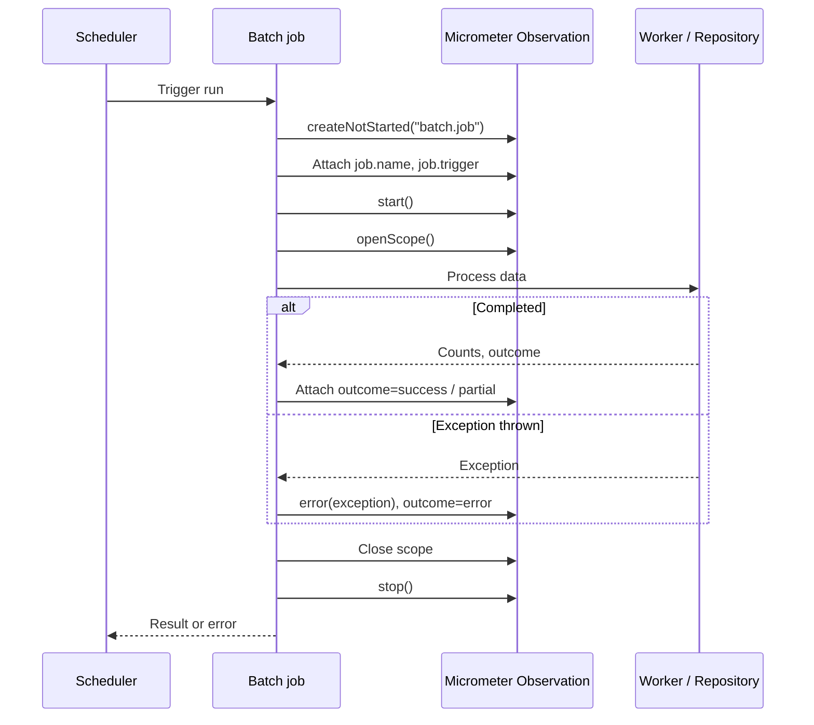
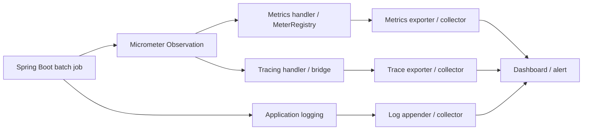

# Custom observations for batch jobs

> **Chapter:** Custom observation  
> **Module:** `SPRING_BOOT_OBSERVABILITY` — setting up observability for Spring Boot using Micrometer Observation, metrics, logs, and distributed tracing; combining context propagation, tags/cardinality, exporters, and sampling to investigate errors, latency, and application behavior in production environments.

## Learning objectives

After this lesson, you will be able to:

- Define **observation boundaries** for a batch job run, a step, or a chunk, and pick the appropriate level of detail.
- Use `ObservationRegistry` and `Observation` to measure execution time, record errors, and attach outcomes for custom-written jobs in Spring Boot.
- Distinguish **job duration**, **processed record count**, **error count**, and **per-run status**; know when to use an observation, counter, gauge, or log.
- Correlate metrics, logs, and distributed traces using job name, run ID, trace ID, and span ID without causing uncontrolled cardinality growth.
- Understand limitations of `@Scheduled`, Spring Batch, parallel processing, retries, sampling, and exporters; apply a verification checklist in operations.

## 1. How do batch job observability needs differ from HTTP requests?

A synchronous API usually has crisp boundaries: receive an HTTP request, process it, return a response. A batch job, by contrast, may be triggered by a scheduler, message, CLI, or operator; run from seconds to hours; and process thousands to millions of records.

For example, at 02:00 daily, `invoice-settlement` reconciles invoices:

1. Read pending unsettled invoices.
2. Split invoices into groups (chunks).
3. Call the payment service and update results.
4. Retry certain transient errors; record unprocessable records.
5. Summarize success/failure counts and finish.

Operations teams need to answer: **Which run failed? Was the slowdown in reading data or calling the partner? Did processed invoice volume drop because there was no data or because the job failed? How did job duration change after the latest deployment?**

Logging "batch started" and "batch completed" is not enough to track **duration trends** or trace a sequence of cross-service calls.

**Custom observations for batch jobs** mean explicitly defining work boundaries, observation names, metadata, and lifecycles so Micrometer Observation connects batch activity to metrics and traces. Logs are emitted separately yet can correlate via trace context or run IDs.

## 2. Choosing signals by operational question

| Question | Recommended signal | Example |
| --- | --- | --- |
| Did the job run on schedule and complete? | Metrics + logs, plus scheduler/job repository state | Run count by outcome; alert when last successful run is too old. |
| How long did the job take? | Duration timer/metric | Daily p95 duration of `invoice-settlement`. |
| How many records were processed? | Counter or summary/gauge chosen by semantics | Succeeded/failed record counts, batch throughput. |
| Which step was slow? | Traces or per-step metrics | `batch.read` or `payment.authorize` span taking most of the time. |
| Where did one specific run fail? | Logs with `batchRunId`, trace ID, span ID | Filter logs by run ID and open the matching trace. |
| Is the failure widespread? | Aggregate metrics + sample logs/traces | Failure rate climbing across multiple runs. |

Metrics answer **trends and scale**, traces answer **execution paths, relationships, and step timings**, and logs answer **specific events**. Never replace all three with a metric labeled with individual run IDs.

### 2.1. A run, a step, and a chunk

Common measurement granularities:

- **Job run:** one execution of `invoice-settlement`, encompassing selected steps. This is the primary level for measuring total duration and outcome.
- **Step/phase:** reading data, validating, reconciling, persisting results. Observing at this level isolates bottlenecks without generating excessive data.
- **Chunk:** a group of records processed in one transaction or operation. Create detailed observations only when per-chunk cost visibility is needed.
- **Item/record:** an individual record. Generally **avoid** creating a span/observation for every item in a large batch unless there is a clear diagnostic target and controlled cost.

If a job processes 500,000 records, creating 500,000 spans can substantially increase load and telemetry costs. Usually it is better to measure jobs/steps, aggregate counters, and increase detail only during controlled diagnostics.

## 3. Designing observation boundaries and lifecycle

For a synchronous job, the simplest choice is **creating one observation per run**:



Each API serves a distinct role:

| API | Role in a batch job |
| --- | --- |
| `Observation.createNotStarted("batch.job", registry)` | Creates an observation for one run with a **stable** name. |
| `lowCardinalityKeyValue(...)` | Attaches bounded-cardinality labels: `job.name`, `job.trigger`, `job.outcome`. |
| `start()` | Starts the job measurement lifecycle at the chosen boundary. |
| `openScope()` | Places the observation in the active context while the job executes; enables child observations, tracing, and log correlation. |
| `error(Throwable)` | Reports the actual job exception to observation handlers. |
| `stop()` | Ends the lifecycle, allowing handlers to finalize metrics/spans. |
| `observe(Supplier/Runnable)` | Concise way to manage start/scope/error/stop for **synchronous** work. |

**Define the exact time interval you want to measure.** If `start()` runs right before the scheduler enqueues a task and `stop()` runs immediately after enqueueing, duration measures only task submission time. If your goal is time from enqueue to completion, measure both wait and execution time with async-appropriate lifecycle management.

A job can **finish with partial failures** without throwing an exception. Thus `getError() == null` does not always equal `job.outcome=success`. Distinguish:

- `success`: completed per business contract.
- `partial`: completed, yet some records failed or were skipped according to defined policy.
- `error`: job failed or halted due to an error preventing goal completion.
- `cancelled`: explicitly cancelled, if supported and tracked by the system.

Outcome status should reflect **batch semantics**, not solely whether a method threw an exception.

## 4. Spring Boot example: measuring a scheduled batch job

Suppose a Spring Boot app uses `@Scheduled` to reconcile invoices. Business processing is abstracted behind `SettlementService`; in a real project, you implement this service to query, process, and commit data.

### 4.1. Enabling the scheduler and required dependencies

In a Spring Boot app, enable scheduling with `@EnableScheduling`:

```java
import org.springframework.boot.SpringApplication;
import org.springframework.boot.autoconfigure.SpringBootApplication;
import org.springframework.scheduling.annotation.EnableScheduling;

@SpringBootApplication
@EnableScheduling
public class BillingApplication {
    public static void main(String[] args) {
        SpringApplication.run(BillingApplication.class, args);
    }
}
```

The project needs Micrometer Observation and compatible Spring Boot integrations. Spring Boot Actuator typically provides the foundation for a managed `ObservationRegistry`. Exporting metrics to Prometheus requires the corresponding registry exporter; traces require configuring a Micrometer Tracing bridge and trace exporter.

**This example does not assume a single Spring Boot version:** match dependency coordinates, scheduler instrumentation policies, and exporter properties to your application's version. When Spring Boot/Spring Batch already provides instrumentation for a boundary, inspect built-in data before creating a duplicate observation with overlapping meaning.

### 4.2. Creating an observation for the job run

The implementation below measures the entire synchronous processing of a single run. `SettlementService` is a business contract requiring a bean implementation in a real app.

```java
package example.batch;

import io.micrometer.core.instrument.MeterRegistry;
import io.micrometer.observation.Observation;
import io.micrometer.observation.ObservationRegistry;
import org.slf4j.Logger;
import org.slf4j.LoggerFactory;
import org.springframework.scheduling.annotation.Scheduled;
import org.springframework.stereotype.Component;

@Component
public class InvoiceSettlementJob {
    private static final Logger log =
            LoggerFactory.getLogger(InvoiceSettlementJob.class);

    private final ObservationRegistry observations;
    private final MeterRegistry meters;
    private final SettlementService settlement;

    public InvoiceSettlementJob(
            ObservationRegistry observations,
            MeterRegistry meters,
            SettlementService settlement) {
        this.observations = observations;
        this.meters = meters;
        this.settlement = settlement;
    }

    // Daily at 02:00 UTC, when scheduling is enabled.
    @Scheduled(cron = "0 0 2 * * *", zone = "UTC")
    public void execute() {
        Observation observation = Observation
                .createNotStarted("batch.job", observations)
                .contextualName("invoice settlement")
                .lowCardinalityKeyValue("job.name", "invoice-settlement")
                .lowCardinalityKeyValue("job.trigger", "scheduled")
                .start();

        try (Observation.Scope scope = observation.openScope()) {
            BatchSummary result = settlement.settlePending();

            String outcome = result.failed() > 0
                    ? "partial"
                    : "success";
            observation.lowCardinalityKeyValue("job.outcome", outcome);

            meters.counter(
                    "batch.records.processed",
                    "job.name", "invoice-settlement"
            ).increment(result.processed());

            meters.counter(
                    "batch.records.failed",
                    "job.name", "invoice-settlement"
            ).increment(result.failed());

            log.info("Invoice settlement completed: processed={}, failed={}",
                    result.processed(), result.failed());

        } catch (RuntimeException | Error failure) {
            observation.error(failure);
            observation.lowCardinalityKeyValue("job.outcome", "error");
            log.error("Invoice settlement failed", failure);
            throw failure;
        } finally {
            observation.stop();
        }
    }

    public interface SettlementService {
        BatchSummary settlePending();
    }

    public record BatchSummary(long processed, long failed) {}
}
```

**How it works:**

1. `@Scheduled` triggers one run. `@EnableScheduling` must be active; normally configure policies to avoid duplicate concurrent runs across multiple instances if the job is not idempotent.
2. `ObservationRegistry` receives an observation named `batch.job`. A shared name lets multiple runs contribute to one group of metrics.
3. `job.name=invoice-settlement` and `job.trigger=scheduled` are bounded tags. These variables **do not contain** per-run identifiers.
4. `start()` begins measurement; `openScope()` maintains context for child activities and logs on the same thread when tracing/logging is configured.
5. `SettlementService` executes business logic and returns `BatchSummary`; the code picks `partial` if any records failed, or `success` otherwise.
6. `MeterRegistry.counter(...)` records processed or failed record counts **per agreed semantics**. These are supplementary metrics alongside the observation's duration/count.
7. On exception, `observation.error(failure)` reports the failure, `job.outcome=error` is attached before stop, and the exception is rethrown for the scheduler or orchestrator to handle per system policy.
8. `finally` ensures `stop()` is called even on exception; `try-with-resources` closes the scope and restores the previous context.

The example requires Java 17+ because of `record`; replace with a DTO class if your stack uses an older Java version. `SettlementService` is only an illustrative interface; provide a real implementation, transaction/retry handling, and business tests before running in production.

**Important limitation:** If `settlePending()` throws an exception after already processing some records, `BatchSummary` is not returned, so the two sample counters **will not record partially processed records**. When exact counts are needed even on mid-run crashes, update counters at successful commit points or read figures from the execution repository. Do not recount items on retries if the metric means "unique completed records."

### 4.3. Example metadata and resulting signals

For one successful run:

```text
Observation name: batch.job
Contextual name:  invoice settlement

low-cardinality tags:
  job.name=invoice-settlement
  job.trigger=scheduled
  job.outcome=success

metrics:
  batch.records.processed += 1200
  batch.records.failed    += 0
```

When a metrics handler is configured, the observation can also contribute to count/duration metrics according to your registry/convention setup. Actual backend metric names may be normalized or transformed by the registry; never assume the literal string `batch.job` is the exact Prometheus output name.

With a suitable tracing handler, the observation can produce a span named `invoice settlement` or another convention-defined name. If the trace is sampled out or no exporter is configured, that span may **not appear** in the backend even though `execute()` ran.

## 5. Using `observe(...)` or manual lifecycle control?

`observe(...)` is usually simplest when you do not need to attach outcomes after work completes:

```java
public void refreshCache(ObservationRegistry registry) {
    Observation.createNotStarted("batch.job", registry)
            .lowCardinalityKeyValue("job.name", "cache-refresh")
            .lowCardinalityKeyValue("job.trigger", "manual")
            .observe(() -> {
                reloadCache();
            });
}
```

`reloadCache()` is a placeholder for application business logic.

For cases needing to distinguish `partial` from `success`, attach result tags afterward, and observe exceptions, explicit `start()` / `openScope()` / `stop()` control shown earlier is clearer. When implementing, pick **one** lifecycle control mechanism per observation; never call `start()` and then call `observe(...)` on the same object without managing lifecycle consistently.

| Condition | Approach |
| --- | --- |
| Synchronous job, no post-work metadata updates needed | Concise `observe(Runnable/Supplier)`. |
| Need to classify `success/partial/error` by result | Create observation and manage lifecycle explicitly. |
| Asynchronous job where one call only enqueues work | Place observation at actual execution and tie stop to real completion. |
| Spring Batch already provides job/step metrics/spans | Leverage built-in instrumentation; add observations only for missing business steps. |

## 6. Measuring steps and chunks to locate bottlenecks

A job can finish slowly due to **reading data**, **calling external services**, **writing to DB**, or **retries**. When an overall `batch.job` observation is not detailed enough, add a few meaningful child observations.

```text
batch.job: invoice-settlement             02:00:00 - 02:03:45
├── batch.fetch                            00:00:16
├── batch.reconcile                        00:03:08
│   ├── payment.partner-call (sample)      00:00:03
│   └── payment.partner-call (sample)      00:00:05
└── batch.persist                          00:00:21
```

Example helper measuring a synchronous step inside the active job scope:

```java
import java.util.function.Supplier;
import io.micrometer.observation.Observation;
import io.micrometer.observation.ObservationRegistry;

public class BatchStepObserver {
    private final ObservationRegistry registry;

    public BatchStepObserver(ObservationRegistry registry) {
        this.registry = registry;
    }

    public <T> T observeStep(String step, Supplier<T> operation) {
        String normalizedStep = switch (step) {
            case "fetch", "reconcile", "persist" -> step;
            default -> "other";
        };

        return Observation.createNotStarted("batch.step", registry)
                .lowCardinalityKeyValue("job.name", "invoice-settlement")
                .lowCardinalityKeyValue("step.name", normalizedStep)
                .observe(operation);
    }
}
```

This example works properly when `observeStep(...)` is called inside an **active scope** of the parent observation on the same execution context (or after context has been properly propagated).

Remember to **normalize step names**. Never use `step.name="chunk-192847"` or per-batch unique IDs, as that produces high-cardinality labels. For large batches, prefer aggregate metrics for chunk duration/throughput; create detailed spans only for phases genuinely worth observing.

### 6.1. When using Spring Batch

Spring Batch provides `Job`, `Step`, `JobExecution`, `StepExecution`, chunk processing, retries, and execution statuses. Depending on version and configuration, the framework may already emit built-in metrics or observations.

With Spring Batch, you should:

- Read actual statuses like `COMPLETED`, `FAILED`, `STOPPED` from job/step executions rather than inferring solely from exceptions.
- Use `JobExecutionListener`, `StepExecutionListener`, tasklets/processors, or business services when extra signals are needed; pick **one start and stop point with a clear scope**.
- Never store a live `Observation` or `Observation.Scope` inside a persisted/serialized execution context. Scopes are execution contexts, not job state to survive restarts.
- When a job restarts or retries, clearly define how a new `execution` differs from a `job instance` and which semantics your metrics count.
- Avoid measuring the exact same job duration with both built-in instrumentation and manual observations sharing identical names/tags if that double-counts dashboards.

The `@Scheduled` example in Section 4 is a **custom scheduled job**, not a Spring Batch `JobRepository` or restartable execution setup. When using Spring Batch, rely on Spring Batch's statuses and orchestration mechanisms for accurate outcomes.

## 7. Correlation IDs, trace context, and batch run IDs

Batch jobs usually lack a parent HTTP request. A scheduler-triggered run can start a new root trace, while operations inside the run link as child spans when tracing handlers and scopes are configured.

**Distinguish three kinds of identifiers:**

| Identifier | Purpose | Where should it appear? |
| --- | --- | --- |
| `job.name` | Groups runs of the same job type | Metric tags, logs, and trace attributes (low cardinality). |
| `batchRunId` / `jobExecutionId` | Finds **one specific run**, links restarts/retries by convention | Structured logs, execution repository, or controlled trace attributes. |
| `traceId`, `spanId` | Links operations within a distributed trace | Tracing backend and correlated logs. |

**Never put `batchRunId`, `jobExecutionId`, or `traceId` into metric tags.** They change with every run/trace, creating excessive time series and backend load. For a run ID, logs and traces are the right home.

### 7.1. Adding run IDs to the logging context

If you need to search logs for a run independently of trace sampling, generate an ID at job start and put it in **SLF4J MDC** for the synchronous processing scope:

```java
import java.util.UUID;
import org.slf4j.MDC;

String runId = UUID.randomUUID().toString();

try (MDC.MDCCloseable ignored =
        MDC.putCloseable("batchRunId", runId)) {
    // Run synchronous job logic and log here.
    // Tracing (if active) manages traceId/spanId via its own mechanism.
}
```

MDC attaches `batchRunId` to logs emitted on the current thread when your logging pattern or structured logging is configured to read that field. `MDCCloseable` clears/restores the value when leaving scope, preventing the ID from leaking to another job reusing the same thread.

A Logback/Spring Boot pattern example might include:

```yaml
logging:
  pattern:
    level: "%5p traceId=%X{traceId:-} spanId=%X{spanId:-} batchRunId=%X{batchRunId:-}"
```

`traceId`/`spanId` appear when Micrometer Tracing and MDC integration are active inside a valid scope. `batchRunId` in this snippet is set manually. When using JSON structured logging, emit equivalent JSON fields so the log backend can query by distinct keys.

If a batch launched by Spring Batch already has a stable `jobExecutionId` persisted in the repository, prefer that identifier over generating a separate UUID to minimize the number of IDs operators must cross-reference.

### 7.2. Calling other services and propagating context

Suppose the batch calls `payment-service` over HTTP or sends a message to a queue. For both sides to share the same trace, you must:

1. Use tracing bridges and instrumentation appropriate for the client/server or producer/consumer.
2. Inject/extract W3C Trace Context (e.g., `traceparent`) or your agreed propagation format.
3. For tasks crossing executors, threads, or Reactor, configure **context capture/restore** at each boundary.
4. Pass `batchRunId` via message/HTTP metadata when backed by an explicit contract and data policy; trace context does not automatically carry custom business IDs.

A long run may span multiple traces: after pushing a message to a queue, a consumer executing much later might start its own trace. In that case, `batchRunId`/workflow ID and message IDs correlate events, while span links or tracing relationships can be used if supported by your tools. Never assume two spans with the same run ID automatically have a parent–child relationship.

### 7.3. Asynchronous and parallel processing

Do not create an observation on the scheduling thread and call `stop()` right after submitting tasks to an executor if you intend to measure actual task completion. Nor should you open an `Observation.Scope` on the main thread assuming it automatically follows every worker.

Two common strategies:

- **Each worker measures its own work:** propagate context through the executor, create child observations on workers, close scopes/stop in workers, and aggregate job-level metrics once futures finish.
- **Measure total job duration:** start before dispatching work, stop only after joining/awaiting all tasks and summarizing results; manage the observation lifecycle in the coordinator without leaving thread-local scopes open across threads indefinitely.

For jobs lasting several hours or producing millions of spans, assess tracing costs and consider breaking work into phases. Aggregate metrics combined with run-ID-tagged logs are often more practical than keeping a massive trace tree for a job's entire lifetime.

## 8. Tags, cardinality, and data recording policies

Define standard labels upfront:

| Key | Example values | Use as metric tag? | Reason |
| --- | --- | --- | --- |
| `job.name` | `invoice-settlement` | Yes | Known, stable set of jobs. |
| `job.trigger` | `scheduled`, `manual`, `event` | Yes | Bounded values. |
| `job.outcome` | `success`, `partial`, `error`, `cancelled` | Yes | Outcome grouping. |
| `step.name` | `fetch`, `reconcile`, `persist` | Yes if normalized | Compare duration by phase. |
| `tenant.tier` | `free`, `pro`, `enterprise` | Yes if bounded | Only when needed and approved for grouping. |
| `tenantId` | Per-tenant identifier | Usually no | Cardinality explosion and privacy risk. |
| `batchRunId` | Per-run UUID | No | Fresh value on every run. |
| `recordId` / `invoiceId` | Per-record ID | No | Very high cardinality, unsuitable for metrics. |

A metric combining multiple labels has potential combinations **equal to the product of each label's cardinality**. For example, 20 jobs × 3 triggers × 4 outcomes × 5 steps already produces 1,200 combinations before counting instance/region labels; remember to account for system-added labels as well.

**Low-cardinality key-values** fit metrics; **high-cardinality key-values** can provide investigative value in traces subject to privacy checks, payload budgets, and backend limits. Never put tokens, passwords, PII, full payloads, or payment details into logs/traces just to make debugging easier.

## 9. Exporters, sampling, and visibility limits

To observe telemetry outside the process, compatible integrations are needed:



Key notes:

- **Metrics** can count runs, durations, and record counts even when a run's trace is not sampled. Data can still be missing if the metrics pipeline fails or the app terminates abruptly before flushing.
- **Trace sampling**, e.g., 10%, means not every run emits a trace. For infrequent yet critical jobs, low probability can make capturing a failing run's trace difficult; choose a strategy balancing risk and storage capacity.
- **Exporters/collectors** can lose connectivity, overload, or drop data. Missing spans in the backend **do not prove** the job never ran.
- **Long-running jobs:** spans may not be exported until the observation stops; if the process is killed abruptly, completion signals may never arrive. Combine liveness/heartbeats, job repositories, and last-success timestamps to detect hung or missed jobs.
- **Logs** should stay structured at a sensible verbosity; logging every item in a huge batch inflates costs and buries critical warnings.

Basic configuration example for a Spring Boot project with compatible integrations:

```yaml
spring:
  application:
    name: billing-batch

management:
  endpoints:
    web:
      exposure:
        include: health,info,prometheus
  tracing:
    sampling:
      probability: 0.1
```

`prometheus` only works when the Prometheus registry is present. Tracing requires a bridge/exporter and compatible receiver. Dependency names or exporter properties may differ across Spring Boot versions; verify against your application's version before deploying.

Actuator endpoints must be secured per environment policies. Never expose management data or sensitive operational info publicly on the Internet.

## 10. Alerting: hung jobs and missed runs

A duration metric only finishes recording when an observation calls **stop**. If a process hangs indefinitely or crashes before stopping, alerting solely on completed job duration metrics misses the most severe failures.

Batch observability therefore should not stop at timers. Consider adding:

1. **Last successful completion timestamp:** a gauge or value updated after successful completion to detect missed cycles.
2. **Active/running job count:** number of concurrently executing jobs; unexpected spikes indicate overlapping or stuck runs.
3. **Job heartbeat/progress:** periodic progress checkpoints for long jobs, backed by durable storage if it must survive restarts.
4. **Job execution state in the repository:** start/end status, retries, checkpoints, restarts; rely on the business source of truth rather than inferring everything from telemetry.
5. **Context-aware alerts:** e.g., "settlement job has had no successful run within the expected window" is often more actionable than only "p95 duration > 5 minutes."

Never assume "no errors occurred" simply because `batch.jobs.errors` did not increment. The scheduler might never have fired, the JVM might have crashed before recording metrics, or the exporter might be broken.

## 11. Practice: investigating a slow batch job

**Scenario:** `invoice-settlement` normally finishes in 3 minutes, yet today took nearly 20 minutes with many invoices left unreconciled.

Suggested investigation steps:

1. **Inspect actual job state:** check the execution repository/scheduler, input item counts, job outcome, retry counts, and overlapping runs. Verify whether this is one long run or multiple runs.
2. **Review aggregate metrics:** check duration, run counts by `job.outcome`, throughput, and failed record counts; compare against previous days with similar data volume.
3. **Filter logs by `batchRunId`/`jobExecutionId`:** determine start time, phase transitions, warnings, timeouts, retries, and the last checkpoint.
4. **Inspect traces if collected:** examine `batch.fetch`, `batch.reconcile`, and `batch.persist` spans to see which phase dominated duration. If traces are absent due to sampling, continue using logs and metrics.
5. **Check dependencies:** inspect DB connection pool metrics, queue backlogs, HTTP client latency, and provider errors; look for recent deployments or config changes near the onset.
6. **Separate symptoms from root causes:** slow `batch.reconcile` might stem from a slow partner, excessive retries, DB locks, data growth, or thread-pool exhaustion; one long span alone does not prove root cause.
7. **Verify after remediation:** re-measure duration, processed records, outcome, and last-success timestamp; ensure the fix did not introduce duplicate processing or data corruption.

Example interpretation:

> Metrics show job duration jumped from ~3 minutes to ~20 minutes, with most time spent in the `reconcile` phase. Logs with the same `batchRunId` show HTTP timeouts and retries; payment dependency metrics also show elevated latency. This evidence points toward the dependency or retry policy, which should be confirmed with network metrics, configuration checks, and additional runs.

This illustrates **correlating multiple signals** in observability; never mistake a single log or trace for proof representing every run.

## 12. Common design mistakes

| Symptom | Common cause | Resolution |
| --- | --- | --- |
| Timer records a few ms while job runs for minutes | `stop()` called right after submitting async task | Move stop to actual work completion, or measure queue time and processing time separately. |
| Job metrics are missing | Missing metrics handler/registry, observation not stopped, exporter inactive | Check registry, lifecycle, and ingestion pipeline. |
| Traces are missing | Missing tracing bridge/exporter, sampled out, or lost context | Check instrumentation, sampling, and propagation. |
| Child spans disconnected from job span | Parent scope not opened or context lost across executor/HTTP | Check `openScope()` and context capture/restore. |
| Counters unexpectedly high during retries | Counting every attempt instead of committed records | Redefine counter semantics; increment at commit points. |
| Metric series count explodes | Using `batchRunId`, `recordId`, or dynamic URLs as labels | Move IDs to logs/traces; standardize low-cardinality tags. |
| Job reports `success` despite failed records | Checking only exceptions, ignoring `BatchSummary`/execution status | Define outcomes based on business criteria. |
| Duplicate runs across instances | Every instance triggers `@Scheduled` | Use distributed locking/coordination or centralized scheduling and ensure idempotency. |
| Dashboard misses skipped runs | Measuring only completed executions | Add last-success timestamps, scheduler state, and missed-run alerts. |
| Trace ID exists yet matching logs are missing | MDC logging unconfigured, logs outside scope, or pipeline/sampling mismatch | Check log fields, context propagation, and log backend. |

## 13. Self-verification exercise

In a test environment, deploy the service and simulate three scenarios:

1. **Success:** `settlePending()` returns `BatchSummary(100, 0)`. Verify `success` outcome and expected counter increments once the registry/exporter are active.
2. **Partial completion:** returns `BatchSummary(100, 7)`. Verify `partial` outcome and failed record count. Clarify whether `processed=100` means total attempted or total committed.
3. **Failure by exception:** throw `IllegalStateException`. Verify the error is recorded on the observation, outcome is `error`, the exception propagates to the scheduler, and the observation stops.
4. **Correlated data:** emit logs with a run ID, enable tracing, and verify `traceId`/`spanId` appear in logs for a sampled run. Test calling a downstream dependency and verify context propagation.
5. **High load:** simulate multiple chunks and confirm metric series count does not scale with item ID or run ID. Add extra step instrumentation only when diagnostically justified.
6. **Hung or killed job:** simulate cleanly in a test environment; verify last-success/heartbeat/monitoring mechanisms detect missing completions even though the duration timer never stopped.

**Completion criteria:** You can explain exactly what interval the observation measures, how outcomes are decided, how record counts are defined, and how to correlate one run's logs/traces with aggregate metrics without putting variable IDs in metric tags.

## 14. Self-check questions

**Question 1.** Should you use `batchRunId` as a low-cardinality metric tag to locate a specific run?  
**Hint:** No. `batchRunId` changes every run; keep it in logs, execution repositories, or controlled trace attributes. Metrics should use job names and bounded status groups.

**Question 2.** A job finishes 100 records with 7 record errors without throwing an exception. What should the outcome be?  
**Hint:** Per our example policy, `partial`; you cannot rely solely on `Observation.Context.getError()`.

**Question 3.** Why must `stop()` be called when managing the lifecycle manually?  
**Hint:** Handlers need to know when the operation ended to compute duration and finish spans; `finally` guarantees stop even on exceptions.

**Question 4.** If `@Scheduled` runs on two instances, does a custom observation prevent duplicate processing?  
**Hint:** No. Observations only measure and aid investigation; distributed locks, schedulers, or idempotency are needed at the business orchestration layer.

**Question 5.** Does a missing trace for a batch run mean the job never ran?  
**Hint:** No. The trace may have been sampled out, dropped by an exporter, or uninstrumented; check job repositories, logs, and metrics to verify execution.

**Question 6.** When should you add `batch.step` child observations?  
**Hint:** When you need to isolate time-consuming or error-prone phases; keep their number bounded and normalize names/tags.

**Question 7.** A job takes 20 minutes, yet its duration metric reads 10 ms. What should you check first?  
**Hint:** Check the start/stop boundaries. The observation may only wrap task enqueueing rather than asynchronous execution.

**Remember:** Custom observations for batch jobs start with **accurate measurement boundaries**, **business-meaningful outcomes**, and **low-cardinality labels**. Combine `ObservationRegistry` with metric counters, run-ID-tagged logs, and distributed traces where appropriate. In Spring Boot, pay close attention to lifecycle management, context propagation, retries, sampling/exporters, and hung or missed job states—these determine whether observability truly helps resolve incidents in production.
