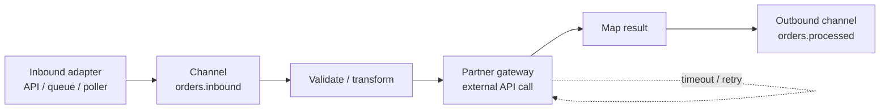
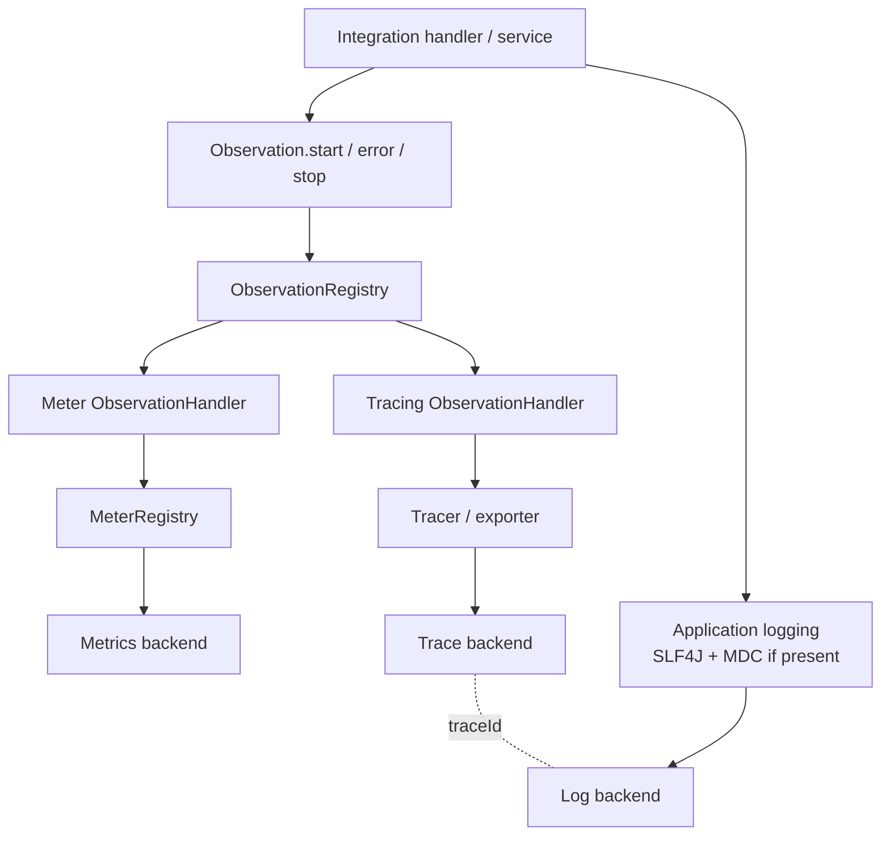
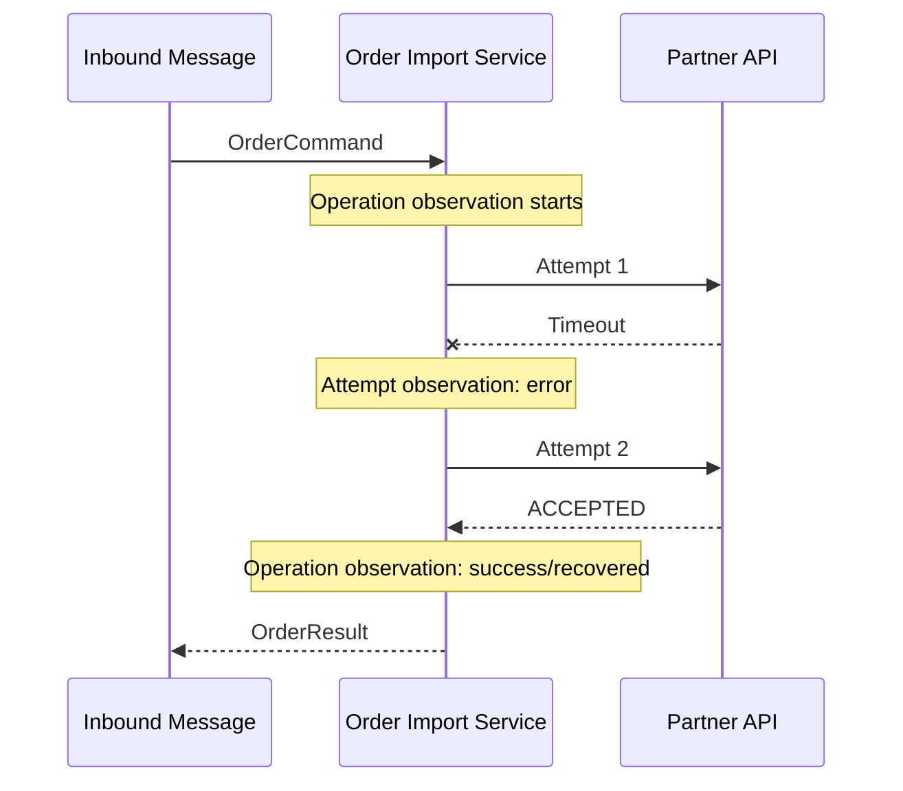

# Custom observations for integration flows in Spring Boot

An integration application typically receives data from APIs, queues, or polling schedules, validates and transforms messages, calls partner services, and forwards results to the next stage. If the entire flow only has HTTP metrics, we know how long incoming requests took yet struggle to tell whether **transformation steps, partner calls, or retry mechanisms** are slowing down the pipeline. **Custom observations** describe meaningful units of work within an integration flow, linking metrics, distributed tracing, and logs to the right business boundaries.

This is the **Custom observations for integration flows** lesson in the **Custom observation** chapter of the **SPRING_BOOT_OBSERVABILITY** module. The module's goal is establishing observability for Spring Boot using Micrometer Observation, metrics, logs, and distributed tracing; learning context propagation, tags/cardinality, exporters, sampling, and signal correlation to investigate errors, latency, and application behavior in production.

In this lesson, *integration flow* refers to a message-processing pipeline connecting components—especially the **Spring Integration** model with channels, handlers, transformers, adapters, or gateways. The same boundary-setting principles also apply to integration pipelines written as regular Java services.

## 1. Learning objectives

After completing this lesson, you will be able to:

- Select suitable custom observation boundaries for the overall flow and individual processing steps worth investigating.
- Inject `ObservationRegistry` into Spring Integration handlers/services and create observations in Java code.
- Attach low-cardinality `flow`, `stage`, and `outcome` labels; report exceptions via `error(ex)` and close observations on every execution path.
- Distinguish a message processing execution, a dependency call, and a retry attempt to avoid miscounting business operations.
- Understand active scope limitations when messages cross `DirectChannel`, `ExecutorChannel`, queues, brokers, or Reactor.
- Verify correlation across logs, metrics, and tracing, and handle cases where traces are absent due to sampling or exporters.

## 2. Where should you observe inside an integration flow?

Suppose an order ingestion system integrates with a partner:



Three common observation granularities exist:

| Boundary | Suggested name | What does it measure? | When is it suitable? |
| --- | --- | --- | --- |
| Overall message processing operation | `integration.order.process` | Duration from handler start until final result | Want success rates and latency of one unit of work |
| Critical integration step | `integration.partner.call` | Duration and failures of the partner call | Need to separate partner bottlenecks from internal processing |
| Single external call attempt | `integration.partner.attempt` | Latency and outcome of each individual attempt | Need to diagnose retries, timeouts, and dependency health |

You do not need an observation for **every** line of code or trivial transformation. Over-instrumented flows clutter traces, raise collection costs, and may duplicate built-in HTTP client, messaging, or Spring Integration instrumentation.

**Boundary selection rule:** An observation should wrap **one clearly named unit of work** with well-defined start/end points and an outcome operators genuinely want to track. For instance, one custom observation around a high-value data normalization step is more useful than spans around individual field assignments.

### Distinguishing message lifetime from method execution time

A `Message<?>` may sit in a queue before a consumer picks it up. When a custom observation wraps only a synchronous handler, the timer measures **handler execution time**; it does not automatically include queue wait time or downstream subscriber processing. To measure **end-to-end latency**, establish a transaction/message-wide measurement mechanism with clear start rules, end rules, and asynchronous correlation.

## 3. How do Observation, registry, handlers, and exporters work together?

**Micrometer Observation** provides a unified API for describing observed operations. An `Observation` carries a name, key-values, events, error state, and start/stop lifecycle. `ObservationRegistry` coordinates the configured `ObservationHandler` instances.



In Spring Boot with Actuator, **inject the Spring-managed registry** into flow-handling services. Creating an isolated `ObservationRegistry.create()` elsewhere prevents your custom observation from reaching the application's configured meter/tracing handlers.

Key notes:

- Observations **do not automatically export metrics/traces/logs**. Metrics require a meter registry and handler; tracing requires a bridge/tracer/exporter; logs rely on loggers and collection pipelines.
- `Observation.error(ex)` notifies handlers of an error; it does not automatically emit a business log line or rethrow the exception.
- Seeing `traceId` in logs **does not guarantee** a span was saved: tracing may sample it out, or the exporter/backend may fail.
- If an HTTP client, broker adapter, or Spring Integration component is already instrumented, check built-in observations before adding a custom one at the exact same boundary.

## 4. Preparing the Spring Boot project

With Spring Boot 3.x, Spring Integration 6.x, and versions managed via the Spring Boot BOM, a Gradle Kotlin DSL dependencies example:

```kotlin
dependencies {
    implementation("org.springframework.boot:spring-boot-starter-integration")
    implementation("org.springframework.boot:spring-boot-starter-actuator")

    // Optional when distributed tracing via OpenTelemetry is needed:
    implementation("io.micrometer:micrometer-tracing-bridge-otel")
    runtimeOnly("io.opentelemetry:opentelemetry-exporter-otlp")
}
```

Spring Integration supplies message channels and DSL flow configuration. Actuator/Micrometer provides Observation support configured by Spring Boot. The last two tracing dependencies are only needed when converting observations into OpenTelemetry spans and exporting them; configure an exporter/collector matching your environment. Never assume a tracing backend exists merely because the application starts cleanly.

In development, first verify that **the service receives the `ObservationRegistry` bean**, messages flow through the expected handler, and outcome tags appear. Only then expand to metrics/tracing backends and centralized logging.

## 5. Spring Integration example: observing an order processing step

We will build a synchronous flow:

1. A message of type `OrderCommand` enters the `ordersInbound` channel.
2. `OrderImportService` calls a `PartnerGateway` to register the order with the partner.
3. A result of type `OrderResult` goes to the `ordersProcessed` channel.

The custom observation wraps **the processing step inside the service**, from just before calling the partner until receiving a result or exception. This example does not attempt to measure queue wait time or downstream consumer processing.

### 5.1. IntegrationFlow configuration

```java
import org.springframework.beans.factory.annotation.Qualifier;
import org.springframework.context.annotation.Bean;
import org.springframework.context.annotation.Configuration;
import org.springframework.integration.channel.DirectChannel;
import org.springframework.integration.channel.QueueChannel;
import org.springframework.integration.dsl.IntegrationFlow;
import org.springframework.messaging.MessageChannel;
import org.springframework.messaging.PollableChannel;

@Configuration(proxyBeanMethods = false)
public class OrderFlowConfiguration {

    @Bean
    MessageChannel ordersInbound() {
        return new DirectChannel();
    }

    @Bean
    PollableChannel ordersProcessed() {
        return new QueueChannel();
    }

    @Bean
    IntegrationFlow orderImportFlow(
            @Qualifier("ordersInbound") MessageChannel inbound,
            @Qualifier("ordersProcessed") PollableChannel processed,
            OrderImportService service) {

        return IntegrationFlow.from(inbound)
            .handle(OrderCommand.class,
                (payload, headers) -> service.process(payload))
            .channel(processed)
            .get();
    }
}
```

By default, `DirectChannel` invokes its subscriber on the sender's thread, so the custom observation inside `service.process` wraps synchronous execution. The outbound `QueueChannel` is where **processed messages are placed** for consumers to receive later. Switching to an `ExecutorChannel`, broker, or async gateway changes thread boundaries and timing scopes; we examine that shortly.

### 5.2. Illustrative data types and gateway

```java
public record OrderCommand(String orderId, String content) { }

public record PartnerReply(boolean accepted, String reference) { }

public record OrderResult(String orderId, String status) { }

public interface PartnerGateway {
    PartnerReply submit(OrderCommand command);
}
```

`content` represents a payload that may carry business data; this example **does not** log or tag that payload. `PartnerGateway` is an interface requiring a real implementation, such as an HTTP client. Records here target Spring Boot on Java 17+.

### 5.3. Creating a custom observation inside the handler service

```java
import io.micrometer.observation.Observation;
import io.micrometer.observation.ObservationRegistry;
import org.springframework.stereotype.Service;

@Service
public class OrderImportService {

    private final ObservationRegistry registry;
    private final PartnerGateway partnerGateway;

    public OrderImportService(
            ObservationRegistry registry,
            PartnerGateway partnerGateway) {
        this.registry = registry;
        this.partnerGateway = partnerGateway;
    }

    public OrderResult process(OrderCommand command) {
        Observation observation = Observation
            .createNotStarted("integration.order.process", registry)
            .contextualName("process imported order")
            .lowCardinalityKeyValue("flow", "order-import")
            .lowCardinalityKeyValue("stage", "partner-submit")
            .start();

        try (Observation.Scope ignored = observation.openScope()) {
            try {
                PartnerReply reply = partnerGateway.submit(command);

                if (!reply.accepted()) {
                    observation.lowCardinalityKeyValue(
                        "outcome", "rejected");
                    observation.event(
                        Observation.Event.of("partner.rejected"));
                    return new OrderResult(
                        command.orderId(), "REJECTED");
                }

                observation.lowCardinalityKeyValue(
                    "outcome", "success");
                return new OrderResult(
                    command.orderId(), "ACCEPTED");
            } catch (RuntimeException ex) {
                observation.lowCardinalityKeyValue(
                    "outcome", "error");
                observation.error(ex);
                throw ex;
            }
        } finally {
            observation.stop();
        }
    }
}
```

Lifecycle analysis:

- `createNotStarted` assigns a stable name to the custom observation; `integration.order.process` describes the business operation, not a request ID.
- `lowCardinalityKeyValue("flow", "order-import")` and `stage=partner-submit` use small bounded value sets suited for metrics.
- `start()` starts the observation; `openScope()` sets the current observation so synchronous logging/tracing integrations can read the context.
- A partner response **declining per business contract** receives `outcome=rejected`; the example avoids mislabeling it as a technical error.
- Dependency exceptions receive `outcome=error` and `observation.error(ex)` before rethrowing, letting Spring Integration and callers handle failures per flow configuration.
- `try-with-resources` closes the scope; `stop()` runs in `finally` across success, rejection, and exception paths.

**Important distinction:** If `PartnerGateway` uses an instrumented HTTP client, the `integration.order.process` observation acts as the **parent observation** of the HTTP client observation. They measure different scopes, so having both makes sense. If you only want to measure the already-instrumented HTTP call itself, adding a redundant custom observation for the exact same purpose creates duplicate data.

## 6. Sending messages and observing outcomes

In a real application, inbound adapters feed data into `ordersInbound`. To test the flow in development, a component can inject the channels and send a message:

```java
import org.springframework.beans.factory.annotation.Qualifier;
import org.springframework.messaging.Message;
import org.springframework.messaging.MessageChannel;
import org.springframework.messaging.PollableChannel;
import org.springframework.messaging.support.MessageBuilder;
import org.springframework.stereotype.Component;

@Component
public class OrderFlowClient {

    private final MessageChannel inbound;
    private final PollableChannel processed;

    public OrderFlowClient(
            @Qualifier("ordersInbound") MessageChannel inbound,
            @Qualifier("ordersProcessed") PollableChannel processed) {
        this.inbound = inbound;
        this.processed = processed;
    }

    public boolean send(OrderCommand command) {
        return inbound.send(
            MessageBuilder.withPayload(command).build()
        );
    }

    // Illustrates a basic test consumer only.
    public Message<?> receive(long timeoutMillis) {
        return processed.receive(timeoutMillis);
    }
}
```

Reading directly from `QueueChannel` works for testing **one** message, yet under concurrent requests you must never assume the first message popped matches the command just sent; use correlation, request-reply gateways, or proper routing instead.

When `PartnerGateway` throws an exception in a synchronous flow, the error normally bubbles back to the sender and no `OrderResult` is produced. In flows driven by pollers, executors, or brokers, errors may route to an `errorChannel`, retry/recovery advice, or a dead-letter queue depending on configuration. The service's custom observation should still record errors accurately within its scope, while retries/acks/nacks remain **the messaging layer's responsibility**.

## 7. Observation names, tags, and cardinality

Standardize metadata while designing the flow:

| Field | Example | Usage scope |
| --- | --- | --- |
| Observation name | `integration.order.process` | Stable, describes the operation |
| `flow` | `order-import`, `shipment-export` | Low-cardinality, bounded flow names |
| `stage` | `validate`, `transform`, `partner-submit` | Low-cardinality, normalized stage names |
| `outcome` | `success`, `rejected`, `error`, `degraded` | Low-cardinality for outcome classification |
| `error.category` | `timeout`, `dependency`, `invalid-message` | Low-cardinality when bounded |
| `attempt.kind` | `initial`, `retry` | Low-cardinality when tracking attempts |
| `orderId`, `messageId`, `traceId` | Per-message values | Controlled log/trace context only; never metric labels |
| Payloads, tokens, Authorization headers | Potentially sensitive data | Never write directly into metrics/logs/traces |

**Cardinality** is the number of distinct values a label takes. Suppose 100,000 distinct order IDs arrive per day: putting `orderId` into a low-cardinality key multiplies time series across every combination of other labels. Instead, keep bounded tags like `flow`, `stage`, and `outcome` for metrics, and rely on logs or controlled high-cardinality trace attributes when looking up a specific order.

While an `Observation` accepts high-cardinality key-values, do not confuse that with permission to record arbitrary data. Tracing backends still incur storage costs, and sensitive data can spread across external observability systems.

### Why omit full endpoints or exception messages?

- URLs containing order IDs, query parameters, tokens, or customer names bring high cardinality and data leak risks. To classify endpoints, use **route templates** or a bounded catalog of partner service names.
- Exception messages can embed partner or user-supplied data, vary endlessly, and leak PII. Attach `error.category=timeout` instead, and keep detailed diagnostics in properly masked logs.
- Message payloads are often large; stuffing payloads into observations/events inflates cost and risks exposing sensitive fields. Record only essential, vetted attributes.

## 8. Error handling, retries, fallbacks, and final outcomes

An integration flow typically has at least two result levels:

1. **Attempt:** a single partner call that might time out or be rejected.
2. **Operation:** overall processing of a message that might recover and succeed after retries.



| Case | Attempt-level observation | Operation-level observation |
| --- | --- | --- |
| Partner returns ACCEPTED immediately | Succeeded | `success` |
| Partner returns REJECTED per expected rules | Valid response received | `rejected` |
| Timeout, retried and succeeded | First attempt `error`, retry succeeded | `success` or `recovered` per convention |
| All attempts fail | Attempts record errors | `error` |
| Primary source fails, fallback returns degraded result | Primary call records error | `degraded` if business needs to distinguish |

Establish outcome conventions **before building dashboards**. If the operation-level metric tracks the final outcome, do not automatically call `error(ex)` on the outer observation for failures fully recovered at the attempt level. Conversely, unrecovered technical errors must be recorded on the operation observation.

### Wrapping retries inside an observation can mislead

If a service invokes a retry library inside the `try` block, an exception from the first attempt may **never reach the outer `catch`** because the retry library handles it internally. The operation then finishes cleanly and the outer observation gets `outcome=success`. That makes sense if the outer observation measures final outcomes; to count timeout occurrences, add metrics/logs/observations **at the attempt or retry callback level**.

In Spring Integration, components like retry advice, error channels, or recovery flows alter where exceptions are caught and messages are replayed. Inspect the actual runtime flow before placing observations so you do not wrap retries inside a handler while simultaneously double-counting them at the adapter layer.

### Failures at the message boundary

Mapping or validation errors occurring before reaching `OrderImportService` will **not** appear inside the service's custom observation. To track them, place observations at the validation step or an appropriate inbound boundary. Messages ending up in a dead-letter queue may also require dedicated dead-letter metrics, since handler metrics never see messages that failed before reaching the handler.

## 9. Propagation when flows cross threads, queues, and brokers

A common pitfall is that the active Java scope is tied to a **thread or reactive execution** context. When `DirectChannel` invokes a synchronous handler, the caller's trace context continues on the same thread if integrations are configured. However, several channels/adapters introduce asynchronous boundaries:

| Boundary | Risk | Approach |
| --- | --- | --- |
| Synchronous `DirectChannel` | Usually same thread; still requires proper scopes | Open/close scope around actual processing |
| `ExecutorChannel`, async gateway | Handler runs on another thread; loses MDC/parent span without propagation | Use context propagation or executor-aware instrumentation |
| `QueueChannel`, poller | Message waits and is consumed later | Observe enqueue/dequeue and processing with distinct boundaries |
| Kafka/RabbitMQ broker | Crosses network and processes; ThreadLocal cannot follow | Propagate via message headers and messaging instrumentation |
| Reactor/`Mono`/`Flux` | Runs on subscribe; callbacks may switch threads | Use compatible operators/instrumentation and Reactor Context |

**Never** open an `Observation.Scope` on a producer and try holding it across a queue to a consumer. Producers and consumers run at different times, on different threads, and often on different machines. Across brokers, carry trace context using library-supported propagation, typically via message headers following W3C Trace Context when supported.

For instance, `traceparent` carries trace IDs and span context across boundaries, yet manually attaching a header string **does not** guarantee the tracer understands it or builds accurate parent–child spans. Verify Spring Integration/messaging instrumentation, Micrometer Tracing, and propagator configuration on **both producer and consumer sides**.

### Preventing context loss in logs

When Micrometer Tracing and logging are configured properly, log MDC can include `traceId`/`spanId`. If a flow crosses a thread pool without propagation, logs inside handlers may lose those IDs or inherit stale context from a reused thread. Never manually copy `traceId` into a `ThreadLocal` and forget cleanup. Use **Micrometer Context Propagation** compatible with your executor or reactive pipeline and verify under concurrent load.

## 10. Correlating metrics, logs, and traces to investigate flows

A practical operational setup typically includes:

- **Metrics:** track duration via `integration.order.process` and classify outcomes by `flow` and `stage`; monitor error rates and p95 when histograms/percentiles are configured.
- **Traces:** inspect the custom observation's parent span alongside HTTP client or messaging spans to pinpoint partner calls, retries, and per-step durations.
- **Logs:** record diagnostic events with stable error codes, timestamps, and trace IDs if available; avoid logging full payloads or logging the same exception repeatedly at every layer.

Illustrative logs (not automatic output of `Observation.error(ex)`):

```text
2026-11-22T04:10:02Z INFO  event=order_import_started   flow=order-import traceId=4bf92f3577b34da6a3ce929d0e0e4736
2026-11-22T04:10:04Z WARN  event=partner_submit_retry  flow=order-import errorCode=PARTNER_TIMEOUT
2026-11-22T04:10:05Z INFO  event=order_import_finished flow=order-import outcome=success
```

`WARN` logs for retries are helpful at moderate volume; if retries happen very frequently, use a counter metric to track rates and log only anomalous cases needing investigation. Logging a retry warning does not mean the overall operation failed.

### Sample incident investigation workflow

**Symptom:** messages processed per minute drop, `integration.order.process` p95 increases, and the queue backlog grows.

1. **Start with metrics:** inspect throughput, timer latency, and outcomes by flow/stage; compare against queue depth, consumer lag, or active pollers. Handler metrics alone do not measure queue backlog.
2. **Inspect sampled traces:** locate a high-latency trace. If the partner call span dominates duration, inspect timeouts/retries. If the handler is fast yet end-to-end latency is high, suspect queueing or downstream stages after the handler.
3. **Search logs by trace/message correlation:** identify error codes, attempt counts, retry timestamps, and final outcomes. Do not expect every log to have a matching trace if tracing uses sampling.
4. **Isolate root cause:** cross-check partner latency, connection counts, thread pools, queue depth, recent deployments, and downstream errors; avoid jumping to conclusions from a single trace.
5. **Verify after remediation:** confirm throughput recovers, backlogs drain, and error/retry rates and p95 return to normal.

Observations measure **part of the picture**; for full flow visibility, pair them with queue, consumer, retry, and dead-letter metrics matching your system topology.

## 11. Common design mistakes

| Mistake | Consequence | Fix |
| --- | --- | --- |
| Creating observations for every minor transformation | Noisy, costly spans and metrics | Instrument only business/operationally meaningful steps |
| Using `traceId` or `orderId` as low-cardinality tags | Time series explosion | Keep tags bounded; put IDs in controlled logs/traces |
| Stopping observation right after creating future/publisher | Timer only measures scheduling, misses real errors | Tie lifecycle to completion/error/cancellation |
| Calling `stop()` after code that may throw | Observation never stops on error | Place in `finally` or use `observe(...)` |
| Omitting `error(ex)` in manual observations | Handlers may miss failure state | Report exceptions before rethrowing |
| Counting every retry failure as operation failure | Inflated user-facing failure alerts | Separate attempt outcomes from final operation outcomes |
| Wrapping duplicate observations over HTTP/messaging instrumentation | Overlapping spans and timers | Check built-in instrumentation and pick distinct business boundaries |
| Holding scopes across queues/brokers | Corrupted context and MDC leaks | Propagate via message headers/instrumentation |
| Putting sensitive payloads/headers in tags or logs | Data leaks | Log only approved fields and apply masking |
| Assuming traces always exist in backend | Missing traces when sampling/exporters fail | Check sampler, collector, pipeline; rely on metrics/logs too |
| Treating handler timer as end-to-end latency | Misses queue wait times | Define explicit E2E timing milestones and correlation |

## 12. Self-verifiable hands-on exercise

**Problem:** Implement the order import flow with three `PartnerGateway` modes: returning `accepted=true`, returning `accepted=false`, and throwing a timeout. Then extend it to retry once on timeout.

| Case | Input / Behavior | Expectation |
| --- | --- | --- |
| A — Success | Partner returns accepted | Produces `OrderResult(ACCEPTED)`, `outcome=success`, observation stops |
| B — Rejected | Partner returns rejected | Produces `OrderResult(REJECTED)`, `outcome=rejected`, not flagged as technical error |
| C — Technical error | Partner throws exception | `outcome=error`, `error(ex)` recorded, exception propagates per flow, observation stops |
| D — Retry succeeds | First attempt times out, retry succeeds | Attempt metric records error; operation metric reflects final outcome |
| E — Pre-handler validation error | Message rejected before reaching service | Service observation does not appear; signal needed at validation boundary |
| F — Async | Processed via executor/queue | Context is neither lost nor mixed between messages when propagation works |

### Verification steps

1. Send individual messages and inspect `ordersProcessed`; under concurrent messages, use correlation instead of assuming queue order reflects request-reply pairing.
2. Verify each `OrderImportService.process` call creates one observation that starts and stops cleanly with the expected `outcome` value.
3. When the gateway throws an exception, verify the error is not swallowed by instrumentation and the messaging layer routes it via caller, error channel, or retry as configured.
4. With metrics enabled, compare total processed counts across `success/rejected/error` and audit tag names and value sets.
5. With tracing enabled, find the custom observation span and child spans. If spans are missing, inspect bridges, handlers, exporters, collectors, and sampling.
6. When switching to async or brokers, send concurrent messages and verify trace IDs/correlation remain accurate, MDC is cleaned up, and context never leaks across messages.
7. Verify logs and traces never record `content`, tokens, or personal data, and metric labels contain no dynamic IDs.

### Self-assessment questions

1. What does a custom observation wrapping `service.process` measure, and what part of `QueueChannel` does it leave out?
2. Why should `outcome=rejected` usually not be classified as a technical error even though the business request was declined?
3. When a retry succeeds, why does the partner attempt error rate differ from the flow's final failure rate?
4. If logs contain `traceId` yet no trace appears in the tracing backend, which components should you check?
5. Why is holding an `Observation.Scope` across a broker or thread pool dangerous?
6. When should you add a custom observation instead of relying solely on HTTP client instrumentation?

## 13. Key takeaways

**Custom observations for integration flows** are valuable when placed at **meaningful work boundaries**, such as overall message processing, a partner call, or an individual retry attempt. In Spring Boot, inject the configured `ObservationRegistry`, use consistent observation names, attach low-cardinality tags, report exceptions via `observation.error(ex)` when appropriate, and always stop the observation.

When flows cross threads, queues, or brokers, design context propagation and correlation suited to asynchronous execution. Metrics measure throughput, latency, and outcome ratios; traces reveal call chains; logs explain specific events. Combining them with queue/retry metrics while governing exporters, sampling, and sensitive data enables effective troubleshooting of latency, errors, and integration behavior in production.
