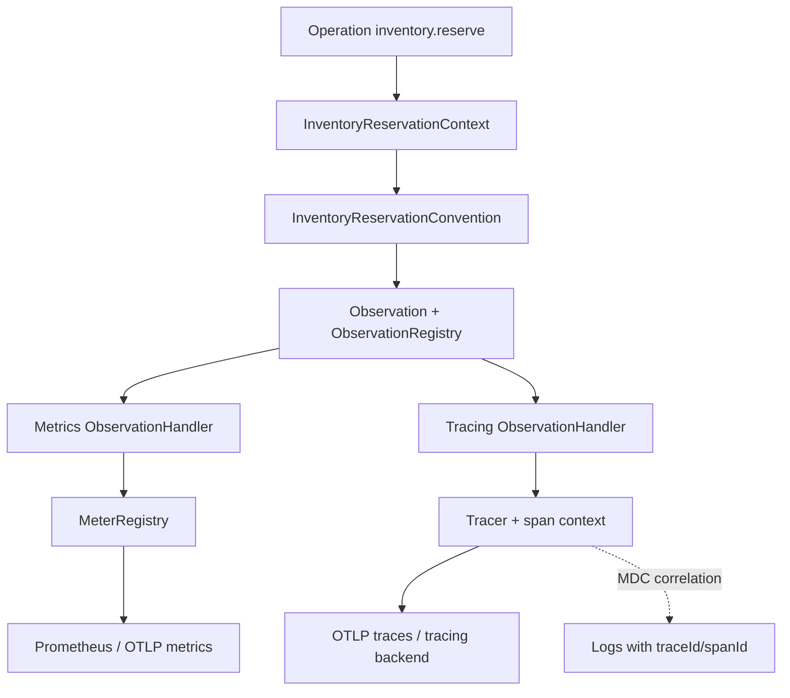

# ObservationConvention in Spring Boot Observability

In a Spring Boot application, an **Observation** describes a lifecycle-bound activity such as handling an HTTP request, querying data, or reserving inventory for an order. When a system creates Observations across many places, naming and tagging them ad hoc in each location often causes problems: the same operation ends up with multiple names; metrics use different tag names than tracing; user IDs accidentally leak into metric labels; and data cannot be aggregated consistently across versions.

Micrometer's **`ObservationConvention`** solves this standardization need. It defines how to name and extract **key-values** from an **`Observation.Context`** for a given type of activity. Spring Boot and instrumented components also use conventions to keep observation names and accompanying metadata consistent.

This lesson belongs to the **Convention and filter** chapter of the **SPRING_BOOT_OBSERVABILITY** module. You will build a business convention, understand convention precedence, control **tags/cardinality**, distinguish between conventions, filters, and predicates, and verify the results in **metrics, logs, and distributed traces** via Micrometer Observation, exporters, and sampling.

## 1. The problem: instrumentation works, but data is inconsistent

Suppose `order-service` handles an inventory reservation step. Multiple development teams created Observations on their own:

```java
Observation.createNotStarted("reserve-item", registry)
        .lowCardinalityKeyValue("salesChannel", "web")
        .observe(() -> reserveItem());

Observation.createNotStarted("inventory-reservation", registry)
        .lowCardinalityKeyValue("channel", "WEB")
        .observe(() -> reserveItem());
```

These two snippets measure the same kind of work, yet:

- Observation names differ: dashboards may treat them as two separate operations.
- Same meaning, different tag names: `salesChannel` vs. `channel`.
- Tag values use inconsistent casing conventions: `web` vs. `WEB`.
- Tracing may display two inconsistent span names.
- When expanding with `orderId` or dynamic URLs, the number of time series can grow rapidly.

To analyze latency and errors of the inventory reservation operation across the entire system, you need a consistent **naming and tagging contract**. A convention serves as that contract, based on the contextual data provided by instrumentation.

### Expected outcome

| Component | Unified convention |
| --- | --- |
| Observation name | `inventory.reserve` |
| Contextual name | `reserve inventory` |
| Low-cardinality key | `channel=web/mobile` |
| Low-cardinality key | `warehouse.region=apac/eu/other` |
| High-cardinality key | Only technical correlation data that is genuinely needed and permitted |
| Exception/error | Recorded through the Observation lifecycle |
| Metrics | Aggregates executions of the same operation type |
| Trace | Produces a span with appropriate name and attributes, if tracing is configured and the span is sampled |

A good convention removes the need for development teams to remember or reinvent names and tags at every call site.

## 2. What is ObservationConvention?

`ObservationConvention<T extends Observation.Context>` is an interface used to describe rules for a type of Observation. It typically provides:

- **`getName()`**: the stable technical name of the operation; can be used by the metrics handler as the meter name.
- **`getContextualName(T context)`**: a human-readable operation name in context, often useful when reading tracing spans.
- **`getLowCardinalityKeyValues(T context)`**: key-values with a small number of distinct values, suitable for metric tags and also eligible to become span attributes.
- **`getHighCardinalityKeyValues(T context)`**: more detailed key-values for tracing when supported by the handler; should not be placed into metric tags.
- **`supportsContext(Observation.Context context)`**: determines whether the convention applies to a specific context type, which is critical when registering conventions for multiple Observation types.

These methods describe a **rule**, rather than storing metrics or exporting traces themselves. `ObservationRegistry` holds the configuration, and handlers invoke the rule when processing an Observation.



**Distinguishing the two registries:** `ObservationRegistry` manages Observation handlers, filters, predicates, and conventions; `MeterRegistry` manages metrics such as Timer and Counter. A single Observation can produce data for both signals when the application has the required handlers and exporters configured.

## 3. What data does Observation.Context carry?

A convention needs input data to determine tags and the contextual name. **`Observation.Context`** is where instrumentation stores information about the activity.

For example, in an inventory reservation flow, the context might contain:

- Sales channel: `web` or `mobile`.
- Warehouse region: `apac`, `eu`, or `other`.
- Operation outcome: succeeded, out of stock, dependency failure.
- Error state recorded in the Observation.

Not all data should become tags. The context may hold additional internal parameters used during processing, but the convention should only expose attributes to observability that are necessary and permitted.

An important principle is to **separate processed data from exported data**. A context may hold a framework object or business data; the convention must explicitly decide what goes into metrics/traces.

### Custom context example

```java
import io.micrometer.observation.Observation;

public final class InventoryReservationContext extends Observation.Context {

    private final String channel;
    private final String warehouseRegion;

    public InventoryReservationContext(String channel, String warehouseRegion) {
        this.channel = normalizeChannel(channel);
        this.warehouseRegion = normalizeRegion(warehouseRegion);
    }

    public String getChannel() {
        return channel;
    }

    public String getWarehouseRegion() {
        return warehouseRegion;
    }

    private static String normalizeChannel(String value) {
        return "mobile".equalsIgnoreCase(value) ? "mobile" : "web";
    }

    private static String normalizeRegion(String value) {
        if ("apac".equalsIgnoreCase(value)) {
            return "apac";
        }
        if ("eu".equalsIgnoreCase(value)) {
            return "eu";
        }
        return "other";
    }
}
```

**Why normalize directly in the context?** Because tags are built from a bounded set of values. If the channel is sent with varying spellings such as `mobile`, `Mobile`, and `MOBILE`, dashboard data becomes fragmented. Normalization must align with the business contract; this example merely illustrates two channels and three region groups.

## 4. Writing a custom ObservationConvention

Convention for the context above:

```java
import io.micrometer.common.KeyValue;
import io.micrometer.common.KeyValues;
import io.micrometer.observation.Observation;
import io.micrometer.observation.ObservationConvention;

public final class InventoryReservationConvention
        implements ObservationConvention<InventoryReservationContext> {

    @Override
    public boolean supportsContext(Observation.Context context) {
        return context instanceof InventoryReservationContext;
    }

    @Override
    public String getName() {
        return "inventory.reserve";
    }

    @Override
    public String getContextualName(InventoryReservationContext context) {
        return "reserve inventory";
    }

    @Override
    public KeyValues getLowCardinalityKeyValues(
            InventoryReservationContext context) {

        return KeyValues.of(
                KeyValue.of("channel", context.getChannel()),
                KeyValue.of("warehouse.region", context.getWarehouseRegion())
        );
    }

    @Override
    public KeyValues getHighCardinalityKeyValues(
            InventoryReservationContext context) {

        return KeyValues.empty();
    }
}
```

This is a metrics-safe convention: values belong to a finite set, names are stable, and no sensitive information is included.

### Meaning of each method

| Method | Value in example | Role |
| --- | --- | --- |
| `supportsContext(...)` | True for `InventoryReservationContext` | Restricts the convention to the relevant operation type |
| `getName()` | `inventory.reserve` | Operation name for grouping metrics |
| `getContextualName(...)` | `reserve inventory` | Descriptive name convenient for reading traces |
| `getLowCardinalityKeyValues(...)` | `channel`, `warehouse.region` | Splits metrics into a small, consistent set of groups |
| `getHighCardinalityKeyValues(...)` | Empty | Avoids adding unreviewed detailed data |

`getName()` should normally return a string independent of individual requests. If you need to represent a specific ID, do **not** replace the name with `inventory.reserve.order-123456`. When a trace attribute is needed, evaluate whether it is suitable as a span attribute, whether storing it is permitted, whether its retention period is reasonable, and who can access it.

### Responsibilities a convention does not handle

A convention does **not** automatically:

- Make HTTP requests or database calls.
- Open a scope and stop the Observation on behalf of the calling code.
- Choose tracing sampling or guarantee that an exporter delivers spans to the backend.
- Propagate W3C trace context to another HTTP service.
- Turn every value in the context into queryable data.

A convention only defines metadata according to a consistent contract.

## 5. Using the convention in a service

A clear usage pattern is passing the convention and context when creating the Observation. Example of a Spring Boot service with a framework-managed registry:

```java
import io.micrometer.observation.Observation;
import io.micrometer.observation.ObservationRegistry;
import org.springframework.stereotype.Service;

@Service
public class InventoryReservationService {

    private static final InventoryReservationConvention CONVENTION =
            new InventoryReservationConvention();

    private final ObservationRegistry observationRegistry;

    public InventoryReservationService(ObservationRegistry observationRegistry) {
        this.observationRegistry = observationRegistry;
    }

    public void reserve(String channel, String region, Runnable reservationAction) {
        InventoryReservationContext context =
                new InventoryReservationContext(channel, region);

        Observation.createNotStarted(
                    CONVENTION,
                    () -> context,
                    observationRegistry)
                .observe(reservationAction);
    }
}
```

Here:

1. The service receives the `ObservationRegistry` managed by Spring Boot.
2. The context carries the values needed for the operation.
3. The convention determines the name, contextual name, and key-values.
4. `observe(...)` manages the Observation lifecycle around the business action.
5. When metrics/tracing handlers are configured, the same activity can contribute to the corresponding signals.

Using `Runnable` here merely keeps the example focused on the Observation API. In a real application, `reservationAction` is typically a call to a repository, client, or business component.

### 5.1. Handling exceptions and outcome

If `reservationAction` throws an exception, `observe(...)` normally records the error and still stops the Observation. Which tag/status a metric or span uses to represent the error depends on the configured handlers and convention.

If you want `outcome` on every execution, design it explicitly:

- A **fixed set of values** such as `reserved`, `out_of_stock`, `failed`.
- A clear point in time when the outcome is determined in the context or on the Observation.
- How metrics and tracing handlers collect this value during the lifecycle.
- Ensuring there are no duplicate writes and no undefined outcome when an exception is thrown.

Example of adding a key-value directly on the Observation when the status needs to be updated after processing:

```java
Observation observation = Observation.createNotStarted(
        CONVENTION,
        () -> new InventoryReservationContext("web", "apac"),
        observationRegistry);

observation.observe(() -> {
    try {
        reserveInventory();
        observation.lowCardinalityKeyValue("outcome", "reserved");
    } catch (RuntimeException exception) {
        observation.lowCardinalityKeyValue("outcome", "failed");
        throw exception;
    }
});
```

In this example `reserveInventory()` is a hypothetical business function. Key-values are added while the Observation is still active; whether they appear in metrics/traces depends on the lifecycle and individual handlers. To apply an outcome convention consistently across a broader codebase, you can extend the context/convention or use an appropriate filter mechanism, then verify the actual output.

### 5.2. Scope and child span creation

`observe(...)` typically opens a scope while executing the callback, allowing inner instrumentation to access the current Observation. For instance, when inventory reservation calls an instrumented HTTP client, the tracing handler can create the HTTP client span as a child of the `inventory.reserve` span.

If you create an Observation and only call `start()`/`stop()` without opening a scope, inner code may not see the same context. Do not use `Observation.Context` as a global variable or manually copy Trace IDs as a substitute for context propagation.

## 6. Global conventions and local conventions

In large systems, there are two distinct needs:

- **Local convention:** the instrumentation site explicitly passes the appropriate convention when creating the Observation. Every call site for that operation uses one explicit rule.
- **Convention registered on ObservationRegistry:** the framework or application can register a convention for matching contexts to be shared across multiple instrumentation points.

A local convention usually takes higher precedence than a default convention selection when the API/framework supports this mechanism. How a framework chooses between **local**, **custom**, and **default** conventions depends on the implementation and version, so do not guess the order for every case. Read the contract of the instrumentation in use and inspect the emitted names/tags after registration.

### 6.1. Why supportsContext matters

Suppose both HTTP server observations and `InventoryReservationContext` share the same `ObservationRegistry`. If a custom convention accepts every context and casts it to `InventoryReservationContext`, the system may fail when handlers process HTTP requests.

How to check:

```java
@Override
public boolean supportsContext(Observation.Context context) {
    return context instanceof InventoryReservationContext;
}
```

The convention only applies when the context matches. For Observation contexts provided by Spring Framework or Spring MVC/WebFlux, use the dedicated convention interface of the corresponding instrumentation if you want to customize HTTP names/tags. Do not apply a generic business convention across all context types.

### 6.2. When should you create a custom convention?

Use one when:

- Multiple places perform the same kind of work and need uniform names/tags.
- You need to hide framework details to keep dashboard schemas stable across refactors.
- Default tags lack a **low-cardinality** business dimension.
- You need to control which data enters span attributes and metric labels.
- There is a requirement for a shared convention across multiple services or application versions.

There is no need to create a dedicated convention just to change a simple tag on a single Observation if declaring it directly is already clear enough. The goal is to reduce fragmentation and errors, not to increase the number of Java classes.

## 7. Distinguishing ObservationConvention, ObservationFilter, and ObservationPredicate

They belong to the same family of Observation data management APIs, but operate at different times and scopes.

| API | Question it answers | Typical job |
| --- | --- | --- |
| **`ObservationConvention`** | What is this Observation type named and what key-values does it have? | Standardize `inventory.reserve`, `channel`, `warehouse.region` |
| **`ObservationFilter`** | Should the context be enriched or adjusted before the Observation ends? | Add a common tag, normalize an attribute |
| **`ObservationPredicate`** | Should this Observation be processed or disabled for a specific case? | Suppress tracking for a low-value internal group of operations |
| **`MeterFilter`** | Which specific meter is registered or reconfigured in MeterRegistry? | Deny meters, control names/tags or distribution |
| **`ObservationHandler`** | What signals should be recorded on Observation start/stop/error/scope? | Record Timer, start/end tracing span |

**Convention** is where the schema of an operation type is expressed. **Filter** focuses on transforming/enriching data in the pipeline. **Predicate** decides whether an observation is enabled at that point. **MeterFilter** only affects the metrics registry and does not replace a convention for spans.

For example, an `ObservationFilter` might add `deployment.environment=production` according to a global policy. However, do not use a filter to automatically grab all HTTP headers or payloads and convert them into low-cardinality tags. That approach both explodes cardinality and introduces data exposure risks.

### 7.1. Combining multiple rules can cause overlap

If a convention already sets `channel=web` while a filter adds `channel=mobile`, the data becomes confusing and depends on how handlers resolve duplicate key-values. Assign clear naming and responsibilities:

- Convention defines the base schema of the operation.
- Filter only adds attributes with a clear justification, without arbitrarily overwriting the schema.
- MeterFilter separately manages registration and how metrics are exported.
- Predicate is used when you want to **suppress signal creation** for a specific group of observations.

Test every execution path (success, error, timeout) to ensure tags and metric names remain consistent.

## 8. Cardinality: which decisions directly affect cost?

The **cardinality** of a tag is the number of distinct values that can appear. For time-series metrics backends, the number of label combinations is a major driver of series count.

For example, a timer has:

- `channel`: 2 values.
- `warehouse.region`: 3 values.
- `outcome`: 3 values.

The maximum number of combinations across these three labels is:

\[
2 \times 3 \times 3 = 18
\]

If you add `orderId` with millions of values, the number of series can grow with the number of orders, on top of other labels. Therefore, **low-cardinality key-values must be designed as a finite catalog**.

| Data | Where should it go? | Reason |
| --- | --- | --- |
| `channel=web/mobile` | Low-cardinality key-value | Few values, useful for dashboards |
| `warehouse.region=apac/eu/other` | Low-cardinality key-value | Performance analysis by region |
| `outcome=reserved/failed` | Low-cardinality key-value | Compare outcome ratios |
| Trace ID | Trace context and log correlation | Identifies a single trace, not used as a metric label |
| Order ID | Do not put in metric labels; only consider as an approved attribute | Huge value count, potentially sensitive |
| Email, token, card number, raw body | Do not record in observability | Information leakage risk |
| URL `/orders/123` | Use route template instead of raw URL as a tag | Avoids one tag per resource |

Remember that high-cardinality key-values are not a free-for-all dump. Span attributes are also stored, indexed, or searched depending on the backend, and may traverse external systems. Control data types, lengths, retention periods, and access permissions.

### 8.1. Operation names must also be stable

In addition to metric tags, **meter/span names** should represent a *class* of work. Do not construct operation names containing IDs, timestamps, or arbitrary query parameters:

- Good: `payment.authorize`, `inventory.reserve`, `HTTP GET /orders/{id}`.
- Bad: `payment.authorize.user-18437`, `GET /orders/18437`.

If an application runs multiple instances, all of them should share the same naming convention so dashboards can aggregate properly.

## 9. How ObservationConvention affects metrics and tracing

An Observation can produce a **Timer** in metrics and a **span** in a distributed trace. The convention supplies the name and metadata to those handlers.

### 9.1. In metrics

Suppose `inventory.reserve` is invoked multiple times through an `ObservationRegistry` that has a metrics handler. A Timer can record counts and durations broken down by `channel` and `warehouse.region`.

On Actuator, you can inspect the meter via:

```bash
curl -s http://localhost:8080/actuator/metrics
curl -s http://localhost:8080/actuator/metrics/inventory.reserve
```

The Prometheus registry may rename meters according to Prometheus conventions; for example, a timer produces series with suffixes like `_seconds_count` or `_seconds_sum`. Exact names depend on the convention, registry, and version; inspect the actual output before writing PromQL.

**Creating an Observation does not guarantee a metric immediately appears.** There must be a metrics handler, an appropriate MeterRegistry, and the activity must actually complete. If a meter is missing, check the registry, Observation lifecycle, and filters before concluding the convention is wrong.

### 9.2. In tracing

When a Micrometer Tracing bridge and exporter are active, an Observation can create a span. The contextual name provided by the convention gives the span a meaningful name; low/high-cardinality key-values can be added as span attributes by the tracing handler.

A span holds Trace ID, Span ID, and parent–child relationships. When a request calls `inventory-service`, the HTTP client/server must propagate context, for example via W3C headers:

```http
traceparent: 00-4bf92f3577b34da6a3ce929d0e0e4736-00f067aa0ba902b7-01
```

A convention **does not propagate headers** and does not preserve context across thread switches on its own. For HTTP clients, use Spring Boot-compatible instrumentation; for `@Async`, Reactor, or messaging, configure the corresponding context propagation mechanism.

Sampling is also a separate mechanism. If only a fraction of requests are sampled, metrics may still reflect every Observation processed by the metrics handler, while the tracing backend only contains a subset of spans.

### 9.3. In logs

When tracing scope is maintained and logging integration is configured, MDC can hold `traceId` and `spanId`, allowing logs for a single request to be filtered. A convention contributes operation metadata, but it does not configure logging patterns and does not ship logs to a backend.

An example of formatted log output with correlation:

```text
INFO  [order-service,4bf92f3577b34da6a3ce929d0e0e4736,00f067aa0ba902b7] Inventory reservation started
WARN  [order-service,4bf92f3577b34da6a3ce929d0e0e4736,8a2f3bce9d013057] Inventory timeout
```

This is only an illustrative format, not a mandatory Spring Boot pattern. Log correlation helps navigate from an error span to exception details, but does not prove root cause without cross-checking metrics and downstream dependencies.

## 10. Spring Boot configuration for verification

Below is an illustrative **Spring Boot 3.x** configuration. Artifact/property names may vary across Spring Boot releases; in real projects, use the proper dependency management and documentation for your running version.

### 10.1. Maven dependencies

```xml
<dependencies>
    <dependency>
        <groupId>org.springframework.boot</groupId>
        <artifactId>spring-boot-starter-actuator</artifactId>
    </dependency>

    <!-- Export metrics for Prometheus -->
    <dependency>
        <groupId>io.micrometer</groupId>
        <artifactId>micrometer-registry-prometheus</artifactId>
    </dependency>

    <!-- Tracing via OpenTelemetry -->
    <dependency>
        <groupId>io.micrometer</groupId>
        <artifactId>micrometer-tracing-bridge-otel</artifactId>
    </dependency>

    <!-- Export spans via OTLP -->
    <dependency>
        <groupId>io.opentelemetry</groupId>
        <artifactId>opentelemetry-exporter-otlp</artifactId>
    </dependency>
</dependencies>
```

Even without a tracing bridge/exporter, you can still verify the convention through metrics. When combining with tracing, you need a tracing backend and an OTLP pipeline receiving spans. Do not override arbitrary Micrometer/OpenTelemetry versions when the Spring Boot BOM already manages them.

### 10.2. Illustrative application.yml

```yaml
spring:
  application:
    name: order-service

management:
  endpoints:
    web:
      exposure:
        include: health,info,metrics,prometheus
  tracing:
    sampling:
      probability: 1.0    # Use only in lab environment
  otlp:
    tracing:
      endpoint: http://localhost:4318/v1/traces
```

Here `localhost:4318` is the OTLP/HTTP receiver reachable on the network environment visible to the application. If Spring Boot runs in a different container from the Collector, use the appropriate service/DNS name instead of `localhost`. In production, consider sampling, TLS, authentication, Actuator protection, and retention policies. The tracing exporter is unrelated to `PrometheusMeterRegistry`.

### 10.3. Verification from a request

Suppose an HTTP endpoint calls `InventoryReservationService.reserve(...)` and then invokes a downstream service via an instrumented client. After sending a request:

1. Check that `inventory.reserve` appears in `/actuator/metrics`.
2. Check that the `channel` and `warehouse.region` tags belong to the defined value sets.
3. Check `/actuator/prometheus` to verify series with the same meaning are exported according to the backend convention.
4. Query the tracing backend by `service.name=order-service` or operation name.
5. Verify the `reserve inventory` span has the expected relationship with the HTTP server span and shares the same Trace ID.
6. Trigger a controlled business error, then verify that the metric, span, and logs contain enough information to trace it.
7. Try reducing sampling; confirm the difference between aggregated metrics and the number of traces shown in the UI.

## 11. Common mistakes when implementing conventions

| Symptom | Cause to check | Resolution |
| --- | --- | --- |
| Unexpected metric name | Convention not applied, name altered by registry or framework | Inspect how the Observation is created and the actual metric name |
| Convention not selected | Wrong `supportsContext`, mismatched context type, unexpected precedence | Check context, registration, local/default conventions |
| `ClassCastException` in convention | Code casts context without checking | Accept only the right context, use generic interface and `instanceof` |
| Missing metric tags while span has attributes | Metrics/tracing handlers handle key-values differently | Check low/high-cardinality key-values |
| Sudden spike in meter series | Tag has dynamic IDs, too many values, or overly broad histogram | Normalize enums, route templates, limit dimensions |
| Observation has Timer but no span | Missing tracing bridge/exporter, sampling dropped span | Inspect the tracing pipeline separately |
| Broken span across service calls | Missing W3C propagation, misconfigured client or async instrumentation | Check `traceparent` and context propagation |
| Logs missing Trace ID | No active span, lost scope, logging pattern not configured | Check MDC and async threads |
| Error does not get expected outcome | Exception/status logic inconsistent with convention | Design explicit outcomes, test all execution paths |
| One metric has several similar tag names | Services use different conventions | Define and enforce a shared schema |
| Exporter fails to send data | Wrong endpoint/protocol/auth/network | Check Collector and backend; separate export issues from convention issues |

Do not try to fix an exporter issue by changing the convention when the Observation and meter themselves are already created properly. Conversely, a backend receiving data successfully can still leave dashboards hard to use if names, tags, or cardinality lack standardization.

## 12. Hands-on lab: building a shared convention

The goal is to observe the impact of a convention on both metrics and traces, while controlling schema changes as business requirements evolve.

1. **Create the context and convention** per sections 3–4. Ensure `supportsContext` only accepts `InventoryReservationContext`.
2. **Instrument the service** using `Observation.createNotStarted(CONVENTION, ... , observationRegistry)`, and use `observe(...)` to manage the lifecycle.
3. **Run two traffic groups** with `channel=web/mobile` and `warehouse.region=apac/eu`. Do not use customer IDs or personal data.
4. **Inspect the metric** in Actuator. Verify a stable operation name; compare counts and durations across tag sets.
5. **Export metrics** via Prometheus or an appropriate registry. Inspect series names and labels in the backend; do not infer them from Java names.
6. **Enable tracing** with 100% sampling in the lab, send requests, and find spans by name/context. Record the Trace ID of one request.
7. **Trigger a controlled error**, read the trace timeline and logs with Trace ID/Span ID; cross-reference with the operation metric.
8. **Test another context**, such as the HTTP server context provided by the framework. Verify the business convention is not mistakenly applied to that activity.
9. **Test a controlled schema change**, such as adding `warehouse.region=other`. Verify cardinality grows within expected bounds without creating unbounded series.
10. **Test sampling and propagation** when calling a downstream service. Lower sampling to understand why metrics remain complete while traces are partial, and verify HTTP headers propagate properly on sampled traces.

### Result checklist

| Item to verify | Criteria |
| --- | --- |
| Convention matches context type | Accepts only `InventoryReservationContext` |
| Stable operation name | All requests of the same type use `inventory.reserve` |
| Clear contextual name | Span in backend has a readable, useful name |
| Controlled tags | No dynamic IDs; channel/region values belong to a finite set |
| Measurable metrics | Timer/measurement appears after activity completes |
| Linked tracing | Business span sits under the appropriate parent in sampled traces |
| Log correlation | Logs can be searched by Trace ID if logging is configured |
| No filter/predicate conflicts | No duplicate tags added or unintended suppression |
| Verifiable export | Can isolate convention issues from OTLP/Prometheus pipeline issues |

## 13. Principles for production environments

An `ObservationConvention` is most useful when it makes the metadata of an operation type **stable, predictable, and safe**:

1. **Define the contract by operation type.** Observation names, contextual names, and key-values must carry shared business meaning, independent of per-request IDs.
2. **Normalize in the context.** Map free-form inputs into supported value groups before exposing them as low-cardinality key-values.
3. **Separate metadata from data transport.** Conventions define names/tags; handlers, MeterRegistry, Tracer, and exporters handle recording and exporting.
4. **Do not mix convention/filter/predicate roles.** Use conventions to define schemas; filters to enrich/normalize; predicates to drop observations; MeterFilter for meter policies.
5. **Evaluate cardinality cost and privacy** before adding any tag or span attribute; never use baggage to propagate sensitive data.
6. **Preserve distributed trace context** across HTTP, async, and messaging; verify using Trace ID rather than looking only at span names.
7. **Combine all three signals.** Metrics reveal trends and impact; traces show the request path; logs provide details to verify hypotheses about errors or latency.

With a properly designed `ObservationConvention`, Spring Boot can record repeated executions under one unified system of names and key-values. This lays the foundation for comparing metrics over time, finding meaningful spans in distributed traces, and correlating with logs when investigating application behavior in production.
