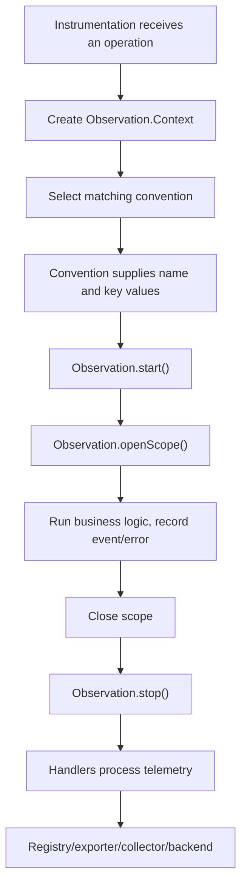

# Default convention in Micrometer Observation

A Spring Boot application can record millions of HTTP operations, database queries, or external service calls. If every developer invents their own observation names and tags, the same behavior will appear under different metric and span names. Dashboards become hard to aggregate, alerts miss signals, and cross-service incident investigation lacks consistency.

**Default convention** solves that foundation: it provides a **default naming and tagging convention** for the observation name, contextual display name, and key-values of a **specific observation type**. When business customization is needed, the system can select a matching custom convention while keeping the default convention as a fallback.

This lesson belongs to the **Convention and filter** chapter of the **SPRING_BOOT_OBSERVABILITY** module. The module sets up observability for Spring Boot using Micrometer Observation, metrics, logs, and distributed tracing; it also uses context propagation, tags/cardinality, exporters, and sampling to correlate signals when investigating errors or latency. Understanding default conventions helps keep naming and data classification stable right from the instrumentation point.

## Learning objectives

After this lesson, you will be able to:

1. Explain what a default convention is, where it sits in observation creation, and how it differs from a custom convention.
2. Distinguish `getName()`, `getContextualName(...)`, low-cardinality key values, and high-cardinality key values.
3. Design a default `ObservationConvention<T>` for a Spring Boot operation.
4. Understand how instrumentation selects between custom and default conventions, and why simply declaring a bean does not necessarily change every observation.
5. Distinguish conventions from `ObservationFilter`, `ObservationPredicate`, `ObservationHandler`, and exporter configuration.
6. Recognize issues such as metric renaming, tag cardinality explosion, hard-to-correlate traces, or conventions not being applied.

## 1. What is a default convention?

In Micrometer Observation, an `ObservationConvention<T extends Observation.Context>` defines the observation contract for a context type. A convention describes the fields an application wants to use consistently when turning an operation into telemetry.

A **default observation convention** is typically provided by an instrumentation library or by the application itself. It answers these questions:

- What is this observation named, e.g., `checkout.payment.authorize`?
- If tracing is enabled, what should the contextual display name of the span be, e.g., `authorize payment`?
- Which low-value-count dimensions are suitable for metrics, e.g., `operation=authorize`?
- Which higher-distinct-value details can be helpful in traces without becoming metric labels?

Key distinction: **a default convention is not a global default set of tags applied to every observation in the application**. A convention is normally tied to a specific context type and specific instrumentation. HTTP server, HTTP client, messaging, and payment business logic may all use different conventions.

Example:

```text
Instrumentation: checkout payment
   |
   +-- Context holds operation, partner, outcome...
   |
   +-- Matching custom convention? -- yes --> Use custom convention
   |                                  |
   |                                  no
   +----------------------------------+--> Default convention
                                              |
                                              +--> name
                                              +--> contextual name
                                              +--> low-cardinality tags
                                              +--> high-cardinality values
                                              |
                                              v
                                     Observation / handlers
                                              |
                                 Metrics, traces (if configured)
```

The diagram illustrates the selection model. **The actual selection mechanism belongs to the API or instrumentation creating the observation**, not an implicit rule that every convention bean in Spring is automatically used for every observation.

### Default does not mean immutable

A default convention is a consistent starting point. A library may allow customizing a convention to rename metrics or tags; an application can also write its own default convention for custom-instrumented business operations.

What matters is having a clear reason to customize. If every team renames HTTP metrics on a whim, dashboard reuse and alerting rules degrade.

## 2. Information provided by a convention

With Micrometer Observation, the two groups of information most easily confused are **names** and **key values**.

| Method/concept | Meaning | Example | Note |
|---|---|---|---|
| `getName()` | Stable technical name of the observation | `checkout.payment.authorize` | Often affects the metric or span name, depending on the handler |
| `getContextualName(context)` | Contextual action description | `authorize payment` | Often useful as the span display name; avoid dynamic IDs |
| `getLowCardinalityKeyValues(context)` | Dimensions with a finite value set | `operation=authorize`, `partner=provider-a` | Better suited as metric tags |
| `getHighCardinalityKeyValues(context)` | Details with many distinct values | An approved, non-sensitive request identifier | Can assist traces; unsuitable as metric labels |
| `supportsContext(context)` | Indicates whether the convention supports that context type | `context instanceof CheckoutContext` | Crucial when selecting a convention by context type |

### 2.1. `getName()`: a technical name that must stay stable

For example, `checkout.payment.authorize` identifies the type of activity being observed. Keep this name stable across releases so dashboards and measurements retain the same meaning.

Do not turn an observation name into:

```text
checkout.payment.authorize.order-4837289
checkout.payment.authorize.user-991027
checkout.payment.authorize.2026-11-22T09:30:15
```

Per-request variations can explode the number of meter/span names and make aggregation difficult. Classifying via a stable name plus finite tags is a better choice.

The exact name displayed by a backend may be transformed according to a meter registry's naming convention or tracing semantic conventions. Therefore, the name chosen in code is not guaranteed to match character-for-character across all exporters.

### 2.2. `getContextualName(...)`: an activity description name

The contextual name answers "what is it doing?" in a way investigators can easily read on a trace timeline. For example:

```text
Observation name:     checkout.payment.authorize
Contextual name:      authorize payment
Low-cardinality tag:  operation=authorize
```

Avoid embedding per-transaction data in the contextual name, such as `authorize payment for user 827391`. A trace can carry distinguishing information in controlled attributes, while span names should stay short, stable, and recognizable.

Not every handler uses the contextual name the same way. A metric handler cares primarily about the meter name and tags; a tracing handler may use the contextual name to describe the span.

### 2.3. Low-cardinality: data for aggregation

Low cardinality means the number of distinct values in a dimension is small and controlled. For example:

- `operation=authorize|capture|refund`
- `partner=provider-a|provider-b`
- `result=approved|declined|error`
- `channel=web|mobile|batch`

If the number of tag combinations grows too large, time-series storage and query costs increase rapidly. Even if each individual tag has few values, the **Cartesian product across multiple dimensions** can still be large.

For example: 4 operations × 3 partners × 4 results × 5 environments × 20 instances = **4,800 potential combinations** for a single metric. Account for versions, routes, and other dimensions before deciding to add a label.

### 2.4. High-cardinality: useful, but must be controlled

An individual request correlation ID can help locate the exact trace, yet it has a huge number of distinct values. Therefore, it is **unsuitable as a metric label**.

High-cardinality key values in a convention may be used by certain handlers as trace attributes; there is no guarantee every backend retains them. Nor should you assume you can attach every ID to a trace:

- Do not collect access tokens, card numbers, emails, or sensitive payloads.
- Limit size, retention, and access permissions.
- Check sampling rules: a trace might not be retained.
- Do not use request IDs or order IDs as observation names or span names.

**Low/high cardinality describes intended usage and data distinctness**, not two security on/off switches.

## 3. Where does default convention sit in the observation lifecycle?

A typical observation flow:



The diagram describes the general flow; the exact moment handlers read names/tags and when filters are applied can vary by version, API, and how the instrumentation is written.

Several important rules:

1. **A convention describes data.** It does not run business logic, measure time, or make network requests on its own.
2. **Observation orchestrates the lifecycle.** `start()`, `openScope()`, `error()`, and `stop()` create lifecycle hooks that handlers can use.
3. **Handlers turn lifecycle hooks into signals.** A metric handler can record a timer; a tracing handler can create a span.
4. **Exporters/collectors handle transport.** A convention by itself does not decide whether a trace is sampled and sent to the backend.
5. **Current context is a separate concern.** For logs and child spans to correlate, scope and propagation still need to be configured properly.

Hence, configuring the right convention **is not enough** to obtain metrics and traces. The registry also needs appropriate handlers, meters/tracers, exporters, and backends.

## 4. Building a default convention for a Spring Boot business operation

Suppose an application needs to observe payment authorization calls. You want services to standardize on:

- Technical name: `checkout.payment.authorize`.
- Trace display name: `authorize payment`.
- Two metric dimensions: `operation=authorize` and `partner=provider-a`.
- No order ID, user ID, or raw URL added as metric tags.

First, create a dedicated context:

```java
import io.micrometer.observation.Observation;

final class PaymentObservationContext extends Observation.Context {

    private final String operation;
    private final String partner;

    PaymentObservationContext(String operation, String partner) {
        this.operation = operation;
        this.partner = partner;
    }

    String operation() {
        return operation;
    }

    String partner() {
        return partner;
    }
}
```

In this example, `operation` and `partner` must be normalized into a **finite set of values** where the context is constructed. Do not pass raw client-supplied strings directly without validation.

Next, write the default convention:

```java
import io.micrometer.common.KeyValue;
import io.micrometer.common.KeyValues;
import io.micrometer.observation.Observation;
import io.micrometer.observation.ObservationConvention;

final class DefaultPaymentObservationConvention
        implements ObservationConvention<PaymentObservationContext> {

    @Override
    public boolean supportsContext(Observation.Context context) {
        return context instanceof PaymentObservationContext;
    }

    @Override
    public String getName() {
        return "checkout.payment.authorize";
    }

    @Override
    public String getContextualName(PaymentObservationContext context) {
        return "authorize payment";
    }

    @Override
    public KeyValues getLowCardinalityKeyValues(
            PaymentObservationContext context) {

        return KeyValues.of(
                KeyValue.of("operation", context.operation()),
                KeyValue.of("partner", context.partner())
        );
    }

    @Override
    public KeyValues getHighCardinalityKeyValues(
            PaymentObservationContext context) {

        return KeyValues.empty();
    }
}
```

This is how you express a default contract via `ObservationConvention<T>`. The methods simply read the context and return stable values; they do **not** push data to Prometheus or tracing systems themselves.

### Why is a custom context useful?

The context holds the operation's data, while the convention decides **how to interpret that data into telemetry**. When naming or tagging policies change, you can update the convention without editing every gateway call site.

However, if the context holds too much information or the convention reads unnormalized external request data, that design can cause high cardinality or sensitive data leaks. Keep the context business-meaningful and restrict which fields are exported to telemetry.

## 5. How are default and custom conventions selected?

In instrumentation that accepts both a default convention and a custom convention, the typical model is:

1. There is a **default convention** dedicated to the context type.
2. If a custom convention is provided and supports the context, select it.
3. If no suitable custom convention exists, fall back to the default convention.
4. The Observation is created using the chosen convention; handlers receive lifecycle callbacks as normal.

This selection mechanism **must be supported by the API or instrumentation class**. Merely naming a class `Default...Convention` does not make Micrometer automatically treat it as a default.

### Example using conventions when creating an observation

The following example illustrates Micrometer Observation's custom/default convention selection overload in a synchronous flow. Verify exact imports and signatures against your project's Micrometer version when moving to production.

```java
import io.micrometer.observation.Observation;
import io.micrometer.observation.ObservationConvention;
import io.micrometer.observation.ObservationRegistry;
import org.springframework.stereotype.Service;

@Service
class PaymentService {
    private final ObservationRegistry observationRegistry;
    private final PaymentGateway paymentGateway;

    private final ObservationConvention<PaymentObservationContext> customConvention;
    private final ObservationConvention<PaymentObservationContext> defaultConvention =
            new DefaultPaymentObservationConvention();

    PaymentService(
            ObservationRegistry observationRegistry,
            PaymentGateway paymentGateway) {

        this.observationRegistry = observationRegistry;
        this.paymentGateway = paymentGateway;
        this.customConvention = null; // Example: no custom convention provided yet.
    }

    PaymentResult authorize(PaymentRequest request) {
        PaymentObservationContext context =
                new PaymentObservationContext("authorize", "provider-a");

        return Observation.createNotStarted(
                        customConvention,
                        defaultConvention,
                        () -> context,
                        observationRegistry)
                .observe(() -> paymentGateway.authorize(request));
    }
}
```

`PaymentGateway`, `PaymentRequest`, and `PaymentResult` are hypothetical types. The goal of this code is to clarify two roles:

- **Default convention** supplies the name and tags when no suitable custom convention is available.
- **`observe(...)`** wraps the synchronous callback, manages start/scope/stop, and records errors per the supported API; the convention does not do this work.

In some versions or integrations, `ObservationDocumentation` utility APIs or the instrumentation itself may accept the custom/default convention pair. Understanding the fallback principle is essential, but **do not assume every observation type uses the exact same overload or dependency injection mechanism**.

### A custom convention is not an automatic tag filter

If you want to rename a library's observation, check whether the library provides a dedicated convention interface or bean customization hook. Some libraries use specialized `ObservationConvention<T>` interfaces for HTTP, messaging, or other clients; others do not allow overriding via a generic bean.

If you build your own instrumentation, you explicitly decide when to pass a custom convention. If you rely on Spring Boot auto-instrumentation, verify the extension point published by the framework. Simply adding a `@Bean ObservationConvention<?>` to the application context **does not guarantee** that every HTTP observation, JDBC span, or background task switches to it.

## 6. Comparing default convention, filter, predicate, and handler

This chapter covers both **conventions** and **filters**; they solve different problems.

| Component | Core question | Example | Should not be used to |
|---|---|---|---|
| **Default convention** | If no customization applies, how is the observation named/tagged by default? | `checkout.payment.authorize` with `operation=authorize` | Decide which backend every trace is exported to |
| **Custom convention** | For this context type, how should the default convention be overridden? | Change span name, add finite tags | Automatically alter all instrumentation without wiring |
| **`ObservationFilter`** | How should contexts of already-created observations be adjusted or enriched? | Add `deployment.environment=prod` to matching contexts | Act as a security mechanism replacing redaction/export controls |
| **`ObservationPredicate`** | Should an operation be observed under the given condition? | Skip a noisy internal operation | Solve all tracing sampling requirements |
| **`ObservationHandler`** | How to react to start/stop/error/event/scope? | Record a timer, create a span, handle events | Define business rules for a transaction |
| **`MeterFilter`** | How should meters be adjusted or restricted on the metrics side? | Deny a group of meters or apply tag rules | Rename contextual spans or handle log correlation |
| **Exporter / sampler** | Which data is transported or retained? | OTLP exporter, trace sampling | Standardize names/tags like a convention |

### Why not use a filter instead of a default convention?

Filters are suited for adjusting contexts according to cross-cutting policies, such as adding environment or a normalized attribute. Conventions are suited for defining the **semantics of an operation type**: operation name, display name, and low/high cardinality.

If a filter tries to rename and retag every observation by parsing arbitrary name strings, that logic becomes brittle whenever a library changes names in an upgrade. An explicit convention for the right context type is usually much easier to maintain.

### And why is a convention not enough to filter telemetry?

A convention can return key values, but it does not necessarily allow skipping an entire observation. If you want to exclude an operation from processing, use a predicate or the appropriate instrumentation policy. If you want to keep only 10% of traces, configure a sampler/collector; omitting a few key values in a convention is not sampling.

## 7. Default conventions and built-in Spring Boot instrumentation

In Spring Boot 3.x, many instrumentations already include their own conventions or semantic naming for HTTP servers/clients and integrated components. They typically emit names and tags expected by metrics/tracing backends.

For example, HTTP server instrumentation may use fields like method, route, status, and exception in a standardized way. **Exact metric names depend on the Spring Boot version, Micrometer, naming conventions, and exporters**, so do not copy a name from one dashboard and assume every codebase emits the exact same thing.

When you want to customize, answer these questions:

1. **What data is missing?** Route template, business operation, partner, or outcome?
2. **Where is the observation created?** Framework HTTP instrumentation or custom observation code?
3. **What extension points does the framework offer?** Custom server/client observation convention, filter, handler, or manual observation creation?
4. **Are values stable?** Normalized URI templates differ from raw URLs; finite partner IDs differ from user IDs.
5. **Who reads the data?** Prometheus dashboards, trace UI, log queries, or SLO alerts?
6. **Will changes break historical data series?** Changing names/tags may require updating dashboards and alerts.

A good default convention must remain resilient across minor code refactors. For instance, splitting a controller into two classes should still preserve the public operation name if the business semantics did not change.

## 8. Bad examples and how to fix them

### Mistake 1 — Using a dynamic ID in the observation name

```java
// Avoid: every order ID becomes a different name.
String name = "checkout.payment.authorize." + orderId;
Observation.createNotStarted(name, registry)
        .observe(() -> gateway.authorize(request));
```

**Consequence:** metric names/span names become fragmented and can cause cardinality or series explosion. **Fix:** use a stable `checkout.payment.authorize`; only store an approved identifier in controlled traces/logs when genuinely needed.

### Mistake 2 — Putting the full URL into a low-cardinality tag

```text
Wrong:
  uri=/orders/987654321/payment
  uri=/orders/987654322/payment

Better:
  uri=/orders/{id}/payment
  operation=authorize
```

Dynamic URLs should not become metric labels. With HTTP instrumentation, use normalized route templates. If your code creates its own context, normalize before passing into the convention.

### Mistake 3 — Changing the default convention without checking dashboards

Suppose a metric name was previously derived from `checkout.payment.authorize`, and after changing the convention to `checkout.authorize`, old dashboards stop showing new series. Nothing is necessarily broken; **the telemetry schema changed**.

When changing names/tags:

- Notify and audit metric consumers: dashboards, alerts, recording rules, SLOs.
- Plan a migration window and monitor both old and new names for a reasonable overlap if needed.
- Verify new tags do not increase cardinality or alter error-rate semantics.
- Cross-check span names and log correlation to avoid misreading historical incidents.

### Mistake 4 — Registering a generic custom convention and expecting every library to use it

A generic `ObservationConvention<?>` bean is not guaranteed to intercept HTTP or messaging instrumentation. **Fix:** identify the library's own convention extension point and how Spring Boot wires it; for custom-instrumented business logic, pass the convention explicitly.

### Mistake 5 — Confusing "no traces" with "convention not working"

A metric properly named by a convention yet missing a corresponding span can happen because the tracing handler is not registered, context propagation broke, the sampler dropped the trace, the exporter failed, or the collector dropped it. Inspect each telemetry layer, not just the convention name.

### Mistake 6 — Computing outcome from state unavailable when the convention is read

If a convention reads `outcome` from the context when the observation starts, while business logic only learns success/failure after finishing, some handlers may receive an un-updated value. Handlers may collect key values at different lifecycle points.

**Fix:** separate metadata known before execution (operation, partner category) from outcomes known afterward (success, timeout, declined). Check the specific handler/convention lifecycle, update context at the right time, and verify the actual resulting metric/span. Do not assume a mutable field will be re-read by all handlers at stop time.

## 9. Investigation scenario: same error, two different metric names

Suppose a Spring Boot system has two payment services: `checkout-service` and `reconciliation-service`. Both call a payment authorization API, yet the teams recorded:

```text
checkout-service:
  metric operation name = checkout.payment.authorize
  tag operation=authorize

reconciliation-service:
  metric operation name = payment.authorize.request
  tag action=auth
```

When the provider times out, a dashboard querying one metric name shows only one service. The operations team assumes the other service is unaffected.

### Analysis

1. **Monitoring detects:** errors and latency are rising, yet aggregating by one metric name does not represent all authorization flows.
2. **Compare conventions:** two instrumentations describe the same activity type without a unified name/tag schema.
3. **Standardize the convention:** adopt a shared default convention with `checkout.payment.authorize` or an appropriate business name, tag `operation=authorize`, and `service.name`/resource attributes following the stack's standard.
4. **Preserve distinct context:** each service can still have a meaningful contextual name or span attribute. Do not attach request IDs to metrics to force linking individual transactions.
5. **Assess impact:** update dashboards, alerts, and rules. Verify queryability across historical data before and after the change.
6. **Verify end-to-end:** generate successful requests, timeout requests, and cross-service requests; inspect metrics, traces, and log correlation. Check sampling and exporters if traces are missing.

A unified convention ensures both services are measured under **the same semantics**, while traces and logs allow drilling into individual requests when needed. However, changing a convention does not connect context across services on its own; HTTP/messaging propagation must still work.

## 10. Default convention design checklist

Before shipping a new convention to production, verify:

- **Name:** Is `getName()` stable, reflective of the operation type, and free of IDs/timestamps?
- **Contextual name:** Is it short, helpful in traces, and free of sensitive information?
- **Low-cardinality tags:** Do they have a finite, clear, normalized value set suitable for metric grouping?
- **High-cardinality tags:** Are they truly necessary, approved for collection, and governed by retention/access controls?
- **Context support:** Does `supportsContext(...)` match only the intended context type and avoid misapplying to other instrumentation?
- **Fallback:** When no custom convention is present, does instrumentation actually use the declared default?
- **Lifecycle:** When do handlers read key values? Are post-execution outcomes recorded correctly?
- **Spring wiring:** Is the custom bean integrated via the right extension point without disrupting auto-configuration?
- **Schema compatibility:** Do dashboards/alerts/SLOs still query the right names and tags after changes?
- **Correlation:** Do logs/spans carry relevant trace context; does context propagate across HTTP, executors, and message queues?
- **Pipeline:** Have the registry, handlers, sampler, exporter, and backend each been verified independently?
- **Cost:** Are new time-series counts and span attribute sizes within the telemetry budget?

## 11. Self-assessment questions

**Question 1.** A default convention is declared for `PaymentObservationContext`. Does it automatically rename every HTTP server observation?

**Hint:** No. A convention is bound to a context type and the instrumentation using it. The framework must support that extension point, or your code must pass the convention when creating the observation.

**Question 2.** Why should `getName()` return `checkout.payment.authorize` instead of `checkout.payment.authorize.order-283`?

**Hint:** A stable name lets metrics/spans be aggregated and queried consistently; ID-dependent names fragment telemetry and can cause cardinality explosion.

**Question 3.** A trace contains the `authorize payment` span, but metrics do not appear. Can you conclude the default convention is wrong?

**Hint:** Not yet. The tracing handler may be working while the metrics handler, meter registry, or exporter is not configured. Check the metrics pipeline independently.

**Question 4.** Two context types share one custom convention; `supportsContext(...)` returns `false` for one of them. What should happen in the fallback mechanism?

**Hint:** If the instrumentation supports custom/default selection, a non-matching custom convention is not applied to that context; the corresponding default convention is used instead.

**Question 5.** A team wants 100% of error traces but only 10% of successful traces. Can that be solved with `getHighCardinalityKeyValues(...)`?

**Hint:** No. That is a sampling policy, typically belonging to the tracer/sampler or collector. A convention defines names and attributes; it does not control trace retention rates.

## Conclusion

**A default convention is the fallback naming and tagging contract for an observation type**, keeping names and key values consistent when no matching custom convention is provided. In Spring Boot, it makes metrics easy to aggregate, traces easy to read, and data across services share the same semantics. Yet a convention is only one layer of observability: scopes, context propagation, observation handlers, meter/tracing registries, samplers, and exporters still determine which telemetry is actually recorded and correlated. Good design starts with stable names, cardinality-controlled tags, proper extension points, and end-to-end verification across dashboards, logs, and traces.
