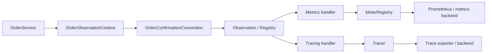
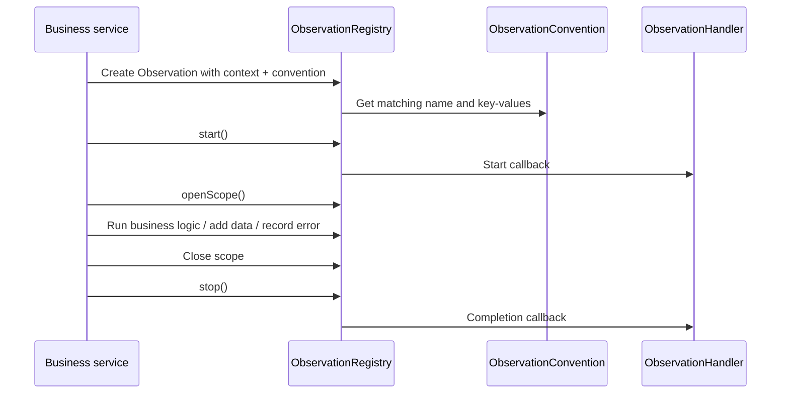

# Custom convention in Micrometer Observation

Suppose a Spring Boot system has three ordering channels: web, mobile app, and partner. Each channel invokes an order confirmation operation, yet the development teams named telemetry differently: `checkout.submit`, `placeOrder`, `order.confirm`. One team used the `channel` tag, another used `source`, and one even placed the order ID directly into a metric tag. As a result, dashboards are hard to aggregate, time-series queries are inconsistent, and the number of metric series can explode.

**Custom convention** solves this by specifying the **Observation name, contextual name, and key-value set** under a shared contract. Instead of letting every business method concatenate strings and pick labels ad hoc, you define the convention in a class with clear responsibility.

This lesson belongs to the **Convention and filter** chapter of the `SPRING_BOOT_OBSERVABILITY` module. The module's goal is to establish observability for Spring Boot using Micrometer Observation, metrics, logs, and distributed tracing, while understanding context propagation, tags/cardinality, exporters, sampling, and how to correlate signals to investigate errors, latency, and application behavior in production. In this lesson, the focus is on building and applying a custom `ObservationConvention` for a business operation.

## 1. What is an Observation convention?

An `Observation` describes an activity to observe, such as confirming an order or calculating shipping fees. `ObservationRegistry` dispatches the Observation lifecycle to handlers. **`ObservationConvention<T>` is the interface that defines how to interpret the context of an Observation type into a name and meaningful key-values.**

A convention typically answers four questions:

1. **What is this Observation named?** For example, `order.confirm` as a stable name to group metrics of the same kind.
2. **What is the human-readable name in context?** For example, `confirm-order` as a suitable span name when tracing is enabled.
3. **Which data is low cardinality?** For example, `order.channel=web/mobile/partner/other`, suitable for aggregating metrics.
4. **Which data is high cardinality?** For example, a single transaction's reference code for trace lookup, unsuitable as a metric label.

Common methods on a convention include `getName()`, `getContextualName(context)`, `getLowCardinalityKeyValues(context)`, `getHighCardinalityKeyValues(context)`, and `supportsContext(context)`. They separate the **telemetry contract** from business execution code.

| Object | Role |
| --- | --- |
| `Observation.Context` | Holds facts of a single execution, such as order channel and reference code |
| `ObservationConvention<T>` | Specifies the name and key-values for the matching context type |
| `ObservationRegistry` | Manages observation configurations and coordinates handlers |
| `ObservationHandler` | Receives lifecycle callbacks to record metrics, create spans, or perform integration tasks |
| `MeterRegistry` | Stores and aggregates metrics on the application side before export |
| Tracer and exporter | Manage, propagate, and export traces to the receiving system |

A convention **does not record metrics, create traces, or emit logs on its own**. To obtain actual telemetry, the application must have suitable handlers, registries, exporters, and backends.

## 2. Why use a custom convention instead of arbitrary tags?

Micrometer still lets you write:

```java
Observation.createNotStarted("order.confirm", observationRegistry)
    .lowCardinalityKeyValue("order.channel", "web")
    .observe(() -> confirmOrder());
```

For a single simple operation, this approach works. Once multiple services instrument the same kind of work, problems begin to appear:

- Names can drift across versions, breaking dashboards or alerts.
- The `order.channel` tag might be recorded as `channel`, `payment.channel`, or `sales.source` in different places.
- One team puts per-request IDs into a low-cardinality key-value, causing cardinality explosion.
- `timeout`, `rejected`, and `error` outcomes may be interpreted differently.
- Changing the rule requires searching and updating many spots across the codebase.

A custom convention provides **a consistent schema**. Depending on the application, the convention can target a specific business context type or be shared more broadly.

### Information flow diagram



The diagram shows **logical responsibilities**, not that the convention directly invokes handlers. At runtime, the Observation is created with a registry and convention; handlers read context/name/key-values in the appropriate lifecycle callbacks.

## 3. Designing the convention contract before coding

Suppose the `order.confirm` operation needs to measure duration, error rate, and compare across channels.

| Component | Convention | Notes |
| --- | --- | --- |
| Observation name | `order.confirm` | Stable over time, contains no IDs |
| Contextual name | `confirm-order` | Easy to read in traces when tracing is enabled |
| Low-cardinality key | `order.channel` | `web`, `mobile`, `partner`, `other` |
| Low-cardinality key | `order.mode` | `immediate` or `scheduled` |
| High-cardinality key | `order.reference` | Opaque code, only used when telemetry policy permits |
| Outcome | `outcome=success/rejected/error` | Business-defined semantics; choose recording timing carefully |

Do not use raw URLs, SQL statements, email addresses, tokens, or exception messages as metric tags. Unbounded values increase time-series count and can leak sensitive data into telemetry systems.

**Cardinality** is the number of distinct combinations of label values. For instance, `order.channel` has 4 values and `order.mode` has 2 values, so those two dimensions alone create at most **8 combinations**. Adding `order.reference` for 100,000 orders would vastly expand the theoretical combination count. That is why classifying key-values inside the convention is critical.

The convention must also align with backend queryability: renaming `order.confirm` to `checkout.complete` is not just a Java refactor—it can require updating dashboards, alerts, and historical queries.

## 4. Creating a custom context for a business operation

The following examples use Spring Boot 3.x, Java 17+, and Micrometer Observation managed by `spring-boot-starter-actuator`. The actual Micrometer version is selected by the Spring Boot BOM/parent.

We create a dedicated context instead of stuffing everything into disconnected strings:

```java
import io.micrometer.observation.Observation;

public final class OrderConfirmationContext extends Observation.Context {
    private final String channel;
    private final String mode;
    private final String reference;

    public OrderConfirmationContext(
            String channel, String mode, String reference) {
        this.channel = normalizeChannel(channel);
        this.mode = normalizeMode(mode);
        this.reference = reference;
    }

    public String channel() {
        return channel;
    }

    public String mode() {
        return mode;
    }

    public String reference() {
        return reference;
    }

    private static String normalizeChannel(String input) {
        if ("web".equals(input)
                || "mobile".equals(input)
                || "partner".equals(input)) {
            return input;
        }
        return "other";
    }

    private static String normalizeMode(String input) {
        return "scheduled".equals(input) ? "scheduled" : "immediate";
    }
}
```

This context class captures the **facts of one execution**. Normalizing at the ingestion boundary ensures the convention never accidentally generates thousands of tag values from uncontrolled inputs.

`reference` is kept in the context as high-cardinality data, though you should evaluate whether it truly needs to be exported to telemetry. Do not push fields containing personal data or secrets into traces merely because the API allows it.

## 5. Implementing `ObservationConvention<T>`

The convention uses the `OrderConfirmationContext` type to determine the Observation name and key-value set:

```java
import io.micrometer.common.KeyValue;
import io.micrometer.common.KeyValues;
import io.micrometer.observation.Observation;
import io.micrometer.observation.ObservationConvention;

public final class OrderConfirmationConvention
        implements ObservationConvention<OrderConfirmationContext> {

    @Override
    public boolean supportsContext(Observation.Context context) {
        return context instanceof OrderConfirmationContext;
    }

    @Override
    public String getName() {
        return "order.confirm";
    }

    @Override
    public String getContextualName(OrderConfirmationContext context) {
        return "confirm-order";
    }

    @Override
    public KeyValues getLowCardinalityKeyValues(
            OrderConfirmationContext context) {
        return KeyValues.of(
            KeyValue.of("order.channel", context.channel()),
            KeyValue.of("order.mode", context.mode())
        );
    }

    @Override
    public KeyValues getHighCardinalityKeyValues(
            OrderConfirmationContext context) {
        if (context.reference() == null
                || context.reference().isBlank()) {
            return KeyValues.empty();
        }
        return KeyValues.of("order.reference", context.reference());
    }
}
```

**Meaning of each method:**

- `supportsContext` identifies which context the convention handles; when applied globally or via convention selection mechanisms, this prevents misapplication.
- `getName` returns a stable name so metrics handlers can aggregate the same kind of work.
- `getContextualName` returns a meaningful display name for tracing. Avoid embedding order IDs in the contextual name, as that hinders aggregation and can expose data.
- `getLowCardinalityKeyValues` specifies finite dimensions suitable for metrics and dashboard filters.
- `getHighCardinalityKeyValues` returns detailed data for handlers that know how to consume it, typically tracing. Whether an attribute appears on a span depends on the specific handler and configuration.

A convention does not have to return every key-value group. If high-cardinality data is not needed yet, returning `KeyValues.empty()` is a good choice. For internal documents or strict security policies, `order.reference` can be omitted entirely.

## 6. Using a custom convention in a Spring Boot service

In a Spring Boot application, you can register the convention as a bean and inject it alongside `ObservationRegistry`:

```java
import org.springframework.context.annotation.Bean;
import org.springframework.context.annotation.Configuration;

@Configuration
public class OrderObservationConfiguration {
    @Bean
    OrderConfirmationConvention orderConfirmationConvention() {
        return new OrderConfirmationConvention();
    }
}
```

Example of a service applying the convention when creating an Observation:

```java
import io.micrometer.observation.Observation;
import io.micrometer.observation.ObservationRegistry;
import org.springframework.stereotype.Service;

@Service
public class OrderConfirmationService {
    private final ObservationRegistry registry;
    private final OrderConfirmationConvention convention;
    private final OrderGateway gateway;

    public OrderConfirmationService(
            ObservationRegistry registry,
            OrderConfirmationConvention convention,
            OrderGateway gateway) {
        this.registry = registry;
        this.convention = convention;
        this.gateway = gateway;
    }

    public OrderReceipt confirm(OrderCommand command) {
        OrderConfirmationContext context = new OrderConfirmationContext(
            command.channel(), command.mode(), command.reference()
        );

        Observation observation = Observation.createNotStarted(
            null, convention, () -> context, registry
        );

        return observation.observe(() -> gateway.confirm(command));
    }
}

record OrderCommand(String channel, String mode, String reference) {}
record OrderReceipt(String confirmationId) {}

interface OrderGateway {
    OrderReceipt confirm(OrderCommand command);
}
```

In Micrometer Observation's `Observation.createNotStarted(customConvention, defaultConvention, contextSupplier, registry)` overload, the first parameter represents an optional prioritized custom convention; the second parameter is the default convention for that kind of work. In the example, `null` in the custom convention slot means using `OrderConfirmationConvention` directly as this operation's default contract. When targeting a specific Micrometer version, verify the corresponding API signature.

`OrderGateway` is a hypothetical business adapter; a real application must provide a bean implementation. `observe(...)` wraps **synchronous** work, manages start, scope, error recording, and stop, then returns the result or propagates exceptions per business behavior.

**Note:** Registering an `OrderConfirmationConvention` bean does not mean every Observation in the application will automatically use it. In this example the service **passes the convention when creating the Observation**. Built-in framework instrumentations usually have their own convention interfaces and configuration points.

### Why not call `ObservationRegistry.create()` inside a service?

The `ObservationRegistry` bean managed by Spring Boot may already have handlers, predicates, filters, and global policies attached. Creating a local registry inside a service easily causes metrics or tracing to go missing because those configurations are not applied to the new registry.

## 7. Custom convention, global convention, filter, and predicate

These mechanisms often appear together but serve different needs:

| Mechanism | Goal | Timing / characteristics |
| --- | --- | --- |
| `ObservationConvention<T>` | Standardize the name and key-values of **one Observation type** | Used when creating/dispatching Observations for a matching context |
| `GlobalObservationConvention<T>` | Provide a shared convention for compatible contexts when registered | Must define `supportsContext` scope and precedence relative to specific conventions |
| `ObservationFilter` | Modify or enrich context data by policy | Typically applied late in the lifecycle, before completing processing in applicable handlers |
| `ObservationPredicate` | Decide whether an Observation is recorded or becomes a no-op | Filters before executing meaningful observation callbacks |
| `ObservationHandler` | Produce actual side effects when Observation starts/stops/errors/events | Depends on whether the handler supports the context and registry configuration |

### 7.1. When to use a convention?

Choose a custom convention when an operation's name and schema should remain consistent across many call sites, or when you are customizing how a specific context type is instrumented. For instance, every `order.confirm` call uses `order.channel` and `order.mode` under the same contract.

A convention is not the right place to make network calls, query databases, or trigger business side effects. Key-value methods may be invoked at multiple times depending on the handler; logic should be lightweight, deterministic, and must not produce unexpected cardinality.

### 7.2. When to use ObservationFilter?

If you want to attach an organizational label to many Observations, such as `team=checkout`, a filter can be simpler than editing each convention:

```java
import io.micrometer.common.KeyValue;
import io.micrometer.observation.ObservationFilter;
import org.springframework.context.annotation.Bean;
import org.springframework.context.annotation.Configuration;

@Configuration
class ObservationTagPolicy {
    @Bean
    ObservationFilter checkoutTeamTag() {
        return context -> context.addLowCardinalityKeyValue(
            KeyValue.of("team", "checkout")
        );
    }
}
```

When using Spring Boot 3.x Micrometer Observation auto-configuration, `ObservationFilter` beans can be automatically added to the Boot-managed registry. If configuring a registry manually, register the filter on its `observationConfig()`.

**Important difference:** a filter generally runs later than the start phase of an Observation. If a tracing handler needs an attribute at `onStart` to form a span name or context, a value added too late may not appear as expected. Set critical data before `start()` or use an appropriate convention/handler.

### 7.3. When to use ObservationPredicate?

A predicate is useful when deciding to drop Observations that lack operational value, such as a specific internal synthetic check:

```java
import io.micrometer.observation.ObservationPredicate;
import org.springframework.context.annotation.Bean;

@Bean
ObservationPredicate excludeSyntheticOperation() {
    return (name, context) -> !"internal.synthetic.check".equals(name);
}
```

Place this method inside a `@Configuration` class when integrating with Spring. If the predicate rejects an Observation, metrics/tracing handlers relying on it may not emit data. Do not write overly broad predicates that accidentally drop production error signals needed for investigation.

### 7.4. Difference from built-in HTTP conventions

Spring HTTP instrumentation may provide specialized convention interfaces such as `ServerRequestObservationConvention` or other conventions depending on the Servlet/WebFlux stack and Spring Framework version. To customize HTTP server names or tags, prefer **that instrumentation's** extension point; an `OrderConfirmationConvention` bean for a custom context does not automatically apply to HTTP requests.

When overriding a framework convention, inherit or preserve standard key-values where appropriate to keep important dimensions such as HTTP method, status, and URI template. Replacing the entire tag set carelessly can break existing dashboards and alerts.

## 8. Lifecycle: when is a convention used?



The diagram simplifies the callbacks. Depending on the handler and Micrometer version, names and key-values may be read at different points in the lifecycle. To avoid inconsistent results, **data used to determine the name and stable tags should be available before the Observation starts**.

Suppose you need to include `outcome=success/rejected/error`, where the outcome is only known after the gateway responds. You can add a low-cardinality key-value while the Observation is running. The snippet below illustrates the body of a method in the service from section 6, assuming `registry`, `convention`, `context`, `gateway`, and `command` are already in scope:

```java
Observation observation = Observation.createNotStarted(
    null, convention, () -> context, registry
);

observation.start();
try (Observation.Scope scope = observation.openScope()) {
    OrderReceipt receipt = gateway.confirm(command);
    observation.lowCardinalityKeyValue("outcome", "success");
    return receipt;
} catch (BusinessRejectionException ex) {
    observation.lowCardinalityKeyValue("outcome", "rejected");
    throw ex;
} catch (RuntimeException ex) {
    observation.lowCardinalityKeyValue("outcome", "error");
    observation.error(ex);
    throw ex;
} finally {
    observation.stop();
}
```

The example assumes `BusinessRejectionException` is a domain-specific exception; real services may represent business rejections via a result type rather than an exception. If you treat it as an error worth recording, decide explicitly whether to call `observation.error(ex)`. Outcome and error event are not synonymous.

In real applications, avoid trying to put an outcome tag inside the convention by reading a field that is still undetermined at start time. Depending on the handler, a post-start value may affect metrics at stop time without necessarily updating fields already used by the tracing handler when creating the span.

## 9. Context propagation, logs, and tracing with conventions

A convention standardizes data for *a single Observation*. It **does not replace** context propagation mechanisms across threads or services.

For example, when `order-service` calls `payment-service` over HTTP:

1. The `order.confirm` Observation is created within the request handling scope.
2. The tracing handler can create a child span and maintain the appropriate trace/span context.
3. HTTP client instrumentation must inject trace context into headers, usually following W3C Trace Context such as `traceparent`.
4. The receiving side must extract context and create a server span; new Observations on the receiving side are placed within that trace context.
5. If logging has MDC correlation configured, logs inside the scope can include `traceId` and `spanId`.

Required components include a tracing bridge, client/server instrumentation, compatible propagation format, and matching exporter/backend. Adding a custom convention alone does not link traces across multiple services.

With `CompletableFuture`, `@Async`, executors, or Reactor/WebFlux, an active scope on one thread does not automatically carry context onto another thread. Use Micrometer Context Propagation and appropriate framework integrations to capture/restore context. Never pass an open `Observation.Scope` to another thread and close it outside the thread that owns it.

If a trace is dropped by sampling or an exporter fails, a custom Observation can still be recorded as a metric if the metrics handler is configured. Not seeing a span in the backend is **not enough** to conclude the convention did not run.

## 10. Testing a convention in Spring Boot

With Spring Boot 3.x, a project can start with:

```xml
<dependencies>
    <dependency>
        <groupId>org.springframework.boot</groupId>
        <artifactId>spring-boot-starter-actuator</artifactId>
    </dependency>
    <dependency>
        <groupId>io.micrometer</groupId>
        <artifactId>micrometer-registry-prometheus</artifactId>
    </dependency>
</dependencies>
```

Illustrative configuration:

```yaml
spring:
  application:
    name: order-service
management:
  endpoints:
    web:
      exposure:
        include: health,metrics,prometheus
  tracing:
    sampling:
      probability: 0.1
```

The application must have an `OrderGateway` implementation and a way to invoke `OrderConfirmationService.confirm(... )`, such as a REST endpoint or a test. After executing it a few times:

```bash
curl -s http://localhost:8080/actuator/health
curl -s http://localhost:8080/actuator/metrics
curl -s http://localhost:8080/actuator/metrics/order.confirm
curl -s http://localhost:8080/actuator/prometheus
```

If the metrics handler records the Observation using the specified convention, the meter is typically named `order.confirm`. Check the `order.channel` and `order.mode` tags, then test with an unrecognized channel value to confirm it normalizes to `other`.

`/actuator/metrics` reflects the meters currently registered in the application, not a historical time-series store. `/actuator/prometheus` requires the Prometheus registry; Prometheus must scrape periodically to power dashboards and alerts. Latency percentiles/histograms are not automatically populated simply because an observation is recorded; configure metrics distribution settings accordingly.

### 10.1. Testing traces

If you want to inspect spans named by the convention, add a compatible bridge and exporter, for example with Spring Boot 3.x and OpenTelemetry:

```xml
<dependency>
    <groupId>io.micrometer</groupId>
    <artifactId>micrometer-tracing-bridge-otel</artifactId>
</dependency>
<dependency>
    <groupId>io.opentelemetry</groupId>
    <artifactId>opentelemetry-exporter-otlp</artifactId>
</dependency>
```

Then configure the collector/tracing endpoint according to your version and exporter protocol. Sampling at `0.1` is an example of keeping 10% of traces and does not guarantee every error has a span in the backend. Verify Trace IDs across services, low/high-cardinality values on spans if supported by the handler, and log correlation with the same Trace ID.

### 10.2. Protecting endpoints and data

`management.endpoints.web.exposure.include` only specifies which endpoints are accessible over HTTP; it does not configure authentication. Restrict access to management endpoints using network policies and appropriate Spring Security/gateway rules. Never put customer data, payment payloads, secrets, or tokens into convention key-values.

## 11. Troubleshooting when a custom convention has no effect

| Symptom | Possible cause | How to investigate |
| --- | --- | --- |
| Metric still has old name | Service did not use the convention or instrumentation has its own convention | Verify where `createNotStarted` is called and which convention is passed |
| Custom tags missing | Wrong context type, convention not selected, meter not yet recorded | Check `supportsContext`, key-values, and callbacks |
| Metrics visible, no spans | Missing tracing bridge/exporter, dropped by sampling, or backend error | Check handlers and tracing pipeline |
| Span exists, no `order.confirm` in Prometheus | Metrics handler/registry inactive, not scraped yet, or different name | Check `/actuator/metrics`, registry, exporter |
| Time-series count grows quickly | Raw input/ID put into low-cardinality tag | Normalize tags and separate high-cardinality data |
| HTTP server metrics lost standard tags | Overrode framework convention while dropping standard tags | Use the dedicated convention interface and keep essential dimensions |
| Request spans lost parent–child relationship | Discontinuous scope or context propagation | Check async threads, client/server propagation |
| Logs missing Trace ID | Tracing not integrated with MDC/log pattern or log ran outside scope | Check logging and tracing configuration |
| Outcome tag appears late or missing | Value determined after `start` while a handler read at `onStart` | Redesign lifecycle and how handlers collect data |

Do not conclude a convention is broken just because Prometheus or the tracing backend does not show data yet. Separate two questions: **is the Observation contract applied properly** and **is the export pipeline working**.

## 12. Hands-on lab: standardizing the observability schema

You can use a sample Spring Boot service handling order confirmation:

1. Create `OrderConfirmationContext` carrying `channel`, `mode`, and an optional reference code. Normalize values before recording telemetry.
2. Create `OrderConfirmationConvention` providing `getName`, `getContextualName`, `getLowCardinalityKeyValues`, and `getHighCardinalityKeyValues`.
3. Inject `ObservationRegistry` and invoke business logic inside `Observation.createNotStarted(...).observe(... )` with your new convention.
4. Test `web/immediate`, `partner/scheduled`, and an unrecognized channel value. Verify tags are normalized and series count does not grow per order ID.
5. Add an `ObservationFilter` attaching `team=checkout`, and compare with the tags produced by the convention. Verify the name and tags of the specific context are not altered unexpectedly.
6. Add an `outcome` status at the end of the operation, and verify metrics and tracing handlers process the updated value at the proper time.
7. Enable a test tracing backend, send requests across two services, and correlate metrics, spans, and related logs. Observe the difference when changing sampling or intentionally breaking context on an executor.
8. Review management endpoint security, high-cardinality data, and dashboard maintainability across schema updates in the next release.

**Completion criteria:** you can explain how a custom convention differs from filters/predicates/handlers, build a dedicated context, reuse stable names and tags, avoid excessive cardinality, and verify the path of metrics, logs, and traces from the application to the observability system.

## 13. Design principles for production deployment

- Name Observations after **stable operations**, not dynamic routes, IDs, or Java classes that may be refactored.
- Choose tags based on real operational questions and bound input value sets; document the schema so services stay consistent.
- Separate aggregation attributes (low cardinality) from detailed tracing data (high cardinality); always respect privacy policies.
- Use a dedicated context for business data and a convention scoped to that context type.
- Do not add expensive logic or network calls inside a convention.
- Version the telemetry schema alongside dashboards, alerts, and runbooks.
- Test handlers, exporters, sampling, and context propagation independently of convention logic.
- Maintain incident investigation capability by combining metric trends, single-request traces, and correlated logs.

## Conclusion

A **custom convention** turns your business telemetry rules into a reusable, controlled contract. In Spring Boot, define an appropriate `Observation.Context`, implement `ObservationConvention<T>` to standardize names and key-values, and pass the convention when creating the Observation. Metrics/tracing handlers consume that data according to the registry configuration; exporters, sampling, context propagation, and log correlation determine how complete the picture is during production investigations. A solid convention keeps dashboards meaningful, traces readable, and observability costs predictable as the application grows.
