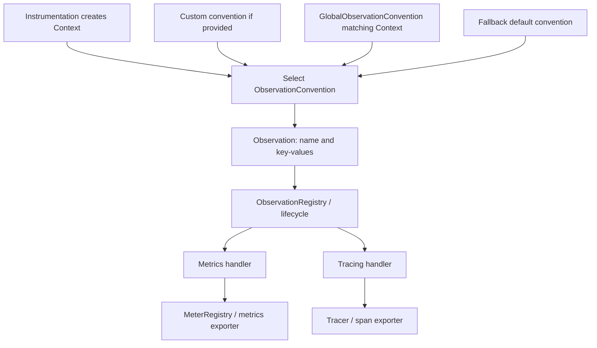
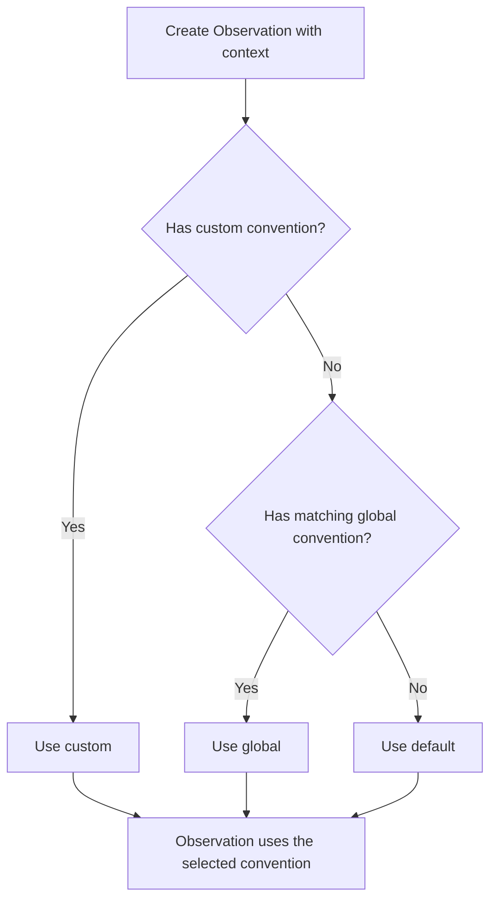

# GlobalObservationConvention in Micrometer Observation

A Spring Boot application typically has many places creating Observations: HTTP server, HTTP client, message consumer, scheduled jobs, and business operations. When multiple components emit data, operators want consistent **Observation names**, **low-cardinality tags**, and **high-cardinality attributes** so metrics, traces, and correlated logs are easy to read. If every place defines its own naming rules, dashboards become fragmented: the same type of operation appears under different names and label sets.

In the **Convention and filter** chapter of the **SPRING_BOOT_OBSERVABILITY** module, `GlobalObservationConvention` is a mechanism for standardizing how Observations are represented **by context type**. This lesson explains how to define, register, prioritize, and verify its impact on a Spring Boot observability setup using Micrometer Observation, metrics, logs, and distributed tracing. The sections on cardinality, exporters, sampling, and propagation help apply naming rules safely when investigating errors, latency, and application behavior in production.

## 1. What problem does a convention solve?

An **Observation** represents an activity being observed. An Observation has a name and key–values describing the activity; `ObservationHandler` instances decide how to process lifecycle events to record metrics or traces.

An **Observation convention** groups the rules for deriving a name and key–values from an `Observation.Context` into a dedicated object, so business code does not have to repeat the same logic.

For example, a payment processing application has a context containing:

- Normalized payment method: `card`, `wallet`, or `bank_transfer`.
- Result category: `success`, `declined`, or `timeout`.
- A technical reference code for each execution, approved for telemetry use.

Instead of creating multiple Observations whose names change with the method, result, or reference code, you can standardize:

| Data type | Example | Purpose |
| --- | --- | --- |
| Observation name | `payment.authorize` | Groups the same activity; usually serves as the basis for the meter name |
| Contextual name | `authorize payment` | Human-readable name in tracing when supported by the handler |
| Low-cardinality key values | `payment.method=card` | Groups metrics by a finite set of values |
| High-cardinality key values | `payment.operation_ref=op-7c91` | Investigates a specific execution in traces when permitted |

`GlobalObservationConvention` applies rules to Observations **that have a matching context** and are created through an API that participates in convention selection. "Global" describes the scope of **registration on an `ObservationRegistry`**, not that every Observation across every registry or context type is altered.

## 2. Participating components

| Component | Responsibility | Key point |
| --- | --- | --- |
| `Observation.Context` | Carries data for a single execution | A dedicated context type tells the convention where to read attributes |
| `ObservationConvention<T>` | Defines the name, contextual name, and key–values for context type `T` | Can be used as a default or local custom convention |
| **`GlobalObservationConvention<T>`** | An `ObservationConvention` registered on a registry | Considered when context matches and no higher-precedence custom convention is supplied |
| `ObservationRegistry` | Stores conventions, filters, predicates, and handlers | Register global conventions via `observationConfig()` |
| `ObservationFilter` | Enriches/modifies `Observation.Context` at the filter stage | Use when adding key–values regardless of which convention is selected |
| `ObservationPredicate` | Decides whether an Observation is created or becomes a no-op | Distinct from renaming/retagging |
| `ObservationHandler` | Processes the Observation lifecycle to produce metrics/spans or other behavior | Having a convention does not mean telemetry is already exported to a backend |

Overall relationship:



The diagram emphasizes that **selecting one convention** and **running multiple handlers** are two separate mechanisms.

## 3. The `GlobalObservationConvention<T>` API

In Micrometer Observation, the interface has the general form:

```java
public interface GlobalObservationConvention<T extends Observation.Context>
        extends ObservationConvention<T> {
}
```

Key methods of `ObservationConvention<T>`:

| API | Return value | Expected impact |
| --- | --- | --- |
| `supportsContext(Observation.Context)` | `boolean` | Decides whether the convention applies to this context type |
| `getName()` | `String` or `null` per API contract | Proposes the technical name for the Observation |
| `getContextualName(T context)` | `String` or `null` | Proposes a contextual name, often useful for spans |
| `getLowCardinalityKeyValues(T context)` | `KeyValues` | Attributes with bounded values, suitable for metric tags |
| `getHighCardinalityKeyValues(T context)` | `KeyValues` | Detailed attributes, typically for spans/tracing |

`supportsContext(...)` is the most important safeguard for a global convention. If written too broadly, a convention intended for payments could be misapplied to HTTP requests, database operations, or other business domains.

A convention like the following should **only** accept `PaymentContext`:

```java
@Override
public boolean supportsContext(Observation.Context context) {
    return context instanceof PaymentContext;
}
```

Checking by concrete type also makes the code cleaner than matching on `getName()` strings, which can be changed by instrumentation or the framework.

## 4. Full example: custom context and global convention

Let us write simple instrumentation for a `payment.authorize` operation. The example includes a dedicated context, a default convention, and a global convention. Class names in the code are illustrative; in a real project, place each public class in its own Java file per standard convention.

### Step 1 — Define the business context

```java
import io.micrometer.observation.Observation;

public final class PaymentContext extends Observation.Context {
    private final String method;
    private final String safeOperationRef;

    public PaymentContext(String method, String safeOperationRef) {
        this.method = method;
        this.safeOperationRef = safeOperationRef;
    }

    public String getMethod() {
        return method;
    }

    public String getSafeOperationRef() {
        return safeOperationRef;
    }
}
```

The `method` value must be **normalized beforehand** into a finite set such as `card`, `wallet`, and `bank_transfer`. `safeOperationRef` is a simulated technical code approved for storage; it must not be a token, email, card number, or personal identifier without proper processing basis.

### Step 2 — Default convention

```java
import io.micrometer.common.KeyValues;
import io.micrometer.observation.Observation;
import io.micrometer.observation.ObservationConvention;

public final class DefaultPaymentConvention
        implements ObservationConvention<PaymentContext> {

    @Override
    public boolean supportsContext(Observation.Context context) {
        return context instanceof PaymentContext;
    }

    @Override
    public String getName() {
        return "payment.process";
    }

    @Override
    public KeyValues getLowCardinalityKeyValues(PaymentContext context) {
        return KeyValues.of("payment.method", context.getMethod());
    }
}
```

This is the fallback rule supplied by instrumentation. It is used when no custom convention is passed and no matching global convention is found.

### Step 3 — Global convention overriding naming and adding detail

```java
import io.micrometer.common.KeyValues;
import io.micrometer.observation.GlobalObservationConvention;
import io.micrometer.observation.Observation;

public final class GlobalPaymentConvention
        implements GlobalObservationConvention<PaymentContext> {

    @Override
    public boolean supportsContext(Observation.Context context) {
        return context instanceof PaymentContext;
    }

    @Override
    public String getName() {
        return "payment.authorize";
    }

    @Override
    public String getContextualName(PaymentContext context) {
        return "authorize payment";
    }

    @Override
    public KeyValues getLowCardinalityKeyValues(PaymentContext context) {
        return KeyValues.of("payment.method", context.getMethod());
    }

    @Override
    public KeyValues getHighCardinalityKeyValues(PaymentContext context) {
        return KeyValues.of(
                "payment.operation_ref",
                context.getSafeOperationRef()
        );
    }
}
```

Here, `getLowCardinalityKeyValues` keeps the metric label count bounded, while `getHighCardinalityKeyValues` returns detailed information to help investigate individual executions.

**A global convention replaces the default convention when selected**; it does not automatically merge all `getLowCardinalityKeyValues` results from the default convention. If mandatory keys must be preserved, declare them in the selected convention or deliberately reuse a shared base convention class.

### Step 4 — Register the convention on ObservationRegistry

Plain Java example:

```java
import io.micrometer.observation.ObservationRegistry;

ObservationRegistry registry = ObservationRegistry.create();

registry.observationConfig().observationConvention(
        new GlobalPaymentConvention()
);
```

This configuration registers the global convention on that **specific `registry`**. If another part of the application creates `anotherRegistry = ObservationRegistry.create()`, the global convention will not automatically appear on that new registry.

### Step 5 — Create the Observation via the convention selection path

```java
import io.micrometer.observation.Observation;
import io.micrometer.observation.ObservationRegistry;

public final class PaymentOperations {
    private final ObservationRegistry registry;

    public PaymentOperations(ObservationRegistry registry) {
        this.registry = registry;
    }

    public void authorize(String method, String safeReference,
                          Runnable gatewayCall) {
        Observation.createNotStarted(
                    null,                               // Custom convention
                    new DefaultPaymentConvention(),     // Default convention
                    () -> new PaymentContext(method, safeReference),
                    registry)
                .observe(gatewayCall);
    }
}
```

The first parameter is `null` to let the system select a matching **global convention**. If `GlobalPaymentConvention` is registered on `registry`, the name used will be `payment.authorize` and the key–values will come from it. If no matching global convention is registered, `DefaultPaymentConvention` is used with the name `payment.process`.

The `Supplier<PaymentContext>` parameter lets Micrometer construct the context when needed. Do not mistake this for deferring **business logic**: `gatewayCall` is still executed inside `observe(...)` unless the surrounding code itself decides not to invoke it.

> Note: `Observation.createNotStarted("payment.authorize", registry)` creates an Observation by **direct name** with the default context. Do not assume a global convention written specifically for `PaymentContext` will be chosen through that API path. Use the overload accepting custom/default conventions and a context supplier so convention selection happens explicitly.

## 5. Precedence order: custom → global → default

With the overload:

```java
Observation.createNotStarted(
        customConvention,
        defaultConvention,
        contextSupplier,
        observationRegistry
);
```

the convention selection rule is:

1. **Custom convention passed directly** in the `customConvention` slot, if non-`null`.
2. If no custom convention is passed, the **global convention matching the context** registered on `ObservationRegistry`.
3. If neither custom nor matching global convention exists, use the **default convention**.



Example matrix:

| Custom passed | Registry has `GlobalPaymentConvention` | Context | Selected convention |
| --- | --- | --- | --- |
| `null` | Yes | `PaymentContext` | GlobalPaymentConvention |
| `null` | No | `PaymentContext` | DefaultPaymentConvention |
| CustomPaymentConvention | Yes | `PaymentContext` | CustomPaymentConvention |
| `null` | Yes | Non-PaymentContext | The default convention corresponding to that context |

When two global conventions both return `true` for the same context, do not rely on implicit ordering as a business contract. Configurations should avoid **overlapping match conditions**. An implementation may iterate over registered global conventions in registration order and pick the first match, but that order is not a good mechanism for expressing feature priority.

### Notes on the "global" scope

`GlobalObservationConvention<PaymentContext>` can affect **every Observation created via the global convention selection path with `PaymentContext` on the same registry**, even across multiple services within the application. It does not guarantee renaming Observations that use a different context type, or Observations created by a library in a way that bypasses convention selection.

To customize Spring's built-in HTTP instrumentation, check the **ObservationContext type and extension point** used by that instrumentation. The payment convention in this example does not affect `ServerRequestObservationContext` just because both live in the same application.

## 6. Registering in Spring Boot: auto-configured beans and manual configuration

In Spring Boot with Actuator/Micrometer Observation integration, `GlobalObservationConvention` beans are automatically registered on the Boot-managed `ObservationRegistry`. You can declare:

```java
import org.springframework.context.annotation.Bean;
import org.springframework.context.annotation.Configuration;

@Configuration
public class ObservationConventionsConfig {

    @Bean
    GlobalPaymentConvention globalPaymentConvention() {
        return new GlobalPaymentConvention();
    }
}
```

Or annotate the convention class with `@Component` (if the class lies within component scan scope). **Pick one of the two registration methods** to avoid creating two duplicate convention beans.

Business services should inject the Boot-managed `ObservationRegistry`:

```java
import io.micrometer.observation.ObservationRegistry;
import org.springframework.stereotype.Service;

@Service
public class PaymentService {
    private final PaymentOperations operations;

    public PaymentService(ObservationRegistry registry) {
        this.operations = new PaymentOperations(registry);
    }

    public void authorize(String method, String safeReference,
                          Runnable gatewayCall) {
        operations.authorize(method, safeReference, gatewayCall);
    }
}
```

The benefit is that the rule is attached to the registry used by application Observations while preserving Spring Boot's metrics and tracing handler integration.

### When creating an ObservationRegistry manually

If a library or service does:

```java
ObservationRegistry local = ObservationRegistry.create();
```

Spring's `GlobalPaymentConvention` bean is not automatically present on `local`. For it to apply, you must register it via `local.observationConfig().observationConvention(...)`. Likewise, the local registry needs the corresponding handlers if you want metrics/traces to actually be produced.

In a Spring Boot application, declaring your own `ObservationRegistry` bean can alter auto-configuration conditions depending on the version. Therefore, verify which registry components actually receive rather than declaring a new bean just to attach a convention.

### Using ObservationRegistryCustomizer when needed

Spring Boot supports the `ObservationRegistryCustomizer` extension point to configure the managed registry. When your goal is simply **registering a GlobalObservationConvention**, declaring a convention bean directly is usually clearer. A customizer is appropriate when additional registry configuration is needed; avoid registering the same convention twice from both a bean and a customizer.

Verifying actual behavior on your running Spring Boot version is essential, because auto-configuration, bean names, and integrated instrumentations can vary between versions.

## 7. How does GlobalObservationConvention differ from ObservationFilter?

Both conventions and filters are used to influence names or key–values, but their scope and timing differ.

| Criterion | GlobalObservationConvention | ObservationFilter |
| --- | --- | --- |
| Purpose | Define the **contract** for names and key–values from a context type | **Modify/enrich** the context after the Observation is already running |
| Selection | Via `supportsContext(...)` during convention resolution | Invoked for Observations processed by a registry holding the filter |
| Relationship to custom convention | Can be overridden by a higher-precedence custom convention | Can add key–values regardless of whether custom/global/default won |
| Registration API | `observationConfig().observationConvention(...)` | `observationConfig().observationFilter(...)` |
| Example | Name every `PaymentContext` as `payment.authorize` | Add `deployment.environment=prod` across Observations |
| Timing | Evaluated when creating/initializing the Observation via supporting APIs | Filter runs before handler `onStop` callbacks |
| Limitation | Does not automatically tag all context types | Late context edits may not affect behavior already executed at `onStart` |

An `ObservationFilter` can be written as follows:

```java
import io.micrometer.common.KeyValue;
import io.micrometer.observation.Observation;
import io.micrometer.observation.ObservationFilter;

public final class EnvironmentObservationFilter
        implements ObservationFilter {

    @Override
    public Observation.Context map(Observation.Context context) {
        return context.addLowCardinalityKeyValue(
                KeyValue.of("deployment.environment", "prod")
        );
    }
}
```

Registration:

```java
registry.observationConfig().observationFilter(
        new EnvironmentObservationFilter()
);
```

This filter adds the environment tag to Observations passing through the registry, even when the Observation uses a custom convention. However, the new tag is typically added to the context **before stop handlers run**, which does not mean an already-created span automatically updates every field uniformly. Verify against your actual handlers and exporter.

**Rules of thumb:**

- Want to **replace the naming and tag convention for a specific context type**: consider `GlobalObservationConvention`.
- Want to **add a shared key–value** across many Observation types regardless of which convention won: consider `ObservationFilter`.
- Want to **skip** certain Observations at creation time: use `ObservationPredicate` with explicit rules.
- Want to **handle lifecycle callbacks** to record metrics/spans or custom events: use an appropriate `ObservationHandler`.

Do not use a convention to prevent Observation creation or ship data; those belong to predicates/handlers/export pipelines at other layers.

## 8. Low-cardinality and high-cardinality in a global convention

A global convention can change how **many** Observations are shaped. Choosing the wrong labels means a seemingly small change can drive up costs across the entire system.

### Low-cardinality: stable, finite value sets

Use normalized groups:

```java
@Override
public KeyValues getLowCardinalityKeyValues(PaymentContext context) {
    return KeyValues.of("payment.method", context.getMethod());
}
```

Suppose `getMethod()` only returns `card`, `wallet`, `bank_transfer`, and `unknown`. For a given meter name and other unchanged labels, this key adds only a bounded number of combinations.

Conversely, the following values are usually **unsuitable** as metric tags:

- `order.id`, `transaction.id`, or `traceId` that varies per request.
- Usernames, emails, or customer identifiers.
- URLs containing unnormalized path parameters and query strings.
- Raw error messages, stack traces, or raw user-agent strings.
- Randomly generated values per execution.

For HTTP, use route templates like `/payments/{id}` instead of URLs containing concrete IDs. For errors, use `error.category=timeout` if the system defines a managed value set.

### High-cardinality: details for investigation

`getHighCardinalityKeyValues` is better suited for technical reference codes needed to investigate individual executions:

```java
@Override
public KeyValues getHighCardinalityKeyValues(PaymentContext context) {
    return KeyValues.of("payment.operation_ref",
            context.getSafeOperationRef());
}
```

When the tracing handler and exporter are active, a high-cardinality key can appear as a span attribute. **It is not automatically written to logs, does not automatically become W3C baggage, and is not automatically propagated over HTTP.**

Do not treat high-cardinality as permission to put personal data or secrets into traces. Span data can be exported, stored, indexed, and shared across multiple teams. Values must have a clear diagnostic purpose, protection policy, and appropriate retention limit.

### Impact on backends

| Signal | What the convention can affect | Conditions to observe it |
| --- | --- | --- |
| Metrics | Meter name and low-cardinality tags | Metrics handler, MeterRegistry, exporter/scrape, backend |
| Traces | Span name and attributes from low/high key-values | Tracing handler/bridge, sampling, collector/exporter |
| Logs | Does not automatically write convention keys as log fields | Logging framework, MDC/encoder, and separate log pipeline |
| Metric → trace link | Can search spans by name/tags if supported by backend; exemplars are a separate feature | Traces must be collected and backend must support correlation/search |

Even though a convention makes naming consistent, it **does not replace context propagation** across services. Trace IDs must be injected and extracted properly over HTTP/messaging/async; log correlation requires MDC and matching logger configuration.

## 9. An example of misconfiguration and how to fix it

Suppose three services participate in payment processing:

```text
checkout-service  ->  payment-service  ->  bank-adapter
```

`checkout-service` and `payment-service` use `payment.authorize` via the global convention. Meanwhile `bank-adapter` creates its own `ObservationRegistry` without registering the convention or tracing handler. When investigating slowness:

- Aggregated metrics on the first two services use the standard names, while the adapter's custom metric may be missing.
- In a captured trace, the adapter's `payment.authorize` business span is absent, even though external HTTP client instrumentation may still create a span.
- Adapter logs may miss `traceId`/`spanId` if tracing context is not propagated into the logging scope.

**You cannot conclude root cause solely from a missing span.** Separate these verification steps:

1. Does the adapter's instrumentation create an Observation with the **right context**?
2. Is that Observation created via the overload that checks custom/global/default conventions?
3. Does the registry used by the adapter have `GlobalPaymentConvention` registered?
4. Does that registry have metrics and tracing handlers?
5. Is an `ObservationPredicate` disabling the Observation?
6. Was the trace dropped by sampling or the exporter/collector?
7. Is log correlation configured; is propagation over HTTP, messaging, or executors intact?

Fixing a naming convention does not automatically fix exporters or propagation. Verify each layer.

## 10. Testing convention precedence rules

A small exercise can prove that **global is only selected when no custom convention is provided**.

Define a local custom convention as well:

```java
import io.micrometer.observation.Observation;
import io.micrometer.observation.ObservationConvention;

public final class CustomPaymentConvention
        implements ObservationConvention<PaymentContext> {

    @Override
    public boolean supportsContext(Observation.Context context) {
        return context instanceof PaymentContext;
    }

    @Override
    public String getName() {
        return "payment.custom";
    }
}
```

Then create an Observation with the custom convention:

```java
Observation.createNotStarted(
        new CustomPaymentConvention(),
        new DefaultPaymentConvention(),
        () -> new PaymentContext("card", "op-7c91"),
        registry
).observe(() -> {
    // Invoke test business logic.
});
```

Even if `registry` has `GlobalPaymentConvention`, the call above still chooses **`CustomPaymentConvention`** according to precedence. Data is emitted using the local convention rather than automatically merging key–values from global.

To compare all three cases:

| Test | Custom convention | Global registered | Expected name |
| --- | --- | --- | --- |
| A | `null` | No | `payment.process` |
| B | `null` | Yes | `payment.authorize` |
| C | CustomPaymentConvention | Yes | `payment.custom` |

To observe the metric name, register a metrics handler with a `MeterRegistry` and execute each Observation. To observe span names, configure a tracing handler/tracer. You cannot rely on merely calling `ObservationRegistry.create()` and glancing at a dashboard to verify.

### Verifying with a metrics handler

A minimal Java setup without depending on a Spring container:

```java
import io.micrometer.core.instrument.simple.SimpleMeterRegistry;
import io.micrometer.core.instrument.observation.DefaultMeterObservationHandler;
import io.micrometer.observation.Observation;
import io.micrometer.observation.ObservationRegistry;

SimpleMeterRegistry meters = new SimpleMeterRegistry();
ObservationRegistry registry = ObservationRegistry.create();

registry.observationConfig().observationHandler(
        new DefaultMeterObservationHandler(meters));
registry.observationConfig().observationConvention(
        new GlobalPaymentConvention());

Observation.createNotStarted(
        null,
        new DefaultPaymentConvention(),
        () -> new PaymentContext("card", "op-7c91"),
        registry
).observe(() -> {
    // Illustrative work.
});

long count = meters.find("payment.authorize")
        .tag("payment.method", "card")
        .timer()
        .count(); // Expected: 1

meters.close();
```

This example checks whether the selected convention creates a metric named `payment.authorize` with tag `payment.method=card`. `SimpleMeterRegistry` stores meters in memory and is great for demos/tests; it does not export to Prometheus or a trace backend.

When extending the lab, try passing the custom convention first and inspect the `payment.custom` timer. That lets you confirm precedence behavior with real data rather than guessing from class names.

## 11. Common pitfalls

| Pitfall | Consequence | Fix |
| --- | --- | --- |
| `supportsContext` always returns `true` | Convention may be misapplied to many Observation types | Restrict to the matching context type |
| Registering convention on registry A while instrumenting with registry B | Convention has no effect where expected | Inject the right registry; verify beans and wiring |
| Creating Observation by direct name and expecting a context-specific global convention to run | Does not enter the expected convention/context selection path | Use the overload with custom/default convention and context supplier |
| Assuming global convention merges all tags from default convention | Missing key–values in signals | Declare all required keys on the chosen convention; use a filter for cross-cutting tags |
| Two global conventions match the same context | Selected rule is unpredictable across configurations | Keep `supportsContext` mutually exclusive and avoid overlap |
| Putting an ID into a low-cardinality key | Metric series count spikes | Use finite value sets only; keep detailed IDs on spans if permitted |
| Using global convention to drop Observations | Wrong API purpose | Use `ObservationPredicate` |
| Using a filter to rename at stop time and expecting every handler to see the new name | Some data was already processed at start | Use a convention for naming and verify handler lifecycles |
| Assuming a convention creates metrics/spans/logs on its own | No data visible if handlers/backends are missing | Check ObservationHandler, exporter, and log pipeline |
| Renaming metrics system-wide without updating dashboards | Alerts, PromQL, and SLOs may break | Assess impact, update queries, and verify in staging |
| Putting tokens or sensitive data into high-cardinality keys | Secrets can enter the trace backend | Apply attribute allowlists, restrict data and access permissions |

## 12. Operational practice before rolling out a global convention to production

Because one convention can affect many Observations of the same type, validate its impact step by step:

1. **List the affected Observation group.** Identify instrumentations using the corresponding context, which registry they use, and where Observations are created.
2. **Audit current names/tags.** Snapshot the meter names, span names, and key values used by dashboards/alerts; evaluate whether renaming will disrupt queries.
3. **Run a success path and an error path.** Compare count, latency, error tag, span status, and log correlation before and after the change.
4. **Evaluate cardinality.** Test with many distinct IDs and verify `payment.operation_ref` does not appear as a metric label; check rules produced by custom handlers.
5. **Check tracing and sampling.** On captured traces, inspect span names and attributes; if missing, verify sampler/exporter before blaming the convention.
6. **Check service boundaries.** Confirm `traceparent`/context propagation over HTTP/messaging, and verify logs still retain `traceId` where needed.
7. **Monitor during rollout.** Ensure metric queries, dashboards, alerts, and SLOs use the new name; if a transition window is needed, plan the meter rename rather than keeping duplicate instrumentation long-term.

A properly applied convention **unifies the observability vocabulary**, while investigation quality still depends on fully configured metrics, logs, traces, and pipelines.

## 13. Self-check questions

1. Does a `GlobalObservationConvention<PaymentContext>` change all Spring Boot HTTP Observations? Why or why not?
2. What is the precedence order among a directly passed custom convention, a global convention, and a default convention?
3. If a custom convention returns only one key, are keys from global and default automatically merged in?
4. Why is `supportsContext(...)` an essential part of a `GlobalObservationConvention`?
5. When adding `deployment.environment` to all Observations, should you consider `GlobalObservationConvention` or `ObservationFilter`?
6. What can happen if you register a `GlobalPaymentConvention` bean while a service calls `ObservationRegistry.create()` on its own?
7. Why is a missing span in the backend insufficient to conclude that a global convention was not applied?
8. If `payment.operation_ref` has nearly one million values per day, how should this key be classified and what risks must be controlled?
9. Why can renaming an Observation affect alerts and dashboards even when actual request counts and latencies have not changed?
10. When context is propagated across a message broker, does a global convention handle trace context injection/extraction on its own?

## References

- [Micrometer — Observation Components](https://docs.micrometer.io/micrometer/reference/observation/components.html): `ObservationContext`, `ObservationConvention`, `GlobalObservationConvention`, filters, predicates, and precedence order.
- [Micrometer Observation — Javadoc `ObservationConvention`](https://javadoc.io/static/io.micrometer/micrometer-observation/1.15.0/io/micrometer/observation/ObservationConvention.html): methods for selecting names and key values.
- [Spring Boot — Observability](https://docs.spring.io/spring-boot/reference/actuator/observability.html): integrating Observations with beans, metrics, and tracing.

## Conclusion

**`GlobalObservationConvention` standardizes names and key–values for Observations with a matching context inside an `ObservationRegistry`.** It is selected after a custom convention and before a default convention on Observation creation paths that participate in convention selection. Keep `supportsContext(...)` narrow enough, classify low/high cardinality properly, and choose `ObservationFilter` when adding common attributes regardless of which convention wins.

In Spring Boot, register the convention with the registry actually used by instrumentation, then verify metrics, traces, and log correlation on live traffic. A unified naming convention makes incident investigation smoother, yet does not replace handlers, exporters, samplers, context propagation, or data protection policies.
