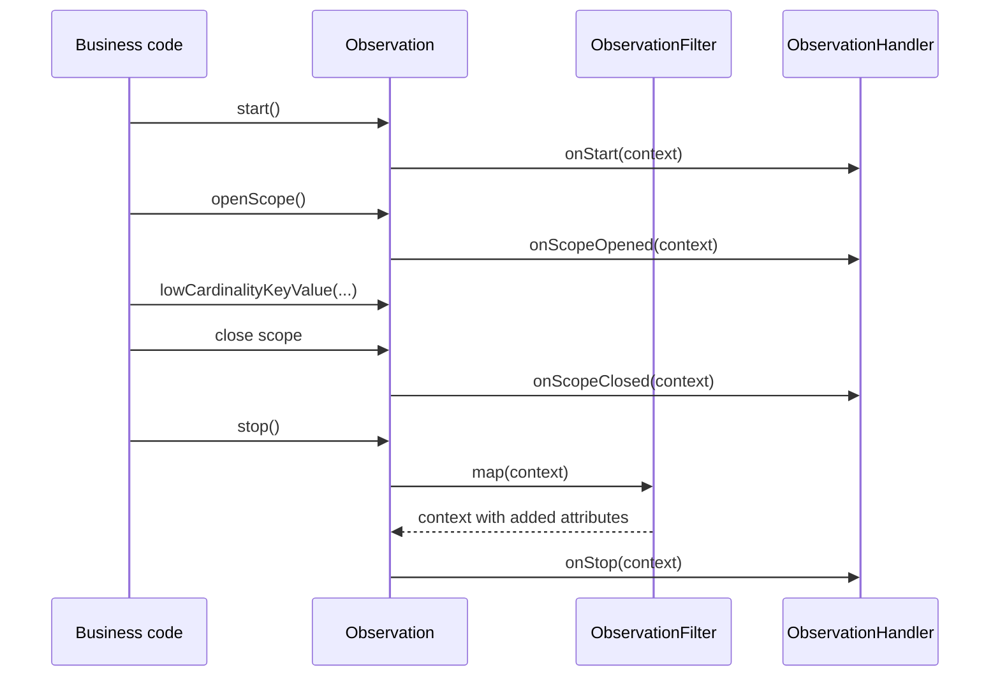
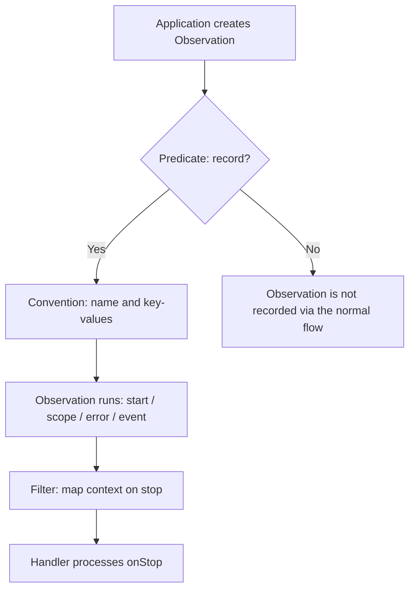
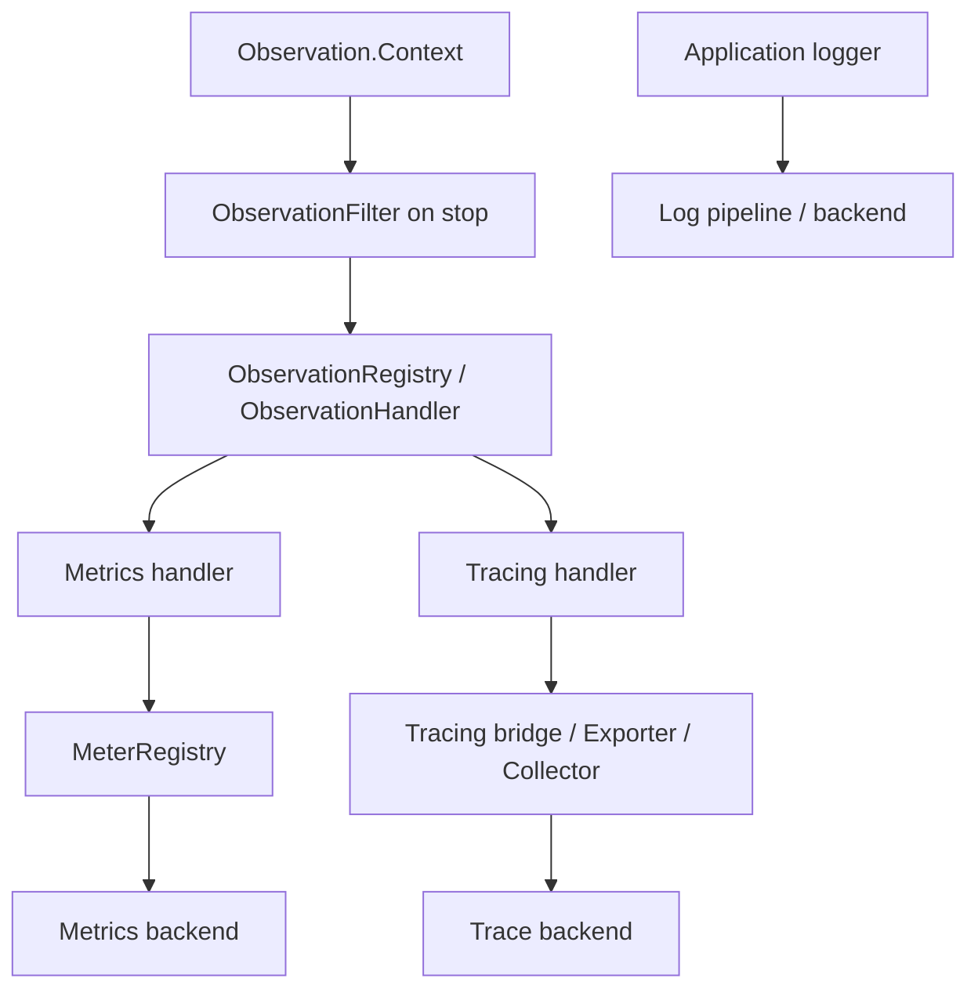

# ObservationFilter: enriching and normalizing observation context

When a Spring Boot application handles `POST /checkout`, observations across the controller, service, and HTTP client may carry different names and tags. To analyze p95 latency, error rates, or request behavior across environments, operations teams often want to add a common attribute such as `deployment.environment=staging` or `service.domain=checkout` to related observations. Copying tag-addition logic into every method causes duplication and inconsistency.

Micrometer Observation's **`ObservationFilter`** lets you **transform `Observation.Context` through a rule registered on `ObservationRegistry`**. It is suited for conditionally adding key-values and normalizing shared attributes. This lesson belongs to the **Convention and filter** chapter of the **SPRING_BOOT_OBSERVABILITY** module, within the scope of building Spring Boot observability using Micrometer Observation, metrics, logs, and distributed tracing.

We will look at when a filter runs, how it differs from `ObservationConvention` and `ObservationPredicate`, how to register and test it, and how it relates to cardinality, context propagation, exporters, sampling, and correlating signals when investigating errors and latency in production systems.

## 1. What does ObservationFilter actually do?

An `Observation` represents an activity with a lifecycle, a name, and a context. `Observation.Context` holds information such as name, key-values, errors, and processing data. The `ObservationFilter` interface accepts a context and returns the mapped context:

```java
import io.micrometer.common.KeyValue;
import io.micrometer.observation.Observation;
import io.micrometer.observation.ObservationFilter;

ObservationFilter environmentFilter = context -> {
    context.addLowCardinalityKeyValue(
        KeyValue.of("deployment.environment", "staging"));
    return context;
};
```

In this example, the filter adds an environment label to the observation. It **does not directly emit** metrics, spans, or logs; those signals depend on handlers, registries, bridges, exporters, and application configuration.

The easiest mistake to make: the word "filter" here **does not mean dropping an observation** the way a servlet filter rejects a request. `ObservationFilter` is primarily used to **modify/enrich the context**. To decide whether an observation is recorded at all, look at `ObservationPredicate`. To deny a meter, look at Micrometer Metrics' `MeterFilter`.

| Need | Right tool |
| --- | --- |
| Add `deployment.environment` to observations | `ObservationFilter` |
| Standardize name, contextual name, and key-values for an instrumentation type | `ObservationConvention` |
| Decide whether an observation is recorded or not | `ObservationPredicate` |
| React when an observation starts, stops, errors, or emits an event | `ObservationHandler` |
| Rename/retag or accept/deny a meter | `MeterFilter` |
| Keep only a fraction of traces to reduce cost | Sampler in the tracing stack |

## 2. Execution timing in the Observation lifecycle

In Micrometer Observation's standard execution flow, `ObservationFilter` is applied **when the observation stops**, before the handler's `onStop` callback. This differs from adding key-values right when the observation is created.



This diagram illustrates an observation with a scope; not every operation needs to open a scope. Exact callbacks and implementation details depend on the Micrometer/handler version, but the difference between data available **at start** and data enriched **at stop** is critical.

Consequences:

1. Filters are suitable for attributes needed when the observation **completes**, such as stable deployment labels, outcomes attached during processing, or grouping metadata.
2. A filter does not retroactively add information to `onStart`, previously written log lines, or spans already initialized earlier.
3. A metrics handler recording a Timer when the observation stops can see the newly added low-cardinality tags. A tracing handler may read context across multiple callbacks; check the specific implementation.
4. The Observation must be properly `stop()`ped. Use `try/finally` or `observe(...)` to end the lifecycle even when an exception occurs.
5. A filter does not open trace scopes, propagate context across threads/HTTP, or alter tracing sampling.

## 3. Example: tagging filter for the checkout group

Suppose checkout operations have names starting with `checkout.`. We want to automatically add `service.domain=checkout` and the deployment environment, while not adding those tags to inventory observations.

```java
import io.micrometer.common.KeyValue;
import io.micrometer.observation.Observation;
import io.micrometer.observation.ObservationFilter;

public final class CheckoutObservationFilter implements ObservationFilter {
    private final String environment;

    public CheckoutObservationFilter(String environment) {
        this.environment = environment;
    }

    @Override
    public Observation.Context map(Observation.Context context) {
        String name = context.getName();
        if (name != null && name.startsWith("checkout.")) {
            context.addLowCardinalityKeyValue(
                KeyValue.of("service.domain", "checkout"));
            context.addLowCardinalityKeyValue(
                KeyValue.of("deployment.environment", environment));
        }
        return context;
    }
}
```

The choices in this snippet are deliberate:

- `environment` is passed through the constructor, fitting stable deployment metadata; do not use a mutable field shared across requests.
- Filtering by operation name restricts the filter's scope.
- Both new keys use small value sets, suitable for grouping metric queries.
- The filter returns the context for subsequent processing.
- Tag names are standardized in one place; dashboards do not have to deal with variants like `env`, `environment`, and `deployment_env`.

If another instrumentation across the system already sets `service.domain`, check for conflicts before adding it again. Duplicate keys with different values can behave unpredictably depending on the API and application order.

### Registering with Micrometer ObservationRegistry

```java
import io.micrometer.observation.Observation;
import io.micrometer.observation.ObservationRegistry;

ObservationRegistry registry = ObservationRegistry.create();
registry.observationConfig()
    .observationFilter(new CheckoutObservationFilter("test"));

Observation.createNotStarted("checkout.payment.authorize", registry)
    .lowCardinalityKeyValue("outcome", "accepted")
    .observe(() -> {
        // Observed business operation.
    });
```

The registry in this example has a filter, yet **is not connected to any metrics or tracing handler**. Therefore running this snippet does not guarantee a Timer on a dashboard or a span in a tracing backend. `ObservationFilter` adjusts observation data, while handlers and exporters decide where data goes.

## 4. Registering a filter in a Spring Boot application

In many Spring Boot 3.x projects with Actuator/Micrometer, you can declare `ObservationFilter` as a Spring bean so observability auto-configuration registers it on the managed `ObservationRegistry`:

```java
import io.micrometer.observation.ObservationFilter;
import org.springframework.beans.factory.annotation.Value;
import org.springframework.context.annotation.Bean;
import org.springframework.context.annotation.Configuration;

@Configuration(proxyBeanMethods = false)
public class ObservabilityConfiguration {
    @Bean
    ObservationFilter checkoutObservationFilter(
            @Value("${app.telemetry.environment:local}") String environment) {
        return new CheckoutObservationFilter(environment);
    }
}
```

```yaml
app:
  telemetry:
    environment: staging
```

In the Java code above, `@Value` reads `app.telemetry.environment`, defaulting to `local` when unset. **Verify whether your running Spring Boot version auto-registers `ObservationFilter` beans.** For manually constructed registries or custom setups, you may need to register the filter explicitly via `registry.observationConfig().observationFilter(...)` during initialization.

Notable configuration pitfalls:

- The filter is registered on registry A, while the service injects registry B.
- The filter is added per request, leading to duplicate registrations and unpredictable behavior.
- Spring may have multiple instrumentation setups or registries; a filter bean might not affect pipelines outside that `ObservationRegistry`.
- An environment value is determined by the first request and stored in a singleton filter, causing subsequent requests to see the wrong value.

For per-request attributes, place them on **each observation's** `Observation.Context` or in an appropriate custom context/convention. A singleton filter cannot reliably access request-scoped data across all threads. If using asynchronous execution, apply proper context propagation.

## 5. Distinguishing Convention, Filter, Predicate, and Handler

These four components have related but distinct responsibilities:

| Component | Typical responsibility | Example |
| --- | --- | --- |
| **`ObservationConvention`** | Provides name and key-values per the contract of an observation type | Naming HTTP server observations by route template |
| **`ObservationFilter`** | Enriches and maps the context at the completion stage | Adding `deployment.environment` |
| **`ObservationPredicate`** | Decides whether to record an observation | Dropping an unnecessary group of instrumentations |
| **`ObservationHandler`** | Processes callbacks and emits observability signals | Metrics handler or tracing handler |



The diagram depicts **high-level roles**, not every internal callback. Handlers may have already received `onStart` before the filter runs.

**Distinguishing via real requirements:**

- "I want to drop metrics or observations for health checks": identify the right filtering layer and consider `ObservationPredicate` or `MeterFilter` depending on the signal to suppress.
- "I want HTTP span names to follow the route template": this belongs to instrumentation conventions and `ObservationConvention`; adding a tag at the end of the lifecycle does not guarantee renaming a span created at start.
- "I want every checkout Timer to carry the environment label": `ObservationFilter` paired with the right metrics handler is a good fit.
- "I want to react when an observation fails": `ObservationHandler.onError` or error-handling code; a filter does not replace error callbacks.

## 6. How does ObservationFilter differ from MeterFilter?

`ObservationFilter` belongs to `io.micrometer.observation` and operates on **observation contexts**. `MeterFilter` belongs to `io.micrometer.core.instrument.config` and operates on **meter registration and configuration**. Despite both having "filter" in their names, their scopes are completely different.

| Scenario | Right class |
| --- | --- |
| Add a common tag to an operation's observation context | ObservationFilter |
| Accept/deny a specific meter | MeterFilter |
| Rename/retag metrics during meter registration | MeterFilter |
| Create a Counter for a business event | Micrometer Metrics API / MeterRegistry |
| Retain only 10% of traces | Tracing sampler |
| Write a log when a business event occurs | Logger or appropriate logging handler |

Adding a tag to an observation does not automatically alter meters registered earlier; conversely, `MeterFilter` does not modify tracing span attributes. To understand where a change takes effect, identify **which data layer it acts upon**.

## 7. Cardinality and data safety

Micrometer distinguishes:

- **Low-cardinality key-values**: small value sets useful for grouping metrics, such as `outcome=accepted/rejected/error`, `service.domain=checkout`.
- **High-cardinality key-values**: larger value sets, sometimes useful on traces for investigating individual requests; still require size limits and sensitive-data safeguards.

For metrics, time-series count depends on the number of **combinations** of label values. If `environment` has 3 values, `domain` has 4, and `outcome` has 3, those labels alone can generate up to **3 × 4 × 3 = 36 combinations**, before counting service, instance, or registry labels.

Adding `orderId`, `customerId`, or `requestId` to low-cardinality tags can cause combinations to grow with every request. If a global filter adds such tags across hundreds of operations, storage costs and metrics system load can surge.

```java
// Avoid: a new label for almost every request.
context.addLowCardinalityKeyValue(
    KeyValue.of("request.id", requestId));

// May be suitable if channel belongs to a fixed set of values.
context.addLowCardinalityKeyValue(
    KeyValue.of("request.channel", "web"));
```

These lines **illustrate tag selection**, not a complete Java method. For user or transaction IDs, use business data systems or correlation/tracing mechanisms designed with proper authorization and data handling. Do not put tokens, passwords, emails, or personal information into tags simply because a `highCardinalityKeyValue` API exists.

Before adding a key-value via a filter, verify:

1. How many distinct values will the label have in production?
2. Is a tag with the same name already set by Spring Boot, a convention, or another filter?
3. Does the information need to appear in metrics, traces, logs, or only one signal?
4. Is the required data already available when the filter runs?
5. Are data protection, retention limits, or access controls needed?

## 8. Real-world impact on metrics, traces, and logs

`ObservationFilter` does not talk to backends directly; it enriches the context for other components to consume.



Simplified diagram of data flow when an observation stops. In practice, metrics/tracing handlers may have already processed earlier callbacks before this point.

**Metrics:** when `DefaultMeterObservationHandler` is wired to `MeterRegistry`, a Timer is recorded when the observation stops. Low-cardinality tags added by the filter can become Timer labels. Metric series names exported to Prometheus or another backend may be converted per registry rules and units.

**Traces:** a tracing handler can turn key-values into span attributes. However, a span is usually created when the observation starts, whereas the filter applies when stopping. Consequently, changing names/tags via a filter **does not guarantee** identical behavior across all tracing bridges; inspect exported span data and how your handler treats attributes on stop.

**Logs:** application logs are written by a logger or dedicated logging handler. A filter does not emit logs on its own and does not update log lines written earlier. Log-to-trace correlation normally relies on `traceId` and `spanId` in the logging context while a scope is active.

**Sampling:** a trace can still be dropped from storage even when the observation is created and the filter runs. Sampling sits at the tracing layer; adding more tags or filters will not "save" a trace that was not sampled.

**Propagation:** a filter does not carry context across HTTP, message brokers, or executors. You need sender/receiver instrumentation, headers like W3C `traceparent`, or async context capture/restore mechanisms. Application metadata placed on an observation does not automatically become propagated baggage either.

## 9. Multiple filters: responsibility, ordering, and concurrency

A single registry can hold multiple `ObservationFilter` instances for region, tenant tier, environment, or business groups. This works well when rules are independent, but avoid these pitfalls:

- Two filters both setting `deployment.environment` with different values.
- Filter A assuming Filter B already ran, without an explicit ordering contract.
- A filter calling a database, network service, or blocking operation inside `map`, adding latency to the observation path.
- A singleton filter storing a mutable `currentUserId`, mixing data across concurrent requests.
- A filter adding tags from unnormalized inputs or arbitrary user-supplied data.

Keep filters **short, focused, and effectively stateless**, performing pure context mapping. Finite-value metadata like `environment` can be an immutable field; per-request data belongs in the respective context. For complex naming conventions, use a proper `ObservationConvention` rather than stacking filters.

Because different handlers can read context at different stages, test the interaction between filters and metrics/tracing handlers on your target version. Do not rely on undocumented side effects.

## 10. Testing filters with an in-memory registry

You can verify exact metric labels emitted by an observation **without Prometheus or a collector**. Example using JUnit 5, `SimpleMeterRegistry`, and `DefaultMeterObservationHandler`, with `CheckoutObservationFilter` from section 3:

```java
import io.micrometer.core.instrument.Timer;
import io.micrometer.core.instrument.observation.DefaultMeterObservationHandler;
import io.micrometer.core.instrument.simple.SimpleMeterRegistry;
import io.micrometer.observation.Observation;
import io.micrometer.observation.ObservationRegistry;
import org.junit.jupiter.api.Test;
import static org.junit.jupiter.api.Assertions.*;

class CheckoutObservationFilterTest {
    @Test
    void enrichesOnlyCheckoutObservations() {
        try (SimpleMeterRegistry meters = new SimpleMeterRegistry()) {
            ObservationRegistry observations = ObservationRegistry.create();
            observations.observationConfig()
                .observationFilter(new CheckoutObservationFilter("test"))
                .observationHandler(
                    new DefaultMeterObservationHandler(meters));

            Observation.createNotStarted(
                    "checkout.payment.authorize", observations)
                .lowCardinalityKeyValue("outcome", "accepted")
                .observe(() -> {
                    // Execute an operation.
                });

            Timer checkout = meters.find("checkout.payment.authorize")
                .tag("service.domain", "checkout")
                .tag("deployment.environment", "test")
                .tag("outcome", "accepted")
                .timer();

            assertNotNull(checkout);
            assertEquals(1L, checkout.count());

            Observation.createNotStarted(
                    "inventory.stock.check", observations)
                .observe(() -> {
                    // Does not belong to checkout group.
                });

            assertNull(meters.find("inventory.stock.check")
                .tag("service.domain", "checkout")
                .timer());
        }
    }
}
```

The test proves the filter ran on the checkout observation, the metrics handler observed the new labels, and the filter did not attach checkout domain labels to the inventory operation. It **does not prove** that the trace backend received attributes, logs were correlated, or exporters work.

Do not assert exact millisecond durations: real timings fluctuate with CPU/JIT/scheduler noise. Asserting `Timer.count()`, metric names, and tags is much more reliable. With a Spring Boot context, add an integration test verifying the filter bean is registered on the **right registry** and auto-configuration does not disable the instrumentation under test.

### Testing when a filter is applied

To verify lifecycle timing, register a custom `ObservationHandler` that snapshots key-values in `onStart` and `onStop`. With the filter in section 3, `deployment.environment` may be absent at start, yet present when the handler receives stop. This test prevents assuming a filter makes tags visible to every handler when the observation starts.

Create a fresh registry per test. When using `@SpringBootTest`, note that Spring Test can cache the `ApplicationContext`, sharing the registry bean and state across tests.

## 11. Real-world scenario: checkout dashboard missing the environment tag

**Hypothetical scenario:** after a deployment, p95 of `checkout.payment.authorize` in staging jumps from around 250 ms to 1.5 seconds. Metrics and traces are being collected, yet the dashboard lacks `deployment.environment`, making staging and production hard to separate.

A sound investigation workflow:

1. **Verify the source metric.** Find the checkout Timer in `MeterRegistry` and inspect its current tags to avoid drawing conclusions from a broken dashboard query.
2. **Check the filter bean.** Was `CheckoutObservationFilter` created and attached to the registry that the service uses?
3. **Check the filter condition.** Does the actual observation name start with `checkout.`? A convention or instrumentation might emit a different name.
4. **Check the lifecycle.** Was the observation properly `stop()`ped? Did the metrics handler record the Timer into the registry?
5. **Check names and cardinality.** Is another filter overwriting `environment` or attaching IDs as low-cardinality tags?
6. **Check the exporter.** If the registry has the tag but the backend does not, check relabeling, mapping, collector, storage, and query syntax.
7. **Investigate latency.** Once environments are separated, correlate p95/error-rate metrics with traces and logs sharing the same Trace ID to check for payment timeouts, retries, or downstream issues.

A filter helps **group measurements**, not fix latency by itself. Adding a new dimension can increase total time series; evaluate the impact on resources and dashboards.

If the Timer has `deployment.environment=staging` while a specific trace lacks that attribute, do not jump to concluding the filter failed to run. The tracing handler may read context at a different point, the trace may have been dropped by sampling, or the collector may rewrite/drop attributes. Check each pipeline stage before changing code.

## 12. Common pitfalls and fixes

| Symptom | Possible cause | How to check |
| --- | --- | --- |
| Filter not applied | Not registered or service uses another registry | Check beans, injected registry, and startup wiring |
| Tag missing in `onStart` | Filter applies near the stop phase | Set the tag earlier if handlers need it at start |
| Wrote a filter to drop observations, metric still appears | Confused `ObservationFilter` with predicate | Use `ObservationPredicate` or meter-level filtering |
| Time-series count surges | Tag contains request ID/user ID | Enforce low-cardinality labels |
| One attribute has multiple names | Convention and filter disagree | Define a naming contract and audit tags |
| Metrics have tag, traces do not | Handlers read context at different times or exporter behaves differently | Check bridge, sampling, span attributes, and collector |
| No new logs after adding filter | Filter does not emit logs | Use appropriate logging instrumentation and correlation |
| Filter slows down requests | Contains I/O or blocking operations in `map` | Keep filters lightweight with no downstream calls |
| Unit test passes, staging lacks tag | Unit test did not cover Spring wiring/exporter | Add integration tests at the proper layer |

## 13. Self-check exercises

**Exercise 1.** You want every checkout observation to carry `deployment.environment=production`. What do you use? What if you only want to adjust labels during meter registration?

*Hint:* `ObservationFilter` fits observation contexts; `MeterFilter` fits the meter layer. Choose based on the signal and layer you need to affect.

**Exercise 2.** A developer writes an `ObservationFilter` to drop observations for `GET /actuator/health`, yet the metric still exists. Why?

*Hint:* This filter has no contract for rejecting observations. Look at `ObservationPredicate` or the corresponding instrumentation/meter filter mechanism.

**Exercise 3.** The tracing handler does not see the new tag in `onStart`, whereas the metrics Timer has the tag at `onStop`. Is that definitely a bug?

*Hint:* No. Filter execution timing and when each handler reads context can explain the difference.

**Exercise 4.** A filter adds `customerId` as a low-cardinality tag. What happens at a scale of 100,000 users?

*Hint:* Time-series combinations grow rapidly, alongside data exposure risks. Use finite labels; per-transaction lookup belongs in appropriate mechanisms.

**Exercise 5.** A unit test with `SimpleMeterRegistry` shows the new label, yet staging spans lack it. Name at least three checks to perform.

*Hint:* Tracing handler/bridge, when context is read, sampling, exporter/collector, attribute mapping, and backend.

**Exercise 6.** Why should you avoid adding a filter to `ObservationRegistry` on every request?

*Hint:* The registry is shared configuration; repeated registration causes duplicate processing, extra overhead, and inconsistent behavior.

## 14. Key takeaways

- **`ObservationFilter`** maps `Observation.Context`, typically when the observation **stops**, before `onStop`; it is not a filter that drops observations.
- **`ObservationConvention`** defines naming/tagging rules; **`ObservationPredicate`** decides whether to record; **`MeterFilter`** acts at the meter layer.
- Filters suit **stable, low-cardinality labels**, while avoiding duplicate tags, unique IDs, sensitive data, and shared mutable state.
- Filters **do not write logs, configure exporters, propagate trace context, or control sampling**. Metrics, traces, and logs require their own handlers and pipelines.
- Use **`ObservationRegistry` + `SimpleMeterRegistry` + `DefaultMeterObservationHandler`** for fast unit verification; add integration tests to verify Spring Boot wiring and exported output.
