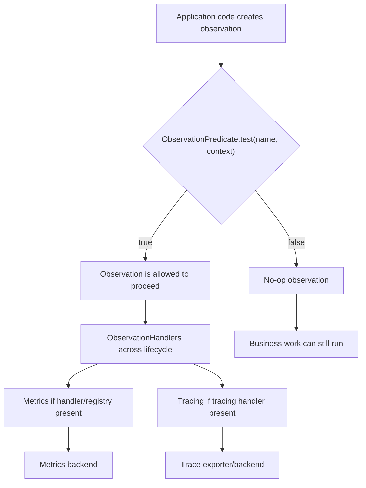

# ObservationPredicate

In the **Convention and filter** chapter of the **SPRING_BOOT_OBSERVABILITY** module, `ObservationPredicate` is the mechanism that decides **whether an observation is recorded through Micrometer Observation or not**. It is especially useful when a Spring Boot application generates high-frequency activities with little diagnostic value, such as a continuously repeating internal heartbeat task.

The goal of observability is to connect **metrics, logs, and distributed tracing** to pinpoint errors, latency, and application behavior in production. Collecting more data is not always better: low-value observations can clutter dashboards, increase metric/trace costs, and drown out important signals. `ObservationPredicate` lets you make an early exclusion decision right at the Observation layer. However, exclusion must be deliberate because it can deprive you of data needed during incident investigation.

## 1. Learning objectives

After this lesson, you will be able to:

1. Explain the role of `ObservationPredicate` and the meaning of `true` / `false` return values.
2. Register a predicate with `ObservationRegistry` and use it in Spring Boot configuration.
3. Distinguish `ObservationPredicate`, `ObservationFilter`, `ObservationConvention`, `ObservationHandler`, and tracing sampling.
4. Choose stable exclusion conditions that do not depend on information unavailable when the observation is created.
5. Understand how a predicate affects metrics and tracing, as well as what it does **not** do to logs and business execution.
6. Verify the behavior of an exclusion rule without accidentally dropping critical signals.
7. Evaluate trade-offs among data reduction, cardinality, traceability, and operational safety.

## 2. Problem: noise from internal operations

Suppose `payment-api` has two kinds of work:

- `payment.authorize`: an important business transaction whose latency and errors must be monitored.
- `internal.cache.heartbeat`: a cache status check running every few seconds that already has a separate health monitoring channel.

If both are instrumented with observations, both can emit timing metrics and tracing spans. As instance count grows, heartbeats can consume a significant share of telemetry volume, whereas operations teams primarily care whether payment transactions fail or slow down.

The appropriate requirement is: **keep observations for payment transactions, drop observations for the internal heartbeat**. We do not want to stop the heartbeat itself, nor do we want to disable all tracing for the application.



The diagram depicts the decision at the Micrometer Observation layer. Concrete signals are emitted only when matching handlers and pipelines exist; even an allowed observation is not guaranteed to have its span exported if sampling drops it or an exporter fails.

## 3. The `ObservationPredicate` API

In Micrometer Observation, `ObservationPredicate` is a functional interface with this core contract:

```java
import io.micrometer.observation.Observation;
import io.micrometer.observation.ObservationPredicate;

ObservationPredicate predicate =
        (String name, Observation.Context context) -> {
            return !"internal.cache.heartbeat".equals(name);
        };
```

The predicate's abstract method receives the **observation name** and **`Observation.Context`** and returns a boolean:

| Result | Meaning in registry | Typical effect |
| --- | --- | --- |
| `true` | Allows the observation to proceed through the Observation pipeline. | Handlers can record metrics, spans, or handle callbacks depending on configuration. |
| `false` | Rejects this observation; Micrometer uses a no-op observation for the excluded case. | No telemetry is emitted by those handlers for the rejected observation lifecycle. |

The rule in the example only rejects observations named exactly `internal.cache.heartbeat`. All other names are allowed.

A few easily misunderstood points:

- A predicate **does not prevent a Java method or HTTP endpoint from executing**. It governs observation, not business execution rights.
- A predicate **does not suppress log lines** written directly by the application; logs may still be emitted, though correlation fields like span ID may differ when the observation is dropped.
- A predicate **is not a security filter**, nor does it automatically redact emails, tokens, or personal data.
- A predicate **does not determine tracing sampling probability**; it drops observations at an earlier layer than trace keep/drop policies.
- If a metric is recorded directly via `MeterRegistry` rather than through an observation handler, an Observation predicate **does not automatically block that direct metric**.

Observation names must be handled carefully. Writing `name.equals(...)` can throw if `name` is unexpectedly null; `"literal".equals(name)` is a clean, null-safe pattern.

## 4. Registering a predicate with `ObservationRegistry`

The registry holds handlers, conventions, filters, and predicates used during instrumentation. In minimal Micrometer Java code, you can register one like this:

```java
import io.micrometer.observation.Observation;
import io.micrometer.observation.ObservationRegistry;

ObservationRegistry registry = ObservationRegistry.create();

registry.observationConfig()
        .observationPredicate(
                (name, context) ->
                        !"internal.cache.heartbeat".equals(name)
        );

Observation permitted =
        Observation.createNotStarted("payment.authorize", registry);

Observation excluded =
        Observation.createNotStarted("internal.cache.heartbeat", registry);
```

This snippet demonstrates configuring a standalone registry. In a Spring Boot application using Actuator, **customize the registry managed by Spring Boot** so HTTP and custom observations share the configuration; do not create an extra standalone registry unless scoping demands it.

### Registering in Spring Boot via a customizer

Example for a Spring Boot 3.x configuration with `spring-boot-starter-actuator`:

```groovy
dependencies {
    implementation 'org.springframework.boot:spring-boot-starter-actuator'
}
```

```java
import io.micrometer.observation.ObservationRegistry;
import org.springframework.boot.actuate.autoconfigure.observation.ObservationRegistryCustomizer;
import org.springframework.context.annotation.Bean;
import org.springframework.context.annotation.Configuration;

@Configuration(proxyBeanMethods = false)
public class ObservationPolicyConfiguration {

    @Bean
    ObservationRegistryCustomizer<ObservationRegistry> observationPolicy() {
        return registry -> registry.observationConfig()
                .observationPredicate((name, context) ->
                        !"internal.cache.heartbeat".equals(name));
    }
}
```

`ObservationRegistryCustomizer` registers the rule on the registry configured by Spring Boot. This example assumes Spring Boot 3.x with Actuator; verify exact package/API names against your Spring Boot version. Predicates should be registered **before the observations to be filtered are created** so earlier executions do not slip through and emit telemetry.

Suppose a service performs two operations:

```java
import io.micrometer.observation.Observation;
import io.micrometer.observation.ObservationRegistry;
import org.springframework.stereotype.Service;

@Service
public class PaymentWorkflow {

    private final ObservationRegistry registry;
    private final PaymentGateway gateway;
    private final HeartbeatClient heartbeat;

    public PaymentWorkflow(ObservationRegistry registry,
                           PaymentGateway gateway,
                           HeartbeatClient heartbeat) {
        this.registry = registry;
        this.gateway = gateway;
        this.heartbeat = heartbeat;
    }

    public PaymentResult authorize(PaymentRequest request) {
        return Observation.createNotStarted("payment.authorize", registry)
                .lowCardinalityKeyValue("operation", "authorize")
                .observe(() -> gateway.authorize(request));
    }

    public void checkCacheHeartbeat() {
        Observation.createNotStarted("internal.cache.heartbeat", registry)
                .observe(heartbeat::check);
    }

    public interface PaymentGateway {
        PaymentResult authorize(PaymentRequest request);
    }

    public interface HeartbeatClient {
        void check();
    }

    public record PaymentRequest(String operationRef) {}
    public record PaymentResult(boolean accepted) {}
}
```

`PaymentGateway` and `HeartbeatClient` are illustrative interfaces implemented by the application. After registering the predicate:

- `authorize(...)` still runs and the `payment.authorize` observation can produce measurements.
- `checkCacheHeartbeat()` **still calls `heartbeat.check()`**. The observation part represented by `internal.cache.heartbeat` is excluded from the Observation pipeline.
- If `heartbeat.check()` writes a log, increments a direct counter, or invokes a separately instrumented HTTP client, those independent signals **do not automatically disappear** just because the enclosing observation was rejected.

Evaluate any instrumentations inside the filtered method: a predicate only rejects observations matching its own condition. If a task emits multiple observations with different names, filtering on the parent name does not necessarily drop independently instrumented child observations.

## 5. When is the rule evaluated?

`ObservationPredicate` participates in the **observation creation decision** in the registry, before a rejected observation runs the normal lifecycle. Therefore, do not design a predicate around an attribute added **after calling `createNotStarted(...)`**.

An easy-to-get-wrong example:

```java
Observation observation =
        Observation.createNotStarted("gateway.call", registry)
                .lowCardinalityKeyValue("traffic", "synthetic");

observation.observe(() -> gateway.call());
```

If a predicate tries to drop `traffic=synthetic`, that value may **not exist in the context when the predicate is evaluated**, because `lowCardinalityKeyValue(...)` happens after `createNotStarted(...)` returns. As a result, the rule may fail to behave as intended.

Proper approaches:

1. **Prefer distinct observation names** when two activities have different semantics, such as `internal.synthetic.gateway-call` and `gateway.call`.
2. If you must rely on context data, create a **custom `Observation.Context` holding the decision data up front** and use the observation creation overload accepting a context/supplier when supported by the API and instrumentation.
3. For HTTP server observations, rely only on fields guaranteed to be available when the predicate runs; check the exact context type and instrumentation in use before reading route, URI, or request metadata.
4. If the goal is simply to enrich or adjust tags before export, use `ObservationFilter` or an appropriate convention instead of forcing a predicate on a decision that arrives too late.

**Important scenario:** `http.server.requests` is often the observation name across many routes. If you write:

```java
(name, context) -> !"http.server.requests".equals(name)
```

you can accidentally drop **all** HTTP server observations instead of a single probe path. Making route-based decisions requires a rule that understands the request context type, what data is already populated, and the impact on HTTP monitoring. Never apply a global filter without verifying its scope.

## 6. How does `ObservationPredicate` differ from `ObservationFilter`?

Both APIs affect observations, yet serve two different purposes.

| Criterion | `ObservationPredicate` | `ObservationFilter` |
| --- | --- | --- |
| Core question | **Should this activity be observed?** | **Should the context of an already-observed activity be adjusted/enriched?** |
| Processing style | Returns a `boolean` from name and context. | Receives and returns the processed `Observation.Context`. |
| Timing | Early, when the registry evaluates creating the observation. | During the observation lifecycle, typically before completion/stop processing. |
| Can drop the entire observation? | Yes, by returning `false`. | Not designed to drop an entire observation. |
| Best-fit scenario | Dropping an unnecessary observation with early-known conditions. | Adding `outcome`, normalized labels, or metadata computed after execution. |
| Risk when misused | Losing metrics/traces for critical operations. | Attaching wrong labels, high cardinality, or modifying context too late for a specific handler. |

For example, an observation filter can add a finite-value label once an outcome has been added to the context:

```java
registry.observationConfig().observationFilter(context -> {
    if ("payment.authorize".equals(context.getName())) {
        context.addLowCardinalityKeyValue(
                io.micrometer.common.KeyValue.of("domain", "payment"));
    }
    return context;
});
```

This is an **illustrative example of `ObservationFilter`**, not something you need to deploy alongside this lesson's predicate if your only goal is dropping heartbeats. A filter can unify labels, but rules must be designed not to insert duplicate labels or disallowed data.

### Compared with `ObservationConvention`

`ObservationConvention` defines how to name and map a context into key-values for an observation type. It fits when you want multiple `payment.authorize` instrumentation sites to share the same naming and tagging contract.

`ObservationPredicate` does not replace a convention: a predicate decides **allow or drop**, whereas a convention decides **how to describe the observation** when it exists.

### Compared with `ObservationHandler`

`ObservationHandler` handles lifecycle callbacks and can produce measurements or spans. The predicate evaluates before the observation enters the normal lifecycle. If no handler is registered, an observation allowed by the predicate still may **not emit the expected telemetry**.

### Compared with `MeterFilter` and tracing sampling

`MeterFilter` operates at the **metrics registry** layer: it can deny meters or adjust meter metadata. It does not automatically suppress observation tracing spans. Conversely, `ObservationPredicate` rejects at the Observation layer, so it can simultaneously affect both metrics and tracing produced by that observation.

**Tracing sampling** decides which traces are recorded or retained according to the tracing stack's sampling policy. When you only want to reduce trace volume while preserving metrics for important transactions, consider **tracing sampling** rather than using an observation predicate to drop the entire observation. Head sampling, collector tail sampling, exporters, and backends are separate mechanisms from predicates.

```text
Micrometer Observation
  ├─ ObservationPredicate: drop or allow observation
  ├─ ObservationFilter/Convention: enrich, normalize context
  └─ ObservationHandler
       ├─ Metrics handler -> meter registry -> MeterFilter -> metrics backend
       └─ Tracing handler -> tracing sampler -> exporter/collector -> trace backend
```

This diagram is a conceptual model; exact callback ordering and how sampling is applied depend on versions, handlers, and pipelines. Do not treat this diagram as a contract guaranteeing custom callback ordering.

## 7. Combining multiple predicates: keeping policy understandable

When multiple components register `ObservationPredicate` instances, the combined rule can become hard to follow. A safe mental model is that **every predicate must agree** for the observation to proceed; a single rejection can drop the observation.

Example with two conditions:

```java
registry.observationConfig()
        .observationPredicate((name, context) ->
                !"internal.cache.heartbeat".equals(name))
        .observationPredicate((name, context) ->
                !"internal.debug.poll".equals(name));
```

The intent is to drop two internal names and allow everything else. In real environments, group rules with shared intent together or document ownership clearly to catch conflicts easily, especially when libraries register customizers on their own.

Risk-reduction principles:

- Use exact names or a controlled name set; avoid overly broad checks like `contains("health")` or `startsWith("http")`.
- Do not add a predicate returning `true` expecting it to "override" another predicate that is returning `false`.
- Keep metric/observation names stable; base decisions on predictable conditions.
- Document why an observation is excluded and which alternative signal still monitors that activity.
- Register policies at application startup rather than mutating predicates continuously per request state.

A poorly written predicate can drop data before it ever reaches the registry or exporter; **you cannot recover traces that were never created** by tweaking dashboards later.

## 8. Cardinality is not the only reason to exclude

High-cardinality tags are a major observability problem, yet not every case should be solved with `ObservationPredicate`.

For example, suppose a system emits:

```text
payment.authorize{paymentId="unique-id-1"}
payment.authorize{paymentId="unique-id-2"}
payment.authorize{paymentId="unique-id-3"}
```

If you use a predicate to drop all `payment.authorize` observations, you reduce metric volume at the cost of losing visibility into payment errors and latency. The right fix is keeping the observation and fixing the **key-value design**:

```java
Observation.createNotStarted("payment.authorize", registry)
        .lowCardinalityKeyValue("operation", "authorize")
        .lowCardinalityKeyValue("provider", "bank-a")
        .observe(() -> paymentGateway.authorize(request));
```

Names and low-cardinality tags should have a finite value set. Fields such as `paymentId`, `userId`, email, raw URLs containing IDs, or tokens do not belong in metric tags and carry privacy risks. If a detailed value is genuinely needed for tracing, evaluate `highCardinalityKeyValue(...)`, data policies, and backend cost separately; a predicate is not a redaction mechanism.

Three common choices:

| Need | Appropriate mechanism |
| --- | --- |
| Drop a low-value observation type identifiable early | `ObservationPredicate` |
| Keep the observation but avoid exporting high-cardinality labels | Fix instrumentation/convention/filter and tag design |
| Keep transaction metrics while reducing trace volume | Tracing sampling / tracing pipeline |

Choosing the wrong mechanism causes unnecessary data loss, especially for rare incidents or issues affecting a small customer segment.

## 9. Impact on logs and context propagation

When Spring Boot has Micrometer Tracing integrated, an allowed observation can create a tracing span. Inside its scope, logs can receive `traceId` and `spanId` via MDC. If a predicate rejects an observation, there is no span for that observation to act as its own context.

However:

- A request may still have a **parent span** from the HTTP server observation; logs inside a dropped operation can continue using the parent context if it remains active.
- If the logging framework is called directly, `logger.info(...)` or `logger.error(...)` calls still execute.
- If trace context was already propagated from upstream, dropping a child observation does not mean every other trace context disappears.
- Accidentally disabling HTTP server observations can severely impair correlation across the entire request.

Similarly, one service can call another over HTTP using the W3C `traceparent` header. Client span creation and propagation depend on client instrumentation and the currently active context; filtering an outer observation does not guarantee all dependency spans vanish, or vice versa. Inspect live traces whenever exclusion rules interact with distributed tracing boundaries.

Predicates are not for fixing broken propagation. If a trace splits at a hop, inspect HTTP client instrumentation, thread/async context propagation, message headers, sampling, and exporters; never add filtering rules to mask missing traces.

## 10. Evaluating in a test environment

A verification procedure after adding `ObservationRegistryCustomizer`:

1. Start the application with Actuator and the appropriate metrics handler/registry. Verify an **allowed** operation actually creates a timing metric.
2. Invoke `payment.authorize` several times with successes and controlled errors; record the exported metrics.
3. Invoke `internal.cache.heartbeat` several times. Confirm the heartbeat **still executes**, while no telemetry is produced by the rejected observation through the corresponding handlers.
4. When a tracing bridge and exporter are present, inspect a request containing both allowed and excluded operations: the trace should preserve the necessary business spans.
5. Inspect logs, correlation, and application health monitoring. Confirm dropping the observation does not erase critical diagnostic evidence.
6. Check latency/error rates before and after the change to catch side effects. Expand filtering policies based on test evidence, not a gut feeling that "too many spans means waste."

You can configure Prometheus for a test environment:

```groovy
dependencies {
    implementation 'io.micrometer:micrometer-registry-prometheus'
}
```

```yaml
management:
  endpoints:
    web:
      exposure:
        include: health,metrics,prometheus
```

After running the operations, inspect actual metric names:

```bash
curl -s http://localhost:8080/actuator/metrics
curl -s http://localhost:8080/actuator/prometheus
```

A missing metric alone is **not enough** to conclude the predicate is working: handlers, meter registry, traffic, or exporter might be misconfigured. First verify the **allowed** case produces data, then compare with the **excluded** case under the same conditions. Protect Actuator with appropriate network/authorization policies rather than leaving management endpoints public.

To verify behavior at the code level, a concise test can register the predicate on a standalone `ObservationRegistry` and verify code inside `observe(...)` still runs even when the observation is rejected. In this lesson, we focus on workflow and examples; building an automated test suite for a specific project is a separate step.

## 11. Common pitfalls

| Symptom | Possible cause | Resolution |
| --- | --- | --- |
| After adding predicate, all HTTP metrics vanish | Overly broad filter on `http.server.requests` name. | Narrow the condition using the right context; verify critical routes. |
| Predicate fails to drop requests with expected tag | Tag was added after the predicate was already evaluated. | Use data available at context creation or distinguish by observation name. |
| Predicate returns `false`, yet logs still appear | Predicate does not control the logger. | Adjust logging configuration if logs genuinely need limiting. |
| Metric still appears after dropping observation | Metric is recorded directly on meter registry or by another observation. | Identify the telemetry source, handler, and metric name. |
| No traces even for allowed group | Tracing bridge, sampler, exporter, or backend misconfigured. | Check the tracing pipeline independently before blaming the predicate. |
| Missing child span while HTTP span remains | Child observation was dropped while server observation remained allowed. | Inspect span structure and confirm whether the effect is intentional. |
| Some instances still emit heartbeat spans | Registry policy not applied uniformly or config not loaded before observation creation. | Compare versions/configs and initialization order across instances. |
| Data lost for rare failing requests | Predicate dropped an important observation. | Restore proper collection policy; do not use predicates in place of smart sampling. |

## 12. Real-world incident investigation scenario

A deployment causes P95 of `POST /payments/authorize` to rise from 250 ms to 1.4 seconds. The system has a predicate dropping `internal.cache.heartbeat` while keeping `payment.authorize`.

A sound investigation path:

1. **Metrics** identify which route has elevated latency, 5xx rate, request volume, and start timestamp.
2. `payment.authorize` metrics isolate whether latency lies inside payment business logic or another HTTP layer.
3. **Logs** contain timeout/retry error details and `traceId` if tracing integration supplied context.
4. **Distributed tracing** shows `payment.authorize` beneath the server span; subsequent client spans pinpoint the slow dependency.
5. If traces are unexpectedly missing, check **predicates first** to verify no rule change accidentally dropped `payment.authorize`; then check sampler, collector, exporter, and context propagation.
6. After tuning the system or reverting a faulty rule, compare metrics across many requests to verify the fix.

The decisive point is knowing **which signals were intentionally excluded**. Investigators must not misread "no heartbeat span" as "heartbeat is not running"; nor should they sacrifice payment spans just to make dashboards quieter.

## 13. Self-check exercises

### Exercise 1: Interpreting boolean logic

```java
registry.observationConfig().observationPredicate(
        (name, context) -> !name.startsWith("internal.")
);
```

**Question:** How are `internal.cache.heartbeat`, `payment.authorize`, and `internal.reconciliation` handled?

**Answer:** Both names starting with `internal.` are rejected; `payment.authorize` is allowed. This rule is overly broad if `internal.reconciliation` is an important job that needs monitoring. Prefer an explicit allowlist/denylist of specific names that may be excluded.

### Exercise 2: Distinguishing predicate from filter

An application wants to keep `payment.authorize` while adding `outcome=success/error` once the result is known. Is a predicate appropriate?

**Answer:** Not the right tool. Predicates accept or reject observations. Record outcome on the context during the lifecycle or use an appropriate `ObservationFilter`/convention; verify cardinality and when handlers read tags.

### Exercise 3: Data available at creation time

```java
Observation obs = Observation.createNotStarted("gateway.call", registry);
obs.lowCardinalityKeyValue("kind", "synthetic");
obs.observe(this::callGateway);
```

**Question:** Can you rely on a predicate reading `kind` to see `synthetic`?

**Answer:** No. The tag is added after `createNotStarted` returns; the predicate decides earlier. Switch to a distinct name or pass decision data in the context at creation time using the appropriate API.

### Exercise 4: Why do logs still appear?

After the predicate rejects `internal.cache.heartbeat`, operators still see `INFO heartbeat check passed`. Is this a bug in the predicate?

**Answer:** No. A predicate governs observations, not the logger. Check where the log is emitted and whether log levels or logging policies should be adjusted. If the log carries a `traceId` from a parent HTTP observation, that does not prove the heartbeat observation created a span either.

### Exercise 5: Reducing traces while keeping metrics

A service wants to keep latency metrics for all `payment.authorize` calls while storing only a fraction of distributed traces. Should it use a predicate returning `false` for 90% of calls at random?

**Answer:** Avoid doing that. That rule drops the entire observation for the rejected 90%, so metrics produced by Observation handlers no longer reflect total traffic. Use proper **tracing sampling** configuration to reduce trace volume while keeping complete metrics.

## 14. Checklist before shipping rules to production

- [ ] Predicate drops only observations with clearly documented names/scopes and clear ownership.
- [ ] Condition depends on data already available when the registry decides whether to accept the observation.
- [ ] Does not accidentally drop all `http.server.requests` or essential business operations.
- [ ] Alternative metrics/health signals exist for excluded internal tasks if operations still need them.
- [ ] Observation policy is clearly separated from tracing sampling, `MeterFilter`, and logging.
- [ ] Predicate is not used to hide cardinality issues caused by poor tag design.
- [ ] Both allowed and excluded cases have been verified in the same environment.
- [ ] Impact on parent/child spans, log correlation, and cross-service propagation has been observed.
- [ ] Exclusion rationale, configuration location, and rollback steps are documented for investigations.
- [ ] Error rate/latency of critical operations are monitored after rollout.

**Remember:** `ObservationPredicate` is an **early observation exclusion tool at the registry** based on name and context, used to cut low-value measurements. Returning `false` does not block business execution and is neither a trace sampling mechanism nor a log filter. In Spring Boot, using predicates with clear intent—paired with conventions/filters to standardize labels and tracing sampling to control cost—keeps metrics, logs, and distributed tracing trustworthy when investigating errors, latency, or application behavior.
