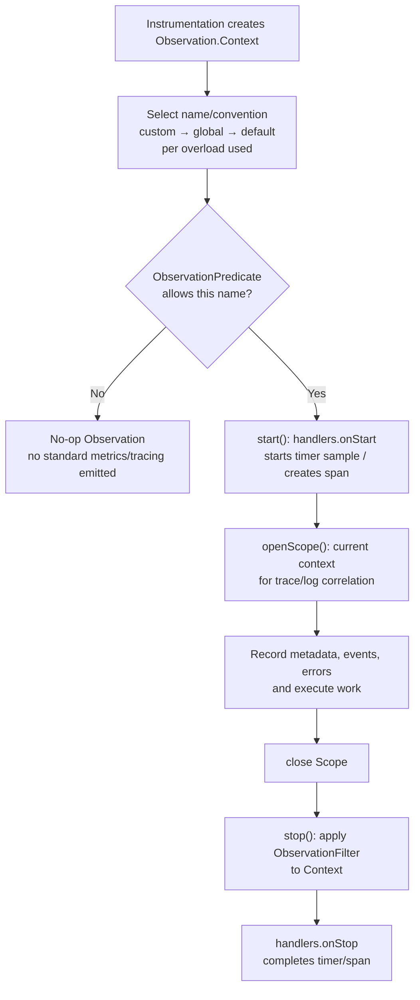
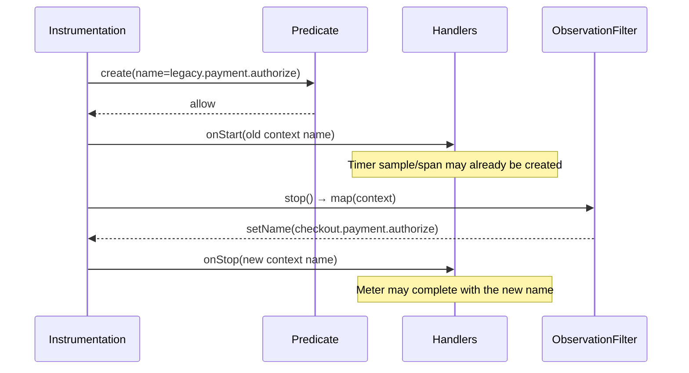
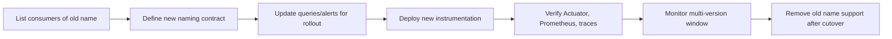

# Renaming an observation name

One day after deploying a new Spring Boot version, the payment processing duration chart suddenly stops showing data. The API still returns responses, logs still record requests, and some traces still appear. Upon investigation, the operations team discovers the metric name changed from `payment.authorize` to `checkout.payment.authorize`, while PromQL queries and alerts still look up the old name.

This change illustrates that **an observation name is part of the telemetry contract**. Renaming can clarify what work is being done or align conventions, yet it simultaneously affects dashboards, alerts, historical comparability, and correlation between metrics and traces.

The **Renaming an observation name** lesson belongs to the **Convention and filter** chapter in the **SPRING_BOOT_OBSERVABILITY** module. The module aims to establish observability in Spring Boot using **Micrometer Observation, metrics, logs, and distributed tracing**; mastering context propagation, tags/cardinality, exporters, sampling, and signal correlation to investigate errors, latency, and real-world application behavior. In this lesson, we focus on **where and when to rename properly while keeping signals consistent**.

## 1. Learning objectives

After this lesson, you will be able to:

1. Distinguish **observation name**, **contextual name/span name**, Micrometer meter name, and exported metric name.
2. Choose the right renaming approach for a custom observation, a Spring Framework-created observation, or an entire group of observations.
3. Explain the order in which `ObservationConvention`, `ObservationPredicate`, `ObservationFilter`, and `ObservationHandler` take effect.
4. Understand why renaming in an `ObservationFilter` at `stop()` can be too late for certain handlers.
5. Design conventions with stable names, finite tags, and preserved measurement semantics.
6. Verify metrics/traces after renaming and migrate dashboards, alerts, and SLOs without losing data or double-counting.

## 2. Which name are we actually changing?

An Observation represents an instrumented activity, such as "authorizing a payment." It may be handled by multiple handlers to record a timer, create a span, or perform other actions. Consequently, not every string seen in an observability system is the exact same "name."

| Concept | Example | Meaning | When changed |
|---|---|---|---|
| **Observation name** | `payment.authorize` | Technical name of the **operation type**, used by Micrometer handlers. | Can change timer/meter names and how components identify the observation. |
| **Contextual name** | `authorize payment` | Contextual operation name, used by tracing handlers to name spans where applicable. | Usually affects how spans are grouped/searched in the trace backend. |
| **Timer name in MeterRegistry** | `payment.authorize` | Meter name created by the metrics handler from observation and convention. | Affects lookups via `/actuator/metrics`. |
| **Exporter series name** | `payment_authorize_seconds_count` | Name converted and suffixed by the registry/exporter. | Affects PromQL, recording rules, and alerts. |
| **Tag/attribute** | `payment.method=card`, `outcome=approved` | Data describing a measurement; groups series by value. | Changing keys/values can also break existing queries. |
| **Trace ID / span ID** | Execution identifiers | Used to correlate spans and logs of a single call. | Not for holding operation names and never used as metric tags. |

Example:

```text
Code:
  Observation name  = checkout.payment.authorize
  Contextual name   = authorize payment
  Low-cardinality   = payment.method:card, outcome:approved

Actuator /metrics:
  checkout.payment.authorize

Prometheus, with standard timer renaming rules:
  checkout_payment_authorize_seconds_count
  checkout_payment_authorize_seconds_sum

Trace backend, when tracing handler is present:
  span name = authorize payment
  attributes may include payment.method=card
```

These Prometheus names **illustrate** common conversion rules. Final names depend on the backend, version, and configuration; always inspect `/actuator/prometheus` or actual collector output.

### 2.1 Two distinct renames

```java
Observation.createNotStarted("checkout.payment.authorize", registry)
        .contextualName("authorize payment")
        .observe(this::callPaymentProvider);
```

- Changing the string passed to `createNotStarted(...)` **renames the observation name**.
- Changing `contextualName(...)` primarily **renames the span display name** as used by the tracing handler.

If you change only `contextualName`, do not expect a `payment.authorize` timer to switch to `checkout.payment.authorize`. If you change only the observation name, the span name may remain unchanged when tracing is configured to use the contextual name.

## 3. Why must renaming be treated as a contract change?

Suppose the previous version measured `checkout.authorize` and the new version measures `payment.authorize`, with identical measurement boundaries. Observable consequences include:

- In `MeterRegistry`, the old name stops receiving data once old instances shut down; the new name starts receiving data.
- Dashboards and alerts filtering on the exact old name look as if "the system has stopped receiving requests."
- SLOs using the old metric may stop evaluating, or fall back to an incorrect expression and produce wrong numbers.
- Span queries by operation name may break if the contextual name or tracing convention also changed.
- `ObservationPredicate` rules, sampling/filtering, or name-based custom logic may be impacted.
- During a rolling deployment, **both names exist simultaneously**. Combining both must avoid double-counting a single execution.

Not every rename preserves semantics. If `checkout.process` previously measured the entire checkout flow while the new version measures only the payment provider call, the boundary has changed. In that case, **a new name is warranted**, and historical data cannot be directly compared even if you kept the same name.

Core rule: **a stable name for an operation type with a stable boundary**. Never embed order IDs, user IDs, raw URLs, timestamps, or retry counts into the name to avoid high cardinality.

## 4. Which renaming mechanism should you choose?

| Need | Preferred change point | Reason |
|---|---|---|
| Self-instrumented business snippet | Rename in `Observation.createNotStarted(name, registry)` | Controlled right at observation creation; easy to manage. |
| Multiple call sites sharing one context type | `ObservationConvention` bound to context | Centralizes name, contextual name, and key-values. |
| Default convention exists, app needs to override | Custom convention passed to factory or `GlobalObservationConvention` with matching `supportsContext` | Replaces via Micrometer mechanism; avoids late renaming. |
| Rename Spring Boot HTTP server/client with property support | Corresponding `management.observations.*.name` property | Uses auto-instrumentation extension points. |
| Control both name and metadata of framework-created HTTP | Stack-appropriate `ServerRequestObservationConvention` / `ClientRequestObservationConvention` | Applies the instrumentation's native convention. |
| Only edit key-values after operation completes | `ObservationFilter` | Post-processes context before `onStop`. |
| Disable a group of observations | `ObservationPredicate` or corresponding enable property | **Not** a renaming feature. |
| Only rename meters exported to a metrics backend | Meter-level customization, if available and appropriate | Changes metrics only; risks divergence from tracing and observation semantics. |

**Rule of thumb:** When you need to rename an observation consistently across its entire lifecycle, prefer doing so **at observation creation or convention selection**. Use `ObservationFilter` to enrich/adjust metadata late in the lifecycle; if you must change `Context.name` in a filter, understand the limitations covered next.

## 5. Lifecycle order determines the outcome of renaming

Micrometer Observation involves registries, contexts, conventions, predicates, handlers, and filters. They participate at **different points in time**.



Note: this diagram shows the general logic. The **custom/global/default convention** selection order depends on which `createNotStarted(...)` overload is used and how the registry is configured; some overloads only use the caller-supplied convention. Exact handler callbacks also depend on which handlers are registered.

### 5.1 ObservationConvention: naming from the start

`ObservationConvention` has these primary methods:

```java
String getName();
String getContextualName(T context);
KeyValues getLowCardinalityKeyValues(T context);
KeyValues getHighCardinalityKeyValues(T context);
boolean supportsContext(Observation.Context context);
```

These values form the naming and metadata contract of an observation type. With factories supporting custom/default/global conventions, the name from the convention is selected before deciding whether to create a real observation or a no-op.

This makes it the right place to design **names, labels, and measurement semantics together**.

### 5.2 ObservationPredicate: decision at creation time

`ObservationPredicate` has the signature:

```java
boolean test(String observationName, Observation.Context context);
```

If a predicate returns `false`, Micrometer can create a no-op observation. The predicate receives the name **at creation/evaluation time**, before filters run at stop.

For example, a predicate rejecting `legacy.payment.authorize` will act on the old name even if an `ObservationFilter` later intends to change the context name. Therefore, **never assume renaming in a filter will alter initial predicate classification**.

### 5.3 ObservationFilter: editing context near the end of the lifecycle

`ObservationFilter` has `map(Observation.Context context)`, called before `ObservationHandler.onStop(...)`. You can write:

```java
context.setName("new.observation.name");
```

This is **valid at the Context API level**, and Spring Framework documentation includes an example of it. However, handlers have already received `onStart`, a handler may already have created and named a span, while another handler uses the name when recording a meter at `onStop`. Changing `Context.name` at this stage can cause:

- The metric timer to receive the new name at `onStop`;
- The span to be created with the old name or contextual name resolved at `onStart`;
- Predicates, other handlers, or earlier logic to have already acted on the old name.

The degree of impact **depends on the handler and version**. Thus, a filter can suit specific post-processing needs, but **there is no guarantee all signals get renamed in sync**.

### 5.4 ObservationHandler is not where you redefine contracts

A custom `ObservationHandler` can read `Context` and perform custom work. Do not rename inside a handler just to avoid updating instrumentation or conventions, because handler ordering and callbacks can yield unpredictable outcomes. When consistent naming is the goal, use a convention.

## 6. Approach 1: renaming a custom observation directly

For application-owned code, the simplest option is updating the constant name and checking all consumption points.

```java
import io.micrometer.observation.Observation;
import io.micrometer.observation.ObservationRegistry;
import org.springframework.stereotype.Service;

@Service
public class PaymentService {
    public static final String AUTHORIZE_OBSERVATION =
            "checkout.payment.authorize";

    private final ObservationRegistry registry;
    private final PaymentGateway gateway;

    public PaymentService(ObservationRegistry registry, PaymentGateway gateway) {
        this.registry = registry;
        this.gateway = gateway;
    }

    public boolean authorize(PaymentRequest request) {
        String method = switch (request.method()) {
            case CARD -> "card";
            case WALLET -> "wallet";
            case TRANSFER -> "transfer";
        };

        return Observation.createNotStarted(AUTHORIZE_OBSERVATION, registry)
                .contextualName("authorize payment")
                .lowCardinalityKeyValue("payment.method", method)
                .observe(() -> gateway.authorize(request));
    }
}

enum PaymentMethod { CARD, WALLET, TRANSFER }
record PaymentRequest(PaymentMethod method, String orderReference) {}
interface PaymentGateway {
    boolean authorize(PaymentRequest request);
}
```

**Explanation:**

1. `AUTHORIZE_OBSERVATION` is a fixed string representing the type of work.
2. `PaymentMethod` is normalized into three valid values for a low-cardinality tag.
3. `request.orderReference()` can vary per request without changing the observation name.
4. `contextualName("authorize payment")` can remain stable so spans stay readable even if the timer is renamed.
5. `observe(...)` manages start, scope, exceptions, and stop for **synchronous** execution.

This illustrative snippet requires a bean implementing `PaymentGateway` and an appropriate caller in a real application. If `gateway.authorize` returns `false` when payment is declined without throwing an exception, that may be a normal business result; to break down approved vs. declined, design an explicit finite outcome metric/tag rather than creating a new name per order.

**When should you avoid this approach?** If multiple classes instrument the same activity type, updating scattered string literals easily misses call sites. Use a shared convention instead.

## 7. Approach 2: renaming via ObservationConvention

For complex business logic, placing names and metadata in a convention centralizes renaming so it can be reviewed independently of processing code.

### 7.1 Declaring context and convention

```java
import io.micrometer.common.KeyValue;
import io.micrometer.common.KeyValues;
import io.micrometer.observation.Observation;
import io.micrometer.observation.ObservationConvention;

final class PaymentAuthorizationContext extends Observation.Context {
    private final String paymentMethod;

    PaymentAuthorizationContext(String paymentMethod) {
        this.paymentMethod = paymentMethod;
    }

    String paymentMethod() {
        return paymentMethod;
    }
}

final class PaymentAuthorizationConvention
        implements ObservationConvention<PaymentAuthorizationContext> {

    @Override
    public boolean supportsContext(Observation.Context context) {
        return context instanceof PaymentAuthorizationContext;
    }

    @Override
    public String getName() {
        // New name, used for this operation type.
        return "checkout.payment.authorize";
    }

    @Override
    public String getContextualName(PaymentAuthorizationContext context) {
        return "authorize payment";
    }

    @Override
    public KeyValues getLowCardinalityKeyValues(
            PaymentAuthorizationContext context) {
        return KeyValues.of(
                KeyValue.of("payment.method", context.paymentMethod()));
    }
}
```

### 7.2 Using the convention when creating observations

```java
import io.micrometer.observation.Observation;
import io.micrometer.observation.ObservationRegistry;

public final class PaymentInstrumenter {
    private static final PaymentAuthorizationConvention CONVENTION =
            new PaymentAuthorizationConvention();

    private final ObservationRegistry registry;

    public PaymentInstrumenter(ObservationRegistry registry) {
        this.registry = registry;
    }

    public boolean recordAuthorization(String normalizedMethod,
                                       java.util.function.BooleanSupplier operation) {
        PaymentAuthorizationContext context =
                new PaymentAuthorizationContext(normalizedMethod);

        return Observation.createNotStarted(
                    CONVENTION,
                    () -> context,
                    registry)
                .observe(operation::getAsBoolean);
    }
}
```

Here `normalizedMethod` must be constrained to a finite set (`card`, `wallet`, `transfer`, `other`). If a customer ID or arbitrary request string is passed into `payment.method`, cardinality will still explode even with a fixed observation name.

For one execution:

```text
Observation name: checkout.payment.authorize
Contextual name:  authorize payment
Low-cardinality:  payment.method=card
```

When you later want to rename to `payment.provider.authorize`, you update `getName()` and follow the migration process below. Call sites no longer need to know the exact name string.

### 7.3 Custom, global, and default conventions

Micrometer supports convention selection under this model:

```text
Custom convention passed directly to observation
        ↓ if absent
GlobalObservationConvention matching Context
        ↓ if absent
Default convention provided by instrumentation
```

**Condition:** this order applies to factory overloads supporting both custom and default conventions. If you call an overload taking **only one** convention, that convention is used directly; do not assume a global convention always overrides it. Read the exact overload called by the instrumentation or library.

`GlobalObservationConvention` is useful when customizing multiple observations of **the same context type** on a registry. Define `supportsContext(...)` strictly to avoid overriding names of unrelated operations. An overly broad global convention can merge distinct operation types into one name.

Spring Boot automatically registers `GlobalObservationConvention`, `ObservationFilter`, `ObservationPredicate`, and `ObservationHandler` beans with the auto-configured `ObservationRegistry`. However, merely declaring a convention bean does not guarantee arbitrary instrumentation will pick it up; that depends on the API/factory used by the instrumentation.

### 7.4 When you need to preserve default semantics

If a library already has a solid default convention, you can override only `getName()` and inherit the tag and contextual name methods:

```java
// Example with an application-designed custom convention:
final class RenamedPaymentConvention
        extends DefaultPaymentAuthorizationConvention {

    @Override
    public String getName() {
        return "checkout.payment.authorize";
    }
}
```

`DefaultPaymentAuthorizationConvention` in this example is a **hypothetical application class**, not a Micrometer API. For Spring Framework's HTTP server, there is a real class `DefaultServerRequestObservationConvention` that can be extended as shown next.

## 8. Approach 3: renaming Spring Boot-instrumented HTTP observations

The HTTP server is already measured by Spring Framework, typically under `http.server.requests` when using Micrometer conventions. You do not need to create manual Observations in every controller to rename it.

### 8.1 Using properties for HTTP server/client

In Spring Boot versions supporting these properties:

```yaml
management:
  observations:
    http:
      server:
        requests:
          name: "api.http.server.requests"
      client:
        requests:
          name: "api.http.client.requests"
```

These correspond to:

- `management.observations.http.server.requests.name` — HTTP server observation name.
- `management.observations.http.client.requests.name` — HTTP client observation name.

For example, when server metrics are exported to Prometheus, a new timer may produce `api_http_server_requests_seconds_count` instead of `http_server_requests_seconds_count`. **Do not assume this exact name before checking the exporter.**

If you only want to rename HTTP metrics using built-in rules, properties are simpler than writing a custom filter. Always verify your **Spring Boot version** and active semantic conventions: when OpenTelemetry conventions are enabled, some meter-name properties may **no longer apply**.

### 8.2 Renaming with a Spring MVC convention

When deeper contract customization is needed, extend Spring MVC's default convention:

```java
import org.springframework.http.server.observation.DefaultServerRequestObservationConvention;

public final class ApiServerRequestObservationConvention
        extends DefaultServerRequestObservationConvention {

    @Override
    public String getName() {
        return "api.http.server.requests";
    }
}
```

In Spring Boot, register a bean of type `ServerRequestObservationConvention` so auto-configuration wires it into HTTP server instrumentation per your version's documentation. Example declaration:

```java
import org.springframework.context.annotation.Bean;
import org.springframework.context.annotation.Configuration;
import org.springframework.http.server.observation.ServerRequestObservationConvention;

@Configuration(proxyBeanMethods = false)
class HttpObservationConfiguration {
    @Bean
    ServerRequestObservationConvention apiHttpConvention() {
        return new ApiServerRequestObservationConvention();
    }
}
```

If your application uses **WebFlux**, choose the corresponding classes in `org.springframework.http.server.reactive.observation`; do not mistakenly use Servlet conventions for reactive stacks. When building a custom HTTP filter/tooling, register the convention with the exact instrumentation that creates the observation.

**Note on tags:** extending the default convention and overriding only `getName()` preserves default low/high-cardinality key-values. If you implement the convention from scratch, ensure essential metadata such as HTTP method, status, outcome, and URI template are preserved; never put concrete URLs into low-cardinality tags.

### 8.3 Switching conventions from Micrometer to OpenTelemetry

Some Spring Boot versions allow:

```yaml
management:
  observations:
    conventions: open-telemetry
```

This switches the **semantic conventions suite**, which can change both names and tag/attribute sets—for example, HTTP server observations may use `http.server.request.duration` instead of `http.server.requests` under the corresponding convention.

Never treat switching convention suites as a single string rename. Inspect all dashboards, alerts, SLOs, exporter output, and trace queries. With OpenTelemetry conventions, Spring Boot documentation notes that certain custom meter name properties no longer take effect.

## 9. Approach 4: renaming with ObservationFilter is possible, but know the limits

Micrometer allows filters to modify `Observation.Context` before calling `onStop` handlers. This is helpful when normalizing or enriching metadata at the end of an operation:

```java
import io.micrometer.observation.Observation;
import io.micrometer.observation.ObservationFilter;
import org.springframework.stereotype.Component;

@Component
public final class RenameLegacyPaymentFilter implements ObservationFilter {

    @Override
    public Observation.Context map(Observation.Context context) {
        if ("legacy.payment.authorize".equals(context.getName())) {
            context.setName("checkout.payment.authorize");
        }
        return context;
    }
}
```

Spring Boot automatically registers `ObservationFilter` beans with its `ObservationRegistry`. The snippet above illustrates `Context.setName(...)`, **not the recommended way to perform consistent renaming across all signals**.

### 9.1 What happens before the filter runs?

Suppose an observation is created with the name `legacy.payment.authorize`.



This is exactly why you should not rely on a filter to rename both **tracing span names** and metrics consistently. Predicates already evaluated the old name; some handlers already acted on the old name in `onStart`. If the tracer uses the resolved contextual name, calling `setName` at `onStop` may not change the span name you see.

### 9.2 When is a filter appropriate?

- Adding a final result tag (`outcome=approved/declined`) when full context is available at the end of the activity.
- Removing a sensitive high-cardinality key before handlers finish, when meeting the system's data policy.
- Normalizing shared metadata into a finite set of values.
- In a system where you **control all handlers** and have thoroughly verified consequences, adjusting context name at stop can serve as a targeted transition mechanism.

If your intent is "every handler knows the new name as soon as the work starts," fix it **at observation creation or in the convention**. Do not push all renaming onto a filter merely because `setName` exists.

### 9.3 Distinguishing ObservationPredicate and MeterFilter

`ObservationPredicate` decides whether to enable/disable an observation at creation time; it **does not rename**. Spring Boot also provides `management.observations.enable.*` properties to disable groups of observations by name prefix.

`MeterFilter` is a **MeterRegistry-layer** API that can alter a meter/identifier or metric labels, yet it does not rename observations, spans, or logs. It is a separate option when you only want to transform metrics, and requires evaluating whether it introduces divergence across signals.

## 10. Right name, wrong cardinality can still break things

Renaming from `legacy.payment.authorize` to `checkout.payment.authorize` helps if the new naming contract is clearer. However, dynamic names or uncontrolled low-cardinality tags can still overload the system.

| Component | Good design | Dangerous design |
|---|---|---|
| Observation name | `checkout.payment.authorize` | `checkout.payment.authorize.ORD-982734` |
| Contextual name/span name | `authorize payment` | `authorize order ORD-982734 for customer 123` |
| Low-cardinality | `payment.method=card`, `outcome=approved` | `user.id=982734`, `email=...` |
| HTTP route tag | `uri=/orders/{id}/pay` | `uri=/orders/982734/pay` |
| High-cardinality trace attribute | Business ID if genuinely needed and approved | Secrets, passwords, tokens, personal data without justification |

Suppose an observation has 3 `channel` values × 4 `payment.method` values × 3 `outcome` values, yielding at most 36 theoretical tag combinations. Adding an `orderId` with 100,000 values can push potential combinations to 3.6 million. Embedding IDs in meter names creates the same fragmentation effect.

Practical rules:

1. **Fix names by operation type**, not per execution.
2. **Low-cardinality keys** must have finite, normalized value sets.
3. **High-cardinality keys** belong in traces only when justified by diagnostic value, data protection policies, and acceptable cost.
4. Never put tokens, cookies, emails, credentials, or sensitive request bodies into names/tags/traces/logs.
5. Never attach `traceId`/`spanId` as metric tags; use them for correlation in logs/traces.

If you want to split metrics by `approved` vs. `declined`, consider an `outcome` tag or dedicated business counters instead of arbitrarily renaming the observation per outcome.

## 11. Verifying a rename in Spring Boot

There are three places to cross-check after renaming.

### 11.1 In the application: Actuator metrics

Example dependencies when Spring Boot manages versions:

```groovy
dependencies {
    implementation 'org.springframework.boot:spring-boot-starter-actuator'
    runtimeOnly 'io.micrometer:micrometer-registry-prometheus'
}
```

Local configuration:

```yaml
management:
  endpoints:
    web:
      exposure:
        include: "health,metrics,prometheus"
```

After triggering the corresponding business/HTTP flow **at least once**:

```bash
curl http://localhost:8080/actuator/metrics
curl http://localhost:8080/actuator/metrics/checkout.payment.authorize
curl http://localhost:8080/actuator/prometheus
```

Verify:

- Does `/actuator/metrics` show the new name? Does the old name still appear from another instance or call site?
- Does the timer under the new name have the expected count and duration? Are required tags preserved?
- What exact series names and units appear in Prometheus output? Are histograms enabled if dashboards compute p95?
- Are endpoints exposed properly and secured appropriately?

Note: `/actuator/metrics` does not emit Prometheus format by default. `/actuator/prometheus` requires the Prometheus registry and matching exposure. In production, do not open management endpoints to all clients just for diagnostics.

### 11.2 In the trace backend

When Micrometer Tracing, a tracer implementation, exporter, backend, and suitable sampling are configured:

1. Send a request through the instrumented business flow.
2. Search for the trace by time range, service, and route; use a Trace ID from logs if available.
3. Inspect the span name and attributes, comparing against the expected contextual name.
4. Verify the same Trace ID propagates to downstream dependencies over HTTP or messaging if supported by your stack.
5. Do not assume "no trace" means the rename failed: the trace may have been dropped by sampling or failed at the exporter/collector.

A rename in `ObservationFilter` where metrics show the new name while spans keep the old name can be a natural consequence of **when the filter runs**, not necessarily a broken tracing pipeline.

### 11.3 Testing with a standalone registry

You can create an `ObservationRegistry` and `SimpleMeterRegistry` without any external backend to verify the contract:

```java
import io.micrometer.core.instrument.simple.SimpleMeterRegistry;
import io.micrometer.core.instrument.observation.DefaultMeterObservationHandler;
import io.micrometer.observation.Observation;
import io.micrometer.observation.ObservationRegistry;

public class RenameContractCheck {
    public static void main(String[] args) {
        SimpleMeterRegistry meters = new SimpleMeterRegistry();
        ObservationRegistry observations = ObservationRegistry.create();

        observations.observationConfig()
                .observationHandler(
                        DefaultMeterObservationHandler.builder(meters).build());

        Observation.createNotStarted("checkout.payment.authorize", observations)
                .lowCardinalityKeyValue("payment.method", "card")
                .observe(() -> { });

        long count = meters.get("checkout.payment.authorize")
                .tag("payment.method", "card")
                .timer()
                .count();

        if (count != 1L) {
            throw new AssertionError("Wrong observation name or count");
        }

        System.out.println("New observation name recorded once");
        meters.close();
    }
}
```

This test only proves the **metrics handler layer** records a timer with the new name when the observation completes; it does not prove span names or propagation. To test multiple handlers, add suitable tracing test instrumentation and assert span names separately.

In real systems, add tests verifying tag set stability, absence of dynamic names, single instrumentation per request, and compatibility with critical dashboards/alerts.

## 12. Migration: renaming without losing operational visibility

Renaming in production should be a planned change, especially for metrics backing SLOs and alerts.

### 12.1 Pre-change checklist

- What are the old and new names? Did measurement boundaries change?
- Which services/versions emit that observation?
- Which dashboards, PromQL queries, recording rules, alerts, SLOs, and runbooks reference the old name?
- Are tags, units, or conventions changing at the same time?
- Does the trace backend search by contextual name or observation name?
- Do any sampling, exporter, or filter rules depend on the old name?
- Will rollout run multiple versions side by side, and is every request measured once?

### 12.2 Rollout steps



**Step 1: Define the contract.** Document the new name, start/stop boundaries, span name, tags, and units. If semantics changed, explicitly state that historical data is not directly comparable.

**Step 2: Prepare consumers.** Update queries to support both old and new names while multiple versions run concurrently. Ensure alerts have no blind spots during deployment.

**Step 3: Roll out gradually.** Monitor instances emitting the new name. During a rolling deployment, seeing both names temporarily is expected.

**Step 4: Verify.** Compare traffic volume, latency, errors, tags, trace names, and dashboards. If total request rate unexpectedly doubles, check for duplicate instrumentation.

**Step 5: Clean up the old contract.** Once old versions are retired and historical data ages out per retention, remove fallback queries and outdated documentation.

### 12.3 PromQL during the transition

If every request is **recorded by exactly one of the two metrics** and both meters share identical semantics:

```promql
sum(rate(payment_authorize_seconds_count[5m]))
+
sum(rate(checkout_payment_authorize_seconds_count[5m]))
```

This sum is accurate only when there is no double-counting and boundaries match. If a release emits **both observations on the same request** for "backward compatibility," summing will double request counts. It is better for each application version to emit one clean signal per contract while consumers handle a controlled rollout.

To compare p95 during a rename, **do not average the p95 values** of the two groups. Aggregate histogram buckets with matching definitions and valid labels, then recompute `histogram_quantile`. If two versions use different bucket boundaries or units, normalize before aggregating.

### 12.4 Rollback scenario

When rolling back to an older version, the old metric name can reappear. If dashboards were already switched exclusively to the new name, visibility will vanish again. Supporting both old and new names in dashboards and alerts across the expected rollout and rollback window is essential.

## 13. Three common investigation scenarios

### Scenario A: metrics changed name, tracing still uses the old name

**Symptom:** `/actuator/metrics` shows `checkout.payment.authorize`, yet in Zipkin/Tempo the span name is still `authorize payment` or an old name.

Questions to check:

1. Did the application **rename only the observation name** while intentionally keeping the old contextual name?
2. Is an `ObservationFilter` calling `context.setName(...)` at stop?
3. Does the tracing handler choose the span name at `onStart` or use the contextual name?
4. Does the observed trace actually come from the newly deployed version?

**Likely conclusion:** the difference is expected per contract; to change the span name, update `contextualName` or the corresponding tracing convention. Do not "fix" it by embedding IDs in the name.

### Scenario B: empty dashboard after enabling OTel conventions

**Symptom:** `http_server_requests_seconds_count` returns no data, even though requests are arriving.

Checks:

1. Was `management.observations.conventions=open-telemetry` enabled or were semantic conventions switched?
2. How did metric names, keys, and units change?
3. Is the query filtering on old labels like `uri` while the new convention uses different keys?
4. Is there an exporter/scrape failure, or simply a schema change?

**Action:** compare actual exporter output before and after, then update recording rules, SLOs, and alerts as a schema migration. Never assume custom name properties keep working after switching convention suites.

### Scenario C: app works, but metrics disappear after adding a predicate

**Symptom:** requests and logs still run, yet the business observation stops appearing.

Checks:

1. Which **name does the predicate receive at observation creation**?
2. Did a convention change the name before the predicate ran?
3. Did a filter rename at stop while the predicate filtered out the old name up front?
4. Does the registry have the right metrics handler and endpoints?

**Action:** align the predicate with the name contract **at creation time**, avoiding reliance on late filter renames. Check metrics and traces side by side to confirm.

## 14. Common mistakes when renaming an observation

| Mistake | Consequence | Fix |
|---|---|---|
| Changing `contextualName` expecting the metric name to change | PromQL still sees the old timer name | Change observation name via code/convention/property. |
| Changing `Context.name` in a filter expecting all handlers to align | Metrics and tracing may show different names | Rename at creation or via convention; test both signals. |
| Concatenating IDs into observation names | Meter name/series explosion, hard aggregation | Fixed names; finite tags; controlled trace attributes. |
| Renaming HTTP by adding a manual Observation in controllers | Risks double-measuring alongside auto-instrumentation | Use HTTP instrumentation properties/conventions. |
| Renaming observation without updating alerts | Alerts lose data or fire falsely | Inventory consumers and execute a migration plan. |
| Ignoring `ObservationPredicate` | Observation may be disabled before the filter runs | Check the name evaluated at creation time. |
| Summing old and new names when both measure the same request | Double-counted rates, wrong SLOs | Ensure each activity emits only one corresponding metric. |
| Switching semantic conventions while updating only metric names | Labels, units, and queries remain broken | Audit the full exporter schema. |
| Overly broad global convention | Unrelated operations collapse into one name | Scope `supportsContext(...)` accurately. |
| Renaming meters in exporter without considering tracing | Hard to match metrics with span operations | Document mappings and verify correlation. |
| Renaming while also changing measurement boundaries | Loss of historical comparability | Use contracts and migrations documenting the new semantics. |
| Checking `/actuator/metrics` before any traffic | Meter is missing, mistaken for broken rename | Send real requests and inspect after observation stops. |

## 15. Practice exercises

**Exercise 1 — Choosing an extension point.** A custom observation named `order.reserve` is created across three service classes. The team wants to rename it consistently to `inventory.reserve` while keeping current tags. Would you use literals, a constant, or an `ObservationConvention`? Explain why.

**Exercise 2 — Understanding callback order.** An observation initially has the name `legacy.payment.authorize`. A predicate rejects observations starting with `legacy.`; a filter contains logic to rename it to `checkout.payment.authorize`. Will the metrics handler record the observation? Why or why not?

**Exercise 3 — Metric and span have different names.** In code, observation name is `checkout.payment.authorize` and contextual name is `authorize payment`. Which name does `/actuator/metrics` show? Which name might the tracing backend show? Is their difference necessarily a bug?

**Exercise 4 — HTTP server.** You want to rename `http.server.requests` to `api.http.server.requests` on a Spring Boot version supporting the property. State the right configuration, how to verify via endpoints, and how to protect dashboards during a rolling deployment.

**Exercise 5 — Cardinality.** A developer proposes naming it `payment.authorize.{orderId}` to quickly find failing requests. Explain the consequences and how to replace it with a fixed name, finite tags, and trace/log correlation.

**Exercise 6 — Histograms during migration.** Two versions instrument HTTP duration using different histogram buckets. Why can't you average the p95 of both versions to produce a combined p95? What elements must align before aggregating?

### Suggested answers

1. If a shared convention truly owns that context type, use `ObservationConvention`; a shared constant also suffices for simple cases. What matters is a single source of truth for the name that all call sites follow.
2. No: the predicate evaluates the name at creation time, so the observation becomes a no-op before the filter ever runs.
3. Metrics typically use `checkout.payment.authorize`, while tracing can use `authorize payment`; differing intentionally is completely valid.
4. Use `management.observations.http.server.requests.name`, send sample requests, inspect `/actuator/metrics`/Prometheus, and update queries/alerts to support both names during rollout.
5. Dynamic names explode metric names/series; use `payment.authorize` and tags like `payment.method=card`. Concrete IDs, when needed and permitted, belong in traces/logs rather than metric tags.
6. p95 is a distribution quantile and cannot be linearly summed or averaged. Histogram buckets, labels, units, time windows, and measurement boundaries must align first.

## 16. References

- [Micrometer — Observation Components](https://docs.micrometer.io/micrometer/reference/observation/components.html): how `ObservationConvention`, predicates, filters, and handlers participate in the lifecycle.
- [Micrometer — Observation Introduction](https://docs.micrometer.io/micrometer/reference/observation/introduction.html): `ObservationRegistry`, metrics/traces, and key-values.
- [Micrometer — Naming Meters](https://docs.micrometer.io/micrometer/reference/concepts/naming.html): naming conventions and how backends convert metric names.
- [Micrometer — ObservationConvention Javadoc](https://javadoc.io/doc/io.micrometer/micrometer-observation): `getName()`, `getContextualName(...)`, `supportsContext(...)`.
- [Spring Boot — Observability](https://docs.spring.io/spring-boot/reference/actuator/observability.html): registries, convention/filter beans, semantic conventions, and disabling observations.
- [Spring Boot — Metrics](https://docs.spring.io/spring-boot/reference/actuator/metrics.html): HTTP server/client observation names and properties for renaming.
- [Spring Framework — Observability Support](https://docs.spring.io/spring-framework/reference/integration/observability.html): custom HTTP observation conventions and `Context.setName` filter example.
- [Prometheus — Naming](https://prometheus.io/docs/practices/naming/): organizing metric names and units in the backend.
- [Prometheus — Histograms and Summaries](https://prometheus.io/docs/practices/histograms/): querying histograms and interpreting percentiles.

**Remember:** Renaming an observation name is **changing the observability contract**. To make a new name take effect consistently across handlers, choose it at observation creation or through an instrumentation-supported convention. `ObservationFilter` can edit the context near the end of the lifecycle, but does not guarantee earlier handlers see the new name. After renaming, verify metrics, traces, and operational queries, control cardinality, and plan dashboard/alert migrations so diagnostic data is never lost.
