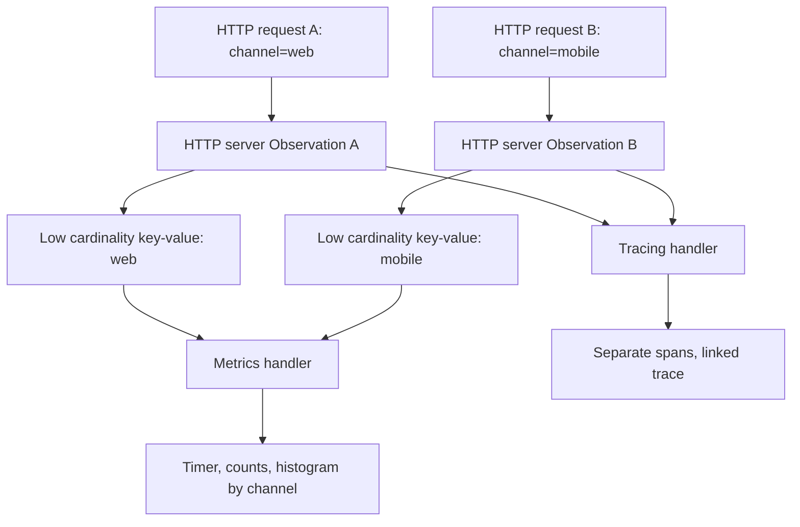
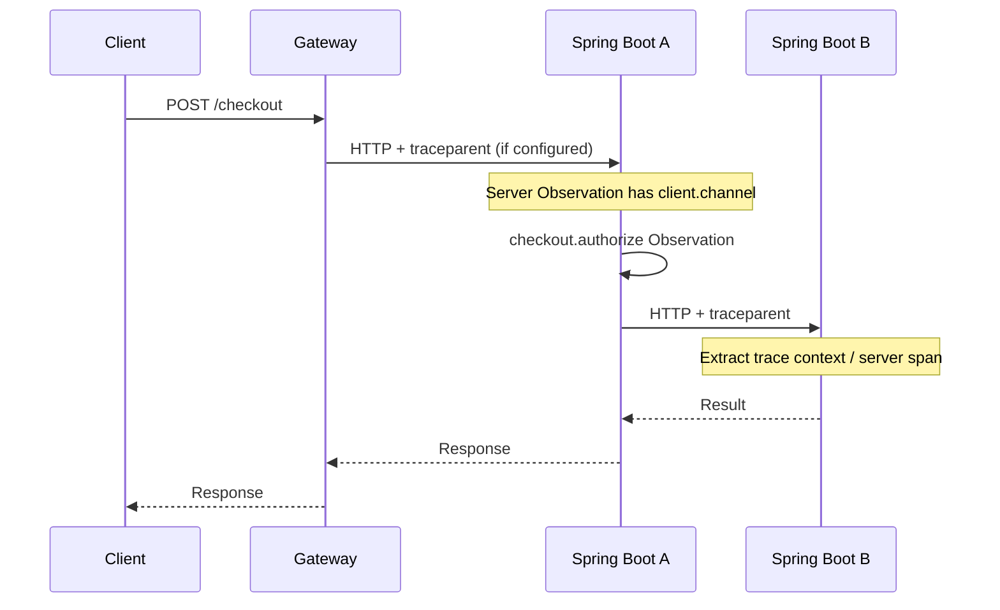

# Adding per-request key values

A Spring Boot API has the `http.server.requests` metric, yet the dashboard only shows overall latency for `POST /checkout`. The operations team wants to know whether requests from the `web` or `mobile` channel are slower, while also inspecting the trace of a specific failing transaction. Putting raw `userId`, `orderId`, or arbitrary header values into metric labels can cause unbounded time-series growth. Conversely, adding only a static tag to every observation fails to distinguish request groups.

The solution is **attaching key-values to each request's specific Observation**, normalizing values needed for aggregation, and letting conventions and handlers decide how to represent them in metrics/traces. In the **Convention and filter** chapter of the **SPRING_BOOT_OBSERVABILITY** module, this is a foundational skill when building observability with Micrometer Observation, metrics, logs, and distributed tracing. It also ties directly into context propagation, cardinality, exporters, sampling, and correlating signals when investigating errors, latency, or application behavior in production.

This lesson answers these questions:

1. What is a **per-request key-value**, and how does it differ from an application-wide static tag?
2. Should you add key-values directly on `Observation`, on `Observation.Context`, via `ObservationConvention`, or via `ObservationFilter`?
3. How do you access the existing HTTP server observation in Spring MVC to enrich it with data from the current request?
4. How does the timing of adding key-values affect metrics, tracing, and observation completion?
5. How do you bound cardinality, protect sensitive data, propagate trace context, and verify results?

## 1. "Per-request" means attaching to the exact occurrence

In Micrometer, an **Observation** describes a single named, lifecycle-bound execution of work: starting, optionally opening a scope, recording key-values/errors/events, and stopping. Two requests hitting `POST /checkout` produce two distinct observation occurrences.

Example:

| Request | Normalized route | Classified channel | Outcome | Trace |
| --- | --- | --- | --- | --- |
| A | `/checkout` | `web` | `success` | Trace A |
| B | `/checkout` | `mobile` | `timeout` | Trace B |
| C | `/checkout` | `web` | `rejected` | Trace C |

To compare latency by channel, you can attach **`client.channel=web|mobile|other`** as a low-cardinality key-value on the corresponding observation. To look up a specific payment execution, use log/trace correlation governed by proper security policies—do **not** add `orderId` as a metric label.

A simple model:



What matters is **where data is stored**. A singleton bean holding a mutable `currentChannel` field updated on every request is a broken design: concurrent requests will overwrite each other. Key-values must be attached to that specific request's observation/context, or derived from an appropriate context when handlers process that occurrence.

## 2. Four ways to put key-values into an Observation

Micrometer offers several extension points; each fits a different need.

| Approach | Best suited when | Key things to watch |
| --- | --- | --- |
| `observation.lowCardinalityKeyValue(...)` or `highCardinalityKeyValue(...)` | You **own the custom observation** and know the current invocation's data | Cover all branches, attach before `stop()`, avoid excessive data |
| `Observation.Context.addLowCardinalityKeyValue(...)` | You hold a reference to an **active observation's context**, e.g. HTTP server observation | Fetch the exact request's context; avoid creating a duplicate observation with the same boundary |
| `ObservationConvention<T>` | Naming, tagging, and cardinality rules must apply uniformly to a **context type** | Read data from context; avoid dropping important default labels |
| `ObservationFilter` | Enriching/normalizing key-values at the registry level, typically near observation completion | Scope by observation type; never rely on global request state |

In addition, Spring MVC, WebFlux, HTTP clients, and other libraries typically have **dedicated conventions** for each instrumentation. For an HTTP server already instrumented by Spring, enrich the existing observation rather than starting a second observation spanning the same entire HTTP request.

### 2.1. Two kinds of key-values

Micrometer Observation distinguishes:

- **Low-cardinality key-value:** Name and values belong to a small, controlled set; suitable as metric dimensions and usable in traces. E.g., `client.channel=web|mobile|batch|other`, `payment.outcome=accepted|rejected|error`.
- **High-cardinality key-value:** Values can vary widely across calls; can be useful as trace attributes if the handler supports them. Normally should not become metric labels. However, **high-cardinality does not mean permission to put PII, tokens, or secrets into traces**.

These key-values belong to **observation metadata**, not business data automatically propagated to other microservices. Propagating trace context via `traceparent` and passing business data via API/message contracts are two separate concerns.

## 3. For custom Observations: attach data right on the occurrence

When instrumenting a business step yourself, the cleanest way is adding key-values directly on the observation.

Example of a synchronous payment service using Spring Boot 3.x, Java 17+, and a configured `ObservationRegistry` bean:

```java
import io.micrometer.observation.Observation;
import io.micrometer.observation.ObservationRegistry;
import org.springframework.stereotype.Service;

@Service
public class CheckoutService {
    private final ObservationRegistry registry;
    private final PaymentGateway paymentGateway;

    public CheckoutService(ObservationRegistry registry,
                           PaymentGateway paymentGateway) {
        this.registry = registry;
        this.paymentGateway = paymentGateway;
    }

    public boolean authorize(String channel, String paymentToken) {
        String normalizedChannel = normalizeChannel(channel);

        Observation observation = Observation
                .createNotStarted("checkout.authorize", registry)
                .lowCardinalityKeyValue("client.channel", normalizedChannel)
                .lowCardinalityKeyValue("operation", "authorize")
                .start();

        try (Observation.Scope scope = observation.openScope()) {
            boolean accepted = paymentGateway.authorize(paymentToken);
            observation.lowCardinalityKeyValue(
                    "payment.outcome", accepted ? "accepted" : "rejected");
            return accepted;
        } catch (RuntimeException | Error failure) {
            observation.error(failure);
            observation.lowCardinalityKeyValue("payment.outcome", "error");
            throw failure;
        } finally {
            observation.stop();
        }
    }

    private static String normalizeChannel(String raw) {
        if (raw == null) {
            return "other";
        }
        return switch (raw.toLowerCase(java.util.Locale.ROOT)) {
            case "web" -> "web";
            case "mobile" -> "mobile";
            case "batch" -> "batch";
            default -> "other";
        };
    }
}

interface PaymentGateway {
    boolean authorize(String paymentToken);
}
```

Several noteworthy design choices:

- `checkout.authorize` is a **stable operation name**, containing no request ID.
- `client.channel` is normalized to a small set before attaching to the observation.
- `payment.outcome` is added **once the result is known and before `stop()`**.
- `paymentToken` goes solely into business logic; it is never emitted as a metric tag, log, or trace attribute.
- `try-with-resources` closes the scope; `finally` guarantees `stop()` runs even on exception or early `return`.
- This is an observation of a **business step**, which may nest inside the framework-created HTTP server observation; the two boundaries have distinct meanings.

If you do not need manual outcome tracking, `observe(...)` simplifies start/scope/stop:

```java
return Observation.createNotStarted("checkout.authorize", registry)
        .lowCardinalityKeyValue("client.channel", normalizedChannel)
        .observe(() -> paymentGateway.authorize(paymentToken));
```

However, the boolean return value in this variant is not mapped into `payment.outcome`. Choose the lifecycle management style based on what you need to measure, and avoid mixing `observe(...)` with manual start/stop on the same observation.

**A subtle detail:** metrics handlers, tracing handlers, and conventions may read the context at different lifecycle hooks. Attaching key-values before `stop()` is required for many handlers, yet does not guarantee handlers that already read attributes at `onStart` will refresh them. When an outcome tag must appear in a backend, verify how your specific handlers read the context.

## 4. For instrumented HTTP servers: use the current request's context

In Spring MVC Servlet, Spring Framework provides `ServerHttpObservationFilter` to observe HTTP server requests. When this instrumentation is active, you can retrieve **`ServerRequestObservationContext` for the current request** and add a low-cardinality key-value.

Suppose we want to classify the request origin into `web`, `mobile`, or `other` from an illustrative header. Create a `HandlerInterceptor`:

```java
import io.micrometer.common.KeyValue;
import jakarta.servlet.http.HttpServletRequest;
import jakarta.servlet.http.HttpServletResponse;
import org.springframework.http.server.observation.ServerRequestObservationContext;
import org.springframework.stereotype.Component;
import org.springframework.web.filter.ServerHttpObservationFilter;
import org.springframework.web.servlet.HandlerInterceptor;

@Component
public class ClientChannelObservationInterceptor implements HandlerInterceptor {

    @Override
    public boolean preHandle(HttpServletRequest request,
                             HttpServletResponse response,
                             Object handler) {

        String channel = normalize(
                request.getHeader("X-Client-Channel"));

        ServerHttpObservationFilter.findObservationContext(request)
                .ifPresent(context -> context.addLowCardinalityKeyValue(
                        KeyValue.of("client.channel", channel)));

        return true;
    }

    private static String normalize(String raw) {
        if (raw == null) {
            return "other";
        }
        return switch (raw.toLowerCase(java.util.Locale.ROOT)) {
            case "web" -> "web";
            case "mobile" -> "mobile";
            default -> "other";
        };
    }
}
```

Register the interceptor:

```java
import org.springframework.context.annotation.Configuration;
import org.springframework.web.servlet.config.annotation.InterceptorRegistry;
import org.springframework.web.servlet.config.annotation.WebMvcConfigurer;

@Configuration
public class RequestObservationWebConfig implements WebMvcConfigurer {
    private final ClientChannelObservationInterceptor interceptor;

    public RequestObservationWebConfig(
            ClientChannelObservationInterceptor interceptor) {
        this.interceptor = interceptor;
    }

    @Override
    public void addInterceptors(InterceptorRegistry registry) {
        registry.addInterceptor(interceptor);
    }
}
```

Notes on this example:

1. `ServerHttpObservationFilter.findObservationContext(request)` can return empty if the HTTP observation filter did not run or the request falls outside its instrumentation. In that case the interceptor still proceeds normally without adding the tag.
2. This code targets **Servlet Spring MVC**, not WebFlux directly. In WebFlux, use the corresponding reactive context/instrumentation.
3. `X-Client-Channel` here is solely illustrative grouping data. Client headers can be spoofed: **never use them for authorization decisions or guaranteed SLA classification**. To group by service tier, derive the tier from the authenticated principal/identity and still normalize it.
4. Interceptors only run for requests reaching Spring MVC handler mapping; failures before the interceptor (such as in a gateway or earlier filter) may lack this tag. If you need a tag on every observed request, consider a convention/registry filter or an earlier hook.
5. Never pass raw `request.getRequestURI()` as a metric label: actual paths can contain `orderId` or random data. HTTP instrumentation usually provides a route template like `/orders/{id}` for aggregation.

### 4.1. Why not create a new HTTP Observation inside the interceptor?

Because the framework already measures the request from the filter/server boundary. If the interceptor creates another observation with the same name/bounds and nearly identical timing, duplicate timers or spans can occur. Those charts become hard to interpret: two measurements share a name with different definitions, and it is unclear which includes filters, authentication, or serialization.

When you only want to **enrich tags on the HTTP server request**, reusing the existing `ServerRequestObservationContext` is the right approach. Create new custom observations for **distinct business steps**, such as `checkout.authorize` or `inventory.reserve`.

## 5. Using ObservationConvention to standardize HTTP request key-values

A convention defines the **name and key-values** of an observation type based on its context. When a labeling policy must apply uniformly across most HTTP requests, a dedicated convention is often cleaner than scattering logic across controllers/interceptors.

In Spring MVC Servlet, extend `DefaultServerRequestObservationConvention` to retain default key-values and append one finite dimension:

```java
import io.micrometer.common.KeyValue;
import io.micrometer.common.KeyValues;
import org.springframework.http.server.observation.DefaultServerRequestObservationConvention;
import org.springframework.http.server.observation.ServerRequestObservationContext;

public final class ClientChannelServerRequestConvention
        extends DefaultServerRequestObservationConvention {

    @Override
    public KeyValues getLowCardinalityKeyValues(
            ServerRequestObservationContext context) {

        String raw = context.getCarrier()
                .getHeader("X-Client-Channel");

        return super.getLowCardinalityKeyValues(context)
                .and(KeyValue.of("client.channel", normalize(raw)));
    }

    private static String normalize(String raw) {
        if (raw == null) {
            return "other";
        }
        return switch (raw.toLowerCase(java.util.Locale.ROOT)) {
            case "web" -> "web";
            case "mobile" -> "mobile";
            default -> "other";
        };
    }
}
```

Declare the bean when using the corresponding Spring MVC instrumentation:

```java
import org.springframework.context.annotation.Bean;
import org.springframework.context.annotation.Configuration;
import org.springframework.http.server.observation.ServerRequestObservationConvention;

@Configuration
public class HttpObservationConventionConfig {

    @Bean
    public ServerRequestObservationConvention serverRequestObservationConvention() {
        return new ClientChannelServerRequestConvention();
    }
}
```

Extending the default convention preserves useful framework-provided dimensions, typically including HTTP method, route template, status, and outcome depending on configuration/version. Writing a replacement from scratch forces you to maintain default rules yourself and risks accidentally dropping them.

### 5.1. How does a convention differ from a filter?

- **Convention:** *How should this observation be represented?* It inspects an existing context to produce a name, contextual name, and key-values under a contract. Conventions are especially suited for instrumentation with a specialized context.
- **ObservationFilter:** *Should metadata in the context be enriched or adjusted before the observation completes?* It is applied at the registry level across potentially many context types and usually fits cross-cutting enrichment rules.

For example, an HTTP convention can translate a header into `client.channel`. A filter fits when adding a standard dimension across *a group of observations* at completion time, such as `deployment.ring=stable|canary` (controlled by config), or attaching outcome from a typed context.

Do not simultaneously attach the same key with two different values across an interceptor, convention, and filter. Precedence becomes confusing and exported backend data may deviate from expectations. Assign **one owner for each dimension**.

### 5.2. When a convention reads data

The HTTP server context often gains status, exception, or route after request handling. A convention may need data only available at the end of the lifecycle. Do not assume every key-value is already computed when the request starts; nor should you mutate fields after `stop()` expecting already-recorded metrics to update.

If you need a tag reflecting business `payment.outcome` that is not part of the default HTTP context, update the context where the result is handled or separate it into a custom business-step observation. Avoid forcing an HTTP convention to reach back into service state via global variables.

## 6. Using ObservationFilter to enrich key-values at the registry level

`ObservationFilter` receives `Observation.Context` and returns the enriched context. Filters run near the end of the observation lifecycle, normalizing data before handlers that consume metadata at stop time process it.

The example below adds `http.client.channel` specifically for HTTP server request contexts. To avoid duplicating the convention from the previous section, **use this filter as an alternative**, rather than registering both to emit the same dimension name.

```java
import io.micrometer.common.KeyValue;
import io.micrometer.observation.ObservationRegistry;
import org.springframework.boot.actuate.autoconfigure.observation.ObservationRegistryCustomizer;
import org.springframework.context.annotation.Bean;
import org.springframework.context.annotation.Configuration;
import org.springframework.http.server.observation.ServerRequestObservationContext;

@Configuration
public class RequestChannelFilterConfig {

    @Bean
    ObservationRegistryCustomizer<ObservationRegistry> requestChannelCustomizer() {
        return registry -> registry.observationConfig()
                .observationFilter(context -> {
                    if (context instanceof ServerRequestObservationContext http) {
                        String header = http.getCarrier()
                                .getHeader("X-Client-Channel");
                        String channel = switch (
                                header == null ? "" :
                                        header.toLowerCase(java.util.Locale.ROOT)) {
                            case "web" -> "web";
                            case "mobile" -> "mobile";
                            default -> "other";
                        };
                        context.addLowCardinalityKeyValue(
                                KeyValue.of("client.channel", channel));
                    }
                    return context;
                });
    }
}
```

In Spring Boot 3.x, `ObservationRegistryCustomizer` is an integration point for configuring the auto-configured registry; this snippet registers the filter on that exact registry. If you manually construct a separate registry, filters registered on Boot's registry will not automatically apply to the standalone one.

Characteristics to understand:

1. A filter can see many `Observation.Context` types, so always **check the type** before reading HTTP data.
2. A filter does not receive `HttpServletRequest` as a separate parameter; here it retrieves the carrier from **`ServerRequestObservationContext`**.
3. Even after adding `KeyValue` to the context, actual metrics or spans depend on handlers, conventions, and when they read data.
4. A filter does not perform authentication, propagation, or sampling.
5. A filter must not perform slow I/O, database queries, or side-effecting logic; instrumentation callbacks must stay lightweight and resilient under error conditions.
6. With a registry shared across many observations, avoid attaching an HTTP dimension to non-HTTP observations (background jobs, databases, message consumers).

**Note on versions and application types:** This example targets Spring Boot 3.x with Spring MVC Servlet. Spring Boot 4.x has starter/tracing configuration changes; WebFlux uses reactive stack contexts/filters. Always verify API signatures for your actual version before applying in a project.

## 7. Design rule: every dimension has one owner

When multiple layers can add key-values, map out ownership clearly. For example:

| Dimension | Suggested owner | Data source | Used in |
| --- | --- | --- | --- |
| `http.method` | HTTP framework convention | HTTP request | Metrics, traces |
| `http.route` or template `uri` | HTTP framework convention | Matched route | Metrics, traces |
| `http.status` or `status` | HTTP instrumentation | Response | Metrics, traces |
| `client.channel` | HTTP convention **or** request interceptor/filter | Normalized input | Aggregated metrics |
| `payment.outcome` | Custom business observation | Business result | Metrics and traces |
| `service.name` | Tracing/metrics resource configuration | Service configuration | Identifying applications |
| `traceId`/`spanId` | Tracing context and log correlation | Active span | Correlating logs/traces |
| `orderId` | Protected domain/audit/log when needed | Business contract | Transaction lookup, never a metric tag |

Across versions and backends, exported names for some dimensions can differ. Do not build dashboards assuming Actuator tag names match Prometheus label names or OpenTelemetry attributes identically; inspect actual exported output.

### 7.1. Duplicate keys and precedence

Suppose an interceptor adds `client.channel=mobile`, and a filter later adds `client.channel=other`. The resulting state becomes ambiguous. Whether a handler favors the latest value or applies some key-value merge rule, the data policy is already contradictory.

The solution is **defining a single writer for each key**. If data must be drawn from multiple sources, resolve trust precedence in *one place* (for example, authenticated identity first, allowlisted header second, `other` last), then emit one canonical value.

Do not use filters to "patch" duplicate tags at the last minute; that makes instrumentation unpredictable and hard to test.

## 8. Choosing low-cardinality vs. high-cardinality by measurement goal

Cardinality is the number of distinct values of a dimension, or the number of resulting label combinations. Each label combination can become a distinct time series; histograms multiply series counts further by bucket.

Suppose a timer has:

- `http.route`: 20 values;
- `http.status`: 5 values;
- `client.channel`: 3 values;
- `instance`: 10 values.

The maximum number of combinations across these dimensions is:

```text
20 × 5 × 3 × 10 = 3,000 label combinations
```

Adding `customerId` with 100,000 values pushes the **theoretical** combination count to 300 million. In practice only observed combinations create series, yet memory, exporter, and query costs can still escalate drastically.

| Request data | Put on metrics? | If investigation is needed |
| --- | --- | --- |
| Channel `web|mobile|other` | Yes, once normalized | Compare dashboards by channel |
| HTTP method | Yes, via default instrumentation | Analyze requests by method |
| Route template `/orders/{id}` | Yes | Endpoint aggregation |
| Normalized response status/outcome | Yes | Separate HTTP errors from business outcomes |
| Raw URL `/orders/999888` | No | Use route template; look up individual requests via correlation |
| `userId`, `orderId`, email | No | Audit/log/trace correlation per data policy |
| `traceId`, `spanId` | Never as metric labels | Query correlated logs/traces |
| Arbitrary headers or full User-Agent | No | Classify into finite groups if purposeful |
| Tokens/secrets or raw request body | No | Never emit to telemetry |

Even though `highCardinalityKeyValue(...)` can be turned into span attributes by a tracing handler, **never insert sensitive data arbitrarily**. Trace exporters ship data to collectors/backends that typically retain it far longer than a request lifetime. Minimize, mask, and enforce retention/access policies whenever storing detailed fields is truly justified.

### 8.1. Never trust raw client values

When reading an `X-Client-Channel` header, treat it as untrusted input. For client-side telemetry grouping, you might allow three values: `web`, `mobile`, `other`. However, if a label identifies VIP customers or SLA responsibility, derive classification from an **authenticated principal/claim** or a controlled configuration source.

A pattern to avoid:

```java
context.addLowCardinalityKeyValue(
        KeyValue.of("client.channel",
                request.getHeader("X-Client-Channel")));
```

This lets callers inject millions of distinct values into a metric tag. Always normalize/allowlist, define a fallback value, and bound input length if needed.

## 9. Per-request key-values and distributed tracing

Attaching `client.channel=mobile` to an HTTP server observation **does not automatically propagate** that attribute onto spans of other services. If an HTTP request goes from a gateway to Spring Boot A, and A calls Spring Boot B, tracing links the spans via proper context propagation.



To keep traces continuous:

- Use server and HTTP client instrumentation; in Spring Boot, prefer Boot-configured builders like `RestClient.Builder` or `WebClient.Builder` so tracing customizers/interceptors are applied.
- Verify the trace context carrier (typically W3C Trace Context including `traceparent`), instead of manually copying a few string tags in place of a propagator.
- For executors, asynchronous callbacks, Reactor, and message brokers, use proper context propagation and verify spans maintain accurate parent–child relationships.
- Distinguish **key-values for metrics/spans** from **baggage** propagated across processes. Do not use baggage to ship entire request metadata or sensitive data.

If tracing uses sampling, the backend may not store the trace for a given request. Metrics still count all requests even when traces are sampled out. Therefore, do not divide span counts of `client.channel=mobile` by total spans and assume that represents true error rate or traffic distribution if sampling is biased.

### 9.1. Logs correlate, but do not automatically inherit every tag

A log emitted within a tracing scope can include `traceId` and `spanId` in MDC/log patterns, depending on configuration. That does not mean logs automatically contain `client.channel` or all Observation key-values. When logs need a lookup field, use structured logging governed by data policy and clear context scoping; avoid copying every metric label and trace attribute into every log line.

A Trace ID is a correlation key; it is **not a metric tag**. Attaching Trace IDs to a timer creates nearly one time series per request, defeating metric aggregation.

## 10. Lifecycle timing for adding key-values

There are three common points in time:

| Timing | What is known? | How to add to observation |
| --- | --- | --- |
| Before or right after `start()` | Method, request channel, operation, dependency | Attach low-cardinality key-values early |
| During request processing | Authenticated tier, matched route, intermediate results | Add to the proper context while still within lifetime |
| Before `stop()` | Final status, technical error, business outcome | Record error/outcome before handlers complete |

In custom observations, use `observe(...)` for simple synchronous work to manage start/scope/stop; use `try/finally` when adding outcome. In Spring HTTP observations, the framework owns the server request lifecycle; enriching tags must happen **before the observation finishes**.

Avoid:

- Creating an observation and calling `stop()` inside an interceptor before the controller executes, thinking it measures the whole request.
- Adding tags to an already-stopped observation expecting the backend to update recorded metrics.
- Letting a mutable singleton hold `currentRequestTag`.
- Adding a tag only on the success branch, leaving failing requests without that dimension; prefer `unknown` or `other` when data is missing.
- Using a request-scoped context as a substitute for cross-thread/process propagation without an actual propagation mechanism.

### 10.1. Additional considerations for async and reactive HTTP

A Spring MVC interceptor may not catch every asynchronous dispatch variant the same way as a synchronous request. In WebFlux, context is typically carried along the Reactor subscription rather than plain thread-locals. If a tag must exist on every request, check instrumentation boundaries, callbacks, and framework version; consider using an **appropriate HTTP observation convention** rather than an interceptor running at only one stage.

With custom `CompletableFuture`, `observe(() -> future)` can stop as soon as the future is created; with `Mono`, `observe(() -> mono)` can stop before subscription completes. A key-value added when an async callback finishes still requires the observation to be active. Choosing the right *end boundary* directly determines per-request metric/trace accuracy.

## 11. Setup and observing results in Spring Boot

Example Maven dependencies for **Spring Boot 3.x** (using matching dependency management):

```xml
<!-- Actuator and Micrometer Observation infrastructure -->
<dependency>
    <groupId>org.springframework.boot</groupId>
    <artifactId>spring-boot-starter-actuator</artifactId>
</dependency>

<!-- When exporting metrics to Prometheus -->
<dependency>
    <groupId>io.micrometer</groupId>
    <artifactId>micrometer-registry-prometheus</artifactId>
</dependency>

<!-- When tracing via Micrometer and OpenTelemetry -->
<dependency>
    <groupId>io.micrometer</groupId>
    <artifactId>micrometer-tracing-bridge-otel</artifactId>
</dependency>

<!-- When exporting traces via OTLP -->
<dependency>
    <groupId>io.opentelemetry</groupId>
    <artifactId>opentelemetry-exporter-otlp</artifactId>
</dependency>
```

A real Spring MVC application also needs the appropriate web starter. An illustrative configuration:

```yaml
management:
  endpoints:
    web:
      exposure:
        include: health,metrics,prometheus
  tracing:
    sampling:
      probability: 0.1
  otlp:
    tracing:
      endpoint: http://localhost:4318/v1/traces
```

Notes:

- The Prometheus registry exposes the scrape endpoint when enabled; a **Prometheus server** still has to scrape the data.
- The OTLP tracing exporter requires a collector/backend actually listening at the configured endpoint.
- Sampling `0.1` is the trace sampling rate; it **does not mean recording only 10% of metrics**.
- Spring Boot 4.x changes tracing starters/properties compared to 3.x. Consult reference docs for your **exact version** rather than copying these properties blindly.
- Do not expose management endpoints publicly to the Internet by default; enforce network controls and authorization.

Send test requests in the lab:

```bash
curl -sS -H "X-Client-Channel: web" \
  http://localhost:8080/checkout

curl -sS -H "X-Client-Channel: mobile" \
  http://localhost:8080/checkout

curl -sS -H "X-Client-Channel: any-random-value" \
  http://localhost:8080/checkout

curl -fsS http://localhost:8080/actuator/metrics/http.server.requests
curl -fsS http://localhost:8080/actuator/prometheus
```

Assume the lab exposes a matching `GET /checkout` route. After requests are processed and metrics are exported, verify that `client.channel` shows `web`, `mobile`, and `other` respectively. Some backends convert dots in label names to underscores; do not assume Prometheus label names are identical to Actuator tag names.

With Prometheus, HTTP server timer metrics are typically exported under names following the naming convention, such as total request count and duration sum; inspect the **actual names** in `/actuator/prometheus` before writing PromQL.

Illustrative query when `http_server_requests_seconds_count` has label `client_channel`:

```promql
sum by (client_channel) (
  rate(http_server_requests_seconds_count[5m])
)
```

If expected metrics/labels do not appear, check in order: has a request occurred, does the context exist, is the interceptor/convention/filter registered, does the registry have a metrics handler, is the endpoint exposed, and are exporter/collector and backend query names accurate?

## 12. Common issues and how to isolate them

| Symptom | Possible cause | What to check |
| --- | --- | --- |
| HTTP metrics exist, but lack `client.channel` | Interceptor/convention/filter not registered or context is not the expected type | Check integration point and whether requests pass through it |
| Only successful requests have the tag | Tag added too late or in a branch skipped on error | Add the tag early or in a convention for all cases |
| Tag contains thousands of unexpected values | Raw header, user ID, or actual URL attached | Enforce allowlist normalization and route templates |
| Tag exported under two different names | Interceptor and convention both write, or backend naming differs | Assign a single owner; check the exporter |
| All requests share the same tag | Shared singleton state, or filter sets a static value | Use per-request context and the right data source |
| Tag added to HTTP observation, missing on child spans | Key-values do not auto-propagate across services/spans | Use tracing propagation; set attributes on target spans if needed |
| Logs have Trace ID, backend lacks span | Sampling or exporter/backend drop | Check the trace pipeline; do not assume a tag bug |
| Controller succeeds, Actuator lacks timer | No meter sample yet, different registry/handler, or meter filtered | Inspect `ObservationRegistry` and endpoints |
| Custom duration is tiny while HTTP request is slow | Observation only timed future/Mono creation, not completion | Align start/stop with actual async lifetime |
| Errors appear only under concurrent traffic | Shared mutable context or global variable | Use isolated context/observation per occurrence |

### 12.1. Layer-by-layer diagnostic checklist

1. **Data source:** Is `X-Client-Channel` present? Is its value normalized?
2. **Instrumentation point:** Did you obtain the HTTP server request's context or accidentally create a separate observation?
3. **Lifecycle:** Was the tag attached before `stop()`? Do error and async branches pass through the tagging code?
4. **Registry/handlers:** Are metrics or tracing handlers active on that context?
5. **Exporter:** Does Actuator show the tag while Prometheus does not? Check name mapping, filters, scraping, and pipeline.
6. **Backend:** Does the query use the right label/time range? Did sampling drop the trace?

Walking through these layers keeps you from trying to "fix" an exporter problem by adding more tags, or fixing broken trace context by putting request IDs into metric labels.

## 13. Hands-on lab: designing controlled per-request tags

**Scenario:** `GET /orders/{id}` serves three channels: `web`, `mobile`, and `batch`. Operations needs to compare error rates and latency by channel, with zero labels containing order IDs or user data.

Steps:

1. **Define the label:** Choose `client.channel=web|mobile|batch|other`. Keep the route template from HTTP instrumentation.
2. **Attach to the existing observation:** Use `ServerHttpObservationFilter.findObservationContext(request)` in Spring MVC or an appropriate HTTP observation convention.
3. **Normalize and fall back:** Send `X-Client-Channel` with valid values, invalid values, and missing header; only allowlisted values must appear.
4. **Observe error paths too:** Trigger `404`, `500`, and simulated timeout responses and verify the tag still appears on requests covered by the HTTP observation.
5. **Compare metrics and traces:** Check `/actuator/metrics/http.server.requests`; if tracing is active, inspect a sample request's trace and confirm that a tag on the server span does not automatically propagate to downstream spans.
6. **Verify cardinality:** Send 100 requests with different order IDs; the distinct value count of `client.channel` stays constant. If you see 100 URL values, fix the metric label.
7. **Verify version/exporter transformations:** Inspect raw exporter metrics and actual PromQL queries; verify key-value name mapping.
8. **Evaluate effectiveness:** Simulate a slow downstream dependency, identify which channel is impacted, and cross-reference via trace/log correlation.

### Self-check questions

**Question 1.** Both aim at "adding per-request tags"—why use `ObservationConvention` in some cases and `ObservationFilter` in others?

**Answer:** A convention fits defining how a **context type** (like HTTP server requests) maps stably to names/key-values. A filter fits enriching or normalizing contexts at the registry level near the end of the lifecycle. They sit at different integration points; pick one owner per dimension to avoid duplication.

**Question 2.** Should you put raw `User-Agent` or `X-Customer-Id` into a metric label to analyze customer behavior?

**Answer:** No. Values can be virtually unbounded, exploding time-series counts and risking personal data exposure. If needed, classify into a small set of groups from a trusted source; personal details belong in protected audit/correlation systems.

**Question 3.** A `HandlerInterceptor` cannot find `ServerRequestObservationContext`. Is all tracing broken?

**Answer:** Not enough to conclude that. The HTTP observation filter might not have run for that request, instrumentation configuration may be missing, the request may have been handled before the interceptor, or the wrong MVC/WebFlux stack was used. Check the instrumentation point before checking the tracing exporter.

**Question 4.** Does a `client.channel` tag on service A's HTTP server span automatically appear on service B?

**Answer:** No. Trace context propagation transfers identifiers and span relationships, not arbitrary key-values. If service B needs the channel for business logic, pass it via the API/message contract; if you want telemetry on B, design B's instrumentation and data policy explicitly.

**Question 5.** Why shouldn't `traceId` be added as a low-cardinality key-value on a timer?

**Answer:** Every Trace ID is virtually unique, causing time-series count to grow with every request. Trace IDs are for looking up logs/traces, not aggregating metrics.

## 14. Practice principles

- **Attach key-values to the right observation occurrence:** use the direct API for custom observations; for instrumented HTTP servers, prefer the existing context/convention.
- **Separate extension point responsibilities:** conventions define naming/tag policies; filters enrich/normalize contexts; handlers emit telemetry per configuration.
- **Bound cardinality at the source:** normalize request inputs into a finite value set; never emit raw IDs, URLs, headers, or secrets.
- **Keep clear ownership for every dimension:** prevent interceptors, conventions, and filters from writing conflicting values to the same key.
- **Add tags before the lifetime ends:** pay attention to error branches, async flows, cancellations, and when handlers read metadata.
- **Correlate signals with the right mechanisms:** metrics measure rates and distributions, traces show request paths, logs record events; propagation, sampling, and exporters shape what becomes visible.
- **Verify end-to-end:** test sample requests, inspect raw Actuator/exporter output, and cross-check traces/logs and backend queries before relying on a tag for dashboards or alerts.

### References

- [Micrometer — Observation API](https://docs.micrometer.io/micrometer/reference/observation.html)
- [Micrometer — Observation components, conventions, and filters](https://docs.micrometer.io/micrometer/reference/observation/components.html)
- [Spring Framework — Observability](https://docs.spring.io/spring-framework/reference/integration/observability.html)
- [Spring Framework — HTTP server observations](https://docs.spring.io/spring-framework/reference/integration/observability.html#observability.http-server)
- [Spring Boot 3.5 — Observability](https://docs.spring.io/spring-boot/3.5/reference/actuator/observability.html)
- [Spring Boot 3.5 — Tracing](https://docs.spring.io/spring-boot/3.5/reference/actuator/tracing.html)
