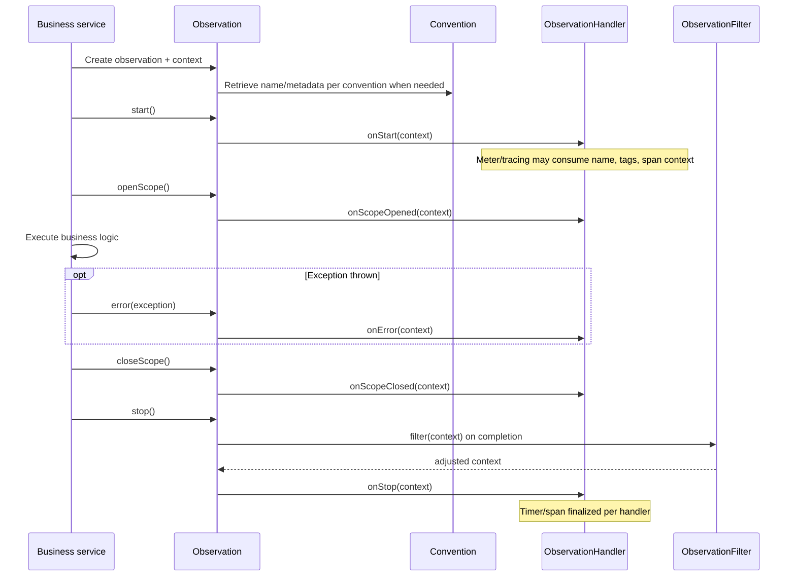
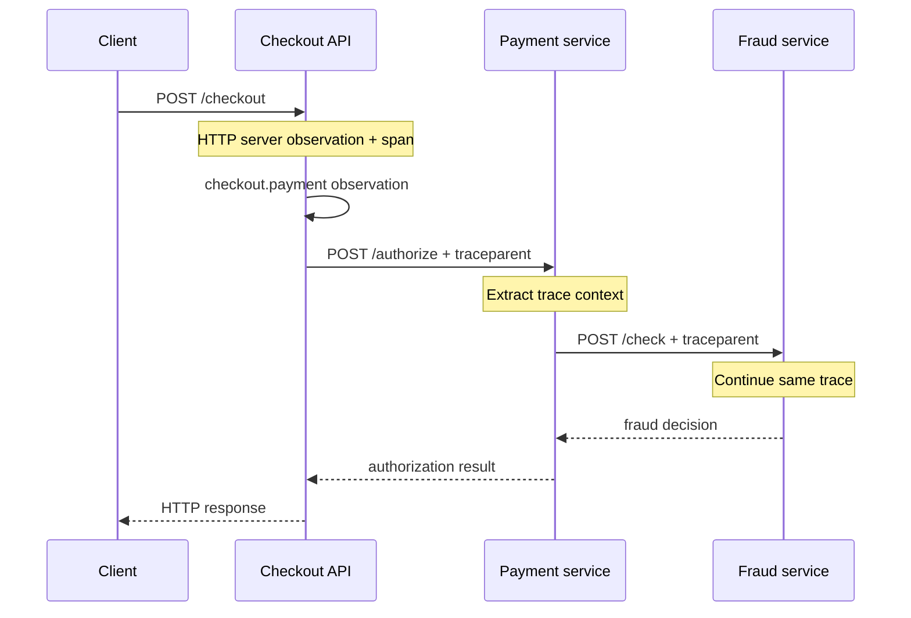

# Do not replace conventions with filters in Micrometer Observation

> **Chapter:** Convention and filter  
> **Module:** `SPRING_BOOT_OBSERVABILITY` — setting up observability for Spring Boot with Micrometer Observation, metrics, logs, and distributed tracing; applying propagation, tags/cardinality, exporters, sampling, and signal correlation when analyzing errors or latency.  
> **Focus:** `ObservationConvention` and `ObservationFilter` both participate in metadata configuration, yet solve **two different problems**. Understand exactly when each runs so you can name observations properly, bound tags, preserve trace context, and avoid misleading dashboards.

## Learning objectives

After this lesson, you will be able to:

1. Explain why a convention defines the **measurement contract of an operation type**, whereas a filter **adjusts context via global rules at the completion stage**.
2. Distinguish `ObservationConvention`, `ObservationFilter`, `ObservationPredicate`, `ObservationHandler`, `MeterFilter`, and servlet/web filters.
3. Decide which attributes must exist right when an observation starts and which can be added after work finishes.
4. Design a stable convention for a custom observation: name, contextual name, low-cardinality and high-cardinality key-values.
5. Register a filter via `ObservationRegistryCustomizer` in Spring Boot and use filters only for appropriate late-stage edits.
6. Inspect metadata at `onStart` and `onStop`, read metrics/traces/logs, and diagnose cases where a filter skews telemetry.

## 1. Scenario: why is adding tags via a filter not enough?

A checkout service has a custom `checkout.payment` observation to time payment gateway calls. The team wants every operation to have:

- Stable metric name `checkout.payment`.
- Human-readable span `process payment`.
- Tag `payment.provider` accepting only `primary` or `backup`.
- Tag `payment.channel` accepting only `WEB`, `MOBILE`, `PARTNER`, or `OTHER`.
- Environment tag `deployment.environment=prod` added uniformly across observations.

A seemingly convenient approach is putting all of this logic into one global `ObservationFilter`. The problem: a filter **does not share the same timing or role as a convention**. When a tracing handler creates a span or selects parent context at observation start, the filter may not have run yet. Naming or classification data needed at start can arrive too late. And if a filter tries to rename operations or assign business semantics across all operations, a global rule can easily affect unrelated observations.

The proper division of responsibilities:

- **Convention:** defines what the `checkout.payment` operation means—its technical name, contextual name, key-value set, and how to extract data from its dedicated context.
- **Filter:** adds or adjusts a common attribute on `Observation.Context`, such as the deployment environment, right before final data is consumed by handlers to finish telemetry.
- **Predicate:** decides whether to create a real observation or turn it into a no-op per filtering policy.
- **Handler:** receives lifecycle callbacks and turns observation data into metrics, traces, or other behavior.

That is why you **should not replace conventions with filters**, even though both can inspect or manipulate key-values.

## 2. Comparing conventions and filters

| Criterion | `ObservationConvention` | `ObservationFilter` |
|---|---|---|
| Primary goal | Define name and key-values for **one observation type** | Modify `Observation.Context` for observations passing through a registry |
| Tied to context type | Yes, via context type and `supportsContext(...)` | Usually shared across many context types |
| Choose observation name | Has `getName()` | Not the right mechanism to name an operation from the start |
| Choose readable span name | Has `getContextualName(context)` | Can edit context late, but does not guarantee renaming an already-created span |
| Low-cardinality metadata | Has `getLowCardinalityKeyValues(context)` | Can add/adjust low-cardinality key-values |
| High-cardinality metadata | Has `getHighCardinalityKeyValues(context)` | Can add/adjust per policy |
| Appropriate timing | Selected/applied as part of the observation definition; handlers can use it from start | Typically invoked late as the observation completes, before `onStop` |
| Best used for | Standard names, semantic tags, business normalization, dashboard contracts | Common tags, post-processing enrichment, rule-based context tweaks |
| Risk when overused | Inconsistent conventions, dynamic names/tags | Too late for tracing start; overly broad scope; overwriting tags |

The critical factor is **timing**. Some handlers read names and attributes in `onStart`, some register timers or read tags only at `onStop`, and exporters may process asynchronously. Relying on an end-of-lifecycle filter therefore cannot guarantee every signal sees the same metadata at all points.

### 2.1. Two names that must be distinguished

In a custom observation:

- **Observation name:** e.g. `checkout.payment`, usually a stable technical name tied to the meter or operation name.
- **Contextual name:** e.g. `process payment`, used to give spans a readable name in tracing when the handler consumes that field.

Never put order IDs, customer IDs, SKUs, or concrete URLs into these names. A name like `checkout.payment.ORD-900221` breaks consistent aggregation and searching, and can cause cardinality growth.

### 2.2. Avoid assuming "filters run before everything"

In the typical Micrometer Observation lifecycle, filters are applied to the context while ending the observation, and handlers are notified at `onStop`. That lets filters enrich metadata before the metrics handler finishes recording the timer. However, the tracing handler may have already created the span and decided initial details at `onStart`. Consistency between metrics and tracing **is not guaranteed** merely by adding a tag in a filter.

## 3. Lifecycle: where do conventions and filters fit?



The diagram above illustrates the intent and logical sequence of a typical synchronous flow. Exact callbacks/conventions vary by Micrometer version, observation type, and handler configuration. Whenever timing matters, verify with a small handler like in the lab section.

**Do not confuse the steps:**

- `start()` opens the timed observation boundary; it does **not** replace `openScope()`.
- `openScope()` sets the current observation so code/logs/downstream instrumentation can use trace context; it does not create metric tags on its own.
- `error(...)` marks failure; it does not replace `stop()`.
- `Scope.close()` restores the previous context; it does not mean the observation is finished.
- `stop()` ends the observation; handlers and exporters decide when telemetry reaches the backend.

If an attribute must **participate in decisions at start** (span name, route classification, parent/child, data needed by early handlers), prepare it upfront via convention, context, or observation creation parameters. An end-of-lifecycle filter cannot turn back time.

## 4. Designing a convention for the checkout operation

Suppose the payment service has exactly four channels: `WEB`, `MOBILE`, `PARTNER`, and `OTHER`. Providers fall into two groups: `primary`, `backup`. This value set yields metric dimensions with bounded cardinality.

### 4.1. Dedicated context

A custom context separates business metadata from observability infrastructure:

```java
package com.example.checkout.observability;

import io.micrometer.observation.Observation;

public final class PaymentObservationContext extends Observation.Context {

    private final String channel;
    private final String provider;

    public PaymentObservationContext(String channel, String provider) {
        this.channel = channel;
        this.provider = provider;
    }

    public String channel() {
        return channel;
    }

    public String provider() {
        return provider;
    }
}
```

This context accepts **already normalized values**, not raw user input. It carries the data the convention uses to decide how telemetry is shaped.

### 4.2. Normalizing values before creating the context

```java
package com.example.checkout.observability;

import java.util.Locale;

public final class PaymentTagPolicy {

    private PaymentTagPolicy() {
    }

    public static String channel(String raw) {
        if (raw == null) {
            return "OTHER";
        }
        return switch (raw.trim().toUpperCase(Locale.ROOT)) {
            case "WEB" -> "WEB";
            case "MOBILE" -> "MOBILE";
            case "PARTNER" -> "PARTNER";
            default -> "OTHER";
        };
    }

    public static String provider(String raw) {
        if ("primary".equalsIgnoreCase(raw)) {
            return "primary";
        }
        if ("backup".equalsIgnoreCase(raw)) {
            return "backup";
        }
        return "other";
    }
}
```

If provider has two defined groups and unknown values may appear, adding `other` is a useful fallback. **Never keep raw hostnames** like `payment-api-836ab.example.net` as provider tags; dynamic domains and instance IDs can grow series counts uncontrollably.

### 4.3. Convention defining the name and key-value set

```java
package com.example.checkout.observability;

import io.micrometer.common.KeyValues;
import io.micrometer.observation.Observation;
import io.micrometer.observation.ObservationConvention;

public final class PaymentObservationConvention
        implements ObservationConvention<PaymentObservationContext> {

    @Override
    public boolean supportsContext(Observation.Context context) {
        return context instanceof PaymentObservationContext;
    }

    @Override
    public String getName() {
        return "checkout.payment";
    }

    @Override
    public String getContextualName(PaymentObservationContext context) {
        return "process payment";
    }

    @Override
    public KeyValues getLowCardinalityKeyValues(
            PaymentObservationContext context) {

        return KeyValues.of("payment.channel", context.channel())
                .and("payment.provider", context.provider());
    }
}
```

Key pieces:

- `supportsContext(...)` restricts the convention to the exact context type.
- `getName()` returns a stable operation name independent of individual requests.
- `getContextualName(...)` provides a meaningful span name when consumed by handlers.
- `getLowCardinalityKeyValues(...)` defines tag sets by business semantics rather than per-transaction details.

This convention **does not define the entire exporter**; it solely standardizes how an observation describes itself. The registry and handlers still determine what metrics/traces are emitted.

### 4.4. Applying the convention when creating a custom observation

With Micrometer Observation 1.x API overloads accepting a convention and context supplier, creation looks like:

```java
import io.micrometer.observation.Observation;
import io.micrometer.observation.ObservationRegistry;

// registry injected into the service by Spring Boot
PaymentObservationConvention convention =
        new PaymentObservationConvention();

PaymentObservationContext context =
        new PaymentObservationContext(
                PaymentTagPolicy.channel(rawChannel),
                PaymentTagPolicy.provider(rawProvider));

Observation observation = Observation.createNotStarted(
        convention, () -> context, observationRegistry);
```

This example shows **the convention selected where the observation is created**. Depending on Micrometer version and integration, overloads or default/custom convention registration mechanisms may differ; verify the API managed by your Spring Boot BOM before putting code into a project.

Merely declaring a `@Component PaymentObservationConvention` does not guarantee **every custom observation** will use it. For custom instrumentation, pass the convention through the observation creation API or the appropriate convention registration hook for that integration. Default convention selection for HTTP server, HTTP client, or other frameworks belongs specifically to each integration.

### 4.5. Avoid using a filter to define names like a convention

A global filter attempting to rewrite names per request is a clear design smell:

```java
// ANTI-PATTERN: DO NOT USE
registry.observationConfig().observationFilter(context -> {
    // Filter runs late, unsuitable for deciding the operation name
    // or span name when the tracing handler starts.
    context.setName("checkout.payment." + rawOrderId);
    return context;
});
```

Even if a context allows updating its name, doing so does not guarantee spans created earlier get renamed accordingly. Appending order IDs also makes operation names dynamic and explodes metric combinations. When an operation needs proper naming, define the contract in a convention or instrumentation configuration.

## 5. Recording outcome metadata without turning filters into business logic

An `outcome` is only known after calling the payment gateway, such as `approved`, `declined`, or `error`. A common pattern is updating **the observation itself** before `stop()`:

```java
package com.example.checkout;

import com.example.checkout.observability.PaymentObservationContext;
import com.example.checkout.observability.PaymentObservationConvention;
import com.example.checkout.observability.PaymentTagPolicy;
import io.micrometer.observation.Observation;
import io.micrometer.observation.ObservationRegistry;
import org.springframework.stereotype.Service;

@Service
public class PaymentService {

    private final ObservationRegistry observationRegistry;
    private final PaymentGateway gateway;
    private final PaymentObservationConvention convention =
            new PaymentObservationConvention();

    public PaymentService(
            ObservationRegistry observationRegistry,
            PaymentGateway gateway) {
        this.observationRegistry = observationRegistry;
        this.gateway = gateway;
    }

    public String charge(String rawChannel, String rawProvider) {
        PaymentObservationContext context = new PaymentObservationContext(
                PaymentTagPolicy.channel(rawChannel),
                PaymentTagPolicy.provider(rawProvider));

        Observation observation = Observation
                .createNotStarted(
                        convention, () -> context, observationRegistry)
                .start();

        try (Observation.Scope scope = observation.openScope()) {
            String decision = gateway.authorize();

            if ("APPROVED".equals(decision)) {
                observation.lowCardinalityKeyValue(
                        "payment.outcome", "approved");
            } else {
                observation.lowCardinalityKeyValue(
                        "payment.outcome", "declined");
            }

            return decision;
        } catch (RuntimeException exception) {
            observation.lowCardinalityKeyValue(
                    "payment.outcome", "error");
            observation.error(exception);
            throw exception;
        } finally {
            observation.stop();
        }
    }
}

interface PaymentGateway {
    String authorize();
}
```

`PaymentGateway` is an illustrative interface; real systems must handle timeouts, retries, idempotency, and security per business requirements.

Characteristics of this approach:

1. The convention defines **the name and upfront tags**.
2. Outcome is attached by code that understands the business result, without asking a filter to guess from exception messages or HTTP statuses.
3. `Scope` is opened around the business work so tracing/log correlation has an active context.
4. On exception, `observation.error(exception)` records the error; `finally` still calls `stop()`.
5. Meter handlers normally capture final tags at completion; some tracing handlers read tags at `onStart`. Therefore, verify whether a late outcome tag actually appears in the tracing backend; if needed upfront, it cannot be set before the result is known.

**Do not assume every callback sees the same metadata snapshot.** Testing context/handler behavior verifies your exact configuration—do not rely solely on seeing a tag appear in Prometheus.

## 6. Where filters fit best: enriching shared metadata

A valid use case for `ObservationFilter` is adding a stable environment label to the contexts of many observation types.

### 6.1. Registering a filter via a Spring Boot customizer

```java
package com.example.checkout.observability;

import io.micrometer.common.KeyValue;
import io.micrometer.observation.ObservationRegistry;
import org.springframework.beans.factory.annotation.Value;
import org.springframework.boot.actuate.autoconfigure.observation.ObservationRegistryCustomizer;
import org.springframework.context.annotation.Bean;
import org.springframework.context.annotation.Configuration;

@Configuration(proxyBeanMethods = false)
public class ObservationFilterConfiguration {

    @Bean
    ObservationRegistryCustomizer<ObservationRegistry> environmentFilter(
            @Value("${app.observability.environment:local}")
            String rawEnvironment) {

        String environment = normalizeEnvironment(rawEnvironment);

        return registry -> registry.observationConfig()
                .observationFilter(context -> {
                    context.addLowCardinalityKeyValue(
                            KeyValue.of("deployment.environment",
                                    environment));
                    return context;
                });
    }

    private static String normalizeEnvironment(String raw) {
        if ("prod".equalsIgnoreCase(raw)
                || "production".equalsIgnoreCase(raw)) {
            return "prod";
        }
        if ("staging".equalsIgnoreCase(raw)) {
            return "staging";
        }
        return "local";
    }
}
```

Corresponding configuration:

```yaml
app:
  observability:
    environment: prod
```

Key takeaways:

- The customizer operates on the **Spring Boot-managed `ObservationRegistry`**.
- The environment value comes from **deployment configuration** and is normalized to a small set.
- The filter applies late-stage to contexts passing through the registry, independent of `PaymentObservationContext`.
- The filter does not dictate operation names, parent spans, or trace context propagated over HTTP.
- Never read environment from an HTTP request or user-controlled header and attach it globally as a metric tag.

If your Spring Boot version supports common observation key-values properties, you can declare configuration instead of writing a filter:

```yaml
management:
  observations:
    key-values:
      deployment.environment: ${APP_ENVIRONMENT:local}
```

**Pick one source per attribute.** Do not use both the common property and a custom filter writing the same key without a clear precedence rule; having two sources makes tags hard to trace.

### 6.2. A single filter runs across many observation types

A global filter can see HTTP server, HTTP client, JDBC-adjacent, or custom observations depending on instrumentation. Every edit inside a filter thus carries wide blast radius. Before adding a shared tag, ask:

- Is this tag needed on **every** observation?
- Does the tag have few distinct values, or does it grow per request?
- Is the tag already added by `MeterRegistry`, Prometheus scrape config, Collector, or resource attributes?
- If the filter edits the context, do handlers at `onStart` and `onStop` see the same value?
- Will adding the tag alter dashboard/alert metric names or series counts?

Filters must never execute database queries, network calls, slow I/O, or secret-handling logic. Observability callbacks sit on the measurement hot path and can degrade application latency and reliability.

## 7. ObservationPredicate is not ObservationFilter

Another common mistake is using a filter to **drop** observations.

| Mechanism | Question it answers | When to use |
|---|---|---|
| `ObservationPredicate` | Should this operation be observed or turned into a no-op? | Skipping a low-value observation group under an intentional policy |
| `ObservationFilter` | How should an already-running observation's context be adjusted before completion? | Common key-values, late metadata enrichment/normalization |
| `ObservationConvention` | What is this operation type named, and what semantic tags does it have? | Semantic naming and observation schema |
| `ObservationHandler` | When an observation starts/errors/stops, what telemetry or action should run? | Creating timers, spans, reacting to lifecycle events |

Illustrative predicate example:

```java
@Bean
ObservationRegistryCustomizer<ObservationRegistry> debugNoisePredicate() {
    return registry -> registry.observationConfig()
            .observationPredicate((name, context) ->
                    !name.startsWith("internal.debug."));
}
```

This predicate drops observations prefixed with `internal.debug.`. **It does not turn a high-cardinality label into a low-cardinality one**; normalizing metadata belongs to the domain contract/convention or data source. Never arbitrarily drop HTTP server observations just to cut trace volume: doing so simultaneously removes metrics and diagnostic spans. Trace sampling, histogram tuning, and retention are different tools from predicates.

### 7.1. MeterFilter is also a separate layer

`MeterFilter` belongs to **Micrometer Metrics/MeterRegistry**; it can accept, deny, map meter IDs, or enforce meter-registry limits. It does not directly define observation names/span names and cannot replace an entire `ObservationConvention`.

Putting metric-only rules in `MeterRegistry` can be necessary, though watch out for metadata divergence between metrics and tracing. Define the telemetry schema source first, then apply per-backend layers deliberately.

### 7.2. Web/servlet filters are not equivalent

A `jakarta.servlet.Filter` or Spring WebFlux `WebFilter` intercepts HTTP requests and responses. `ObservationFilter` operates on `Observation.Context`. The two APIs live at different layers and are not interchangeable just because both contain the word "filter."

## 8. Cardinality: design in the convention, protect across layers

A good tag has a **stable key**, **bounded value set**, **clear semantics**, and **fallback policy for unexpected values**.

Example contract:

| Key | Allowed values | Where managed | Used for |
|---|---|---|---|
| `payment.channel` | `WEB`, `MOBILE`, `PARTNER`, `OTHER` | Domain mapping + convention | Rate/error/latency by channel |
| `payment.provider` | `primary`, `backup`, `other` | Domain mapping + convention | Payment gateway dependency analysis |
| `payment.outcome` | `approved`, `declined`, `error` | Business operation | Comparing business outcomes |
| `deployment.environment` | `local`, `staging`, `prod` | Deployment config/common filter | Separating environments |
| `order.id` | Nearly unique per order | **Never put in low-cardinality tags** | Trace/log correlation when permitted |
| `http.url` with IDs and query | Varies widely per request | **Never put in low-cardinality tags** | Prefer normalized URI templates |

With 4 `payment.channel` × 3 `payment.provider` × 3 `payment.outcome` × 3 `deployment.environment` values, you already have up to **108 label combinations** for one meter per shared label set. Multiplying further by instances, status labels, or histogram buckets increases time series further. Adding `order.id` with 100,000 values can blow past the series budget.

**Principles:**

1. Conventions define a tag set from **already normalized** domain values.
2. Global filters add only stable values meaningful across many operations.
3. Even high-cardinality trace attributes must be screened for sensitive data; never put secrets, tokens, or payment details into traces/baggage/logs.
4. Tags without a clear query, alert, or investigation purpose do not need to exist.

### 8.1. Anti-pattern: using a filter to add order ID to every metric

```java
// AVOID: code illustrating an anti-pattern
registry.observationConfig().observationFilter(context -> {
    context.addLowCardinalityKeyValue(
            KeyValue.of("order.id", lookupOrderIdFromCurrentRequest()));
    return context;
});
```

This can explode cardinality across **many** observations, while the request lookup helper may return wrong values on async threads or when no HTTP request is active. The right approach is passing needed details into each observation's context, then evaluating high-cardinality trace attributes only when authorized and genuinely needed; never add dynamic IDs to meter tags.

## 9. Do not use filters to fix span context or propagation

A distributed trace requires trace/span context, parent–child relationships, and headers (commonly W3C `traceparent`/`tracestate`) injected/extracted properly on outbound/inbound HTTP calls. In Spring Boot, that comes from tracing handlers and instrumented HTTP clients/servers—not from attaching low-cardinality tags inside a filter.

Example request across three services:



If `traceparent` is not propagated from A to B, having a filter add `payment.channel=WEB` in A/B will not restore the trace link. Check:

- Was the HTTP client built via a Spring Boot-configured builder/instrumentation?
- Did a proxy/gateway strip trace context headers?
- Is work crossing an executor, `CompletableFuture`, Reactor, or messaging without context propagation enabled?
- Are the tracing bridge, sampling, exporter, and backend working?

Similarly, log correlation mainly relies on `traceId`/`spanId` in MDC or structured logs when a tracing scope is active. `ObservationFilter` does not configure loggers, emit logs, or assign parent spans.

## 10. When to use convention, filter, or both?

| Need | Choice | Reason |
|---|---|---|
| Name custom operation `checkout.payment` | Convention | Part of the operation schema |
| Contextual name for span `process payment` | Convention | Needed when creating/initializing the span |
| Attach normalized `payment.channel` | Domain mapping + convention | Operation-specific semantic tags |
| Attach `payment.outcome` known only at end | Business code before stop, or properly designed context/convention | Outcome belongs to the operation; filters should not guess |
| Attach fixed environment to all operations | Common observation key-values or filter | Deployment-wide cross-cutting metadata |
| Drop an internal operation not needing tracking | Predicate | Decides whether to observe |
| Prevent a specific meter from creating too many series | Fix tags/convention first; consider `MeterFilter` for metrics | Fixes cardinality at the source, with optional meter-layer guardrails |
| Record timer/span across lifecycle | Configured `ObservationHandler` | Handlers emit telemetry from callbacks |
| Propagate trace to another service | Tracing instrumentation/propagator | Unrelated to tag filters |

Questions to ask when reviewing a pull request that changes observability:

1. "Does this change define the **semantics of an operation type**?" If yes, prefer a convention or context/instrumentation site.
2. "Does this change apply **broadly across many observations** and can it happen late?" If yes, a filter or common configuration may fit.
3. "Does this change **enable/disable observations**?" Use a predicate.
4. "Does this change **export data or measure duration**?" Look at handlers, registries, or exporters.
5. "How many values does the new tag have, and when is it present?" Check cardinality and timing, especially for tracing.

## 11. Verifying early vs. late timing with ObservationHandler

A simple test demonstrates **filters run late**: a handler snapshots the context in `onStart` and `onStop` while a filter adds a static tag. This test needs neither Prometheus nor an OTLP receiver.

```java
import io.micrometer.common.KeyValue;
import io.micrometer.common.KeyValues;
import io.micrometer.observation.Observation;
import io.micrometer.observation.ObservationHandler;
import io.micrometer.observation.ObservationRegistry;
import java.util.concurrent.atomic.AtomicReference;
import org.junit.jupiter.api.Test;

import static org.junit.jupiter.api.Assertions.assertFalse;
import static org.junit.jupiter.api.Assertions.assertTrue;

class ObservationFilterTimingTest {

    @Test
    void filterEnrichesContextBeforeOnStop() {
        ObservationRegistry registry = ObservationRegistry.create();

        AtomicReference<KeyValues> atStart = new AtomicReference<>();
        AtomicReference<KeyValues> atStop = new AtomicReference<>();

        registry.observationConfig().observationHandler(
                new ObservationHandler<Observation.Context>() {
                    @Override
                    public boolean supportsContext(Observation.Context context) {
                        return true;
                    }

                    @Override
                    public void onStart(Observation.Context context) {
                        atStart.set(context.getLowCardinalityKeyValues());
                    }

                    @Override
                    public void onStop(Observation.Context context) {
                        atStop.set(context.getLowCardinalityKeyValues());
                    }
                });

        registry.observationConfig().observationFilter(context -> {
            context.addLowCardinalityKeyValue(
                    KeyValue.of("deployment.environment", "test"));
            return context;
        });

        Observation.createNotStarted("demo.operation", registry)
                .lowCardinalityKeyValue("operation", "demo")
                .observe(() -> "done");

        assertFalse(hasKeyValue(
                atStart.get(), "deployment.environment", "test"));
        assertTrue(hasKeyValue(
                atStop.get(), "deployment.environment", "test"));
    }

    private static boolean hasKeyValue(
            KeyValues keyValues, String key, String value) {
        for (KeyValue item : keyValues) {
            if (key.equals(item.getKey())
                    && value.equals(item.getValue())) {
                return true;
            }
        }
        return false;
    }
}
```

If this test produces different results on a specific Micrometer version, inspect that version's implementation and handler/filter ordering. What matters is **never making arbitrary assumptions about timing** when deciding whether a tag will be read by a tracing handler at span creation.

### 11.1. Testing the convention's semantic tag contract

With `PaymentObservationConvention` from earlier, you can verify names and key-values directly without depending on an exporter:

```java
import static org.junit.jupiter.api.Assertions.assertEquals;
import static org.junit.jupiter.api.Assertions.assertTrue;

import io.micrometer.common.KeyValue;
import org.junit.jupiter.api.Test;

class PaymentObservationConventionTest {

    @Test
    void namesAndTagsAreStable() {
        PaymentObservationContext context =
                new PaymentObservationContext("WEB", "primary");
        PaymentObservationConvention convention =
                new PaymentObservationConvention();

        assertEquals("checkout.payment", convention.getName());
        assertEquals("process payment",
                convention.getContextualName(context));

        boolean foundChannel = false;
        for (KeyValue item
                : convention.getLowCardinalityKeyValues(context)) {
            if (item.getKey().equals("payment.channel")
                    && item.getValue().equals("WEB")) {
                foundChannel = true;
            }
        }
        assertTrue(foundChannel);
    }
}
```

Also add tests for `PaymentTagPolicy.channel(...)` covering diverse inputs—empty strings, mixed casing, invalid values, and `null`. These tests protect the single most critical property of low-cardinality metadata: **no unexpected values ever appear**.

### 11.2. Limits of unit tests

An `ObservationHandler` unit test verifies callback and context behavior, but does not prove timers are exported as real series or spans reach the backend. Integration tests require a Spring Boot context, `MeterRegistry`, or corresponding exporter. In production, also monitor the impact of added tags on scrape size, series counts, and latency.

## 12. Verifying in Spring Boot with Actuator and Prometheus

Example Spring Boot 3.x application using Actuator with the Prometheus registry:

```xml
<dependency>
    <groupId>org.springframework.boot</groupId>
    <artifactId>spring-boot-starter-actuator</artifactId>
</dependency>
<dependency>
    <groupId>io.micrometer</groupId>
    <artifactId>micrometer-registry-prometheus</artifactId>
</dependency>
```

Local configuration:

```yaml
spring:
  application:
    name: checkout-service

management:
  endpoints:
    web:
      exposure:
        include: health,metrics,prometheus
  tracing:
    sampling:
      probability: 1.0
```

Depending on dependencies, properties, and version, tracing does not start working solely because sampling is `1.0`: you need a tracing bridge, tracer, and matching exporter/receiver. For metrics, `/actuator/prometheus` only appears when the Prometheus registry is on the classpath and the endpoint is exposed.

After calling a real business endpoint leading to `PaymentService.charge(...)`:

```bash
curl -s http://localhost:8080/actuator/metrics
curl -s http://localhost:8080/actuator/metrics/checkout.payment
curl -s http://localhost:8080/actuator/prometheus
```

Depending on the `MeterRegistry`, `checkout.payment` may be exported in a form like:

```text
checkout_payment_seconds_count{payment_channel="WEB",payment_provider="primary",payment_outcome="approved",deployment_environment="local",...} 8
checkout_payment_seconds_sum{payment_channel="WEB",payment_provider="primary",payment_outcome="approved",deployment_environment="local",...} 0.247
```

This **illustrates the shape of Prometheus series**; actual names and key/value conversions vary with naming conventions, registries, versions, and configuration. Always inspect live output before building dashboards.

Example PromQL queries based on those illustrative series names:

**Payment processing rate by channel:**

```promql
sum by (payment_channel) (
  rate(checkout_payment_seconds_count[5m])
)
```

**Gateway business error ratio by provider (0–1):**

```promql
sum by (payment_provider) (
  rate(checkout_payment_seconds_count{
    payment_outcome="error"
  }[5m])
)
/
clamp_min(
  sum by (payment_provider) (
    rate(checkout_payment_seconds_count[5m])
  ),
  1e-9
)
```

If labels in your environment lack `outcome` as shown, check when the tag was attached and which handler created the meter. **Do not equate business operation error rate with HTTP 5xx**: a declined payment can be an expected business outcome and the API may return 200 or 4xx depending on contract.

## 13. Using metrics → traces → logs to investigate errors

Suppose a dashboard reports the error ratio of `checkout.payment` rising when `payment.provider=backup`. Investigation workflow:

1. From metrics, identify the time window, provider, channel, and magnitude of the error-rate/latency spike.
2. In the tracing backend, filter by service/operation/time range; locate the payment operation span along with downstream calls if a trace was sampled.
3. Inspect attributes: if `payment.provider` or the contextual name is missing from the span while present on the metric, check the convention and when tags are attached. Late-running filters do not guarantee tracing start receives those attributes.
4. Use `traceId` to find matching logs; logs carry correlation IDs if tracing + MDC/structured logging are configured.
5. Check downstream status, timeouts, retries, and saturation; validate before/after deployments with metrics rather than relying on a single trace.

**Traces can be dropped by sampling**, even while meters continue incrementing. If spans are missing, check sampling, bridge, OTLP endpoint, Collector, backend retention, and query time range first. A bug in a filter/convention is only one of several possibilities.

### 13.1. When a tag appears in metrics but disappears in tracing

Check specifically:

- Was the tag added **before `start()`** via convention/initial context, or only in a filter/late code block?
- Does the tracing handler read tags at `onStart` or `onStop` in your version?
- Was the trace/span actually sampled and delivered to the backend?
- Does the Collector strip or rename attributes by policy?
- Are you looking at the right service/operation/span, or confusing the parent HTTP span with the child custom span?

Changing the filter is not the only fix. If both timers and spans must be classified by an immutable value, prepare that value up front.

## 14. Common anti-patterns

### 14.1. Stuffing all business logic into one global filter

**Symptom:** a filter inspects observation names by string matching, reads HTTP requests, guesses providers, parses exceptions, renames spans, and attaches all tags.

**Consequence:** hard to test, timing-dependent, breaks easily on observations without an HTTP request or on background threads.

**Fix:** put naming/tagging contracts in a dedicated context/convention; keep filters limited to scoped global enrichment with stable data.

### 14.2. Using a filter to paper over a vague convention

**Symptom:** a custom observation uses a generic name like `operation`, and a filter renames it to `checkout.payment` based on stop-time data.

**Consequence:** metrics and spans may end up with mismatched names; early handlers already saw the old name.

**Fix:** choose a stable name at the instrumentation/convention layer, never changing semantic identity at the end of the lifecycle.

### 14.3. Using dynamic values as low-cardinality tags

**Symptom:** `order.id`, `customer.email`, `raw.url`, `exception.message` show up in metrics.

**Consequence:** unbounded time-series growth and potential sensitive-data exposure.

**Fix:** normalize into enums/categories and use route templates; per-request details belong only in controlled traces/logs when genuinely required.

### 14.4. Adding the same tag across multiple layers

**Symptom:** `deployment.environment` is set in `management.observations.key-values`, a filter, and Prometheus relabeling with conflicting values.

**Consequence:** label collisions or dashboards showing inconsistent classifications for the same environment.

**Fix:** pick one source of truth per tag and verify exported output.

### 14.5. Assuming a filter can create trace context

**Symptom:** trace A→B breaks, so the team adds `traceId` as a low-cardinality tag in a filter.

**Consequence:** the trace remains broken while metric cardinality explodes.

**Fix:** inspect instrumented clients, W3C propagation, executor/reactive context, and tracing handlers; never use metric tags in place of trace headers.

### 14.6. Ignoring differences between data at start and stop

**Symptom:** a tag exists on `Observation.Context` at completion, yet is absent from the created span.

**Fix:** verify with handler tests at `onStart/onStop`, prepare early-needed metadata in context/convention, and inspect the backend rather than guessing.

## 15. Pre-deployment review checklist

- [ ] Operation name and contextual name are meaningful, stable, and defined in the right place.
- [ ] Convention reflects domain semantics and applies only to matching contexts.
- [ ] Low-cardinality tags use allowlists/enums; zero user IDs, order IDs, raw URLs, or sensitive content.
- [ ] Metadata needed for tracing start is already present when the observation starts.
- [ ] Filters only enrich/adjust appropriate context fields late in the lifecycle and perform no heavy I/O.
- [ ] Predicates drop operations only after evaluating impact on both metrics and traces.
- [ ] No duplicate common tags across properties, filters, `MeterRegistry`, Collector, and scrape configs.
- [ ] Tests exist for normalization, convention names/tags, and filter timing.
- [ ] Real operations have been invoked and verified via `/actuator/metrics` or Prometheus exposition.
- [ ] Tracing/log correlation has been verified with appropriate sampling and exporters.
- [ ] Dashboards/alerts are updated if metric names or labels changed.
- [ ] Series counts, latency, and exporter errors are monitored after deployment.

## 16. Practice exercises

**Exercise 1 — Choosing the right mechanism.** Given four requirements: (a) add `deployment.environment` to all observations, (b) name the payment span `process payment`, (c) drop `internal.debug.*`, (d) record a timer when an operation stops — assign convention/filter/predicate/handler to each. Explain **why** a single filter cannot handle all four well.

**Exercise 2 — Designing a contract.** A service has `payment.provider` as a hostname like `pay-127.us-east.example.net` and `payment.channel` as a raw user-input header. Design normalization into `primary/backup/other` and `WEB/MOBILE/PARTNER/OTHER`; calculate maximum combinations before adding environment/outcome. Explain why truncating strings to 30 characters still does not guarantee low cardinality.

**Exercise 3 — Testing timing.** Run a test handler capturing context at `onStart` and `onStop`, then add a filter attaching `deployment.environment`. Compare the snapshots. If a span lacks the environment tag while the timer has it, present at least two better solutions when the requirement is "spans must have the tag from the start."

**Exercise 4 — Investigation.** The HTTP dashboard still reports 5xx errors, yet the `checkout.payment` span lacks `payment.provider`. Verify step by step: was the convention attached when creating the observation, was provider normalized before start, are tracing sampling/OTLP configured properly, and is a Collector transforming attributes?

**Completion criteria:** you can read code containing conventions and filters and pinpoint what is the semantic contract versus late-stage enrichment; prove which tags exist at start/stop; keep cardinality bounded; and use metrics–traces–logs to investigate when telemetry signals diverge.

---

## Remember

**Conventions define the operation; filters enrich observation context at the right stage.** A convention is where stable names, contextual names, and semantic tags belong for an observation type. Filters fit late cross-cutting enrichment, but cannot guarantee updating decisions already made by tracing or other handlers at `onStart`. Use predicates to choose whether to observe, handlers to turn lifecycle callbacks into telemetry, and instrumented clients/propagators to link traces across services.

In Spring Boot, use the uniformly configured `ObservationRegistry`, normalize low-cardinality values at the source, avoid putting per-request data onto metrics, and verify both when metadata is read and what actually arrives in the backend. This separation of responsibilities keeps metrics, traces, and logs consistent and reliable when investigating errors and latency in production.
