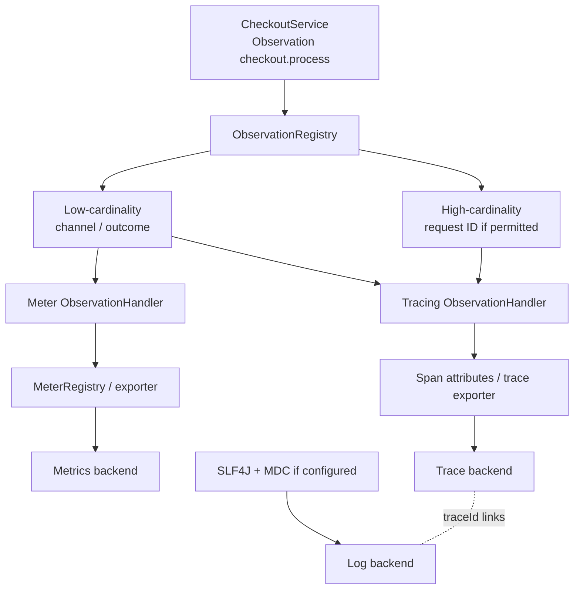

# Low-cardinality key value in Micrometer Observation

Suppose a Spring Boot application receives hundreds of thousands of order requests every day. The operations team wants to know **how many requests fail, which sales channel errors are concentrated in, and whether the p95 latency of the payment step is increasing**. These questions require labels to slice metrics, but if every request creates its own label with `orderId` or `traceId`, the number of time series can grow very quickly and make the monitoring system expensive, slow, or unstable.

**Low-cardinality key value** solves a key part of this problem: attaching key/value pairs to an `Observation` that have a **small, controlled, and analytically meaningful set of values**. For example: `operation=checkout`, `channel=web`, `outcome=error`. As a result, metrics can be aggregated along stable dimensions, while logs and traces still serve investigations of a specific transaction.

The lesson **Low-cardinality key value** belongs to the chapter **Cardinality and metadata** of the **SPRING_BOOT_OBSERVABILITY** module. The module focuses on setting up observability for Spring Boot using Micrometer Observation, metrics, logs, and distributed tracing; learning context propagation, tag/cardinality, exporters, sampling, and correlating signals to investigate errors, latency, and application behavior in production environments. Here, the focus is on **designing metadata with few distinct values** and understanding precisely how it is used.

## 1. Learning objectives

After this lesson, you will be able to:

- Explain the *cardinality* of a tag and why the product of label dimensions determines the number of potential time series.
- Distinguish between `lowCardinalityKeyValue` and `highCardinalityKeyValue` in Micrometer Observation.
- Choose finite keys/values with naming conventions and consistent values across all processing branches.
- Attach low-cardinality metadata to a custom observation in Spring Boot using Java.
- Recognize dangerous cases such as `userId`, `orderId`, `traceId`, full URLs, and exception messages.
- Apply tag limits, verify actual metrics, and correlate with logs/traces without turning per-request identifiers into metric labels.

## 2. What does cardinality mean?

In observability, **the cardinality of a tag** is the number of distinct values that the tag can take. For example:

| Tag | Example values | Expected cardinality | Remarks |
| --- | --- | --- | --- |
| `outcome` | `success`, `rejected`, `error` | 3 | Low, easy to control |
| `http.method` | `GET`, `POST`, `PUT`, `DELETE` | Small | Usually suitable for metrics |
| `region` | `ap-southeast-1`, `eu-west-1` | A few values | Depends on number of deployment regions |
| `channel` | `web`, `mobile`, `partner` | 3 | Low if mapped to an enum |
| `http.route` | `/orders/{id}`, `/payments/{id}` | Relatively small | Use **route template**, avoid actual URL |
| `orderId` | `ord-10001`, `ord-10002`, ... | Very high | Do not use as a low-cardinality tag |
| `traceId` | One ID per trace | Very high | Used to correlate logs/traces |
| `exception.message` | String with dynamic parameters | Can be very high | Carries data leakage risk |

**Low cardinality does not have a fixed numerical threshold that applies to every system.** A tag with 100 values may be acceptable for a simple meter, but unsuitable when combined with many other labels, thousands of pods, and histograms with many buckets. You must evaluate **the actual total number of combinations**, traffic volume, retention, and backend limits.

### Why do labels multiply together?

A time series is distinguished by **metric name + the set of labels and their values**. Suppose a timer has four dimensions:

| Dimension | Number of values |
| --- | ---: |
| `service` | 4 |
| `region` | 6 |
| `channel` | 3 |
| `outcome` | 3 |

If every combination occurs, the number of potential label sets is:

\[
4 \times 6 \times 3 \times 3 = 216
\]

If you continue adding `orderId` with 50,000 values, the **potential multiplicative** number of combinations increases to:

\[
216 \times 50\,000 = 10\,800\,000
\]

This is an **upper-bound estimate assuming every combination occurs**, not a guarantee that the backend will create all 10.8 million series. The actual number of series depends on observed combinations, infrastructure-added labels, series lifetime, and how the exporter/backend represents the meter. With histograms, `_bucket`, `_sum`, and `_count` series further increase data volume.

In other words: a tag that sounds harmless on its own can become expensive when **combined with many other tags** or deployed across hundreds of instances.

## 3. Low-cardinality and high-cardinality in Micrometer Observation

Micrometer Observation distinguishes two groups of key-values:

- **Low-cardinality key-values:** a small, stable set of values; can be used by meter observation handlers as **metric tags** and can also be present in tracing metadata, depending on the integration.
- **High-cardinality key-values:** contain detailed data for each unit of work, such as technical reference codes with many values; typically **not used as metric tags** by standard meter observation handlers, but can be used by tracing handlers as span attributes.

API example:

```java
Observation observation = Observation
    .createNotStarted("checkout.process", observationRegistry)
    .lowCardinalityKeyValue("operation", "checkout")
    .lowCardinalityKeyValue("channel", "web")
    .highCardinalityKeyValue("request.id", requestId)
    .start();
```

`requestId` in the example above should only be added **if data policy permits**, it contains no sensitive information, and the operations team genuinely needs that attribute in traces. High-cardinality metadata still consumes resources, has size limits, and requires access control. You should not attach every ID by default just because they do not become metric tags.

### Comparison table

| Criterion | Low-cardinality | High-cardinality |
| --- | --- | --- |
| Primary purpose | Group, filter, aggregate metrics | Diagnose a specific request or business operation |
| Number of values | Few and standardized | Can be very large |
| Suitable examples | `outcome=error`, `channel=web` | `request.id=...`, permitted transaction code |
| Metrics via common meter handlers | Can become a tag | Usually not converted into a tag |
| Tracing | Can be a span attribute | Can be a span attribute, depending on handler |
| Main risk | Label multiplication increases time series | Overly detailed data, storage cost, sensitivity risk |
| Cross-service propagation | Not automatic | Also not automatic |

**Important:** `highCardinalityKeyValue(...)` is not equivalent to **baggage** or the `traceparent` header. It does not automatically carry a value across to another service. Propagation over HTTP, queues, or threads depends on tracing/context propagation and the corresponding instrumentation. If you want to carry metadata across service boundaries, you need to design a dedicated propagation mechanism that is bounded and complies with security policies.

## 4. What makes a good low-cardinality key-value?

Check four aspects before putting a tag into a metric:

1. **Finite or clearly bounded value set:** for example, `channel` only accepts `web`, `mobile`, `partner`, `unknown`.
2. **Consistent meaning:** `outcome=error` in service A and service B should be clearly defined, not used for business rejections in one place and exceptions in another.
3. **Analytical usefulness:** the operations team can query error rate, throughput, or latency along this dimension; do not add a tag simply because the data is available.
4. **Contains no secrets, personal data, or arbitrary values:** avoid tokens, emails, user IPs, unnormalized input, exception messages, and URLs containing path parameters.

Keys are commonly named using a `lowercase` convention with dots for grouping, such as `error.category`, `http.route`, `messaging.operation`; some systems use underscores. What matters is **consistency with the semantic conventions and naming conventions of the stack in use**. Key names transformed when exported to Prometheus or other backends may not look identical to the raw form in Java.

### Normalizing input values

Do not pass a client-sent string directly into a tag:

```java
// Unsafe if the client sends arbitrary values in the header.
observation.lowCardinalityKeyValue(
    "channel", request.getHeader("X-Channel"));
```

Instead, map it to an allowed set of values:

```java
static String metricChannel(String raw) {
    if (raw == null) {
        return "unknown";
    }

    return switch (raw.toLowerCase(java.util.Locale.ROOT)) {
        case "web" -> "web";
        case "mobile", "ios", "android" -> "mobile";
        case "partner" -> "partner";
        default -> "unknown";
    };
}
```

As a result, even if a client sends `X-Channel: 123456`, `X-Channel: test-1`, or a very long string, the metric still only receives values from a small set. Normalization **does not replace data validation** if this field is used for business decisions or authorization; it is strictly classification for observability.

## 5. Practical example: custom observation for checkout

An application receives checkout requests from three channels: web, mobile, and partner. For each operation, we need to know which channel has more errors and how long processing takes. If inventory rejects due to being out of stock, this is an **expected business outcome**; if the gateway throws a timeout, this is a technical error.

We will create a custom observation with:

- `name=checkout.process`: stable operation name.
- `operation=checkout`: clearly indicates the operation type.
- `channel=web|mobile|partner`: enum with a finite value set.
- `outcome=success|rejected|error`: classifies the final outcome.

### 5.1. Defining data and dependencies

```java
public enum CheckoutChannel {
    WEB("web"), MOBILE("mobile"), PARTNER("partner");

    private final String metricTag;

    CheckoutChannel(String metricTag) {
        this.metricTag = metricTag;
    }

    public String metricTag() {
        return metricTag;
    }
}

public record CheckoutCommand(
        String orderId,
        CheckoutChannel channel,
        int itemCount) {}

public record CheckoutResult(boolean accepted) {}

public interface CheckoutGateway {
    CheckoutResult reserve(CheckoutCommand command);
}
```

`orderId` is the ID of a specific order. `channel` is represented by an enum so only three values can be recorded in metrics. The example assumes `command` has already been validated and `channel` is non-null before entering the service; in a real project, that condition must be checked at the boundary.

### 5.2. Attaching low-cardinality key-values by outcome

```java
import io.micrometer.observation.Observation;
import io.micrometer.observation.ObservationRegistry;
import org.springframework.stereotype.Service;

@Service
public class CheckoutService {

    private final ObservationRegistry registry;
    private final CheckoutGateway gateway;

    public CheckoutService(ObservationRegistry registry,
                           CheckoutGateway gateway) {
        this.registry = registry;
        this.gateway = gateway;
    }

    public CheckoutResult checkout(CheckoutCommand command) {
        Observation observation = Observation
            .createNotStarted("checkout.process", registry)
            .lowCardinalityKeyValue("operation", "checkout")
            .lowCardinalityKeyValue(
                "channel", command.channel().metricTag())
            .start();

        try (Observation.Scope scope = observation.openScope()) {
            try {
                CheckoutResult result = gateway.reserve(command);

                if (result.accepted()) {
                    observation.lowCardinalityKeyValue(
                        "outcome", "success");
                } else {
                    observation.lowCardinalityKeyValue(
                        "outcome", "rejected");
                }

                return result;
            } catch (RuntimeException ex) {
                observation.lowCardinalityKeyValue(
                    "outcome", "error");
                observation.error(ex);
                throw ex;
            }
        } finally {
            observation.stop();
        }
    }
}
```

The code above has three paths:

1. **Success:** the gateway returns `accepted=true`, the observation gets `outcome=success`, the scope closes, and `stop()` runs.
2. **Contractual rejection:** the gateway returns `accepted=false`, and the observation gets `outcome=rejected`. By default, this is not a system exception.
3. **Technical error:** the gateway throws a `RuntimeException`, the observation receives `outcome=error` and `error(ex)`; then the exception continues propagating to the caller, while `stop()` is always called.

Every branch sets an `outcome` value belonging to the same three-value set. Thus, aggregating the rate of each outcome does not depend on whether the caller responds with HTTP 200, 409, or 5xx. Framework-created HTTP observations can have their own label scheme; this custom observation describes **checkout business semantics**.

**Do not add `orderId` to `lowCardinalityKeyValue`.** If you want to look up a specific order, use controlled logs and/or trace attributes when permitted. This requires verifying tracer configuration, MDC, and data policies before sending IDs to the backend.

### 5.3. Why should outcome be set before stop?

Observation handlers can use key-values at different points in the lifecycle. With common timer observation handlers, labels attached before the observation ends can be used when finalizing the timer metric. Therefore, success/failure branches should attach the outcome **before `stop()`**.

Do not assume every handler or exporter reads key-values at the exact same moment. When adding tags late, inspect the actual metric/span in your stack. If you want a tag to always be available from the start, attach it before `start()` like `operation` and `channel` in the example.

## 6. How does low-cardinality metadata flow into metrics and tracing?



**Metrics:** a meter observation handler typically creates a timer from the observation name and puts low-cardinality key-values into the tag set. In Prometheus, a timer may be exported as series with `_seconds_count`, `_seconds_sum`, and `_seconds_bucket` suffixes when histograms are enabled; exact names depend on the exporter, naming convention, and version. For `outcome`, finite values allow aggregating counts and latency.

**Traces:** a tracing observation handler can turn both low- and high-cardinality key-values into attributes on a span. However, exported attributes, errors, span names, and sampling depend on the integration. Tracing sampling reduces the number of stored traces; it is **not a direct way to reduce metric cardinality**, because metrics and traces usually have separate pipelines and export policies.

**Logs:** `Observation.lowCardinalityKeyValue(...)` does not emit logs on its own and does not guarantee all key-values appear in MDC. If you want logs to contain `channel` or `outcome`, log controlled fields according to your log schema or use an appropriate logging integration. When tracing is configured, `traceId` and `spanId` can appear in logs for linking; these are **correlation keys**, not metric labels.

### Correlating a specific error

Imagine metrics show `checkout.process{channel="mobile", outcome="error"}` spiking. You pull an error log from the corresponding time window and use the log's `traceId` to open the trace if it was sampled and exported. The trace may reveal that the gateway span took 1.8 seconds before timing out. You do not need to turn each `traceId` into a time series to perform this investigation.

## 7. Production metadata conventions

A good tag set needs consistent **names, value sets, observation levels, and units of measurement**. Example proposed schema for `checkout.process`:

| Key | Value type | Allowed set | Meaning |
| --- | --- | --- | --- |
| `operation` | Enum string | `checkout` | Operation type |
| `channel` | Enum string | `web`, `mobile`, `partner`, `unknown` | Source channel |
| `outcome` | Enum string | `success`, `rejected`, `error` | Final outcome |
| `error.category` | Enum string if used | `timeout`, `dependency`, `validation`, `other` | Technical error group |
| `service` | Controlled deployment value | Registered service name | Originating source |

Some systems may not need `operation` if the observation name is already distinctive enough. Every additional tag must answer **a specific operational question**, not be added just because the data is at hand.

### Designing a consistent outcome

An application-owned enum avoids variants like `ok`, `OK`, `passed`, `SUCCESS` expressing the same concept. Example convention:

- `success`: the work completed as requested.
- `rejected`: rejected per business contract, not necessarily an infrastructure failure.
- `error`: technical error or unrecovered failure within the observation's scope.
- `degraded`: add only if the system genuinely has a fallback mode that degrades quality and you want to track it separately.

This definition must align with the **observation boundary**. A failed inventory call attempt might have `outcome=error`, while the overall checkout operation after a successful retry still has `outcome=success` or `degraded` per contract. Mixing attempt counts with checkout counts causes error rates to be misinterpreted.

### Missing or inconsistent tags

If the success branch has `outcome=success` but the exception branch lacks `outcome`, the backend may create multiple combinations of missing/present labels. A dashboard filtering `outcome=error` will miss real failures. Ensure all measured branches **set a value**, or have a clear `unknown` convention when classification is not possible.

Avoid preemptively setting `error.category="none"` and then appending another key with the same name via an append API without confirming your Micrometer version's semantics; if you need to update a value, design the tagging logic to set it once at a deterministic point, or use context/convention according to the API.

## 8. Cardinality limits and infrastructure protection

Designing finite tags is the primary measure. When a system handles hard-to-control data or has many developers, you should add **guardrails** at the registry and infrastructure layers.

### 8.1. Calculating a series budget upfront

Suppose a `checkout.process` metric has 4 channels, 4 outcomes, 6 regions, and 5 instances:

\[
4 \times 4 \times 6 \times 5 = 480
\]

This is the **maximum number of label combinations assuming every combination occurs** across these four dimensions. If a histogram has 12 buckets along with `_sum` and `_count`, a single label combination can generate many additional series; the exact count depends on the exporter and configuration. Remember to multiply by default infrastructure labels such as `job`, `instance`, `pod`, or deployment when budgeting.

### 8.2. MeterFilter as a defensive layer

Micrometer Metrics provides `MeterFilter` to limit certain tag values by meter name. The following Java example uses the Micrometer Metrics API in Spring Boot:

```java
import io.micrometer.core.instrument.MeterRegistry;
import io.micrometer.core.instrument.config.MeterFilter;
import org.springframework.boot.actuate.autoconfigure.metrics.MeterRegistryCustomizer;
import org.springframework.context.annotation.Bean;
import org.springframework.context.annotation.Configuration;

@Configuration(proxyBeanMethods = false)
public class MetricTagGuardrails {

    @Bean
    MeterRegistryCustomizer<MeterRegistry> checkoutTagLimit() {
        return registry -> registry.config().meterFilter(
            MeterFilter.maximumAllowableTags(
                "checkout.process",
                "channel",
                10,
                MeterFilter.deny()
            )
        );
    }
}
```

This pattern limits the number of **distinct values of the `channel` tag** accepted for meters whose names start with `checkout.process`; once the threshold is reached, new meters with tag values exceeding the limit can be denied according to the filter. This is a **last-resort safety mechanism** and does not fix poorly tagged data: denied series mean metrics may be missing. You need to monitor the filter itself, understand its scope by version, and check the consequences with the exporter in use.

With `channel` mapped to a three-value enum as in the example, a limit of 10 primarily guards against unintended code changes. You should not use a filter as an excuse to allow `orderId` or `userId` into metric tags and hope the registry handles it safely.

### 8.3. Distinguishing blocking in code vs. at export time

| Layer | Control | Limitation |
| --- | --- | --- |
| Service/controller | Normalize input to enum | Best because it prevents dynamic labels at the source |
| Observation convention/filter | Apply consistent schema/tags | Requires understanding when handlers read metadata |
| MeterRegistry/MeterFilter | Limit, deny, rename meter/tag | Can cause missing metrics or confusing results if used late |
| Collector/exporter | Drop/relabel/aggregation per backend | Costs resources before dropping and can lose signals |
| Metrics backend | Quotas, retention, cardinality alerts | Protects infrastructure but does not fix application design flaws |

No layer can replace designing metadata with a **bounded set of values from the start**.

## 9. Relationship with ObservationConvention and ObservationFilter

When you only have one custom observation, calling `lowCardinalityKeyValue(...)` directly in the service is usually clear enough. When multiple layers and teams create the same kind of observation, the tag schema can be centralized using:

- **`ObservationConvention`:** standardizes the name, contextual name, and key-values for a type of observation context; usually fits best when there is a dedicated context type.
- **`ObservationFilter`:** customizes the observation context via the registry before completion; fits adding shared metadata within a defined scope.
- **`ObservationPredicate`:** decides conditionally whether an observation is allowed to be created/recorded, such as excluding a group of health checks that do not need measurement.
- **`ObservationHandler`:** reacts to lifecycle callbacks; meter/tracing handlers use metadata to produce the corresponding signals.

You should not use an `onStart` handler to dynamically attach every request ID to low-cardinality tags. That is a metadata design flaw, regardless of whether the code lives in a service, convention, filter, or handler.

### Framework metadata vs. custom metadata

Spring Boot/Spring Framework can create observations for HTTP servers/clients and other instrumented components. Certain labels such as method, route, status, or URI template are often already provided by the framework with its own conventions. Before manually adding a label with the same name, check existing data and compatibility with the version in use.

For example, **`/orders/{id}`** is a finite route template, whereas **`/orders/841239`** is a concrete path with a dynamic ID. If you overwrite the route tag with `request.getRequestURI()`, you can defeat the cardinality goal even though the framework originally used a safe label.

## 10. Common mistakes

| Mistake | Consequence | Fix |
| --- | --- | --- |
| Attaching `userId` or `orderId` as a low-cardinality key | Time series count grows with users/orders | Use IDs in controlled log/trace context |
| Setting full URL as `http.route` | Every path parameter creates a new value | Use a route template |
| Taking client-supplied headers directly | Clients can generate countless tag values | Map to an enum/`unknown` |
| Setting `exception.message` as a tag | High cardinality, possible data exposure | Standardize a finite `error.category` |
| Each service having its own `outcome` values | Hard to aggregate and compare | Define a unified outcome contract |
| Exception branch forgetting `outcome=error` | Dashboards miss errors | Cover all branches, set tags before `stop()` |
| Attaching `traceId` as a metric label to join logs | Massive cardinality | Use traceId for log/trace correlation |
| Assuming high-cardinality propagates across services automatically | Metadata lost across HTTP/queue boundaries | Configure appropriate propagation/instrumentation |
| Using trace sampling to reduce metric series count | Does not solve root metric cardinality | Reduce tag values, review extra labels and registry |
| Enabling histograms for every meter with many labels | Rapidly increases series count and storage | Choose SLOs/histograms for critical meters |
| Using MeterFilter as the primary fix for dirty tags | Missing metrics, hard to explain | Normalize at source; filter is only a guardrail |
| Attaching the same tag via multiple unchecked mechanisms | Duplicate labels or unintended overwrites | Check observation conventions, handlers, and exporters |

## 11. Practice and verification

Apply this to `CheckoutService` in section 5. Create a test implementation of `CheckoutGateway` that can successively return `accepted=true`, `accepted=false`, and throw a `RuntimeException`.

### Test case table

| Case | Input/behavior | Expected tags | What to observe |
| --- | --- | --- | --- |
| A | `channel=WEB`, succeeds | `channel=web, outcome=success` | Timer count increments in the success group |
| B | `channel=MOBILE`, rejected | `channel=mobile, outcome=rejected` | Do not confuse business rejection with technical error |
| C | `channel=PARTNER`, timeout | `channel=partner, outcome=error` | Observation records error, still stops, exception propagates |
| D | Client sends invalid channel | `channel=unknown` after normalization if accepted | Does not create a new metric tag from the input string |
| E | Many different order IDs on the same channel | Same `channel=web` | Does not emit `orderId` as a metric label |
| F | First retry attempt fails, second succeeds | Distinguish attempt and operation metrics | Do not count attempt failures as final request errors |

### Checking each layer

1. **In code:** verify every branch sets an outcome before stop; only finite labels are used and no per-order private data is exposed.
2. **In MeterRegistry:** verify the `checkout.process` meter has the expected `channel` and `outcome` tags, and the number of meters per combination is low. If you need standalone testing, use `SimpleMeterRegistry` with an appropriate observation meter handler configured; a standalone metrics registry does not automatically generate timers from observations without a handler.
3. **In the exporter:** inspect the actual metric names and tags added by naming conventions/collectors. Do not guess series names solely from the `Observation` name in Java.
4. **In tracing:** verify tags are appropriately reflected on spans when a tracing handler/exporter is configured; if traces are missing, check sampling, collector, and context propagation.
5. **In logs:** when investigating a failed checkout, search logs by timestamp and trace ID, then open the corresponding trace if available. Avoid demanding a separate metric series per ID.
6. **Over time:** monitor the number of active time series and cost as instances, regions, or outcomes grow. Cardinality is an ongoing operational concern, not just a unit test pass condition.

### Try calculating a budget yourself

A service has 3 channels, 4 outcomes, 8 regions, 10 instances, and 2 operation types. Calculate the maximum number of combinations assuming every combination occurs:

\[
3 \times 4 \times 8 \times 10 \times 2 = 1\,920
\]

Now consider adding `tenantId` with 2,000 values:

\[
1\,920 \times 2\,000 = 3\,840\,000
\]

What happens if the timer also exports histogram buckets? Which dimensions would you keep for metrics, and where would you put `tenantId` so you can still investigate a specific case? Explain your choices based on operational needs, privacy, and storage capacity.

## 12. Self-assessment questions

1. Why is `lowCardinalityKeyValue` named “low cardinality” yet the API cannot guarantee that the values passed in actually have low variation?
2. When is `error.category=timeout` better than `exception.message=Read timed out for order 123`?
3. An observation has both `traceId` and `outcome`: which field is suitable for creating a metric label? Why?
4. Adding a tag with only 5 values can multiply the total number of series by how much? What causes actual results to differ from the theoretical multiplication?
5. Why does trace sampling not solve having millions of label combinations in metrics?
6. When a service returns a result from a fallback, should you attach `outcome=success`, `degraded`, or `error`? Which boundaries and contracts must be defined first?
7. When Spring Boot already auto-instruments HTTP endpoints, why can using the actual path instead of the route template break cardinality?
8. At which layer of the pipeline do `ObservationFilter` and `MeterFilter` differ?

## 13. Key takeaways

**Low-cardinality key value** is a metadata pair with a **finite, consistent, and analytically useful set of values for aggregating metrics**. In Micrometer Observation, use `lowCardinalityKeyValue` for dimensions like `operation`, `channel`, `outcome`; avoid putting `orderId`, `userId`, `traceId`, full URLs, or exception messages into metric labels. Each additional tag can multiply the number of series combinations with existing tags.

Good design starts with normalizing data at the source, defining clear outcomes aligned with observation boundaries, reviewing all exported labels, and setting a cardinality budget. Metrics provide aggregated numbers; logs and traces provide per-request detail; context propagation, exporters, and sampling determine how much correlation is observable. When each signal is assigned its proper role, Spring Boot can preserve both **incident investigation capability** and **controlled monitoring costs** in production environments.
