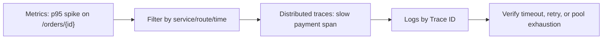

# Cardinality in Spring Boot Observability metrics

In an observability system, a metric is useful when it describes application behavior over time and can be aggregated reliably. However, the same metric can generate tens, thousands, or millions of **time series** when its tags/labels take on too many values. This phenomenon is called **high cardinality** and is a common reason why metrics backends consume excessive memory, drive up storage costs, run slow queries, or fail to meet alerting needs.

The lesson **“Cardinality in metrics”** belongs to the chapter **Cardinality and metadata** in the **SPRING_BOOT_OBSERVABILITY** module. The content focuses on Micrometer and Spring Boot: identifying high-cardinality tags, calculating their impact on series count, designing business-aligned labels, controlling data via Observation/MeterRegistry, and verifying in Prometheus or an equivalent metrics backend. At the same time, it clarifies how to correlate **metrics, logs, and distributed traces** without turning per-request identifiers into metric labels.

## 1. What are metrics, tags, and time series?

A **metric** is a measurement with a clear name and type, such as the count of successful orders or the duration of HTTP request processing. Micrometer provides meters such as:

- **Counter:** represents a monotonically increasing cumulative event count, such as confirmed orders.
- **Timer:** records execution count and duration, such as reservation duration or HTTP handling time.
- **Gauge:** observes a value at the time of reading, such as active connections in use.
- **DistributionSummary:** records the distribution of a measured quantity that is not necessarily time, such as bounded payload sizes.

A meter typically carries **tags** (Micrometer) or **labels** (Prometheus). For example:

```text
orders.processed{channel="web",outcome="success"}  410
orders.processed{channel="web",outcome="failure"}   12
orders.processed{channel="mobile",outcome="success"} 290
orders.processed{channel="mobile",outcome="failure"}  8
```

This is a conceptual example of metric series, not the exact export format of a Counter in every backend. For the same metric name `orders.processed`, each distinct label combination is a **separate time series**.

In a Prometheus-style backend, a time series is distinguished by **the metric name and the entire label set**. Two samples with the same name and same labels at different timestamps are two data points of the same series; two samples differing in a label value belong to two different series.

### Cardinality has two easily confused meanings

- **Cardinality of a tag:** the number of distinct values that tag can receive. For example, `channel` having `web` and `mobile` has a cardinality of 2.
- **Cardinality of a metric:** the number of label combinations that actually occur and form distinct series. This depends on both each individual tag and the relationship between them.

Not every possible combination will occur. However, if label dimensions are relatively independent, the total number of series can grow close to the product of the value counts of each dimension.

## 2. Formula for estimating time series count

Suppose an HTTP metric has the following tags:

| Tag | Distinct value count (assumed) | Examples |
| --- | ---: | --- |
| `uri` | 25 | `/orders/{id}`, `/payments` |
| `method` | 4 | GET, POST, PUT, DELETE |
| `status` | 5 | 200, 201, 400, 404, 500 |
| `instance` | 12 | 12 running instances |

The **theoretical upper bound** on the number of label combinations is:

\[
N_{\text{series}} \leq \prod_{i=1}^{k} |V_i|
\]

where \(V_i\) is the value set of the \(i\)-th tag. In the example:

\[
25 \times 4 \times 5 \times 12 = 6\,000\text{ combinations}
\]

The actual number may be much smaller because some methods do not exist on every route, some statuses are rare, and instances may receive different traffic.

If you add `user.id` with 10,000 values, the upper bound becomes:

\[
6\,000 \times 10\,000 = 60\,000\,000\text{ combinations}
\]

This is an **upper-bound scenario**, not a prediction that the system will definitely create 60 million series. Still, it shows that a single tag carrying an ID can turn an aggregate measurement into countless series that are virtually impossible to aggregate efficiently.

### Histograms further multiply series count

With a classic Prometheus-style histogram, each label set typically has multiple bucket series, along with count and sum series. For a hypothetical example, if a histogram has 15 bucket series and 2 count/sum series, then **one** tag combination can produce around 17 series instead of one. Exact counts depend on configuration and backend type.

\[
6\,000 \text{ combinations} \times 17 \approx 102\,000\text{ series}
\]

When configuring many buckets or many labels, cost can escalate rapidly. Therefore, you must consider **both tag cardinality and how the meter exports data**, not just count metric names.

### Ingested sample volume also increases

In a scrape model assuming every 15 seconds, a series is sampled up to about 4 samples/minute while the target is healthy. With 100,000 stable series, the system can receive roughly 400,000 samples/minute from that group of series alone. That is a back-of-the-envelope estimate to visualize scale, excluding retries, replication, metadata, or backend storage characteristics.

## 3. Distinguishing low-cardinality and high-cardinality metadata

In Micrometer Observation, **low-cardinality key-values** are typically used as tags for metrics and can also be used as attributes in traces. **High-cardinality key-values** can provide detailed information for traces through the corresponding handler; under standard integration, they do not become metric tags.

| Data | Expected cardinality | Suitable for metrics? | Reason |
| --- | --- | --- | --- |
| `http.request.method`: GET/POST/... | Low | Yes | Useful for breaking down by HTTP method |
| `http.route`: `/orders/{id}` | Bounded if routes are finite | Yes | Groups requests by endpoint |
| `outcome`: success/failure | Low | Yes | Useful for error rates |
| `payment.method`: card/wallet | Low | Yes | Breakdown by payment method type |
| `warehouse.region`: apac/eu/other | Low | Yes | Breakdown by region |
| `user.id`, `order.id` | Very high | No | Nearly one value per user/order |
| `request.id`, `trace.id` | Nearly unique | No | Identifies each execution, creates separate series |
| Raw URL with resource ID | High | No | Every new URL can create a new series |
| Timestamps, UUIDs, session IDs | Very high | No | Grows continuously over time |

Do not conclude “if it's high-cardinality, just push it to traces.” Traces also incur storage/indexing costs and carry security policies. **Emails, tokens, card numbers, credentials, raw payloads, and sensitive personal data must not be placed into metric labels, span attributes, or baggage**.

### Metric labels are not a tool for looking up a specific request

To answer “where did order X fail?”, use logs with a correlation ID, traces with a Trace ID, and business systems with appropriate access controls. Metric labels answer “across all orders, which group is currently slow or failing frequently?”. The two types of questions require different data.

## 4. Sources of cardinality growth in Spring Boot

### 4.1. Raw URLs instead of route templates

Unsuitable example:

```text
uri="/orders/1001"
uri="/orders/1002"
uri="/orders/1003"
...
```

This label set grows with the number of orders. A better label:

```text
uri="/orders/{id}"
```

Spring MVC/WebFlux with appropriate instrumentation typically uses the route template or a normalized fallback value. However, actual labeling behavior depends on version, framework, endpoint type, and configuration; **inspect exported labels**, rather than assuming every custom router keeps cardinality low.

URLs with query strings, UUIDs, pagination cursors, or download filenames must also be reviewed if the application constructs metric tags manually.

### 4.2. Attaching transaction IDs to a Counter

What not to do:

```java
meterRegistry.counter(
        "orders.created",
        "order.id", orderId
).increment();
```

If every order has a new `orderId`, each call can register a new meter/series. An aggregate counter no longer provides meaningful value when nearly every label combination records only once.

A better example:

```java
meterRegistry.counter(
        "orders.created",
        "channel", normalizedChannel,
        "outcome", "success"
).increment();
```

Here `normalizedChannel` must belong to a small predefined set. Never pass a string received directly from a client into a tag without constraining its value set.

### 4.3. Infrastructure tags

Labels like `instance`, `pod`, `container`, or `host` identify where metrics originate, but their value count can change during autoscaling, deployments, or restarts. They are not necessarily a design flaw; assess **which labels are needed for per-instance investigation** and **which labels should be aggregated/dropped at the appropriate layer**.

In particular, if each deployment creates new pods, the backend may retain both old and new series throughout the retention window. Distinguish **active series**, new series created over time, and total series still stored.

### 4.4. Uncontrolled instrumentation

Common sources to audit:

- A metric per raw SQL query text instead of operation type.
- A metric per exception message containing variable data.
- A metric per tenant/customer when the tenant set is large.
- Metrics from queues/topics with dynamically generated names.
- Span or meter names built from user input.
- Tags automatically added by a custom `ObservationConvention` or `MeterFilter`.

Even if a label starts with few values, it can become high-cardinality as the product grows. Maintain an **allowlist** and bound the number of values from the outset.

## 5. Designing safe tags around observability goals

Before adding a tag, answer four questions:

1. **What is the operational question?** For example, comparing latency between `channel=web` and `channel=mobile`.
2. **How many values can appear?** Estimate both today and if users/orders grow tenfold.
3. **Is the tag stable over time?** Dynamic IDs, ephemeral pod names, or full URLs often cause heavy churn.
4. **Does the tag contain sensitive information?** If yes, do not export it to an observability system accessible to many people.

A tag design sheet can be documented like this:

| Metric/operation | Allowed tags | Valid values | Exclude |
| --- | --- | --- | --- |
| `orders.created` | `channel`, `outcome` | web/mobile; success/failure | orderId, userId |
| `inventory.reserve` | `warehouse.region`, `outcome` | apac/eu/other; reserved/failed | raw warehouse address |
| `payment.authorize` | `payment.method`, `outcome` | card/wallet; approved/declined/error | account number, token |
| `http.server.requests` | `uri`, `method`, `status` and framework-provided tags | Route template, standardized method/status | Raw URL, session ID |

### 5.1. Classify errors, do not use error messages

Do not put `exception.getMessage()` into a tag because messages can contain IDs, paths, SQL, or request-specific content. Replace it with a stable set of error codes:

```text
error.category="validation"
error.category="dependency_timeout"
error.category="business_rejected"
error.category="unexpected"
```

An exception class name sometimes has a relatively finite number of values, but you must still check instrumentation and actual exception types. When stack trace details are needed, use logs/traces with appropriate data controls.

### 5.2. Use “other” or reject invalid values?

There are two common approaches:

- Normalize out-of-list values to `other` or `unknown` to keep total series small.
- Reject or report a business input error if the value is invalid per contract, while recording error metrics under a bounded group.

Never silently convert an invalid payment method into `card` just to lower cardinality. **Label normalization is for aggregating observations**, not altering business decisions.

## 6. Java example with Micrometer MeterRegistry

Example service recording a counter with a finite label set, independent of order ID:

```java
import io.micrometer.core.instrument.MeterRegistry;
import org.springframework.stereotype.Component;

@Component
public class OrderMetrics {

    private final MeterRegistry meterRegistry;

    public OrderMetrics(MeterRegistry meterRegistry) {
        this.meterRegistry = meterRegistry;
    }

    public void recordProcessed(String channel, boolean success) {
        String channelTag = normalizeChannel(channel);
        String outcomeTag = success ? "success" : "failure";

        meterRegistry.counter(
                "orders.processed",
                "channel", channelTag,
                "outcome", outcomeTag
        ).increment();
    }

    private static String normalizeChannel(String channel) {
        if ("web".equalsIgnoreCase(channel)) {
            return "web";
        }
        if ("mobile".equalsIgnoreCase(channel)) {
            return "mobile";
        }
        return "other";
    }
}
```

The service uses only the Spring Boot-managed `MeterRegistry`. `channelTag` falls into at most three groups and `outcomeTag` into two groups, so for these tags there are **at most 6 combinations**. Common tags or backend-added labels may make the total series count larger.

There is no need to instantiate a new `SimpleMeterRegistry` inside a business service: that registry would sit outside the Prometheus/OTLP registry configured by Spring Boot.

### 6.1. Timer for a business operation

```java
import io.micrometer.core.instrument.MeterRegistry;
import io.micrometer.core.instrument.Timer;
import org.springframework.stereotype.Service;

@Service
public class InventoryService {

    private final MeterRegistry meterRegistry;

    public InventoryService(MeterRegistry meterRegistry) {
        this.meterRegistry = meterRegistry;
    }

    public void reserve(String region, Runnable operation) {
        String regionTag = normalizeRegion(region);

        Timer timer = meterRegistry.timer(
                "inventory.reserve.duration",
                "warehouse.region", regionTag
        );

        timer.record(operation);
    }

    private static String normalizeRegion(String region) {
        if ("apac".equalsIgnoreCase(region)) {
            return "apac";
        }
        if ("eu".equalsIgnoreCase(region)) {
            return "eu";
        }
        return "other";
    }
}
```

The Timer measures the execution duration of `operation`. This example focuses on recording metrics; how `outcome` or exceptions are recorded must be designed separately if you want to distinguish results. Do not add UUIDs, order IDs, or request payloads as Timer labels.

## 7. Cardinality in Micrometer Observation

When you want the same operation to serve both metrics and traces, use **Observation**:

```java
import io.micrometer.observation.Observation;
import io.micrometer.observation.ObservationRegistry;
import org.springframework.stereotype.Service;

@Service
public class ReservationWorkflow {

    private final ObservationRegistry observationRegistry;

    public ReservationWorkflow(ObservationRegistry observationRegistry) {
        this.observationRegistry = observationRegistry;
    }

    public void execute(String region, Runnable action) {
        String regionGroup = normalizeRegion(region);

        Observation.createNotStarted(
                    "inventory.reserve",
                    observationRegistry
                )
                .lowCardinalityKeyValue("warehouse.region", regionGroup)
                .observe(action);
    }

    private static String normalizeRegion(String value) {
        if ("apac".equalsIgnoreCase(value)) {
            return "apac";
        }
        if ("eu".equalsIgnoreCase(value)) {
            return "eu";
        }
        return "other";
    }
}
```

Once Spring Boot has wired the proper handlers:

- **The metrics handler** can create a timer from the Observation name and low-cardinality key-values.
- **The tracing handler** can create a span when an appropriate tracing bridge, scope, and sampling are present.
- **Exporters** ship metrics or spans through separate paths to the backend.
- **Logs** can be correlated with Trace ID/Span ID when tracing context and logging patterns are configured.

### 7.1. Low and high cardinality in Observation

Micrometer Observation separates two operations:

```java
observation.lowCardinalityKeyValue("warehouse.region", "apac");
observation.highCardinalityKeyValue("operation.reference", approvedReference);
```

`approvedReference` in the example is an **approved, non-sensitive** technical correlation value. Under standard metrics/tracing handlers, low-cardinality key-values can be exported to both metrics and tracing; high-cardinality key-values are intended for tracing and do not automatically become metric tags.

However, **high-cardinality is not a license to record everything**: trace attributes still consume storage and may be queried by many people. Business documents, customer details, or secrets must not be included simply because they stay out of metrics.

### 7.2. ObservationConvention unifies the schema

When multiple places record `inventory.reserve`, use `ObservationConvention` and an appropriate `Observation.Context` type to consistently define the name, contextual name, and low/high-cardinality key-values. Conventions prevent teams from creating `warehouse_region`, `region`, and `warehouseRegion` for the same concept.

**`ObservationFilter`** adds/modifies Observation data according to a shared policy; **`MeterFilter`** intercepts meters when they are registered in `MeterRegistry`. They serve different roles. Do not use a filter to automatically copy all HTTP headers or payloads into tags.

## 8. Limiting cardinality at MeterRegistry

Designing tags at the source is the most important step. In addition, Micrometer provides **`MeterFilter`** to control which meters get registered.

Example capping the number of distinct `uri` values on the HTTP meter group, used as a defensive measure:

```java
import io.micrometer.core.instrument.config.MeterFilter;
import org.springframework.context.annotation.Bean;
import org.springframework.context.annotation.Configuration;

@Configuration
class MetricCardinalityGuard {

    @Bean
    MeterFilter limitHttpUriValues() {
        return MeterFilter.maximumAllowableTags(
                "http.server.requests",
                "uri",
                100,
                MeterFilter.deny()
        );
    }
}
```

In Micrometer versions supporting this API, the filter counts allowed `uri` tag values for meters matching the prefix and can deny new meters once the threshold is exceeded. **This is a safety guardrail**, not a way to turn raw URLs into route templates.

Understand the consequences clearly:

1. Once the threshold is hit, **new measurements can be dropped** if the filter denies the meter.
2. Metrics/alerts may no longer reflect full traffic.
3. Limits apply per registry/meter filter and specific value set, not across the total of all label dimensions system-wide.
4. Monitor alerts/logs and test impact before deploying to production.
5. Better instrumentation design remains using route templates and finite value sets from the beginning.

Avoid overly broad deny filters, as they can drop critical alerting metrics or mask incidents.

### 8.1. Common tags and external labels

Spring Boot 3.x supports common tags via configuration:

```yaml
spring:
  application:
    name: order-service

management:
  metrics:
    tags:
      application: order-service
      environment: production
```

Common tags should reflect service identity, environment, and stable configuration groups. If a label such as `pod` is added by Kubernetes, scrape config, or backend relabeling, check its impact at the **ingestion layer**. Such labels may not appear in the tags list returned at `/actuator/metrics` yet still contribute to cardinality in the backend.

## 9. Histograms, percentiles, and the impact of labels

When analyzing p95/p99 latency, systems commonly enable histograms or the corresponding distribution configuration:

```yaml
management:
  metrics:
    distribution:
      percentiles-histogram:
        http.server.requests: true
      slo:
        http.server.requests: 100ms,300ms,1s
```

In Spring Boot 3.x, this is an example distribution configuration for the HTTP server Timer. Histograms enable latency aggregation across multiple instances in the backend, but they also multiply series count by the number of buckets and label combinations.

A decision workflow:

- Pick a small set of critical operations/routes requiring p95/p99 evaluation.
- Choose buckets/SLO boundaries meaningful to actual user experience.
- Estimate series count with and without histograms.
- Ensure the operation's tags have finite value sets.
- Verify backend queries, e.g., aggregatable histogram quantiles from buckets.

Never average per-instance p95 values and treat that as the overall p95. A local percentile does not combine linearly into a system-wide percentile.

### When cardinality defeats the analytical goal

Suppose you need to measure p95 latency by `channel`. If every request carries a `request.id` label, almost every series holds only a handful of samples, leaving insufficient data to compute a meaningful distribution per series. The system spends far more resources while still needing query-time aggregation. It is better to keep `channel` as the metric label from the start and use Trace ID to inspect a specific request's path.

## 10. Investigating cardinality with Actuator and Prometheus

To determine whether an issue lies in the application or the backend, inspect from inside Spring Boot outward.

### 10.1. Inspecting meters inside the application

With Spring Boot 3.x and Actuator enabled:

```yaml
management:
  endpoints:
    web:
      exposure:
        include: health,info,metrics,prometheus
```

Illustrative commands:

```bash
curl -s http://localhost:8080/actuator/metrics
curl -s http://localhost:8080/actuator/metrics/http.server.requests
curl -s "http://localhost:8080/actuator/metrics/http.server.requests?tag=uri:/orders/%7Bid%7D"
```

The last command illustrates filtering by tag `uri=/orders/{id}` when that metric and label actually exist. HTTP clients may require different encoding for special characters; you can inspect `availableTags` in the JSON first.

Actuator `/actuator/metrics` displays meters inside the application; it **does not account for labels added by the backend after scraping** and does not replace the backend's active series count.

### 10.2. Analyzing with PromQL

Illustrative queries, applicable when Prometheus stores the corresponding series:

```promql
# Total visible series for an HTTP timer metric group.
count({__name__=~"http_server_requests_seconds_.*"})

# Count HTTP series per uri label value.
count by (uri) (http_server_requests_seconds_count)

# URIs with the most series due to combinations with other labels.
topk(10, count by (uri) (http_server_requests_seconds_count))

# Count distinct uri values currently present in this series group.
count(count by (uri) (http_server_requests_seconds_count))
```

Exact series names depend on Prometheus export format, Micrometer version, and histogram settings. **These queries count series/label combinations**, not request counts directly. To measure request rate or error rate, use `rate(...)` queries and appropriate aggregations.

You can use the backend's status/TSDB UI or internal metrics to analyze active series, newly created series, churn, and top resource-consuming metric names. In systems with many scrape targets, examine `job`, `instance`, and scrape-added labels.

### 10.3. Reading incident symptoms

Key indicators to watch:

| Symptom | What to check |
| --- | --- |
| Active series climb rapidly as traffic rises | Is there a label per new request/user/order? |
| Ingestion spikes after a release | Was a new tag, raw URL, or histogram added? |
| Metric still exists but count is abnormally low | Is a MeterFilter denying new values? |
| Backend queries slow down for one metric | Are there too many label combinations or buckets? |
| Series count grows after every rollout | Are pod/instance labels and churn increasing? |
| Dashboard loses data for a route | Did metric name, route tags, or scrape/relabeling change? |
| Traces exist but metrics are missing | Is there an issue in metrics registry, filter, exporter, or query? |

Check **series count, rate of new series creation, and measurement completeness** simultaneously. A cardinality cap that drops data can make dashboards look lighter while making alerts less accurate.

## 11. Does reducing cardinality lose error-investigation capability?

If you remove `orderId` and `requestId` from metrics, you can still investigate an individual request using **logs and distributed traces**.

A practical workflow:

1. **Metrics:** detect elevated error rate or p95 on `http.server.requests` or `payment.authorize` by service, route, and outcome.
2. **Traces:** find slow/errored traces in the same time window and read the span tree to see which dependency or business step took the time.
3. **Logs:** use Trace ID/Span ID to fetch timeout, retry, or exception details across the involved services.
4. **Cross-check:** verify the hypothesis against connection pool, network, and database metrics and additional traces.



**Do not attach Trace IDs to metric labels.** If your backend, registry, and instrumentation support **exemplars**, certain measurement points can carry a reference to a trace for investigation without creating a regular label dimension per Trace ID. This requires actual exporter/backend support and sampling; not every metric has exemplars.

### Trace sampling vs. metric cardinality

Example Spring Boot 3.x configuration:

```yaml
management:
  tracing:
    sampling:
      probability: 0.10
```

Tracing sampling reduces the number of exported traces; it **does not automatically reduce the number of label combinations in `MeterRegistry`**. A metrics handler can still measure full activity while only a fraction of traces are stored.

Conversely, reducing metric cardinality by omitting `request.id` **does not lose** the Trace ID propagated via W3C Trace Context when tracing instrumentation is configured properly. The two mechanisms serve different purposes.

## 12. Production cardinality control plan

An operational policy should include:

1. **Tag allowlist:** define the name, type, source, and expected value set for each dimension per metric/operation.
2. **Cardinality thresholds:** monitor active series, churn, new series per day, ingestion cost, and backend quotas.
3. **Review on instrumentation changes:** adding new labels or histograms requires impact review, especially on HTTP/messaging.
4. **Normalize at the source:** route templates, enum values, categorized errors; avoid patching infinite application-generated labels via downstream relabeling.
5. **Multi-layer limits:** MeterFilter in Micrometer; relabeling/metric filtering in Collector or backend; dashboard query aggregation. Know clearly which layer drops data and the consequences of dropping.
6. **Test with representative traffic:** include successes, errors, rarely used routes, large tenant counts, and multiple instances.
7. **Monitor data loss:** if limits are exceeded, know how many meters/measurements were denied and the impact on alerting.
8. **Metadata security:** follow data classification policies and keep PII/secrets out of tags, baggage, spans, and logs.

Backend-added labels (e.g., cluster, namespace, pod, scrape target) need owners and cardinality budgets just like application labels. A tag that looks “stable” per pod can still generate churn if pods are recreated continuously.

## 13. Hands-on lab: identifying and fixing a high-cardinality metric

Use a Spring Boot 3.x application with Actuator and `micrometer-registry-prometheus` or an equivalent metrics backend. You can use the `OrderMetrics` service from section 6.

### Step 1 — Set up the baseline configuration

Add dependencies in Maven if not already present:

```xml
<dependencies>
    <dependency>
        <groupId>org.springframework.boot</groupId>
        <artifactId>spring-boot-starter-actuator</artifactId>
    </dependency>
    <dependency>
        <groupId>io.micrometer</groupId>
        <artifactId>micrometer-registry-prometheus</artifactId>
    </dependency>
</dependencies>
```

Expose `metrics,prometheus` in Actuator in the lab environment. Do not expose management endpoints publicly in production.

### Step 2 — Create a metric with finite value groups

Call `recordProcessed("web", true)`, `recordProcessed("mobile", false)`, and variants. Inspect `/actuator/metrics/orders.processed` and `/actuator/prometheus`. Confirm the `channel` and `outcome` labels have only the designed groups.

### Step 3 — Calculate the series budget

List each dimension for the metric, expected value count, and instance count. Multiply them to get the upper bound. If histograms are enabled, multiply by the series emitted per label combination. Document which assumptions are maximums and measure actuals in the backend.

### Step 4 — Analyze a flawed design

There is no need to send PII or register millions of meters to test. Simply compare the design with and without an `order.id` tag using the calculation from section 2. Identify why dynamic IDs break the metrics budget.

### Step 5 — Fix at the source

Replace arbitrary labels with a route template or an `other` group. For inputs from HTTP headers or query parameters, check an allowlist; if an input is invalid under the business contract, handle the business error rather than silently changing the value.

### Step 6 — Verify metrics and traces

If a Micrometer Tracing bridge and OTLP exporter are configured, use the Observation from section 7. With 100% sampling in the lab only, verify an operation produces both a Timer and a corresponding span. Lower sampling to 10%, and verify displayed traces drop while aggregate metrics continue recording when the metrics handler is active.

### Step 7 — Test a guardrail policy

In the lab environment, configure `MeterFilter.maximumAllowableTags(...)` with a low threshold for a test meter. Generate enough synthetic values to exceed the threshold and observe that new meters can be denied. Restore the configuration and re-verify metrics. Never use meter denial to mask raw URL bugs in production.

### Step 8 — Evaluate results

| Criterion | Expected outcome |
| --- | --- |
| Stable metric names | No IDs, timestamps, or dynamic URLs in names |
| Bounded tags | Values belong to an allowlist or `other` group |
| Predictable series | Able to calculate and explain the series budget |
| Correct instrumentation | Counter/Timer increments after the operation runs |
| Working exporter | Backend sees measurements, not just Actuator |
| Independent tracing | Trace ID is used for correlation, not as a metric label |
| Sampling understood | Trace sampling does not solve metric cardinality |
| No data leakage | No tokens, PII, or payment codes in tags/attributes |
| Early alerting | Monitor active series and churn to catch abnormal growth |

## 14. Key takeaways

**Cardinality is the cost of label diversity.** A new tag may be handy on a dashboard, but if it has thousands or millions of values, time series counts grow fast and aggregate measurement loses effectiveness. With Spring Boot and Micrometer:

- Use **stable meter names** and **low-cardinality tags** describing meaningful business groups.
- Use **route templates** instead of raw URLs, **outcome/category** instead of exception messages, and **finite value sets** instead of free-form input.
- Estimate **tag combinations × series generated per meter/histogram**, then verify in practice with Actuator and the backend.
- Use `MeterFilter` as a defensive guardrail where appropriate, while monitoring the impact if data is denied.
- Separate **metrics for aggregate trends** from **logs/traces for investigating a specific request**.
- Maintain data security controls even when metadata is recorded into high-cardinality span attributes or baggage.
- Track both **active series** and **series churn** as the system autoscales or rolls out new versions.

When cardinality is well controlled, Micrometer metrics remain rich enough to detect errors, latency, and application behavior while keeping monitoring costs predictable. Distributed traces and logs continue providing depth to investigate individual requests without letting metric labels grow unbounded.
