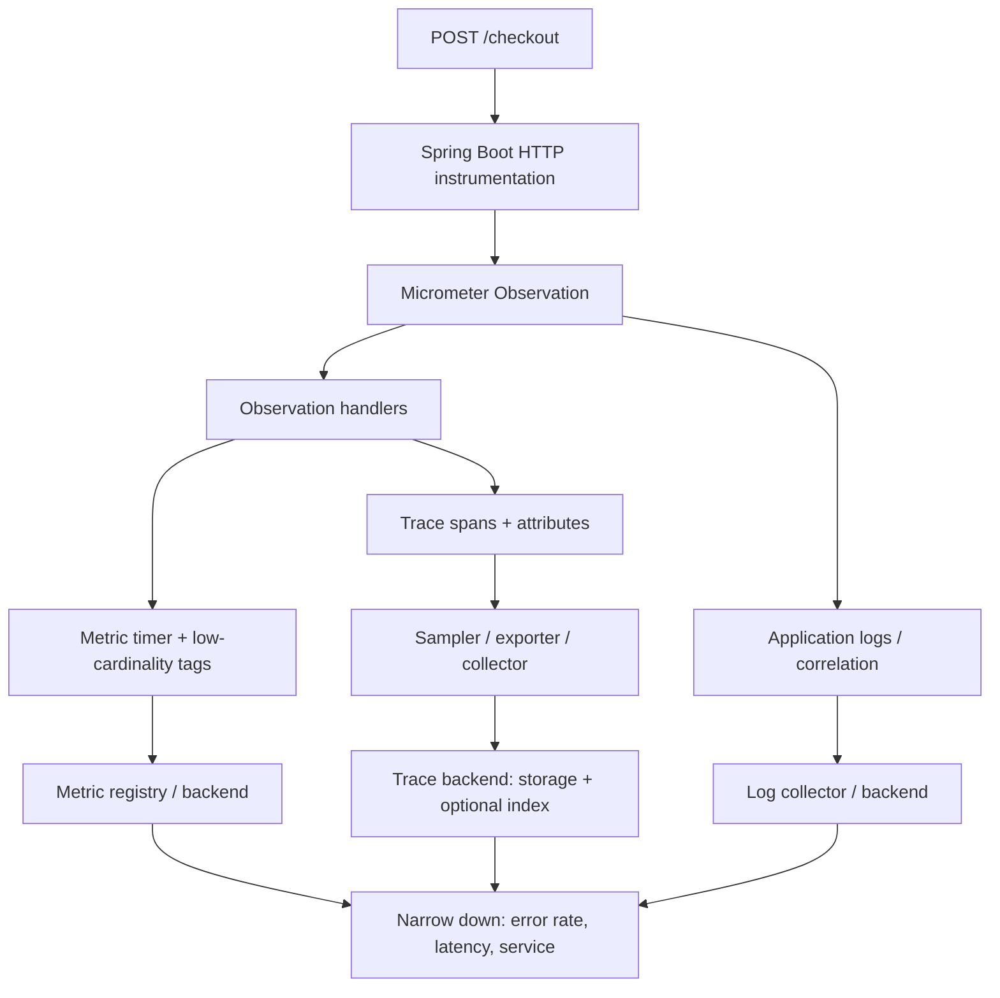

# Cardinality in traces

A Spring Boot application processes thousands of requests per second. Each request can create a trace with spans for the controller, database, HTTP client, and business steps. To investigate a slow request, an engineer wants to search by transaction ID, payment method, or provider. However, if every identifier is placed into span names, attributes, and baggage, tracing data can become expensive, hard to query, or expose sensitive information.

That is the problem of **cardinality in traces**: needing enough metadata to identify a specific case, while keeping names and analytical dimensions stable and avoiding uncontrolled data and index growth.

This lesson belongs to the **Cardinality and metadata** chapter of the **SPRING_BOOT_OBSERVABILITY** module. In this module, Spring Boot is instrumented with Micrometer Observation, metrics, logs, and distributed tracing; context propagation, exporters, sampling, and signal correlation help investigate errors, latency, and application behavior in production environments. The current topic focuses on designing **trace/span metadata**, distinguishing it from cardinality in metrics, and understanding the trade-offs between queryability, cost, and data safety.

## Learning objectives

After this lesson, you will be able to:

1. Explain the cardinality of a metadata field and distinguish between **distinct value count**, **span count**, and **size per span**.
2. Identify cardinality in span names, span attributes, events, resource attributes, and baggage.
3. Compare the consequences of high cardinality in **metric labels** and **trace attributes** without mechanically applying one rule to both.
4. Use low/high-cardinality key values of Micrometer Observation in a Spring Boot example.
5. Design queries using a **stable label set to narrow down**, then use controlled detailed attributes to investigate a single trace.
6. Explain the impact of sampling, exporters, collectors, backend indexing, and propagation on observable data.
7. Build a checklist to limit costs, prevent sensitive data exposure, and verify the usefulness of trace metadata.

## 1. What is cardinality in a tracing system?

**Cardinality** of a field is **the number of distinct values** appearing in that field within the dataset and time window under consideration.

Suppose a service records spans with these fields:

```text
span.name = checkout.payment.authorize

payment.provider = provider-a | provider-b
payment.operation = authorize | capture | refund
http.response.status_code = 200 | 400 | 500 | ...
payment.attempt.id = a74f... | 4e20... | 92bd... | ...
```

In this hypothetical scenario:

- `payment.provider` has a few known values → **low cardinality**.
- `payment.operation` has a finite set of values → **low cardinality**.
- `payment.attempt.id` is almost different on every attempt → **high cardinality**.
- `span.name` is fixed by operation type → easy to group and aggregate.

High cardinality does not mean a long value. A 12-character ID string can have millions of distinct values. Conversely, a long message that only repeats two values has low cardinality, even though it still consumes storage.

### Three concepts to keep separate

| Concept | Example | Primary impact |
|---|---|---|
| **Attribute cardinality** | `payment.attempt.id` differs on every span | Number of distinct values the storage, search, or indexing system must handle |
| **Span/trace volume** | Each request creates 12 spans; more requests stored | Number of records to ingest, transmit, store, and process |
| **Data size per span** | Adding large stack traces or dozens of attributes | Storage capacity, bandwidth, and processing cost per span |

The three factors are related but **not equivalent**. Adding an attribute with unique values can raise indexing costs; creating 30 spans instead of 5 increases data volume even when every attribute is low-cardinality; storing a large payload makes every span heavy despite low cardinality.

There is no absolute threshold like “above N values is dangerous” that applies to every backend. You must evaluate based on traffic, indexing behavior, retention policies, and investigative needs.

## 2. Why is cardinality in traces different from metrics?

With **metrics**, each label combination typically becomes a separate time series. For instance, labels like `route`, `status`, `instance`, `payment.provider` can produce many series; attaching `traceId` or `orderId` makes the series count grow nearly linearly with request count. This is the common reason not to use individual IDs as metric labels.

With **traces**, each span is inherently a specific record; trace IDs and span IDs are identifiers with very high uniqueness **by design**. A trace needs IDs to link spans belonging to the same flow. Therefore, concluding “every high-cardinality attribute is wrong in traces” is incorrect.

The difference is **where the cost occurs**:

| Aspect | Metrics | Traces |
|---|---|---|
| Typical storage unit | Time series by metric name and label set | Span/trace records with timestamps, relationships, and attributes |
| How does high cardinality affect it? | Creates huge numbers of series, straining memory/index/queries | Can increase span size, indexed value counts, search complexity, or storage cost |
| Are per-request IDs needed? | Usually not; do not use `traceId` as a metric label | Yes, trace/span IDs are the core mechanism for linking spans |
| Should business IDs be stored on every record? | Usually not | Only when truly needed, permitted, index/retention-controlled, and non-sensitive |
| Impact of sampling | Metrics can normally measure all instrumented requests | Only a portion of traces/spans are stored depending on sampler, pipeline, and export errors |
| Effective querying pattern | Aggregate along stable labels | Narrow down by service/operation/status/time, then open a specific trace; search by ID when needed |

**Key takeaway:** traces can accommodate certain high-cardinality attributes to investigate specific requests, but that does not mean you should index all of them or dump every piece of business data onto spans.

Some tracing backends store and scan attributes without indexing every value; other backends build secondary indexes or columnar search. Cost and query-speed implications depend on backend architecture. Never assume “having an attribute on a span” equals “fast attribute search everywhere.”

## 3. Where does cardinality show up in a trace?

### 3.1. Span name: should describe the operation type, not each request

Span name is one of the fields operators most often use to group slow or failing operations.

**Avoid:**

```text
GET /orders/764093
GET /orders/764094
checkout authorize payment for customer-38817
SQL SELECT * FROM orders WHERE id = 764093
```

Every request can generate a new name, making the list of operations hard to aggregate, inflating distinct values, and risking leaking sensitive data into names.

**Prefer:**

```text
GET /orders/{id}
checkout.payment.authorize
db.query.orders
payment-provider.request
```

The name expresses the activity type; variable details, if needed, belong in appropriate, normalized, and controlled attributes. For HTTP, prefer framework-known route templates over raw URLs containing order IDs. For SQL, avoid putting the full statement with literals or parameter values into the span name.

Some instrumentation libraries have version- and backend-specific naming conventions; prioritize keeping semantics stable and following your stack's actual conventions rather than forcing every library into an arbitrary format.

### 3.2. Span attributes: choosing analytical dimensions and details

A span can carry attributes such as:

```text
service.name = checkout-service
http.request.method = POST
http.route = /checkout
payment.provider = provider-a
payment.operation = authorize
payment.attempt.id = 9be6e0c4...
```

Two main groups:

- **Classification attributes:** operation name, partner type, normalized route, outcome category. Usually low cardinality, helping filter or aggregate across many traces.
- **Identifying attributes:** request ID, attempt correlation ID, transaction ID. Usually high cardinality, useful for tracking down a specific case when an appropriate data policy is in place.

A high-cardinality attribute is **not automatically useless**. If support receives a correlation ID from a provider, putting an internal non-sensitive ID on a span can help connect incidents across two systems. Still, answer clearly: can this ID actually be queried, does it really need to be repeated on every span, who can view it, and how long is it retained?

If you only need to look up a trace by `traceId`, you usually do not need to duplicate `traceId` into multiple custom attributes. Trace ID is already a built-in identifier of the tracing model.

### 3.3. Resource attributes: process/service context

Resource attributes describe the source generating telemetry, such as `service.name`, `deployment.environment.name`, `service.version`, or an instance identifier following your stack's conventions.

- `service.name` usually has relatively low cardinality within a system.
- `service.version` changes per deployment, useful for before/after release comparisons.
- `service.instance.id` can have many values when scaling or spinning up new pods; this may be necessary for operations, but should not be used as a default query dimension in every dashboard.

Resource attribute behavior differs from per-span attributes: one service produces many spans that share the same resource metadata. Even so, distinct value counts and indexing policies still require evaluation.

Do not dynamically construct `service.name` per tenant, request, or user. Service names should reflect stable operational workloads.

### 3.4. Events and exceptions: do not stuff dynamic messages into names

A span can contain events describing what happened during processing. For example:

```text
Event name: payment.retry
Attributes:
  retry.attempt = 2
  retry.reason = timeout
```

Stable event names make filtering and reading timelines easier. Avoid naming events like `payment.retry.for-order-764093`, or writing raw exception messages containing tokens, raw URLs, payloads, or personal data into attributes.

Stack traces can help in investigations but increase span size. For frequently repeated errors, consider limiting detail level and collecting selectively; keep error reporting structured consistently between logs and traces.

### 3.5. Span links and baggage: different semantics from span attributes

A **span link** describes a relationship between a span and another span context, useful in fan-out, batch, or asynchronous messaging flows. Links carry trace/span identifiers as part of the tracing model; preserve proper relationships instead of abusing hand-concatenated string attributes.

**Baggage** is contextual data that can travel across hops alongside trace context when propagation is configured. Baggage differs from span attributes:

- Not every baggage key automatically becomes an attribute recorded and indexed in the backend.
- Baggage can cross service/network boundaries; every byte and every sensitive value warrants caution.
- A high-cardinality ID that does not need to be passed downstream **should not be put into baggage just for lookup**.
- Baggage may be size-limited, filtered, or dropped at certain boundaries.

**Principle:** only put into baggage information that downstream services genuinely need for processing or linking; do not use baggage as a metadata dumping ground for the tracing system.

## 4. Visualizing how data flows through a Spring Boot system



Observe the diagram:

1. **Instrumented observation** generates names and key values according to conventions, context, and business code.
2. **Metrics handlers** typically use low-cardinality key values to group measurements.
3. **Tracing handlers** can use both low-cardinality and high-cardinality key values as span attributes depending on implementation and configuration.
4. **Sampling/exporter/collector** determines which trace data reaches the backend.
5. **The backend** determines which attributes are stored/indexed and searchable efficiently.
6. **Logs** can carry `traceId`/`spanId` when logging correlation is integrated; logs still need separate policies for sensitive data and retention.

Adding a high-cardinality key-value to an observation **does not guarantee** it appears in every stored trace. If handlers, samplers, or exporters differ across environments, outcomes can differ as well.

## 5. Micrometer Observation: low and high cardinality are two usage intents

Micrometer Observation lets you distinguish key values by intent:

- `lowCardinalityKeyValue(...)`: values generally suitable for use in metrics and eligible to be added to spans by tracing handlers.
- `highCardinalityKeyValue(...)`: detailed information that can serve traces, but **should not be placed into metric labels** like low-cardinality values.

This distinction helps handlers process signals sensibly. It is **not an encryption, authorization, or automatic sensitive-data-blocking mechanism**. If an application adds a token as a high-cardinality key-value, it still risks being exported to the tracing backend.

### Spring Boot example: payment authorization

Suppose a payment service has two allowed providers and an internal, anonymous diagnostic ID for a **transaction attempt**. This diagnostic ID is attached only if data policy permits; in many cases `traceId` is already sufficient for investigation.

```java
import io.micrometer.observation.Observation;
import io.micrometer.observation.ObservationRegistry;
import org.springframework.stereotype.Service;

@Service
class PaymentApplicationService {
    private final ObservationRegistry observationRegistry;
    private final PaymentGateway paymentGateway;

    PaymentApplicationService(ObservationRegistry observationRegistry,
                              PaymentGateway paymentGateway) {
        this.observationRegistry = observationRegistry;
        this.paymentGateway = paymentGateway;
    }

    PaymentResult authorize(PaymentRequest request,
                            String safeDiagnosticAttemptId) {
        // Provider value must come from a finite normalized catalog.
        String provider = "provider-a";

        return Observation.createNotStarted(
                        "checkout.payment.authorize", observationRegistry)
                .contextualName("authorize payment")
                .lowCardinalityKeyValue("payment.provider", provider)
                .lowCardinalityKeyValue("payment.operation", "authorize")
                .highCardinalityKeyValue(
                        "payment.attempt.id", safeDiagnosticAttemptId)
                .observe(() -> paymentGateway.authorize(request));
    }
}
```

`PaymentGateway`, `PaymentRequest`, and `PaymentResult` here are hypothetical domain types. `safeDiagnosticAttemptId` represents a correlation code **approved by policy, containing no user info or secrets**; it must not be replaced by a raw client-sent ID or payment payload.

This pattern illustrates that:

- The observation name and contextual name stay stable across requests.
- `payment.provider` and `payment.operation` have bounded value counts, convenient for metric aggregation.
- `payment.attempt.id` has high cardinality, meant only for specific investigative needs; usage and access permissions should be restricted.
- `observe(...)` manages the synchronous lifecycle; it does not turn every HTTP client, thread, or message queue into child spans without instrumentation/propagation.

**Production code note:** you must genuinely validate and normalize the provider, decide whether collecting attempt IDs is allowed, check how handlers export attributes, and ensure the exporter/collector/backend are configured. The example does not deploy the entire telemetry pipeline out of the box.

### Do not use low-cardinality to attach per-request IDs

```java
// Do not do this:
Observation.createNotStarted(
        "checkout.payment.authorize", observationRegistry)
    .lowCardinalityKeyValue("payment.attempt.id", safeDiagnosticAttemptId);
```

If a metric handler uses this label, the number of time series can grow rapidly with request count. Using `highCardinalityKeyValue(...)` reduces the risk of the ID entering metric labels when handlers respect the classification, but **does not eliminate tracing costs and privacy risks**.

### When high-cardinality metadata is unnecessary

A standard HTTP flow already has `traceId` and span IDs generated by the tracing implementation. If you only need to link an error log to the trace of that same request, check trace-ID log correlation before inventing an extra `request.id`.

When you need to correlate with an external provider that does not support the same tracing context, consider adding an agreed correlation code, but only on relevant spans. Avoid repeating the same ID on every span of a trace when there is no concrete query benefit.

## 6. Designing trace queries with two layers of metadata

When investigating an incident, an effective approach is:

**Layer 1 — Narrow the result set using stable dimensions.**

```text
time window: 14:00–14:15
service.name: checkout-service
operation/span.name: checkout.payment.authorize
payment.provider: provider-a
status/error: aligned with semantic conventions and backend
```

Fields such as service, operation, provider, and time window locate the group of traces of interest while avoiding indexing random IDs for every request.

**Layer 2 — Open a specific trace to inspect details.**

Once you have a relevant trace:

- Inspect the order and overlap of spans.
- Check child spans for HTTP clients, DB, queues, and business steps.
- Cross-check logs using `traceId` and the matching time window.
- If needed, search by an approved partner correlation code that is stored and indexed by the backend.
- Check whether any spans are missing due to propagation, instrumentation, or sampling/export.

If you try to answer “which requests are slow” based solely on a few sampled traces, you cannot accurately infer the percentage of affected users. Metrics or clearly defined business events are the right tools to measure impact scale.

### Exemplars are not metric labels containing trace IDs

Some stacks support **exemplars**: for example, a metric sample attached with a reference link to a representative trace. This bridges a point on a metric chart to a trace for investigation **without** turning every `traceId` into a time-series label. Availability depends on the registry, exporter, collector, backend, and sampling configuration; it is not always enabled.

## 7. Impact of cardinality on storage, indexing, and query speed

Trace data typically passes through multiple stages: instrumentation → SDK/bridge → exporter → collector → backend. Each stage may enforce different limits on attributes, events, payload size, sampling, and retention.

| Processing point | Potential issue when metadata is overly detailed | Control approach |
|---|---|---|
| Application | Builds long strings, many attributes, increases CPU/GC, or accidentally logs sensitive data | Instrument only needed fields; bound length/value sources |
| Tracing SDK / bridge | Attribute/event count limits, drops or truncates data | Check configuration and signals reporting dropped data |
| Exporter / collector | Large payloads, full queues, network/backpressure, dropped data | Monitor queues, retries, dropped spans, and bandwidth |
| Trace backend | Many distinct values create huge indexes, slow/expensive queries depending on tech | Select attributes to index, set appropriate retention and queries |
| Dashboard / trace search | Operation lists hard to aggregate due to dynamic names; ID queries may be slow | Stable names, group by finite fields, use IDs only when needed |
| Authorization system | IDs could be used to correlate back to customers or transactions | Remove unnecessary data, enforce RBAC and access controls |

**Not every tracing backend indexes all attributes.** Determine your backend's actual mechanism before forecasting costs. Some systems optimize for trace-ID lookups, while others offer rich attribute search at the cost of extra indexing resources.

### Estimating load properly

When budgeting, evaluate separately:

1. **Request or message rate** processed by the application.
2. **Average number of spans per request** and exception paths.
3. **Sampling policy** and effective rate after export/drops.
4. **Attribute count and value size** per span.
5. **Indexing strategy**, retention, compression, and replication in the backend.
6. **Rare-error discoverability:** are enough traces retained to investigate anomalous conditions?

A design with few attributes that creates huge numbers of spans still costs money. A design with low sampling that indexes dynamic IDs can still incur significant cost across retained spans.

### Limiting attribute count is not limiting cardinality

A configuration capping spans at 32 attributes only controls **the number of fields**, not how many distinct values a single field takes across millions of spans. Conversely, a rule restricting `payment.provider` to three normalized values bounds cardinality regardless of span volume.

You need **stable schemas**, **value allowlists**, **length limits**, **sampling**, and **pipeline resource limits** together.

## 8. Does sampling make high cardinality disappear?

No. Sampling reduces the number of recorded spans/traces, but **does not change the nature** of an attribute whose value is nearly unique per request. For the retained spans, the ID remains high-cardinality.

Key points to keep in mind:

- **Head-based sampling** may drop a trace before knowing whether it will fail or be slow. A high-cardinality ID on a dropped trace will not help backend lookup.
- **Tail-based sampling** can prioritize errored/slow traces if the collector and pipeline support it; in exchange, it requires buffering and resources.
- **Parent-based sampling** follows upstream decisions, helping services respect the same decision, but does not guarantee complete traces if propagation/export fails.
- **Absence of a trace in the backend** does not prove a request never happened. Check metrics, logs, sampling, collector, and retention.
- **Stored traces can be biased**: do not compute overall error rates or p99 of all traffic directly from a handful of traces selected by special policies.

Illustrative Spring Boot 3.x configuration example:

```yaml
management:
  tracing:
    sampling:
      probability: 0.10
```

The value `0.10` is simply a tracing sampling probability under the configured stack mechanism; it does not mean only 10% of metrics are measured, nor does it bound the distinct attribute values on retained spans. For your exact Spring Boot version and exporter, confirm where sampling runs and whether the collector applies additional policies.

## 9. Cardinality, security, and privacy

In traces, metadata can traverse multiple layers, services, or telemetry vendors. The more queryable the data, the bigger the impact if sensitive data slips in.

**Do not collect into span names, attributes, events, or baggage** values such as:

- Access tokens, refresh tokens, API keys, session cookies, and authentication credentials.
- Payment card numbers, security codes, bank account details.
- Request/response bodies containing personal data or secrets without proper controls.
- Emails, phone numbers, addresses, or personally identifiable information without a clear purpose and processing basis.

Never assume a **hashed ID** is completely anonymous. A deterministic hash still allows linking activities of the same person, or even guessing the original value if the input space is small.

To reduce risk:

1. Prefer `traceId` for internal correlation instead of copying business IDs onto every span.
2. Collect extra correlation IDs only for concrete investigative questions and with proper approval.
3. Do not record raw URLs, arbitrary headers, or request payloads; use route templates and normalized fields.
4. Restrict ID attributes to essential spans; do not pass via baggage if downstream services do not use them.
5. Configure redaction/dropping in the application and pipeline, along with access controls, retention, and export limits.
6. Check whether metadata passed over HTTP/messaging crosses trust boundaries.

**Low/high cardinality is not a “safe/unsafe” classification.** A low-cardinality value can still be sensitive, such as a medical status or user attribute. Collection decisions must evaluate content and context, not merely value count.

## 10. Investigation scenario: slow payment provider, yet traces cannot be found

Suppose a system consists of `checkout-service`, `payment-service`, and an external provider. After a deployment:

- The `POST /checkout` metric shows p95 latency spiking.
- Logs show many `payment_provider_timeout` events.
- An engineer tries searching traces by `orderId`, but the backend returns very few results.
- The tracing dashboard shows thousands of span names starting with `checkout-order-...`.

### Layer-by-layer analysis

**Step 1 — Check names and cardinality.** If span names contain `orderId`, every order gets its own name. This breaks grouping by operation. Fix the span name to a stable value like `checkout.payment.authorize`.

**Step 2 — Check search assumptions.** Not every backend indexes `orderId`. If `orderId` was only logged or placed in an unindexed attribute, searching traces by that ID may fail or perform poorly. If logs contain `traceId`, try searching by that exact trace ID first.

**Step 3 — Check trace sampling.** If only a subset of traces is kept, a specific transaction may not have been stored. Do not conclude the request never ran solely from an empty search result.

**Step 4 — Check propagation.** If checkout calls payment over HTTP or a message queue, confirm trace context is injected/extracted properly; otherwise, the trace breaks between the two services.

**Step 5 — Cross-check logs and metrics.** Use metrics to quantify impact; use timeout logs, timestamps, versions, and providers to narrow scope; open relevant sampled traces to inspect client spans, DB spans, retries, and uninstrumented gaps.

**Step 6 — Redesign metadata.** Keep `payment.provider`, `operation`, `http.route`, and version finite. If a partner diagnostic ID is truly needed, store it on selected appropriate spans/logs in compliance with data policy and backend indexing capabilities.

**Step 7 — Verify results.** After the change, re-run normal/slow/failing requests and compare dashboards, logs with `traceId`, trace timelines, and exporter/collector status. Evaluate span name count and stored data size.

Changing the span name alone does not fix the timeout bug, but it makes trace querying and comparison reliable enough to investigate the true root cause.

## 11. Anti-patterns to recognize

| Error-prone practice | Consequence | Improvement |
|---|---|---|
| Putting `orderId`, `userId`, or timestamps into span names | Operations fragment into countless dynamic names | Use stable names and route templates; keep details in controlled attributes |
| Attaching `traceId` as a metric tag | Time series explosion | Look up traces by ID in the tracing backend; consider exemplars if supported |
| Dumping unbounded raw URL/path/query strings into attributes | High cardinality, bloat, risk of exposing sensitive parameters | Use route templates and attribute allowlists |
| Adding the same high-cardinality ID to every span | Duplicate data, higher cost and risk | Attach only to relevant spans or rely on built-in trace IDs |
| Indexing every attribute “just in case” | High cost and poor query performance depending on backend | Choose indexes based on operational questions; set sensible retention |
| Using baggage to transport search metadata | Metadata may cross multiple services and trust boundaries | Use baggage only for context actually needed downstream |
| Setting sampling very low without accounting for rare errors | May miss crucial traces for incident investigation | Choose sampling based on SLOs, traffic, and needs; consider tail sampling where suitable |
| Treating sampled trace counts as true error rates | Skewed by sampling or dropped data | Use metrics/SLIs or clearly defined business events |
| Believing high-cardinality is automatically stripped from traces | Export and data exposure risk | Enforce policies in code, handlers, collectors, and backends; review fields |
| Confusing index cardinality with span attribute count | Fixing the wrong bottleneck | Measure distinct values, size/span, span count, and indexing |

## 12. Checklist for designing tracing metadata in Spring Boot

Before shipping a new observation/span, answer:

- **Operation:** is the span/observation name stable, reflective of the work type, and free of dynamic IDs?
- **Classification:** which attributes are needed for dashboards, trace filtering, and dependency identification? Is their value set finite?
- **Detail:** which high-cardinality attributes are genuinely needed to track down a specific request? Can `traceId` replace them?
- **Sensitivity:** does it contain PII, secrets, payloads, raw URLs, or unvalidated user input?
- **Micrometer:** are low/high-cardinality key values attached for their intended purpose? Do handlers receive data as expected?
- **Propagation:** is trace context preserved properly across HTTP, executors, `@Async`, Reactor, or message queues?
- **Sampling:** does the current policy allow investigating rare errors? Do you distinguish sampler drops from exporter/pipeline drops?
- **Exporter:** are size/attribute limits, queues, and retries sized for traffic?
- **Backend:** which fields are indexed, what is their cost, how well do trace-ID lookups perform, and what is the retention?
- **Correlation:** do logs include `traceId`/`spanId` when configured? Can you jump from metrics to traces via exemplars if supported?
- **Verification:** have you tested normal, error, slow, and cross-service requests?
- **Resources:** are you monitoring span count, attribute count, payload size, distinct values, ingestion, and dropped data?

## 13. Self-assessment

**Question 1.** Trace IDs have very high cardinality. Should we remove trace IDs from the tracing system?

**Hint:** No. Trace IDs are essential to link the spans of a trace. What to avoid is using trace IDs as metric labels or copying them into unnecessary metadata.

**Question 2.** A span attribute `payment.attempt.id` has a different value on every request. Will the tracing system definitely suffer a “series explosion” like Prometheus?

**Hint:** You cannot apply metrics' time-series mechanics directly to traces. The impact in tracing depends on record size, indexing, queries, and volume; you still need to evaluate cost and privacy.

**Question 3.** What benefit does changing a span name from `GET /orders/1234` to `GET /orders/{id}` bring?

**Hint:** Reduces distinct operation names, groups results better by request type, keeps dynamic IDs out of names, and lowers search overhead depending on the backend.

**Question 4.** Does calling `highCardinalityKeyValue(...)` guarantee that a value is non-sensitive and automatically exported only to the tracing backend?

**Hint:** No. The API only declares usage intent. Handlers, pipelines, and data policies determine export behavior; sensitivity must be controlled independently.

**Question 5.** Why cannot the percentage of error spans in a tracing backend be used as the service's overall request error rate?

**Hint:** Traces may be sampled under varying policies, one request has multiple spans, and exporters/collectors may drop data. You need metrics/SLIs with a clear request or transaction counting unit.

**Question 6.** After configuring 10% sampling, has the cardinality of `payment.attempt.id` become low?

**Hint:** Not yet. The number of stored spans drops, but the attribute remains nearly unique on each stored span. Sampling reduces volume; cardinality describes value diversity.

## Conclusion

**Cardinality in traces is a property of metadata attached to spans and resources**, not merely request count or span count. Unlike metric labels, certain highly unique identifiers such as trace IDs are essential for tracing; however, dynamic span names and uncontrolled attributes still break grouping, increase index/storage costs, and risk sensitive data exposure. In Spring Boot, use Micrometer Observation with stable names, low-cardinality key values for classification, high-cardinality metadata only for approved investigative purposes, and verify the full path through handlers, propagation, samplers, exporters, and collectors to the backend. A sound balance lets metrics, logs, and distributed traces correlate seamlessly to investigate errors and latency without trading away unbounded cost or privacy.
