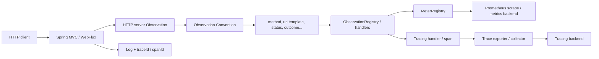

# Endpoint tagging in Spring Boot Observability

Suppose an order service receives two HTTP requests:

```http
GET /api/orders/10293
GET /api/orders/10294
```

Both requests hit the **same business endpoint**. When measuring latency, error rate, and traffic, we want to group them into one bucket `GET /api/orders/{orderId}`. If the actual path is used as a tag, each order ID creates a new value, making the number of metric series grow with the number of orders. Over time, the monitoring system can consume excessive memory and storage and become hard to query, while charts lose the ability to aggregate by endpoint.

In the **Cardinality and metadata** chapter of the `SPRING_BOOT_OBSERVABILITY` module, this lesson focuses on **endpoint tagging** when setting up observability for Spring Boot with Micrometer Observation. We will use metrics to measure HTTP health, correlate with logs and distributed tracing to investigate specific requests, and understand the impact of cardinality, context propagation, exporters, and sampling in production environments.

## 1. What problem do endpoint tags solve?

An HTTP metric needs enough information to answer questions such as:

- Which endpoint is receiving the most requests?
- On which endpoint is the HTTP 5xx rate increasing?
- Did the latency of `POST /api/orders` increase after releasing a new version?
- Do `GET` and `POST` on the same route group behave differently?
- Which specific endpoint experienced an error, and is there a corresponding trace/log to find the root cause?

A **tag** (also called a *label* in Prometheus) is a `key=value` pair attached to a measurement. Instead of having one total for the entire server, we use a finite set of analytical dimensions to group data.

| Common HTTP tag | Example | Meaning |
| --- | --- | --- |
| `method` | `GET`, `POST` | HTTP method |
| `uri` | `/api/orders/{orderId}` | Normalized route template, not the raw URL |
| `status` | `200`, `404`, `503` | HTTP status code |
| `outcome` | `SUCCESS`, `CLIENT_ERROR`, `SERVER_ERROR` | HTTP outcome group |
| `exception` | `None` or exception type name | Error classification when recorded by instrumentation |
| `application` | `order-service` | Distinguishes services if configured as a common tag |

Exact tag names, value sets, and meters depend on the **Spring Boot/Micrometer version, Servlet/WebFlux stack, and observation convention in use**. The names above are common examples in Spring Boot 3.x configurations, not an immutable contract across all versions.

**Distinguish three layers of information:** metric tags for aggregating data; span attributes for investigating a trace; log fields for understanding event details. The same piece of information may be valuable in a trace yet should not become a metric tag.

## 2. What is cardinality and why must endpoints be normalized?

**Cardinality of a tag** is the number of distinct values it takes. **Cardinality of a time series set** depends on the number of value combinations across multiple tags, metric names, instances, and other dimensions.

For example, suppose an HTTP timer has:

| Dimension | Assumed value count |
| --- | ---: |
| `uri` (route template) | 20 |
| `method` | 4 |
| `status` | 5 |
| `instance` | 3 |

The maximum number of combinations under a simple model is:

\[
20 \times 4 \times 5 \times 3 = 1\,200
\]

This is only a **theoretical limit** assuming independent dimensions; not every route has every method/status, and backends may add other dimensions. Still, it illustrates why increasing the value count of one tag rapidly multiplies time series.

If the `uri` tag is replaced with raw paths of 100,000 orders instead of 20 route templates, the number of possible combinations grows by many orders of magnitude. With histograms, each label set can also spawn many bucket series, making the impact even larger.

### 2.1. How do route templates and raw paths differ?

| Actual request | `uri` value to use | Values to avoid |
| --- | --- | --- |
| `GET /api/orders/10293` | `/api/orders/{orderId}` | `/api/orders/10293` |
| `GET /api/orders/10294` | `/api/orders/{orderId}` | `/api/orders/10294` |
| `GET /api/customers/9/orders/25` | `/api/customers/{customerId}/orders/{orderId}` | Path containing two real IDs |
| `POST /api/orders` | `/api/orders` | Query string or user payload |
| `GET /api/search?q=phone` | `/api/search` | `/api/search?q=phone` |

Note: `GET /api/orders/10293` is the **request path**, whereas `/api/orders/{orderId}` is the **matched route template**. Spring MVC/WebFlux can normally supply this template via the framework's HTTP instrumentation when a request matches a route. If a request does not match a route, hits a static resource, goes through a special filter, or fails too early, the route name may be undetermined and instrumentation uses a fallback value instead. Do not assume every 404 will carry a predefined template.

### 2.2. Cardinality does not mean request volume

One million requests to the same route template with a fixed tag set still land in just a few series; one thousand requests with one thousand different user IDs attached as tags can create a huge number of series. **Reducing request volume does not directly solve a tag having too many values.**

Design rule: use **low-cardinality tags** for finite dimensions you genuinely want to filter charts by or compute alerts on. High-distinctness values such as user IDs, session IDs, order IDs, request IDs, and raw URLs are usually better suited for spans/logs with separate retention and access policies.

## 3. Data flow when Spring Boot records endpoint metrics



This is a **conceptual diagram**. At runtime, an Observation is created with a registry and handlers read the context at appropriate moments; a convention is not necessarily a sequential step running before every callback. What matters is:

1. The framework knows a request is being handled and, with appropriate instrumentation, creates an HTTP Observation.
2. The convention determines the name and low-cardinality key-value set from request/response info, including the route template if available.
3. The metrics handler records duration and invocation counts into `MeterRegistry`.
4. The tracing handler, if a tracer bridge is present, manages spans and trace relationships.
5. The exporter/backend receives telemetry for historical storage, search, visualization, and alerting.

In a Spring Boot 3.x application with Actuator, the HTTP server meter is typically named `http.server.requests`. Different versions/instrumentations or conventions may use other names; always verify the actual name in your application before writing dashboard queries.

## 4. Setting up a Spring Boot example

Example illustrating Spring Boot 3.x, Java 17+, and Maven. Assumes the project uses the Spring Boot parent/BOM to manage compatible dependency versions.

```xml
<dependencies>
    <dependency>
        <groupId>org.springframework.boot</groupId>
        <artifactId>spring-boot-starter-web</artifactId>
    </dependency>
    <dependency>
        <groupId>org.springframework.boot</groupId>
        <artifactId>spring-boot-starter-actuator</artifactId>
    </dependency>
    <dependency>
        <groupId>io.micrometer</groupId>
        <artifactId>micrometer-registry-prometheus</artifactId>
    </dependency>
</dependencies>
```

```yaml
spring:
  application:
    name: order-service

management:
  endpoints:
    web:
      exposure:
        include: health,metrics,prometheus
  metrics:
    tags:
      application: order-service
```

When the application runs on port 8080 with the typical management web path configuration, you can inspect the endpoints via `/actuator/health`, `/actuator/metrics`, and `/actuator/prometheus`.

**Exposure is not an authentication mechanism:** expose only necessary endpoints, restrict them to internal networks, or configure Spring Security/gateway rules appropriately. Metrics endpoints can reveal route names, error classifications, and application architecture.

### 4.1. Sample REST controller

```java
import org.springframework.http.ResponseEntity;
import org.springframework.web.bind.annotation.GetMapping;
import org.springframework.web.bind.annotation.PathVariable;
import org.springframework.web.bind.annotation.PostMapping;
import org.springframework.web.bind.annotation.RequestMapping;
import org.springframework.web.bind.annotation.RestController;

@RestController
@RequestMapping("/api/orders")
public class OrderController {

    @GetMapping("/{orderId}")
    public ResponseEntity<String> find(@PathVariable String orderId) {
        return ResponseEntity.ok("order-" + orderId);
    }

    @PostMapping
    public ResponseEntity<Void> create() {
        return ResponseEntity.accepted().build();
    }
}
```

This is a minimal controller for observing tags; production applications need input validation, authentication, error handling, and real business logic.

Send requests with two different order IDs:

```bash
curl -i http://localhost:8080/api/orders/10293
curl -i http://localhost:8080/api/orders/10294
curl -i -X POST http://localhost:8080/api/orders
curl -s http://localhost:8080/actuator/metrics
curl -s http://localhost:8080/actuator/metrics/http.server.requests
```

With compatible default HTTP instrumentation, the two GET calls are expected to be aggregated under a route tag like `uri=/api/orders/{orderId}`, rather than spawning a `uri` value per order ID.

## 5. Reading endpoint tags via Actuator

The `/actuator/metrics/http.server.requests` endpoint typically provides the meter name, measurements such as count/total time, and a list of filterable tags. Example **illustrative** response structure, not a mandatory schema across all versions:

```json
{
  "name": "http.server.requests",
  "measurements": [
    {"statistic": "COUNT", "value": 3.0},
    {"statistic": "TOTAL_TIME", "value": 0.042}
  ],
  "availableTags": [
    {"tag": "method", "values": ["GET", "POST"]},
    {"tag": "uri", "values": ["/api/orders/{orderId}", "/api/orders"]},
    {"tag": "status", "values": ["200", "202"]}
  ]
}
```

The timing and tag values above are hypothetical data. In a real application, the meter may have more or fewer labels and other statistics. Never assume an error request that has never occurred will already appear in `availableTags`.

### 5.1. Filtering by a specific endpoint

Actuator metrics supports the `tag=key:value` query parameter. Use `curl -G --data-urlencode` to avoid manually escaping the curly braces of a route template:

```bash
curl -G 'http://localhost:8080/actuator/metrics/http.server.requests' \
  --data-urlencode 'tag=uri:/api/orders/{orderId}' \
  --data-urlencode 'tag=method:GET'
```

How to read the output:

- `COUNT` shows how many times measurements matching the filtered tag group completed during that instance's meter lifetime.
- `TOTAL_TIME` is the accumulated total time; the unit is described in the meter response.
- `MAX` or other statistics may be present depending on timer configuration.
- Error rates and p95 over time require periodic collection by the backend and proper calculations, not a single snapshot from Actuator.

If the metric is missing, send a request first, then check dependencies, actuator endpoint status, web exposure, actual meter name, instrumentation, and whether `stop()` was called on the relevant Observation.

### 5.2. Which endpoint tags should and should not be added?

| Proposed tag | Suitable for metrics? | Explanation |
| --- | --- | --- |
| `method` | Yes | HTTP method value set is small |
| `uri` as route template | Yes | Route count is designed by the API and controllable |
| `status` | Yes | Status code set is finite |
| `outcome` | Yes | Finite outcome categories |
| `api.group` = `orders/payments/other` | Yes, if truly needed | Stable route grouping, helpful for dashboards |
| `orderId`, `customerId` | No | Large value set, spikes cardinality |
| `requestId`, `traceId` | No | Typically unique per request |
| Query string, raw path | No | User-supplied values, hard to bound |
| Raw User-Agent, source IP | Usually no | Many values, personal data risk |
| Verbatim exception message | No | Variable values and may leak sensitive info |

**The `uri` tag should describe the endpoint, not identify individual requests.** To locate errors for a single request, use traceId/requestId in controlled tracing or logging systems.

## 6. Adding an `api.group` tag per endpoint with a custom convention

In the Spring MVC/Servlet stack of Spring Framework 6, HTTP server Observation has its own convention mechanism. When you want to extend default tags, you can implement/register `ServerRequestObservationConvention` and extend `DefaultServerRequestObservationConvention` to **preserve standard tags**, then add one finite grouping dimension.

### 6.1. Creating the convention

```java
import io.micrometer.common.KeyValue;
import io.micrometer.common.KeyValues;
import org.springframework.http.server.observation.DefaultServerRequestObservationConvention;
import org.springframework.http.server.observation.ServerRequestObservationContext;

public final class ApiGroupObservationConvention
        extends DefaultServerRequestObservationConvention {

    @Override
    public KeyValues getLowCardinalityKeyValues(
            ServerRequestObservationContext context) {
        return super.getLowCardinalityKeyValues(context)
            .and(KeyValue.of("api.group", apiGroup(context.getPathPattern())));
    }

    private String apiGroup(String routeTemplate) {
        if (routeTemplate == null) {
            return "unmatched";
        }
        if (routeTemplate.startsWith("/api/orders")) {
            return "orders";
        }
        if (routeTemplate.startsWith("/api/payments")) {
            return "payments";
        }
        return "other";
    }
}
```

In this example, `getPathPattern()` retrieves the matched route from the Servlet stack's observation context. We group by **route template**, rather than reading and recording raw paths like `/api/orders/10293` directly. If no route is determined, return `unmatched` to avoid creating unbounded tags. Grouping rules must be reviewed whenever API paths change; verify with real requests and `/actuator/metrics` payloads.

Calling `super.getLowCardinalityKeyValues(context)` preserves Spring-provided labels such as method/status/uri/outcome per version. Rebuilding the label set from scratch and dropping standard HTTP tags can break dashboards or alerts relying on them.

### 6.2. Registering the convention in the application

```java
import org.springframework.context.annotation.Bean;
import org.springframework.context.annotation.Configuration;
import org.springframework.http.server.observation.ServerRequestObservationConvention;

@Configuration
public class HttpObservationConfiguration {

    @Bean
    ServerRequestObservationConvention serverRequestObservationConvention() {
        return new ApiGroupObservationConvention();
    }
}
```

With Spring Boot 3.x and compatible Spring MVC instrumentation, the convention bean for Servlet HTTP server Observation can be used to customize how tags are produced for HTTP requests. With WebFlux, extension points/contexts and integration rules may differ; use the convention matching your exact stack and version.

**Do not assume a single `ObservationConvention` bean automatically changes every Observation.** Each instrumentation has its own convention selection mechanism. Verify the integration actually uses the new bean and avoid conflicting with conventions already configured by the framework or other libraries.

### 6.3. Verifying the result

Send requests to both routes:

```bash
curl -s http://localhost:8080/api/orders/10293
curl -s http://localhost:8080/api/orders/10294
curl -G 'http://localhost:8080/actuator/metrics/http.server.requests' \
  --data-urlencode 'tag=api.group:orders' \
  --data-urlencode 'tag=method:GET'
```

The expected result is that `api.group=orders` increments its invocation count with requests, while `uri` remains a route template. If `api.group` does not appear, check which convention Spring HTTP instrumentation selected, whether the bean was component-scanned, and whether the registry has an appropriate metrics handler.

### 6.4. Avoiding custom tags derived from user data

Avoid doing this:

```java
// WRONG example: every ID becomes a new metric label.
return super.getLowCardinalityKeyValues(context)
    .and(KeyValue.of(
        "raw.path",
        context.getCarrier().getRequestURI()
    ));
```

This wrong example illustrates the cardinality problem: `raw.path` can change on every request. Per-request tracking data belongs in logs/traces under appropriate policies, rather than a metric label.

## 7. Querying by endpoint in Prometheus

With `micrometer-registry-prometheus` and web exposure for `prometheus`, the application can expose metrics in Prometheus format. If Prometheus scrapes successfully, the timer named `http.server.requests` typically exports series like:

```text
http_server_requests_seconds_count{method="GET",uri="/api/orders/{orderId}",status="200",...}
http_server_requests_seconds_sum{method="GET",uri="/api/orders/{orderId}",status="200",...}
```

Actual series names and labels must be taken from the application's endpoint/exporter; the example above illustrates a common form when Micrometer converts timers to seconds. The `...` is only a placeholder in the example, not valid exposition text to copy verbatim into Prometheus.

### 7.1. Request rate by endpoint

```promql
sum by (method, uri) (
  rate(http_server_requests_seconds_count{application="order-service"}[5m])
)
```

The result shows average requests/second over a 5-minute window, grouped by method and route template. When multiple instances serve an application, `sum by (...)` aggregates across instances, provided scraping is complete and service-distinguishing labels are accurate.

### 7.2. HTTP 5xx rate by endpoint

```promql
sum by (method, uri) (
  rate(http_server_requests_seconds_count{
    application="order-service",status=~"5.."
  }[5m])
)
/
sum by (method, uri) (
  rate(http_server_requests_seconds_count{
    application="order-service"
  }[5m])
)
```

Multiply by 100 for a percentage. For endpoints with no requests during the query window, the denominator may be 0 or missing data; dashboards/alerts must handle this cleanly and avoid noisy interpretations at low traffic.

Note that `status=~"5.."` measures **HTTP 5xx**, not all business failures. For instance, HTTP 200 can still carry a `payment=rejected` result; tracking that requires a custom business Observation or a separate metric with a clearly defined outcome.

### 7.3. p95 latency by endpoint

If the application has enabled **Prometheus histogram buckets** for the HTTP timer, you can use:

```promql
histogram_quantile(
  0.95,
  sum by (le, method, uri) (
    rate(http_server_requests_seconds_bucket{
      application="order-service"
    }[5m])
  )
)
```

Typical Spring Boot 3.x configuration used to request histograms for this meter:

```yaml
management:
  metrics:
    distribution:
      percentiles-histogram:
        http.server.requests: true
```

**Having a timer does not automatically mean histogram buckets exist.** Verify that the exporter outputs `_bucket` series and that the distribution configuration matches your Micrometer/Prometheus version. Histograms multiply series count by bucket count, so enable them only for measurements that truly need multi-dimensional percentiles; avoid pairing dense histograms with high-cardinality labels.

## 8. When an endpoint does not match a route: handling 404 and unexpected errors

For `GET /api/orders/10293`, the framework can resolve `/api/orders/{orderId}`. However, for `GET /api/no-such-route/987654`, the request may not match any mapping. In that case:

- `uri` may receive a fallback value such as `NOT_FOUND` or another value depending on convention/version;
- some errors occurring before route resolution may be grouped under an unknown-route bucket;
- the response code can still be 404, 500, or another value depending on which layer raised the error;
- you should not fall back to the raw path, because scanners or bots can hit countless distinct 404 paths and blow up cardinality.

If you need to know which specific 404 paths users are requesting, consider querying **access logs with data limits and retention**, instead of adding raw URLs to the HTTP timer. Logs must be sanitized to avoid storing secrets in query parameters.

## 9. Endpoint tags and metrics, logs, and traces

Suppose `POST /api/orders` response time jumps from 120 ms to 1.3 s. The signals contribute as follows:

| Signal | Suitable data | Question answered |
| --- | --- | --- |
| HTTP metrics | `method=POST`, `uri=/api/orders`, `status=500` | How are endpoint traffic, error rate, and latency changing? |
| Business metrics | `operation=payment.authorize`, `channel=card` | Which business step is slow or failing often? |
| Distributed trace | Trace ID, HTTP spans, payment gateway call span | Which service/operation made a specific request slow? |
| Logs | `traceId`, `spanId`, error code, and controlled message | What happened at the moment the request failed? |

### 9.1. Why is traceId not a metric tag?

A Trace ID is an identifier used to link spans and logs of **one specific request**; it typically differs on every request. Attaching traceId as a metric tag causes series count to scale with traffic. The proper workflow is:

1. Use the route template metric tag to identify the problematic endpoint group.
2. From a timestamp or sample request, find a trace via the tracing backend or correlated logs.
3. Inspect related spans to pinpoint downstream calls, retries, or timeouts.
4. Open logs with the same traceId to read error details.

Tracing integration requires the proper Micrometer Tracing bridge, handler, exporter/backend, and context propagation. Sampling can cause a given request to have no retained trace; absence of a trace in the backend **does not prove** the request never ran. When sampling is lowered to save costs, aggregate metrics can still track trends if the metrics handler is configured independently.

### 9.2. Context propagation is not handled by tags

Endpoint tags describe a request within one service; to link a trace from `order-service` to `payment-service`, the HTTP client must inject trace context into headers and the receiver must extract compatible context, typically following the W3C `traceparent` standard.

In asynchronous tasks, Reactor, or executors, a compatible context propagation mechanism is required; simply adding `uri` or `api.group` to an Observation does not automatically carry the trace to another thread or process. When current context is lost, HTTP metrics may still show up while trace/log correlation breaks apart.

## 10. Controlling cardinality through design and testing

Before adding an endpoint tag, answer:

1. **What is the operational question?** If no concrete dashboard, alert, or analysis needs that dimension, it probably shouldn't be added.
2. **Is the value set bounded?** For example, 4 sales channels are controllable; IDs, raw headers, and raw URLs are not.
3. **Can it be normalized upfront?** Route templates, enums, status groups, and customer tiers are much easier to control than raw values.
4. **Will values vary across new releases?** Adding new API routes increases series count; plan for it.
5. **Does it carry sensitive information?** Never put tokens, emails, phone numbers, or identifying data into metric labels.
6. **Is a histogram needed?** Histogram buckets multiply series count per label; evaluate p95/p99 need.
7. **What are the backend limits/costs?** Check scrape volume, retention, query cost, and budget.

### Practical verification checklist

| Check | How to verify |
| --- | --- |
| Two different IDs share the same route | Send `/api/orders/10293` and `/api/orders/10294`; verify only one matching route template value appears |
| Custom tag has a finite set | Send varied requests, verify `api.group` only yields `orders/payments/other/unmatched` |
| No raw path exposed | Check `/actuator/metrics` and `/actuator/prometheus` have no IDs as tags |
| 404s do not grow unbounded | Send many unmapped URLs; verify they are grouped under an appropriate fallback |
| Histograms serve queries | Verify `_bucket` series exist only for meters where histograms are enabled |
| Prometheus scrapes cleanly | Data increments over time and per instance; rate queries return sensible results |
| Trace/log correlation works | Tracing backend has matching traces, logs include traceId when configured |
| Management endpoints secured | Only authorized parties can access management endpoints |

## 11. Common errors and how to investigate

| Symptom | Possible cause | Resolution |
| --- | --- | --- |
| Thousands of distinct `uri` values | Raw URL/path used as tag | Switch to route templates, constrain fallbacks |
| Too many `uri=UNKNOWN` or fallbacks | Requests didn't match routes or instrumentation missed mapping | Check routing, stack, and when requests are observed |
| Missing `http.server.requests` meter | Meter name changed, missing actuator/instrumentation, or no requests yet | Check `/actuator/metrics`, dependencies, and version |
| `api.group` not visible | Convention not selected, bean unregistered, or stack mismatch | Check HTTP observation convention, context, and Spring config |
| p95 query returns no data | Histograms disabled or `_bucket` series not exported | Check distribution config and exporter |
| Unusually high 5xx rate | Upstream errors, request handling bug, or wrong query filter | Cross-check method/uri/status with traces/logs |
| Monitoring system consumes heavy memory | High-cardinality labels, too many buckets/instances/metrics | Count series and drop unnecessary dimensions |
| Metrics exist but traces are missing | Sampling, exporter, tracing bridge, or propagation issue | Inspect tracing pipeline independently of metrics |
| Convention change breaks dashboards | Renamed or removed old tags | Version telemetry schemas and plan query updates |

### Note on changing tags in production

Tags are part of the **operational contract**. Renaming `uri` to another tag, removing `status`, or renaming `api.group` values can break or alter existing PromQL queries, charts, and alerts. Assess monitoring compatibility and update dashboards alongside the release whenever changing schemas.

## 12. Hands-on lab: building an endpoint-level dashboard

Create a Spring Boot application with the controller from section 4 and the custom convention from section 6:

1. Run the API and send requests to at least two different IDs on `/api/orders/{orderId}`. Use `/actuator/metrics/http.server.requests` to verify whether `uri` is a route template.
2. Call `POST /api/orders` and a non-existent route. Observe the resulting `method`, `status`, `outcome`, and `uri` values.
3. Add `api.group` in the custom convention. Prove that order requests with different IDs all get `api.group=orders` and do not generate a per-ID tag.
4. Enable Prometheus scraping; write queries for request rate and HTTP 5xx by `method,uri`.
5. Enable histograms for the specific meter needing latency analysis. Write a p95 query and verify `_bucket` series exist before interpreting charts.
6. Add a tracing bridge/exporter if you want to investigate a single request; correlate the trace with logs carrying `traceId`, and explain why `traceId` does not belong in metric tags.
7. Review tags and Actuator access permissions. Check the impact of new routes, 404s, retries, and sampling on telemetry quality.

**Completion criteria:** you can explain why `uri=/api/orders/{orderId}` is better than `uri=/api/orders/10293`; verify endpoint tags with Actuator; query request rate/5xx/p95 in Prometheus; add a finite grouping tag while preserving standard HTTP tags; and distinguish the roles of metrics, logs, and traces during incident investigation.

## Conclusion

**Endpoint tagging** turns many individual requests into manageable analytical dimensions. In Spring Boot, favor HTTP tags with finite values such as method, status, outcome, and especially **route templates** for `uri`. When extensions are needed, use the HTTP Observation convention appropriate for your Servlet/WebFlux stack, preserve standard tags, and normalize all new values. Never put raw URLs, IDs, or traceIds into metric tags; rely on correlated tracing and logs to investigate individual requests. Combining controlled cardinality with properly configured exporters, histograms, sampling, and context propagation lets you observe application errors and latency while keeping your monitoring system stable in production.
