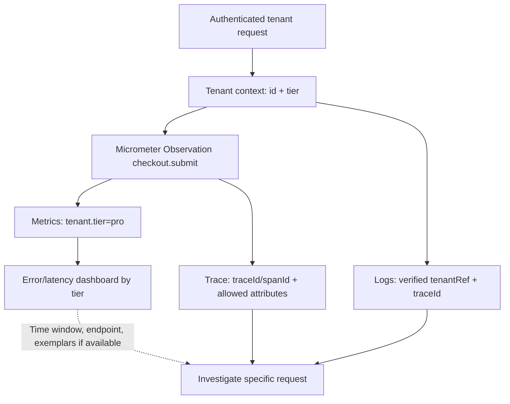
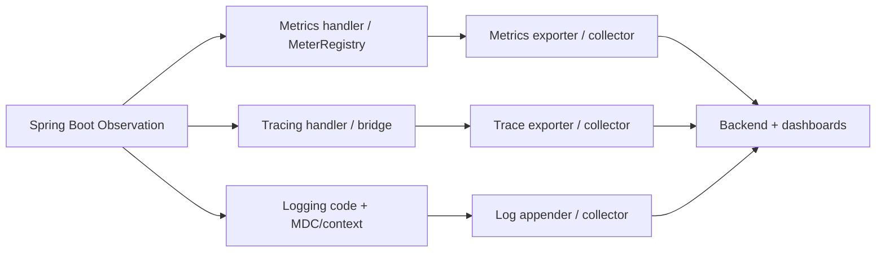

# Tenant tagging

> **Chapter:** Cardinality and metadata  
> **Module:** `SPRING_BOOT_OBSERVABILITY` — setting up observability for Spring Boot with Micrometer Observation, metrics, logs, and distributed tracing. This lesson focuses on attaching tenant information to investigate errors, latency, and application behavior, while controlling cardinality, context propagation, exporters, and sampling.

## Learning objectives

After this lesson, you will be able to:

- Explain what a **tenant tag** is in a multi-tenant application and identify the operational questions the tag must answer.
- Distinguish `tenant.id`, `tenant.tier`, `tenant.segment`, and related attributes by sensitivity, cardinality, and intended use.
- Estimate time series counts from label combinations; design a **cardinality budget** for metrics.
- Attach tenant-group tags to **Micrometer Observation** in Spring Boot using authenticated and normalized data.
- Know when to search for a specific tenant using **structured logs** or **tracing span attributes**, rather than putting tenant IDs into metrics.
- Verify context propagation, monitor exporters/sampling, and troubleshoot incidents such as time series explosions or wrong tenant labels.

## 1. The problem in a multi-tenant system

Suppose a SaaS application running on Spring Boot serves tens of thousands of businesses. Each business is a **tenant** with its own data, users, and access permissions. The system shares HTTP endpoints, connection pools, and downstream dependencies.

One day, the latency of `POST /orders` spikes. Looking at the overall chart, p95 latency increases from 300 ms to 1.8 seconds. The operations team asks:

- Is only the `enterprise` subscriber group affected, or `free` and `pro` as well?
- Is the issue tied to a deployment region, a plan tier, or all tenants?
- Can a specific customer reporting an error be supported via a run/request ID without inflating metrics costs?
- How do we distinguish a system-wide fault from an issue with one tenant's configuration or data?

**Tenant tagging** adds **grouping context** to observability signals. However, the tagging strategy must match the nature of each signal.

If you attach each customer's individual `tenant.id` to every metric, the number of time series can grow with the tenant count, bringing risks in storage, queries, cost, ingestion limits, and privacy. For metrics, the goal is usually **comparing tenant groups**; when investigating **a specific tenant**, use mechanisms with appropriate granularity and access control.

## 2. “Tenant tagging” can mean different things

In observability systems, terms like *tag*, *label*, *attribute*, or *field* are sometimes used interchangeably. They share the role of carrying metadata, yet differ in cost and usage.

| Signal | How metadata is attached | Question it should answer | Notes |
| --- | --- | --- | --- |
| **Metrics** | Labels/tags on time series | Does `enterprise` have a higher error rate than `free`? | Every label combination can create a new time series; prefer finite values. |
| **Distributed tracing** | Attributes on spans, baggage/context when configured | Why was a specific tenant's request slow at a dependency? | Can carry finer attributes, subject to cost, sampling, and access control. |
| **Logs** | Structured fields in event records | Which exception did tenant X's request hit, and when? | Requires collection policy, sensitive-data masking, retention limits, and query RBAC. |
| **Context propagation** | Context carried across requests/tasks/messages | Does work in service B belong to the tenant authenticated in service A? | Never confuse tracing context with proof of tenant authentication. |

**Micrometer Observation** is the common API layer for describing an operation. An observation can carry **low-cardinality key values** suitable for metrics and **high-cardinality key values** usable by tracing handlers when properly configured. That does not mean every key-value will appear in all three of metrics, logs, and traces.

### 2.1. Choosing keys with clear semantics

| Illustrative key | Values | Expected cardinality | Metric tag? |
| --- | --- | --- | --- |
| `tenant.tier` | `free`, `pro`, `enterprise`, `unknown` | Very low | **Yes**, when genuinely useful. |
| `tenant.segment` | `small`, `mid_market`, `large`, `unknown` | Low if normalized | **Yes**, per analytical need. |
| `tenant.region` | `ap_southeast`, `eu_west`… | Low if region groups are fixed | **Yes**, when region has operational meaning. |
| `tenant.isolation` | `shared`, `dedicated` | Low | **Yes**, if comparing resource tiers. |
| `tenant.id` | `tenant-9c3e...` | Can equal tenant count and keep growing | **Usually no**. |
| `tenant.name` | Free-form business name | Very high and potentially sensitive | **No**. |
| `user.id` | Tenant's user ID | Very high | **No**. |
| `customer.email` | Email address | Very high, personal data | **No**. |

Key names are illustrative conventions, not all default Spring Boot or OpenTelemetry semantic conventions. Within an organization, standardize names and semantics so services do not mix `tenant.plan`, `subscription`, and `tier` with incompatible value sets.

## 3. Cardinality: why is tenant ID a dangerous label?

**Cardinality** of a label is the number of distinct values the label can take. For time-series metrics, a time series typically corresponds to a combination of metric name and all labels.

Suppose a metric has:

- 3 values of `http.method`;
- 5 values of `http.route`;
- 4 values of `status.group`;
- 3 values of `tenant.tier`.

The maximum number of combinations for these four labels is:

\[
3 \times 5 \times 4 \times 3 = 180
\]

This is an **estimate of label combinations** in the example, not an assertion that the system always produces all 180 series. Some combinations will never happen. On the other hand, histogram buckets, instance count, deployment regions, and extra labels can make the actual series count significantly larger.

If you replace `tenant.tier` with `tenant.id` across 20,000 tenants, just the illustrative combination grows to:

\[
3 \times 5 \times 4 \times 20\,000 = 1\,200\,000
\]

That number is the potential combinations for **one metric type and hypothetical label set**, before counting other metrics or histogram time series. A system with 20,000 tenants will not necessarily materialize every combination; however, the growth risk is clear.

### 3.1. Consequences of high cardinality

- **Application:** the meter registry has to manage more meters and label sets, raising CPU/memory overhead.
- **Collector/backend:** time series count and sample rate climb, risking quota breaches, ingestion rejections, or higher storage bills.
- **Queries/dashboards:** grouping queries slow down, charts become unreadable, and alerts misfire on sparse/unstable data.
- **Operations:** as customer count grows, telemetry costs escalate unpredictably.
- **Security:** exposing tenant identifiers to a shared metrics backend can leak customer structure or access-restricted data.

**Principle:** metric tags must support meaningful aggregation and have a **controlled value set**. A unique identifier per tenant usually serves *event lookup*, not *aggregation*.

### 3.2. Defining a label budget

Before adding a tenant label, document:

1. Which **operational question** does that label answer? If there is no specific dashboard, alert, or comparison needing it, do not add it yet.
2. Do values come from an **enum/finite convention** or arbitrary input?
3. How many values exist today, and what is the maximum in 6–12 months?
4. How many other labels is it combined with, especially `uri`, `instance`, `status`, and histogram buckets?
5. What **cardinality/cost limits** exist in `MeterRegistry` and the backend, and who monitors them?
6. Can logs, traces, or queries over business data satisfy the detailed requirement instead?

An internal budget table might look like this:

| Label | Allowed values | Control ownership |
| --- | --- | --- |
| `tenant.tier` | `free`, `pro`, `enterprise`, `unknown` | Billing/domain team provides the canonical mapping. |
| `tenant.region` | Approved deployment region list | Platform team manages region configuration. |
| `tenant.segment` | Agreed finite segments | Product and SRE standardize values. |
| `tenant.id` | Not used on shared metrics | Investigated via RBAC-protected logs/traces. |

Do not force all of these labels onto every metric. Every label adds dimensionality; keep only dimensions required for operational decisions.

## 4. Tenant identification must come from a trusted source

The question is not only *does the tag have low cardinality*, but also *does the tag identify the right tenant*.

For example, a client sends a header:

```http
X-Tenant-ID: tenant-enterprise-01
```

If a service blindly trusts this header to attach metadata, a user can spoof another tenant. A `tenant.tier=enterprise` metric would then reflect client-asserted values rather than verified entitlements.

The **right source** should be the tenant context established by the authentication/authorization layer or a trusted gateway and checked against the account/tenant the request is permitted to access.

A sound flow:

1. Authenticate the principal or workload identity.
2. Resolve the tenant the principal is authorized to act on, or the background job's tenant from trusted configuration.
3. Map the tenant to a **normalized tier/segment/region**.
4. Attach the normalized metadata to the observation when measuring.
5. Never use telemetry fields to make authorization decisions or decide which tenant owns data.

**Tracing context such as `traceparent` does not replace authentication context.** It links spans; it does not prove a request is authorized to access tenant data. Baggage can also be supplied by external sources; inspect it at trust boundaries before trusting or using it in business logic.

### 4.1. Handling unknown tenants

Cases like health checks, background workers, unauthenticated rejected requests, or system-level jobs may lack a valid tenant. Never let free-form request values create new tags.

Use a fixed default label such as `unknown` or `system`, with clearly defined semantics. Depending on the metric type, sometimes it is better **not to attach a tenant tag** to system work rather than forcing every activity into a tenant bucket.

Distinguish:

- `unknown`: the system could not determine a trustworthy grouping;
- `system`: work not belonging to a specific tenant, if that category is defined;
- `free`: an authenticated tenant on the free plan.

Lumping missing context into `free` just to reduce label counts will distort metrics.

## 5. Spring Boot example: attaching `tenant.tier` to a custom observation

The example below illustrates a Spring Boot service measuring `checkout.submit`. The tenant tier comes from an **application-implemented provider after authentication**, then maps to one of four stable values.

### 5.1. Defining the allowed value set

```java
package example.observability;

import java.util.Locale;

public enum TenantTier {
    FREE, PRO, ENTERPRISE, UNKNOWN;

    public String metricValue() {
        return name().toLowerCase(Locale.ROOT);
    }
}
```

An interface representing reading the verified tenant tier:

```java
package example.observability;

public interface TrustedTenantMetadataProvider {
    // Implementation must read authenticated/authorized tenant context.
    // May return UNKNOWN if the request/job has no valid tenant.
    TenantTier currentTenantTier();
}
```

This is an **illustrative contract**. Spring Boot does not auto-provide a `TrustedTenantMetadataProvider` bean of this name. In a real project, implement it using your security context, authenticated session, or trusted batch-job configuration source. Never return a tier by trusting a client-sent header directly.

### 5.2. Creating an observation for a business operation

```java
package example.observability;

import java.util.function.Supplier;

import io.micrometer.observation.Observation;
import io.micrometer.observation.ObservationRegistry;
import org.springframework.stereotype.Service;

@Service
public class TenantCheckoutObservation {
    private final ObservationRegistry registry;
    private final TrustedTenantMetadataProvider tenantMetadata;

    public TenantCheckoutObservation(
            ObservationRegistry registry,
            TrustedTenantMetadataProvider tenantMetadata) {
        this.registry = registry;
        this.tenantMetadata = tenantMetadata;
    }

    public <T> T observeSubmit(Supplier<T> action) {
        TenantTier resolved = tenantMetadata.currentTenantTier();
        String tier = resolved == null
                ? TenantTier.UNKNOWN.metricValue()
                : resolved.metricValue();

        return Observation.createNotStarted("checkout.submit", registry)
                .contextualName("submit checkout")
                .lowCardinalityKeyValue("tenant.tier", tier)
                .lowCardinalityKeyValue("operation", "submit")
                .observe(action);
    }
}
```

Used inside a tenant-authenticated flow like this:

```java
String orderId = tenantCheckoutObservation.observeSubmit(
        () -> checkoutService.placeOrder(command));
```

`checkoutService` and `command` represent application business components, not variables provided automatically by Spring Boot.

Explanation:

1. `TrustedTenantMetadataProvider` supplies a trustworthy tier, separating authentication logic from measurement logic.
2. `TenantTier` is an enum so the tag value set is finite; when unresolved, it falls back to `unknown`.
3. `Observation.createNotStarted("checkout.submit", registry)` keeps the name stable across tenants.
4. `lowCardinalityKeyValue("tenant.tier", tier)` lets a configured metrics handler aggregate by tier.
5. `observe(action)` manages the start/scope/error/stop lifecycle for a **synchronous operation**; if the action throws an exception, error events can be recorded by observation handlers.
6. When a tracing handler is active, the observation can produce an appropriate span or metadata and link to the current request via scope/context propagation.

**Note:** actual metric names and attributes exported to the backend depend on Micrometer handlers, conventions, registries, and exporters. This snippet alone does not guarantee data reaches Prometheus or a tracing backend.

### 5.3. Why not use tenant ID as a low-cardinality tag?

Avoid code like this:

```java
// Do not do this on shared metrics:
// tenantId is unique per tenant and grows with customer count.
Observation.createNotStarted("checkout.submit", registry)
        .lowCardinalityKeyValue("tenant.id", tenantId)
        .observe(action);
```

Naming the method `lowCardinalityKeyValue` does not verify whether the value set is actually small. **The instrumentation author is responsible** for ensuring the key has low cardinality.

If you need to investigate a specific tenant, consider a high-cardinality tracing attribute or log field **after evaluating access controls, storage, and data sensitivity**. Use only verified IDs; do not attach tenant IDs to every span by default without a clear need and policy.

## 6. Framework metrics vs. business metrics

The `checkout.submit` example above is a **custom observation**. Most systems also want to break down Spring Boot's HTTP server metrics by tenant group.

Different signal types require choosing where to attach metadata:

| Measurement scope | Approach | Notes |
| --- | --- | --- |
| Business custom observation | Attach `tenant.tier` when creating the observation in the service | Direct control over name, context, and tags. |
| Spring Boot-created HTTP server observation | Use convention/filter/context per version and instrumentation layer | Metadata must come from an authenticated source; avoid reading tenant context too late. |
| Meter created directly via `MeterRegistry` | Attach normalized tags when registering/creating the meter | Does not automatically inherit tags from the Observation API. |
| Event logs | Put valid tenant context into structured logging/MDC when logging | Does not appear automatically just because an observation has `tenant.tier`. |
| Tracing spans | Add attributes via appropriate tracing instrumentation | Must account for span creation timing, sampling, exporter, and access permissions. |

**Not every framework-emitted metric automatically carries a tenant tag.** The custom observation above does not modify all HTTP server metrics, JVM metrics, or connection pool metrics.

For HTTP metrics, consider `ServerRequestObservationConvention` or an extension mechanism suited to your Spring Boot/Micrometer version to add labels from authenticated request context. If using `ObservationFilter`, note that it runs as the observation prepares to stop, so metadata must still be present in the context at that point. Do not assume reading `SecurityContextHolder` or `ThreadLocal` from a filter at stop time always works, especially under async execution.

A **global common tag** like `deployment.environment=production` can apply to every meter. However, `tenant.tier` is a **per-request/job** attribute, so it must not be set as a fixed global common tag on a shared `MeterRegistry`. That confuses application-level metadata with request-level metadata.

## 7. A protective guardrail with `MeterFilter`

Even when code normalizes tiers, add a monitoring and limiting layer if the system permits customizable labels. Micrometer Metrics provides `MeterFilter` to govern meter IDs at the metrics layer.

Example Spring Boot bean limiting the number of **distinct values** of `tenant.tier` for meters whose names start with `checkout.submit`:

```java
package example.observability;

import io.micrometer.core.instrument.config.MeterFilter;
import org.springframework.context.annotation.Bean;
import org.springframework.context.annotation.Configuration;

@Configuration(proxyBeanMethods = false)
public class TenantMetricGuardConfig {

    @Bean
    MeterFilter tenantTierLimit() {
        return MeterFilter.maximumAllowableTags(
                "checkout.submit",
                "tenant.tier",
                4,
                MeterFilter.deny());
    }
}
```

Meaning:

- `maximumAllowableTags` limits the number of accepted **tag values** for the specified meter name scope.
- `MeterFilter.deny()` is the action taken when exceeding the threshold; new meters with unaccepted values can be denied, leading to **missing metrics for the over-limit group**.
- This is a **safety guardrail against misconfiguration**, not a substitute for normalizing input data.
- The meter name prefix must match the meter actually created by handlers/registries. Check the real meter name in your application/registry.
- This limit **does not automatically bound total series count** caused by products of other labels, histograms, or multiple meter names.

If a system defines 4 tiers and begins seeing a 5th value, investigate why: is there a new tier missing from the convention, malformed formatting, or client input leaking into tags?

When `MeterFilter` denies data, ensure you can detect it via instrumentation checks, meter counts, config logs, or metric pipeline alerts. Never treat a flat chart after denial as proof that an incident is over.

## 8. Using logs and traces to investigate a specific tenant

A customer support question might be: “Why did tenant `tenant-83d` get a payment error at 10:25?” This is a query for **a specific entity**, unlike error stats grouped by tier.

### 8.1. Structured logs with a verified identifier

Example log record designed for searching:

```json
{
  "timestamp": "2026-11-22T03:25:40Z",
  "level": "ERROR",
  "service": "checkout-service",
  "event": "payment.timeout",
  "tenantTier": "pro",
  "tenantRef": "tenant-83d",
  "traceId": "24a3af941a324e03b2f47e90b512a083",
  "spanId": "a9f16d0453a92130",
  "dependency": "payment-provider",
  "durationMs": 3000
}
```

`tenantRef` here is a verified identifier approved for recording under internal policy. In high-security systems, you may need an alternate/pseudonymous lookup ID and tenant-scoped query authorization.

Do not let sensitive information such as tokens, passwords, emails, or invoice payloads enter logs simply to attach tenant context.

### 8.2. Trace ID to connect processing steps

A trace might look like:

```text
Trace 24a3af941a324e03b2f47e90b512a083
POST /orders                     3.2 s
└── checkout.submit              3.1 s
    └── payment.authorize        3.0 s  ERROR (timeout)
```

In this model:

- `traceId` identifies a distributed trace; `spanId` identifies an operation.
- `tenant.tier` helps clarify the tenant group inside the trace when handlers forwarded the metadata.
- `tenantRef` or a high-cardinality attribute can be added **selectively** to traces to aid search, once a data policy is in place.
- Traces may be **sampled**; not every request will have a trace in the backend.

If a user provides a support code, the team can search logs by request/correlation ID, grab `traceId` from the logs, and open the corresponding trace if collected. Metric exemplars on supporting backends can navigate from a chart data point to a trace. Never add trace IDs to metric labels to mimic exemplars.

### 8.3. Logs, spans, and metrics operate at different aggregation levels



The diagram shows the distinct purposes: **metrics keep dimensionality controlled**, while logs/traces support detailed correlation under strict access scopes.

## 9. Propagation in a multi-tenant system

A request may flow from `api-gateway` to `order-service`, `payment-service`, and then publish a message to `invoice-worker`.

For consistent observability:

1. **Secure identity/tenant context:** the receiver must verify tenant authorization or trust data supplied by an authenticated internal component under a security contract. Tracing headers alone do not prove a valid tenant.
2. **Propagate trace context:** use HTTP client/server integrations or messaging instrumentation supporting header injection/extraction like W3C `traceparent`, so spans along the journey stay linked.
3. **Propagate tenant metadata when needed:** pass `tenant.tier` or a tenant reference through an agreed mechanism, avoiding putting sensitive data into default baggage. Receivers must revalidate trust and usage scope.
4. **Preserve context across async boundaries:** when using `@Async`, `Executor`, `CompletableFuture`, or Reactor, use compatible context propagation to restore tracing/logging and tenant context on the worker thread.
5. **Limit data across boundaries:** do not blindly forward all baggage or custom headers to external partners; transmit only metadata permitted by contract and security policy.

For example, a queued message processed an hour later may start a new trace; correlation/workflow IDs connect business stages, while trace IDs describe the execution path within each trace. A `tenant.tier=pro` tag on a metric is not enough to identify that two messages belong to the same specific tenant.

### 9.1. Avoid confusing context with authorization

Suppose `tenant.tier=enterprise` arrives in client-sent baggage. If the backend uses it to grant enterprise features, that is a design bug. Baggage is **metadata for context/observability**, not proof of a service plan.

Especially in multi-tenant systems, ensure telemetry data for tenant A cannot be queried unauthorized by users from tenant B. Logging a tenant ID for troubleshooting does not automatically enforce access control in the log backend.

## 10. Exporters, sampling, and limits of tenant-scoped information

To capture useful information, an application needs a complete pipeline:



Important limitations:

- **Metrics handler and exporter:** an observation with the right tag still does not guarantee you see the metric in Prometheus or another backend. You need the right registry, endpoint/exporter, scrape/collector, and query with the exact meter name.
- **Tracing sampling:** at 10% sampling probability, a low-traffic tenant group might have almost no retained traces even when real errors happen. Choose a sampling strategy suited to investigative needs and cost.
- **Tag attachment timing:** if metadata is only added to the observation near `stop()`, handlers that ran on `onStart` or logs emitted earlier will miss the tag; attach early where needed.
- **Context propagation:** a service that loses tenant context may record `unknown` despite a valid request. A spike in `unknown` may indicate a propagation or resolution bug rather than customers switching to a new tier.
- **Collector/backend:** ingestion caps, drop rules, or export failures can create data gaps. Missing signals do not prove an operation never occurred.

In multi-tenant products, **outcome-based or tenant-specific sampling** can introduce bias if you infer error rates from traces. Use complete, well-defined metrics for trend analysis; sampled traces are better suited for illustrating and debugging individual request paths.

### 10.1. Starter Spring Boot configuration example

When the project already includes Actuator, a Micrometer registry, and compatible tracing integration:

```yaml
spring:
  application:
    name: checkout-service

management:
  endpoints:
    web:
      exposure:
        include: health,info,prometheus
  tracing:
    sampling:
      probability: 0.1
```

`/actuator/prometheus` is only available when the corresponding Prometheus registry is present and the endpoint is exposed. `sampling.probability` in compatible configurations adjusts trace sampling, without directly reducing metric cardinality.

Actuator endpoints must be secured appropriately per environment. Access to metrics, logs, and traces must also account for the fact that data may carry multi-tenant information.

## 11. When per-tenant metrics are truly required

There are legitimate requirements, such as dedicated SLO contracts for enterprise accounts. In such cases, “do not use tenant ID as a label” is the **safe default**, but the final decision must weigh scale, goals, budget, and security model.

Options:

| Option | Best suited when | Trade-offs |
| --- | --- | --- |
| **Metrics by tier/segment** | Comparing broad customer groups | Cannot query details for a single tenant. |
| **Controlled logs/traces with tenant ID** | Incident investigation for a specific tenant | Queries cost more; subject to sampling and retention. |
| **Per-tenant aggregates from business data** | Accurate per-tenant SLA/billing reports | Needs a separate data pipeline and access controls, not necessarily runtime metrics. |
| **Allowlisted & quota-capped per-tenant metrics** | Only a few contractual tenants need deep monitoring | Requires managing allowlists, caps, tenant lifecycle changes, and cardinality budgets. |
| **Dedicated pipeline/namespace for a tenant group** | Telemetry isolation or specialized ops required | Increases deployment complexity, cost, and governance. |

If you choose per-tenant metrics, establish allowlist entry/exit criteria, cap the number of tenants and total time series, avoid customer names in labels, enforce query RBAC, handle cleanup/migration when tenants change, and define quota-exceeded behavior. Never attach `tenant.id` to every metric by default and hope the backend handles the load.

**SLO accuracy:** sampled traces and logs can drop events. For contracts demanding exact per-tenant figures, design an accurate, auditable measurement source rather than deriving SLA percentages from sampled traces alone.

## 12. Incident investigation: is only the enterprise tier slow?

**Scenario:** after a new release, several enterprise customers report slow order creation. The overall chart increases only slightly.

Workflow:

1. **Check metrics by group:** inspect throughput, error rate, and latency of `checkout.submit` or instrumented HTTP routes broken down by `tenant.tier`. Compare `free`, `pro`, `enterprise`, and `unknown`.
2. **Check load shifts:** does the enterprise group differ in traffic volume, order size, processing type, or region distribution from other groups? A higher p95 alone does not prove an enterprise-specific code bug.
3. **Filter RBAC-protected logs:** for the reporting tenant, retrieve the request ID/correlation ID and check log events, timestamps, trace IDs, and involved dependencies.
4. **Open sampled traces:** identify which step consumes time, such as DB, inventory, or payment. If no trace exists, continue with logs and metrics; sampling may have dropped it.
5. **Check tenant context and propagation:** compare tags across services, especially if one service switches to `unknown` or gets the wrong tier across async/queue boundaries.
6. **Cross-check other data sources:** connection pools, shards, cache hit ratios, retries, deployed versions, and enterprise-tier configurations.
7. **Verify after fixing:** monitor latency, error rate, and throughput by tier; ensure no high-cardinality metric tags were added during diagnostics.

**Well-supported conclusion:** “The `enterprise` group has elevated latency in the payment step; retained traces show slow provider calls, logs for affected requests record timeouts, and dependency metrics show matching latency spikes in the same window.” This investigative finding is backed by multiple signals, though it does not prove root cause until network, config, and dependency behavior are checked.

**Unsupported conclusion:** “No trace was found for tenant X, so that tenant never sent a request.” The trace may have been sampled out, uninstrumented, or dropped by the exporter.

## 13. Common errors and how to fix them

| Symptom | Possible cause | What to check |
| --- | --- | --- |
| Time series count grows with tenant count | `tenant.id` or dynamic values used as metric labels | Switch to finite tier/segment; review MeterRegistry and backend limits. |
| Unusual spike in `unknown` group | Tenant resolution or context propagation bug | Check security context, async/queue boundaries, and tag extraction timing. |
| `enterprise` label appears on unauthorized requests | Trusting client-supplied headers/baggage | Derive tier from authenticated, authorized tenant context. |
| `tenant.tier` missing from HTTP metrics | Tag only attached in custom observation | Add instrumentation/convention at HTTP scope; verify meter name. |
| Logs lack tenant ID while metrics have tier | Logging context unset or logged too early | Populate structured fields/MDC before logs are emitted. |
| Trace found without tenant attribute | Handler read metadata before tag was added, or exporter filtered attributes | Check tag attachment timing, handlers, sampling, and backend. |
| `MeterFilter` cap drops new series | `deny` filter triggered when tag values exceed limit | Investigate unexpected labels, update convention/mapping; monitor drops. |
| Dashboard shows wrong tier after plan change | Tag read from stale cache or inconsistent tier across services | Check source of truth, cache TTL, and when tier updates take effect. |
| Unauthorized tenant ID found in external telemetry | Missing data policy/trust boundary | Redact/drop, restrict exports, and audit query permissions. |
| Tenant p95 fluctuates wildly at low request counts | Low sample count over a short window | Check sample counts, observation window, and distribution before concluding. |

## 14. Verification lab

### 14.1. Scenario

Prepare a Spring Boot service with `ObservationRegistry` and an appropriate metrics registry. Simulate authenticated requests across four groups:

```text
free       100 requests
pro        100 requests
enterprise 100 requests
unknown     10 requests  (simulating workload with undetermined tier)
```

Follow these steps:

1. Use the `TenantTier` enum and `TenantCheckoutObservation` as shown above. Confirm metrics for `checkout.submit` carry `tenant.tier` values within the defined set.
2. Send many new requests with **different tenant IDs** in the same tier. Ensure the number of `tenant.tier` values does not grow with tenant count.
3. Trigger an error request. Log request ID/trace ID in an authorized flow and verify matching metadata reaches the backend.
4. Change a tenant from `pro` to `enterprise` in the trusted data source. Confirm tags on **new observations** reflect the new tier; historical metrics still reflect values emitted earlier.
5. Simulate a request without valid tenant context. Verify it is classified as `unknown` or rejected per application policy; never trust client-supplied tier values.
6. If tracing is enabled, inspect spans, tags, and log correlation on a collected trace; explain why some requests may have no trace when sampling is on.
7. Check time series/tag counts in the metrics backend and observe how `MeterFilter` behaves when values exceed the limit; keep test traffic isolated from production data.

**Success criteria:** you demonstrate that metric tags have a finite value set, tenant IDs do not appear in metric labels, tenant context comes from an authenticated source, traces/logs correlate properly when configured and authorized, and you can detect spikes in `unknown` labels or missing telemetry.

### 14.2. Self-check questions

**Question 1.** With 30,000 tenants, why is `tenant.id` usually unsuitable as a metric tag?  
**Hint:** Each tenant produces a distinct value, causing time series combinations to surge when multiplied by route, status, instance, and histogram buckets.

**Question 2.** Can `tenant.tier` be used in metric tags?  
**Hint:** Yes, if the tier set is standardized, finite, genuinely useful for analysis, and total cardinality stays within budget.

**Question 3.** If a client sends header `X-Tenant-Tier: enterprise`, should it be used immediately to classify metrics?  
**Hint:** Never trust it directly. Derive the tier from authenticated and authorized tenant context.

**Question 4.** Does `highCardinalityKeyValue("tenant.id", id)` guarantee that the tenant ID is written to logs?  
**Hint:** No. The Observation API does not emit logs on its own. Forwarding to tracing depends on handlers/bridges; logs must be written through a separate logging mechanism.

**Question 5.** Does a `MeterFilter` blocking a 5th `tenant.tier` value completely eliminate the risk of metric explosion?  
**Hint:** No. Other labels, histograms, and multiple meter names can still grow series counts; plus, denial risks dropping new data.

**Question 6.** If no trace exists for an enterprise tenant request, can you conclude the request never happened?  
**Hint:** No. It could be due to sampling, exporter, collector, instrumentation, or propagation issues.

**Question 7.** Why shouldn't `tenant.tier` be configured as a fixed global common tag on `MeterRegistry` in a shared multi-tenant system?  
**Hint:** Tier varies per request/job, whereas common tags describe metadata shared across the entire registry/process.

**Question 8.** If a request passes through a queue and tenant context is lost, what can happen to metric tags?  
**Hint:** The receiving service may record `unknown` or misclassify it; context propagation/restoration is needed, while still validating authorization and trusted data sources.

**Key point to remember:** Tenant tagging in Spring Boot should start with **operational questions and a cardinality budget**. Use `tenant.tier`, `tenant.segment`, or finite groups for metrics when beneficial; use RBAC-protected logs/traces to trace specific tenants. Micrometer Observation helps attach context to operations, yet the accuracy of the whole system also depends on identity/tenant resolution, context propagation, how handlers read metadata, exporters, sampling, and observability backend limits.
